**Goal**: buy material, supplies or subcontracting while keeping a record of each
step, and only pay for what was ordered **and** received.

> 💡 Screenshots show the French interface; button names are given as they appear in the English interface.

**Example used**: the sheet metal shop asks Aciers de l'Ouest for a quote for 4 sheets of 8 mm and
6 sheets of 3 mm, negotiates the price of the 8 mm sheet, requires a material certificate, places
the order, records the supplier's acknowledgement, receives the goods, then records the supplier's invoice.

## Before you start

- You need the **Purchase** permission ("Purchase" menu).
- A **unit** and a **default VAT rate** must exist (see the Methods guide).
- To buy a catalogue item rather than a free line: the item must be
  set to **Purchased = Yes**, with the supplier in its **Preferreds suppliers**.

<!-- feature: qualified-supplier -->
- Your company requires **qualified suppliers**: a purchase order is only accepted for a
  supplier whose latest evaluation is "Approved" and whose review date has not passed. See
  the "Qualified suppliers" guide. To order from a supplier that is not qualified anyway,
  you need the override permission (step 3.1).
<!-- /feature -->

## Overview

```steps
Supplier
Request for quotation
Purchase order
Supplier acknowledgement
Receipt
Supplier invoice
```

Each document is created **from the previous one**. The "Purchase" menu follows the same
order. Its counters show what is left to do: "Waiting to receipt" counts the lines not yet
fully received, "Waiting to invoice" the received lines not yet invoiced, "Orders without
ack." the orders still waiting for the supplier's acknowledgement.

> 💡 In a hurry? You can skip the request for quotation: **Purchase list** menu, list tab,
> "New purchase document" button.

---

## 1. Set up the supplier

A supplier is a third party like any other (**Third party** menu, "New third party"). Three
settings make it usable in purchasing.

**1.1 Activate it as a supplier.** "Detail" tab of the record: set **Status
supplier** to "Active", then click "Update".

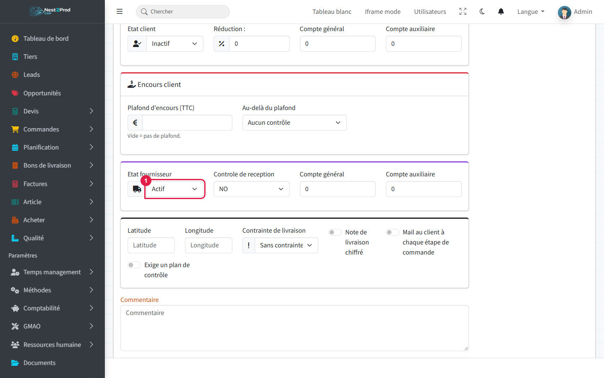

> ⚠️ An "Inactive" supplier does not appear in **any** purchasing list.

**1.2 Its default address.** "Address" tab: enter the address and **tick
"By default"**.

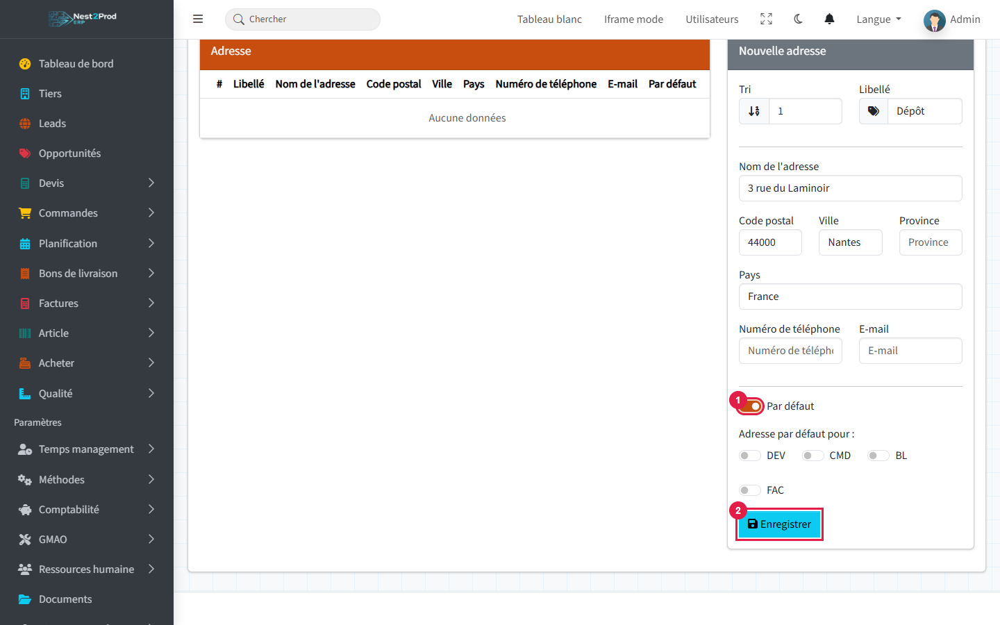

**1.3 Its default contact.** "Contacts" tab: title, first name, last name, e-mail (to
send them documents) and **tick "By default"**.

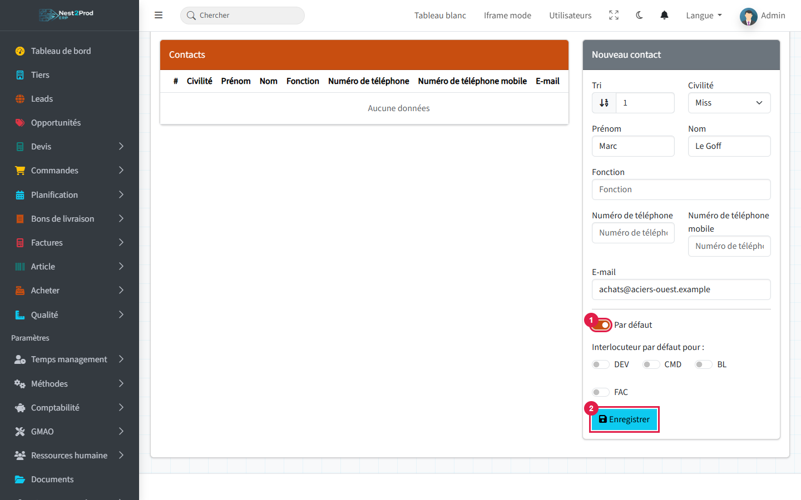

> ⚠️ Without a "By default" address **and** contact, creating a request for quotation and
> turning it into an order fail: they are the ones copied onto the documents.
>
> 💡 "Reception control" = Yes (Detail tab) requires an inspection at every
> receipt from this supplier.

<!-- feature: qualified-supplier -->
> ⚠️ A brand-new supplier is **"Not qualified"**: it has no evaluation yet. But the formal
> evaluation ("Supplier evaluations" tab of its record) is attached to one of its purchase
> orders. Its very first order therefore goes through an override (step 3.1); evaluate it
> afterwards for the next orders.
<!-- /feature -->

---

## 2. Ask the supplier for a quote: the request for quotation

### 2.1 Start from the "Purchase request" screen

**Purchase › Purchase request** menu. The table lists the **needs from customer orders**:
material and subcontracting planned in the routings, not yet purchased.

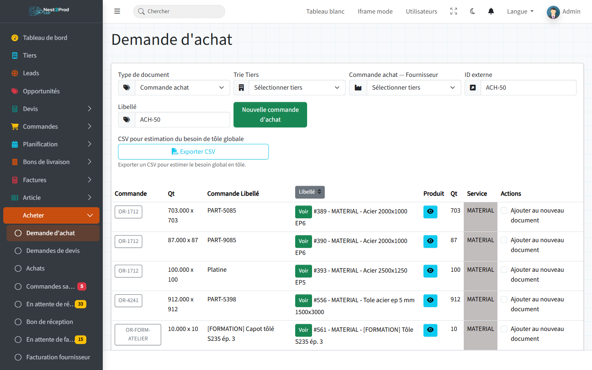

1. **Document type**: "Purchase quotation" to ask for a quote, or "Purchase Order" to
   order directly.
2. **Select suppliers**: one or more. Each supplier receives its
   own request for quotation, so you can compare them.
3. **Label** of the request.
4. Tick the needs concerned ("Add to new document"), then click
   "New purchase document".

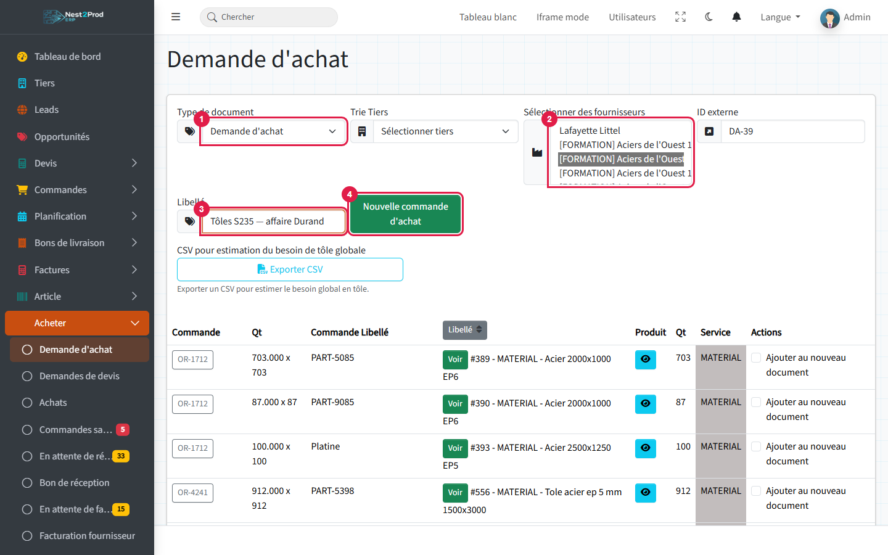

> 💡 If you tick nothing, you create an empty request for quotation, to fill in afterwards.
> This is the case in our example.
>
> 💡 On the operator screen, a **subcontracting** operation shows a
> "New purchase document" button instead of Play: it takes you to this screen.

<!-- feature: qualified-supplier -->
> 💡 A **request for quotation** is never blocked, even for a supplier that is not
> qualified: only the order is. A "Not qualified" badge is shown next to these suppliers
> in the lists.
<!-- /feature -->

### 2.2 Add the lines

"Purchase quotation lines" tab. For each line: **Description**, **Qty** (0 by default,
to fill in) and **Unit Price** (the expected price, or 0), then "Submit". The
"Product" field picks an item from the catalogue.

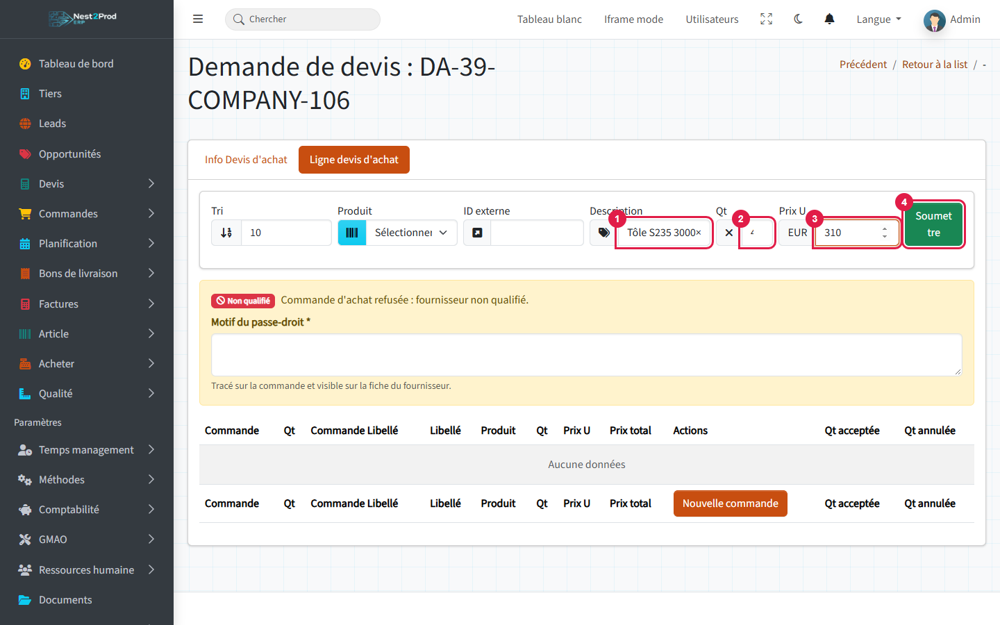

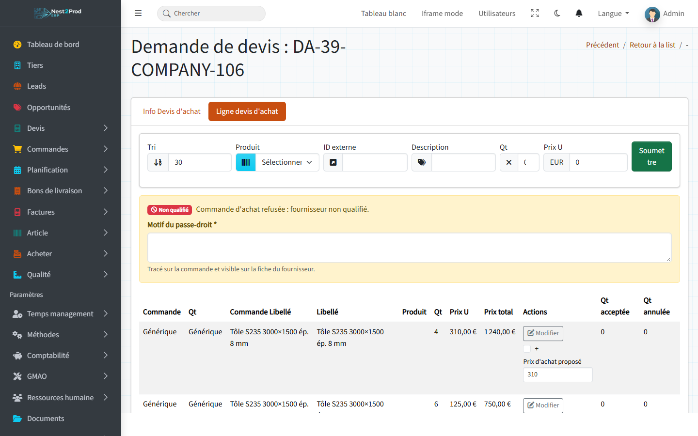

> ⚠️ Lines can only be changed while the request is **"En cours" (In progress)**.
> Complete them before sending it.

### 2.3 Send the request

"Purchase quotation info" tab, **Options** card: "PDF" to print or save it,
"E-mail" to send it to the supplier's contact. Then set the request to
**"Envoyé" (Sent)** by clicking the matching step at the top.

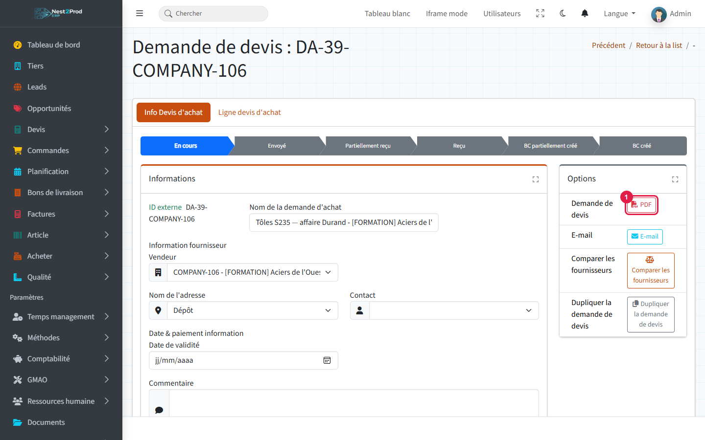

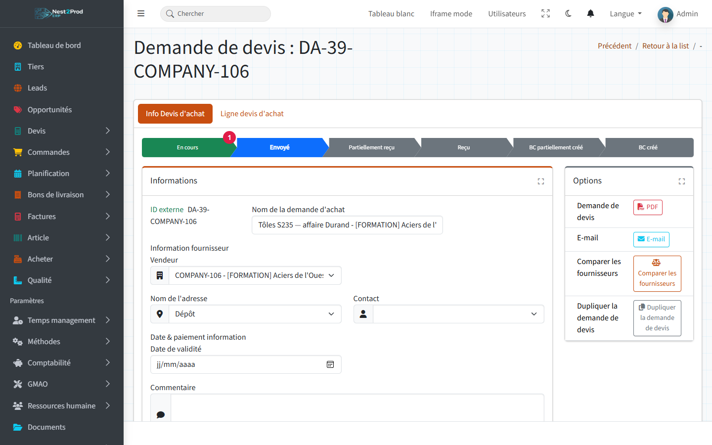

> 💡 The PDF button only appears if the request has an address and a contact.
> "Compare suppliers" shows the answers to the same request side by side.

---

## 3. Order

### 3.1 Turn the request for quotation into an order

When you receive the offer, "Purchase quotation lines" tab:

1. Enter the **Proposed purchase price** from the supplier, line by line (here €295
   instead of €310 for the 8 mm sheet).
2. Tick the lines you keep ("+" box).
3. Click "New order".

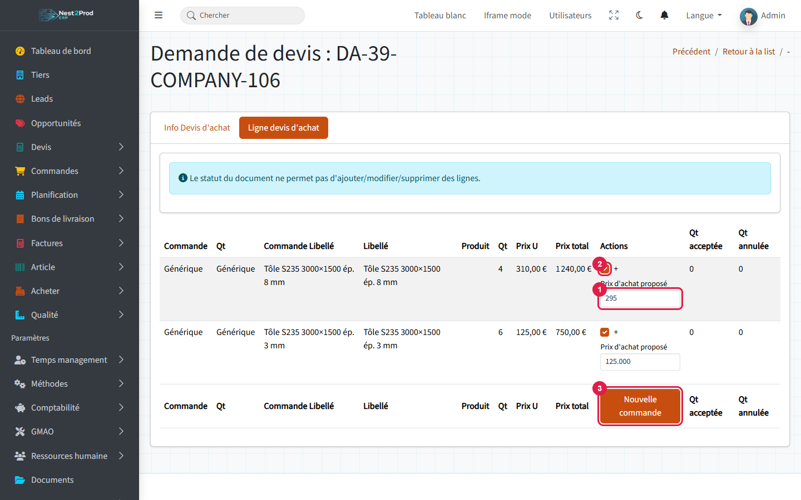

<!-- feature: qualified-supplier -->
If the supplier is not qualified, a yellow box says so above the lines: "Purchase order
refused: supplier not qualified". If you have the override permission, enter the
**Override reason** before clicking "New order". The reason is recorded on the order and
on the supplier's record, and applies to **this order only** (including its move to
"Ordered").

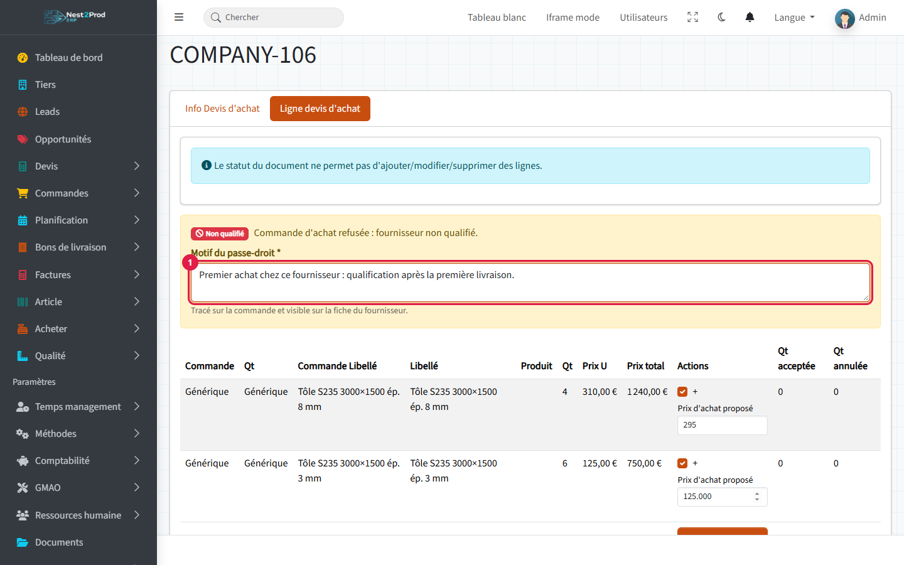

> ⚠️ Without this permission, the box tells you that you cannot order from this supplier:
> have it qualified, or ask a manager to place the order.
<!-- /feature -->

The purchase order is created with the negotiated price of each ticked line, and the
supplier's **default** address and contact (those from step 1).

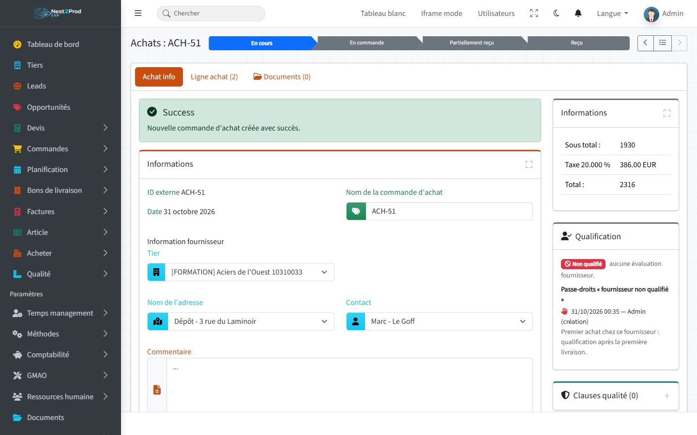

> ⚠️ If no line is ticked, no order is created: check the boxes.

### 3.2 Check the lines: requested date and quality requirements

"Purchase lines" tab: check quantities, prices and discounts. The **"Ajouter" (Add)** button, on the
right edge, adds a line.

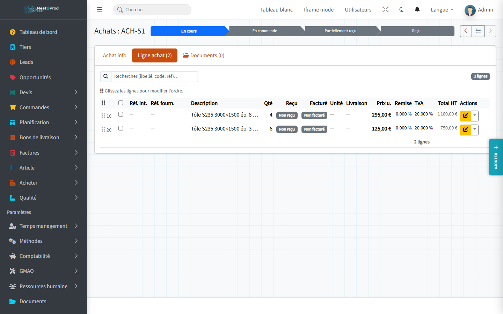

The yellow "Modifier" (Edit) button of a line opens its details:

1. **"Date livraison prévue" (Planned delivery date)**: the date you ask the supplier for.
   It is used to measure their delays.
2. **Purchase criticality**: **Certificate** (EN 10204: 2.1, 2.2, 3.1, 3.2), **Construction
   code** and **Level**, if the part requires it. For a catalogue item, these fields are
   copied from its record and can still be changed here.
3. "Enregistrer" (Save).

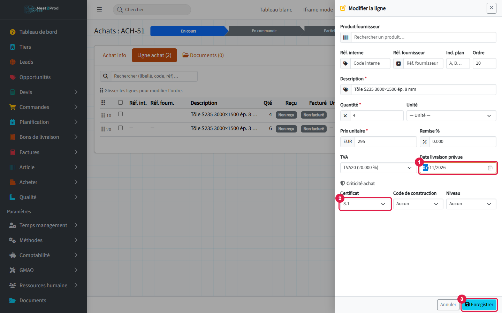

### 3.3 The order's quality clauses

Depending on the criticality of the lines, **quality clauses** are added to the order:
"Quality clauses" card of the "Purchase info" tab. Here, the required 3.1 certificate adds
the "Certificat 3.1" clause. These clauses are **printed at the end of the purchase
order PDF**.

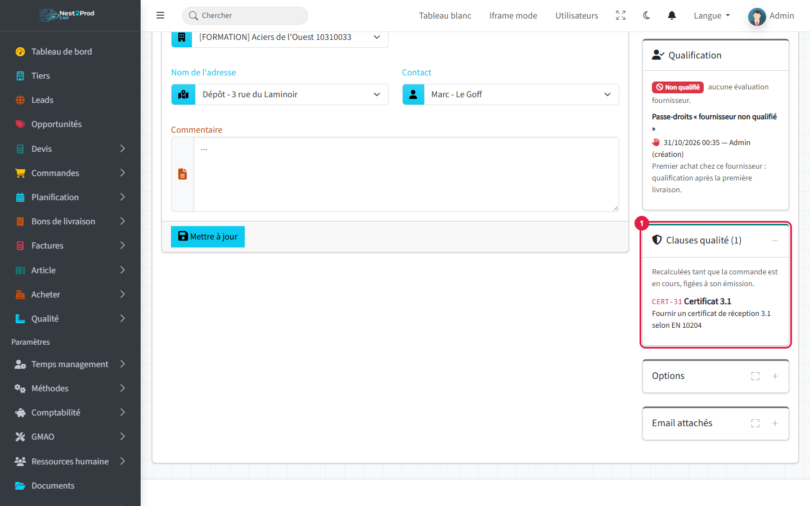

While the order is "In progress", the clauses are recalculated each time the lines change;
they are **frozen** as soon as the order moves to "Ordered".

Texts and their rules are managed in **Purchase › Quality clauses** (restricted
permission): a rule applies when **all** its filled-in criteria match a line; a criterion
left on "Any value" accepts anything.

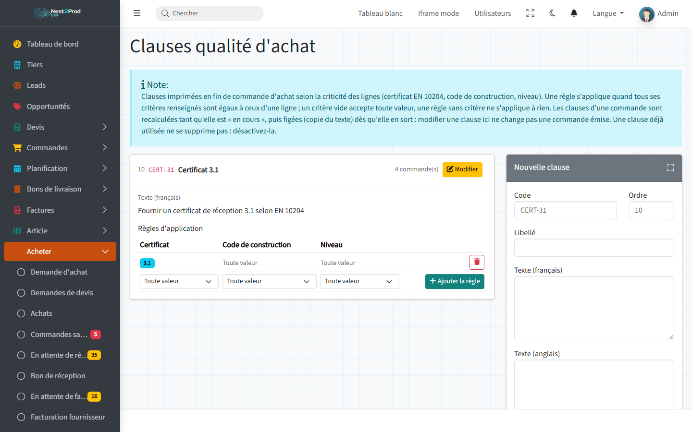

> 💡 Changing a clause does not change orders already issued. A clause already used
> cannot be deleted: untick "Active".

### 3.4 Send the order

Send the order to the supplier from the **Options** card (PDF or e-mail), then
set it to **"Ordered"**.

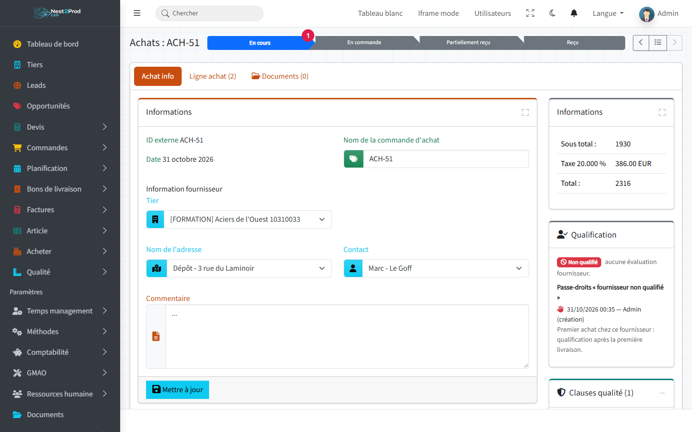

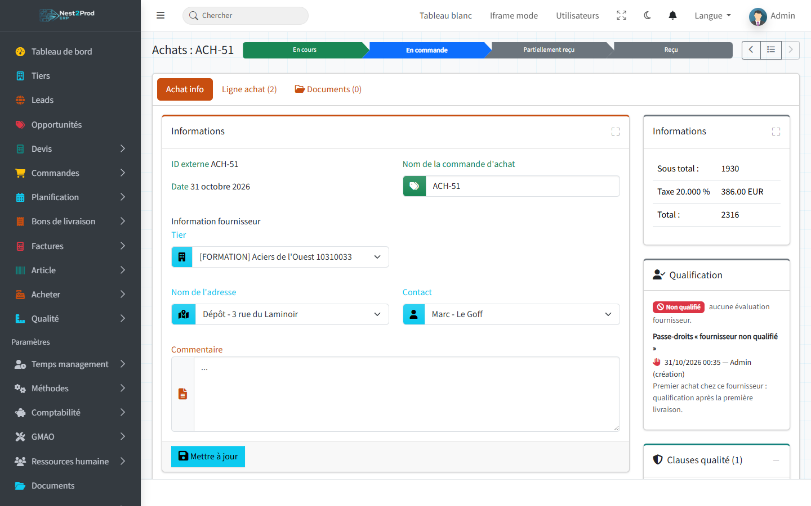

> ⚠️ An "Ordered" order is **locked**: its lines can no longer be changed.
> The next statuses ("Partly received", "Received") move forward on their own with the
> receipts.

---

## 4. Record the supplier's acknowledgement

The supplier confirms your order and announces its delivery date (its "acknowledgement").
Record it: its **confirmed** date is then used to measure their delays.

Order record, "Purchase lines" tab: **"Acknowledgement received"** button (all lines), or
the ▾ menu of a line › "Acknowledgement received" (this line only).

1. **Acknowledgement reference**: the number of the supplier's document. The
   **Acknowledgement date** is today by default; the **Document** (PDF, photo) is optional
   and is filed in the order's Documents tab.
2. **Confirmed date** of each ticked line: suggested equal to the requested date, to be
   corrected from the acknowledgement. The **Gap** column shows the shift (here +3 days).
3. "Save acknowledgement".

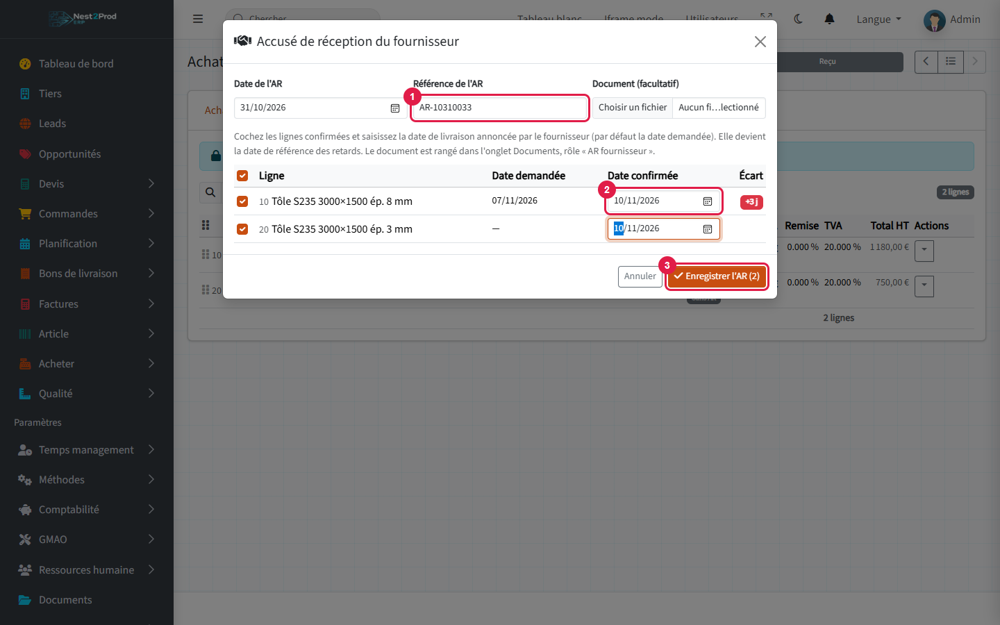

Each line then shows the confirmed date, the requested date with the gap, and the
acknowledgement reference. A line without an acknowledgement shows the "No ack." badge.

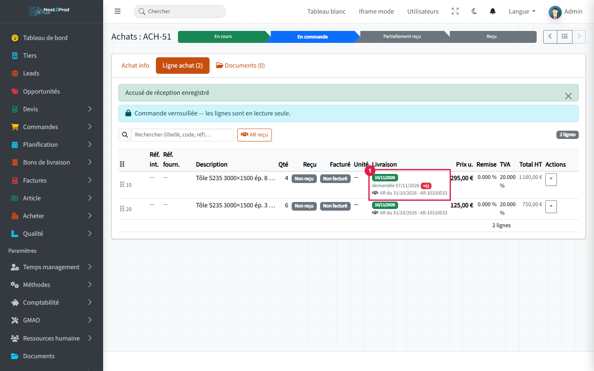

> ⚠️ The acknowledgement can only be entered on an order that has been **placed**: neither
> "In progress" nor cancelled.
>
> 💡 A new entry replaces the previous one: the supplier may confirm a new date later.

**Orders waiting for an acknowledgement**: **Purchase › Orders without ack.** menu. They
appear there a few days after being ordered (3 days by default) as long as one of their
lines has no acknowledgement, with the number of days waited. Chase these suppliers.

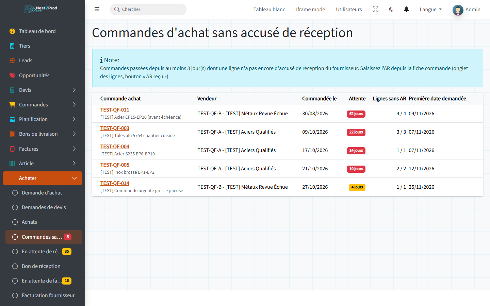

---

## 5. Receive

### 5.1 Create the receipt note

**Purchase › Waiting to receipt** menu: everything ordered and not yet received.
The delivery date column shows the date confirmed by the acknowledgement, otherwise the
requested date.

1. **Sort third party**: the supplier who delivers.
2. **Delivery note number**: the number of the supplier's delivery note, to find the delivery again.
3. Tick the delivered lines.
4. Choose the **User management** (responsible user), then click "New receipt document".

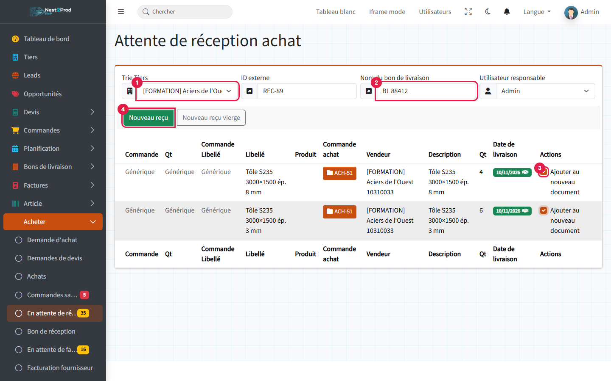

> ⚠️ A ticked line is received **in full**. For a partial delivery, only tick
> the complete lines.
>
> ⚠️ A line already received may still be shown: do not tick it a second time, you
> would create a second receipt.

### 5.2 Rate the supplier (optional)

When the receipt note opens, the **"Rate the supplier"** window offers three ratings from
1 to 5 stars: **Conformity** of the parts, **Lead time** (the software suggests a rating
from the delay against the promised date) and **Documents** (delivery note, certificates,
labelling).

1. Click the stars of each criterion, add a comment if needed.
2. "Save".

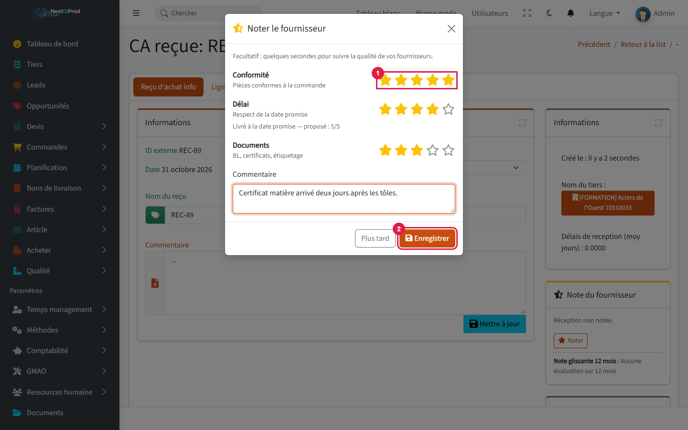

> 💡 "Later" closes the window without saving anything. The "Rate" button of the
> "Supplier rating" card lets you come back to it.

### 5.3 Inspect the received lines

"Purchase receipt lines" tab:

1. **Inspection details**: the physical inspection — accepted and rejected quantities,
   result, **received certificate**, and if needed a **non-conformity** created in one
   click.
2. **Document review**: the check of the certificates, for lines whose order requires a
   certificate. The "Certificate", "Document review" and "Decision" columns show the
   status: here the required 3.1 certificate has not been received yet.

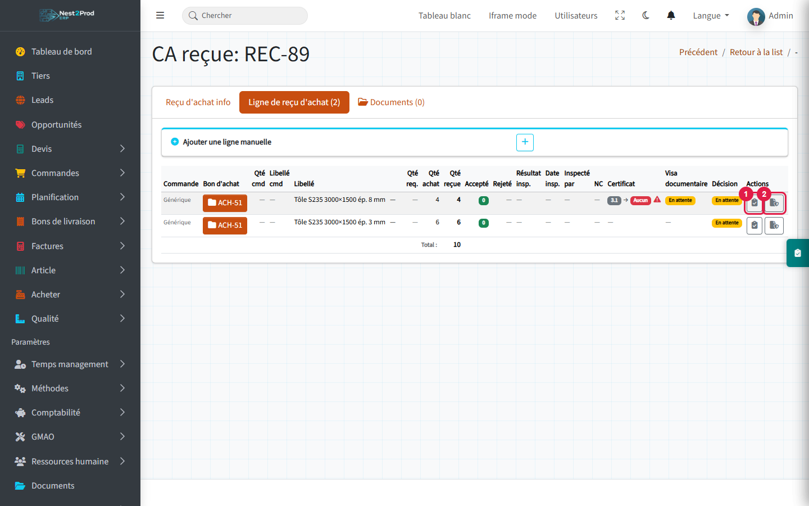

The **decision** is only "Accepted" when the physical inspection **and** the document
review are compliant. The review is restricted to people with the permission (usually
quality staff); they find all the lines to review under **Quality › Receipt document
review**.

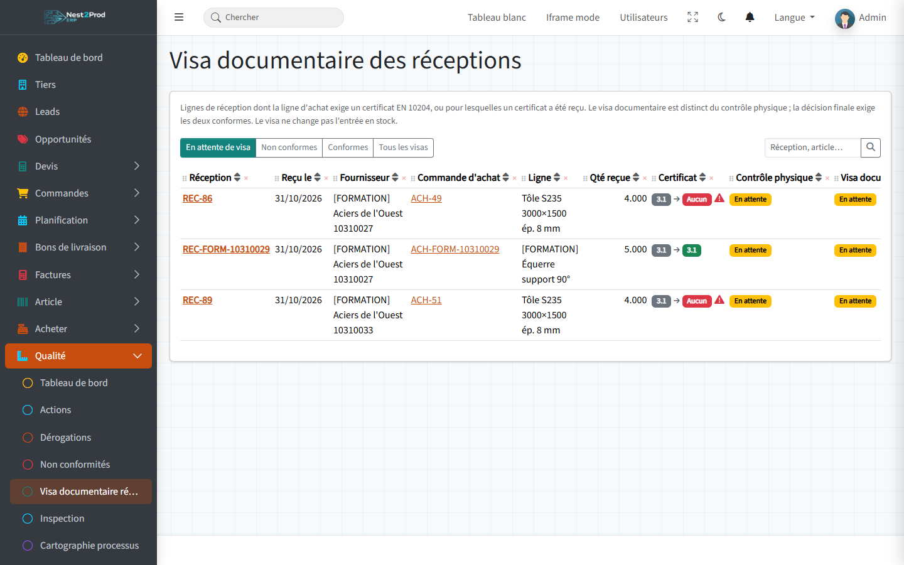

> ⚠️ A received certificate of a lower grade than required (2.2 received for 3.1
> required) is flagged. Marking it "Compliant" despite the gap requires a comment.
>
> 💡 A "Non-compliant" review offers to create a supplier non-conformity. The review does
> not block putting the goods into stock.

### 5.4 Put into stock

For a line linked to an **item**, the "Mise en stock" (Put into stock) button stores the
accepted quantity in a stock location. Its **Batch / heat** section takes the **Heat
number** and the **Supplier batch** read on the material certificate: a batch is then
created, linked to the supplier and to this receipt, so that the heat of a part can be
traced later.

---

## 6. Record the supplier invoice

**Purchase › Waiting to invoice** menu: receipts not yet invoiced.

1. **Sort third party**: the supplier.
2. **"Référence fournisseur" (Supplier reference)**: the number of **their** invoice.
3. Tick the invoiced receipts.
4. Choose the **User management** (responsible user), then click "New invoice document".

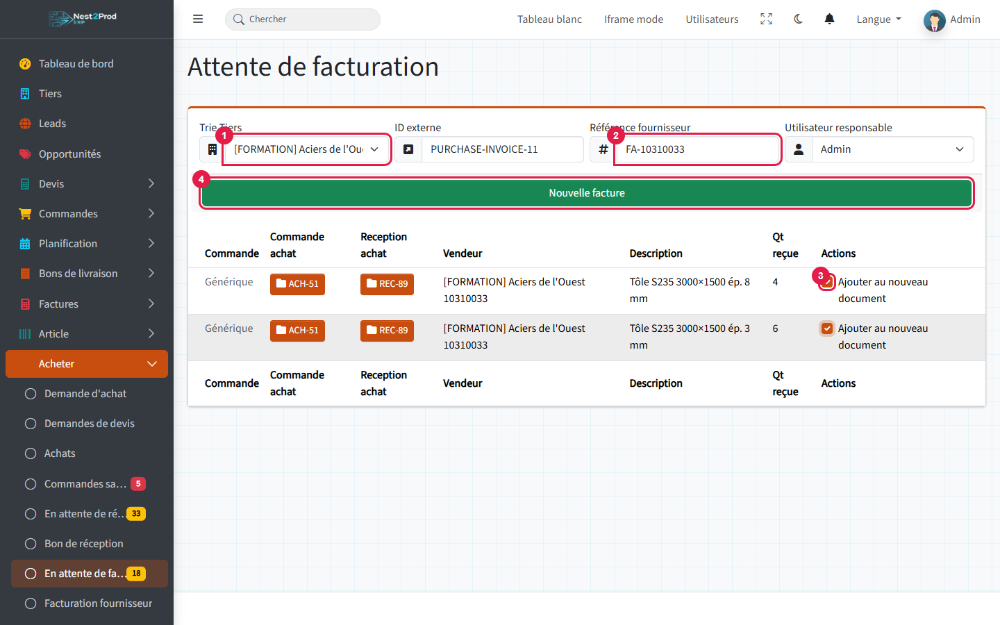

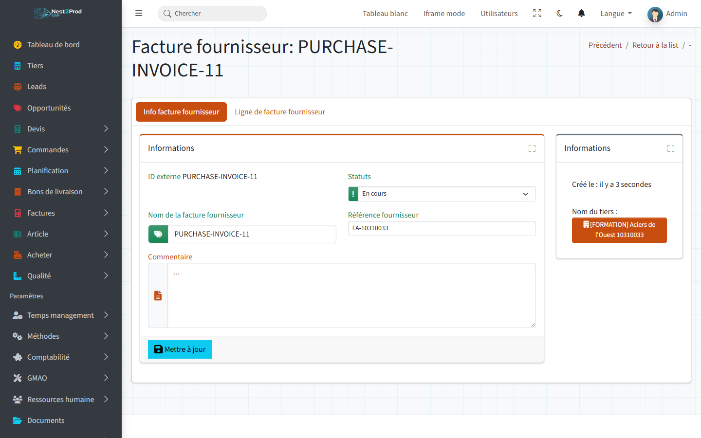

You can only invoice **what has been received**, and at the order price: this is what
ensures you pay the right amount. Once the invoice is checked, set its status
to "Closed".

> ⚠️ The supplier reference is unique for a supplier: the software refuses
> to record the same invoice twice.
>
> 💡 If the accounting assignments are set up, each invoice generates its purchase
> entries, included in the FEC export.

---

## Received electronic invoices

With electronic invoicing, supplier invoices arrive in **Factur-X** format.
**Purchase › Received invoices** menu: those sent by your platform arrive there
on their own, and you can also upload a Factur-X PDF or an XML file by hand.

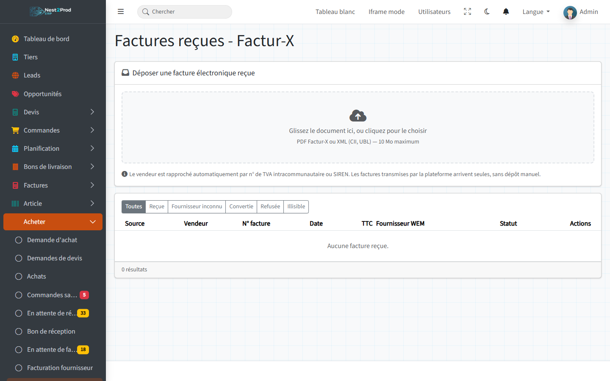

On each received invoice:

- **"Rapprocher" (Match)** opens "Waiting to invoice" for this supplier, with the received
  document next to the receipts to tick and any difference in amount;
- **"Sans rapprochement" (Without matching)** records an invoice without an order (expenses, subscription);
- **"Refuser" (Reject)** sets the document aside.

---

## Following up your suppliers

Receipt ratings and acknowledgement dates feed two indicators, calculated over the
**last 12 months**.

**On the supplier's record**, "Supplier evaluations" tab, "Latest supplier evaluation"
card:

1. **Rolling score**: average of the ratings (quality, lead time, documents). A receipt
   that led to a non-conformity counts 1/5 for quality, whether rated or not.
2. **On-time deliveries**: share of lines delivered no later than the confirmed date
   (otherwise the requested date). A line is measured once **fully** received, on the date
   of its last receipt.

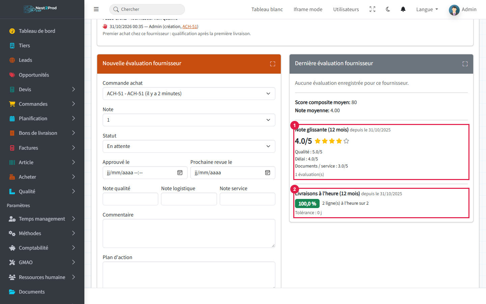

**On the Purchasing dashboard** (**Purchase › Purchase list** menu, "Dashboard" tab), the
"On-time deliveries" card gives the rate of all your suppliers and lists the least
punctual ones.

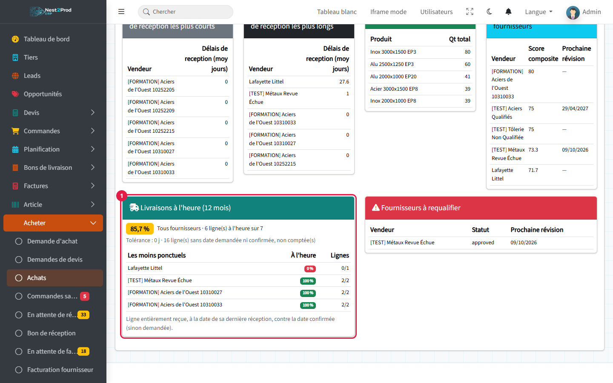

> 💡 A line with neither a requested nor a confirmed date is not included in the rate: it
> is counted separately. Fill in the requested date (step 3.2) or record the
> acknowledgement (step 4).

## What next?

- **Evaluate the supplier**: "Supplier evaluations" tab of its record, for the periodic
  review (status, next review, action plan).
<!-- feature: qualified-supplier -->
- **Qualify it**: an "Approved" evaluation makes it "Qualified" for your next orders,
  with no override ("Qualified suppliers" guide).
<!-- /feature -->
- **Link to the deal**: purchases made for a customer order appear on the summary of its
  opportunity (amount purchased, late purchases based on the confirmed date).

## Frequently asked questions

**My supplier does not appear in the lists.**
Its "Status supplier" is still "Inactive" (step 1.1).

**"No default settings for defaultAddress" when creating the request for quotation.**
The supplier has no "By default" address or contact (steps 1.2 and 1.3).

<!-- feature: qualified-supplier -->
**"Purchase order refused: supplier not qualified".**
Its latest evaluation is not "Approved", or its review date has passed. Have it evaluated,
or enter an override reason if you have the permission (step 3.1).
<!-- /feature -->

**I can no longer add a line to my order.**
It is no longer "In Progress": an order sent to the supplier is locked.

**The "Acknowledgement received" button does not appear.**
The order is still "In progress" (or cancelled): set it to "Ordered" first.

**I cannot find my new order in "Orders without ack.".**
It only appears after a few days of waiting (3 by default): it is a chase list.

**The item search does not find my product in the order.**
The supplier is not in the item's preferred suppliers.

**The supplier only delivered part of the order.**
Receive the delivered lines. The others stay in "Waiting to receipt"
until the next delivery.

**The "Document review" window opens but I cannot enter anything.**
The review is restricted to a dedicated permission, usually given to quality staff:
without it, the window is read-only.
