**Objectif** : acheter matière, fournitures ou sous-traitance en gardant la trace de chaque
étape, et ne payer que ce qui a été commandé **et** reçu.

**Exemple utilisé** : la tôlerie consulte les Aciers de l'Ouest pour 4 tôles de 8 mm et
6 tôles de 3 mm, négocie le prix de la tôle de 8 mm, exige un certificat matière, commande,
enregistre l'accusé de réception du fournisseur, réceptionne puis enregistre sa facture.

## Avant de commencer

- Il faut la permission **Achats** (menu « Acheter »).
- Une **unité** et un **taux de TVA par défaut** doivent exister (voir le guide Méthodes).
- Pour acheter un article du catalogue plutôt qu'une ligne libre : l'article doit être
  marqué **Acheté = Oui**, avec le fournisseur dans ses **fournisseurs préférés**.

<!-- feature: qualified-supplier -->
- Votre société exige des **fournisseurs qualifiés** : une commande d'achat n'est acceptée
  que pour un fournisseur dont la dernière évaluation est « Approuvé » et dont la date de
  revue n'est pas dépassée. Voir le guide « Fournisseurs qualifiés ». Pour commander quand
  même à un fournisseur non qualifié, il faut le droit de passe-droit (étape 3.1).
<!-- /feature -->

## Vue d'ensemble

```steps
Fournisseur
Demande de prix
Commande d'achat
Accusé de réception
Réception
Facture fournisseur
```

Chaque document est créé **à partir du précédent**. Le menu « Acheter » suit le même
ordre. Ses compteurs montrent ce qui reste à faire : « En attente de réception » compte les
lignes pas encore entièrement reçues, « En attente de facturation » les lignes reçues pas
encore facturées, « Commandes sans AR » les commandes qui attendent l'accusé de réception
du fournisseur.

> 💡 Pressé ? Vous pouvez sauter la demande de prix : menu **Achats**, onglet liste,
> bouton « Nouvelle commande d'achat ».

---

## 1. Préparer le fournisseur

Un fournisseur est un tiers comme un autre (menu **Tiers**, « Ajouter un tiers »). Trois
réglages le rendent utilisable dans les achats.

**1.1 L'activer comme fournisseur.** Onglet « Détail » de la fiche : réglez **Etat
fournisseur** sur « Actif », puis « Mettre à jour ».

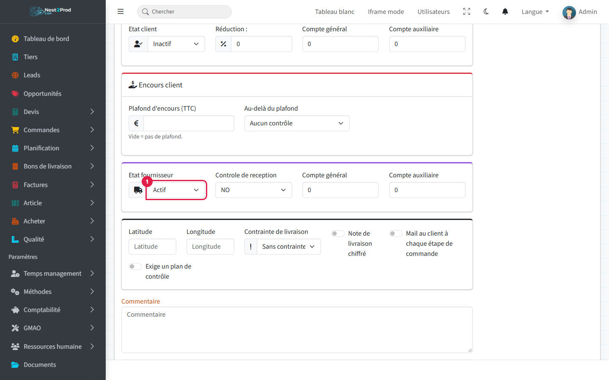

> ⚠️ Un fournisseur « Inactif » n'apparaît dans **aucune** liste des achats.

**1.2 Son adresse par défaut.** Onglet « Adresses » : saisissez l'adresse et **cochez
« Par défaut »**.

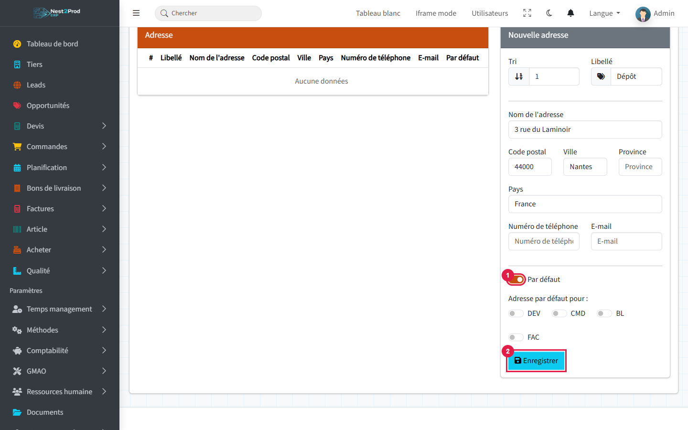

**1.3 Son contact par défaut.** Onglet « Contact » : civilité, prénom, nom, e-mail (pour
lui envoyer les documents) et **cochez « Par défaut »**.

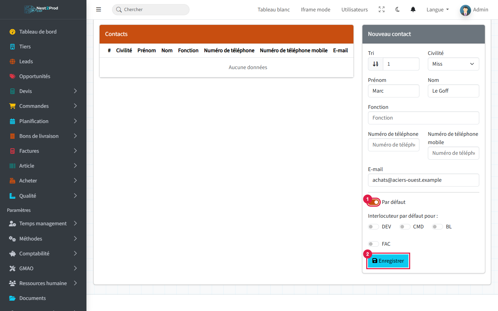

> ⚠️ Sans adresse **et** contact « Par défaut », la création d'une demande de prix et sa
> transformation en commande échouent : c'est eux qui sont repris sur les documents.
>
> 💡 « Controle de reception » = Oui (onglet Détail) impose un contrôle à chaque
> réception de ce fournisseur.

<!-- feature: qualified-supplier -->
> ⚠️ Un fournisseur tout neuf est **« Non qualifié »** : il n'a encore aucune évaluation.
> Or l'évaluation formelle (onglet « Évaluations fournisseurs » de sa fiche) se rattache à
> une de ses commandes d'achat. Sa toute première commande passe donc par un passe-droit
> (étape 3.1) ; évaluez-le ensuite pour les commandes suivantes.
<!-- /feature -->

---

## 2. Consulter le fournisseur : la demande de prix

### 2.1 Partir de l'écran « Demande d'achat »

Menu **Acheter › Demande d'achat**. Le tableau liste les **besoins des commandes clients** :
la matière et la sous-traitance prévues dans les gammes, pas encore achetées.

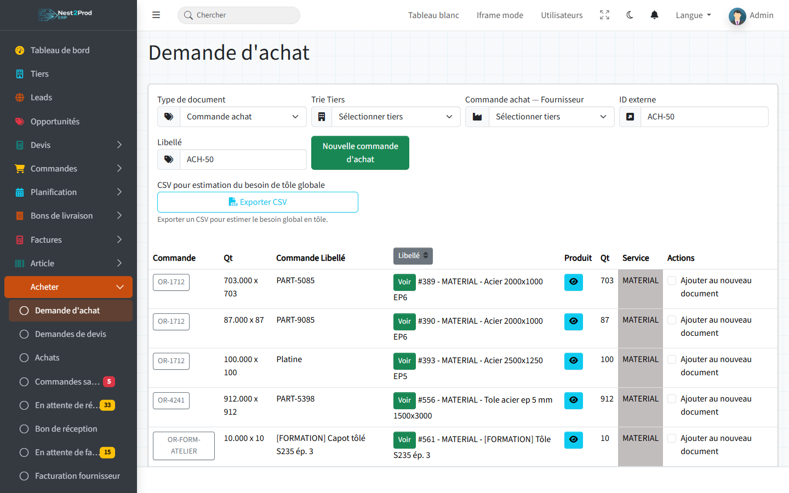

1. **Type de document** : « Demande d'achat » pour consulter, ou « Commande achat » pour
   commander directement.
2. **Sélectionner des fournisseurs** : un ou plusieurs. Chaque fournisseur reçoit sa
   propre demande de prix, ce qui permet de les comparer.
3. **Libellé** de la consultation.
4. Cochez les besoins concernés (« Ajouter au nouveau document »), puis cliquez sur
   « Nouvelle commande d'achat ».

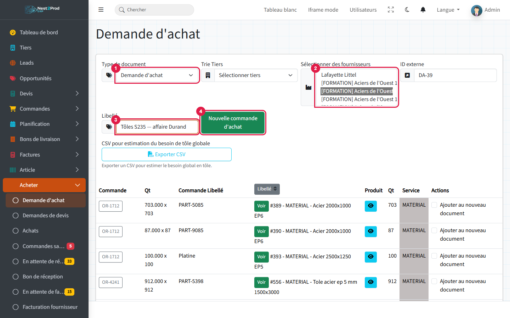

> 💡 Sans rien cocher, vous créez une demande de prix vide, à compléter ensuite.
> C'est le cas de notre exemple.
>
> 💡 Sur l'écran opérateur, une opération de **sous-traitance** propose un bouton
> « Nouvelle commande d'achat » à la place de Play : il mène à cet écran.

<!-- feature: qualified-supplier -->
> 💡 Une **demande de prix** n'est jamais bloquée, même pour un fournisseur non
> qualifié : seule la commande l'est. Un badge « Non qualifié » s'affiche à côté de ces
> fournisseurs dans les listes.
<!-- /feature -->

### 2.2 Ajouter les lignes

Onglet « Ligne devis d'achat ». Pour chaque ligne : **Description**, **Qt** (0 par défaut,
à remplir) et **Prix U** (le prix attendu, ou 0), puis « Soumettre ». Le champ
« Produit » reprend un article du catalogue.

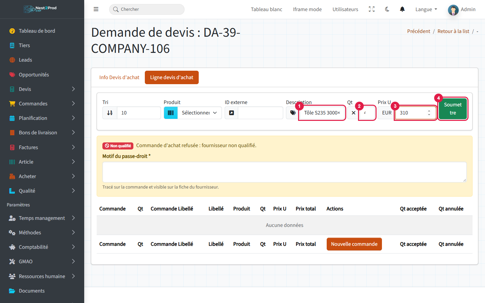

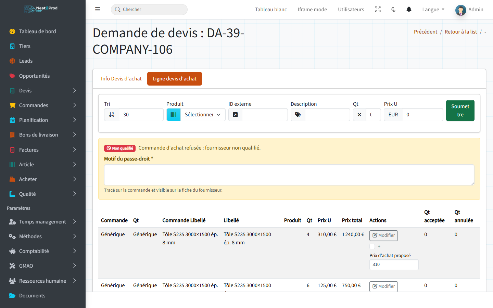

> ⚠️ Les lignes ne se modifient que tant que la demande est **« En cours »**.
> Complétez-les avant de l'envoyer.

### 2.3 Envoyer la demande

Onglet « Info Devis d'achat », carte **Options** : « PDF » pour l'imprimer ou l'enregistrer,
« E-mail » pour l'envoyer au contact du fournisseur. Puis passez la demande à
**« Envoyé »** en cliquant sur l'étape correspondante, en haut.

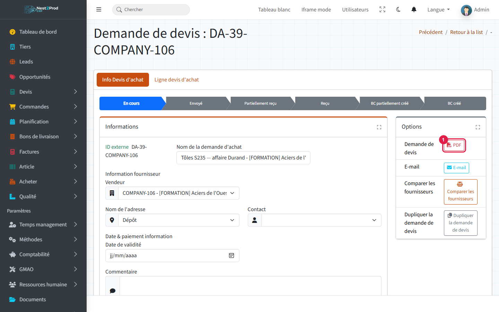

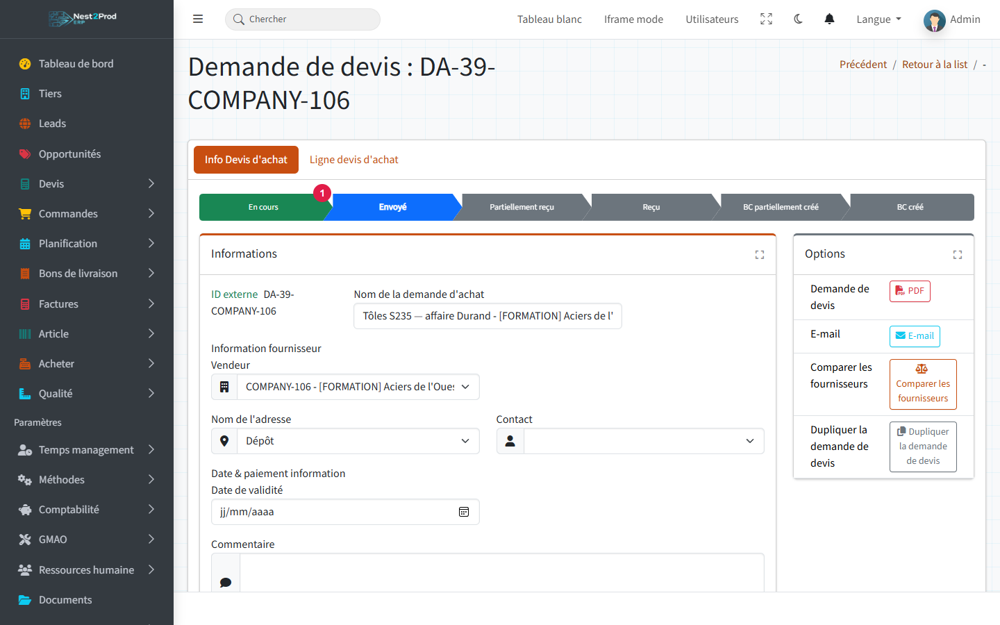

> 💡 Le bouton PDF n'apparaît que si la demande a une adresse et un contact.
> « Comparer les fournisseurs » met côte à côte les réponses d'une même consultation.

---

## 3. Commander

### 3.1 Transformer la demande de prix en commande

À réception de l'offre, onglet « Ligne devis d'achat » :

1. Saisissez le **Prix d'achat proposé** par le fournisseur, ligne par ligne (ici 295 €
   au lieu de 310 € pour la tôle de 8 mm).
2. Cochez les lignes retenues (case « + »).
3. Cliquez sur « Nouvelle commande ».

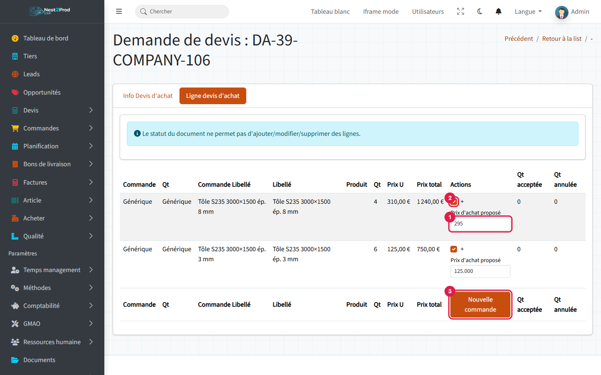

<!-- feature: qualified-supplier -->
Si le fournisseur n'est pas qualifié, un encadré jaune l'annonce au-dessus des lignes :
« Commande d'achat refusée : fournisseur non qualifié ». Si vous avez le droit de
passe-droit, saisissez le **Motif du passe-droit** avant de cliquer sur « Nouvelle
commande ». Le motif est tracé sur la commande et sur la fiche du fournisseur, et vaut
pour **cette seule commande** (y compris son passage « En commande »).

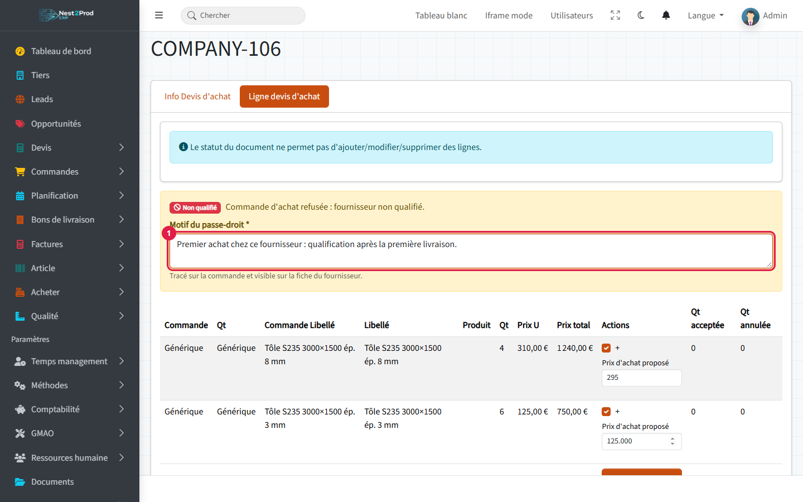

> ⚠️ Sans ce droit, l'encadré indique que vous ne pouvez pas commander à ce fournisseur :
> faites-le qualifier, ou demandez à un responsable de passer la commande.
<!-- /feature -->

La commande d'achat est créée avec les prix négociés de chaque ligne cochée, l'adresse
et le contact **par défaut** du fournisseur (ceux de l'étape 1).

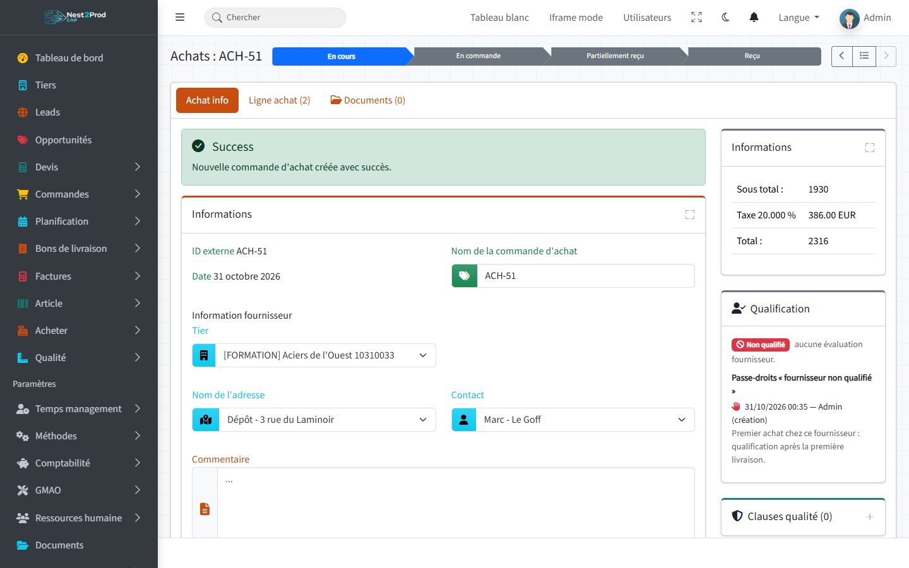

> ⚠️ Si aucune ligne n'est cochée, aucune commande n'est créée : vérifiez les cases.

### 3.2 Vérifier les lignes : date demandée et exigences qualité

Onglet « Ligne achat » : contrôlez quantités, prix et remises. Le bouton **Ajouter**, sur le
bord droit, ajoute une ligne.

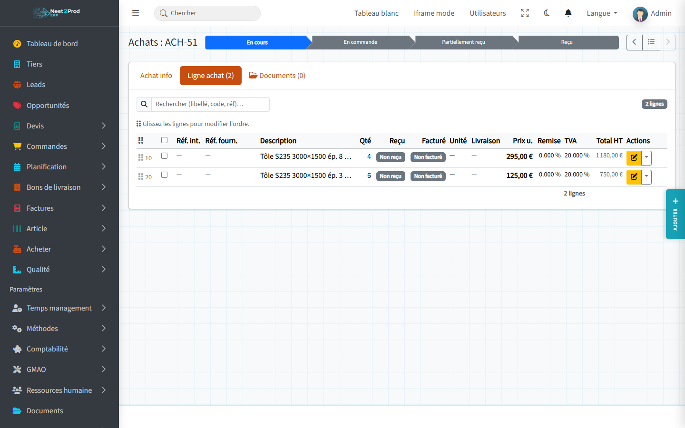

Le bouton jaune « Modifier » d'une ligne ouvre son détail :

1. **Date livraison prévue** : la date que vous demandez au fournisseur. Elle sert à
   mesurer ses retards.
2. **Criticité achat** : **Certificat** (EN 10204 : 2.1, 2.2, 3.1, 3.2), **Code de
   construction** et **Niveau**, si la pièce l'exige. Pour un article du catalogue, ces
   champs sont repris de sa fiche et restent modifiables ici.
3. « Enregistrer ».

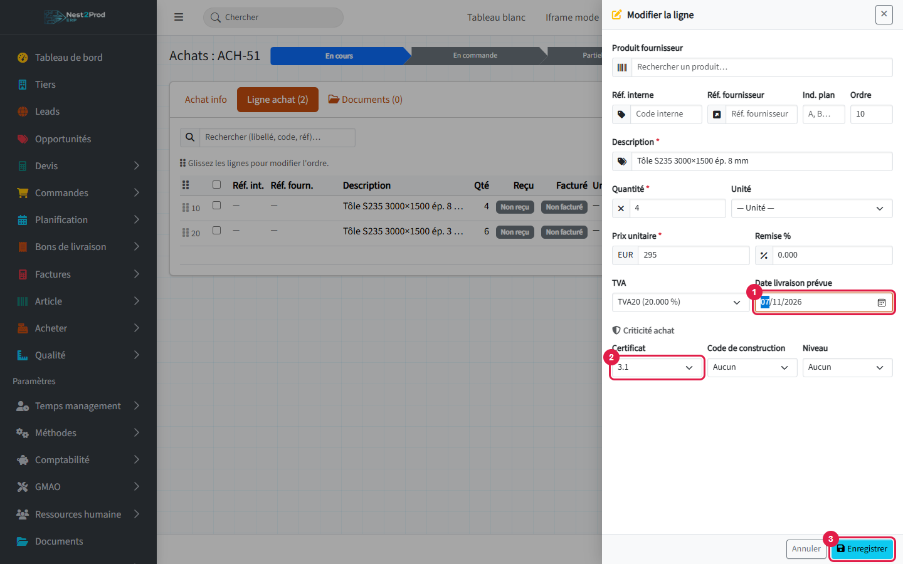

### 3.3 Les clauses qualité de la commande

Selon la criticité des lignes, des **clauses qualité** s'ajoutent à la commande : carte
« Clauses qualité » de l'onglet « Achat info ». Ici, le certificat 3.1 exigé ajoute la
clause « Certificat 3.1 ». Ces clauses sont **imprimées en fin de PDF** de la commande
d'achat.

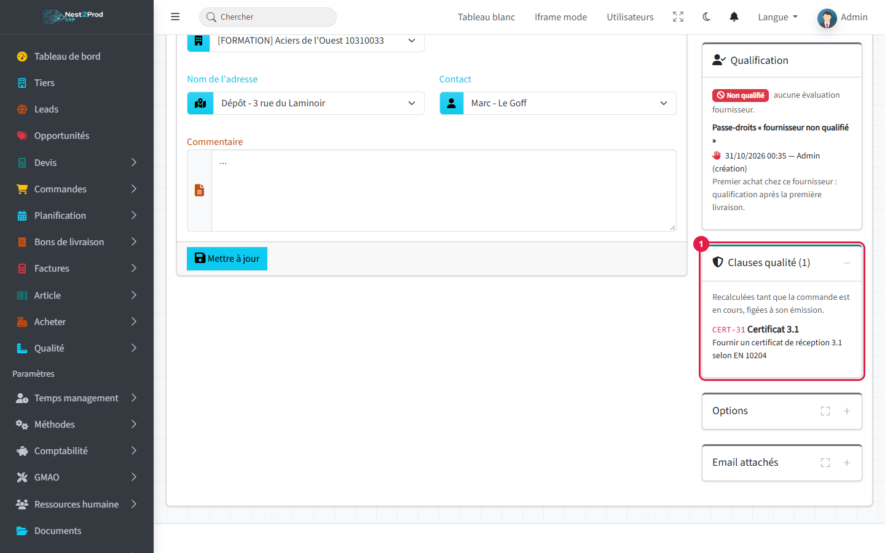

Tant que la commande est « En cours », les clauses sont recalculées à chaque modification
des lignes ; elles sont **figées** dès que la commande passe « En commande ».

Les textes et leurs règles se gèrent dans **Acheter › Clauses qualité** (droit réservé) :
une règle s'applique quand **tous** ses critères renseignés correspondent à une ligne ; un
critère laissé sur « Toute valeur » accepte tout.

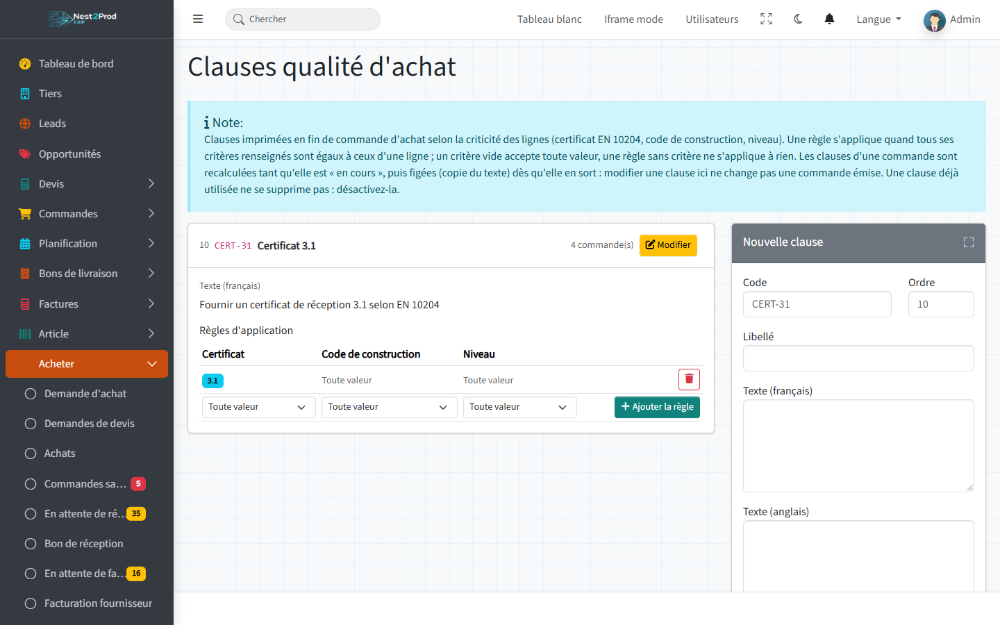

> 💡 Modifier une clause ne change pas les commandes déjà émises. Une clause déjà utilisée
> ne se supprime pas : décochez « Active ».

### 3.4 Envoyer la commande

Envoyez la commande au fournisseur depuis la carte **Options** (PDF ou e-mail), puis
passez-la à **« En commande »**.

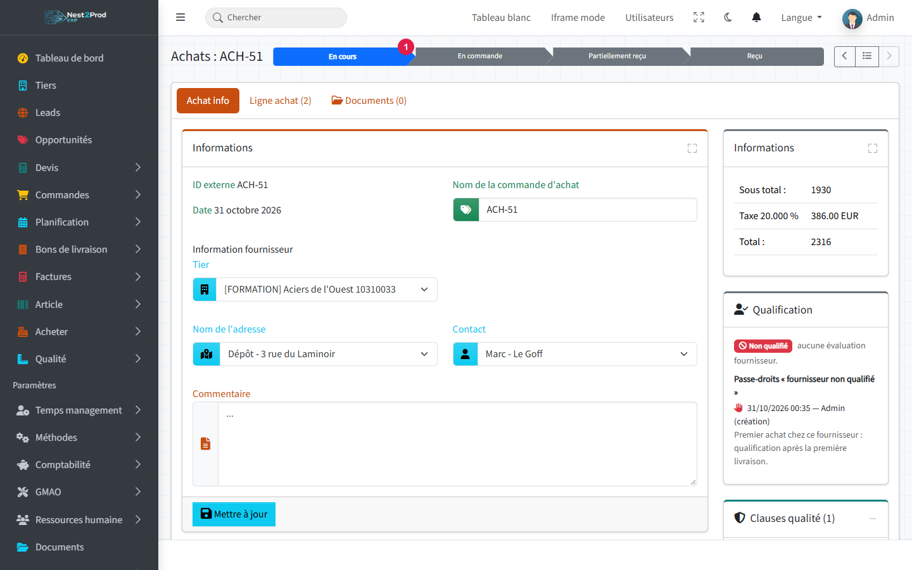

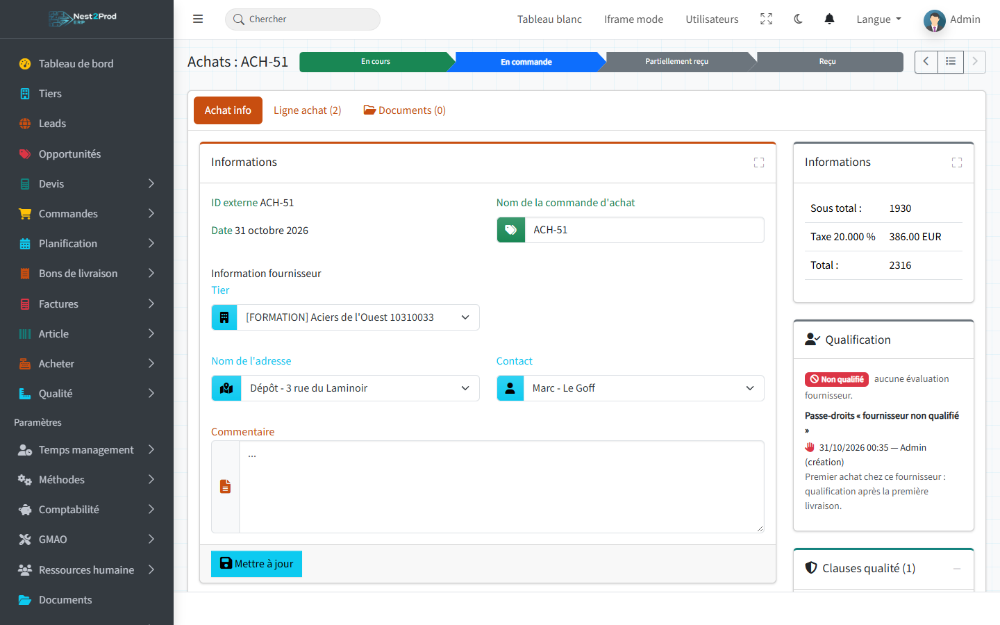

> ⚠️ Une commande « En commande » est **verrouillée** : ses lignes ne se modifient plus.
> La suite des statuts (« Partiellement reçu », « Reçu ») avance toute seule avec les
> réceptions.

---

## 4. Enregistrer l'accusé de réception du fournisseur

Le fournisseur confirme votre commande et annonce sa date de livraison (son « AR »).
Enregistrez-le : c'est sa date **confirmée** qui sert ensuite à mesurer ses retards.

Fiche de la commande, onglet « Ligne achat » : bouton **« AR reçu »** (toutes les lignes),
ou menu ▾ d'une ligne › « AR reçu » (cette ligne seulement).

1. **Référence de l'AR** : le numéro du document du fournisseur. La **Date de l'AR**
   est celle du jour par défaut ; le **Document** (PDF, photo) est facultatif et se range
   dans l'onglet Documents de la commande.
2. **Date confirmée** de chaque ligne cochée : proposée égale à la date demandée, à
   corriger selon l'AR. La colonne **Écart** montre le décalage (ici + 3 jours).
3. « Enregistrer l'AR ».

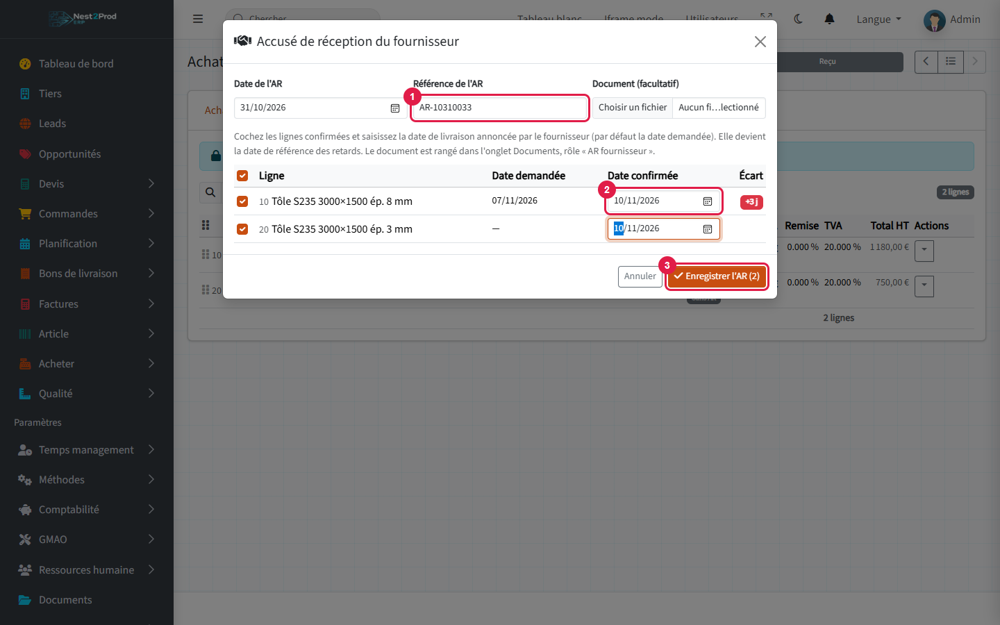

Chaque ligne affiche alors la date confirmée, la date demandée avec l'écart, et la
référence de l'AR. Une ligne sans AR porte le badge « Sans AR ».

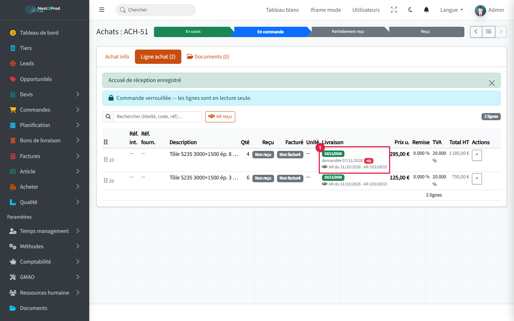

> ⚠️ L'AR ne se saisit que sur une commande **passée** : ni « En cours », ni annulée.
>
> 💡 Une nouvelle saisie remplace la précédente : le fournisseur peut confirmer une
> nouvelle date plus tard.

**Les commandes qui attendent un AR** : menu **Acheter › Commandes sans AR**. Elles y
apparaissent quelques jours après leur passage en commande (3 jours par défaut) tant qu'une
de leurs lignes n'a pas d'AR, avec le nombre de jours d'attente. Relancez ces fournisseurs.

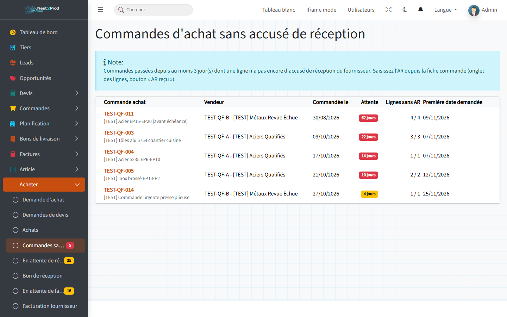

---

## 5. Réceptionner

### 5.1 Créer le bon de réception

Menu **Acheter › En attente de réception** : tout ce qui est commandé et pas encore reçu.
La colonne « Date de livraison » montre la date confirmée par l'AR, sinon la date demandée.

1. **Trie Tiers** : le fournisseur qui livre.
2. **Nom du bon de livraison** : le numéro du BL du fournisseur, pour retrouver la livraison.
3. Cochez les lignes livrées.
4. Choisissez l'**utilisateur responsable**, puis cliquez sur « Nouveau reçu ».

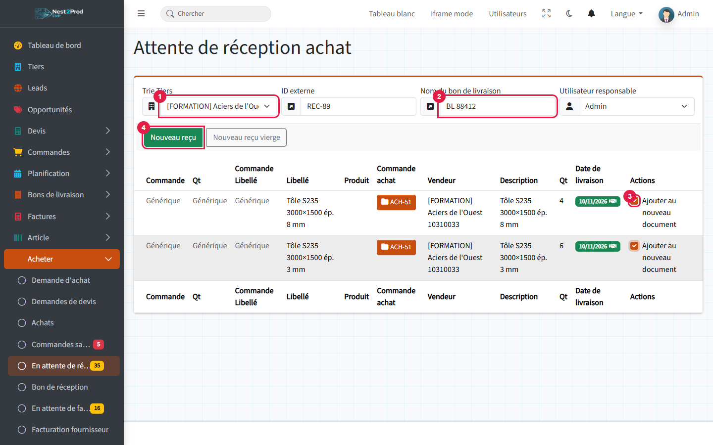

> ⚠️ Une ligne cochée est reçue **en totalité**. Pour une livraison partielle, ne cochez
> que les lignes complètes.
>
> ⚠️ Une ligne déjà reçue peut rester affichée : ne la cochez pas une seconde fois, vous
> créeriez une deuxième réception.

### 5.2 Noter le fournisseur (facultatif)

À l'ouverture du bon de réception, la fenêtre **« Noter le fournisseur »** propose trois
notes de 1 à 5 étoiles : **Conformité** des pièces, **Délai** (le logiciel propose une note
d'après le retard sur la date promise) et **Documents** (BL, certificats, étiquetage).

1. Cliquez sur les étoiles de chaque critère, ajoutez un commentaire si besoin.
2. « Enregistrer ».

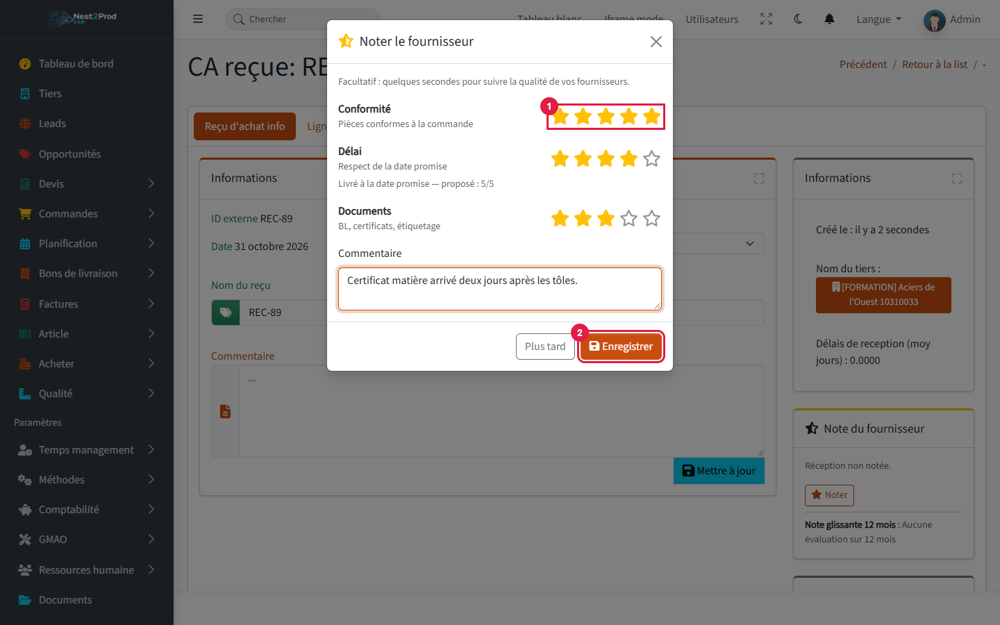

> 💡 « Plus tard » ferme la fenêtre sans rien enregistrer. Le bouton « Noter » de la carte
> « Note du fournisseur » permet d'y revenir.

### 5.3 Contrôler les lignes reçues

Onglet « Ligne de reçu d'achat » :

1. **Détails d'inspection** : le contrôle physique — quantités acceptées et rejetées,
   résultat, **certificat reçu**, et si besoin une **non-conformité** créée en un clic.
2. **Visa documentaire** : le contrôle des certificats, pour les lignes dont la commande
   exige un certificat. Les colonnes « Certificat », « Visa documentaire » et « Décision »
   montrent l'état : ici le certificat 3.1 exigé n'est pas encore reçu.

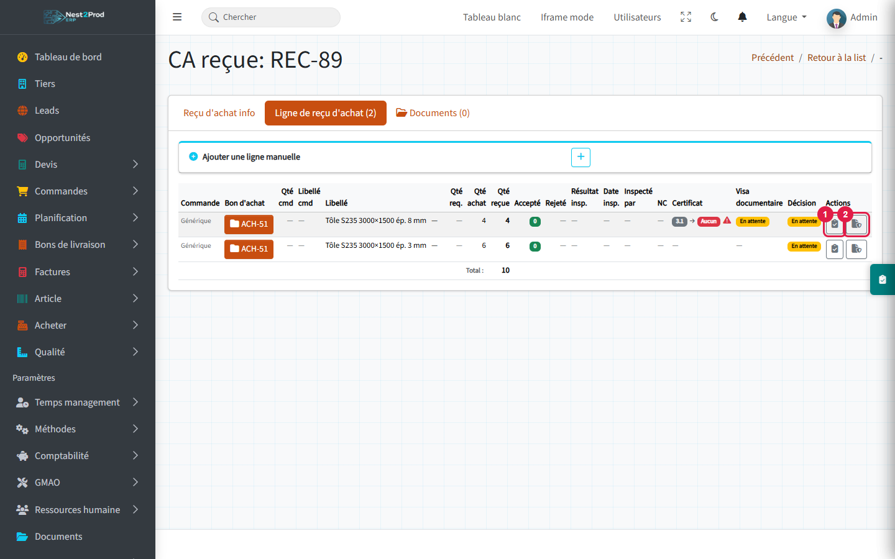

La **décision** n'est « Acceptée » que si le contrôle physique **et** le visa documentaire
sont conformes. Le visa est réservé aux personnes qui en ont le droit (la qualité, le plus
souvent) ; elles retrouvent toutes les lignes à viser dans **Qualité › Visa documentaire
réception**.

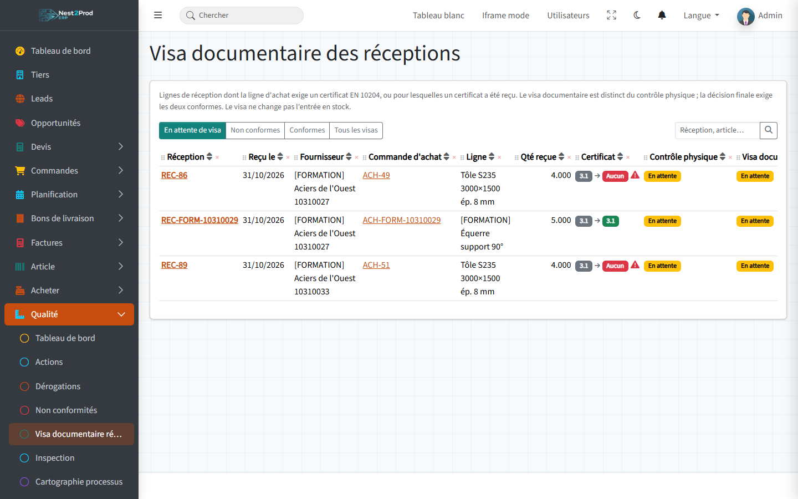

> ⚠️ Un certificat reçu de rang inférieur à celui exigé (2.2 reçu pour 3.1 exigé) est
> signalé. Le viser « Conforme » malgré l'écart demande un commentaire.
>
> 💡 Un visa « Non conforme » propose de créer une non-conformité fournisseur. Le visa ne
> bloque pas la mise en stock.

### 5.4 Mettre en stock

Pour une ligne liée à un **article**, le bouton « Mise en stock » range la quantité
acceptée dans un emplacement de stock. Sa section **Lot / coulée** reçoit le **N° de
coulée** et le **Lot fournisseur** lus sur le certificat matière : un lot est alors créé,
rattaché au fournisseur et à cette réception, pour retrouver plus tard la coulée d'une
pièce.

---

## 6. Enregistrer la facture fournisseur

Menu **Acheter › En attente de facturation** : les réceptions pas encore facturées.

1. **Trie Tiers** : le fournisseur.
2. **Référence fournisseur** : le numéro de **sa** facture.
3. Cochez les réceptions facturées.
4. Choisissez l'**utilisateur responsable**, puis cliquez sur « Nouvelle facture ».

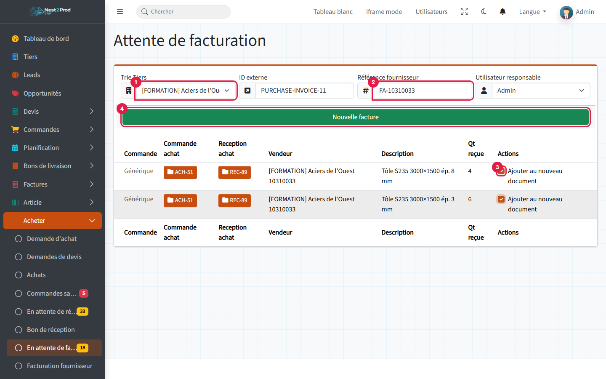

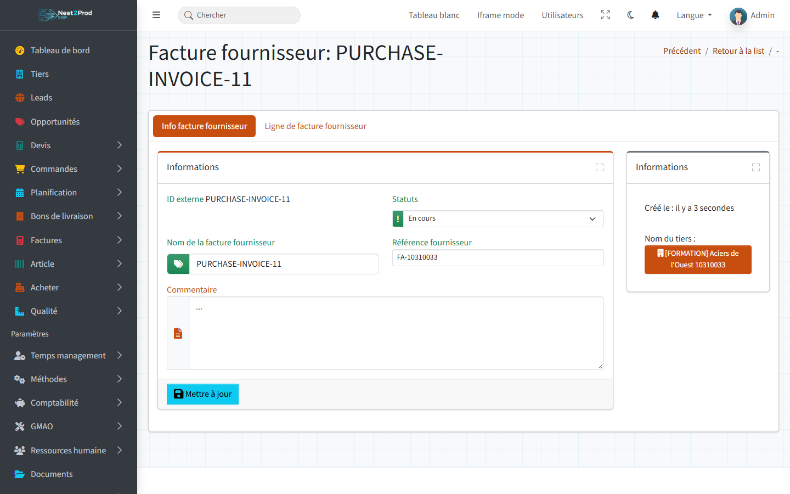

On ne peut facturer **que ce qui a été reçu**, et au prix de la commande : c'est ce qui
garantit de payer le juste montant. Une fois la facture contrôlée, passez son statut
à « Fermé ».

> ⚠️ La référence fournisseur est unique pour un fournisseur : le logiciel refuse
> d'enregistrer deux fois la même facture.
>
> 💡 Si les affectations comptables sont paramétrées, chaque facture génère ses écritures
> d'achat, reprises dans l'export FEC.

---

## Les factures électroniques reçues

Avec la facturation électronique, les factures fournisseurs arrivent au format **Factur-X**.
Menu **Acheter › Factures reçues** : celles transmises par votre plateforme y arrivent
seules, et vous pouvez y déposer à la main un PDF Factur-X ou un fichier XML.

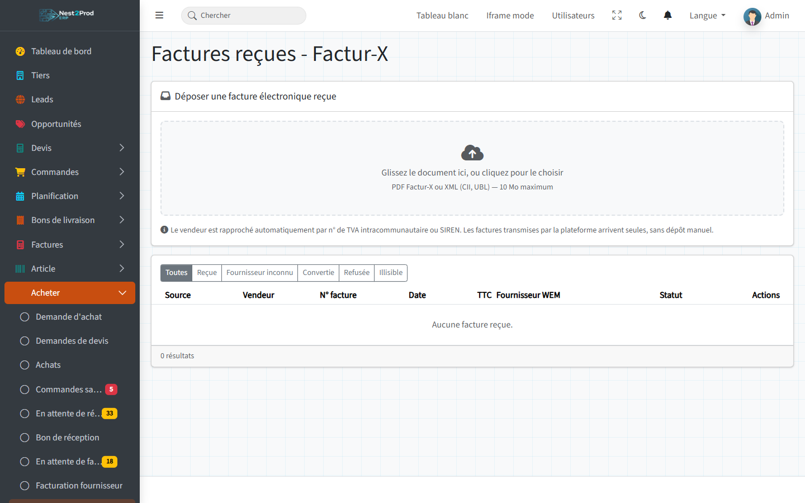

Sur chaque facture reçue :

- **Rapprocher** ouvre « En attente de facturation » sur ce fournisseur, avec le document
  reçu en regard des réceptions à cocher et l'écart de montant éventuel ;
- **Sans rapprochement** enregistre une facture sans commande (frais, abonnement) ;
- **Refuser** écarte le document.

---

## Suivre ses fournisseurs

Les notes de réception et les dates des AR alimentent deux indicateurs, calculés sur les
**12 derniers mois**.

**Sur la fiche du fournisseur**, onglet « Évaluations fournisseurs », carte « Dernière
évaluation fournisseur » :

1. **Note glissante** : moyenne des notes (qualité, délai, documents). Une réception qui a
   donné lieu à une non-conformité compte 1/5 en qualité, notée ou non.
2. **Livraisons à l'heure** : part des lignes livrées au plus tard à la date confirmée
   (sinon demandée). Une ligne est mesurée une fois **entièrement** reçue, à la date de sa
   dernière réception.

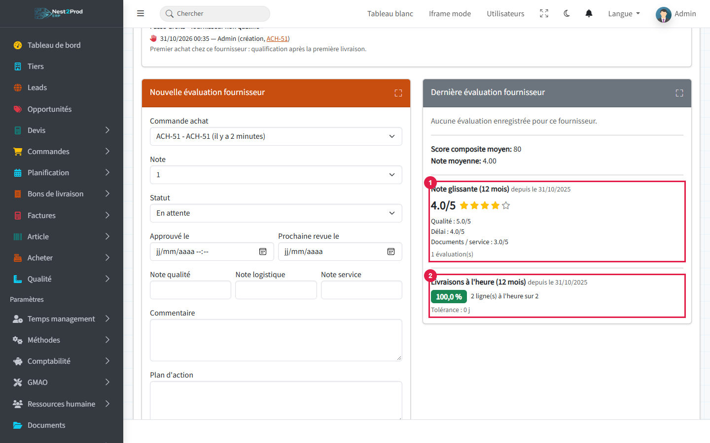

**Sur le tableau de bord Achats** (menu **Acheter › Achats**, onglet « Tableau de bord »), la
carte « Livraisons à l'heure » donne le taux de tous vos fournisseurs et liste les moins
ponctuels.

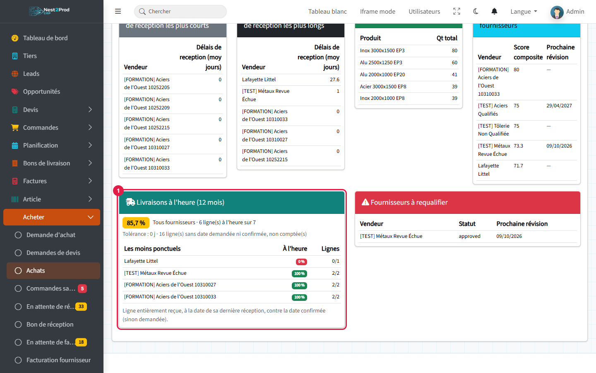

> 💡 Une ligne sans date demandée ni confirmée n'entre pas dans le taux : elle est
> comptée à part. Renseignez la date demandée (étape 3.2) ou enregistrez l'AR (étape 4).

## Et ensuite ?

- **Évaluer le fournisseur** : onglet « Évaluations fournisseurs » de sa fiche, pour la
  revue périodique (statut, prochaine revue, plan d'action).
<!-- feature: qualified-supplier -->
- **Le qualifier** : une évaluation « Approuvé » le rend « Qualifié » pour vos prochaines
  commandes, sans passe-droit (guide « Fournisseurs qualifiés »).
<!-- /feature -->
- **Relier à l'affaire** : les achats faits pour une commande client apparaissent sur la
  synthèse de son opportunité (montant acheté, achats en retard d'après la date confirmée).

## Questions fréquentes

**Mon fournisseur n'apparaît pas dans les listes.**
Son « Etat fournisseur » est resté « Inactif » (étape 1.1).

**« No default settings for defaultAddress » à la création de la demande de prix.**
Le fournisseur n'a pas d'adresse ou de contact « Par défaut » (étapes 1.2 et 1.3).

<!-- feature: qualified-supplier -->
**« Commande d'achat refusée : fournisseur non qualifié ».**
Sa dernière évaluation n'est pas « Approuvé », ou sa date de revue est dépassée. Faites-le
évaluer, ou saisissez un motif de passe-droit si vous en avez le droit (étape 3.1).
<!-- /feature -->

**Je ne peux plus ajouter de ligne à ma commande.**
Elle n'est plus « En cours » : une commande envoyée au fournisseur est verrouillée.

**Le bouton « AR reçu » n'apparaît pas.**
La commande est encore « En cours » (ou annulée) : passez-la d'abord « En commande ».

**Je ne trouve pas ma nouvelle commande dans « Commandes sans AR ».**
Elle n'y entre qu'après quelques jours d'attente (3 par défaut) : c'est une liste de relance.

**La recherche d'article ne trouve pas mon produit dans la commande.**
Le fournisseur n'est pas dans les fournisseurs préférés de l'article.

**Le fournisseur a livré une partie seulement.**
Réceptionnez les lignes livrées. Les autres restent dans « En attente de réception »
jusqu'à la prochaine livraison.

**La fenêtre « Visa documentaire » s'ouvre mais je ne peux rien saisir.**
Le visa est réservé à un droit dédié, en général donné à la qualité : sans lui, la fenêtre
est en lecture seule.
