**Objectif** : acheter matière, fournitures ou sous-traitance en gardant la trace de chaque
étape, et ne payer que ce qui a été commandé **et** reçu.

**Exemple utilisé** : la tôlerie consulte les Aciers de l'Ouest pour 4 tôles de 8 mm et
6 tôles de 3 mm, négocie le prix de la tôle de 8 mm, commande, réceptionne puis enregistre
la facture du fournisseur.

## Avant de commencer

- Il faut la permission **Achats** (menu « Acheter »).
- Une **unité** et un **taux de TVA par défaut** doivent exister (voir le guide Méthodes).
- Pour acheter un article du catalogue plutôt qu'une ligne libre : l'article doit être
  marqué **Acheté = Oui**, avec le fournisseur dans ses **fournisseurs préférés**.

## Vue d'ensemble

```steps
Fournisseur
Demande de prix
Commande d'achat
Réception
Facture fournisseur
```

Chaque document est créé **à partir du précédent**. Le menu « Acheter » suit le même
ordre, et ses compteurs (« En attente de réception », « En attente de facturation »)
montrent ce qui reste à faire.

> 💡 Pressé ? Vous pouvez sauter la demande de prix : menu **Achats**, onglet liste,
> bouton « Nouvelle commande d'achat ».

---

## 1. Préparer le fournisseur

Un fournisseur est un tiers comme un autre (menu **Tiers**, « Ajouter un tiers »). Trois
réglages le rendent utilisable dans les achats.

**1.1 L'activer comme fournisseur.** Onglet « Détail » de la fiche : réglez **Etat
fournisseur** sur « Actif », puis « Mettre à jours ».

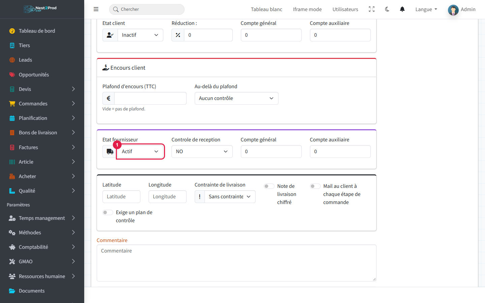

> ⚠️ Un fournisseur « Inactif » n'apparaît dans **aucune** liste des achats.

**1.2 Son adresse par défaut.** Onglet « Adresses » : saisissez l'adresse et **cochez
« Par défaut »**.

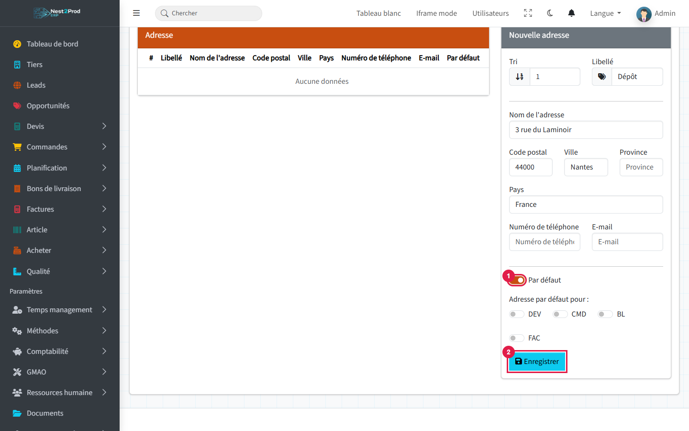

**1.3 Son contact par défaut.** Onglet « Contact » : civilité, prénom, nom, e-mail (pour
lui envoyer les documents) et **cochez « Par défaut »**.

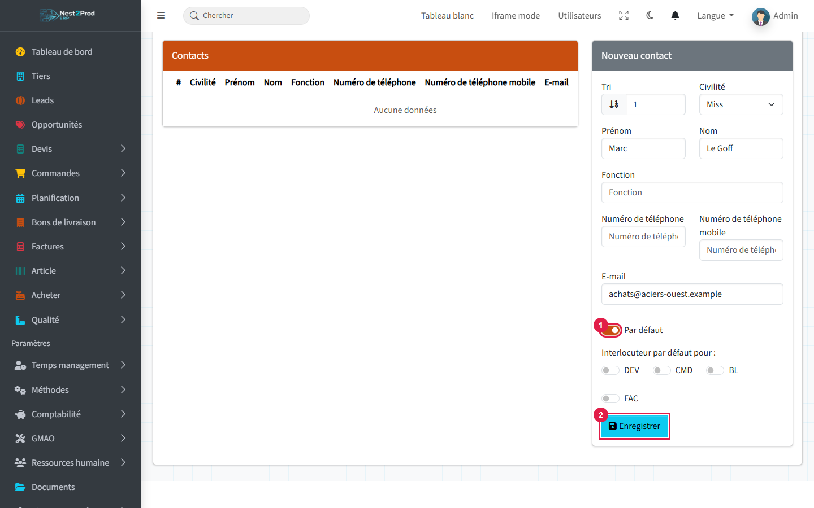

> ⚠️ Sans adresse **et** contact « Par défaut », la création d'une demande de prix et sa
> transformation en commande échouent : c'est eux qui sont repris sur les documents.
>
> 💡 « Controle de reception » = Oui (onglet Détail) impose un contrôle à chaque
> réception de ce fournisseur.

---

## 2. Consulter le fournisseur : la demande de prix

### 2.1 Partir de l'écran « Demande d'achat »

Menu **Acheter › Demande d'achat**. Le tableau liste les **besoins des commandes clients** :
la matière et la sous-traitance prévues dans les gammes, pas encore achetées.

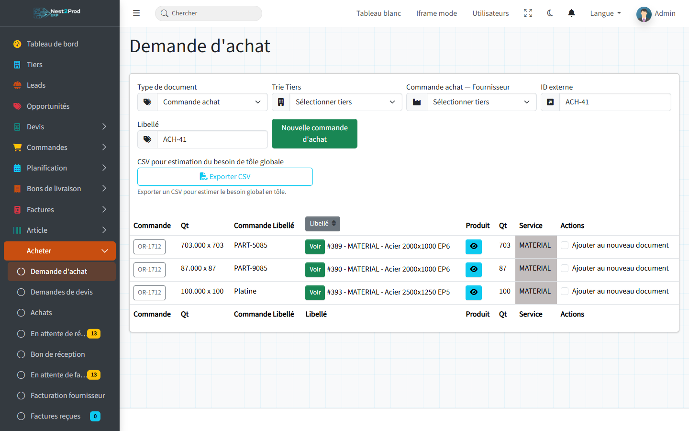

1. **Type de document** : « Demande d'achat » pour consulter, ou « Commande achat » pour
   commander directement.
2. **Sélectionner des fournisseurs** : un ou plusieurs. Chaque fournisseur reçoit sa
   propre demande de prix, ce qui permet de les comparer.
3. **Libellé** de la consultation.
4. Cochez les besoins concernés (« Ajouter au nouveau document »), puis cliquez sur
   « Nouvelle commande d'achat ».

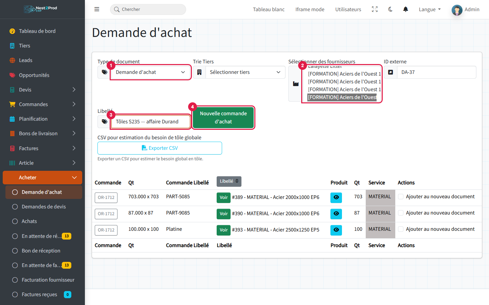

> 💡 Sans rien cocher, vous créez une demande de prix vide, à compléter ensuite.
> C'est le cas de notre exemple.
>
> 💡 Sur l'écran opérateur, une opération de **sous-traitance** propose un bouton
> « Nouvelle commande d'achat » à la place de Play : il mène à cet écran.

### 2.2 Ajouter les lignes

Onglet « Ligne devis d'achat ». Pour chaque ligne : **Description**, **Qt** (0 par défaut,
à remplir) et **Prix U** (le prix attendu, ou 0), puis « Soumettre ». Le champ
« Produit » reprend un article du catalogue.

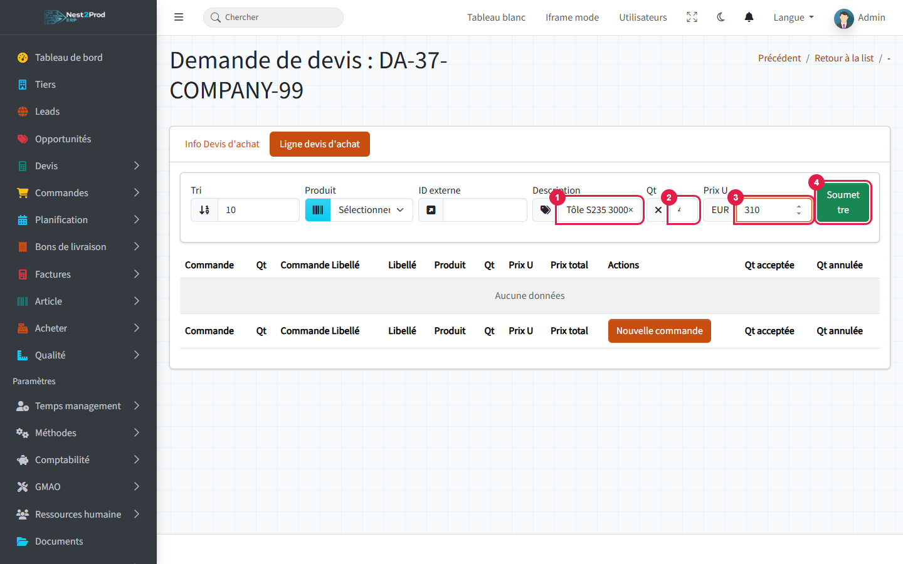

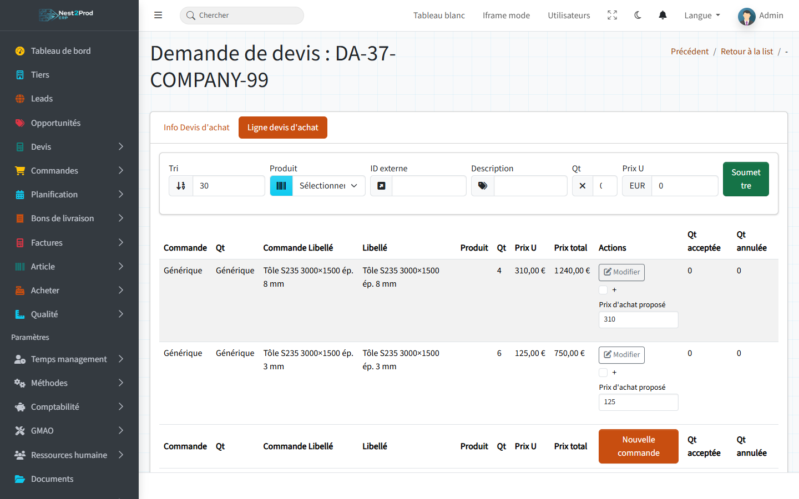

> ⚠️ Les lignes ne se modifient que tant que la demande est **« En cours »**.
> Complétez-les avant de l'envoyer.

### 2.3 Envoyer la demande

Onglet « Info Devis d'achat », carte **Options** : « PDF » pour l'imprimer ou l'enregistrer,
« E-mail » pour l'envoyer au contact du fournisseur. Puis passez la demande à
**« Envoyé »** en cliquant sur l'étape correspondante, en haut.

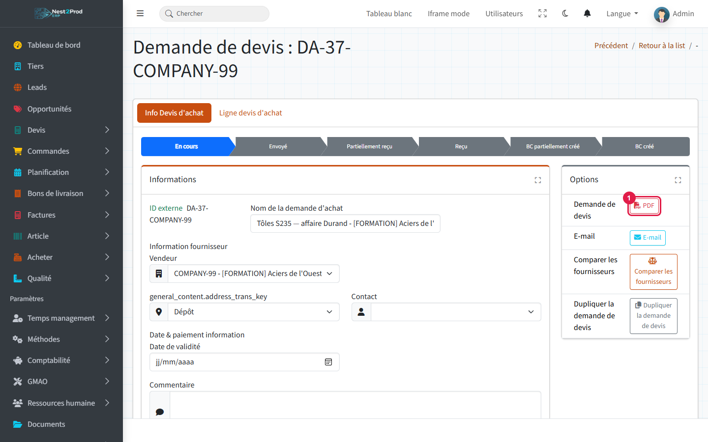

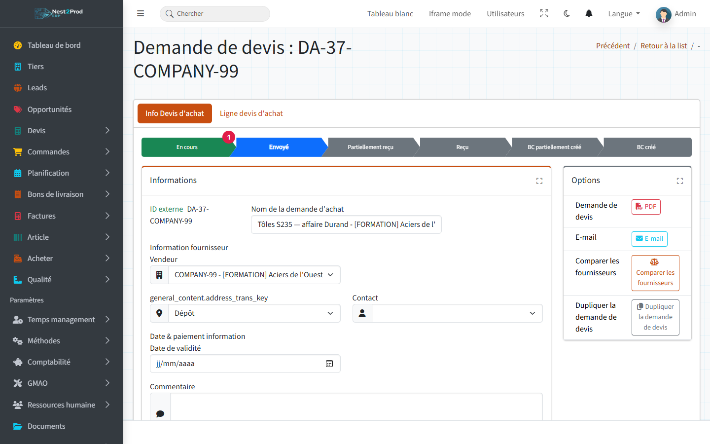

> 💡 Le bouton PDF n'apparaît que si la demande a une adresse et un contact.
> « Comparer les fournisseurs » met côte à côte les réponses d'une même consultation.

---

## 3. Commander

### 3.1 Transformer la demande de prix en commande

À réception de l'offre, onglet « Ligne devis d'achat » :

1. Saisissez le **prix d'achat proposé** par le fournisseur (ici 295 € au lieu de 310 €).
2. Cochez les lignes retenues (case « + »).
3. Cliquez sur « Nouvelle commande ».

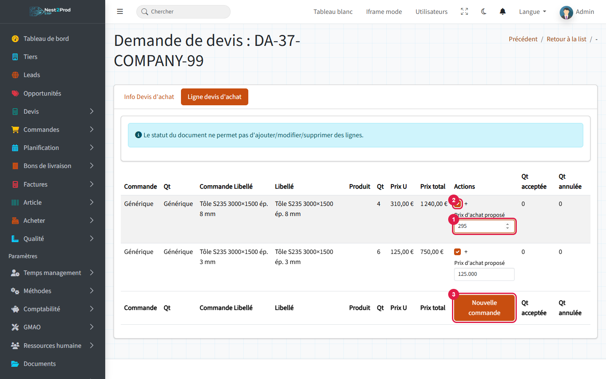

La commande d'achat est créée avec les prix négociés, l'adresse et le contact par défaut
du fournisseur.

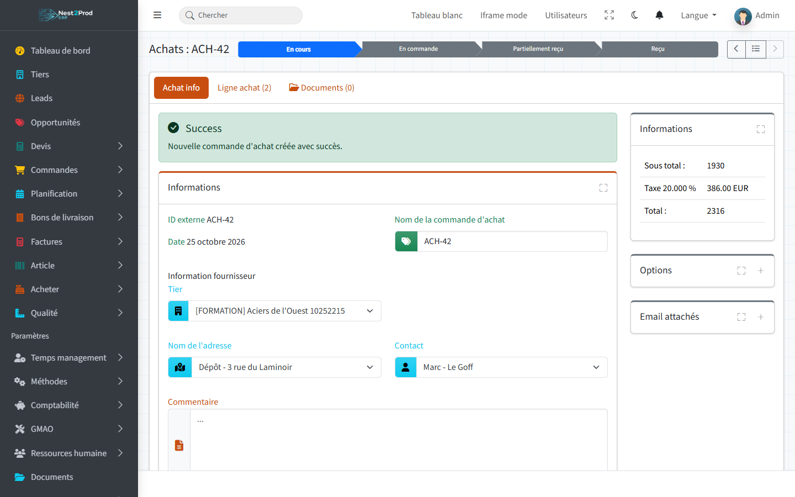

> ⚠️ Si aucune ligne n'est cochée, la page se recharge sans message : vérifiez les cases.

### 3.2 Vérifier et envoyer la commande

Onglet « Ligne achat » : contrôlez quantités, prix et remises. Le bouton **Ajouter**, sur le
bord droit, ajoute une ligne.

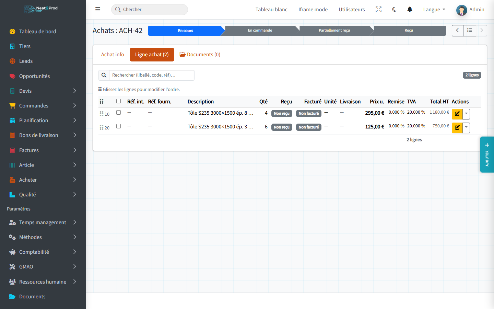

Envoyez la commande au fournisseur depuis la carte **Options** (PDF ou e-mail), puis
passez-la à **« En commande »**.

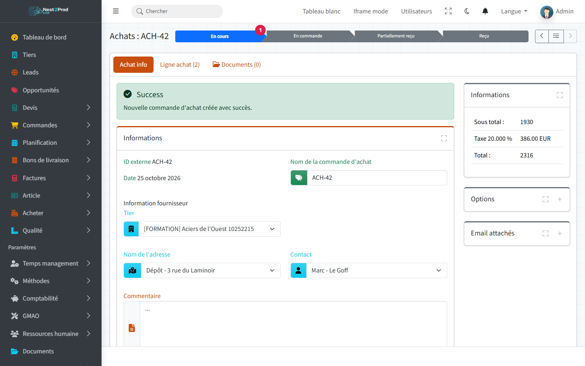

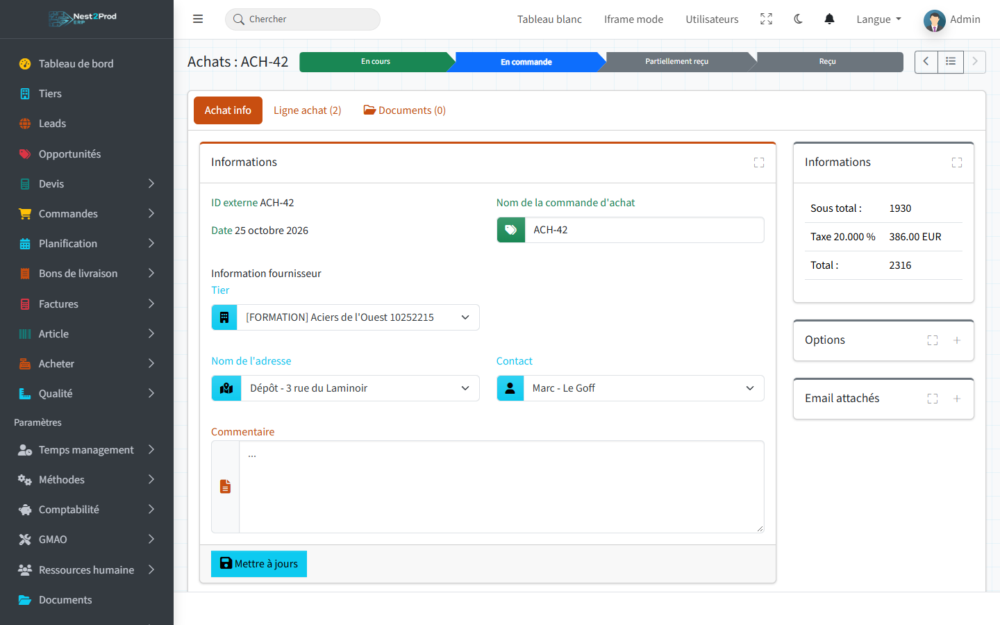

> ⚠️ Une commande « En commande » est **verrouillée** : ses lignes ne se modifient plus.
> La suite des statuts (« Partiellement reçu », « Reçu ») avance toute seule avec les
> réceptions.

---

## 4. Réceptionner

Menu **Acheter › En attente de réception** : tout ce qui est commandé et pas encore reçu.

1. **Trie Tiers** : le fournisseur qui livre.
2. **Nom du bon de livraison** : le numéro du BL du fournisseur, pour retrouver la livraison.
3. Cochez les lignes livrées.
4. Choisissez l'**utilisateur responsable**, puis cliquez sur « Nouveau reçu ».

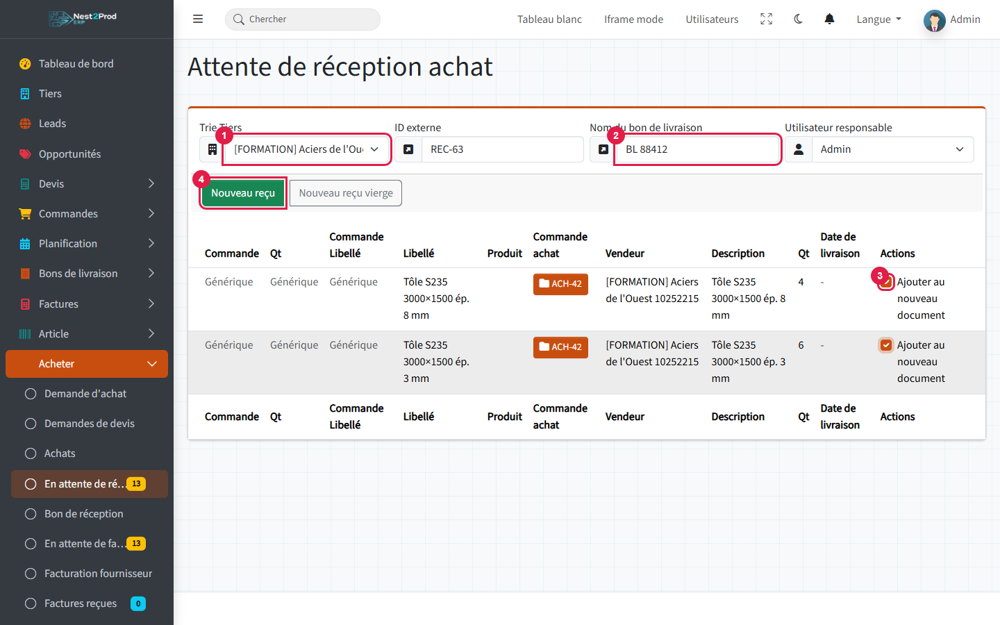

> ⚠️ Une ligne cochée est reçue **en totalité**. Pour une livraison partielle, ne cochez
> que les lignes complètes.
>
> ⚠️ Une ligne déjà reçue peut rester affichée : ne la cochez pas une seconde fois, vous
> créeriez une deuxième réception.

Le bon de réception s'ouvre. Pour chaque ligne, le bouton **Détails d'inspection** permet
d'enregistrer le contrôle : quantités acceptées et rejetées, résultat, et si besoin une
**non-conformité** créée en un clic.

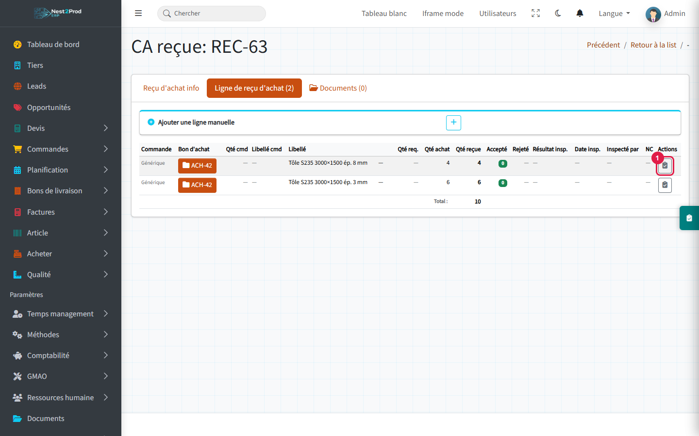

> 💡 Pour une ligne liée à un **article**, le bouton « Mise en stock » range la quantité
> acceptée dans un emplacement de stock.

---

## 5. Enregistrer la facture fournisseur

Menu **Acheter › En attente de facturation** : les réceptions pas encore facturées.

1. **Trie Tiers** : le fournisseur.
2. **Référence fournisseur** : le numéro de **sa** facture.
3. Cochez les réceptions facturées.
4. Choisissez l'**utilisateur responsable**, puis cliquez sur « Nouvelle facture ».

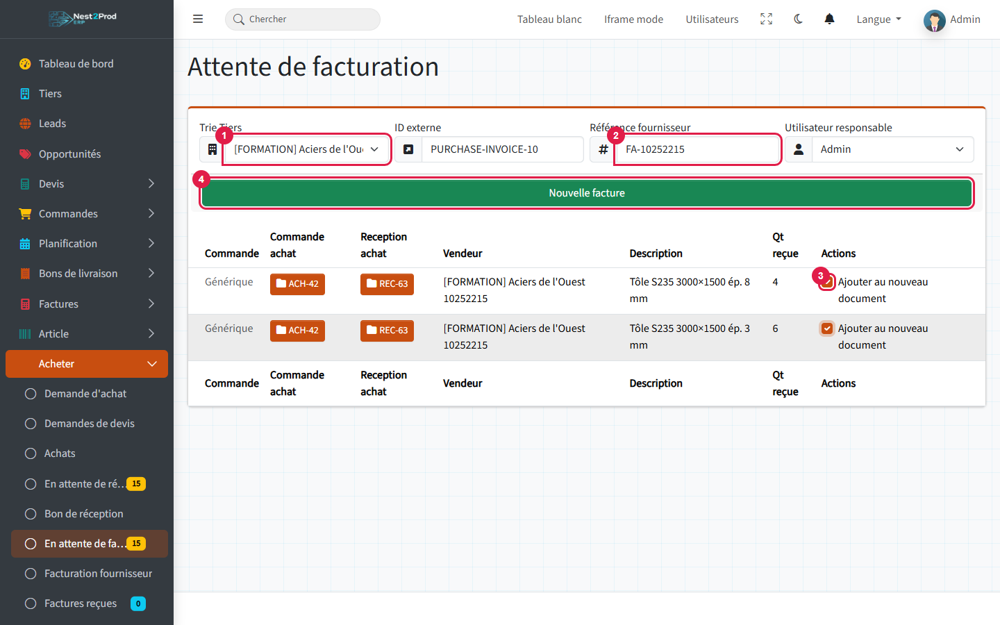

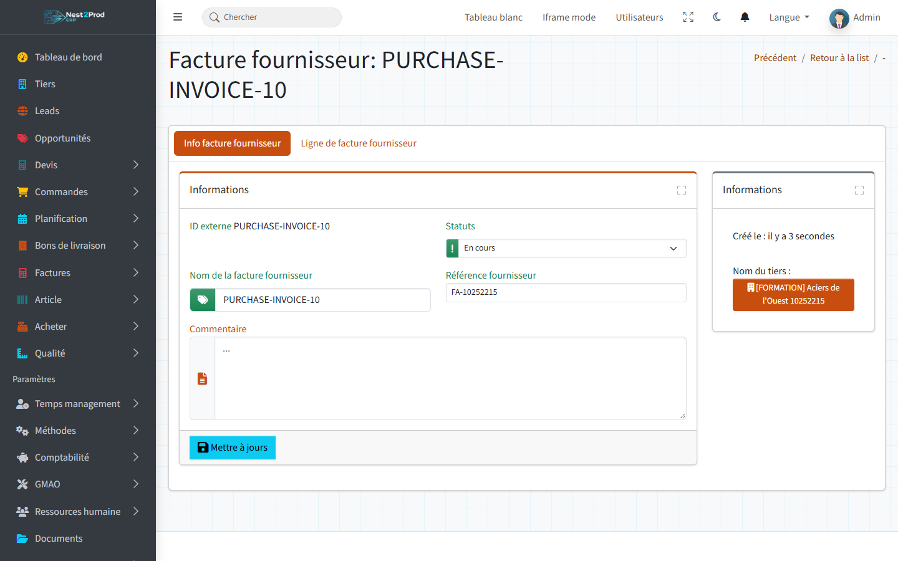

On ne peut facturer **que ce qui a été reçu**, et au prix de la commande : c'est ce qui
garantit de payer le juste montant. Une fois la facture contrôlée, passez son statut
à « Fermé ».

> ⚠️ La référence fournisseur est unique pour un fournisseur : le logiciel refuse
> d'enregistrer deux fois la même facture.
>
> 💡 Si les affectations comptables sont paramétrées, chaque facture génère ses écritures
> d'achat, reprises dans l'export FEC.

---

## Les factures électroniques reçues

Avec la facturation électronique, les factures fournisseurs arrivent au format **Factur-X**.
Menu **Acheter › Factures reçues** : celles transmises par votre plateforme y arrivent
seules, et vous pouvez y déposer à la main un PDF Factur-X ou un fichier XML.

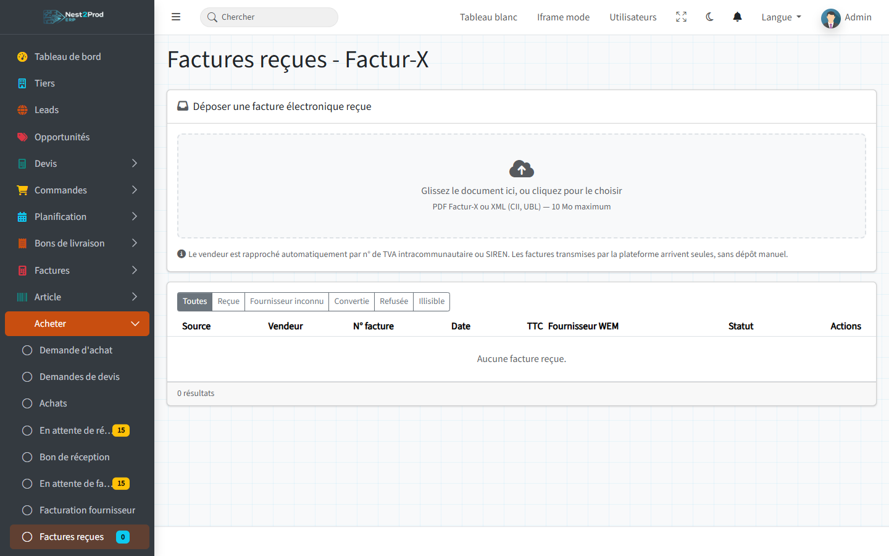

Sur chaque facture reçue :

- **Rapprocher** ouvre « En attente de facturation » sur ce fournisseur, avec le document
  reçu en regard des réceptions à cocher et l'écart de montant éventuel ;
- **Sans rapprochement** enregistre une facture sans commande (frais, abonnement) ;
- **Refuser** écarte le document.

## Et ensuite ?

- **Suivre le fournisseur** : notez-le sur la commande (« Note vendeur ») pour suivre sa
  qualité de service.
- **Relier à l'affaire** : les achats faits pour une commande client apparaissent sur la
  synthèse de son opportunité (montant acheté, achats en retard).

## Questions fréquentes

**Mon fournisseur n'apparaît pas dans les listes.**
Son « Etat fournisseur » est resté « Inactif » (étape 1.1).

**« No default settings for defaultAddress » à la création de la demande de prix.**
Le fournisseur n'a pas d'adresse ou de contact « Par défaut » (étapes 1.2 et 1.3).

**Je ne peux plus ajouter de ligne à ma commande.**
Elle n'est plus « En cours » : une commande envoyée au fournisseur est verrouillée.

**La recherche d'article ne trouve pas mon produit dans la commande.**
Le fournisseur n'est pas dans les fournisseurs préférés de l'article.

**Le fournisseur a livré une partie seulement.**
Réceptionnez les lignes livrées. Les autres restent dans « En attente de réception »
jusqu'à la prochaine livraison.
