**Goal**: keep the record of each item (what you sell, buy or make) and know at any time how
many are left, where, and which heat they come from.

> 💡 Screenshots show the French interface; button names are given as they appear in the English interface.

**Who is it for**: the methods manager (items, prices and routings) and the storekeeper
(stock, batches).

**Example used**: a support bracket bent at 90° in 3 mm steel, laser-cut then bent, stored
on shelf A1 of the store with a minimum stock of 10 parts. A customer buying 50 or more pays
€4.00 instead of €4.50.

## Before you start

- The item list and item page require the **products-menu** permission (read); creating,
  editing or duplicating an item, its prices, routing, bill of materials or documents also
  requires **products-edit**. Stock, batches, serial numbers and inventories require
  **stock-lot-serial-management**.
- **Services** (laser, bending…), **families** and **units** come from Methods (see the
  guide "Methods, the workshop dictionary").

> ⚠️ Without the **products-edit** permission, the item record opens **read only**: a blue
> banner "Read only: editing the item master is reserved to the technical department" is
> shown, fields are greyed out and add buttons disappear (prices, routing, documents). It is
> not a fault: ask the administrator for this permission (Your company › Roles and
> permissions) or send the change to the technical department.

## Overview

```steps
Item
Prices
Routing
Stock and location
Receipts and issues
Stock status
Batches and heats
Inventory
```

The **Product** menu gathers: **Product list**, **Serial Numbers**, **Batches**, **Stock**,
**Stock status** and **Inventories**.

Stock is organised on four levels:

| Level | Example |
|---|---|
| **Stock** (warehouse) | Workshop store |
| **Location** | Shelf A1 |
| **Stock line**: one item in one location | 90° bracket on shelf A1, minimum 10 |
| **Movement**: a receipt, an issue or a transfer | +20 received, −12 issued |

---

## 1. The item list

Menu **Product › Product list**, **Product list** tab: code, label, service, family, sold /
purchased with their prices, number of routing operations.

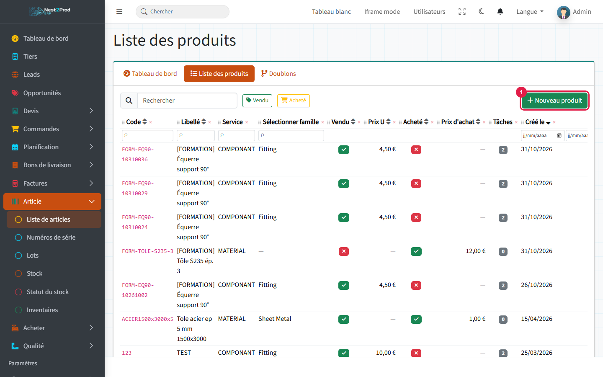

1. **New product** opens the creation window.

The **Dashboard** tab summarises the catalogue by service and family; the **Duplicates** tab
helps merge two records of the same item.

---

## 2. Create an item

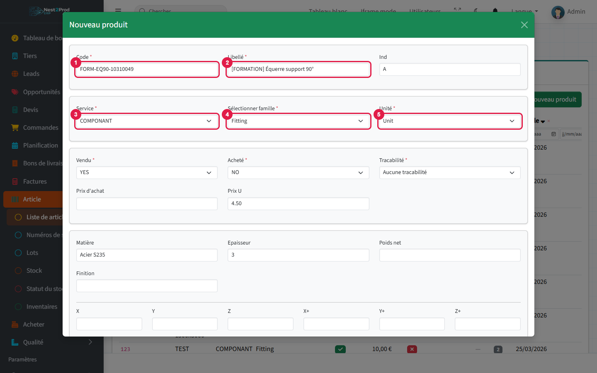

1. **Code**: the item reference, unique.
2. **Label**.
3. **Service**: the item's main service.
4. **Family**: the item's classification (sheet, fitting, component…).
5. **Unit**: piece, kilo, metre…

Then **Sold** and **Purchased** (an item can be both), **traceability**, the **selling price
(Unit price)** and the **purchase price**, material, thickness, weight and dimensions.
**Submit** opens the item record.

> ⚠️ The French **traceability** labels are misleading: "Avec numéro batch" (With batch
> number) means the **batch**, "Avec numéro de lot" (With serial number) means the **serial
> number**.

---

## 3. The item record

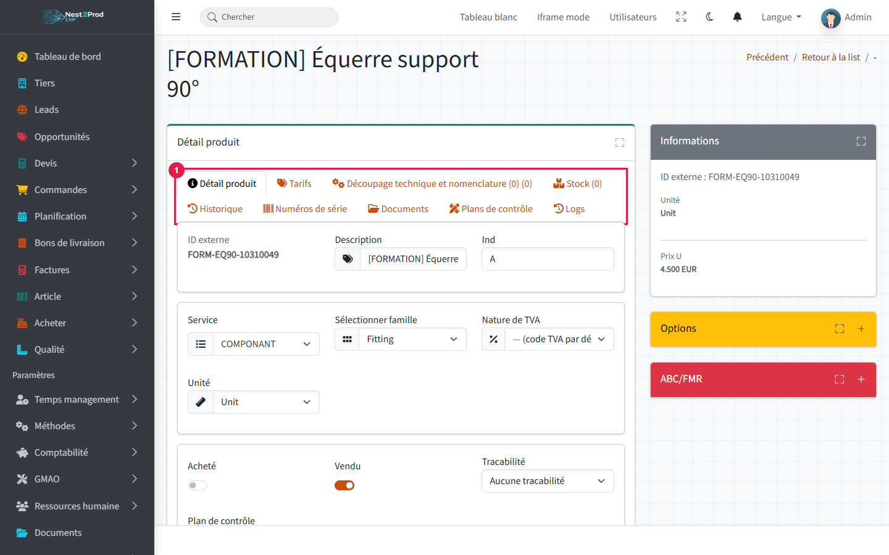

1. The record's tabs:
   - **Product detail**: everything from creation, plus VAT nature, control plan and
     purchase criticality (below);
   - **Prices** (sold items): the customer price list (section 4);
   - **Technical breakdown and bill of materials**: routing and materials (section 5);
   - **Stock**: the item's stock lines (section 8);
   - **History**: quotes, orders and purchases of the item, and the heats of received
     batches;
   - **Serial numbers**, **Documents** (drawings, 3D models, photos), **Control plans** (see
     the guide "Quality — non-conformities and inspection") and **Logs**.

If the item is purchased, a **Preferred suppliers** tab lists its suppliers and their prices
per quantity.

Further down **Product detail**, four lists serve quality:

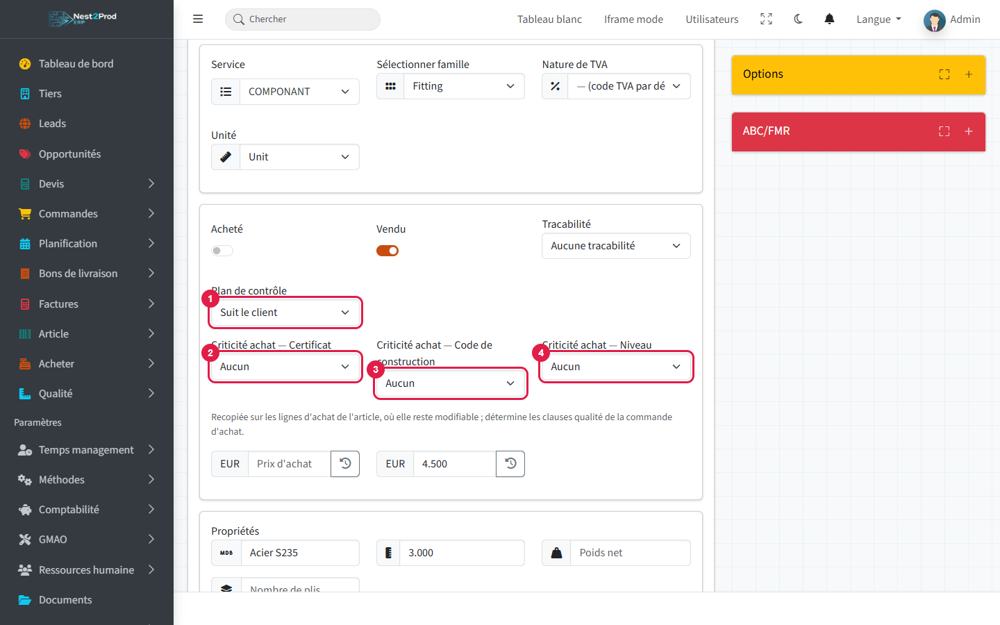

1. **Control plan**: "Follows the customer" (default: the item must be ballooned if the
   customer requires it), "Always" or "Never". It decides whether the item appears in
   **Quality plans › To balloon** (see the guide "Quality — non-conformities and
   inspection").
2. **Purchase criticality — Certificate**: the required EN 10204 material certificate (2.1,
   2.2, 3.1, 3.2).
3. **Purchase criticality — Construction code** (RCC-M, RCC-MX).
4. **Purchase criticality — Level** (N1, N2, N3, NC).

Criticality is copied onto every new purchase order line of the item, where it can still be
changed. It adds the **quality clauses** at the end of the purchase order and tells the
receiver which certificate to expect. Leave "None" for an ordinary item.

> 💡 The **Options** card (right column) offers **Duplicate product**: the copy, routing
> included, is created **immediately** with a temporary code. Rename it right away.

---

## 4. Price breaks by quantity

The **Prices** tab appears for a **sold** item. It recalls the **base selling price** and
lists the specific price breaks.

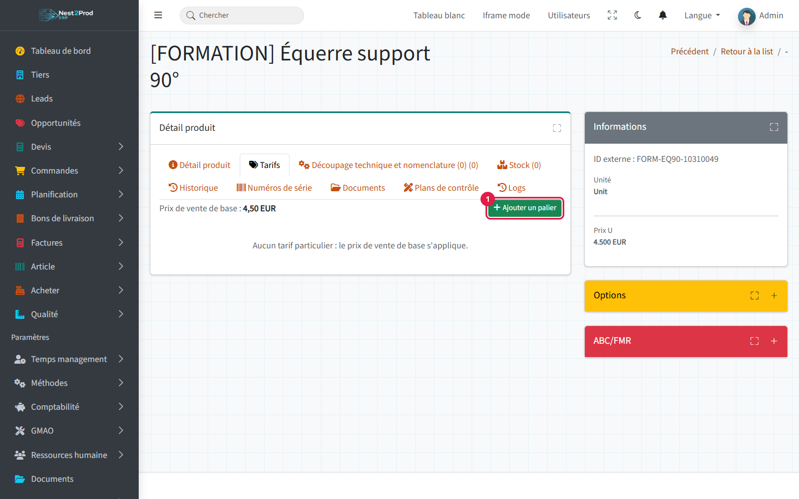

1. **Add a price break** opens the entry window.

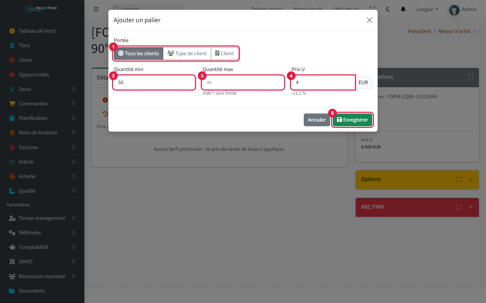

1. **Scope**: **All customers**, a **Customer type**, or a given **Customer**.
2. **Qty min**: the break applies from this quantity.
3. **Qty max**: leave empty for "no limit".
4. **Unit Price**: the break price; the gap to the base price shows below.
5. **Save**.

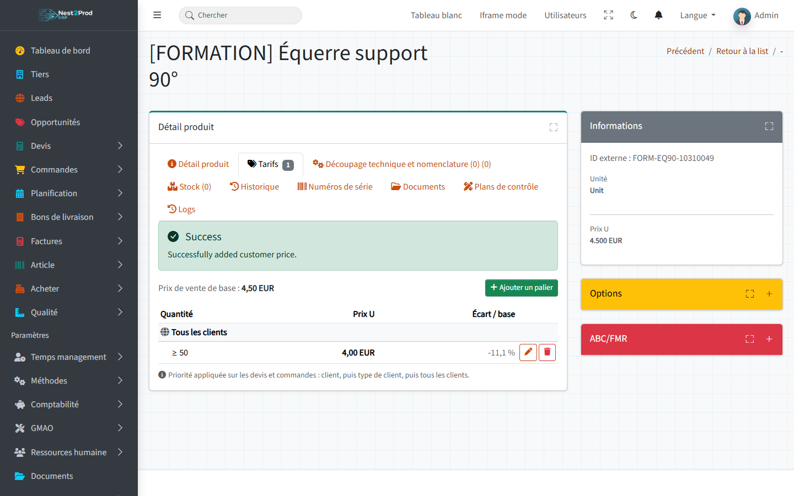

Breaks are grouped by scope and sorted by quantity, with the **gap** to the base price. The
pencil edits a break, the bin deletes it.

> ⚠️ The break price is **not applied automatically**. In the window of a quote or order
> line, the **Grille tarifaire client** (customer price list) card lists the breaks valid for
> that customer, with the one matching the quantity entered in green: click **Appliquer**
> (Apply) to use its price.
>
> 💡 An orange "Quantity ranges overlap" badge flags two breaks that overlap (for example
> 1–50 and 50–100). Nothing is blocked, but fix them to avoid hesitation.

---

## 5. The manufacturing routing

**Technical breakdown and bill of materials** tab. The **Operation** tab on the right edge of
the screen opens the **New operation** panel:

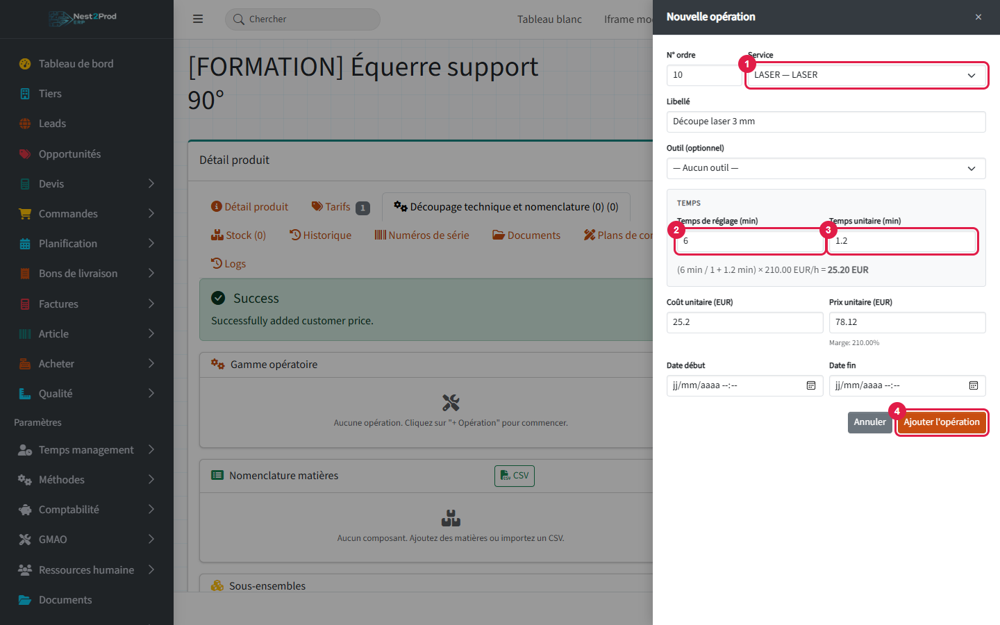

1. **Service**: laser, bending, welding… Label and hourly rate follow.
2. **Setup time**: once per run.
3. **Unit time**: per part.
4. **Add operation**.

Unit cost and price are computed from the service's hourly rate and margin, and remain
editable.

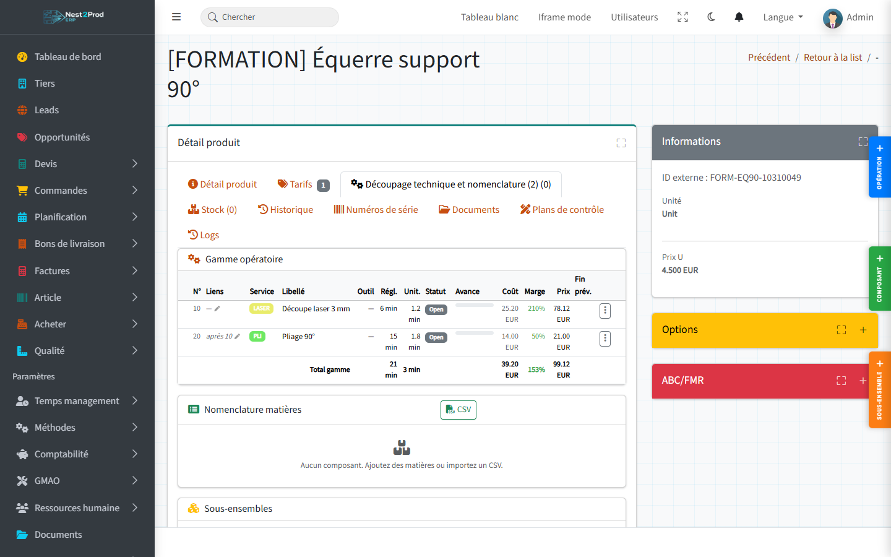

The routing is copied onto every quote and order line using the item. The **Materials bill**
and **Sub-assemblies** cards describe the materials and components consumed.

> 💡 Times are shown in minutes or hours depending on the company's **Time unit** setting.

---

## 6. Item documents

**Documents** tab: drop the PDF drawing, the DXF file, the 3D model (STEP, STL) and photos.

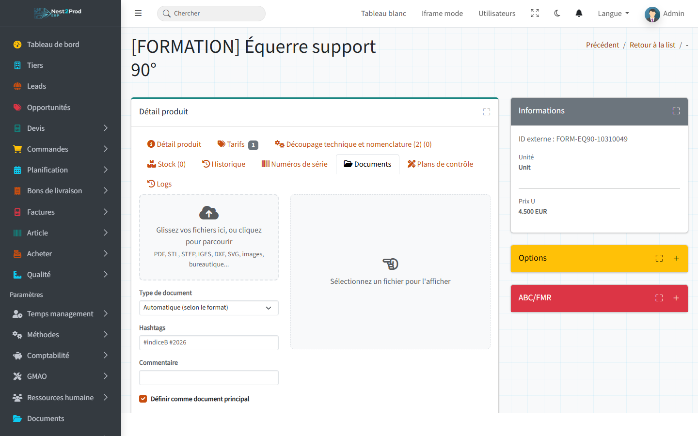

Choose the **document type** (drawing, 3D model, photo…). The main drawing is used by quote
and order lines, the job traveller and the ballooning tool of control plans. Clicking a file
shows it on the right, 3D models included.

---

## 7. Organise the stock

Menu **Product › Stock**, **New stock** card:

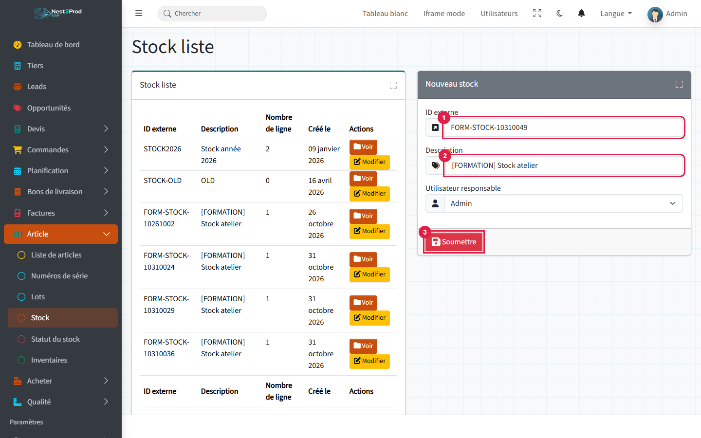

1. **External ID**: a short stock code.
2. **Description**.
3. **Submit** opens the stock record.

On the stock record, **New stock location** card: a code and a description (shelf, rack,
area).

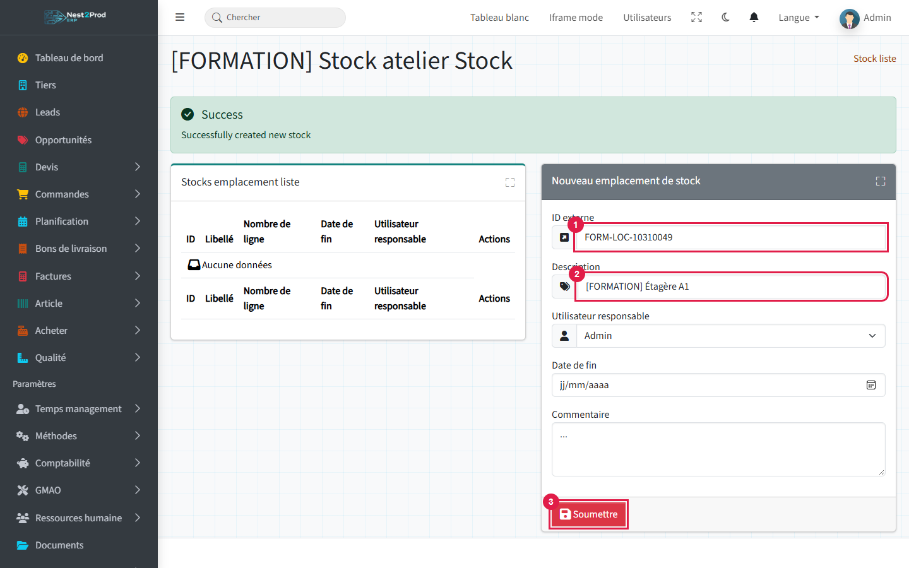

Then, on the location record, store the item there:

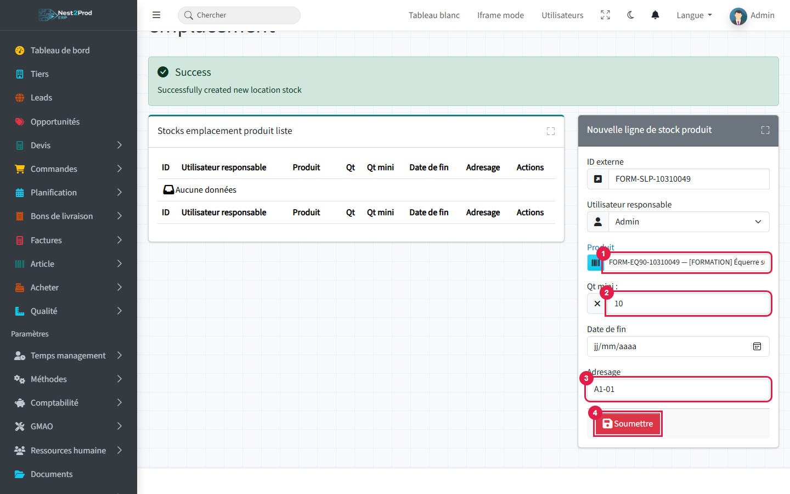

1. **Product**: type the code or label, then click the suggested item.
2. **Min qty**: the desired minimum stock in this location.
3. **Addressing**: the exact position (A1-01).
4. **Submit**.

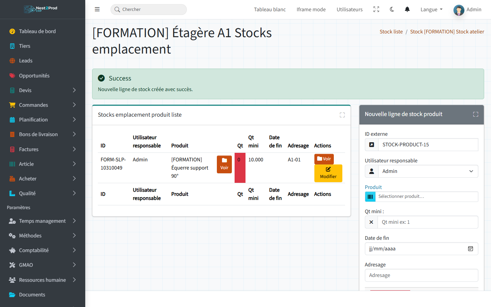

> 💡 Each form suggests a code (STOCK-…, STOCK-LOCATION-…, STOCK-PRODUCT-…) following the
> last one created: keep it or replace it with your own coding.
>
> ⚠️ Stocks, locations, lines and movements **cannot be deleted** from the screen: check the
> code and the item before saving.

---

## 8. Receipts, issues and transfers

A stock line's **View** button opens its movements, with four tiles: weighted average cost
(WAC), receipts, issues and current stock.

**Receipt** ("New stock entry line" card):

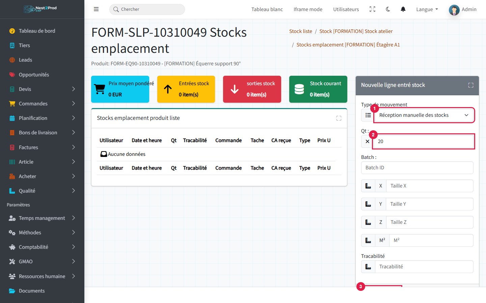

1. **Movement type**: Manual stock receipt, Inventory, Purchase order receipt, Manufactured
   component.
2. **Qty**: the quantity received.

**Issue** ("New stock issue line" card):

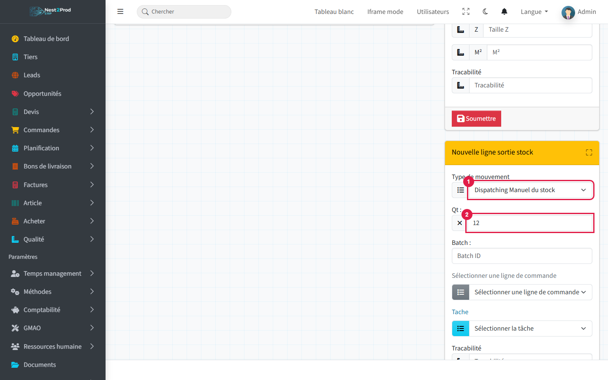

1. **Movement type**: Manual stock dispatching, or Delivered part.
2. **Qty**: the quantity issued. It is refused if stock is insufficient.

An issue can be linked to an **order line** or a **task**: the lists only offer those
concerning the item of the stock line. The **Stock transfer** card moves a quantity to
another location (an issue and a receipt in one operation).

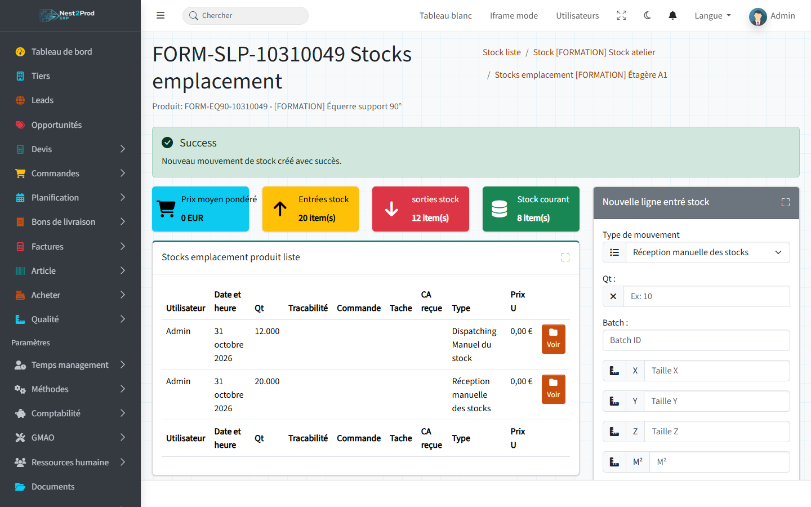

Purchase receipts, deliveries and production declarations create these movements on their
own: manual entry is for cases outside the flow.

> ⚠️ A movement is **final**: there is no deletion or cancellation. A mistake is corrected
> by an opposite movement.
>
> ⚠️ A manual receipt carries no price: it does not change the **WAC**, which stays at 0 as
> long as the item only came in that way. Only purchase receipts value the stock.
>
> 💡 Leave the **Batch** field empty. For a part of a batch, type the **batch code**
> (BATCH-…) in **Traceability**: the movement is then linked to the batch and shows on its
> record (section 11).

The item record's **Stock** tab lists all its lines, the quantity in red when it falls below
the minimum:

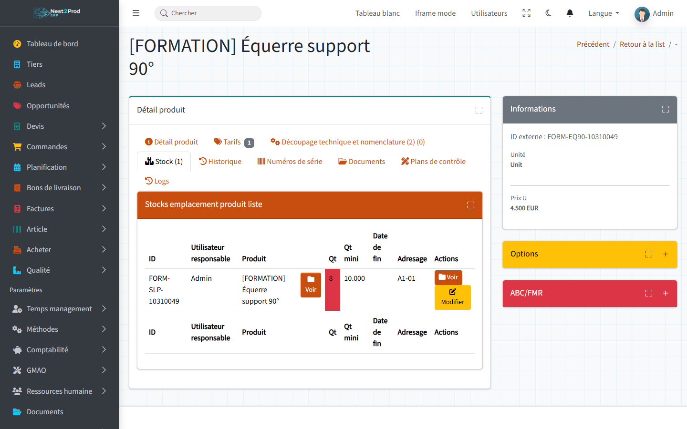

---

## 9. Stock status

Menu **Product › Stock status**: for each item, total stock against **demand** (undelivered
orders and unfinished tasks), reservations and locations.

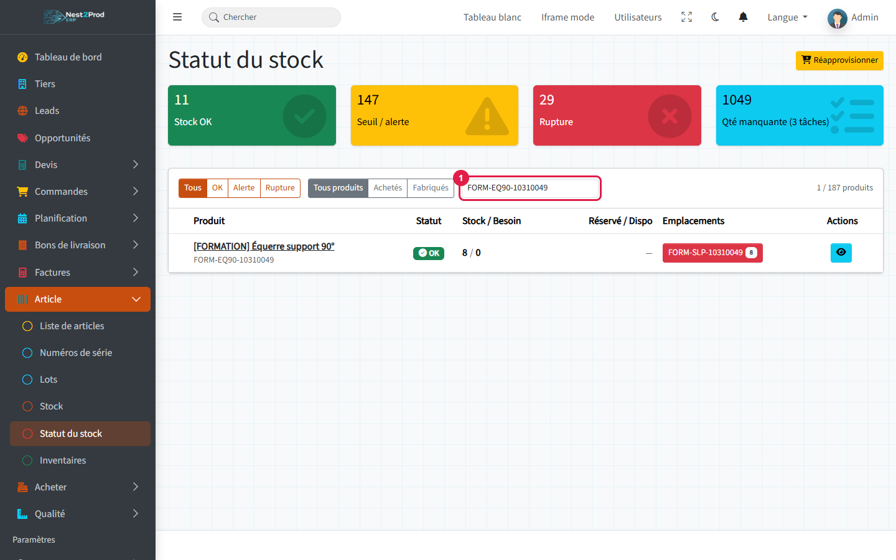

1. The search filters by code or label.

- **Status**: OK if stock covers demand, Alert if just equal, Shortage if lower.
- **Locations**: each badge turns red below the location's **minimum**.

In the example, the bracket is **OK** (8 in stock, no demand) but its location is **red**
(8 below the minimum of 10): restock, without an urgent order.

**Reorder** opens purchase needs. For a manufactured item with demand, the folder icon
creates an internal manufacturing **order**, after confirmation.

---

## 10. Serial numbers

Menu **Product › Serial Numbers**: one number per delivered part, with item, order, status
and the **Trace** button (its history).

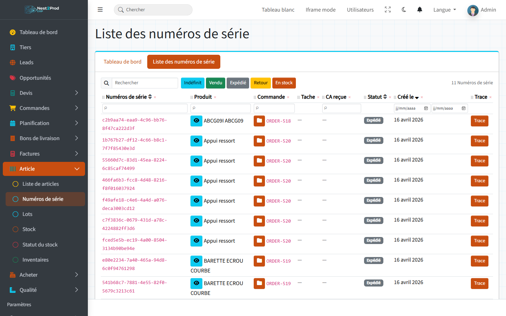

Serial numbers are created at **delivery**, for items tracked per part.

---

## 11. Batches and heats

A **batch** groups parts or material of the same origin: its **heat number** (the steel
mill's melt number, printed on the certificate), the **supplier batch**, the **EN 10204
certificate** and the purchase receipt it comes from.

### Create the batch at receipt

The batch is born when a purchase receipt line is **put into stock** (receipt record,
**Purchase receipt lines** tab, warehouse icon button, see the guide "From request for
quotation to supplier invoice"):

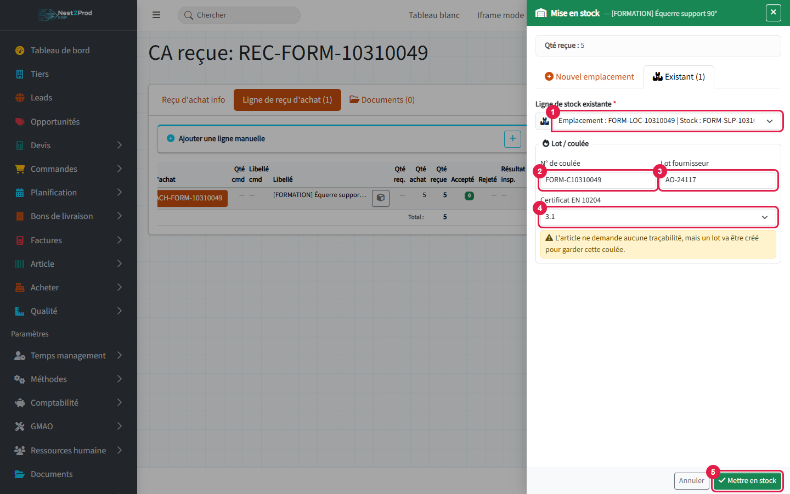

1. **Ligne de stock existante** (existing stock line, **Existant** tab) or **Nouvel
   emplacement** (new location): where to store the goods.
2. **Heat number**: read from the certificate or the material.
3. **Supplier batch**: the supplier's batch number, if any.
4. **EN 10204 certificate**: suggested from the certificate noted when inspecting the
   receipt.
5. **Mettre en stock** (put into stock).

> 💡 This drawer is shown in French whatever the language chosen: the button names are
> given here as they appear.

A batch is created if the item is batch-tracked ("With batch number") **or** if a heat or
supplier batch is entered. The batch gets a BATCH-… code; supplier and receipt are filled in
automatically.

> ⚠️ For an item **without traceability**, entering a heat still creates a batch: the yellow
> warning "The product requires no traceability, but a batch will be created to keep this
> heat" says so. Leave the fields empty if you do not want to track this material.

### Find a batch by its heat

Menu **Product › Batches**:

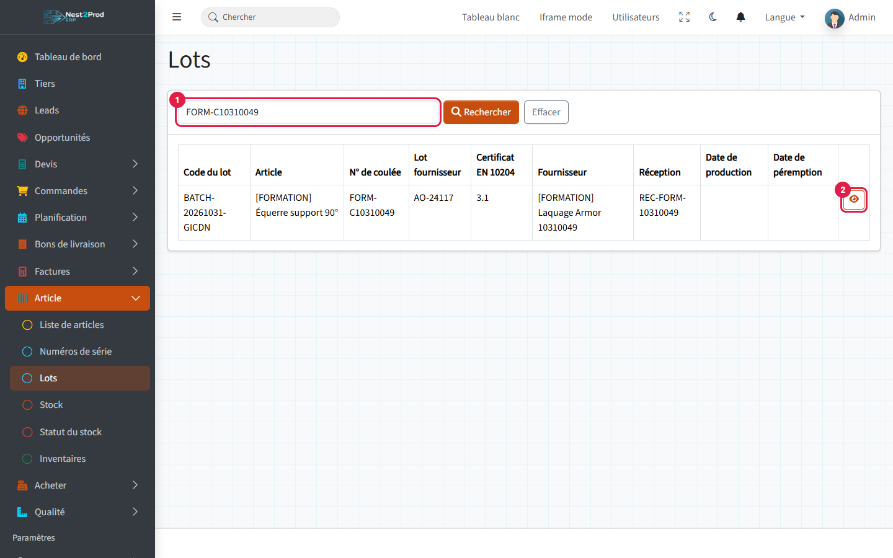

1. The search accepts the **heat number**, the **supplier batch** or the **batch code**,
   then **Search**. A green icon in the certificate column shows that a certificate is
   attached.
2. The eye opens the **batch record**.

### The batch record

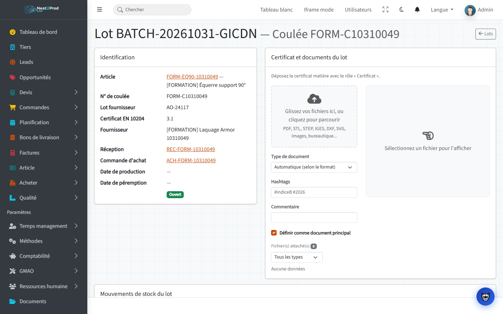

- **Identification**: item, heat, supplier batch, certificate, supplier, receipt, purchase
  order (clickable links) and open / closed state;
- **Certificate and batch documents**: drop the **material certificate** (PDF or photo) with
  the **Certificate** role; it stays attached to the batch;
- **Batch stock moves**: every receipt and issue, with the stock line and the task that
  consumed the material.

The heat also shows under the traceability of the stock line's movements (link to the batch
record), in the item's **History** tab and in **Consumed batches** on the task screen:

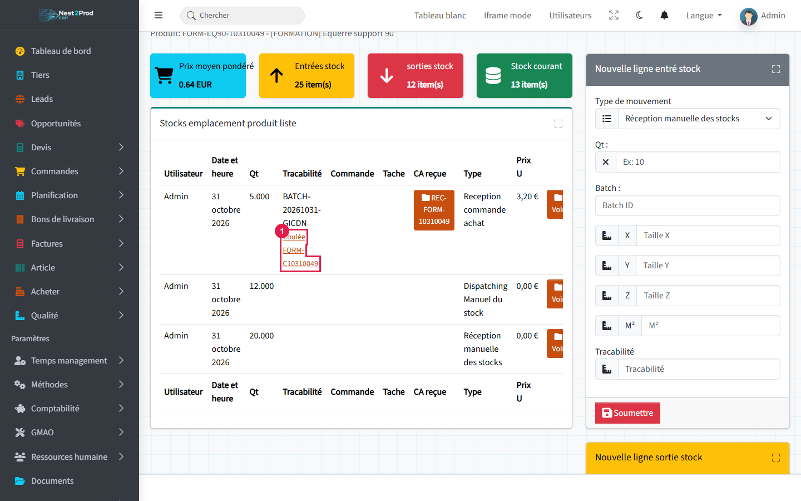

1. The "Coulée …" (heat) link opens the batch record.

> 💡 When a task consumes material, the issue is split **batch by batch, oldest first**: the
> job traveller thus prints the heats used.

<!-- feature: access-log -->
> 💡 Opening a batch record is recorded in the **access log** (read traceability), like
> quotes and orders.
<!-- /feature -->

---

## 12. Inventories

Menu **Product › Inventories**, **New inventory**: choose the scope (all stock, locations or
categories).

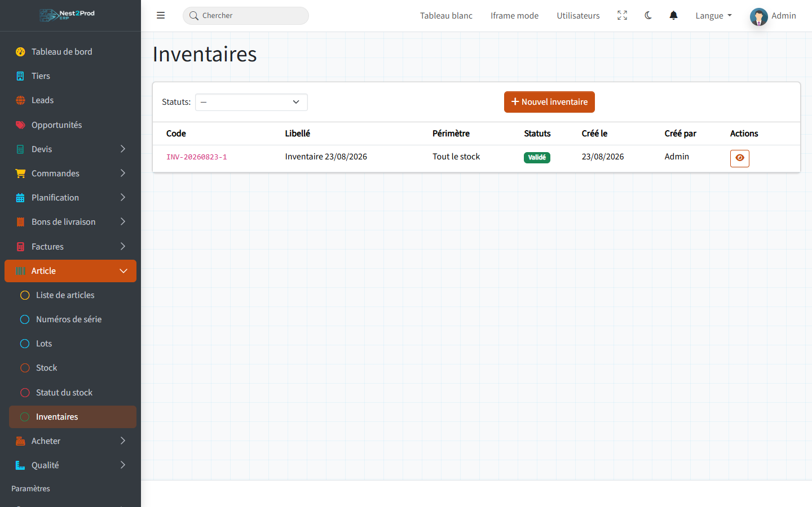

The record follows three steps:

1. **Export** the counting list (Excel), or its **blind version** without expected
   quantities, to print for counting;
2. **Import** the counted file: a preview flags errors before import;
3. **Validate**: variances become adjustment movements.

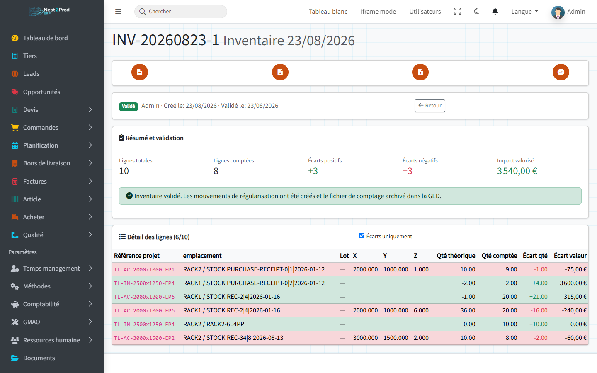

The record sums up counted lines, positive and negative variances and their **valued
impact**; the **Variances only** box shows only lines with a variance.

> ⚠️ Pause stock movements during the inventory: validation is refused if stock moved since
> creation. Once validated, the inventory is frozen and its movements are final.
>
> 💡 Counting happens in the Excel file: counted quantities cannot be typed in the screen.

## What next?

- **Sell the item**: add it to a quote line; its routing and price list follow (guide "From
  prospect to invoice").
- **Buy it**: request for quotation, order, receipt and putting into stock with the heat
  (guide "From request for quotation to supplier invoice").
- **Inspect it**: ballooned control plan, first article (guide "Quality — non-conformities
  and inspection").

## Frequently asked questions

**I cannot change anything on the item record.**
You lack the **products-edit** permission: the "Read only" banner says so. Ask the
administrator for it.

**I added a price break, but the quote keeps the base price.**
The break is not applied automatically: on the quote line, click **Appliquer** in the
**Grille tarifaire client** card.

**"Code already used" when creating a stock or location.**
The code typed is already taken: use the code suggested by the form, or choose another one.

**The weighted average cost stays at 0.**
The item only came into stock through manual receipts, which carry no price.

**I entered the wrong quantity in an issue.**
Record a receipt for the difference (or the opposite): a movement cannot be changed.

**The item is "OK" but the location is red.**
Stock covers open orders, but it fell below the location's minimum.

**I cannot find the heat of a material.**
The heat is only known if it was entered when the receipt was put into stock. For an
existing batch, the heat cannot be completed from the screen: note it on the next receipt.
