**Goal**: keep the record of each item (what you sell, buy or make) and know at any time how
many are left, and where.

> 💡 Screenshots show the French interface; button names are given as they appear in the English interface.

**Who is it for**: the methods manager (items and routings) and the storekeeper (stock).

**Example used**: a support bracket bent at 90° in 3 mm steel, laser-cut then bent, stored
on shelf A1 of the store with a minimum stock of 10 parts.

## Before you start

- The item list requires the **products-menu** permission; stock, batches, serial numbers
  and inventories require **stock-lot-serial-management**.
- **Services** (laser, bending…), **families** and **units** come from Methods (see the
  guide "Methods").

## Overview

```steps
Item
Routing
Stock and location
Receipts and issues
Stock status
Inventory
```

The **Product** menu gathers: **Product list**, **Serial Numbers**, **Batches**, **Stock**,
**Stock status** and **Inventories**.

Stock is organised on four levels:

| Level | Example |
|---|---|
| **Stock** (warehouse) | Workshop store |
| **Location** | Shelf A1 |
| **Stock line**: one item in one location | 90° bracket on shelf A1, minimum 10 |
| **Movement**: a receipt, an issue or a transfer | +20 received, −12 issued |

---

## 1. The item list

Menu **Product › Product list**, **Product list** tab: code, label, service, family, sold /
purchased with their prices, number of routing operations.

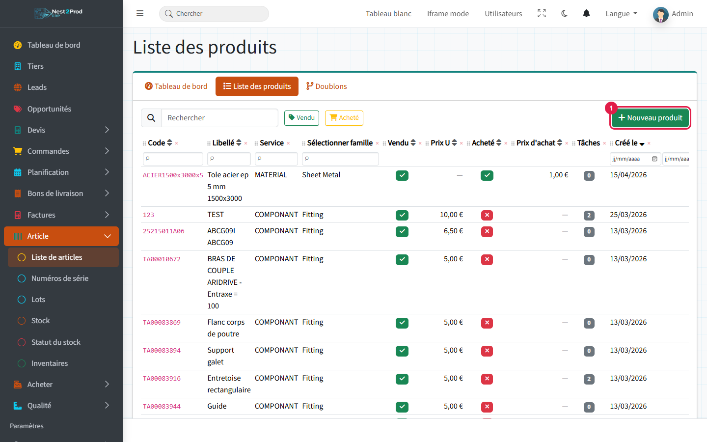

1. **New product** opens the creation window.

The **Dashboard** tab summarises the catalogue by service and family; the **Duplicates** tab
helps merge two records of the same item.

---

## 2. Create an item

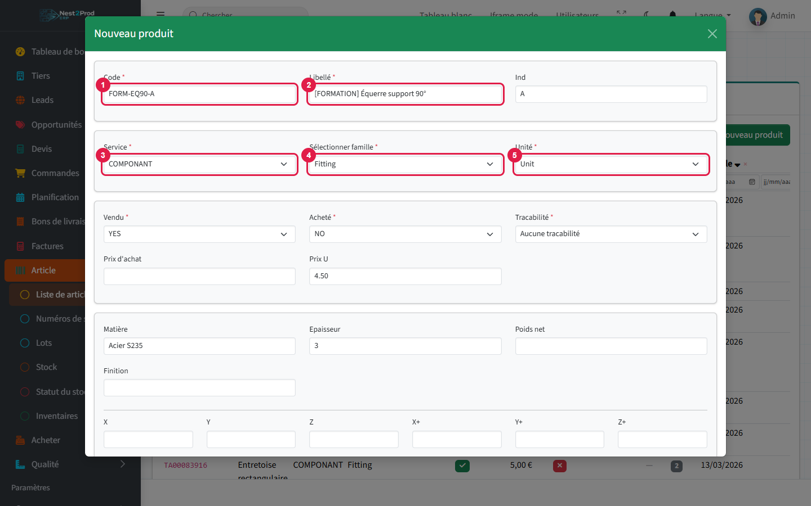

1. **Code**: the item reference, unique.
2. **Label**.
3. **Service**: the item's main service.
4. **Family**: the item's classification (sheet, fitting, component…).
5. **Unit**: piece, kilo, metre…

Then **Sold** and **Purchased** (an item can be both), **traceability**, the **selling price
(Unit price)** and the **purchase price**, material, thickness, weight and dimensions.
**Submit** opens the item record.

> ⚠️ The **traceability** labels are misleading: "With batch number" means the **batch**,
> "With lot number" means the **serial number**.

---

## 3. The item record

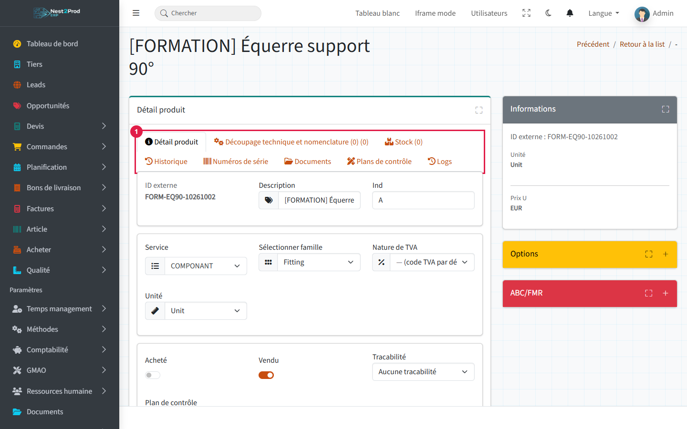

1. The record's tabs:
   - **Product detail**: everything from creation, plus VAT nature, control plan and the
     **customer price list** (price per customer and quantity);
   - **Technical breakdown and bill of materials**: routing and materials (section 4);
   - **Stock**: the item's stock lines (section 7);
   - **History**: quotes, orders and purchases of the item;
   - **Serial numbers**, **Documents** (drawings, 3D models, photos), **Control plans** (see
     the guide "Quality") and **Logs**.

If the item is purchased, a **Preferred suppliers** tab lists its suppliers and their prices
per quantity.

> 💡 The **Options** card (right column) offers **Duplicate product**: the copy, routing
> included, is created **immediately** with a temporary code. Rename it right away.

---

## 4. The manufacturing routing

**Technical breakdown and bill of materials** tab. The **Operation** tab on the right edge of
the screen opens the **New operation** panel:

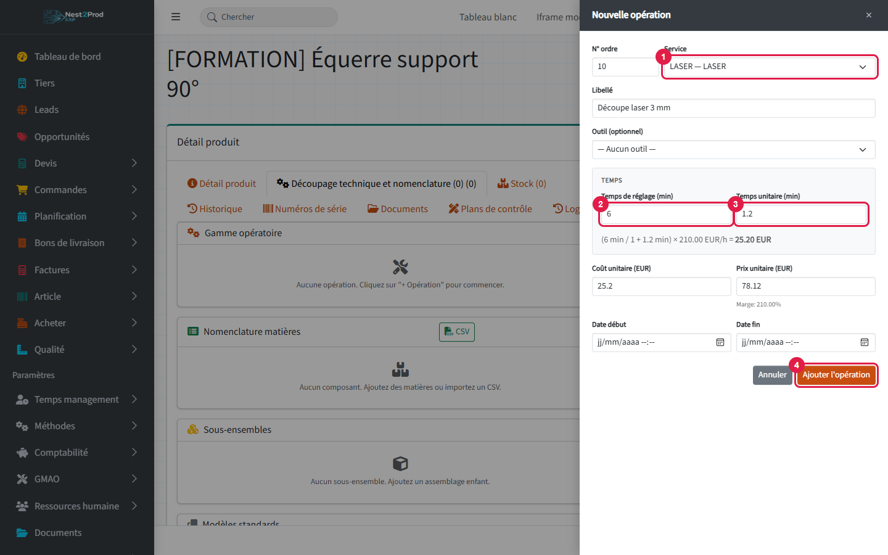

1. **Service**: laser, bending, welding… Label and hourly rate follow.
2. **Setup time**: once per run.
3. **Unit time**: per part.
4. **Add operation**.

Unit cost and price are computed from the service's hourly rate and margin, and remain
editable.

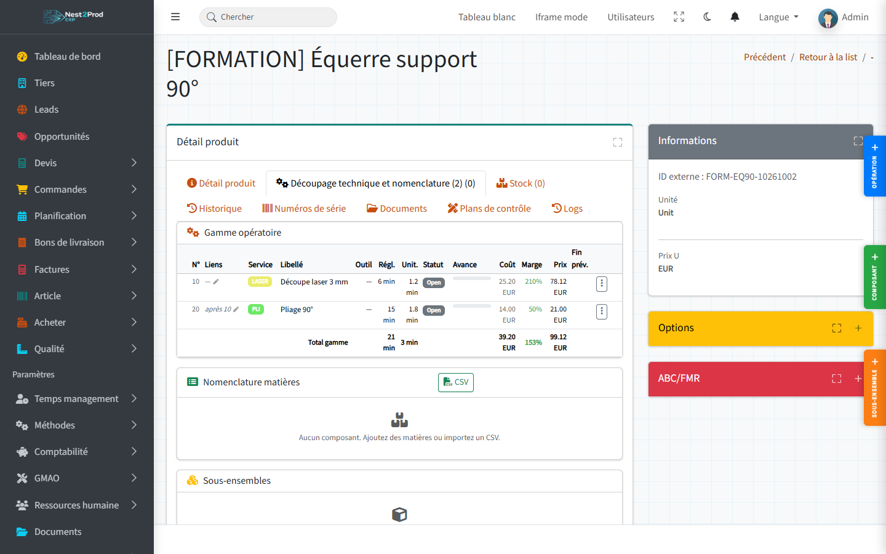

The routing is copied onto every quote and order line using the item. The **Materials bill**
and **Sub-assemblies** cards describe the materials and components consumed.

> 💡 Times are shown in minutes or hours depending on the company's **Time unit** setting.

---

## 5. Item documents

**Documents** tab: drop the PDF drawing, the DXF file, the 3D model (STEP, STL) and photos.

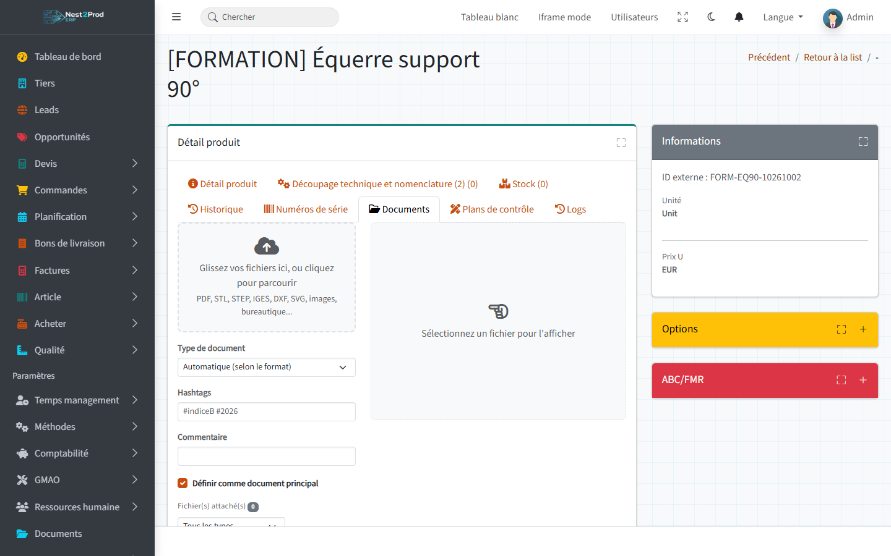

Choose the **document type** (drawing, 3D model, photo…). The main drawing is used by quote
and order lines, the job traveller and the ballooning tool of control plans. Clicking a file
shows it on the right, 3D models included.

---

## 6. Organise the stock

Menu **Product › Stock**, **New stock** card:

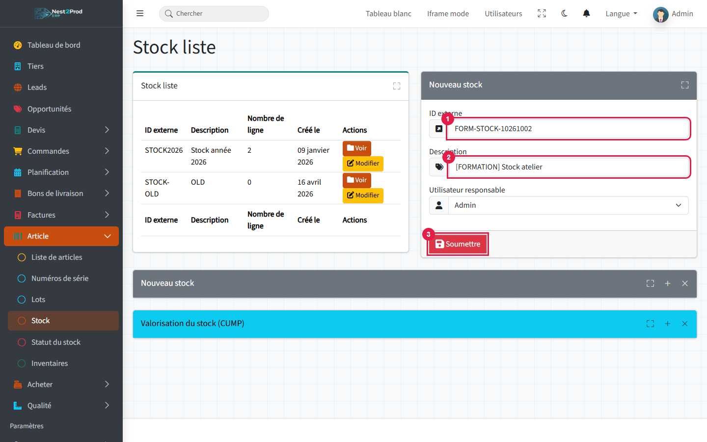

1. **External ID**: a short stock code.
2. **Description**.
3. **Submit** opens the stock record.

On the stock record, **New stock location** card: a code and a description (shelf, rack,
area).

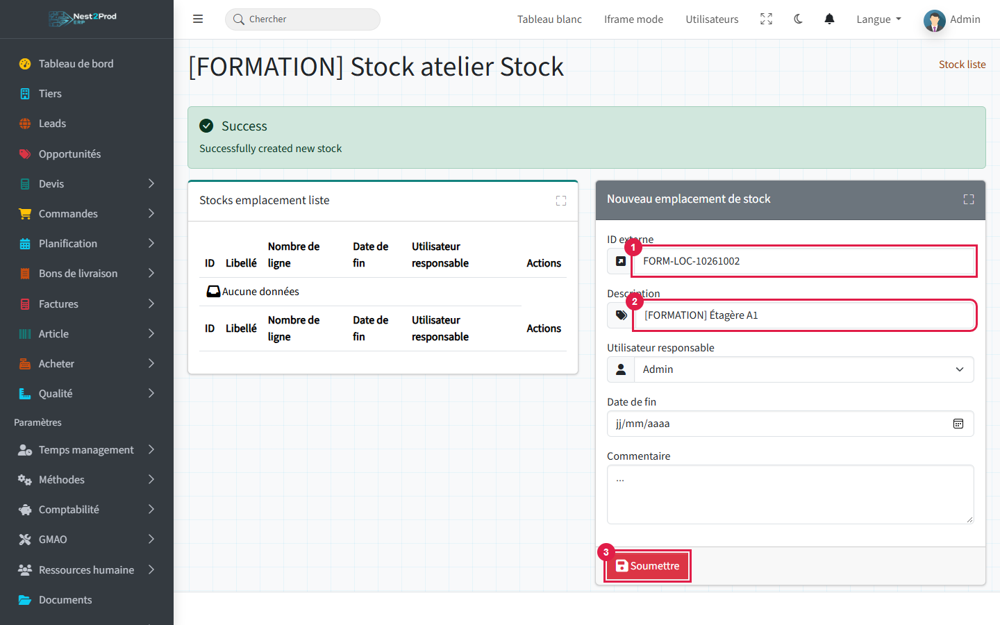

Then, on the location record, store the item there:

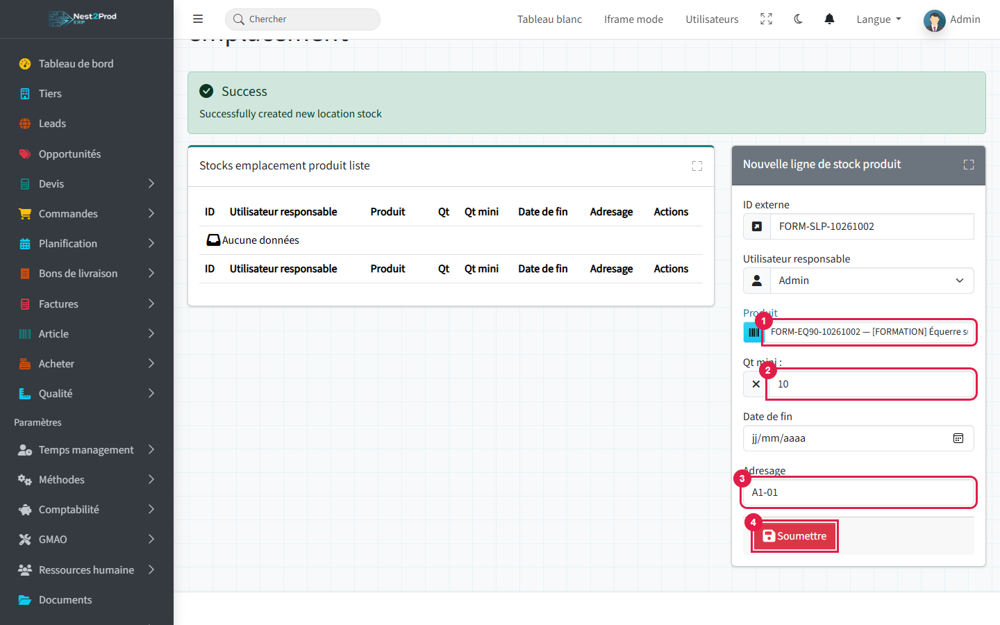

1. **Product**: type the code or label, then click the suggested item.
2. **Min qty**: the desired minimum stock in this location.
3. **Addressing**: the exact position (A1-01).
4. **Submit**.

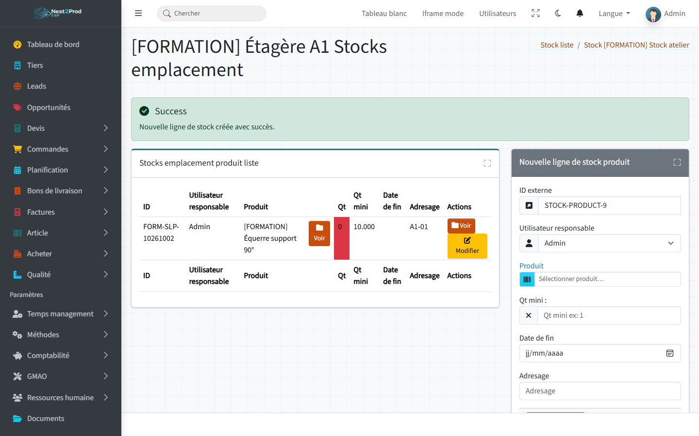

> ⚠️ Stocks, locations, lines and movements **cannot be deleted** from the screen: check the
> code and the item before saving.

---

## 7. Receipts, issues and transfers

A stock line's **View** button opens its movements, with four tiles: weighted average cost
(WAC), receipts, issues and current stock.

**Receipt** ("New stock entry line" card):

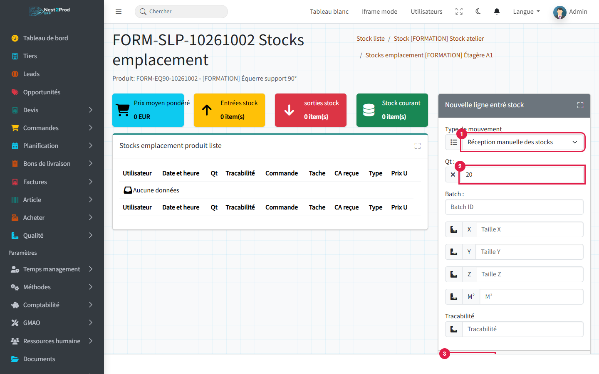

1. **Movement type**: Manual stock receipt, Inventory, Purchase order receipt, Manufactured
   component.
2. **Qty**: the quantity received.

**Issue** ("New stock issue line" card):

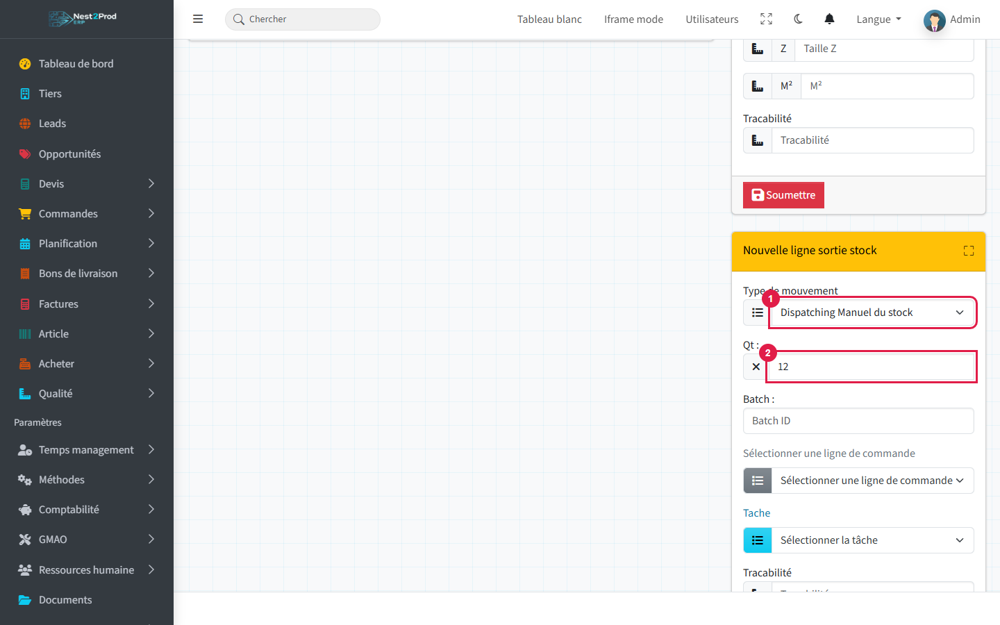

1. **Movement type**: Manual stock dispatching, or Delivered part.
2. **Qty**: the quantity issued. It is refused if stock is insufficient.

An issue can be linked to an order line or a task of the item. The **Stock transfer** card
moves a quantity to another location (an issue and a receipt in one operation).

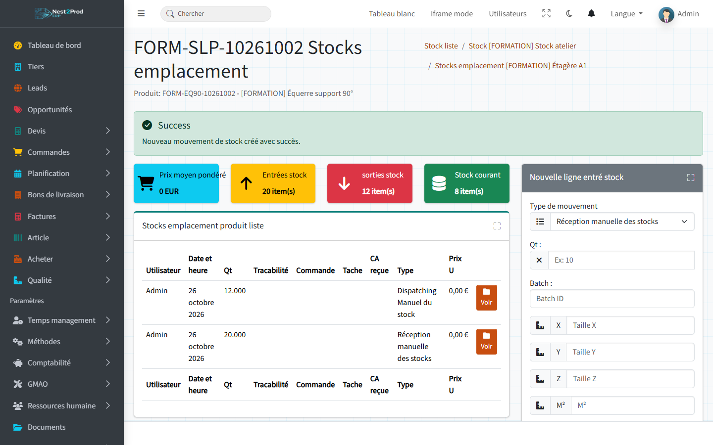

Purchase receipts, deliveries and production declarations create these movements on their
own: manual entry is for cases outside the flow.

> ⚠️ A movement is **final**: there is no deletion or cancellation. A mistake is corrected
> by an opposite movement.
>
> ⚠️ A manual receipt carries no price: it does not change the **WAC**, which stays at 0 as
> long as the item only came in that way. Only purchase receipts value the stock.
>
> 💡 Leave the **Batch** field empty: the batch is written in **Traceability**.

The item record's **Stock** tab lists all its lines, the quantity in red when it falls below
the minimum:

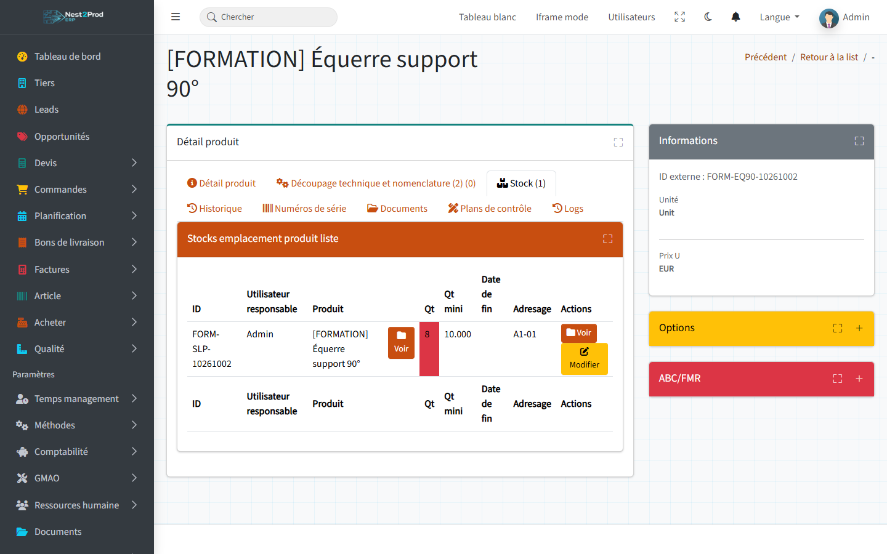

---

## 8. Stock status

Menu **Product › Stock status**: for each item, total stock against **demand** (undelivered
orders and unfinished tasks), reservations and locations.

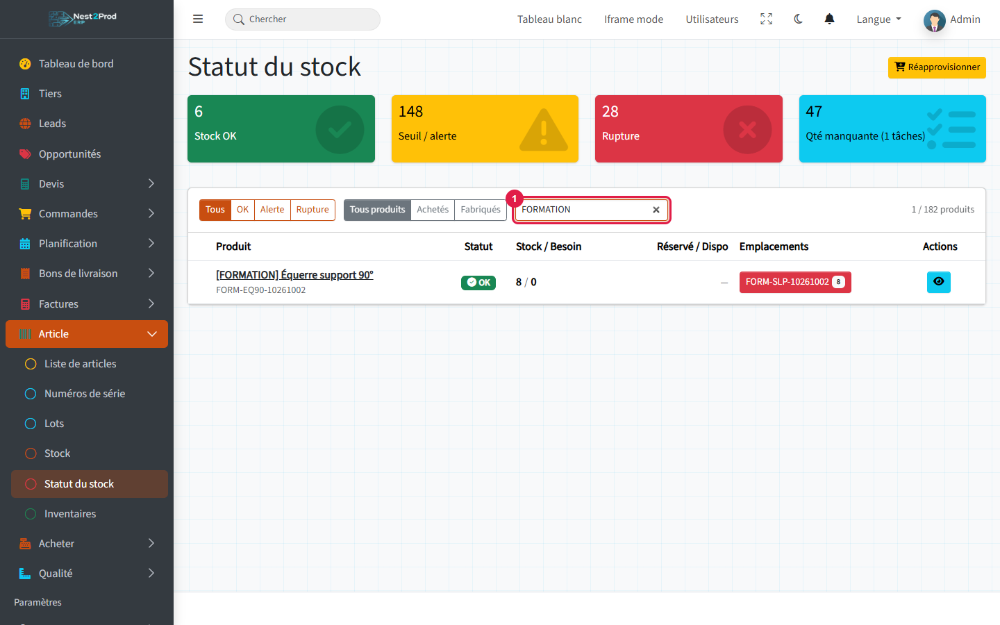

- **Status**: OK if stock covers demand, Alert if just equal, Shortage if lower.
- **Locations**: each badge turns red below the location's **minimum**.

In the example, the bracket is **OK** (8 in stock, no demand) but its location is **red**
(8 below the minimum of 10): restock, without an urgent order.

**Reorder** opens purchase needs. For a manufactured item with demand, the folder icon
creates an internal manufacturing **order**, after confirmation.

---

## 9. Serial numbers and batches

Menu **Product › Serial Numbers**: one number per delivered part, with item, order, status
and the **Trace** button (its history).

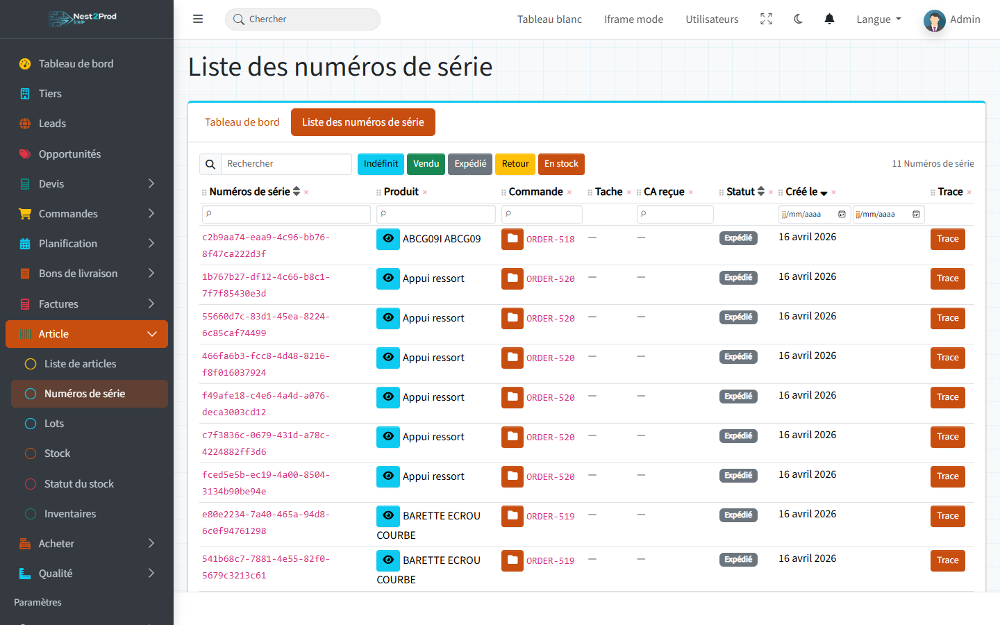

Serial numbers are created at **delivery**, for items tracked per part.

> ⚠️ The **Batches** screen stays empty for now: the batch number of a batch-tracked item is
> held by the **Traceability** field of stock movements (generated at the first stocking from
> a receipt or an internal order).

---

## 10. Inventories

Menu **Product › Inventories**, **New inventory**: choose the scope (all stock, locations or
categories).

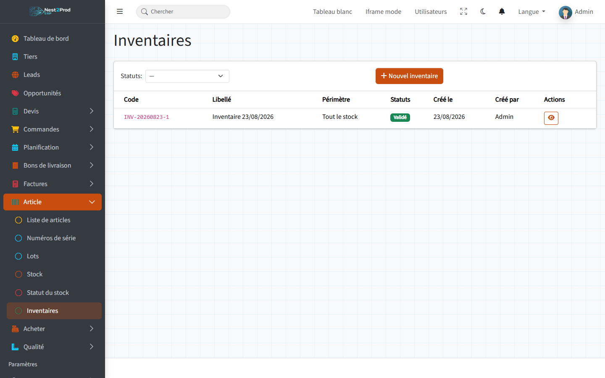

The record follows three steps:

1. **Export** the counting list (Excel), or its **blind version** without expected
   quantities, to print for counting;
2. **Import** the counted file: a preview flags errors before import;
3. **Validate**: variances become adjustment movements.

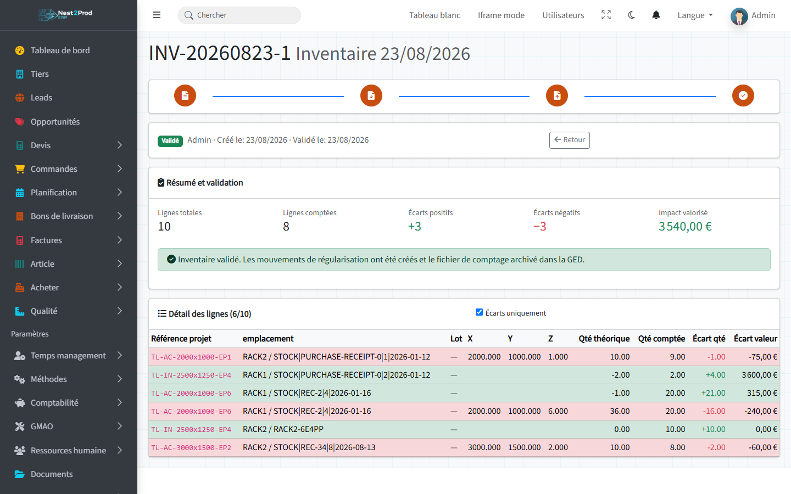

> ⚠️ Pause stock movements during the inventory: validation is refused if stock moved since
> creation. Once validated, the inventory is frozen and its movements are final.
>
> 💡 Counting happens in the Excel file: counted quantities cannot be typed in the screen.

## Frequently asked questions

**"Code already used" when creating a stock or location.**
Another stock already has this code: choose another one.

**The weighted average cost stays at 0.**
The item only came into stock through manual receipts, which carry no price.

**I entered the wrong quantity in an issue.**
Record a receipt for the difference (or the opposite): a movement cannot be changed.

**The item is "OK" but the location is red.**
Stock covers open orders, but it fell below the location's minimum.
