**Objectif** : tenir la fiche de chaque article (ce que l'on vend, achète ou fabrique) et
savoir à tout moment combien il en reste, où, et de quelle coulée il vient.

**Pour qui** : le responsable des méthodes (articles, tarifs et gammes) et le magasinier
(stock, lots).

**Exemple utilisé** : une équerre support pliée à 90° en acier de 3 mm, découpée au laser
puis pliée, rangée sur l'étagère A1 du magasin avec un stock minimum de 10 pièces. Un client
qui en prend 50 ou plus la paie 4,00 € au lieu de 4,50 €.

## Avant de commencer

- La liste et la fiche des articles demandent la permission **products-menu** (lecture) ;
  créer, modifier, dupliquer un article, ses tarifs, sa gamme, sa nomenclature ou ses
  documents demande en plus **products-edit**. Le stock, les lots, les numéros de série et
  les inventaires demandent **stock-lot-serial-management**.
- Les **services** (laser, pliage…), **familles** et **unités** viennent des Méthodes
  (voir le guide « Les Méthodes »).

> ⚠️ Sans la permission **products-edit**, la fiche article s'ouvre en **consultation
> seule** : un bandeau bleu « Consultation seule : la modification de la base article est
> réservée au service technique » s'affiche, les champs sont grisés et les boutons d'ajout
> disparaissent (tarifs, gamme, documents). Ce n'est pas une panne : demandez à
> l'administrateur de vous donner ce droit (Votre société › Rôles et permissions) ou
> adressez la modification au service technique.

## Vue d'ensemble

```steps
Article
Tarifs
Gamme
Stock et emplacement
Entrées et sorties
Statut du stock
Lots et coulées
Inventaire
```

Le menu **Article** regroupe : **Liste de articles**, **Numéros de série**, **Lots**,
**Stock**, **Statut du stock** et **Inventaires**.

Le stock s'organise sur quatre niveaux :

| Niveau | Exemple |
|---|---|
| **Stock** (entrepôt) | Magasin atelier |
| **Emplacement** | Étagère A1 |
| **Ligne de stock** : un article dans un emplacement | Équerre 90° sur l'étagère A1, minimum 10 |
| **Mouvement** : une entrée, une sortie ou un transfert | +20 en réception, −12 en sortie |

---

## 1. La liste des articles

Menu **Article › Liste de articles**, onglet **Liste des produits** : code, libellé,
service, famille, vendu / acheté et leurs prix, nombre d'opérations de la gamme.

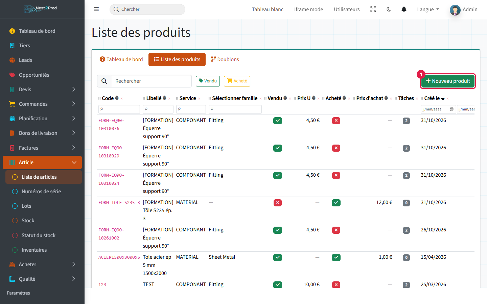

1. **Nouveau produit** ouvre la fenêtre de création.

L'onglet **Tableau de bord** résume le catalogue par service et par famille ; l'onglet
**Doublons** aide à fusionner deux fiches du même article.

---

## 2. Créer un article

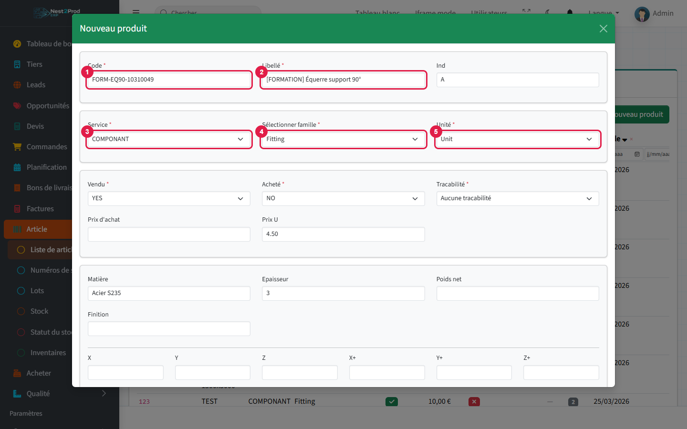

1. **Code** : la référence de l'article, unique.
2. **Libellé**.
3. **Service** : le service principal de l'article.
4. **Famille** : le classement de l'article (tôle, raccord, composant…).
5. **Unité** : pièce, kilo, mètre…

Puis **Vendu** et **Acheté** (un article peut être les deux), la **traçabilité**, le
**prix de vente (Prix U)** et le **prix d'achat**, la matière, l'épaisseur, le poids et les
dimensions. **Soumettre** ouvre la fiche de l'article.

> ⚠️ Les libellés de la **traçabilité** sont trompeurs : « Avec numéro batch » correspond au
> **lot**, « Avec numéro de lot » au **numéro de série**.

---

## 3. La fiche article

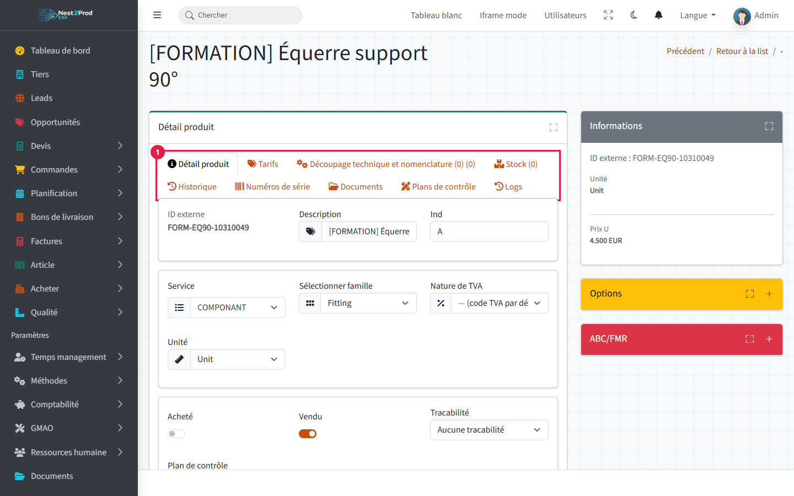

1. Les onglets de la fiche :
   - **Détail produit** : toutes les informations de la création, plus la nature de TVA, le
     plan de contrôle et la criticité achat (ci-dessous) ;
   - **Tarifs** (article vendu) : la grille tarifaire client (section 4) ;
   - **Découpage technique et nomenclature** : la gamme et les matières (section 5) ;
   - **Stock** : les lignes de stock de l'article (section 8) ;
   - **Historique** : les devis, commandes et achats de l'article, et les coulées des lots
     reçus ;
   - **Numéros de série**, **Documents** (plans, modèles 3D, photos), **Plans de
     contrôle** (voir le guide « Qualité — non-conformités et contrôle ») et **Logs**.

Si l'article est acheté, un onglet **Fournisseurs préférés** liste ses fournisseurs et leurs
prix par quantité.

Plus bas dans **Détail produit**, quatre listes servent à la qualité :

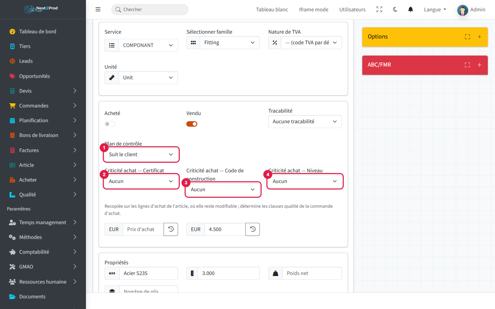

1. **Plan de contrôle** : « Suit le client » (par défaut, l'article doit être bullé si le
   client l'exige), « Toujours » ou « Jamais ». Il décide si l'article apparaît dans
   **Plans qualité › À bullé** (voir le guide « Qualité — non-conformités et contrôle »).
2. **Criticité achat — Certificat** : le certificat matière EN 10204 exigé (2.1, 2.2, 3.1,
   3.2).
3. **Criticité achat — Code de construction** (RCC-M, RCC-MX).
4. **Criticité achat — Niveau** (N1, N2, N3, NC).

La criticité est recopiée sur chaque nouvelle ligne de commande d'achat de l'article, où elle
reste modifiable. Elle ajoute les **clauses qualité** en fin de commande d'achat et indique
le certificat attendu à la réception. Laissez « Aucun » pour un article courant.

> 💡 La carte **Options** (colonne de droite) propose **Dupliqué produit** : la copie, gamme
> comprise, est créée **immédiatement**, avec un code provisoire. Renommez-la aussitôt.

---

## 4. Les tarifs par quantité

L'onglet **Tarifs** apparaît pour un article **vendu**. Il rappelle le **prix de vente de
base** et liste les paliers particuliers.

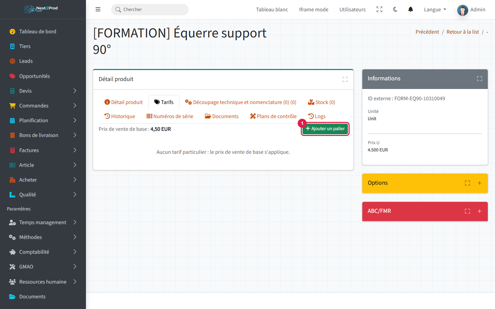

1. **Ajouter un palier** ouvre la fenêtre de saisie.

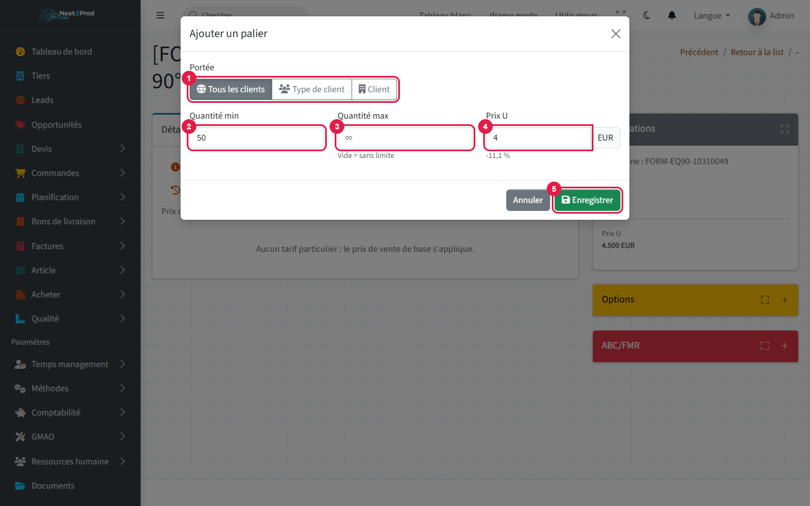

1. **Portée** : **Tous les clients**, un **Type de client**, ou un **Client** précis.
2. **Quantité min** : le palier s'applique à partir de cette quantité.
3. **Quantité max** : laissez vide pour « sans limite ».
4. **Prix U** : le prix du palier ; l'écart avec le prix de base s'affiche dessous.
5. **Enregistrer**.

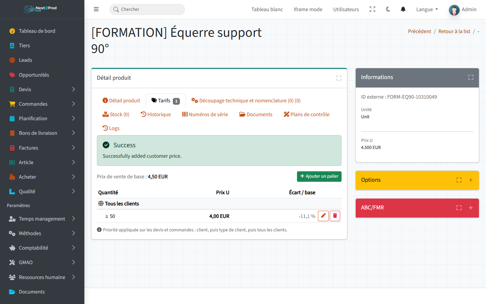

Les paliers sont regroupés par portée et triés par quantité, avec l'**écart** au prix de base.
Le crayon modifie un palier, la corbeille le supprime.

> ⚠️ Le prix du palier **n'est pas appliqué tout seul**. Dans la fenêtre d'une ligne de devis
> ou de commande, la carte **Grille tarifaire client** liste les paliers valables pour ce
> client, le palier qui correspond à la quantité saisie en vert : cliquez sur **Appliquer**
> pour reprendre son prix.
>
> 💡 Un badge orange « Des tranches de quantité se chevauchent » signale deux paliers qui se
> recouvrent (par exemple 1–50 et 50–100). Rien n'est bloqué, mais corrigez-les pour éviter
> l'hésitation.

---

## 5. La gamme de fabrication

Onglet **Découpage technique et nomenclature**. La languette **Opération**, au bord droit de
l'écran, ouvre le panneau **Nouvelle opération** :

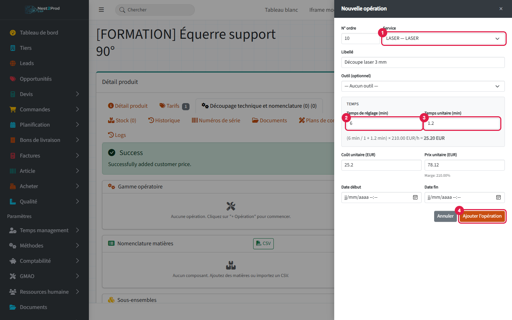

1. **Service** : laser, pliage, soudure… Le libellé et le taux horaire suivent.
2. **Temps de réglage** : une fois par lancement.
3. **Temps unitaire** : par pièce.
4. **Ajouter l'opération**.

Le coût et le prix unitaires se calculent avec le taux horaire et la marge du service, et
restent modifiables.

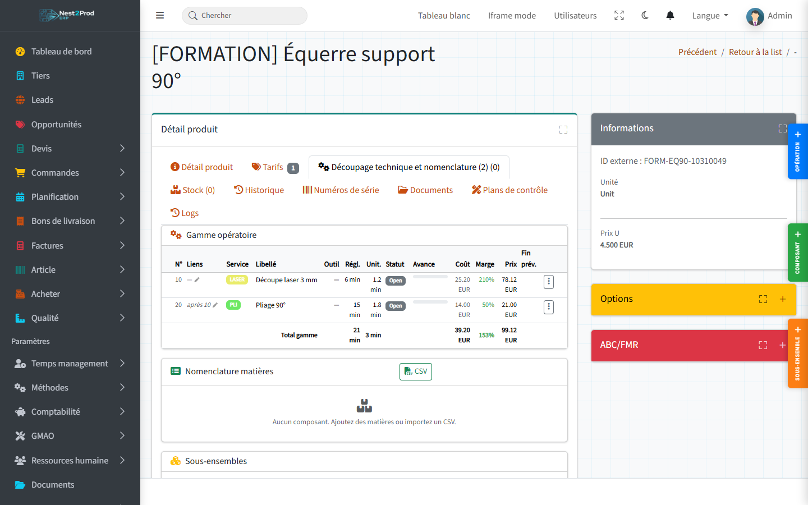

La gamme est recopiée sur chaque ligne de devis et de commande qui utilise l'article. Les
cartes **Nomenclature matières** et **Sous-ensembles** décrivent les matières et les
composants consommés.

> 💡 Les temps s'affichent en minutes ou en heures selon le réglage **Unité des temps** de
> l'entreprise.

---

## 6. Les documents de l'article

Onglet **Documents** : déposez le plan PDF, le fichier DXF, le modèle 3D (STEP, STL) et les
photos.

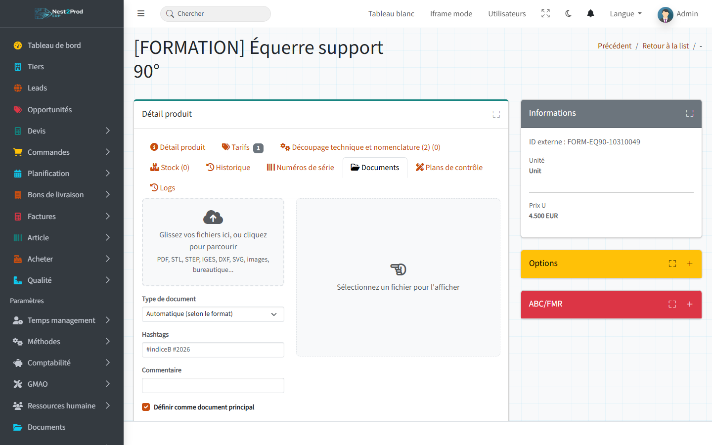

Choisissez le **type de document** (plan, modèle 3D, photo…). Le plan principal est repris
par les lignes de devis et de commande, par la fiche suiveuse et par le bulleur des plans de
contrôle. Un clic sur un fichier l'affiche à droite, y compris les modèles 3D.

---

## 7. Organiser le stock

Menu **Article › Stock**, carte **Nouveau stock** :

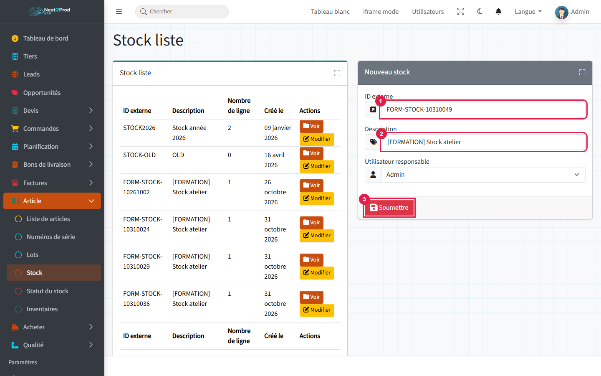

1. **ID externe** : un code court du stock.
2. **Description**.
3. **Soumettre** ouvre la fiche du stock.

Sur la fiche du stock, carte **Nouveau emplacement de stock** : un code et une description
(étagère, rack, zone).

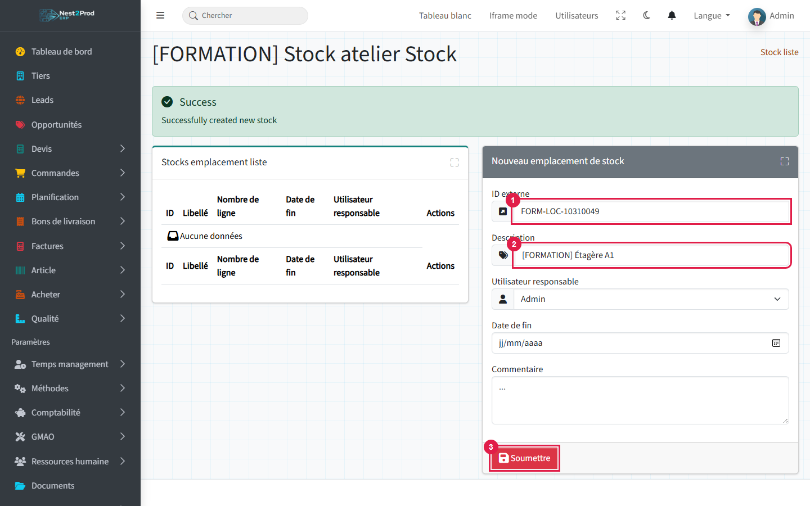

Puis, sur la fiche de l'emplacement, rangez-y l'article :

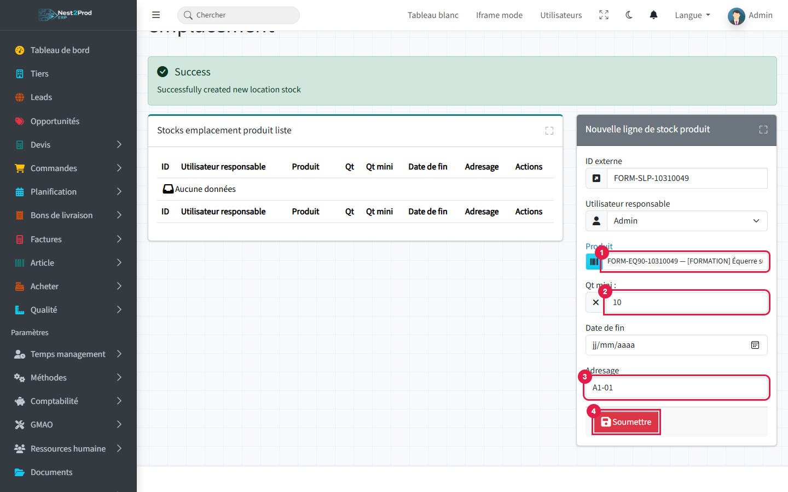

1. **Produit** : tapez le code ou le libellé, puis cliquez sur l'article proposé.
2. **Qt mini** : le stock minimum souhaité dans cet emplacement.
3. **Adresage** : la position précise (A1-01).
4. **Soumettre**.

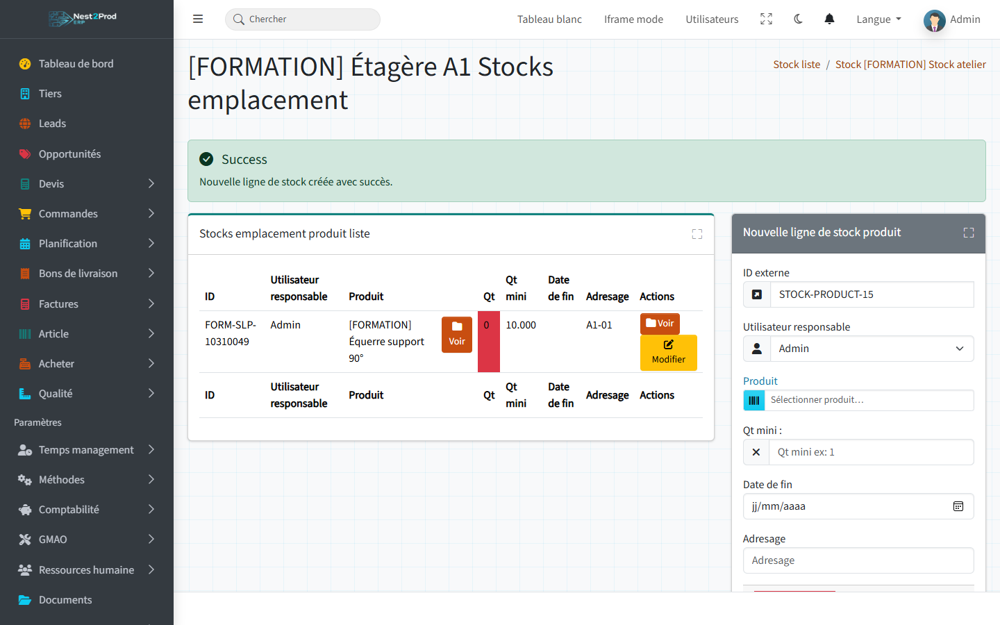

> 💡 Chaque formulaire propose un code (STOCK-…, STOCK-LOCATION-…, STOCK-PRODUCT-…) qui suit
> le dernier créé : gardez-le ou remplacez-le par votre propre codification.
>
> ⚠️ Stocks, emplacements, lignes et mouvements **ne se suppriment pas** depuis l'écran :
> vérifiez le code et l'article avant d'enregistrer.

---

## 8. Entrées, sorties et transferts

Le bouton **Voir** d'une ligne de stock ouvre ses mouvements, avec quatre tuiles : prix
moyen pondéré (CUMP), entrées, sorties et stock courant.

**Entrée** (carte « Nouvelle ligne entré stock ») :

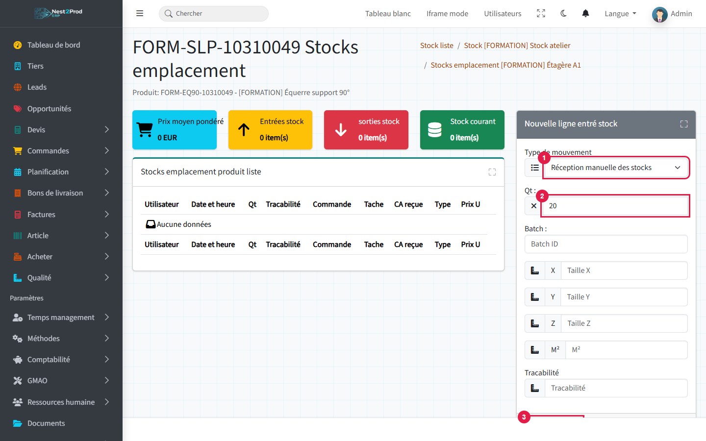

1. **Type de mouvement** : Réception manuelle des stocks, Inventaires, Réception commande
   achat, Composant fabriqué.
2. **Qt** : la quantité entrée.

**Sortie** (carte « Nouvelle ligne sortie stock ») :

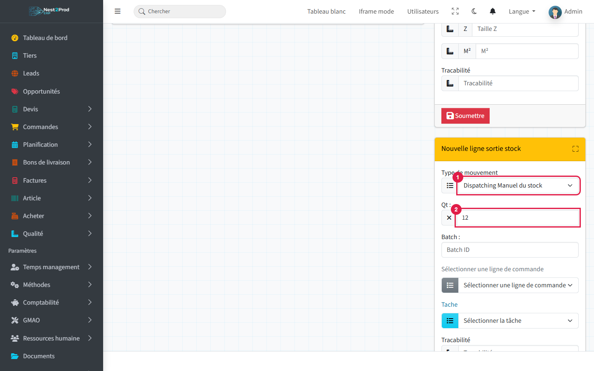

1. **Type de mouvement** : Dispatching manuel du stock, ou Pièce livrée.
2. **Qt** : la quantité sortie. Elle est refusée si le stock est insuffisant.

La sortie peut être rattachée à une **ligne de commande** ou à une **tâche** : les listes ne
proposent que celles qui concernent l'article de la ligne de stock. La carte **Transfert de
stock** déplace une quantité vers un autre emplacement (une sortie et une entrée en une seule
opération).

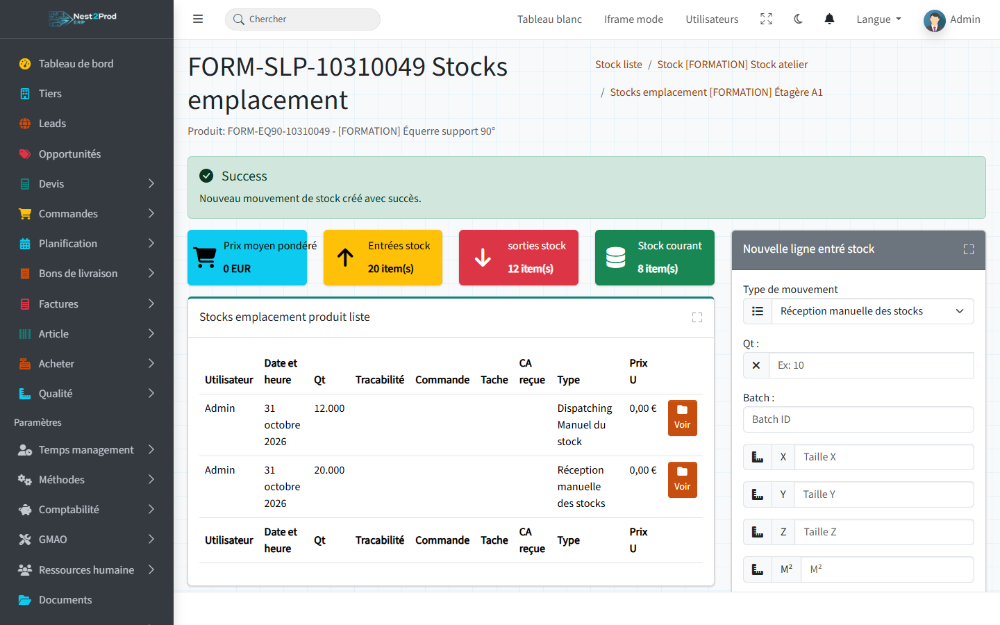

Les réceptions d'achat, les livraisons et les déclarations de production créent ces
mouvements toutes seules : la saisie manuelle sert aux cas hors flux.

> ⚠️ Un mouvement est **définitif** : il n'y a ni suppression ni annulation. Une erreur se
> corrige par un mouvement inverse.
>
> ⚠️ Une entrée manuelle ne porte pas de prix : elle ne fait pas évoluer le **CUMP**, qui
> reste à 0 tant que l'article n'est entré que de cette façon. Seules les réceptions
> d'achat valorisent le stock.
>
> 💡 Laissez le champ **Batch** vide. Pour une pièce d'un lot, tapez le **code du lot**
> (BATCH-…) dans **Tracabilité** : le mouvement est alors rattaché au lot et apparaît sur sa
> fiche (section 11).

L'onglet **Stock** de la fiche article reprend toutes ses lignes, avec la quantité en rouge
quand elle passe sous le minimum :

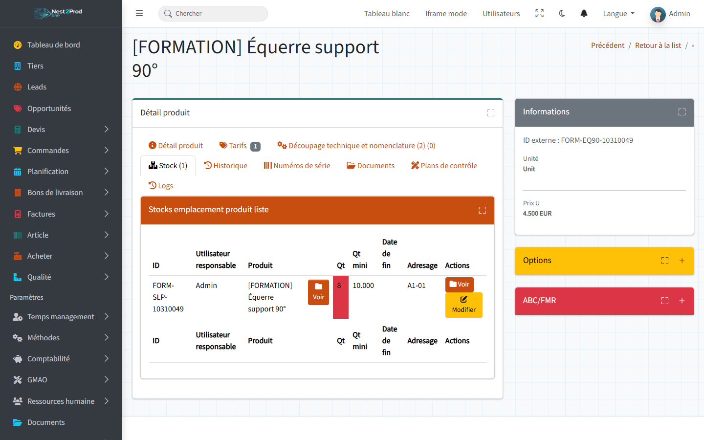

---

## 9. Le statut du stock

Menu **Article › Statut du stock** : pour chaque article, le stock total face au **besoin**
(commandes non livrées et tâches non terminées), les réservations et les emplacements.

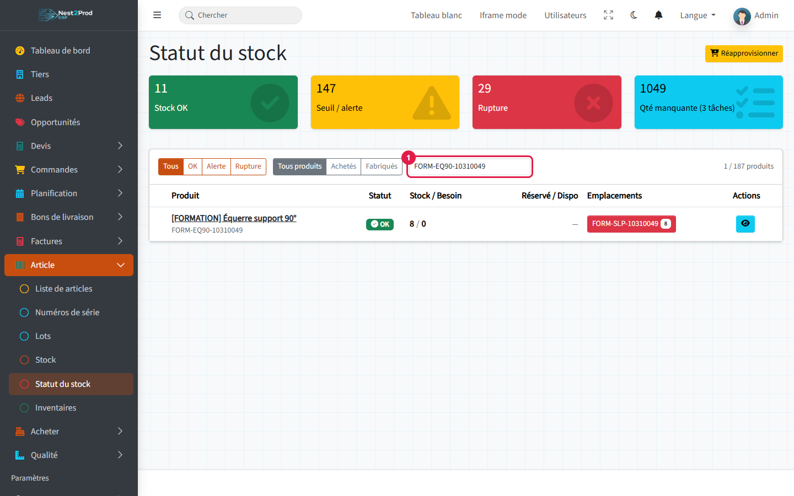

1. La recherche filtre par code ou libellé.

- **Statut** : OK si le stock couvre le besoin, Alerte s'il est tout juste égal, Rupture
  s'il est inférieur.
- **Emplacements** : chaque badge passe au rouge sous le **minimum** de l'emplacement.

Dans l'exemple, l'équerre est **OK** (8 en stock, aucun besoin) mais son emplacement est
**rouge** (8 sous le minimum de 10) : il faut réapprovisionner, sans urgence de commande.

**Réapprovisionner** ouvre les besoins d'achat. Pour un article fabriqué avec un besoin,
l'icône de dossier crée une **commande interne** de fabrication, après confirmation.

---

## 10. Les numéros de série

Menu **Article › Numéros de série** : un numéro par pièce livrée, avec l'article, la
commande, le statut et le bouton **Trace** (son parcours).

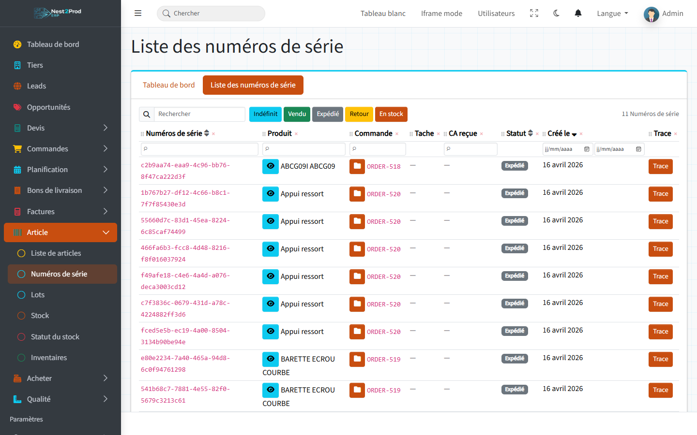

Les numéros de série sont créés à la **livraison**, pour les articles suivis à la pièce.

---

## 11. Les lots et les coulées

Un **lot** regroupe les pièces ou la matière d'une même origine : sa **coulée** (le numéro
de fusion de l'aciérie, inscrit sur le certificat), le **lot fournisseur**, le **certificat
EN 10204** et la réception d'achat d'où il vient.

### Créer le lot à la réception

Le lot naît à la **mise en stock** d'une ligne de réception d'achat (fiche réception, onglet
**Ligne de reçu d'achat**, bouton à l'icône d'entrepôt, voir le guide « De la demande de prix à la facture fournisseur ») :

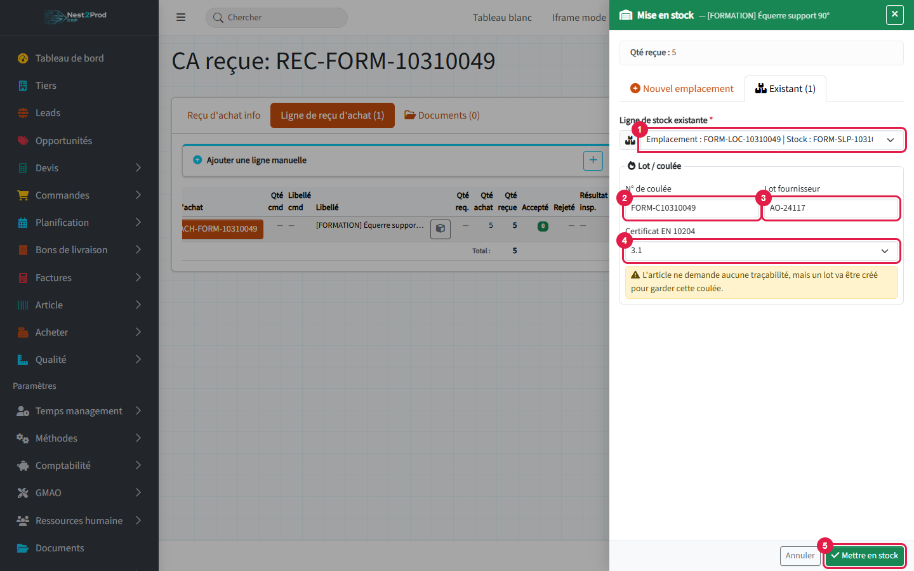

1. **Ligne de stock existante** (onglet **Existant**) ou **Nouvel emplacement** : où ranger la
   marchandise.
2. **N° de coulée** : relevé sur le certificat ou sur la matière.
3. **Lot fournisseur** : le numéro de lot du fournisseur, s'il y en a un.
4. **Certificat EN 10204** : proposé d'après le certificat noté au contrôle de la réception.
5. **Mettre en stock**.

Un lot est créé si l'article est suivi par lot (« Avec numéro batch ») **ou** si une coulée
ou un lot fournisseur est saisi. Le lot reçoit un code BATCH-… ; le fournisseur et la
réception sont repris tout seuls.

> ⚠️ Pour un article **sans traçabilité**, saisir une coulée crée quand même un lot :
> l'avertissement jaune « L'article ne demande aucune traçabilité, mais un lot va être créé
> pour garder cette coulée » le rappelle. Laissez les champs vides si vous ne voulez pas
> suivre cette matière.

### Retrouver un lot par sa coulée

Menu **Article › Lots** :

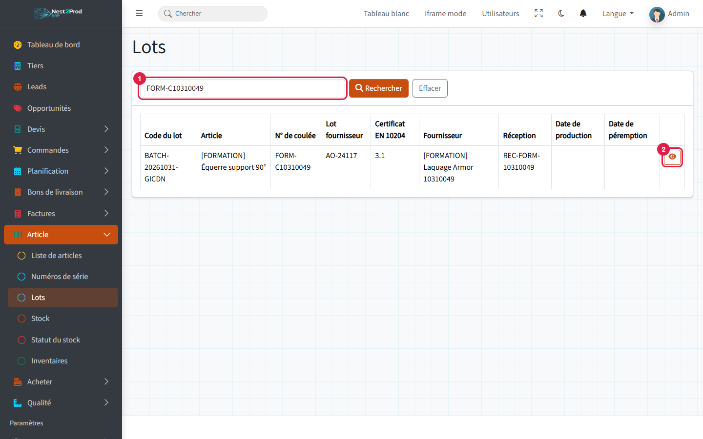

1. La recherche accepte le **n° de coulée**, le **lot fournisseur** ou le **code du lot**,
   puis **Rechercher**. Une icône verte dans la colonne du certificat indique qu'un
   certificat est joint.
2. L'œil ouvre la **fiche lot**.

### La fiche lot

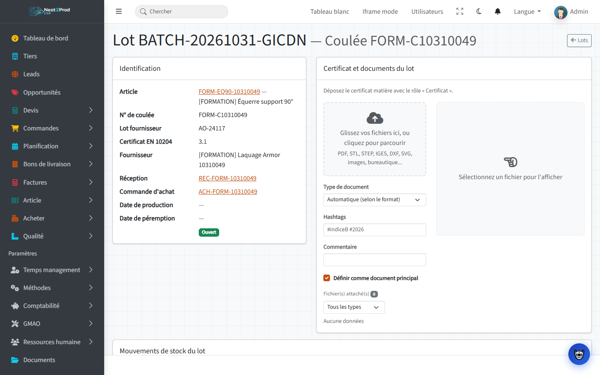

- **Identification** : article, coulée, lot fournisseur, certificat, fournisseur, réception,
  commande d'achat (liens cliquables) et état ouvert / clôturé ;
- **Certificat et documents du lot** : déposez le **certificat matière** (PDF ou photo) avec
  le rôle **Certificat** ; il reste attaché au lot ;
- **Mouvements de stock du lot** : chaque entrée et sortie, avec la ligne de stock et la
  tâche qui a consommé la matière.

La coulée apparaît aussi sous la traçabilité des mouvements de la ligne de stock (lien vers
la fiche lot), dans l'onglet **Historique** de l'article et dans **Lots consommés** de
l'écran de la tâche :

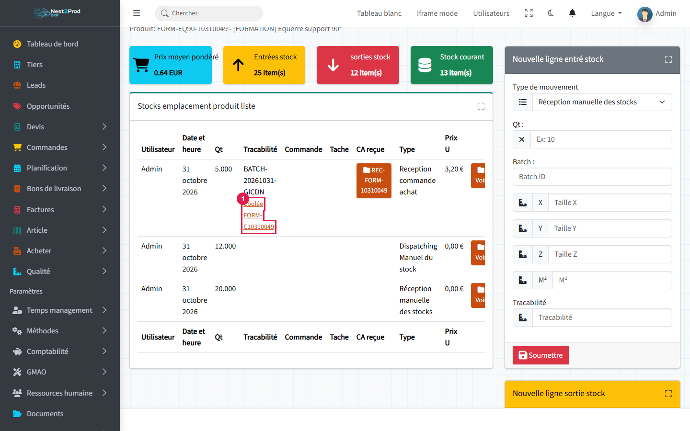

1. Le lien « Coulée … » ouvre la fiche lot.

> 💡 Quand une tâche consomme la matière, la sortie est répartie **lot par lot, du plus
> ancien au plus récent** : la fiche suiveuse imprime ainsi les coulées utilisées.

<!-- feature: access-log -->
> 💡 L'ouverture d'une fiche lot est enregistrée dans le **journal des consultations**
> (traçabilité des accès), comme celle des devis et commandes.
<!-- /feature -->

---

## 12. Les inventaires

Menu **Article › Inventaires**, **Nouvel inventaire** : choisissez le périmètre (tout le
stock, des emplacements ou des catégories).

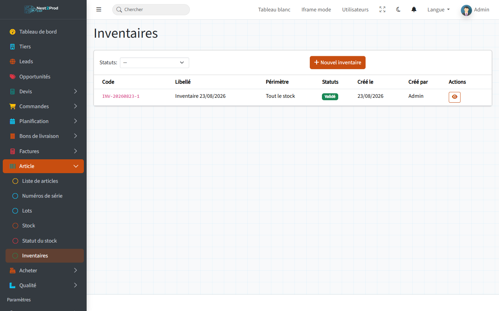

La fiche suit trois étapes :

1. **Exporter** la liste à compter (Excel), ou sa **version aveugle** sans les quantités
   attendues, à imprimer pour le comptage ;
2. **Importer** le fichier compté : un aperçu signale les erreurs avant l'import ;
3. **Valider** : les écarts deviennent des mouvements de régularisation.

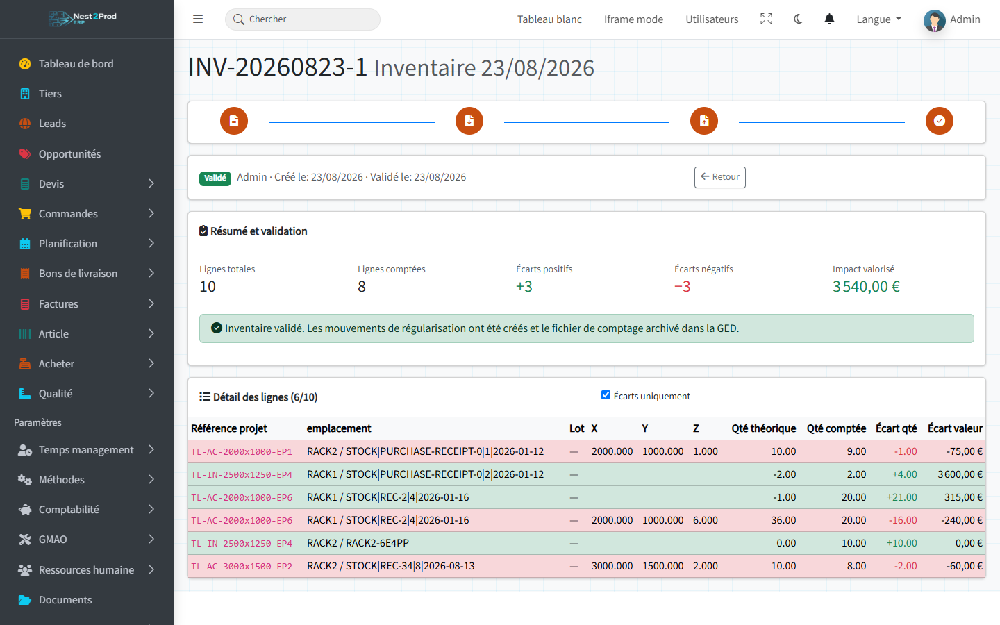

La fiche résume les lignes comptées, les écarts positifs et négatifs et leur **impact
valorisé** ; la case **Écarts uniquement** n'affiche que les lignes en écart.

> ⚠️ Mettez les mouvements de stock en pause pendant l'inventaire : la validation est refusée
> si le stock a bougé depuis la création. Une fois validé, l'inventaire est figé et ses
> mouvements sont définitifs.
>
> 💡 Le comptage se fait dans le fichier Excel : il n'y a pas de saisie des quantités
> comptées dans l'écran.

## Et ensuite ?

- **Vendre l'article** : ajoutez-le à une ligne de devis ; sa gamme et sa grille tarifaire
  suivent (guide « Du prospect à la facture »).
- **L'acheter** : demande de prix, commande, réception et mise en stock avec la coulée
  (guide « De la demande de prix à la facture fournisseur »).
- **Le contrôler** : plan de contrôle bullé, premier article (guide « Qualité — non-conformités et contrôle »).

## Questions fréquentes

**Je ne peux rien modifier sur la fiche article.**
Il vous manque la permission **products-edit** : le bandeau « Consultation seule » le
signale. Demandez-la à l'administrateur.

**J'ai ajouté un palier, mais le devis reste au prix de base.**
Le palier n'est pas appliqué automatiquement : sur la ligne de devis, cliquez sur
**Appliquer** dans la carte **Grille tarifaire client**.

**« Code déjà utilisé » en créant un stock ou un emplacement.**
Le code saisi est déjà pris : reprenez le code proposé par le formulaire, ou choisissez-en
un autre.

**Le prix moyen pondéré reste à 0.**
L'article n'est entré en stock que par des entrées manuelles, qui ne portent pas de prix.

**Je me suis trompé de quantité dans une sortie.**
Faites une entrée de la différence (ou l'inverse) : un mouvement ne se modifie pas.

**L'article est « OK » mais l'emplacement est rouge.**
Le stock couvre les commandes en cours, mais il est passé sous le minimum de l'emplacement.

**Je ne retrouve pas la coulée d'une matière.**
La coulée n'est connue que si elle a été saisie à la mise en stock de la réception. Pour un
lot déjà créé, la coulée ne se complète pas depuis l'écran : notez-la sur la prochaine
réception.
