**Goal**: record the work done in the workshop in real time, and use it to manage the
load and measure production.

> 💡 Screenshots show the French interface; button names are given as they appear in the English interface.

**Who is it for**: **operators** (sections 1 to 6) and the **workshop manager** (sections 7 to 11).

## Before you start {#avant-de-commencer}

- **Operations** come from the routing of the order lines (see the guide
  "From prospect to invoice"). A quote operation cannot be recorded.
- The **task workflow** (statuses Open, Started, In progress, Finished…) must be set up
  (see "Setting up your instance").
- **Resources** (machines, workstations) must be linked to their services (see the
  guide "Methods").

<!-- feature: production-release -->
- On your instance, a production operation only starts once its order line has been
  **released for production** by engineering (see the guide "Release for production").
<!-- /feature -->

## Overview {#vue-densemble}

```steps
Find the operation
Start
Record the parts
Take the material
Finish
Sign off the phase
Manage and measure
```

---

## 1. Workshop mode {#le-mode-atelier}

The **workshop** screen is made for a shared workstation or a tablet: large tiles, no
side menu. Open your instance address followed by **/workshop** and bookmark it on the
workshop computer.

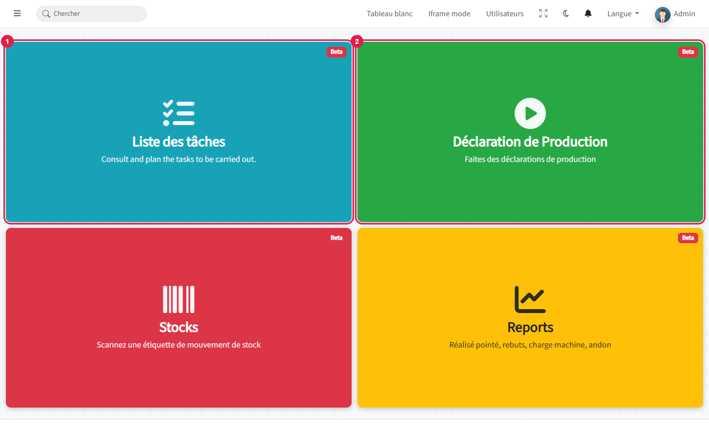

1. **Tasks list**: what is left to do.
2. **Production Declaration**: the tracking screen of an operation.

The two other tiles open the stock label scan and the workshop reports
(section 10).

> 💡 On a tablet, the grid button in the top bar opens the app
> launcher. **Attendance** (clock-in and clock-out) is for presence,
> not for production.

---

## 2. Find your work {#trouver-son-travail}

The **workshop list** shows the order operations, with their service, their
resource, their progress and their due date.

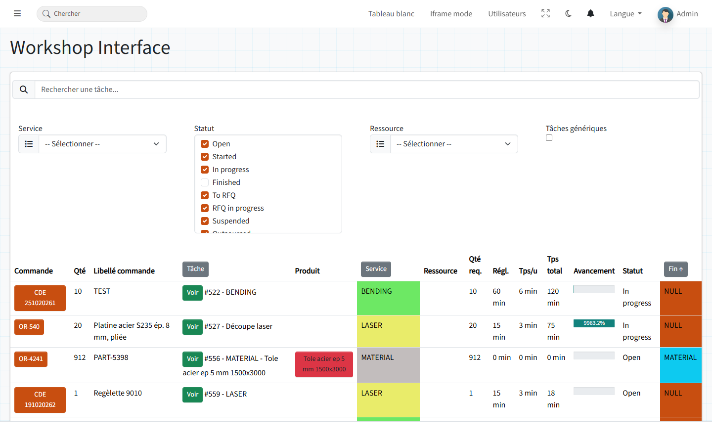

- Filter by **Service**, **Resource** or **Status** (finished operations are
  hidden by default).
- The **Fin** (End) column is coloured: red if the due date has passed, orange if it is
  today, blue if it is still to come.
- The **Voir** (View) button opens the tracking screen of the operation.

The operator can also type the **operation number**, the one on the job card, in
the search of "Production Declaration". The screen also shows the indicators for the
month: operations in progress, hours produced, OEE (TRS).

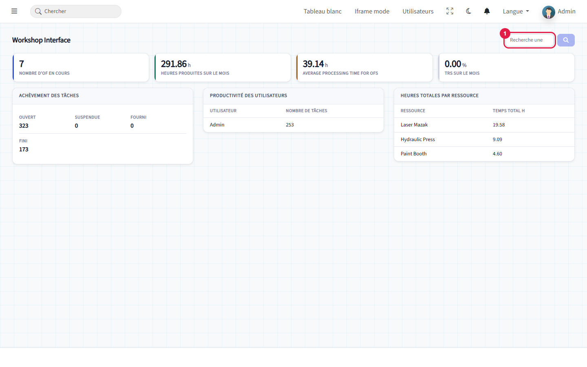

---

## 3. Record on the tracking screen {#declarer-sur-lecran-de-suivi}

<!-- feature: production-release -->
**First of all: the release for production.** As long as the order line is not released,
a banner explains it and the Play button stays greyed out.

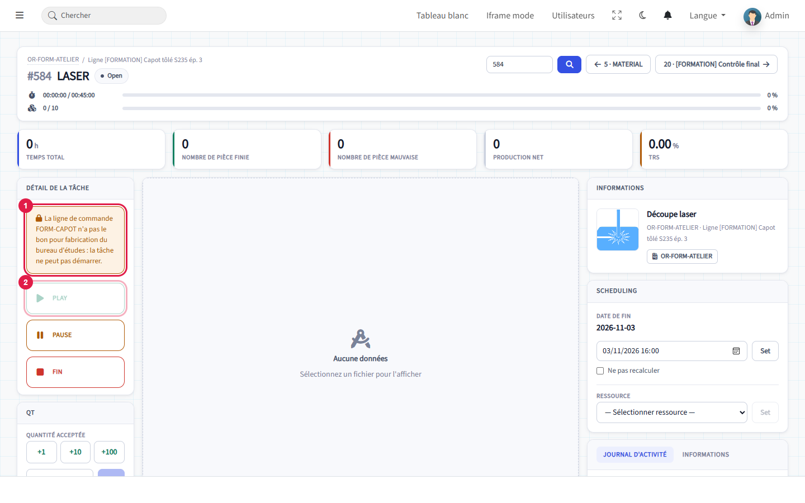

1. The banner names the order line waiting for its release.
2. **Play** is greyed out: the operation cannot start.

Tell engineering: once the line is released, reload the page and Play is active again.

> ⚠️ Only **production** operations wait for the release. Material, supplies and
> subcontracting are never blocked.
<!-- /feature -->

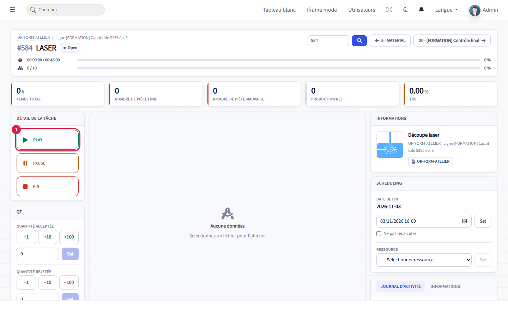

The header shows the order, the line and the operation, with two bars: the **time**
clocked against the planned time, and the **parts** produced against the ordered quantity. The
buttons at the top right move to the previous or next operation of the same routing.

**Start.** Click **Play** when work begins: the operation switches to "In progress"
and the timer runs.

**Record the parts** as you go:

- **Good quantity**: +1, +10 or +100, or type a number then "Set";
- **Rejected quantity**: −1, −10 or −100 for scrap.

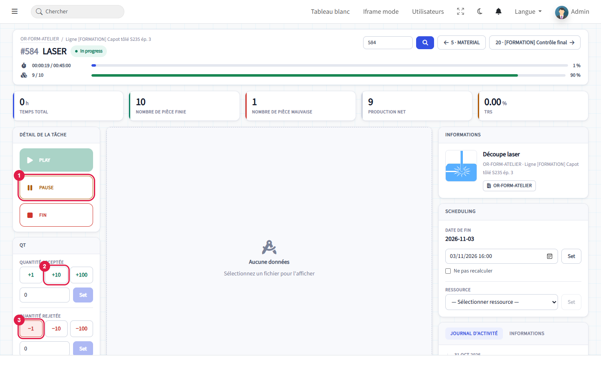

1. **Pause** stops the timer (break, tool change, waiting for material).
2. **+10** records 10 good parts.
3. **−1** records one scrapped part.

The counters update: good parts, bad parts, **Net production**
(good parts minus scrap).

> ⚠️ The quick buttons (+1, +10, −1…) record **immediately**, without confirmation.
> A mistake is corrected by recording the opposite.

**Finish.** Click **End** when the operation is finished. The activity log keeps
every action, with who did it and when.

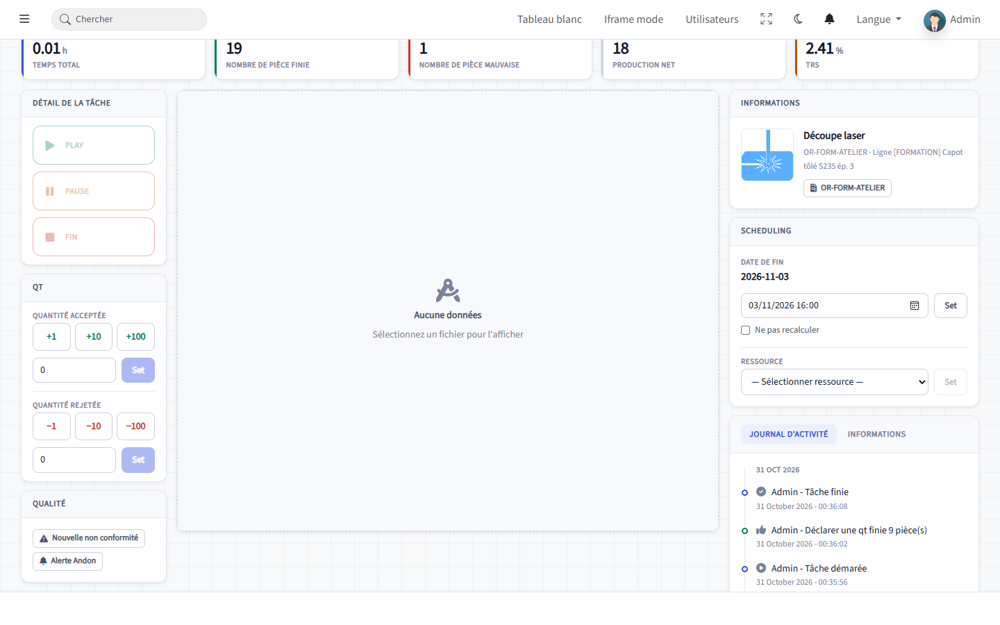

> 💡 When all the operations of a line are finished, the "Tâches" (Tasks) column of the
> order line changes to **Terminé** (Finished).

### The cards on the right

**Scheduling**: the planned end date, the **Ne pas recalculer** (Do not recalculate) box (the automatic
planning calculation will no longer change it) and the assigned **resource** (machine).

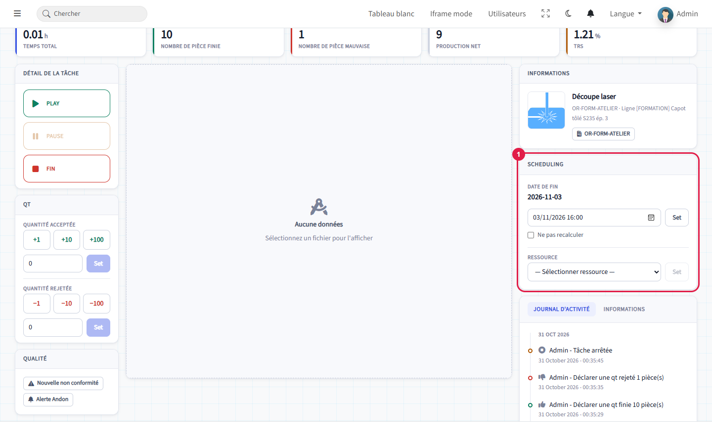

**Information**: status, quantity, cost, price, setup time, unit time, total
time, **OEE (TRS)** and progress.

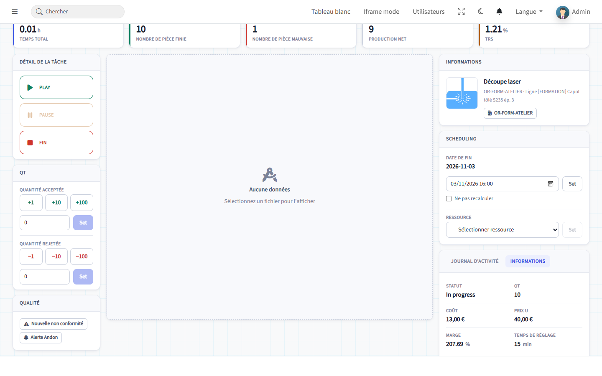

### The drawing and the inspection

**In the middle**, the drawing or the 3D model of the part is shown when a file is attached to
the order line or to the item.

If the item has an **approved control plan** at the ordered revision, the screen opens on
the **Inspection** tab: the ballooned drawing and the grid of characteristics to measure,
part by part (see the Quality guide). An out-of-tolerance measurement can create a
non-conformity.

> 💡 On a **first article**, recording good parts before part 1 has been measured asks
> for a confirmation. It is a reminder: the declaration remains possible.

> 💡 **Subcontracting and material**: for an operation handed to a supplier, the screen
> offers "New purchase document" instead of Play, then "End" on receipt.

---

## 4. Take the material from stock {#sortir-la-matiere-du-stock}

A **material** routing line (sheet, bar, component) carries the item to consume. Open it
from the tracking screen with the previous-operation button (for example
"5 · MATERIAL"), then record the quantity taken from stock in the **Remove from stock**
card: type the quantity, then "Set".

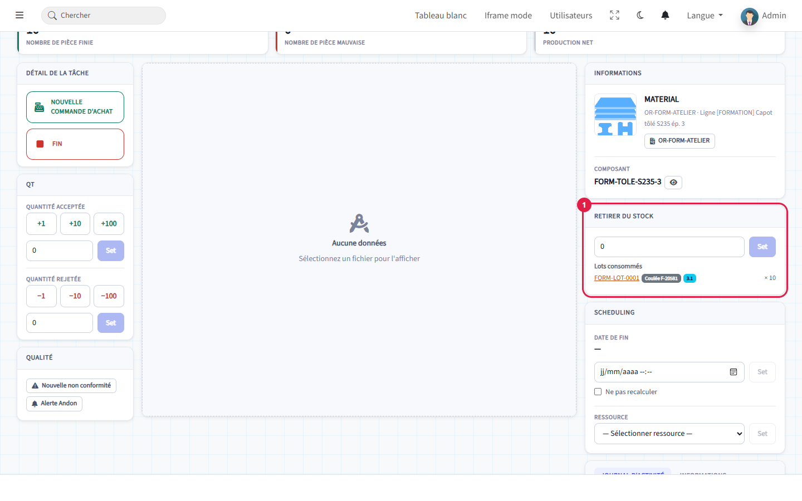

The card then lists the **Consumed batches**: batch code, **heat** number, material
certificate type and quantity. Clicking the batch code opens its page (receipt,
certificate, movements).

> ⚠️ The withdrawal is recorded **at once**, without confirmation. You do not choose the
> batch: the oldest one in stock goes first, and a withdrawal spanning two batches is
> split between them.

> 💡 The consumed heats are also printed on the order's **job card** (section 11): it is
> the material trace of the manufacturing record.

---

## 5. Phase release sign-off {#le-visa-de-liberation-dune-phase}

Some work centres can require a **sign-off**: an operation finished on that work centre
waits for a supervisor to sign it off before moving on to the next one (final inspection,
qualified welding…). If none of your work centres requires it, this section does not
concern you and the screen shows nothing more.

**The setting.** Menu **Methods › Services**, "Edit" button of the work centre: tick
**Release sign-off required**, then "Update".

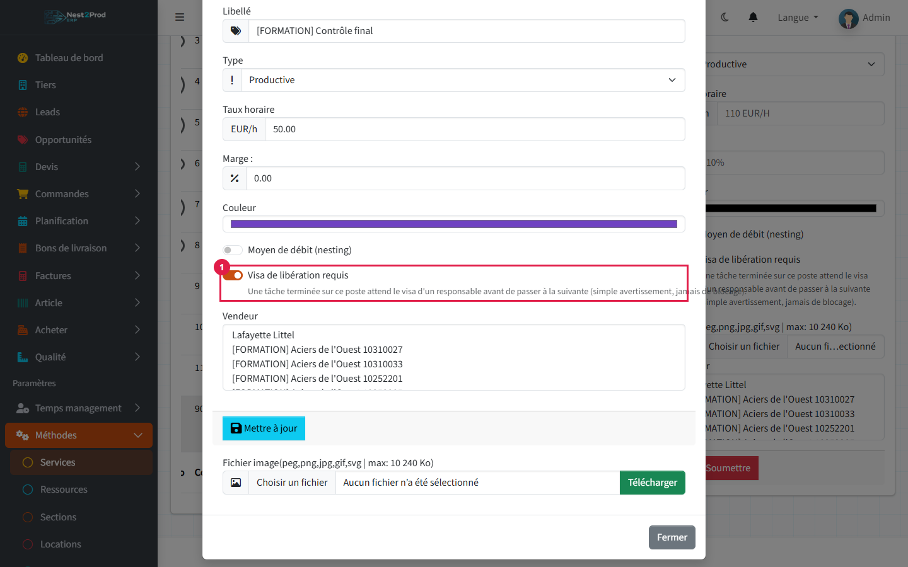

**Give the sign-off.** Once the operation is finished, the **Release sign-off** card of
the tracking screen shows "Finished, awaiting sign-off".

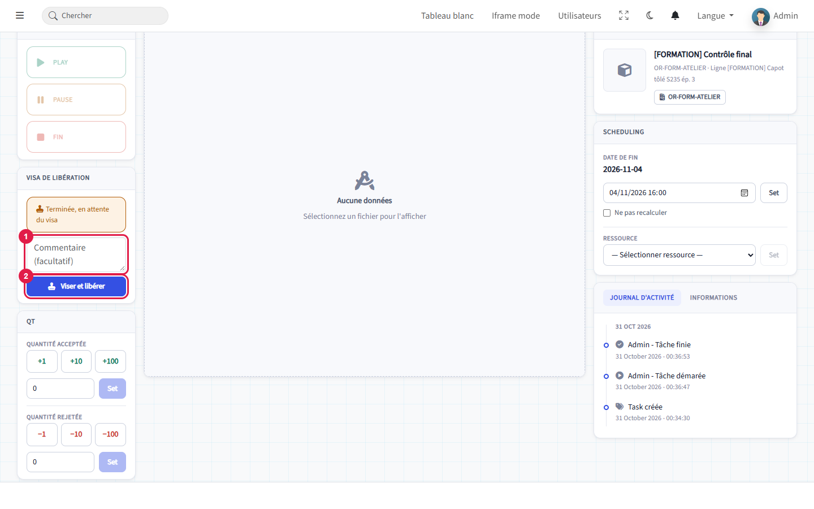

1. Add a **comment** if needed (optional).
2. Click **Sign off and release**.

The card changes to "Released", with the date, the author and the comment.

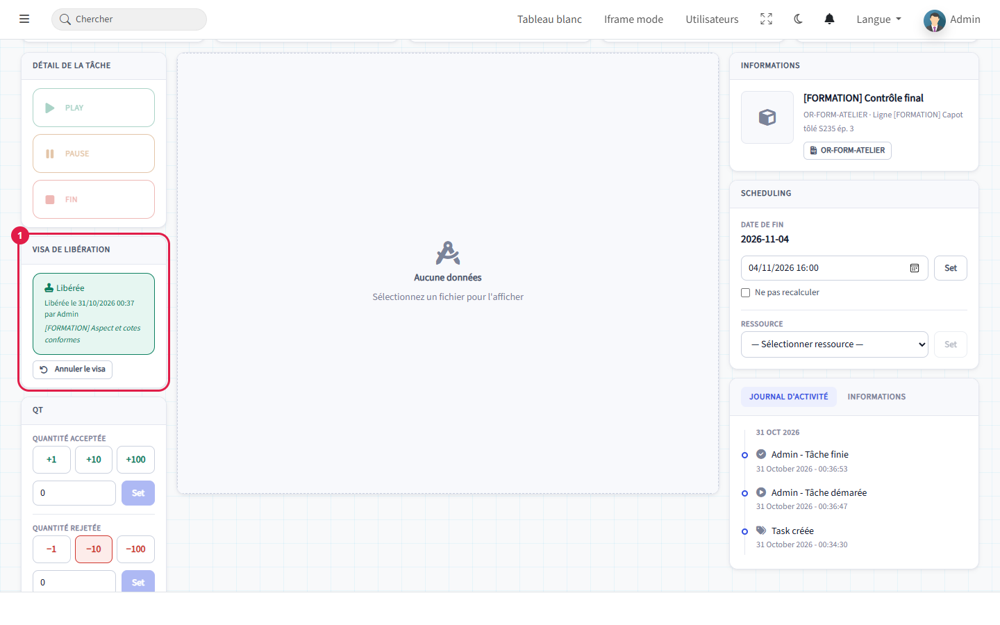

> ⚠️ The sign-off is reserved to holders of the "task-release" permission (Admin role by
> default). Others see the status, without the button. The sign-off can only be given once
> the operation is **finished**.

**The next operation** shows a warning as long as the previous one is not signed off.

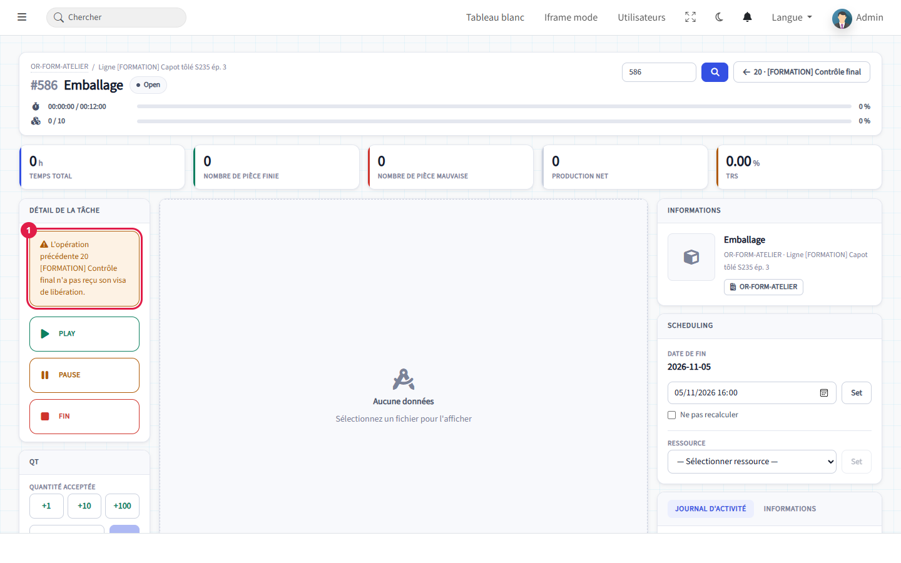

When clicking Play, the operator must confirm "Start anyway?".

> 💡 The sign-off **never blocks** production: it is a warning. A sign-off given by
> mistake is cancelled with "Cancel sign-off".

---

## 6. Report a problem {#signaler-un-probleme}

**Quality** card of the tracking screen:

- **New non conformity** immediately creates a non-conformity linked to the operation,
  to be completed in the Quality module;
- **Alerte Andon** (Andon alert) reports a stop or a problem (breakdown, missing material, waiting for
  inspection): fill in the alert type, then "Ajouter l'alerte" (Add the alert).

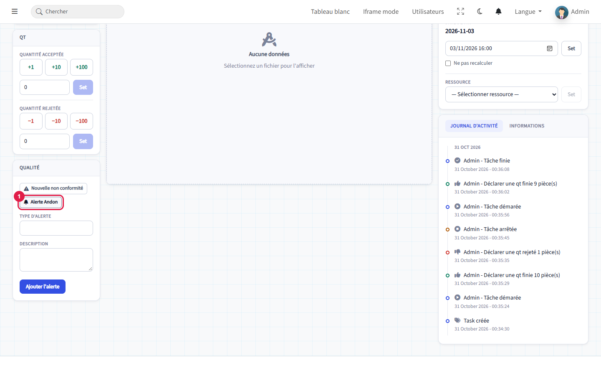

The workshop manager handles the alerts on the Andon screen (section 10).

---

## 7. The tasks list {#la-liste-des-taches}

Menu **Scheduling › Tasks list**: all the order operations, with
filters by service, resource and status. Clicking a line opens the tracking screen.

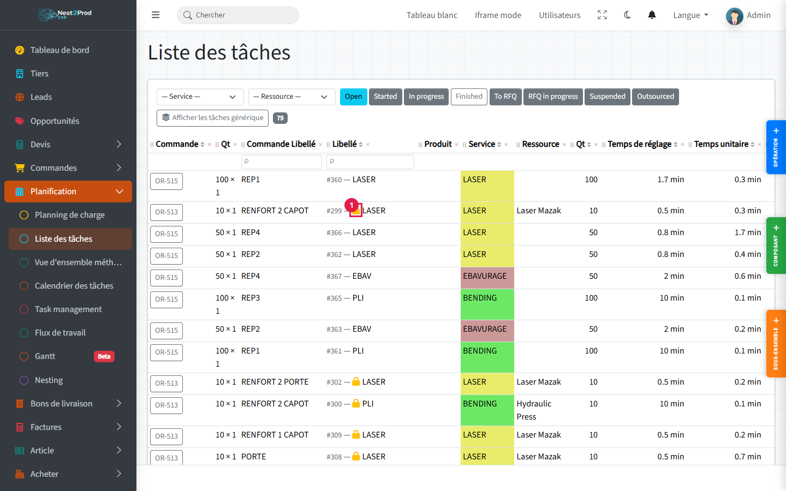

<!-- feature: production-release -->
1. A **padlock** before the label marks a production operation whose order line is not
   released for production yet.
<!-- /feature -->

---

## 8. The Kanban {#le-kanban}

Menu **Scheduling › Workflow**: one column per status, one card per
operation. Filter on a **service** ("Select Service", then "Filter"): without a filter,
the page shows all operations.

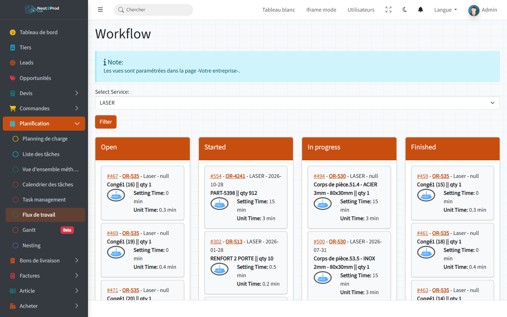

> ⚠️ Dragging a card changes the status of the operation: to "Started" or
> "In progress", it is started; to "Finished", it is finished.

<!-- feature: production-release -->
An operation not released for production cannot be dragged to "Started" or
"In progress": the Kanban shows "Tasks not released for production, move cancelled" and
puts the card back.
<!-- /feature -->

On a work centre requiring a sign-off, cards carry a badge: **Sign-off required** (not
finished yet), **To sign off**, **Released**, or **Previous not released** on the next
operation.

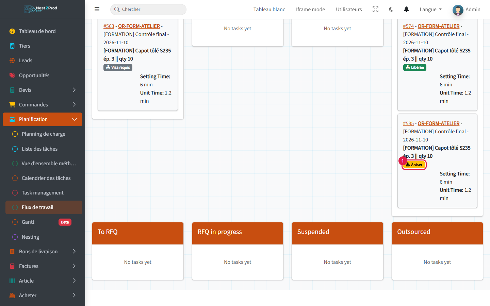

---

## 9. The load planning {#le-planning-de-charge}

Menu **Scheduling › Load planning**: the load of each **service** (or of each
**resource**) day by day, compared with its capacity. The colours go from "Free" to
"Overloaded".

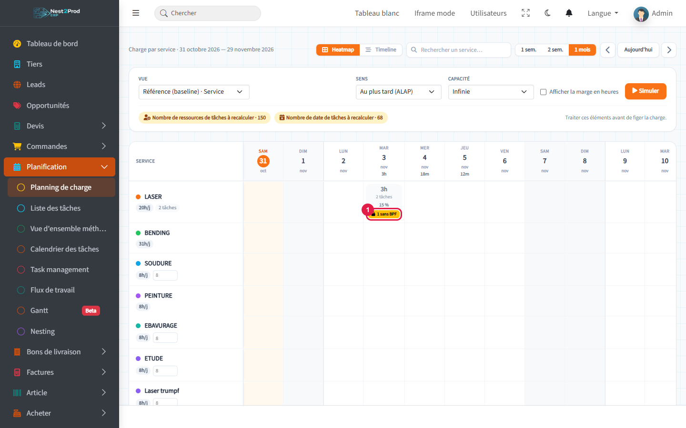

<!-- feature: production-release -->
1. The **"1 not released"** badge counts the operations of the day whose line is not
   released for production yet: the load is planned, but cannot start.
<!-- /feature -->

- **Vue** (View): by service or by resource. The resource view has an **Unassigned
  tasks** line for operations without a machine.
- **Sens** (Direction): as late as possible (ALAP) or as soon as possible (ASAP); **Capacité** (Capacity): infinite or finite.
- The orange badges point out operations whose **resource** or **dates**
  are still to be calculated.
- The load of an operation is placed on its **end date**: a period with no operation
  due stays empty.

> ⚠️ **Simuler** (Simulate) recalculates and **saves** the dates of all operations not
> finished, except those with "Ne pas recalculer" (Do not recalculate) ticked. It is not a preview.
>
> 💡 To recalculate a single order: order page, "Task Calculation Date".

---

## 10. Measure production {#mesurer-la-production}

**Reports** tile on the workshop home: what was done over the period (today, 7 or
30 days), refreshed every minute.

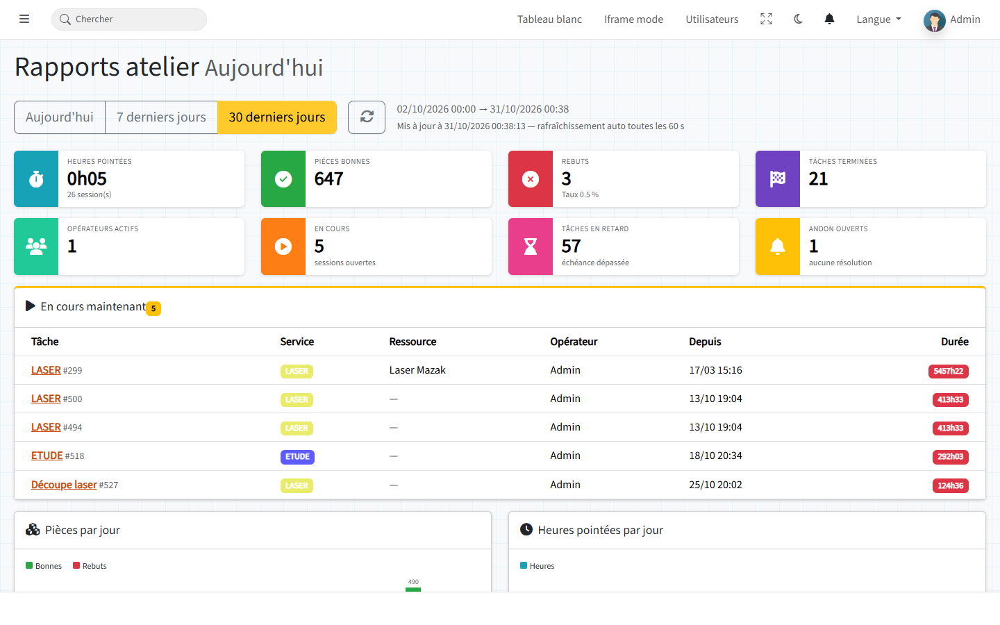

- Hours clocked, **good parts**, **scrap** and scrap rate, finished operations;
- active operators, operations **in progress now**, **late** operations;
- breakdown by resource (the actual machine load), by operator and by service;
- Andon alerts for the period.

The **Andon** screen (address **/workshop/andon**) lists the alerts: set them to "In Progress"
when someone is dealing with them, then "Solved".

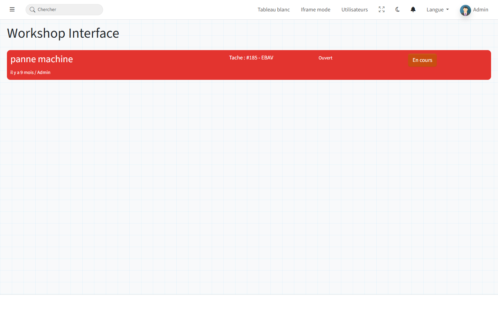

> 💡 Leave the Andon screen or the reports displayed on a large screen in the workshop.

---

## 11. The job card {#la-fiche-suiveuse}

The **job card** travels with the parts through the workshop: a cover page for the
order, then one sheet per line with the material, the routing to clock and the
inspections. Print it from the order page, Information tab ("i" icon), **Options** card:
**Job traveler** line, "Print" button.

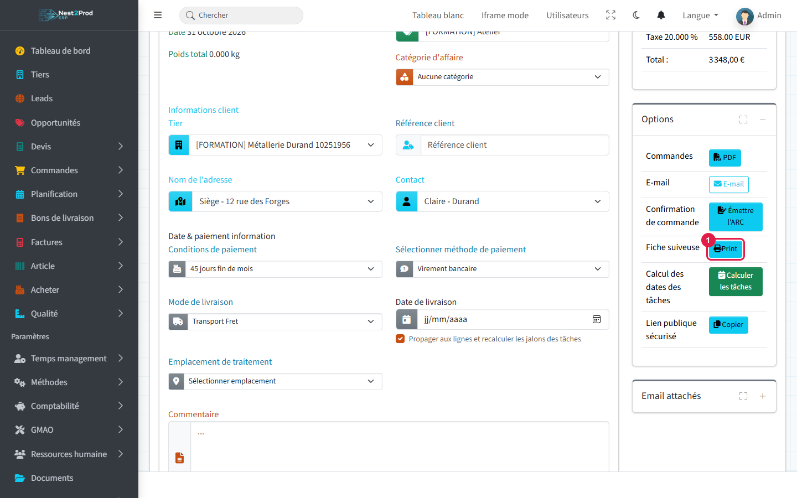

The **heats** of the batches already taken from stock (section 4) are printed on it: in
the "Material lot" column of the component, and in a "Consumed batches" line under the
operation that took the material. If nothing has been taken yet, the column stays empty,
to be filled in by hand at the workstation.

> 💡 Print the card again after taking the material so that it carries the heats.

## What next? {#et-ensuite}

- Finished parts go to **delivery** and then to **invoicing** (guide
  "Invoice and get paid").
- If the order line requires an **end-of-manufacturing record**, the delivery note and the
  invoice stay blocked until that record is validated (see the same guide).
- Non-conformities reported in the workshop are handled in the Quality module.

## Frequently asked questions {#questions-frequentes}

**The Play button is greyed out.**
The operation is already started or finished.
<!-- feature: production-release -->
If a banner with a padlock is shown above it, the order line is waiting for its release
for production: see engineering.
<!-- /feature -->

**"This is a quote task, no action possible."**
The operation belongs to a quote: only order operations can be recorded.

**A warning says a previous operation "has not been signed off".**
The previous operation is on a work centre requiring a sign-off and is not signed off yet.
You can start anyway; tell the supervisor so that they sign it off.

**The "Consumed batches" do not appear.**
The item has no batch in stock: the withdrawal is recorded without a batch. Batches are
created when the material is received, when the item is tracked by batch or a heat number
is entered.

**My machine does not appear in the list of resources.**
It is not linked to the service of the operation (Methods › Ressources).

**The load planning is empty.**
No operation is due in the period shown: change the period with the
arrows.

**The order line stays "En cours" (In progress).**
One of its operations is not finished: open the routing of the line to find it.
