**Objectif** : déclarer en temps réel le travail fait à l'atelier, et s'en servir pour
piloter la charge et mesurer la production.

**Pour qui** : les **opérateurs** (sections 1 à 6) et le **chef d'atelier** (sections 7 à 11).

## Avant de commencer

- Les **opérations** viennent de la gamme des lignes de commande (voir le guide
  « Du prospect à la facture »). Une opération de devis ne se déclare pas.
- Le **flux des tâches** (statuts Open, Started, In progress, Finished…) doit être en place
  (voir « Mettre en route son instance »).
- Les **ressources** (machines, postes) doivent être rattachées à leurs services (voir le
  guide « Les Méthodes »).

<!-- feature: production-release -->
- Sur votre instance, une opération de production ne démarre qu'après le **bon pour
  fabrication** (BPF) de sa ligne de commande, donné par le bureau d'études (voir le guide
  « Bon pour fabrication »).
<!-- /feature -->

## Vue d'ensemble

```steps
Trouver l'opération
Démarrer
Déclarer les pièces
Sortir la matière
Terminer
Viser la phase
Piloter et mesurer
```

---

## 1. Le mode atelier

L'écran **atelier** est fait pour un poste partagé ou une tablette : grandes tuiles, sans
menu latéral. Ouvrez l'adresse de votre instance suivie de **/workshop** et mettez-la en
favori sur le poste de l'atelier.

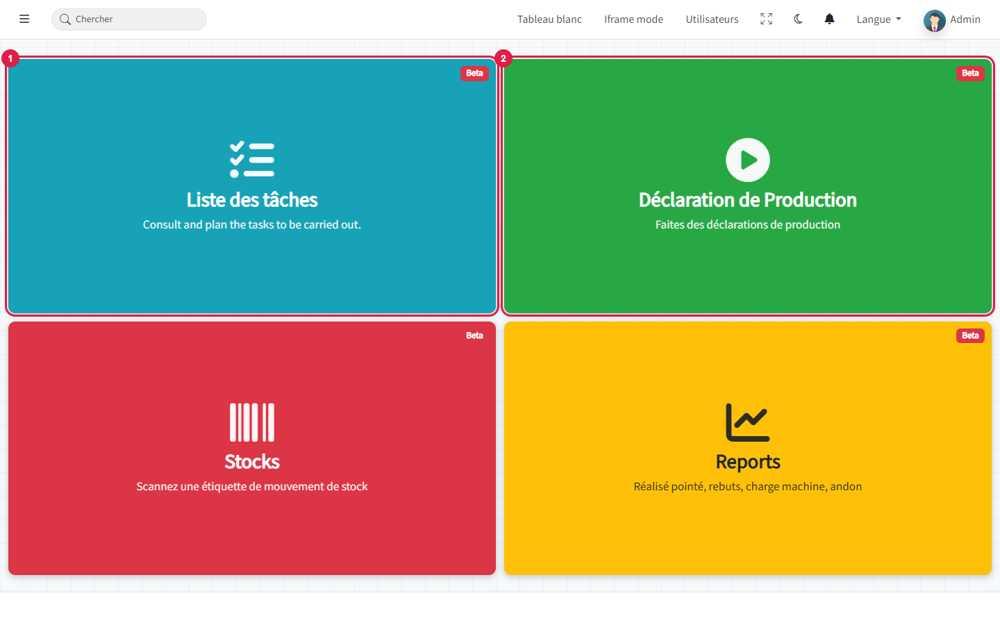

1. **Liste des tâches** : ce qui reste à faire.
2. **Déclaration de production** : l'écran de suivi d'une opération.

Les deux autres tuiles ouvrent le scan d'étiquette de stock et les rapports atelier
(section 10).

> 💡 Sur une tablette, le bouton grille de la barre du haut ouvre le lanceur
> d'applications. Le **Pointage** (badgeuse d'entrée et de sortie) sert à la présence,
> pas à la production.

---

## 2. Trouver son travail

La **liste atelier** montre les opérations des commandes, avec leur service, leur
ressource, leur avancement et leur échéance.

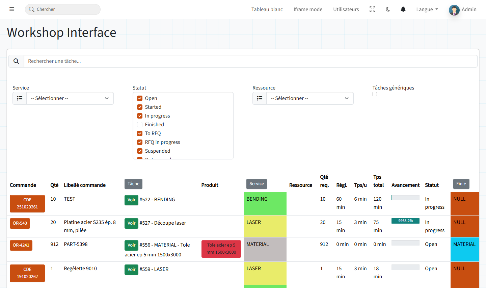

- Filtrez par **service**, **ressource** ou **statut** (les opérations terminées sont
  masquées par défaut).
- La colonne **Fin** se colore : rouge si l'échéance est dépassée, orange si c'est
  aujourd'hui, bleu si elle est à venir.
- Le bouton **Voir** ouvre l'écran de suivi de l'opération.

L'opérateur peut aussi taper le **numéro de l'opération**, celui de la fiche suiveuse, dans
la recherche de « Déclaration de production ». L'écran affiche aussi les indicateurs du
mois : opérations en cours, heures produites, TRS.

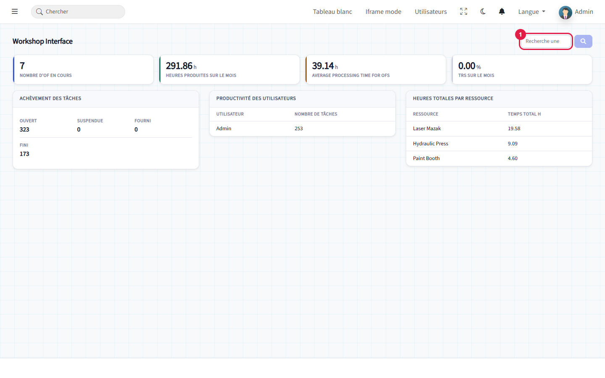

---

## 3. Déclarer sur l'écran de suivi

<!-- feature: production-release -->
**Avant tout : le bon pour fabrication.** Tant que la ligne de commande n'a pas son BPF,
l'écran l'explique dans un bandeau et le bouton Play reste grisé.

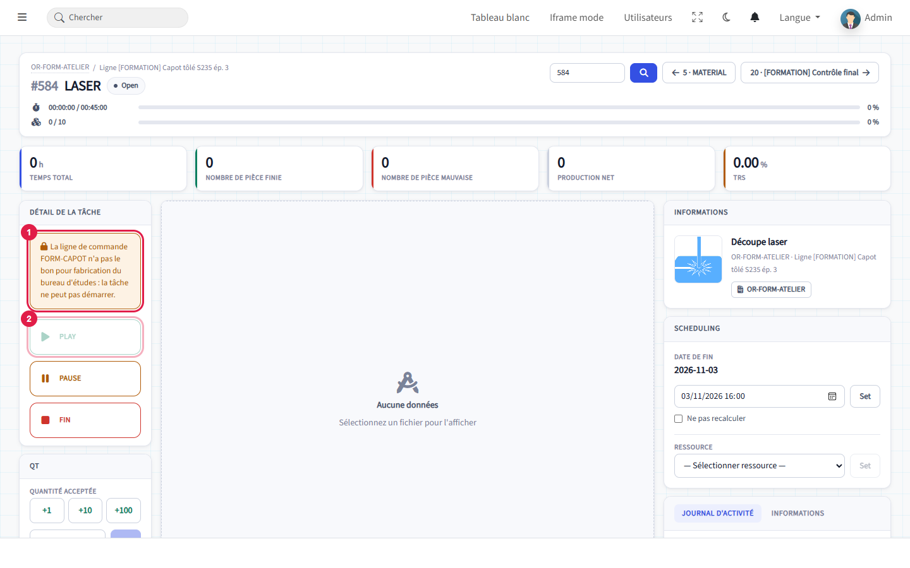

1. Le bandeau nomme la ligne de commande qui attend son BPF.
2. **Play** est grisé : l'opération ne peut pas démarrer.

Prévenez le bureau d'études : dès que le BPF est donné, rechargez la page, Play redevient
actif.

> ⚠️ Seules les opérations de **production** attendent le BPF. La matière, les
> fournitures et la sous-traitance ne sont jamais bloquées.
<!-- /feature -->

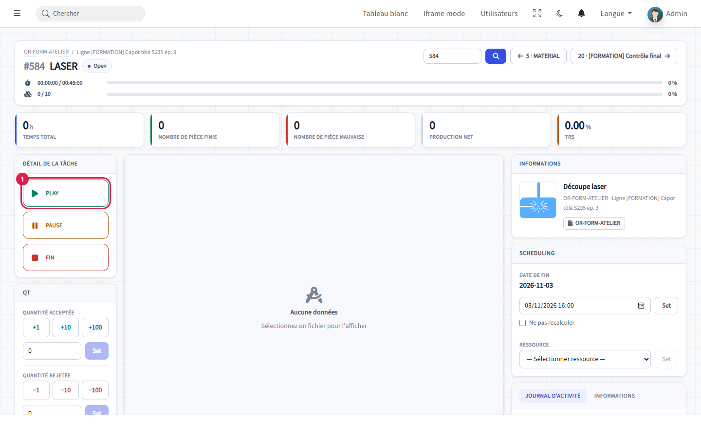

L'en-tête rappelle la commande, la ligne et l'opération, avec deux barres : le **temps**
pointé sur le temps prévu, et les **pièces** produites sur la quantité commandée. Les
boutons en haut à droite passent à l'opération précédente ou suivante de la même gamme.

**Démarrer.** Cliquez sur **Play** au début du travail : l'opération passe « In progress »
et le chronomètre tourne.

**Déclarer les pièces** au fil de l'eau :

- **Quantité acceptée** : +1, +10 ou +100, ou saisissez un nombre puis « Set » ;
- **Quantité rejetée** : −1, −10 ou −100 pour les rebuts.

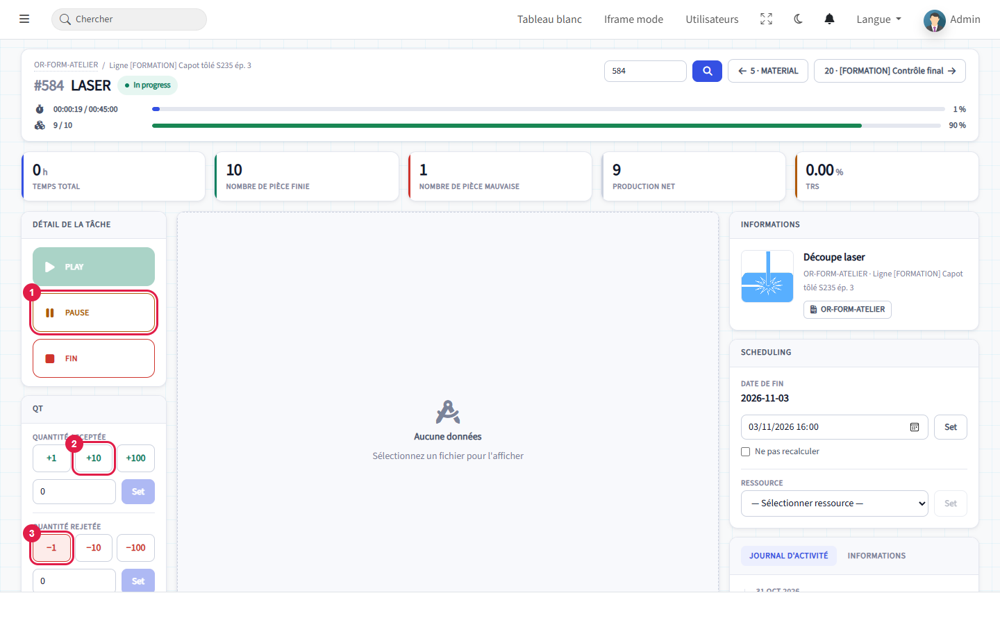

1. **Pause** arrête le chronomètre (pause, changement d'outil, attente matière).
2. **+10** déclare 10 pièces bonnes.
3. **−1** déclare une pièce rebutée.

Les compteurs se mettent à jour : pièces bonnes, pièces mauvaises, **production nette**
(bonnes moins rebuts).

> ⚠️ Les boutons rapides (+1, +10, −1…) déclarent **immédiatement**, sans confirmation.
> Une erreur se corrige par une déclaration inverse.

**Terminer.** Cliquez sur **Fin** quand l'opération est finie. Le journal d'activité garde
chaque action, avec son auteur et son heure.

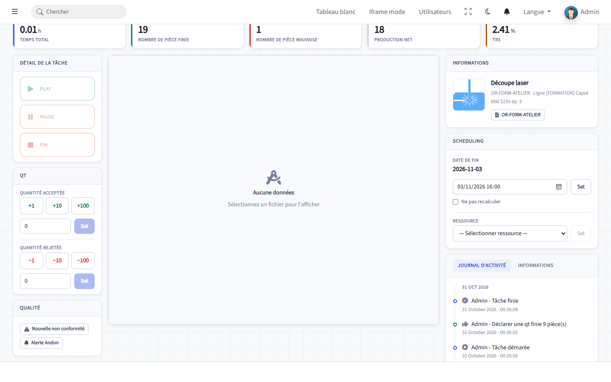

> 💡 Quand toutes les opérations d'une ligne sont terminées, la colonne « Tâches » de la
> ligne de commande passe à **Terminé**.

### Les cartes de droite

**Planification** : la date de fin prévue, la case **Ne pas recalculer** (le calcul
automatique du planning n'y touchera plus) et la **ressource** (machine) affectée.

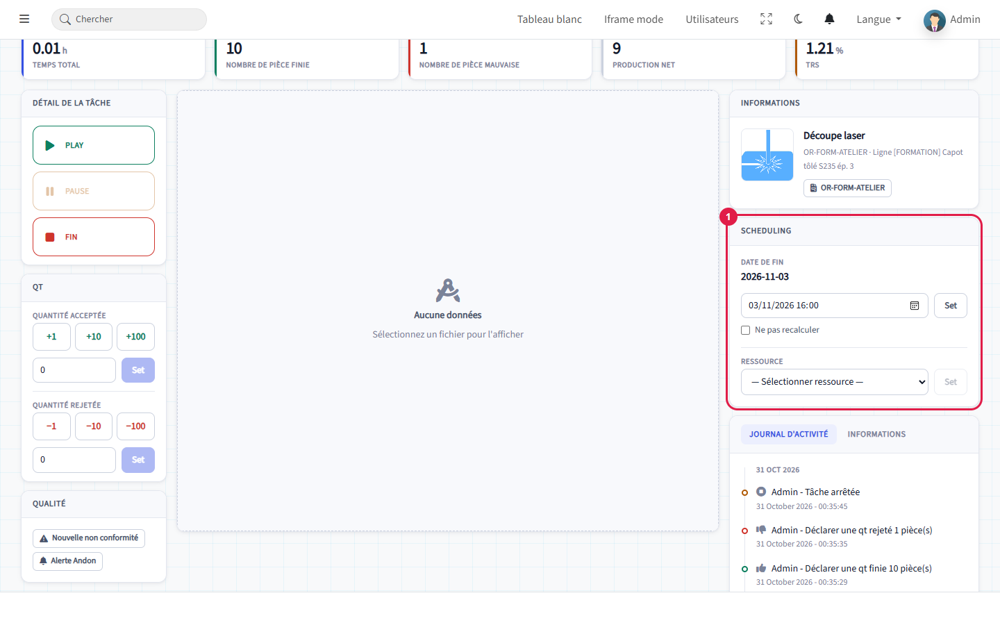

**Informations** : statut, quantité, coût, prix, temps de réglage, temps unitaire, temps
total, **TRS** et avancement.

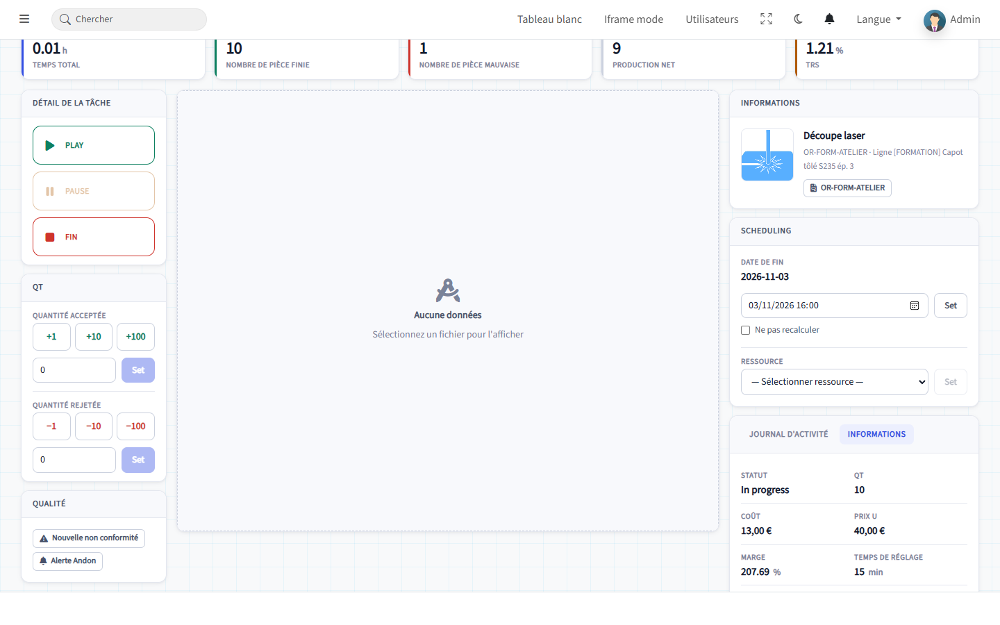

### Le plan et le contrôle

**Au centre**, le plan ou le modèle 3D de la pièce s'affiche quand un fichier est attaché à
la ligne de commande ou à l'article.

Si l'article a un **plan de contrôle validé** à l'indice commandé, l'écran s'ouvre sur
l'onglet **Contrôle** : le plan bullé et la grille des cotes à mesurer, pièce par pièce
(voir le guide de la Qualité). Une mesure hors tolérance peut créer une non-conformité.

> 💡 Sur une **première pièce** (premier article), déclarer des pièces bonnes avant d'avoir
> mesuré la pièce 1 affiche une demande de confirmation. C'est un rappel : la déclaration
> reste possible.

> 💡 **Sous-traitance et matière** : pour une opération confiée à un fournisseur, l'écran
> propose « Nouvelle commande d'achat » à la place de Play, puis « Fin » à la réception.

---

## 4. Sortir la matière du stock

Une ligne de gamme de **matière** (tôle, barre, composant) porte l'article à consommer.
Ouvrez-la depuis l'écran de suivi avec le bouton de l'opération précédente (par exemple
« 5 · MATERIAL »), puis déclarez la quantité prise en stock dans la carte
**Retirer du stock** : saisissez la quantité, puis « Set ».

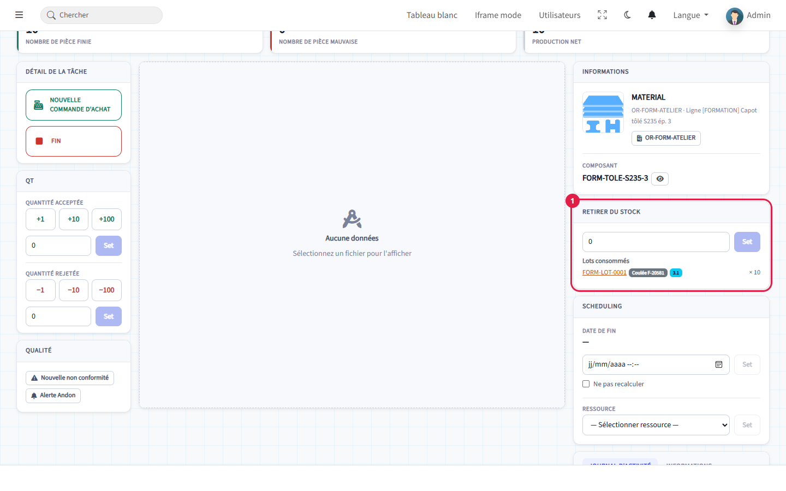

La carte liste ensuite les **Lots consommés** : code du lot, **coulée**, type de certificat
matière et quantité. Un clic sur le code du lot ouvre sa fiche (réception, certificat,
mouvements).

> ⚠️ La sortie est enregistrée **tout de suite**, sans confirmation. Vous ne choisissez pas
> le lot : le plus ancien en stock part en premier, et une sortie à cheval sur deux lots
> est répartie entre eux.

> 💡 Les coulées consommées s'impriment aussi sur la **fiche suiveuse** de la commande
> (section 11) : c'est la trace matière du dossier de fabrication.

---

## 5. Le visa de libération d'une phase

Certains postes de charge peuvent exiger un **visa** : une opération terminée sur ce poste
attend qu'un responsable la vise avant de passer à la suivante (contrôle final, soudure
qualifiée…). Si aucun de vos postes ne l'exige, cette section ne vous concerne pas et
l'écran n'affiche rien de plus.

**Le réglage.** Menu **Méthodes › Services**, bouton « Modifier » du poste : cochez
**Visa de libération requis**, puis « Mettre à jour ».

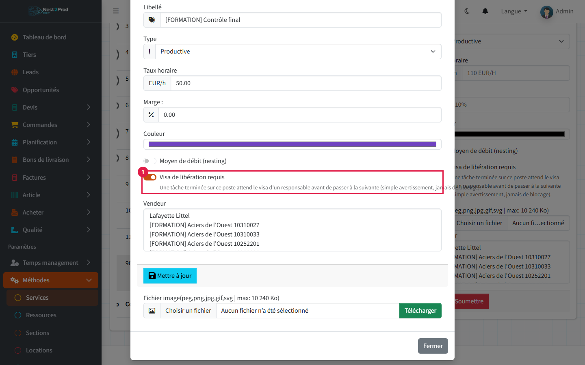

**Donner le visa.** Quand l'opération est terminée, la carte **Visa de libération** de
l'écran de suivi indique « Terminée, en attente du visa ».

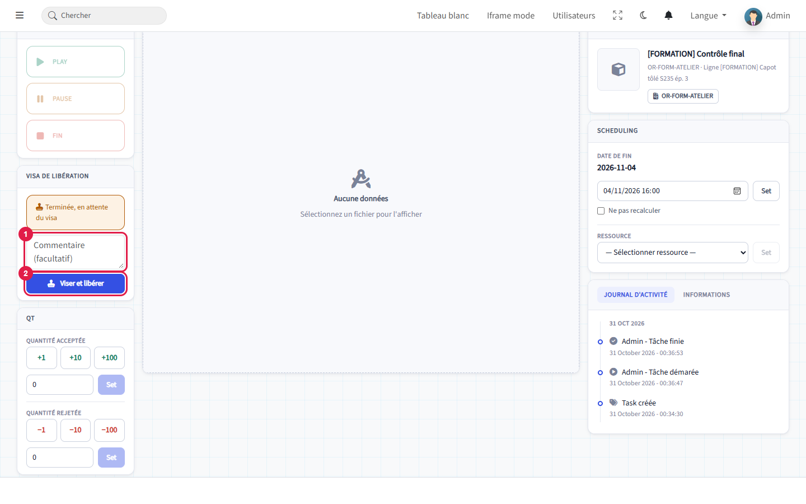

1. Ajoutez un **commentaire** si besoin (facultatif).
2. Cliquez sur **Viser et libérer**.

La carte passe à « Libérée », avec la date, l'auteur et le commentaire.

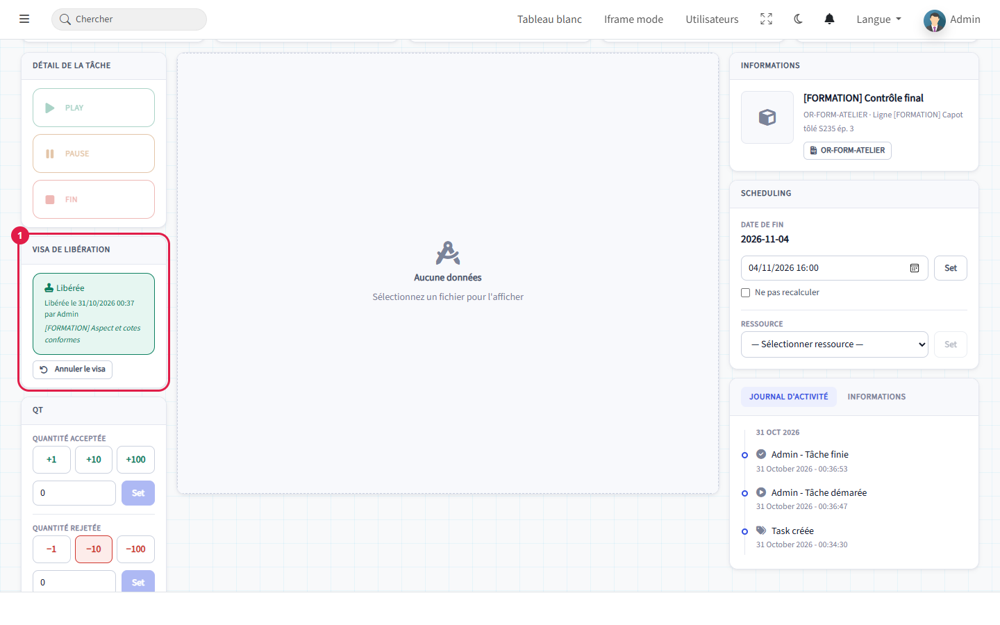

> ⚠️ Le visa est réservé aux porteurs de la permission « task-release » (rôle Admin par
> défaut). Les autres voient l'état, sans le bouton. Le visa ne se donne qu'une fois
> l'opération **terminée**.

**L'opération suivante** affiche un avertissement tant que la précédente n'est pas visée.

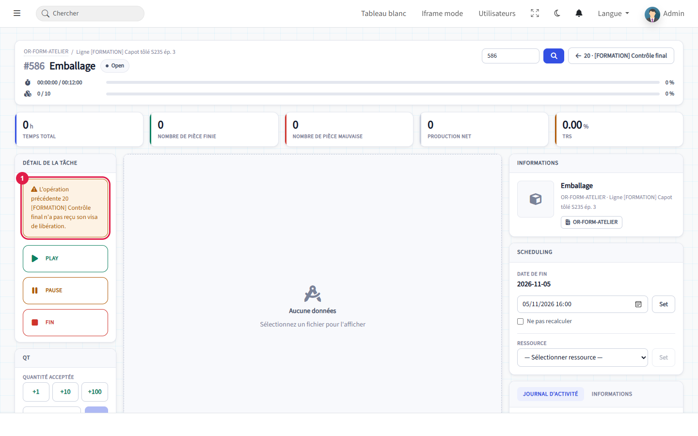

En cliquant sur Play, l'opérateur doit confirmer « Démarrer quand même ? ».

> 💡 Le visa **ne bloque jamais** la production : c'est un avertissement. Un visa donné
> par erreur s'annule avec « Annuler le visa ».

---

## 6. Signaler un problème

Carte **Qualité** de l'écran de suivi :

- **Nouvelle non conformité** crée tout de suite une non-conformité liée à l'opération,
  à compléter dans le module Qualité ;
- **Alerte Andon** signale un arrêt ou un problème (panne, manque matière, attente
  contrôle) : renseignez le type d'alerte, puis « Ajouter l'alerte ».

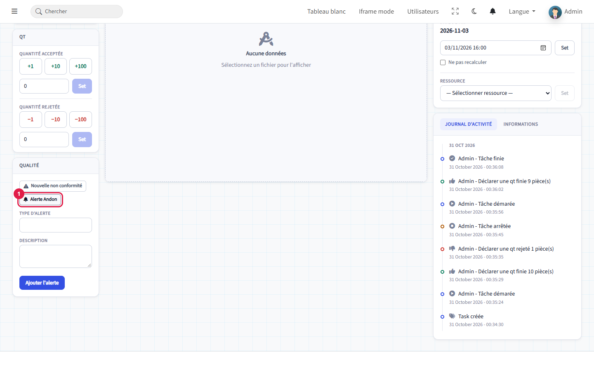

Le chef d'atelier traite les alertes sur l'écran Andon (section 10).

---

## 7. La liste des tâches

Menu **Planification › Liste des tâches** : toutes les opérations des commandes, avec des
filtres par service, ressource et statut. Un clic sur une ligne ouvre l'écran de suivi.

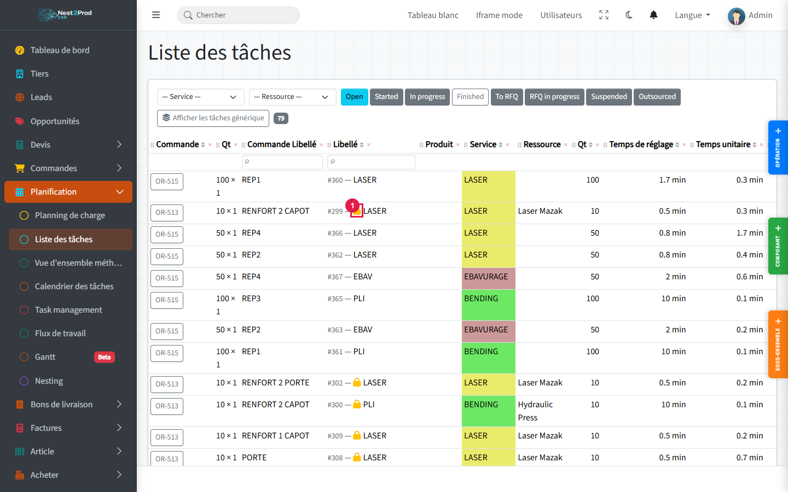

<!-- feature: production-release -->
1. Un **cadenas** devant le libellé signale une opération de production dont la ligne de
   commande n'a pas encore son bon pour fabrication.
<!-- /feature -->

---

## 8. Le Kanban

Menu **Planification › Flux de travail** : une colonne par statut, une carte par
opération. Filtrez sur un **service** (« Select Service », puis « Filter ») : sans filtre,
la page affiche toutes les opérations.

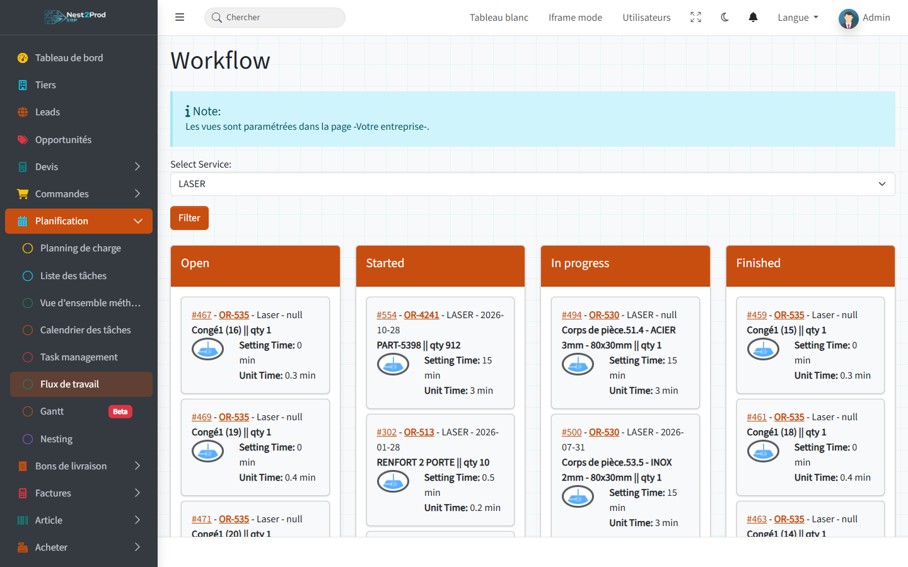

> ⚠️ Glisser une carte change le statut de l'opération : vers « Started » ou
> « In progress », elle est démarrée ; vers « Finished », elle est terminée.

<!-- feature: production-release -->
Une opération sans bon pour fabrication ne peut pas être glissée vers « Started » ou
« In progress » : le Kanban affiche « Tâches sans bon pour fabrication, déplacement
annulé » et remet la carte à sa place.
<!-- /feature -->

Sur un poste à visa, les cartes portent une pastille : **Visa requis** (pas encore
terminée), **À viser**, **Libérée**, ou **Précédente non libérée** sur l'opération
suivante.

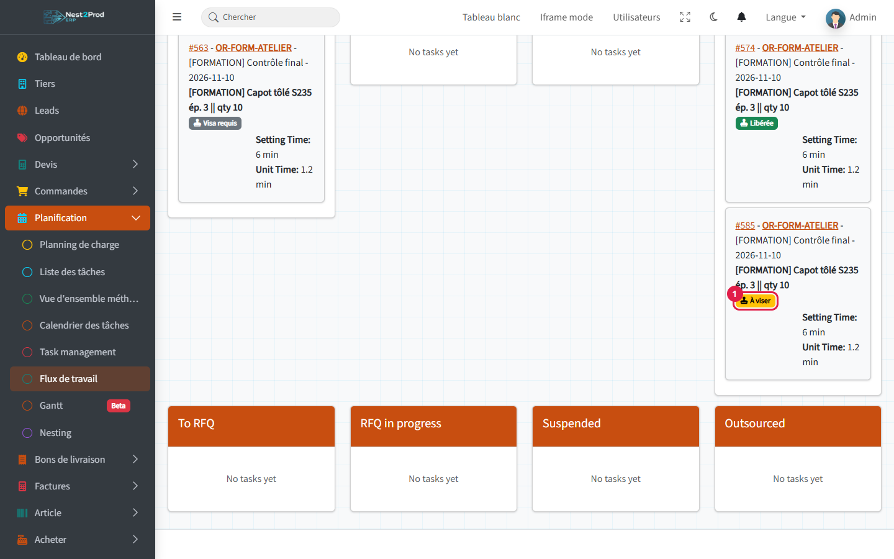

---

## 9. Le planning de charge

Menu **Planification › Planning de charge** : la charge de chaque **service** (ou de chaque
**ressource**) jour par jour, comparée à sa capacité. Les couleurs vont de « Libre » à
« Surcharge ».

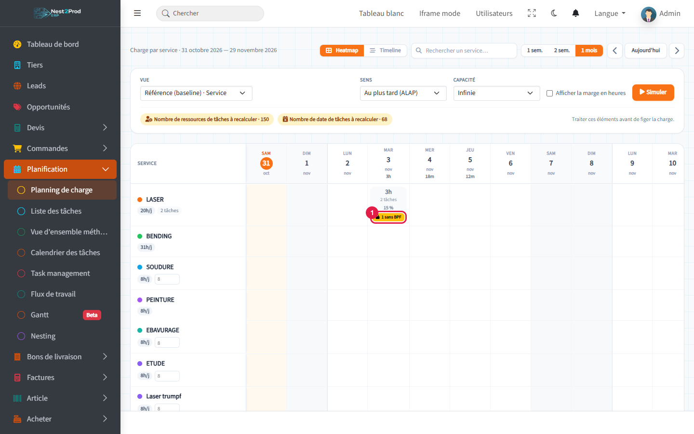

<!-- feature: production-release -->
1. La pastille **« 1 sans BPF »** compte les opérations du jour dont la ligne n'a pas
   encore son bon pour fabrication : la charge est prévue, mais ne peut pas démarrer.
<!-- /feature -->

- **Vue** : par service ou par ressource. La vue par ressource a une ligne **Tâches non
  affectées** pour les opérations sans machine.
- **Sens** : au plus tard (ALAP) ou au plus tôt (ASAP) ; **Capacité** : infinie ou finie.
- Les pastilles orange signalent les opérations dont la **ressource** ou les **dates**
  restent à calculer.
- La charge d'une opération est placée sur sa **date de fin** : une période sans opération
  à échéance reste vide.

> ⚠️ **Simuler** recalcule et **enregistre** les dates de toutes les opérations non
> terminées, sauf celles cochées « Ne pas recalculer ». Ce n'est pas un aperçu.
>
> 💡 Pour recalculer une seule commande : fiche commande, « Calcul des dates des tâches ».

---

## 10. Mesurer la production

Tuile **Reports** de l'accueil atelier : le réalisé sur la période (aujourd'hui, 7 ou
30 jours), rafraîchi toutes les minutes.

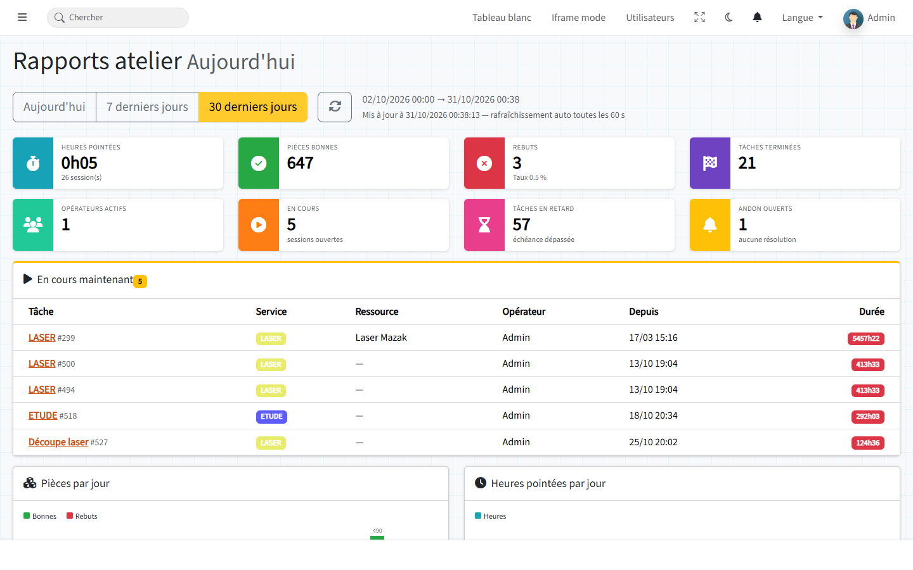

- Heures pointées, **pièces bonnes**, **rebuts** et taux de rebut, opérations terminées ;
- opérateurs actifs, opérations **en cours maintenant**, opérations **en retard** ;
- répartition par ressource (la charge machine réalisée), par opérateur et par service ;
- alertes Andon de la période.

L'écran **Andon** (adresse **/workshop/andon**) liste les alertes : passez-les « En cours »
quand quelqu'un s'en occupe, puis « Résolue ».

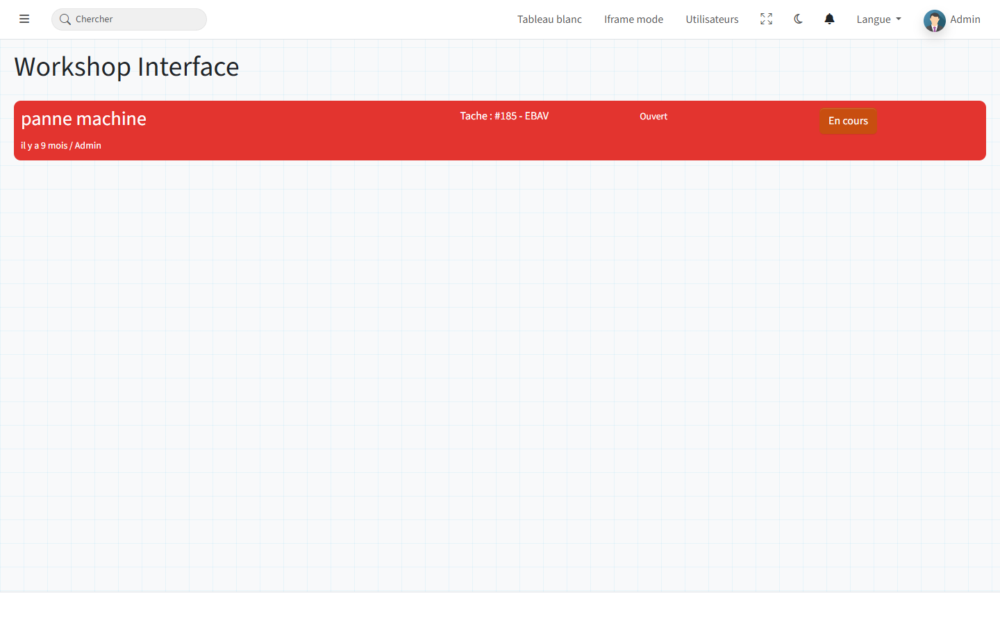

> 💡 Laissez l'écran Andon ou les rapports affichés sur un grand écran de l'atelier.

---

## 11. La fiche suiveuse

La **fiche suiveuse** accompagne les pièces dans l'atelier : une page de garde pour la
commande, puis une fiche par ligne avec la matière, la gamme à pointer et les contrôles.
Elle s'imprime depuis la fiche commande, onglet Informations (icône « i »), carte
**Options** : ligne **Fiche suiveuse**, bouton « Print ».

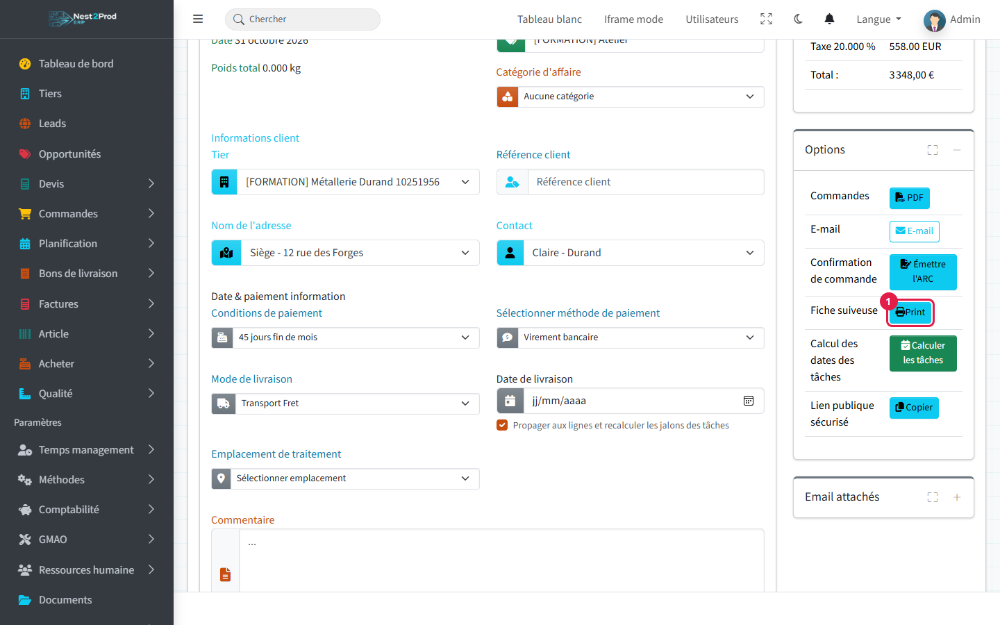

Les **coulées** des lots déjà sortis du stock (section 4) y sont imprimées : dans la
colonne « Lot matière » du composant, et dans une ligne « Lots consommés » sous
l'opération qui a sorti la matière. Si rien n'est encore sorti, la colonne reste vide,
à remplir à la main au poste.

> 💡 Réimprimez la fiche après la sortie de matière pour qu'elle porte les coulées.

## Et ensuite ?

- Les pièces terminées partent en **livraison** puis en **facturation** (guide
  « Facturer et encaisser »).
- Si la ligne de commande exige un **dossier de fin de fabrication**, le bon de livraison et
  la facture restent bloqués tant que ce dossier n'est pas validé (voir le même guide).
- Les non-conformités déclarées à l'atelier se traitent dans le module Qualité.

## Questions fréquentes

**Le bouton Play est grisé.**
L'opération est déjà démarrée ou terminée.
<!-- feature: production-release -->
Si un bandeau avec un cadenas s'affiche au-dessus, la ligne de commande attend son bon pour
fabrication : voyez le bureau d'études.
<!-- /feature -->

**« Il s'agit d'une tâche de devis, aucune action possible. »**
L'opération appartient à un devis : seules les opérations de commande se déclarent.

**Un avertissement parle d'une opération précédente « pas reçu son visa ».**
L'opération précédente est sur un poste à visa et n'est pas encore visée. Vous pouvez
démarrer quand même ; prévenez le responsable pour qu'il la vise.

**Les « Lots consommés » n'apparaissent pas.**
L'article n'a pas de lot en stock : la sortie est enregistrée sans lot. Les lots se créent
à la réception de la matière, quand l'article est suivi par lot ou qu'une coulée est saisie.

**Ma machine n'apparaît pas dans la liste des ressources.**
Elle n'est pas rattachée au service de l'opération (Méthodes › Ressources).

**Le planning de charge est vide.**
Aucune opération n'a d'échéance sur la période affichée : changez de période avec les
flèches.

**La ligne de commande reste « En cours ».**
Une de ses opérations n'est pas terminée : ouvrez la gamme de la ligne pour la retrouver.
