**Objectif** : déclarer en temps réel le travail fait à l'atelier, et s'en servir pour
piloter la charge et mesurer la production.

**Pour qui** : les **opérateurs** (sections 1 à 4) et le **chef d'atelier** (sections 5 à 8).

## Avant de commencer

- Les **opérations** viennent de la gamme des lignes de commande (voir le guide
  « Du prospect à la facture »). Une opération de devis ne se déclare pas.
- Le **flux des tâches** (statuts Open, Started, In progress, Finished…) doit être en place
  (voir « Mettre en route son instance »).
- Les **ressources** (machines, postes) doivent être rattachées à leurs services (voir le
  guide « Les Méthodes »).

## Vue d'ensemble

```steps
Trouver l'opération
Démarrer
Déclarer les pièces
Pause / reprise
Terminer
Piloter et mesurer
```

---

## 1. Le mode atelier

L'écran **atelier** est fait pour un poste partagé ou une tablette : grandes tuiles, sans
menu latéral. Ouvrez l'adresse de votre instance suivie de **/workshop** et mettez-la en
favori sur le poste de l'atelier.

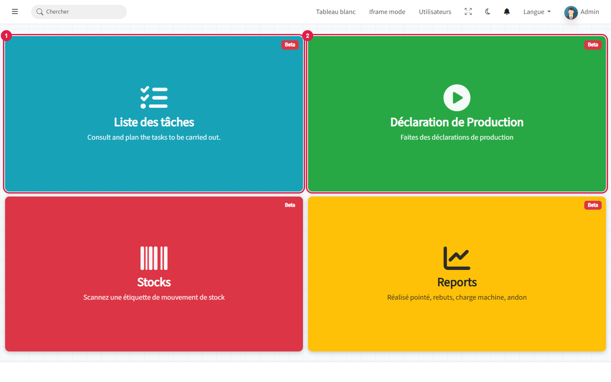

1. **Liste des tâches** : ce qui reste à faire.
2. **Déclaration de production** : l'écran de suivi d'une opération.

Les deux autres tuiles ouvrent le scan d'étiquette de stock et les rapports atelier
(section 8).

> 💡 Sur une tablette, le bouton grille de la barre du haut ouvre le lanceur
> d'applications. Le **Pointage** (badgeuse d'entrée et de sortie) sert à la présence,
> pas à la production.

---

## 2. Trouver son travail

La **liste atelier** montre les opérations des commandes, avec leur service, leur
ressource, leur avancement et leur échéance.

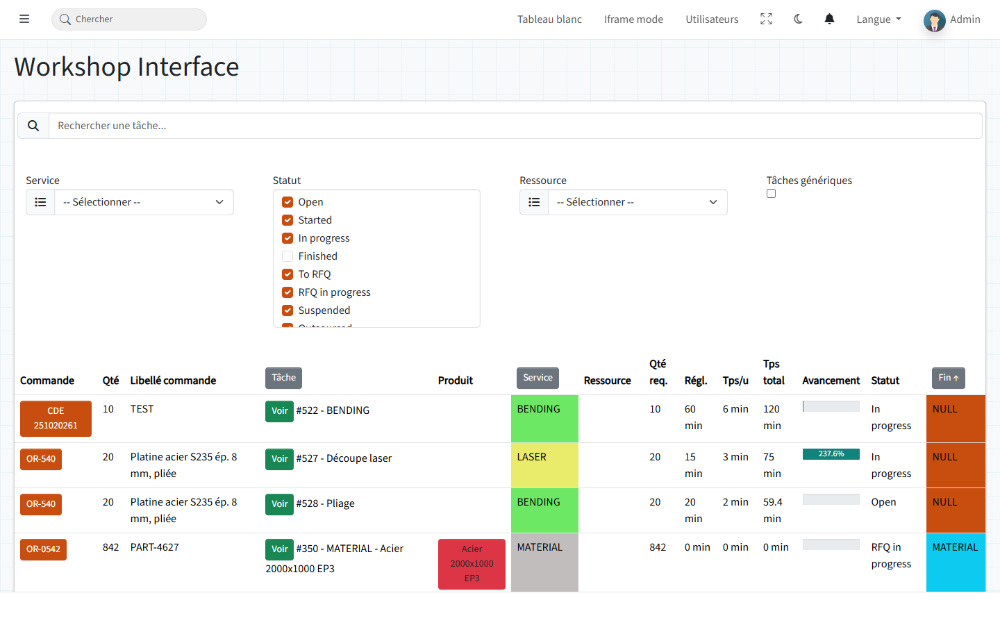

- Filtrez par **service**, **ressource** ou **statut** (les opérations terminées sont
  masquées par défaut).
- La colonne **Fin** se colore : rouge si l'échéance est dépassée, orange si c'est
  aujourd'hui, bleu si elle est à venir.
- Le bouton **Voir** ouvre l'écran de suivi de l'opération.

L'opérateur peut aussi taper le **numéro de l'opération**, celui de la fiche suiveuse, dans
la recherche de « Déclaration de production ». L'écran affiche aussi les indicateurs du
mois : opérations en cours, heures produites, TRS.

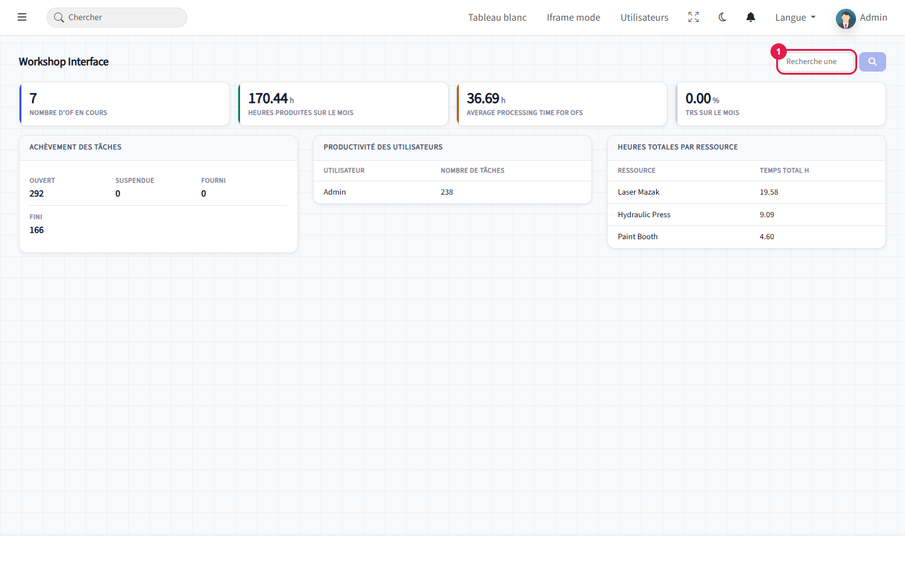

---

## 3. Déclarer sur l'écran de suivi

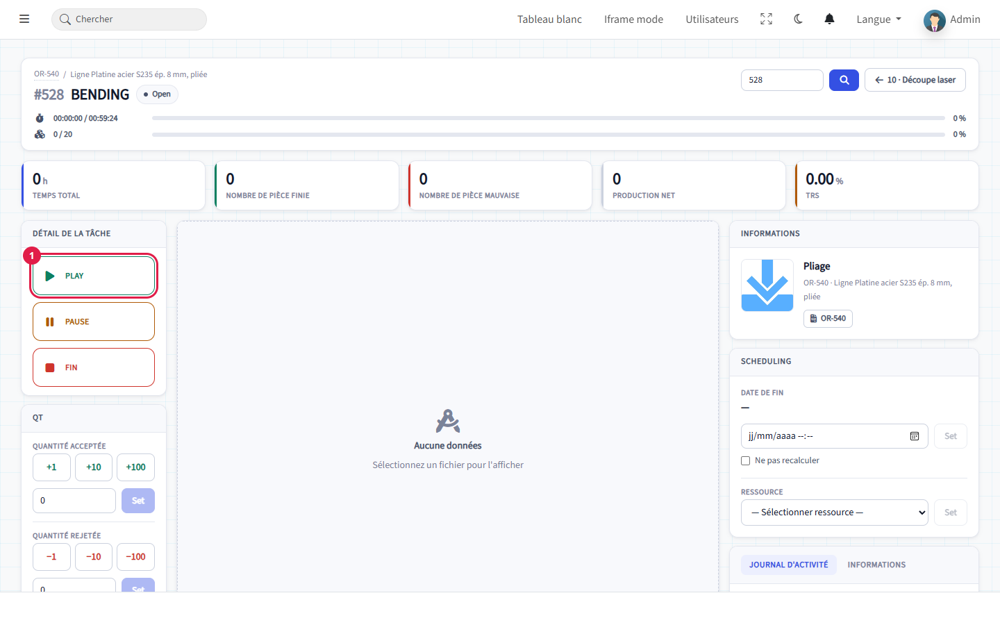

L'en-tête rappelle la commande, la ligne et l'opération, avec deux barres : le **temps**
pointé sur le temps prévu, et les **pièces** produites sur la quantité commandée. Le bouton
en haut à droite passe à l'opération précédente ou suivante de la même gamme.

**Démarrer.** Cliquez sur **Play** au début du travail : l'opération passe « In progress »
et le chronomètre tourne.

**Déclarer les pièces** au fil de l'eau :

- **Quantité acceptée** : +1, +10 ou +100, ou saisissez un nombre puis « Set » ;
- **Quantité rejetée** : −1, −10 ou −100 pour les rebuts.

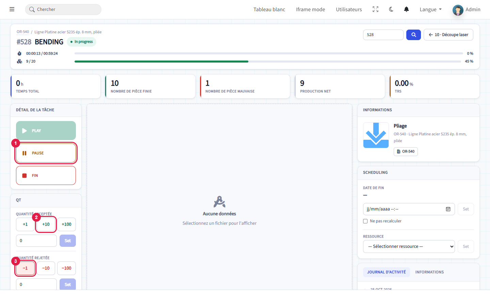

1. **Pause** arrête le chronomètre (pause, changement d'outil, attente matière).
2. **+10** déclare 10 pièces bonnes.
3. **−1** déclare une pièce rebutée.

Les compteurs se mettent à jour : pièces bonnes, pièces mauvaises, **production nette**
(bonnes moins rebuts).

> ⚠️ Les boutons rapides (+1, +10, −1…) déclarent **immédiatement**, sans confirmation.
> Une erreur se corrige par une déclaration inverse.

**Terminer.** Cliquez sur **Fin** quand l'opération est finie. Le journal d'activité garde
chaque action, avec son auteur et son heure.

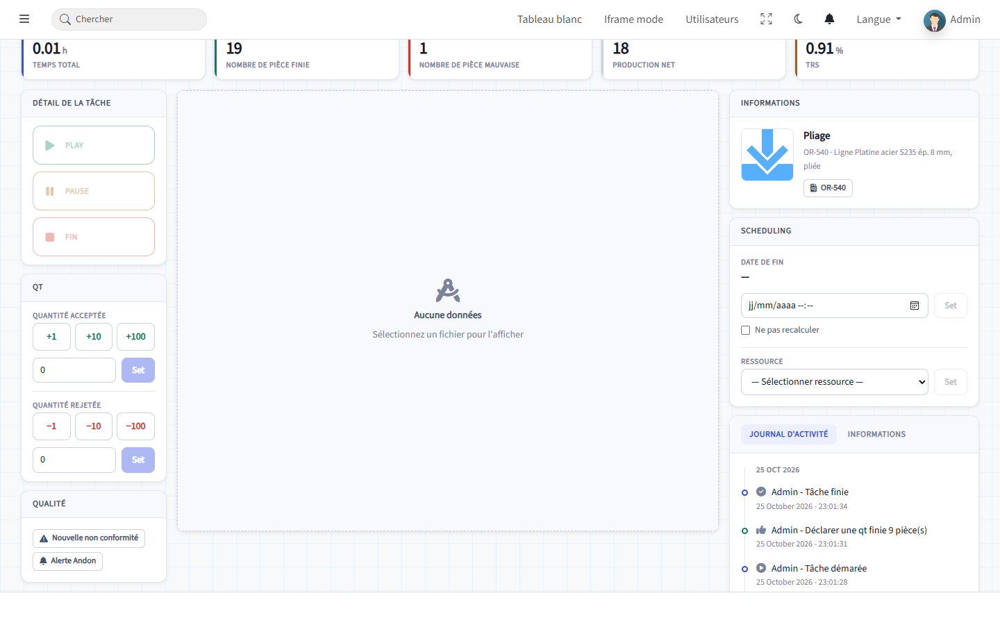

> 💡 Quand toutes les opérations d'une ligne sont terminées, la colonne « Tâches » de la
> ligne de commande passe à **Terminé**.

### Les cartes de droite

**Planification** : la date de fin prévue, la case **Ne pas recalculer** (le calcul
automatique du planning n'y touchera plus) et la **ressource** (machine) affectée.

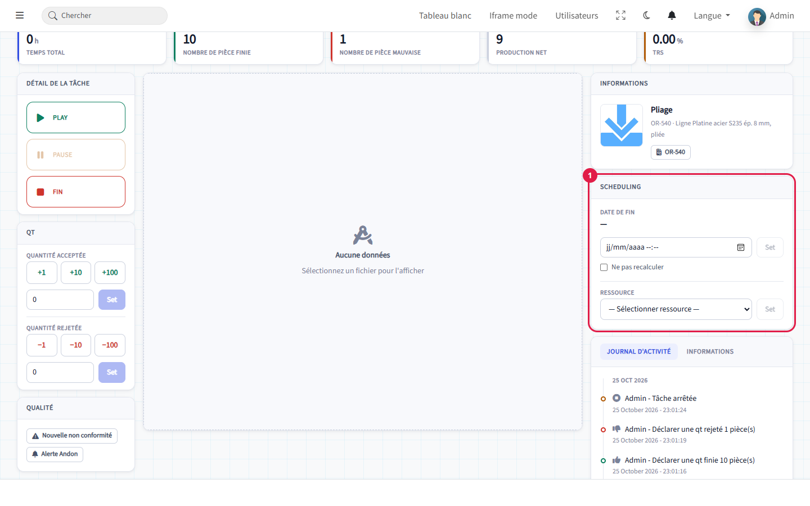

**Informations** : statut, quantité, coût, prix, temps de réglage, temps unitaire, temps
total, **TRS** et avancement.

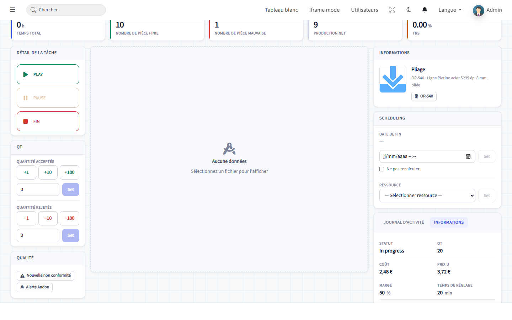

**Au centre**, le plan ou le modèle 3D de la pièce s'affiche quand un fichier est attaché à
la ligne de commande ou à l'article. Si l'article a un **plan de contrôle** validé, un
onglet **Contrôle** permet de saisir les mesures.

> 💡 **Sous-traitance et matière** : pour une opération confiée à un fournisseur, l'écran
> propose « Nouvelle commande d'achat » à la place de Play, puis « Fin » à la réception.

---

## 4. Signaler un problème

Carte **Qualité** de l'écran de suivi :

- **Nouvelle non conformité** crée tout de suite une non-conformité liée à l'opération,
  à compléter dans le module Qualité ;
- **Alerte Andon** signale un arrêt ou un problème (panne, manque matière, attente
  contrôle) : renseignez le type d'alerte, puis « Ajouter l'alerte ».

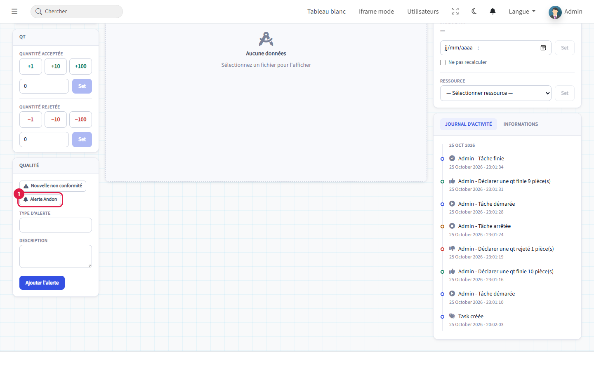

Le chef d'atelier traite les alertes sur l'écran Andon (section 8).

---

## 5. La liste des tâches

Menu **Planification › Liste des tâches** : toutes les opérations des commandes, avec des
filtres par service, ressource et statut. Un clic sur une ligne ouvre l'écran de suivi.

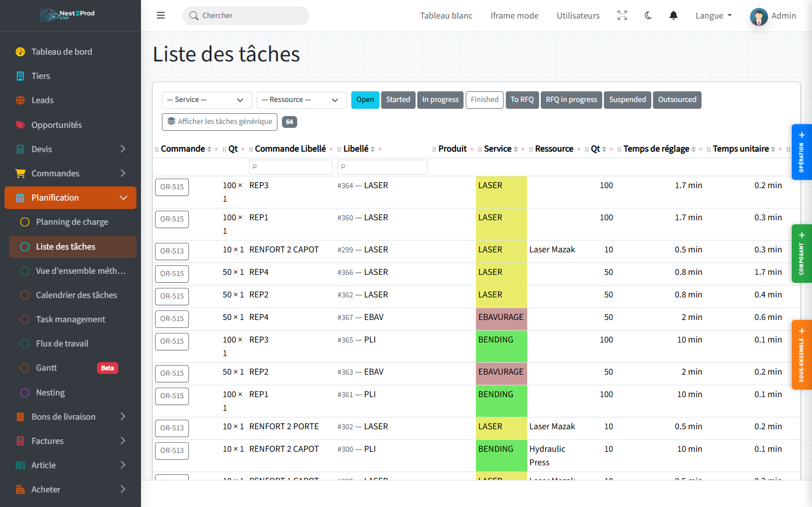

---

## 6. Le Kanban

Menu **Planification › Flux de travail** : une colonne par statut, une carte par
opération. Filtrez sur un **service** (« Select Service », puis « Filter ») : sans filtre,
la page affiche toutes les opérations.

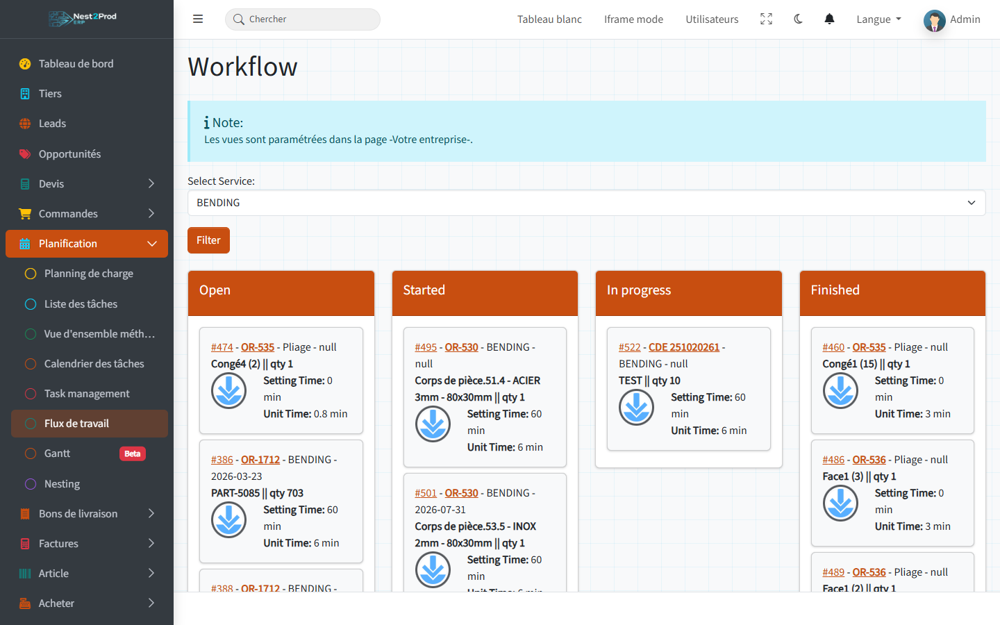

> ⚠️ Glisser une carte change le statut de l'opération : vers « In progress », elle est
> démarrée ; vers « Finished », elle est terminée.

---

## 7. Le planning de charge

Menu **Planification › Planning de charge** : la charge de chaque **service** (ou de chaque
**ressource**) jour par jour, comparée à sa capacité. Les couleurs vont de « Libre » à
« Surcharge ».

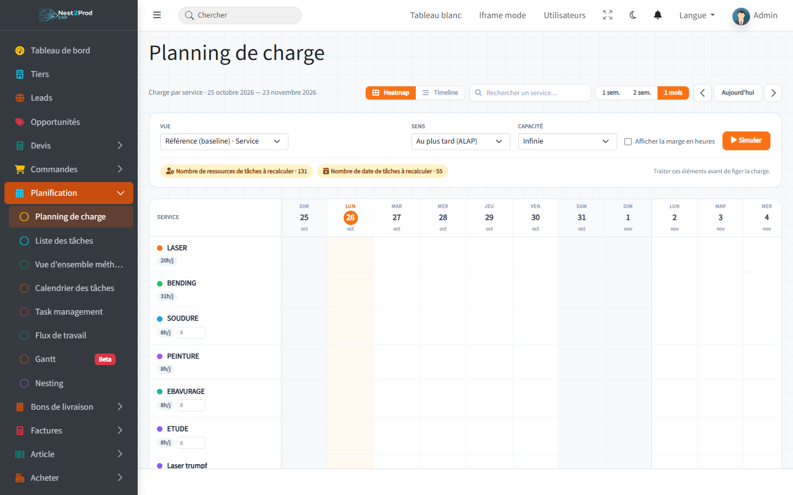

- **Vue** : par service ou par ressource. La vue par ressource a une ligne **Tâches non
  affectées** pour les opérations sans machine.
- **Sens** : au plus tard (ALAP) ou au plus tôt (ASAP) ; **Capacité** : infinie ou finie.
- Les pastilles orange signalent les opérations dont la **ressource** ou les **dates**
  restent à calculer.
- La charge d'une opération est placée sur sa **date de fin** : une période sans opération
  à échéance reste vide.

> ⚠️ **Simuler** recalcule et **enregistre** les dates de toutes les opérations non
> terminées, sauf celles cochées « Ne pas recalculer ». Ce n'est pas un aperçu.
>
> 💡 Pour recalculer une seule commande : fiche commande, « Calcul des dates des tâches ».

---

## 8. Mesurer la production

Tuile **Reports** de l'accueil atelier : le réalisé sur la période (aujourd'hui, 7 ou
30 jours), rafraîchi toutes les minutes.

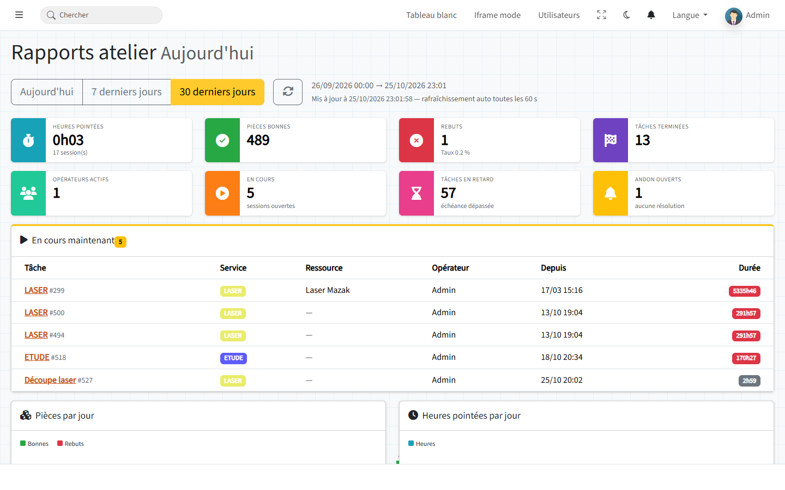

- Heures pointées, **pièces bonnes**, **rebuts** et taux de rebut, opérations terminées ;
- opérateurs actifs, opérations **en cours maintenant**, opérations **en retard** ;
- répartition par ressource (la charge machine réalisée), par opérateur et par service ;
- alertes Andon de la période.

L'écran **Andon** (adresse **/workshop/andon**) liste les alertes : passez-les « En cours »
quand quelqu'un s'en occupe, puis « Résolue ».

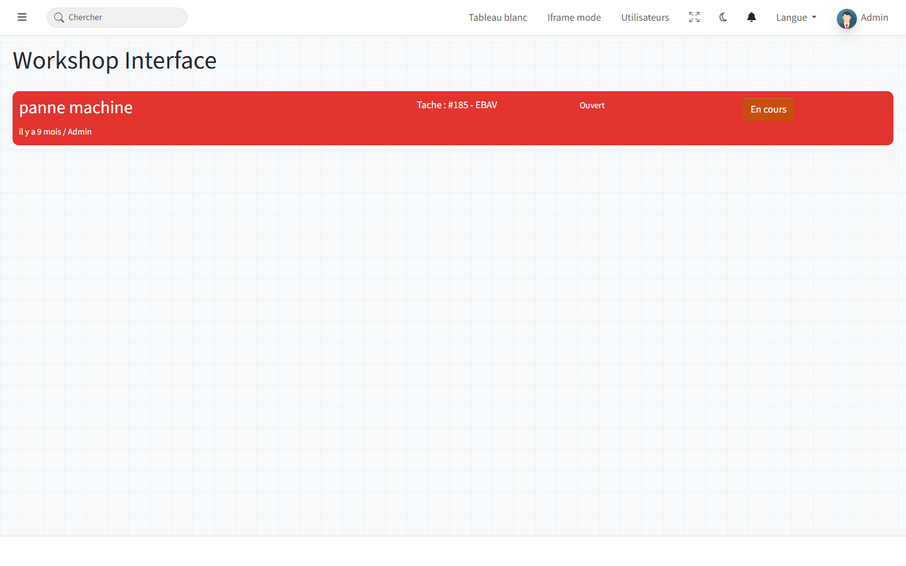

> 💡 Laissez l'écran Andon ou les rapports affichés sur un grand écran de l'atelier.

## Questions fréquentes

**Le bouton Play est grisé.**
L'opération est déjà démarrée ou terminée.

**« Il s'agit d'une tâche de devis, aucune action possible. »**
L'opération appartient à un devis : seules les opérations de commande se déclarent.

**Ma machine n'apparaît pas dans la liste des ressources.**
Elle n'est pas rattachée au service de l'opération (Méthodes › Ressources).

**Le planning de charge est vide.**
Aucune opération n'a d'échéance sur la période affichée : changez de période avec les
flèches.

**La ligne de commande reste « En cours ».**
Une de ses opérations n'est pas terminée : ouvrez la gamme de la ligne pour la retrouver.
