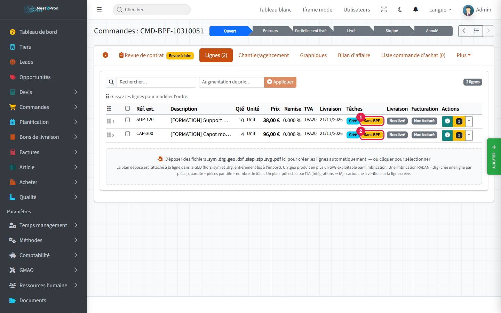
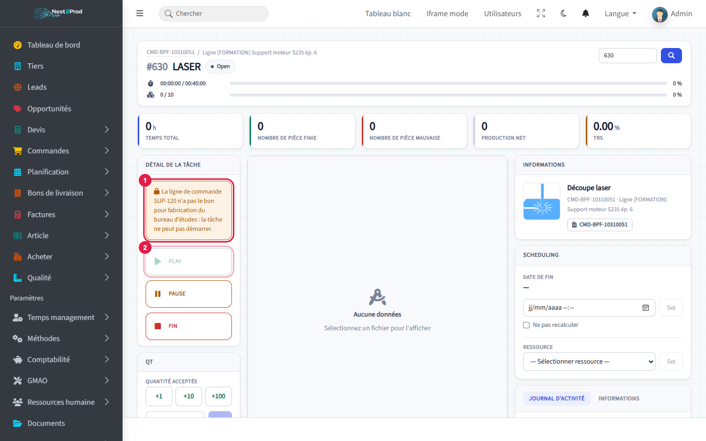
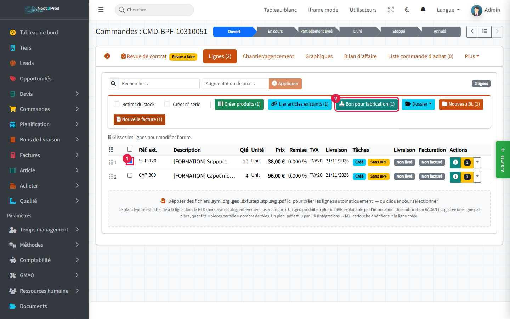
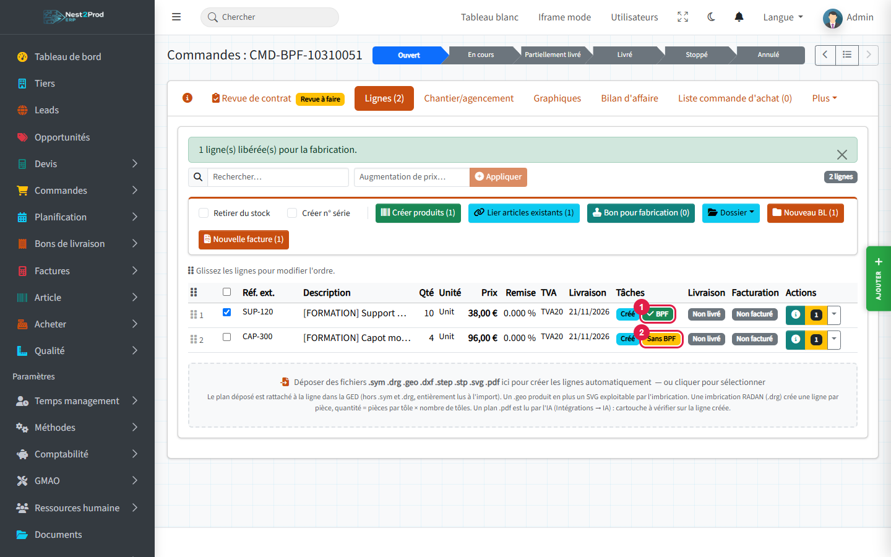
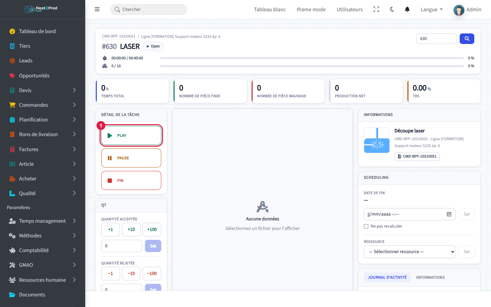
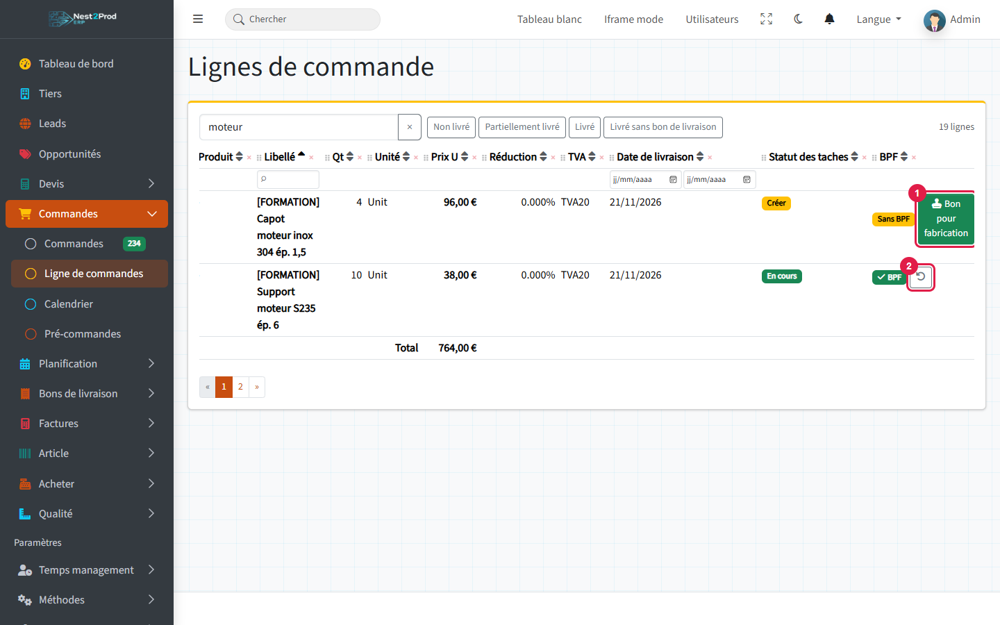
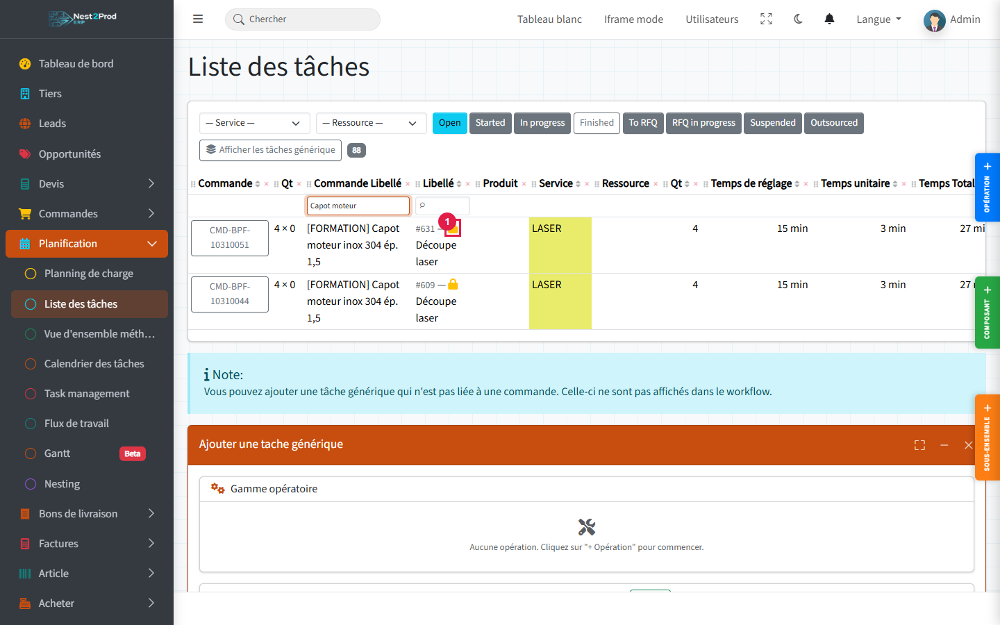

**Goal**: no production operation starts on an order line until engineering has approved the
drawing, the material and the routing. This go-ahead is the **release for production**
(shown as **RFP** in the English interface).

> 💡 Screenshots show the French interface (« BPF » = RFP); button names are given as they
> appear in the English interface.

**Example used**: Chaudronnerie Morel orders 10 motor brackets and 4 stainless covers. The
bracket drawing is approved, the cover drawing is still waiting for the customer's answer:
only the bracket goes into production.

## Before you start {#avant-de-commencer}

- Your company has made the release for production mandatory: that is why this guide is
  shown. Without this option nothing is blocked and no RFP badge is displayed.
- Granting or revoking a release requires the **"production-release"** permission (Admin role
  by default; give it to engineering in Your company → Roles and permissions).
- The order needs a **routing**: operations on each line (see the guide "From prospect to
  invoice").

### What the release blocks, and what it does not

| Blocked without release | Never blocked |
|---|---|
| **Starting** ("Play") an operation whose work centre is **productive** (cutting, bending, welding…) | Material, components, supplies |
| Moving a task to "Started" or "In progress" on the Kanban | Subcontracting |
| | Purchases and stock reservations |

Procurement can therefore start before the release: only shop-floor work waits.

## Overview {#vue-densemble}

```steps
Order and routing
Lines "Not released"
Released by engineering
The shop floor starts
Follow-up and revoking
```

---

## 1. Spot the lines without release {#reperer-les-lignes-sans-bpf}

Open the order, **"Lines"** tab. In the "Tasks" column each line carries a badge:

- badges 1 and 2, **"Not released"** (orange): the shop floor cannot start this line's
  operations yet.



A new line, or a **duplicated** line, never has a release: it must always be given.

## 2. What the operator sees {#ce-que-voit-loperateur}

On the tracking screen of a productive operation whose line is not released:

1. a **banner** explains that the line has not been released for production by engineering;
2. the **"Play"** button is greyed out.



> 💡 The operator only has to tell engineering: as soon as the line is released, reloading the
> screen is enough.

## 3. Release from the order {#donner-le-bpf-depuis-la-fiche-commande}

The quickest way when several lines are ready.

1. Tick the approved line(s).
2. Click **"Release for production (n)"** in the action bar that appears; the number counts
   the ticked lines that are not released yet.



A message confirms how many lines were released. Then:

1. the released line carries the green **"RFP"** badge (hover it to see the date and who
   released it);
2. the other line stays **"Not released"**.



> ⚠️ Each ticked line is judged on its own. If one is refused, a window gives the reason line
> by line; the others are released anyway. Possible refusals are described below ("When the
> release is refused").

## 4. The shop floor starts {#latelier-demarre}

Reload the tracking screen: the banner is gone and **"Play"** is available (1).



## 5. Release or revoke line by line {#donner-ou-annuler-le-bpf-ligne-par-ligne}

Menu **Orders → Order lines**: the list of all lines, across all orders, has an **"RFP"**
column. Handy for engineering, who see at a glance everything waiting for their go-ahead.

1. On a "Not released" line: **"Release for production"** button.
2. On an "RFP" line: the undo arrow button, **"Revoke release"**, after confirmation.



> ⚠️ **Revoking is refused as soon as one operation of the line has started** (even once, even
> paused). The message is: "A task of this line has already started: the release can no longer
> be revoked." So check the drawing **before** releasing.

## 6. Where to see lines without release {#ou-voir-les-lignes-sans-bpf}

- **Task list** (Planning → Task list): an orange **padlock** (1) in front of the label of
  productive operations whose line is not released.



- **Load planning**: an "n not released" badge in the day cells concerned.
- **Gantt**: "(not released)" after the operation name.
- **Kanban**: dropping an unreleased operation into "Started" or "In progress" is refused; the
  message lists the tasks concerned and **nothing is moved**.
- **Order set to "In progress"**: productive operations without release keep their status, the
  others move on as usual.

## When the release is refused {#quand-le-bpf-est-refuse}

The line is not released, with a message, in these cases:

- **Contract review rejected**: "The order review was rejected: the line cannot be released."
  Have the review redone ("Contract review" tab of the order).
- **Amendment pending**: an amendment reopens the review; "An amendment is awaiting the
  contract review sign-off: the line cannot be released until then."
- **Old change request not approved** on the order.
- **Presentation line** (heading, subtotal, text): it is not manufactured.
- Line **already released**.

> ⚠️ **Changing the drawing revision revokes the release.** If you change a line's "Ind. plan"
> (new drawing, revision B instead of A), its release is removed automatically: the new drawing
> must be approved again. The removal is recorded in the change history.

## What next? {#et-ensuite}

- **Report production** on the tracking screen: see the guide "Workshop and production".
- **Contract review and amendments**: see the guide "Contract review, amendments and order
  pricing"; an open amendment prevents any new release.
- Give the "production-release" permission to the engineering staff (Your company → Roles and
  permissions).

## Frequently asked questions {#questions-frequentes}

**The "Release for production" button does not appear.**
You lack the "production-release" permission. You see the badges, but only a holder of the
permission can release or revoke.

**Is buying the sheet metal blocked while waiting for the release?**
No. Material, supplies, subcontracting, purchases and reservations are never blocked: you can
procure in advance.

**A packing or deburring operation is blocked, is that normal?**
Yes if its work centre is of the productive type. The block depends on the work centre type,
not on the operation name (Methods → Work centres).

**I released by mistake and the operator has already started.**
The release can no longer be revoked. Stop the operation ("Pause"), correct the line; if the
drawing changes, change the revision: this removes the release and blocks further starts.

**A line with sub-assemblies?**
The release is given on the order line; it applies to the operations of all its
sub-assemblies.
