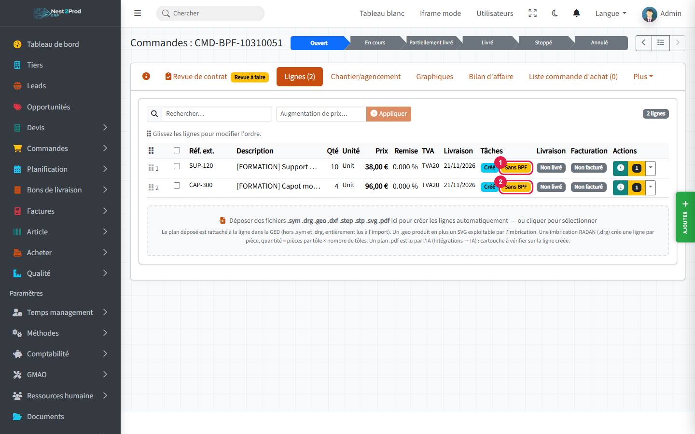
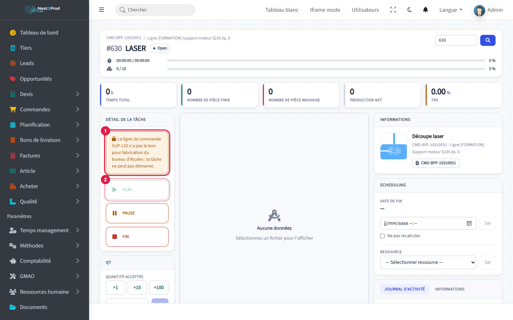
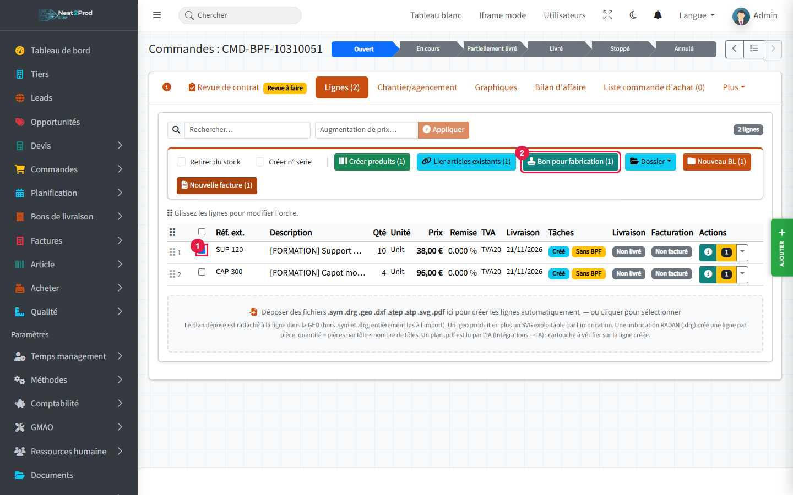
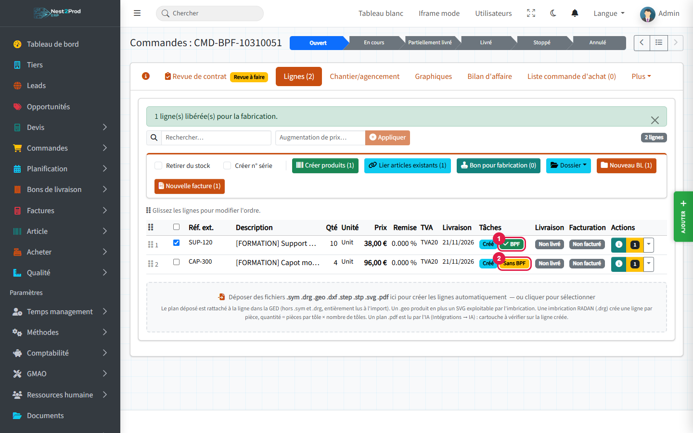
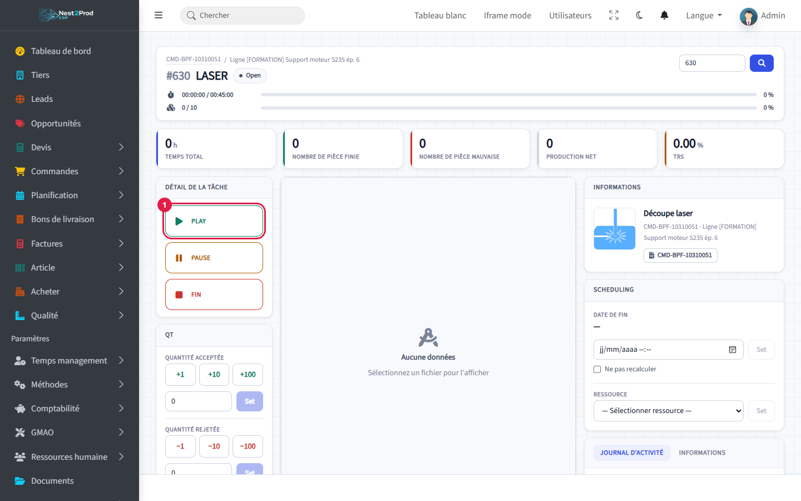
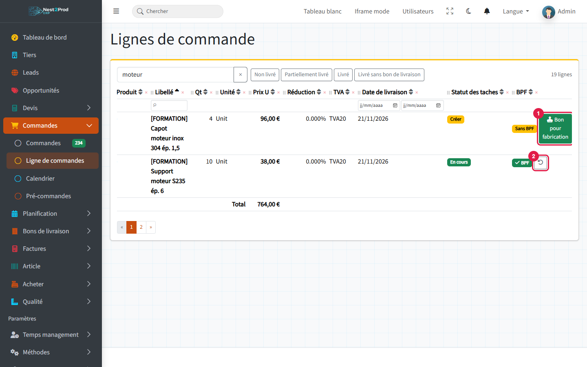
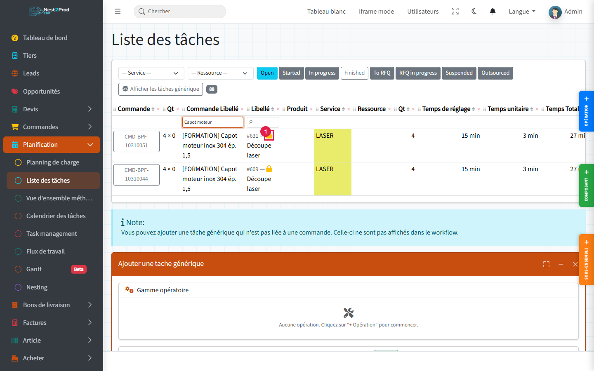

**Objectif** : qu'aucune opération de production ne démarre sur une ligne de commande tant
que le bureau d'études n'a pas validé le plan, la matière et la gamme. Ce feu vert s'appelle
le **bon pour fabrication** (BPF).

**Exemple utilisé** : la Chaudronnerie Morel commande 10 supports moteur et 4 capots inox.
Le plan du support est validé, celui du capot attend encore une réponse du client : seul le
support part en fabrication.

## Avant de commencer {#avant-de-commencer}

- Votre société a activé l'obligation de bon pour fabrication : c'est pour cela que ce guide
  apparaît. Sans cette option, rien n'est bloqué et aucun badge BPF n'est affiché.
- Donner ou annuler un BPF demande le droit **« production-release »** (rôle Admin par défaut,
  à confier au bureau d'études dans Votre société → Rôles et permissions).
- La commande doit avoir une **gamme** : des opérations sur chaque ligne (voir le guide
  « Du prospect à la facture »).

### Ce que le BPF bloque, et ce qu'il ne bloque pas

| Bloqué sans BPF | Jamais bloqué |
|---|---|
| Le **démarrage** (« Play ») d'une opération dont le poste est **productif** (découpe, pliage, soudure…) | La matière, les composants, les fournitures |
| Le passage d'une tâche en « Started » ou « In progress » dans le Kanban | La sous-traitance |
| | Les achats et les réservations de stock |

Les approvisionnements peuvent donc partir avant le BPF : seul le travail en atelier attend.

## Vue d'ensemble {#vue-densemble}

```steps
Commande et gamme
Lignes « Sans BPF »
BPF donné par le bureau d'études
L'atelier démarre
Suivi et annulation
```

---

## 1. Repérer les lignes sans BPF {#reperer-les-lignes-sans-bpf}

Ouvrez la commande, onglet **« Lignes »**. Dans la colonne « Tâches », chaque ligne porte
un badge :

- badges 1 et 2, **« Sans BPF »** (orange) : l'atelier ne peut pas encore démarrer les
  opérations de cette ligne.



Une ligne neuve, ou une ligne **dupliquée**, n'a jamais de BPF : il faut toujours le donner.

## 2. Ce que voit l'opérateur {#ce-que-voit-loperateur}

Sur l'écran de suivi d'une opération productive dont la ligne n'a pas de BPF :

1. un **bandeau** explique que la ligne n'a pas le bon pour fabrication du bureau d'études ;
2. le bouton **« Play »** est grisé.



> 💡 L'opérateur n'a rien à faire d'autre que prévenir le bureau d'études : dès que le BPF est
> donné, il lui suffit de recharger l'écran.

## 3. Donner le BPF depuis la fiche commande {#donner-le-bpf-depuis-la-fiche-commande}

C'est la méthode la plus rapide quand plusieurs lignes sont prêtes.

1. Cochez la ou les lignes validées.
2. Cliquez **« Bon pour fabrication (n) »** dans la barre d'actions qui apparaît ; le nombre
   entre parenthèses compte les lignes cochées qui n'ont pas encore de BPF.



Un message confirme le nombre de lignes libérées. Ensuite :

1. la ligne libérée porte le badge vert **« BPF »** (survolez-le pour voir la date et l'auteur) ;
2. l'autre ligne reste **« Sans BPF »**.



> ⚠️ Chaque ligne cochée est jugée séparément. Si l'une est refusée, une fenêtre en donne la
> raison ligne par ligne ; les autres sont quand même libérées. Les refus possibles sont
> décrits plus bas (« Quand le BPF est refusé »).

## 4. L'atelier démarre {#latelier-demarre}

Rechargez l'écran de suivi : le bandeau a disparu et **« Play »** est disponible (1).



## 5. Donner ou annuler le BPF ligne par ligne {#donner-ou-annuler-le-bpf-ligne-par-ligne}

Menu **Commandes → Ligne de commandes** : la liste de toutes les lignes, toutes commandes
confondues, a une colonne **« BPF »**. Pratique pour le bureau d'études, qui y voit d'un coup
d'œil tout ce qui attend son feu vert.

1. Sur une ligne « Sans BPF » : bouton **« Bon pour fabrication »**.
2. Sur une ligne « BPF » : bouton de retour en arrière (flèche), **« Annuler le BPF »**, après
   confirmation.



> ⚠️ **L'annulation est refusée dès qu'une opération de la ligne a démarré** (même une seule
> fois, même mise en pause). Le message est : « Une tâche de cette ligne a déjà démarré : le bon
> pour fabrication ne peut plus être annulé. » Vérifiez donc le plan **avant** de donner le BPF.

## 6. Où voir les lignes sans BPF {#ou-voir-les-lignes-sans-bpf}

- **Liste des tâches** (Planification → Liste des tâches) : un **cadenas** orange (1) devant le
  libellé des opérations productives dont la ligne n'a pas de BPF.



- **Planning de charge** : un badge « n sans BPF » dans les cases du jour concernées.
- **Gantt** : « (sans BPF) » après le nom de l'opération.
- **Kanban** : glisser une opération sans BPF dans « Started » ou « In progress » est refusé ;
  le message liste les tâches concernées et **rien n'est déplacé**.
- **Commande passée « En cours »** : les opérations productives sans BPF restent à leur statut,
  les autres avancent normalement.

## Quand le BPF est refusé {#quand-le-bpf-est-refuse}

Le BPF n'est pas donné, avec un message, dans ces cas :

- **Revue de contrat rejetée** : « La revue de la commande est rejetée : pas de bon pour
  fabrication. » Faites reprendre la revue (onglet « Revue de contrat » de la commande).
- **Avenant en attente** : un avenant rouvre la revue ; « Un avenant attend le visa de la revue
  de contrat : pas de bon pour fabrication avant ce visa. »
- **Ancienne demande de changement non approuvée** sur la commande.
- **Ligne de présentation** (titre, sous-total, texte) : elle ne se fabrique pas.
- Ligne **déjà libérée**.

> ⚠️ **Changer l'indice du plan annule le BPF.** Si vous modifiez « Ind. plan » d'une ligne
> (nouveau plan, indice B au lieu de A), son BPF est retiré automatiquement : le nouveau plan
> doit être revalidé. Le retrait est tracé dans l'historique des modifications.

## Et ensuite ? {#et-ensuite}

- **Déclarer la production** sur l'écran de suivi : voir le guide « Atelier et production ».
- **Revue de contrat et avenants** : voir le guide « Revue de contrat, avenants et prix de la
  commande » ; un avenant ouvert empêche tout nouveau BPF.
- Confier le droit « production-release » aux personnes du bureau d'études (Votre société →
  Rôles et permissions).

## Questions fréquentes {#questions-frequentes}

**Le bouton « Bon pour fabrication » n'apparaît pas.**
Il vous manque le droit « production-release ». Vous voyez les badges, mais seul un porteur
du droit peut donner ou annuler le BPF.

**L'achat de la tôle est-il bloqué en attendant le BPF ?**
Non. Matière, fournitures, sous-traitance, achats et réservations ne sont jamais bloqués :
vous pouvez approvisionner en avance.

**Une opération d'emballage ou d'ébavurage est bloquée, est-ce normal ?**
Oui si son poste de charge est de type productif. Le blocage dépend du type du poste, pas du
nom de l'opération (Méthodes → Postes de charge).

**J'ai donné le BPF par erreur et l'opérateur a déjà démarré.**
Le BPF ne peut plus être annulé. Arrêtez l'opération (« Pause »), corrigez la ligne ; si le plan
change, modifiez l'indice : cela retire le BPF et bloque à nouveau les démarrages suivants.

**Une ligne avec des sous-ensembles ?**
Le BPF se donne sur la ligne de commande ; il vaut pour les opérations de tous ses
sous-ensembles.
