**Goal**: before launching a customer order, check that it matches your offer and that you
can deliver it, keep a record of that check, then properly track everything that changes
afterwards (amendment, price, delivery date).

**Example used**: Métallerie Durand orders 4 stainless steel 316L pipe supports, each one
for a tagged item of equipment (1RCP-SUP-001 to 004). The customer will then move to
6 supports through an amendment.

## Before you start {#avant-de-commencer}

- You need access to the **Orders** menu.
- **Signing off** a review (approving or rejecting it) and **cancelling** an amendment are
  restricted to people authorised by your administrator ("contract-review-approve"
  permission in Your company › Roles and permissions). Without it you can prepare
  everything: a message replaces the sign-off buttons.
- Re-enabling the calculated price on an order that is already validated requires the
  "order-price-recalculate" permission.
- The order must be a **customer order**. An internal order has neither review nor amendment.

## Overview {#vue-densemble}

```steps
Order created (review to do)
Prepare the review
Upload the contract documents
Sign off the review
Track line prices and dates
Amendment: review reopened then signed off
```

The contract review **never blocks anything**: an order without a review can be changed,
delivered and invoiced as before. It is flagged by a banner and a badge, so that no order
goes into production without somebody having checked it.

<!-- feature: production-release -->
The one exception in your company: a **rejected** review, or an amendment **awaiting
sign-off**, prevents giving the **production release** to the order lines.
<!-- /feature -->

---

## 1. Enter the lines and their equipment tags {#saisir-les-lignes-et-leurs-reperes-dequipement}

The order has just been created (from a quote or with "New order"). "Lignes" tab, green
"+ AJOUTER" (Add) tab on the right edge of the screen, or "Modifier" (Edit) in the menu of
an existing line.

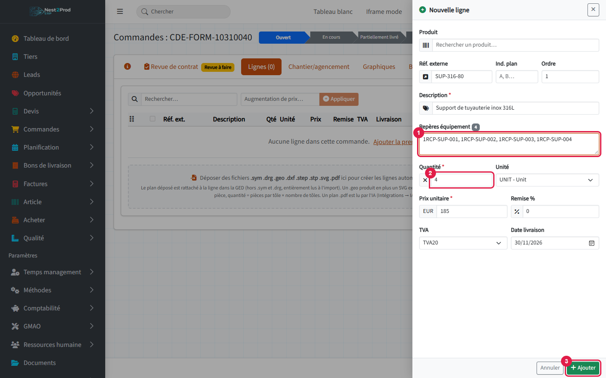

1. **Equipment tags**: enter one tag per item of equipment, separated by a comma, a
   semicolon or a line break. The grey counter shows how many tags are taken into account.
2. **Quantity**: here 4 supports for 4 tags.
3. Click "Ajouter" (Add), or "Enregistrer" (Save) for an edited line.

Tags are printed on the quote, the order, the order acknowledgement, the delivery note and
the job traveller, only when they are filled in. They are copied from the quote when it is
converted into an order.

> 💡 More tags than parts? A simple warning appears under the field: you can still save.

---

## 2. Spot the orders to review {#reperer-les-commandes-a-revoir}

As long as the review has not been signed off, the order page says so.

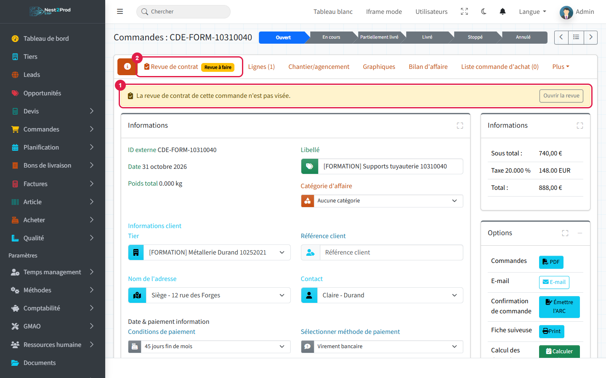

1. The yellow banner of the Information tab reminds you that the review has not been
   signed off. "Open the review" takes you straight there.
2. The "Contract review" tab carries a badge: "Review to do", "Review done" or "Review
   rejected".

In the order list (**Orders** menu, "Orders list" tab), the "Review" column gives the same
information for all your orders.

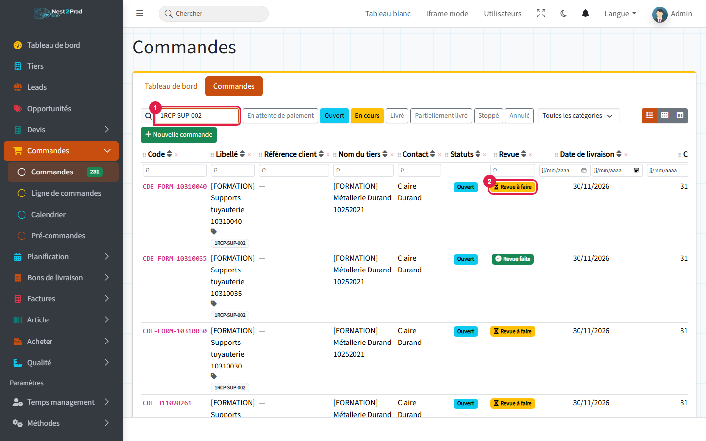

1. The search box also finds an order by **equipment tag**: the matching tag is shown under
   the label.
2. The "Review" column: filter it on "Review to do" to see what is left to review.

---

## 3. Prepare the review {#preparer-la-revue}

Open the "Contract review" tab. The left card holds the checklist, the right one the
contract documents and the amendments.

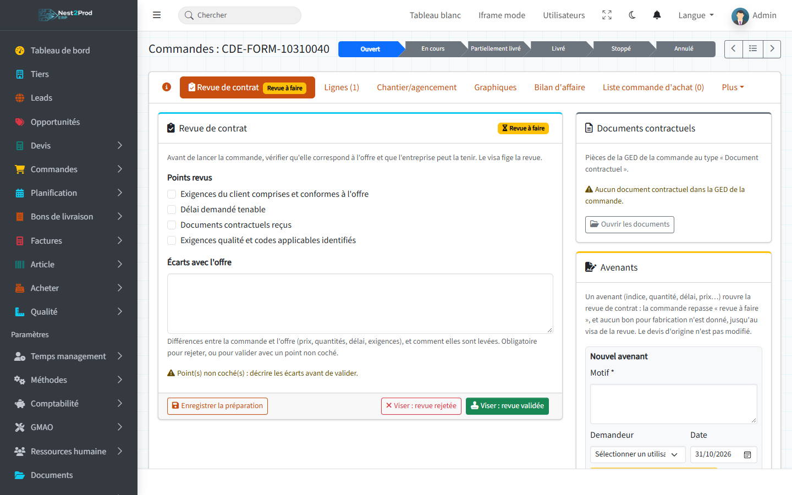

Tick each item checked and write down the deviations from your offer.

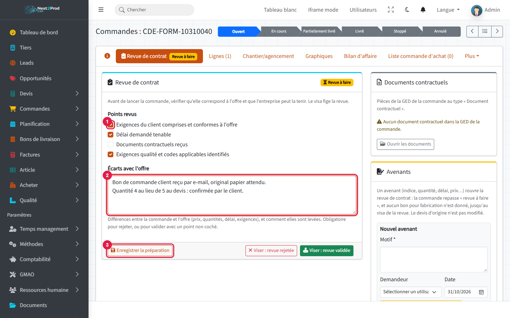

1. **Items reviewed**: customer requirements understood, lead time achievable, contract
   documents received, quality requirements identified.
2. **Deviations from the offer**: what differs from the quote (price, quantity, lead time,
   requirement) and how it is resolved.
3. Click "Save preparation". The preparation can be done in several goes and by any user of
   the module.

> ⚠️ An item left **unticked** requires the deviations to be described before approving. A
> **rejection** always requires the deviations.

---

## 4. Upload the contract documents {#deposer-les-documents-contractuels}

The customer's purchase order, specification, purchasing terms… are filed in the order's
document manager with the "Contract document" type. Click "Open documents" in the
"Contract documents" card (or the "Documents" tab).

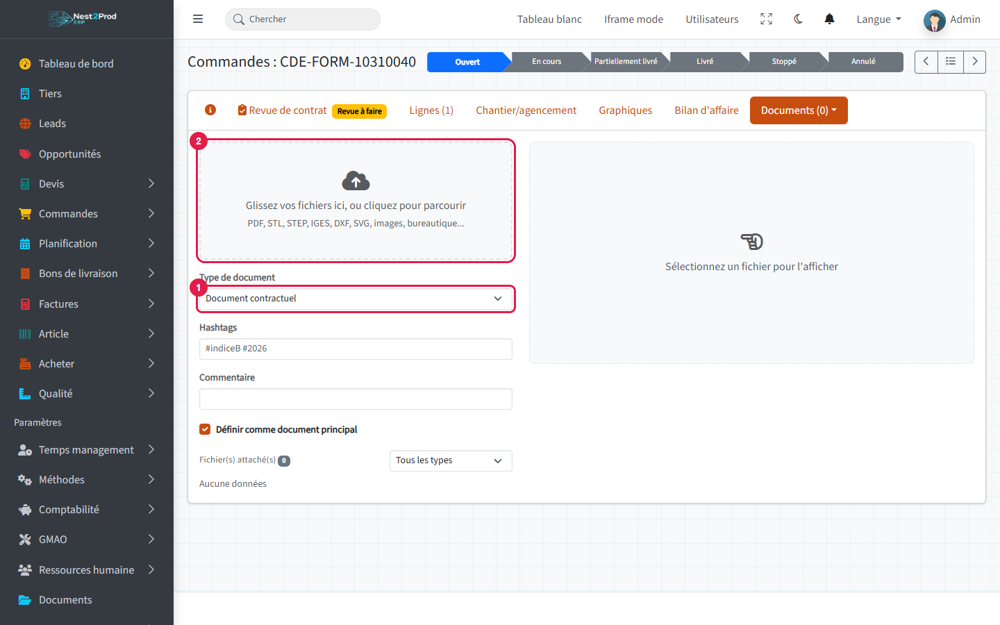

1. **Document type**: choose "Contract document" **before** dropping the file.
2. Drop the file in the area, or click it to choose the file.

Back on the "Contract review" tab, the document appears in the card.

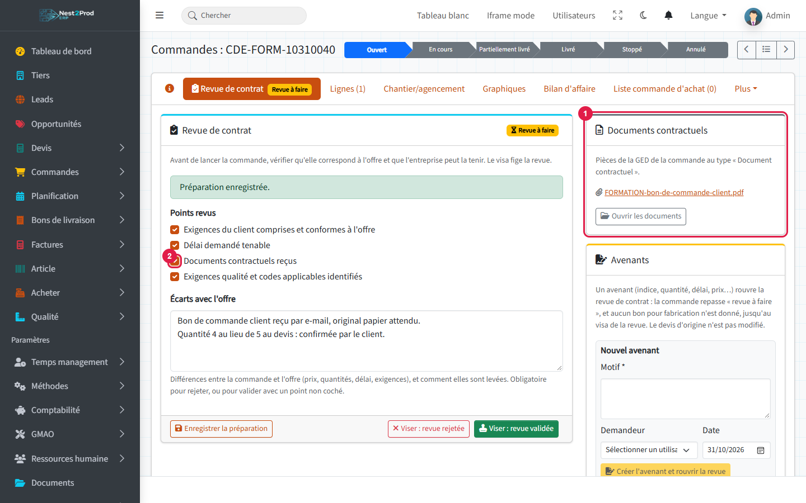

1. The "Contract documents" card lists the files of that type; a click opens them.
2. Tick "Contract documents received", then "Save preparation".

> ⚠️ A file uploaded with another type (or the automatic type) does not appear in the card.
> Change its type in the "Documents" tab.

---

## 5. Calculated price: while the order is in preparation {#prix-calcule-tant-que-la-commande-est-en-preparation}

A line can follow a **calculated price**, read again from its routing (the operations) each
time it is displayed, instead of a frozen price. The setting is in the line's task window:
"Lignes" tab, yellow "Tâches" (Tasks) button of the line.

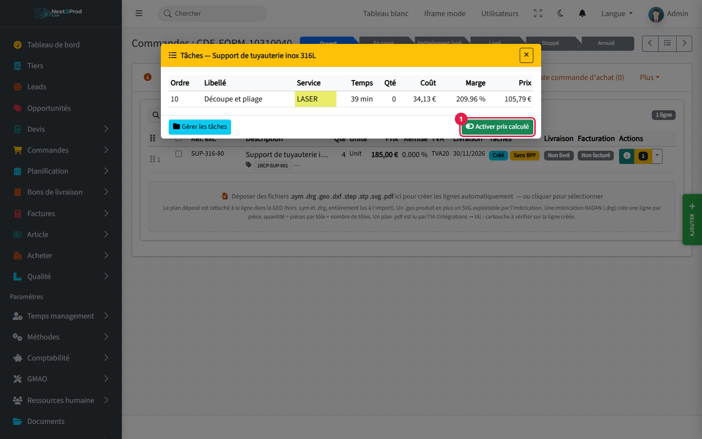

1. As long as the order is **in preparation** ("Open" status and review not yet approved),
   "Enable calculated price" is freely available.

"Disable calculated price" is always possible: the current calculated price becomes the
selling price of the line, which then stays put.

---

## 6. Sign off the review {#viser-la-revue}

When the preparation is complete, an authorised person signs off the review.

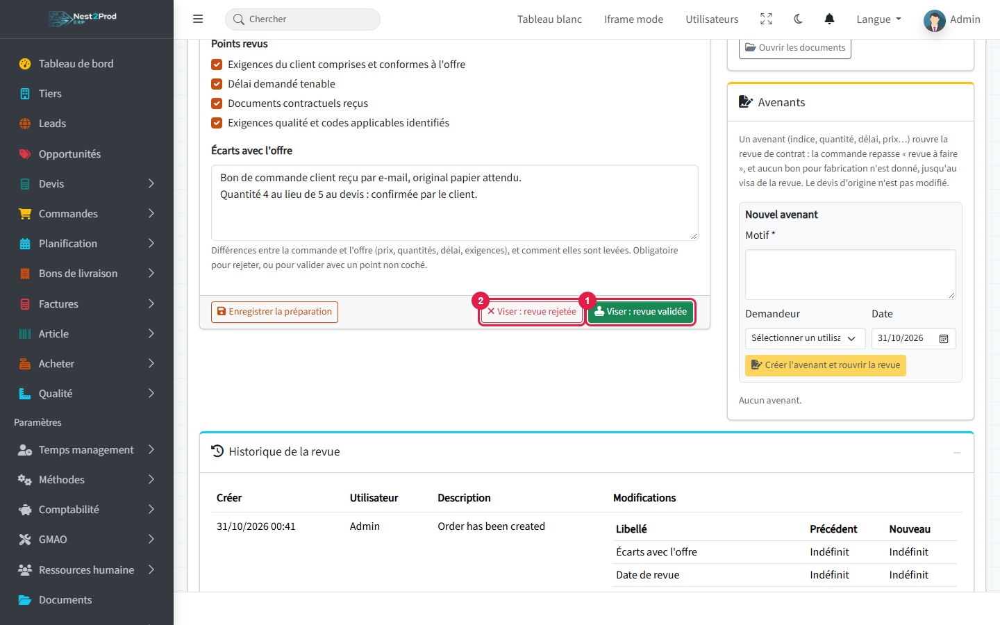

1. "Sign off: review approved": the order matches the offer and you can deliver it.
2. "Sign off: review rejected": the order is not acceptable as it stands (deviations required).

Confirm in the window that opens.

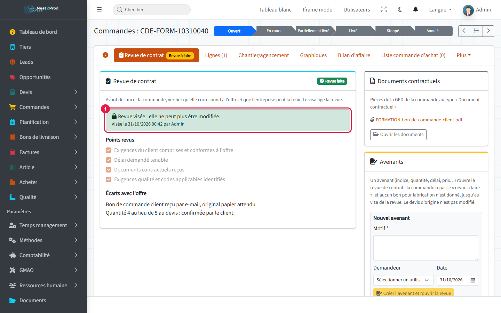

1. The review is **frozen**: the author and date of the sign-off are recorded, nothing can be
   changed any more. The history under the card keeps every change.

On approval, the **order acknowledgement** is prepared as a draft: the "Issue confirmation"
button of the "Options" card (Information tab) picks it up.

> 💡 The tab badge and the banner are updated the next time the order page is displayed.

---

## 7. After the sign-off: the price is frozen {#apres-le-visa-le-prix-est-fige}

Once the review is approved (or the order has moved beyond the "Open" status), the price
accepted by the customer must no longer change on its own.

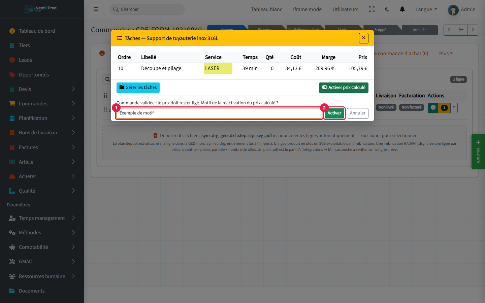

1. "Enable calculated price" now asks for a **reason** (at least 3 characters).
2. "Enable" is only accepted if you hold the matching permission; "Cancel" closes the request
   without changing anything.

> ⚠️ A line already **delivered or invoiced, even partly**, can no longer switch to the
> calculated price, whatever your permissions: the button is greyed out and a padlock
> explains why.

---

## 8. Postpone a delivery date {#reporter-une-date-de-livraison}

Edit the line (line menu › "Modifier") and change the delivery date ("Date livraison").

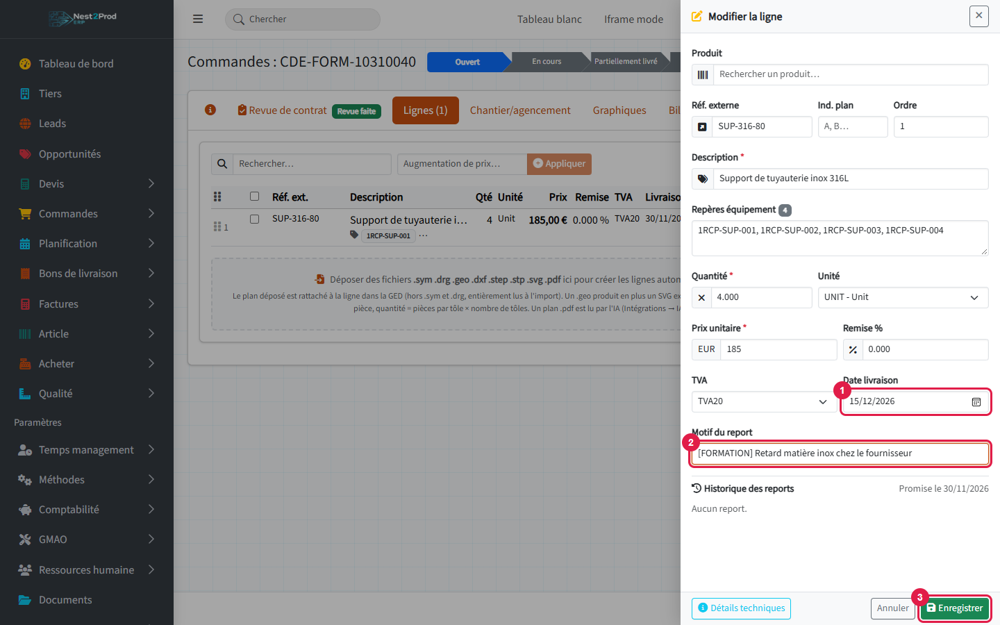

1. Enter the new date.
2. The "Reason for the change" field appears: supplier delay, customer request… It is
   optional but very useful to explain the delay later on.
3. Click "Enregistrer" (Save).

The date promised to the customer when the line was created **never** changes. As soon as it
differs from the current date, the line shows it under the delivery date.

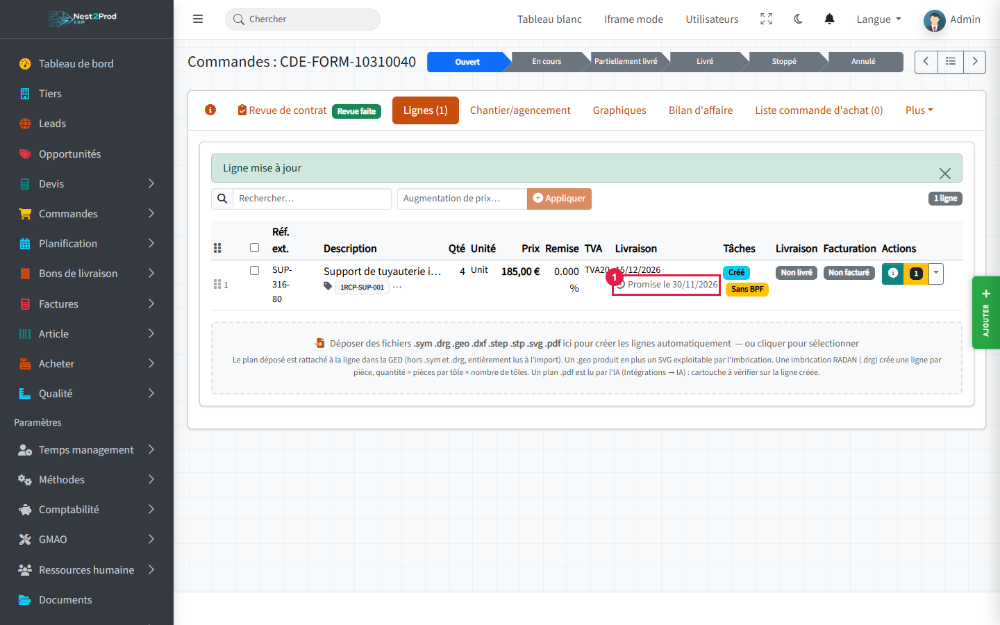

1. "Promised on …": the original date, used to measure real on-time delivery.

When you reopen the line, the panel shows every change.

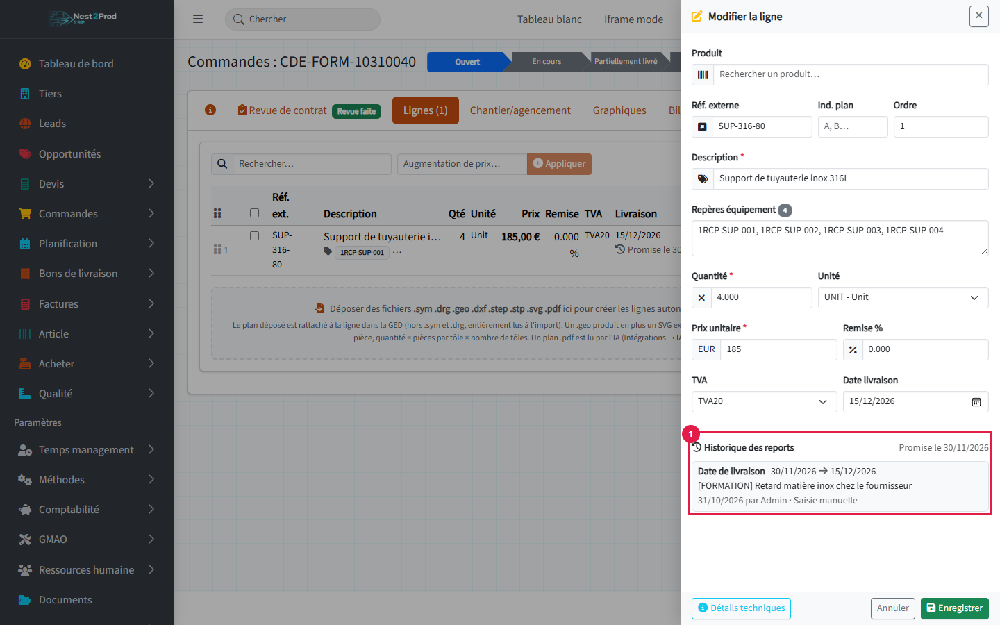

1. "Date changes": old and new date, reason, date of the change, author and origin (manual
   entry, import…).

---

## 9. Create an amendment {#creer-un-avenant}

The customer changes the order after the review (quantity, revision, lead time, price…)?
Create an **amendment**: the review is reopened, and its new sign-off will be the
amendment's sign-off. "Amendments" card of the "Contract review" tab.

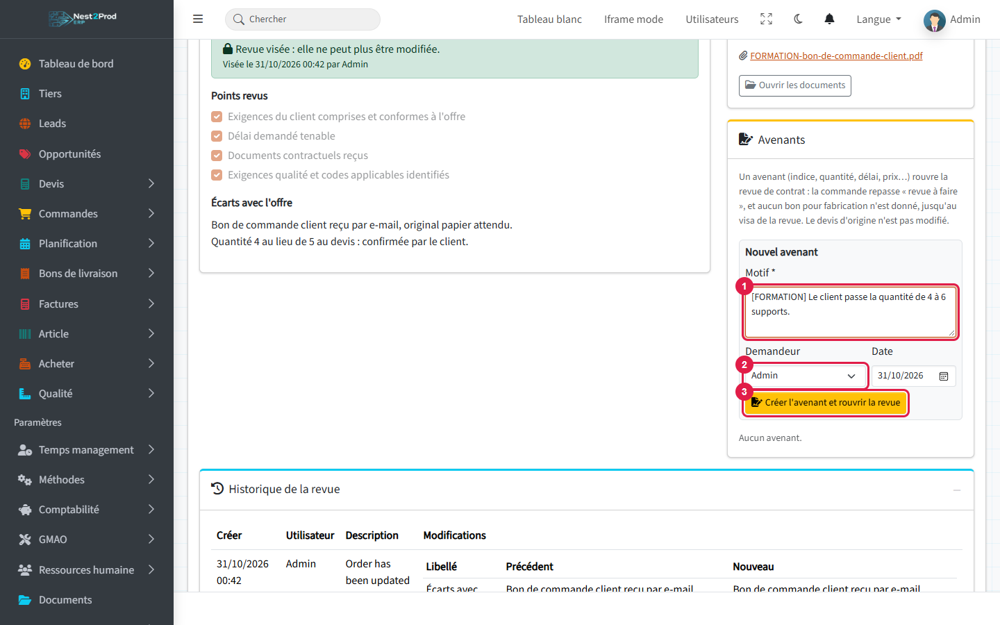

1. **Reason** (required): what the customer asks for.
2. **Requested by** and **Date** (optional).
3. Click "Create the amendment and reopen the review", then confirm.

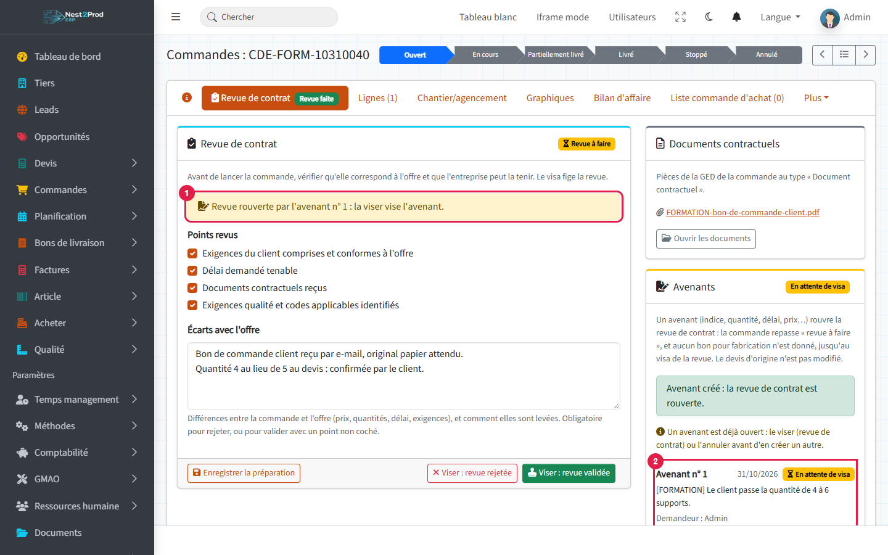

1. The review goes back to "to do". The previous checklist and deviations are kept as a
   starting point.
2. The amendment is "Awaiting sign-off", with the order's amount incl. VAT at the time it
   was created.

Then change the order lines as the amendment requires (here, 6 supports and two more tags).
The original quote is never changed.

> ⚠️ Only one amendment can be open at a time: sign it off or cancel it before creating another.

---

## 10. Cancel or sign off the amendment {#annuler-ou-viser-lavenant}

**Cancel**: the amendment does not go ahead (the customer withdraws, input error).

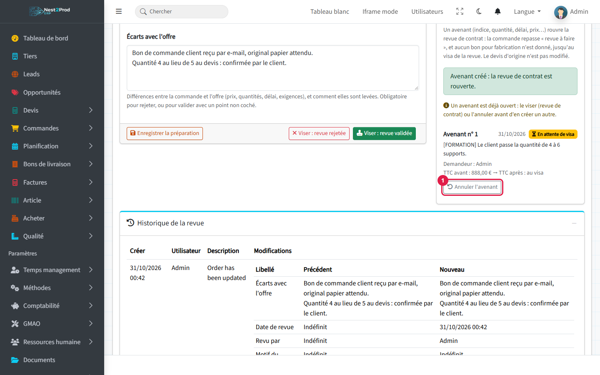

1. "Cancel the amendment" (authorised people only) restores the review as it was before the
   amendment.

**Sign off**: once the lines are changed, go over the checklist and deviations again, then
sign off the reopened review as in step 6.

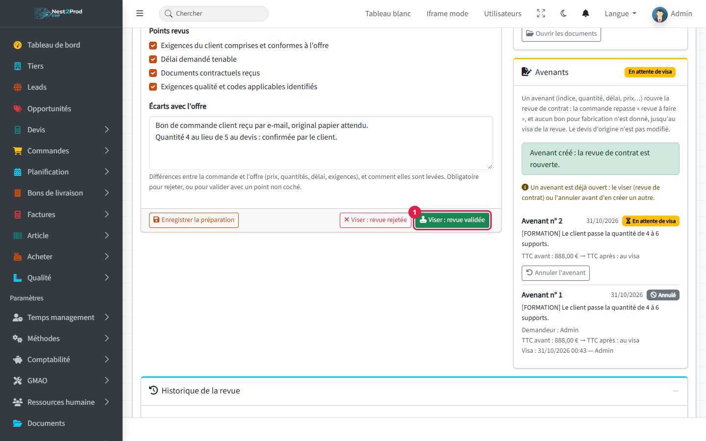

1. "Sign off: review approved" signs off the amendment at the same time. A new order
   acknowledgement is prepared.

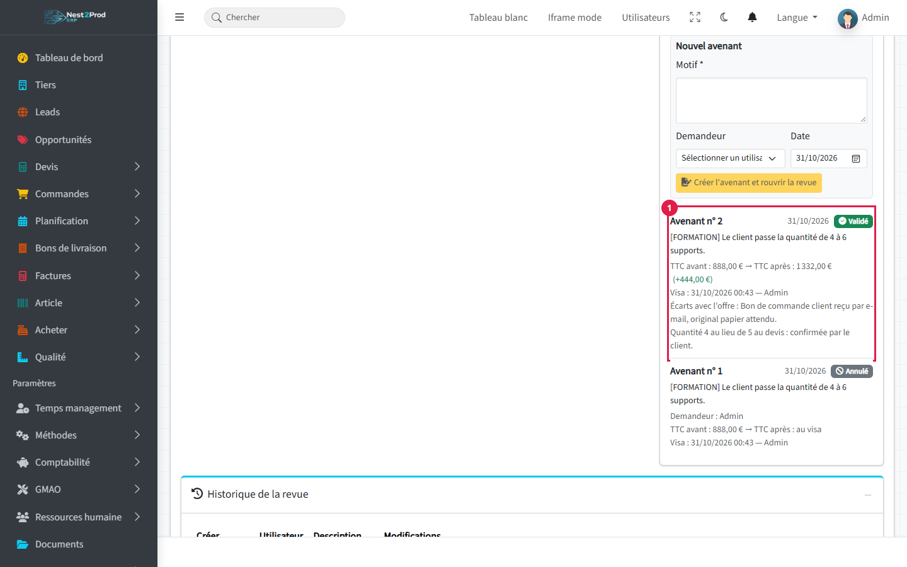

1. The amendment becomes "Approved" with the amount incl. VAT before and after, the
   difference, the author and the date of the sign-off. Cancelled amendments remain listed
   for the record.

---

## What next? {#et-ensuite}

<!-- feature: production-release -->
- Give the **production release** to the lines ("Lignes" tab): it is refused while the review
  is rejected or an amendment awaits its sign-off.
<!-- /feature -->
- Issue and send the **order acknowledgement** ("Options" card, "Issue confirmation").
- Continue the sales process: production, delivery note and invoice ("From prospect to
  invoice" guide).

## Frequently asked questions {#questions-frequentes}

**I cannot see the "Sign off" buttons.**
The sign-off is restricted to authorised people: a message is shown instead. Prepare the
review and let the person who signs off know.

**Can a signed-off review be changed?**
No, it is frozen. If the order changes, create an amendment: it reopens the review.

**Can an order without a review be delivered and invoiced?**
Yes. The review never blocks delivery notes or invoices; it is only flagged by the banner and
the "Review" column.

**"Enable calculated price" is greyed out.**
The line has already been delivered or invoiced, even partly: its price can no longer be
recalculated. The padlock next to the button explains why.

**I changed a date by mistake: has the promised date changed?**
No, the date promised to the customer never changes. Put the right date back: both changes
remain visible in the date changes history.

**What about quotes?**
The quote page has a "Review" tab to record the review of the offer, without sign-off or
amendment.
