**Objectif** : avant de lancer une commande client, vérifier qu'elle correspond à votre offre
et que vous pouvez la tenir, garder la trace de cette vérification, puis suivre proprement
tout ce qui change ensuite (avenant, prix, date de livraison).

**Exemple utilisé** : la Métallerie Durand commande 4 supports de tuyauterie en inox 316L,
chacun destiné à un équipement repéré (1RCP-SUP-001 à 004). Le client passera ensuite à
6 supports par un avenant.

## Avant de commencer

- Vous devez avoir accès au menu **Commandes**.
- **Viser** une revue (la valider ou la rejeter) et **annuler** un avenant sont réservés aux
  personnes autorisées par votre administrateur (droit « contract-review-approve » dans
  Votre société › Rôles et permissions). Sans ce droit, vous pouvez tout préparer : un
  message à la place des boutons de visa vous l'indique.
- Réactiver le prix calculé sur une commande déjà validée demande le droit
  « order-price-recalculate ».
- La commande doit être une **commande client**. Une commande interne n'a ni revue ni avenant.

## Vue d'ensemble

```steps
Commande créée (revue à faire)
Préparer la revue
Déposer les documents contractuels
Viser la revue
Suivre prix et dates des lignes
Avenant : revue rouverte puis visée
```

La revue de contrat **ne bloque rien** : une commande non revue se modifie, se livre et se
facture comme avant. Elle est signalée par un bandeau et une pastille, pour qu'aucune
commande ne parte en fabrication sans que quelqu'un l'ait vérifiée.

<!-- feature: production-release -->
Seule exception dans votre entreprise : une revue **rejetée**, ou un avenant **en attente de
visa**, empêchent de donner le **bon pour fabrication** aux lignes de la commande.
<!-- /feature -->

---

## 1. Saisir les lignes et leurs repères d'équipement

La commande vient d'être créée (depuis un devis ou par « Nouvelle commande »). Onglet
« Lignes », onglet vert « + AJOUTER » au bord droit de l'écran, ou « Modifier » dans le menu d'une ligne existante.

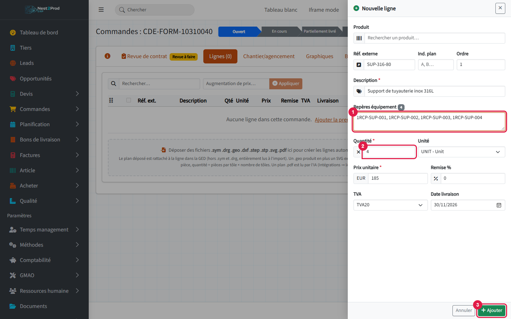

1. **Repères équipement** : saisissez un repère par équipement, séparés par une virgule,
   un point-virgule ou un retour à la ligne. Le compteur gris indique combien de repères
   sont pris en compte.
2. **Quantité** : ici 4 supports pour 4 repères.
3. Cliquez sur « Ajouter » (« Enregistrer » pour une ligne modifiée).

Les repères sont imprimés sur le devis, la commande, l'accusé de réception, le bon de
livraison et la fiche suiveuse, seulement quand ils sont renseignés. Ils sont repris du
devis lors de sa conversion en commande.

> 💡 Plus de repères que de pièces ? Un simple avertissement s'affiche sous le champ :
> l'enregistrement reste possible.

---

## 2. Repérer les commandes à revoir

Tant que la revue n'est pas visée, la fiche commande l'annonce.

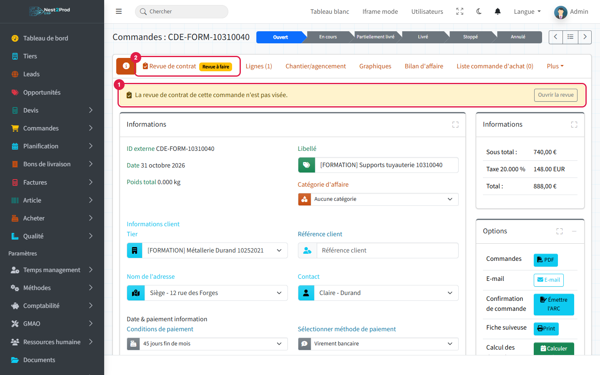

1. Le bandeau jaune de l'onglet Informations rappelle que la revue n'est pas visée.
   « Ouvrir la revue » y mène directement.
2. L'onglet « Revue de contrat » porte une pastille : « Revue à faire », « Revue faite » ou
   « Revue rejetée ».

Dans la liste des commandes (menu **Commandes**, onglet « Commandes »), la colonne
« Revue » donne la même information pour toutes vos commandes.

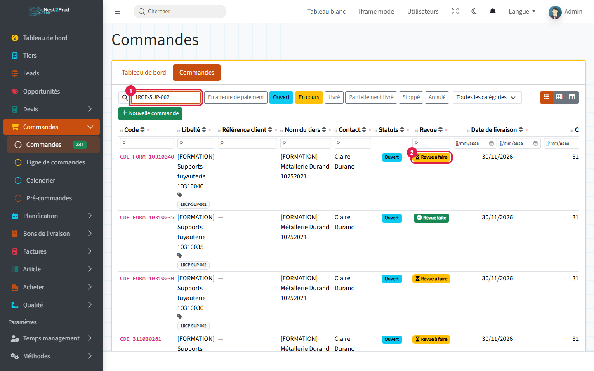

1. La zone de recherche trouve aussi une commande par **repère d'équipement** : le repère
   trouvé s'affiche sous le libellé.
2. La colonne « Revue » : filtrez-la sur « Revue à faire » pour voir ce qui reste à revoir.

---

## 3. Préparer la revue

Ouvrez l'onglet « Revue de contrat ». La carte de gauche porte la check-list, celle de
droite les documents contractuels et les avenants.

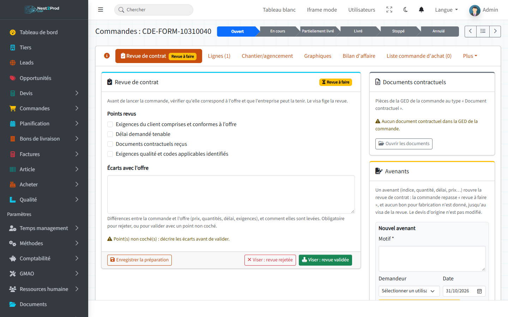

Cochez chaque point vérifié et notez les écarts avec votre offre.

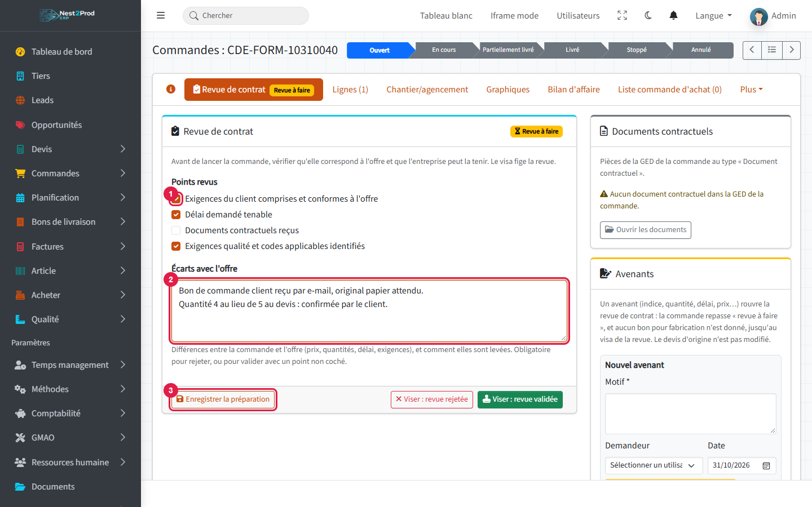

1. **Points revus** : exigences du client comprises, délai tenable, documents contractuels
   reçus, exigences qualité identifiées.
2. **Écarts avec l'offre** : ce qui diffère du devis (prix, quantité, délai, exigence) et
   comment c'est réglé.
3. Cliquez sur « Enregistrer la préparation ». La préparation peut se faire en plusieurs fois
   et par n'importe quel utilisateur du module.

> ⚠️ Un point laissé **non coché** oblige à décrire les écarts avant de valider. Un **rejet**
> exige toujours la description des écarts.

---

## 4. Déposer les documents contractuels

Bon de commande du client, cahier des charges, conditions d'achat… se rangent dans la GED
de la commande avec le type « Document contractuel ». Cliquez sur « Ouvrir les documents »
dans la carte « Documents contractuels » (ou sur l'onglet « Documents »).

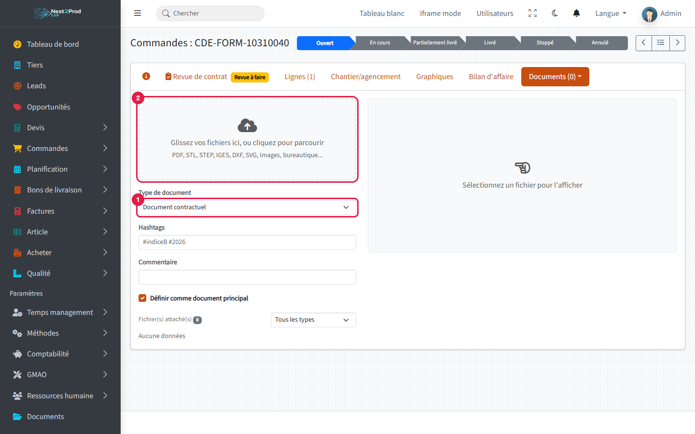

1. **Type de document** : choisissez « Document contractuel » **avant** de déposer le fichier.
2. Glissez le fichier dans la zone, ou cliquez dessus pour le choisir.

De retour sur l'onglet « Revue de contrat », le document apparaît dans la carte.

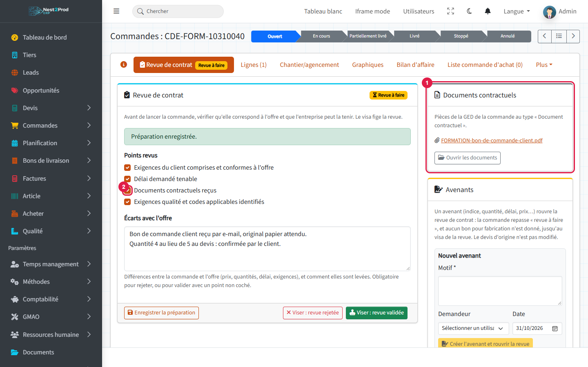

1. La carte « Documents contractuels » liste les pièces de ce type ; un clic les ouvre.
2. Cochez « Documents contractuels reçus », puis « Enregistrer la préparation ».

> ⚠️ Un fichier déposé avec un autre type (ou le type automatique) n'apparaît pas dans la
> carte. Changez son type dans l'onglet « Documents ».

---

## 5. Prix calculé : tant que la commande est en préparation

Une ligne peut suivre un **prix calculé**, relu sur sa gamme (les opérations) à chaque
affichage, au lieu d'un prix figé. Le réglage se trouve dans la fenêtre des tâches de la
ligne : onglet « Lignes », bouton jaune « Tâches » de la ligne.

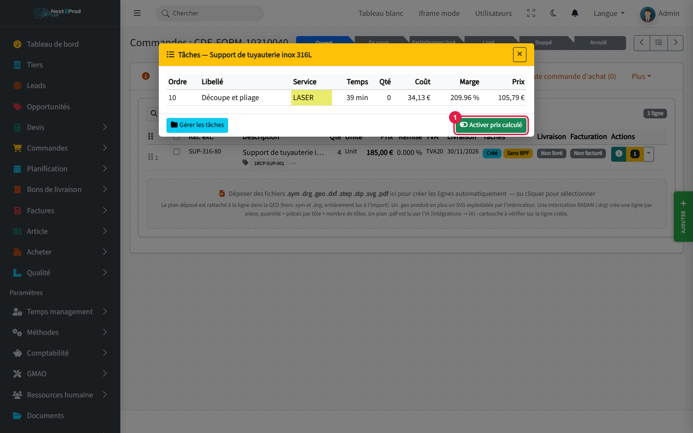

1. Tant que la commande est **en préparation** (statut « Ouvert » et revue pas encore
   validée), « Activer prix calculé » est libre.

« Désactiver prix calculé » est toujours possible : le prix calculé du moment devient le prix
de vente de la ligne, qui ne bouge plus.

---

## 6. Viser la revue

Quand la préparation est complète, une personne autorisée vise la revue.

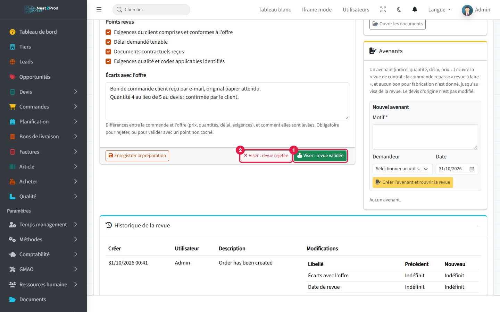

1. « Viser : revue validée » : la commande correspond à l'offre et vous pouvez la tenir.
2. « Viser : revue rejetée » : la commande n'est pas acceptable en l'état (écarts obligatoires).

Confirmez dans la fenêtre qui s'ouvre.

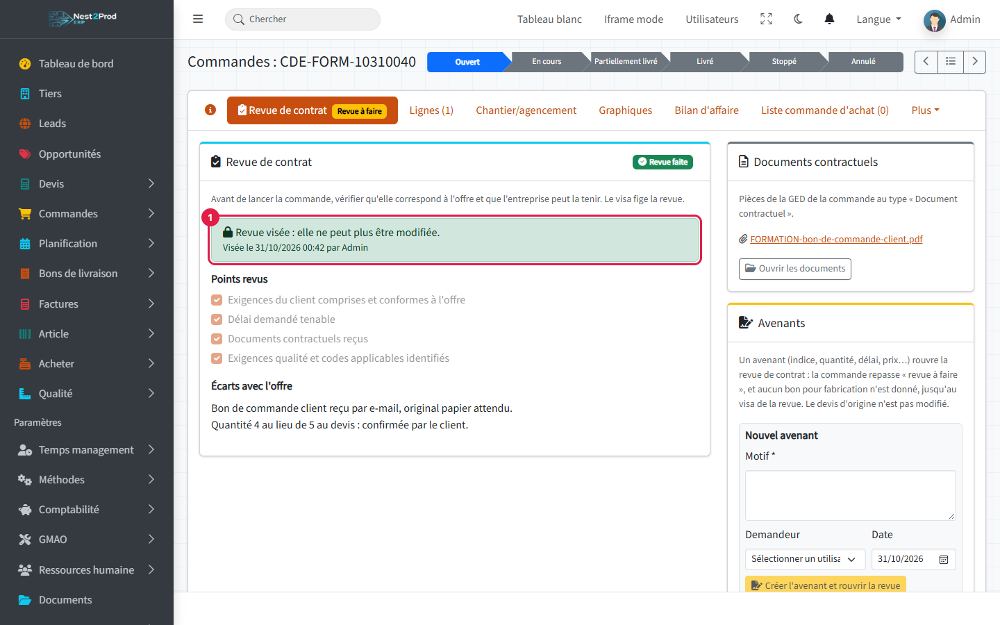

1. La revue est **figée** : l'auteur et la date du visa sont enregistrés, plus rien ne se
   modifie. L'historique sous la carte garde chaque changement.

À la validation, l'**accusé de réception de commande** (ARC) est préparé en brouillon : le
bouton « Émettre l'ARC » de la carte « Options » (onglet Informations) le reprend.

> 💡 La pastille de l'onglet et le bandeau se mettent à jour au prochain affichage de la fiche.

---

## 7. Après le visa : le prix est figé

Une fois la revue validée (ou la commande passée au-delà du statut « Ouvert »), le prix
accepté par le client ne doit plus bouger tout seul.

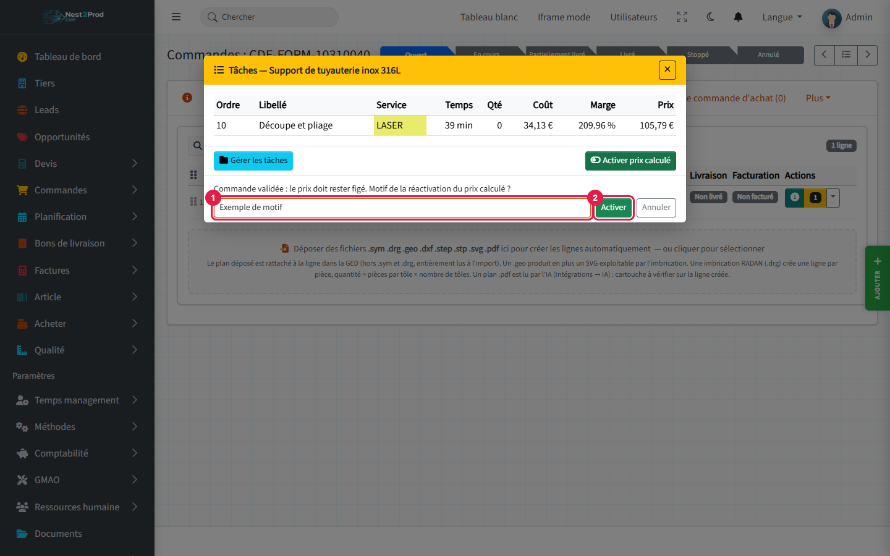

1. « Activer prix calculé » demande alors un **motif** (3 caractères au moins).
2. « Activer » n'est accepté que si vous avez le droit correspondant ; « Annuler » referme la
   demande sans rien changer.

> ⚠️ Une ligne déjà **livrée ou facturée, même en partie**, ne peut plus passer en prix
> calculé, quel que soit votre droit : le bouton est grisé et un cadenas en donne la raison.

---

## 8. Reporter une date de livraison

Modifiez la ligne (menu de la ligne › « Modifier ») et changez la **Date livraison**.

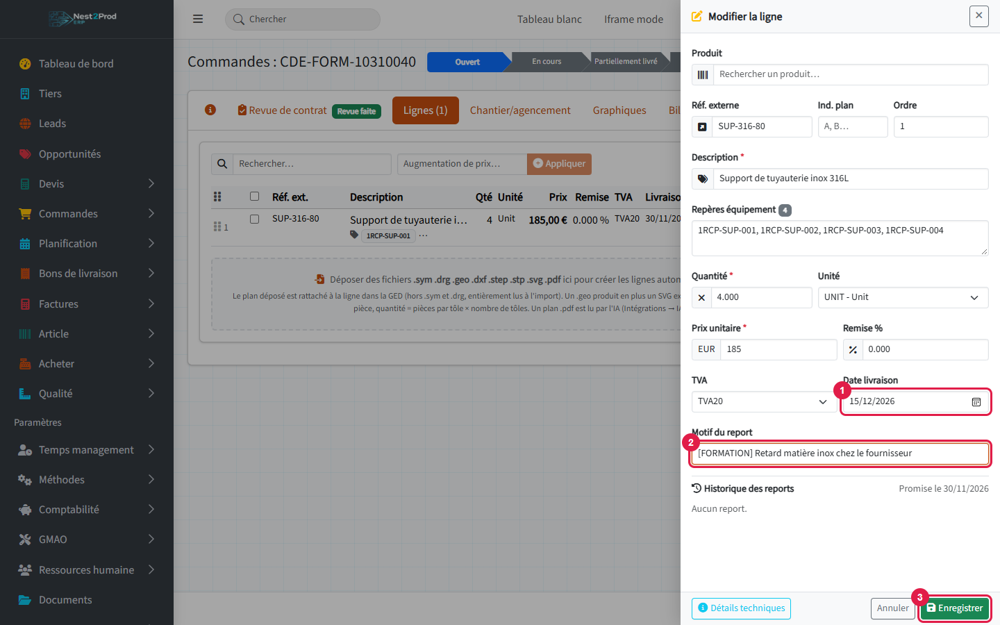

1. Saisissez la nouvelle date.
2. Le champ « Motif du report » apparaît : retard fournisseur, demande du client… Il est
   facultatif mais très utile pour expliquer le retard plus tard.
3. Cliquez sur « Enregistrer ».

La date promise au client à la création de la ligne ne change **jamais**. Dès qu'elle diffère
de la date actuelle, la ligne l'affiche sous la date de livraison.

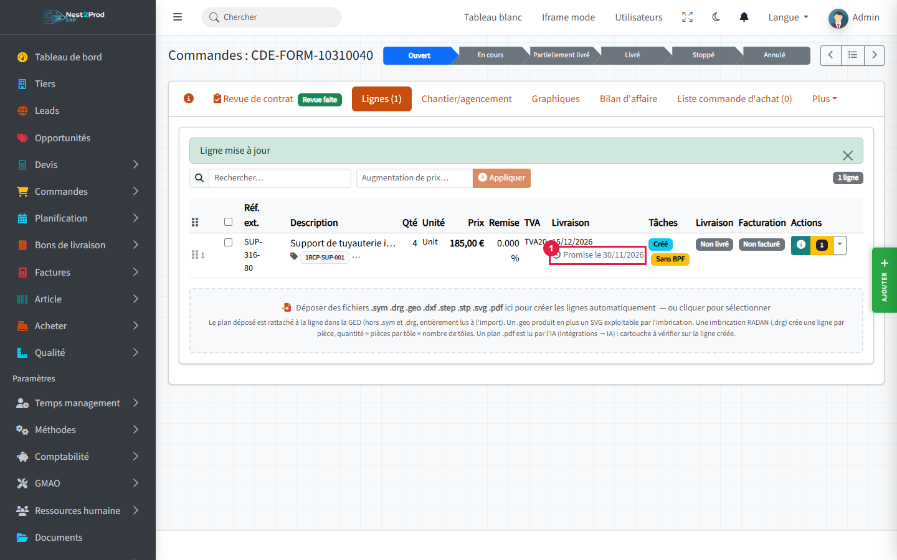

1. « Promise le … » : la date d'origine, qui sert à mesurer la ponctualité réelle.

En rouvrant la ligne, le panneau montre tous les reports.

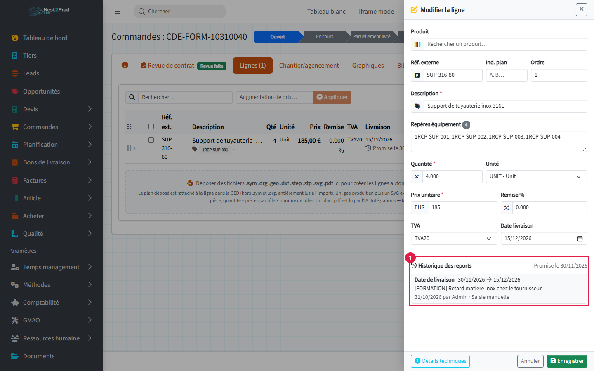

1. « Historique des reports » : ancienne et nouvelle date, motif, date du changement, auteur
   et origine (saisie manuelle, import…).

---

## 9. Créer un avenant

Le client modifie sa commande après la revue (quantité, indice, délai, prix…) ? Créez un
**avenant** : la revue est rouverte, et son nouveau visa vaudra visa de l'avenant. Carte
« Avenants » de l'onglet « Revue de contrat ».

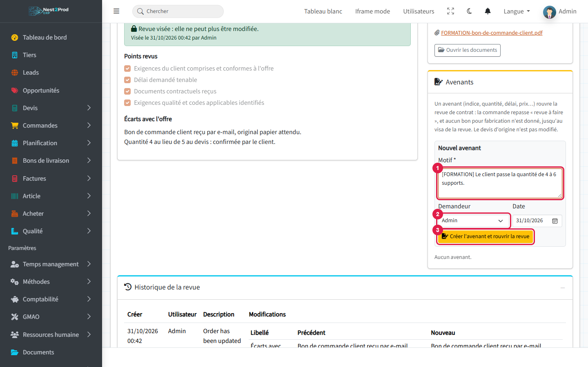

1. **Motif** (obligatoire) : ce que le client demande.
2. **Demandeur** et **Date** (facultatifs).
3. Cliquez sur « Créer l'avenant et rouvrir la revue », puis confirmez.

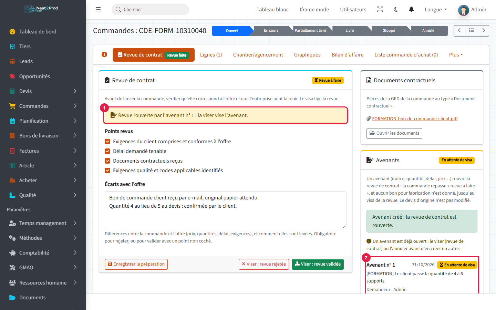

1. La revue repasse « à faire ». La check-list et les écarts précédents sont gardés comme
   base de travail.
2. L'avenant est « En attente de visa », avec le montant TTC de la commande au moment de sa
   création.

Modifiez ensuite les lignes de la commande comme le prévoit l'avenant (ici, 6 supports et deux
repères de plus). Le devis d'origine n'est jamais modifié.

> ⚠️ Un seul avenant peut être ouvert à la fois : visez-le ou annulez-le avant d'en créer un autre.

---

## 10. Annuler ou viser l'avenant

**Annuler** : l'avenant n'a pas lieu (le client se rétracte, erreur de saisie).

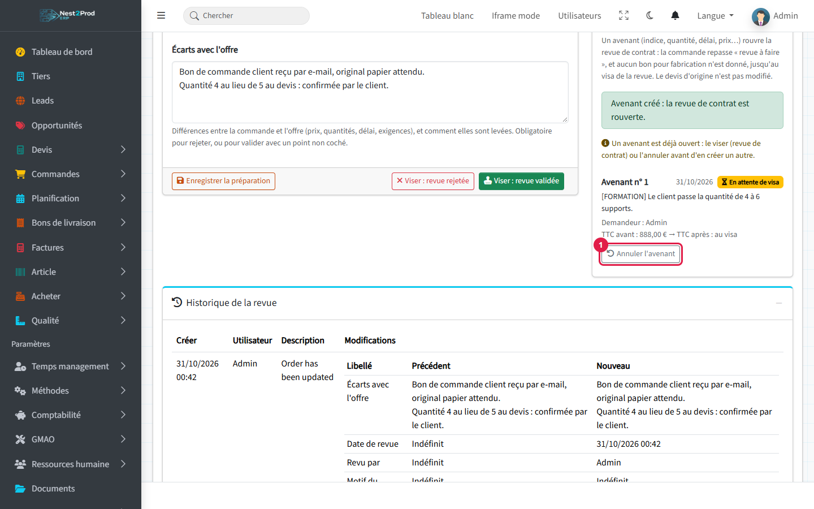

1. « Annuler l'avenant » (réservé aux personnes autorisées) rétablit la revue telle qu'elle
   était avant l'avenant.

**Viser** : une fois les lignes modifiées, revoyez la check-list et les écarts, puis visez la
revue rouverte comme à l'étape 6.

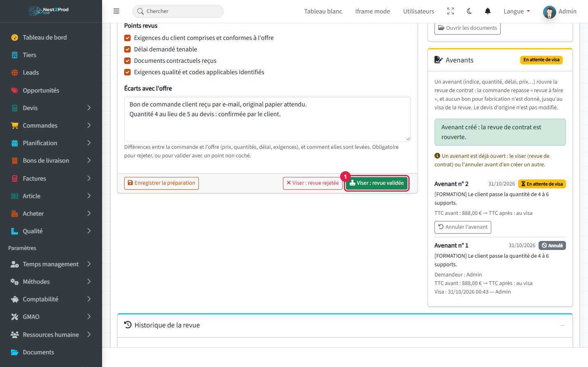

1. « Viser : revue validée » vise en même temps l'avenant. Un nouvel ARC est préparé.

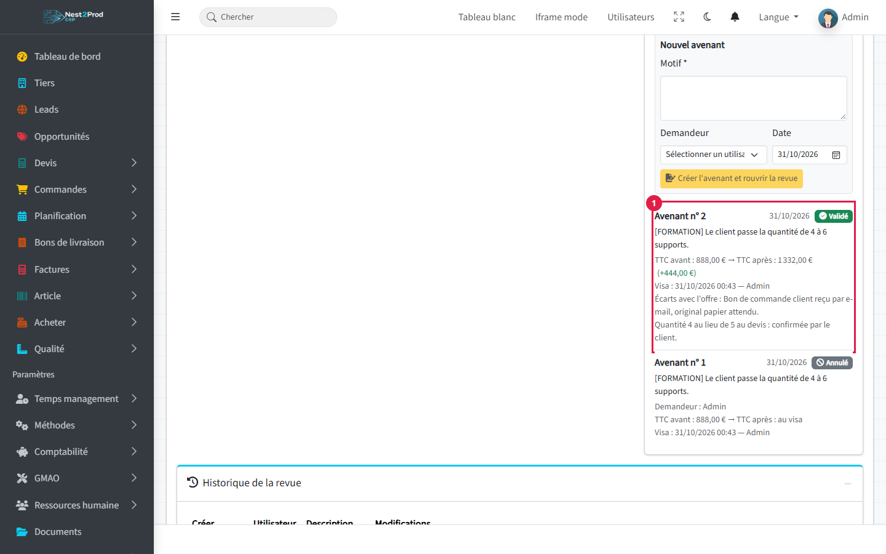

1. L'avenant passe « Validé » avec le montant TTC avant et après, l'écart, l'auteur et la
   date du visa. Les avenants annulés restent listés pour l'historique.

---

## Et ensuite ?

<!-- feature: production-release -->
- Donner le **bon pour fabrication** aux lignes (onglet « Lignes ») : il est refusé tant que
  la revue est rejetée ou qu'un avenant attend son visa.
<!-- /feature -->
- Émettre et envoyer l'**accusé de réception de commande** (carte « Options », « Émettre l'ARC »).
- Poursuivre le parcours de vente : production, bon de livraison et facture (guide « Du
  prospect à la facture »).

## Questions fréquentes

**Je ne vois pas les boutons « Viser ».**
Le visa est réservé aux personnes autorisées : à leur place, un message l'indique. Préparez la
revue et prévenez la personne qui vise.

**Peut-on modifier une revue visée ?**
Non, elle est figée. Si la commande change, créez un avenant : il rouvre la revue.

**Une commande sans revue peut-elle être livrée et facturée ?**
Oui. La revue n'est jamais bloquante pour les bons de livraison ni les factures ; elle est
seulement signalée par le bandeau et la colonne « Revue ».

**« Activer prix calculé » est grisé.**
La ligne est déjà livrée ou facturée, même en partie : son prix ne peut plus être recalculé.
Le cadenas à côté du bouton en donne la raison.

**J'ai corrigé une date par erreur : la date promise a-t-elle changé ?**
Non, la date promise au client ne change jamais. Remettez la bonne date : les deux changements
restent visibles dans l'historique des reports.

**Et les devis ?**
La fiche devis a un onglet « Revue » pour noter la revue de l'offre, sans visa ni avenant.
