**Objectif** : paramétrer la comptabilité une fois pour toutes, avec votre expert-comptable,
pour que chaque facture, règlement et facture fournisseur produise des écritures justes
dans le fichier FEC.

**Pour qui** : le dirigeant ou la personne qui prépare les éléments pour le cabinet
comptable.

## Avant de commencer

- Le menu **Comptabilité** apparaît avec la permission **accounting-menu**.
- Les écrans **Régimes / Natures**, **Matrices de TVA** et **Périodes** demandent en plus
  **accounting-manage** (donnée au rôle Admin).
- L'export FEC se trouve dans **Votre entreprise › Imports/Exports** (permission
  **your-company-menu**).
- Demandez à votre expert-comptable : le plan de comptes utilisé (ventes, achats, TVA
  collectée et déductible), les comptes de banque et de caisse, et le format FEC attendu.

## Vue d'ensemble

```steps
Codes TVA
Affectations
Paiements
Matrices (avancé)
Périodes
Export FEC
```

Le menu **Comptabilité** ouvre une page à onglets : Conditions de paiement, Méthode de
paiement, TVA, Allocation comptable, Mode de livraison, Immobilisations, Régimes / Natures,
et sous **Plus** : les deux matrices de TVA et les Périodes.

**Ce que l'ERP passe en écritures :**

| Journal | Quand | Écriture |
|---|---|---|
| **VENT** (ventes) | à la création de chaque ligne de facture, dès le brouillon | 411 client au débit (TTC), produit et TVA collectée au crédit |
| **VENT** (avoir) | à la création de l'avoir | l'inverse de la vente |
| **ENCAIS** (encaissements) | à l'enregistrement d'un règlement | trésorerie au débit, 411 client au crédit |
| **ACHAT** (achats) | à la création d'une facture fournisseur depuis les réceptions | charge et TVA déductible au débit, 401 fournisseur au crédit |

Modifier ou supprimer une pièce **avant** l'export efface et recrée son écriture ; **après**
l'export, une écriture d'annulation (contre-passation) est passée à la date du jour. Une
écriture transmise au comptable n'est donc jamais modifiée.

> ⚠️ Les immobilisations et l'autoliquidation (TVA due sur achat) ne génèrent pas
> d'écriture : elles restent à saisir par le cabinet.

---

## 1. Les codes TVA

Onglet **TVA** : un code par taux, et un code par cas d'exonération.

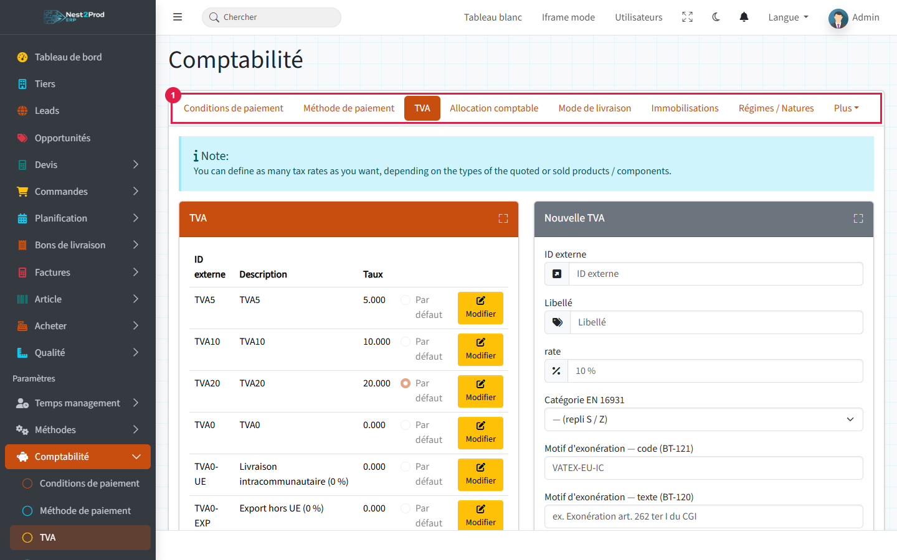

Le code **Par défaut** est proposé sur les lignes de devis, de commande et d'achat. Il se
règle dans la fenêtre **Modifier** du code.

Pour les ventes à 0 %, créez **un code par cas**, chacun avec sa catégorie :

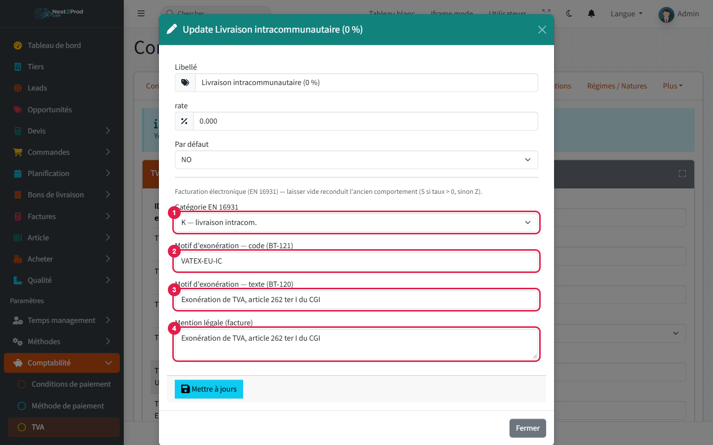

1. **Catégorie EN 16931** : K (livraison intracommunautaire), G (export hors UE), AE
   (autoliquidation), E (exonéré) ; S et Z pour les taux normaux et nuls.
2. **Motif d'exonération — code (BT-121)**, par exemple VATEX-EU-IC.
3. **Motif d'exonération — texte (BT-120)**, la phrase légale.
4. **Mention légale (facture)**.

Le motif et la catégorie partent dans la facture électronique (Factur-X).

> ⚠️ Deux codes au même taux doivent avoir des catégories différentes : deux codes « 0 % »
> sans catégorie sont refusés.
>
> ⚠️ La **mention légale** n'est pas encore imprimée sur le PDF de la facture : en attendant,
> ajoutez-la aux mentions de vos conditions générales.

---

## 2. Les affectations comptables

Onglet **Allocation comptable** : c'est ici que chaque ligne trouve ses comptes. Une
affectation associe un **type** et un **code TVA** à un compte de produit (ou de charge) et
à un compte de TVA.

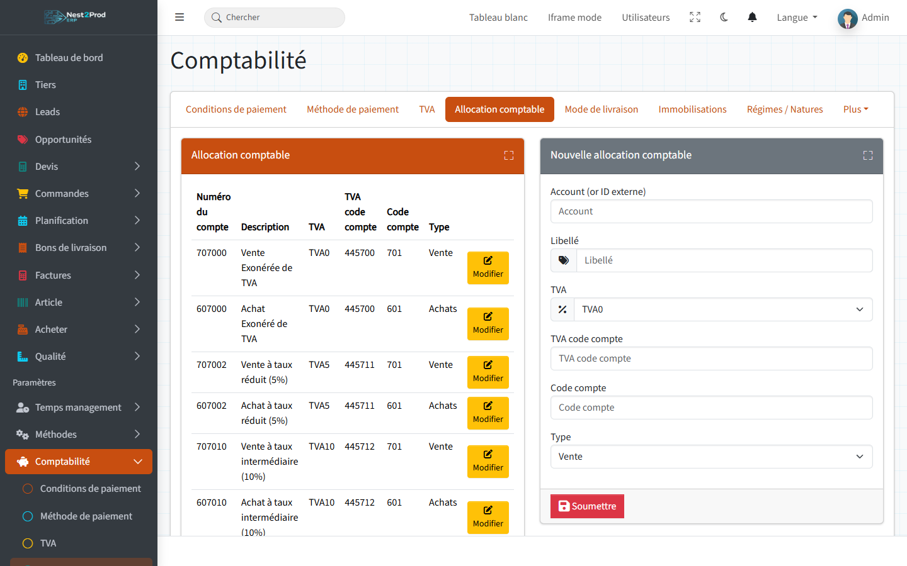

| Type | Utilisé pour |
|---|---|
| **Vente** | toutes les lignes de facture client |
| **Achats** | les lignes de facture fournisseur liées à une commande client |
| **Achat (stock)** | les lignes de facture fournisseur sans commande client (stock, commande interne) |

Les types Acompte, Taxe et Autre ne sont pas utilisés.

- **Code compte** : le compte de produit ou de charge écrit dans le FEC (706000, 601000…).
- **TVA code compte** : le compte de TVA (445710, 445660…).
- **Numéro du compte** : un simple identifiant de l'affectation, qui n'apparaît pas dans
  les écritures.

> ⚠️ Il faut **une affectation par type et par code TVA**, y compris pour chaque code à 0 %
> et pour le type « Achat (stock) ». Une ligne sans affectation correspondante est
> enregistrée **sans écriture, et sans message** : elle manquera au FEC.

---

## 3. Paiements et livraison

**Méthode de paiement** : le **Code compte** est le compte de trésorerie débité par
l'encaissement (512000 pour la banque, 530000 pour la caisse). Laissé vide, c'est 512000.

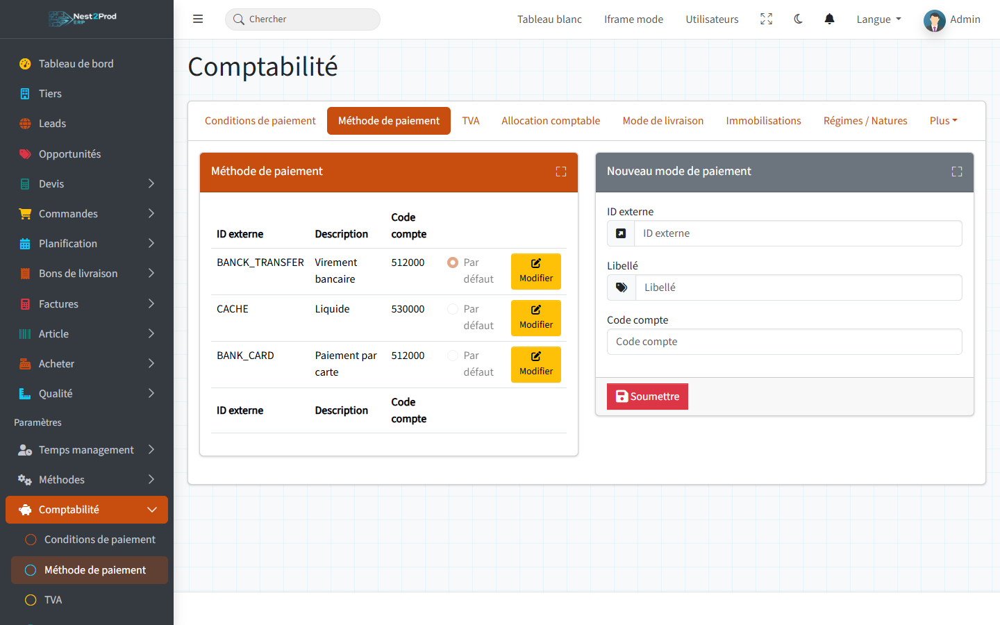

**Conditions de paiement** : elles s'affichent sur les devis, commandes et factures, et la
condition **par défaut** est proposée aux nouveaux clients.

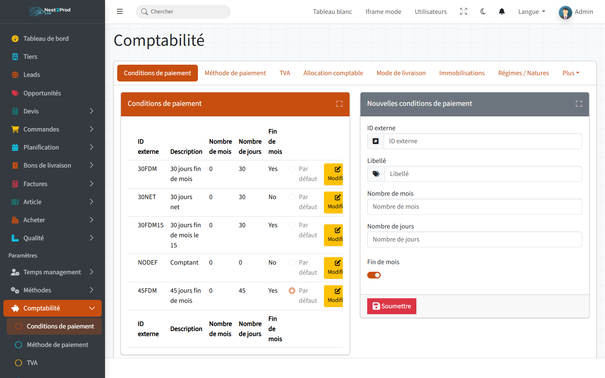

L'échéance d'une facture se calcule depuis sa date de création avec la condition de
paiement de la commande facturée (celle de la condition par défaut si la commande n'en a
pas) : les mois, puis les jours, puis la fin de mois si la case est cochée. « 30 jours fin
de mois » au 10 janvier donne le 28 février.

> 💡 Une facture qui regroupe plusieurs commandes prend la condition de la première. La date
> d'échéance reste modifiable sur la facture.

**Mode de livraison** : un libellé repris sur les tiers et les devis, sans effet comptable.

---

## 4. Régimes, natures et matrices de TVA (avancé)

Quand un même article se vend à des clients de régimes différents (France, Union
européenne, export, franchise), les matrices choisissent les comptes selon le couple
**régime du client × nature de l'article**.

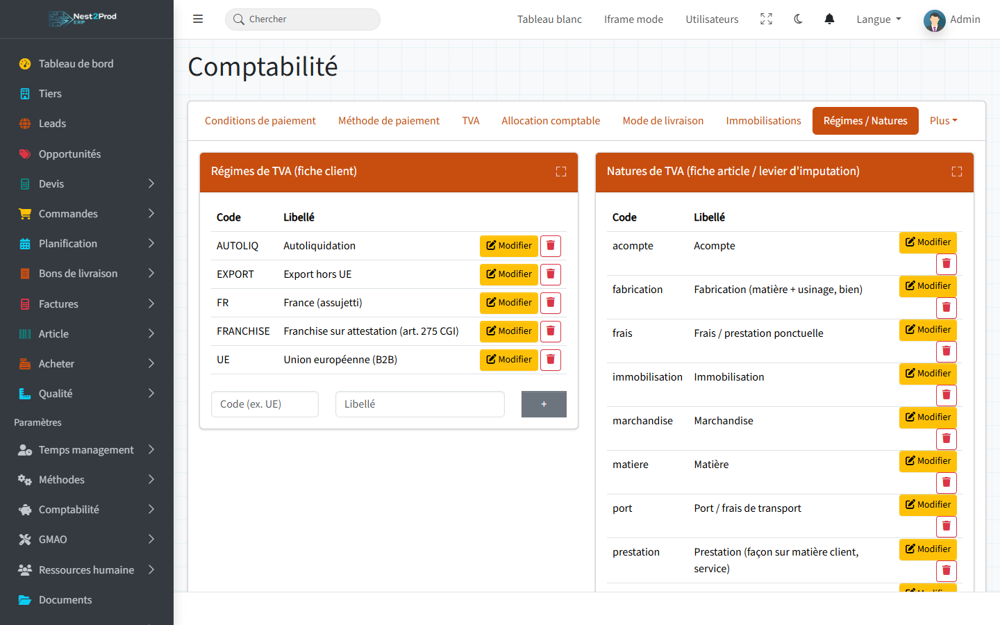

- Le **régime** se choisit sur la fiche du client, onglet **Détail**, carte **Régime de
  TVA** (avec l'attestation pour une franchise) :

  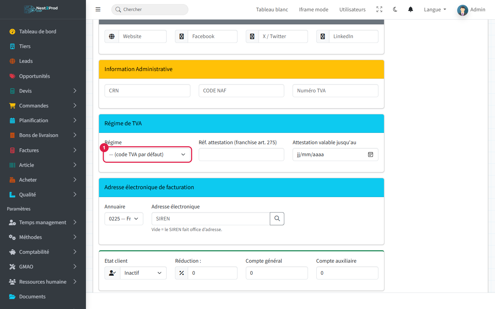

- La **nature** se choisit sur la fiche article, onglet **Détail produit** (fabrication,
  matière, prestation, port…).

Une règle de la **Matrice TVA ventes** donne le compte de vente et le compte de TVA
collectée pour un couple régime × nature :

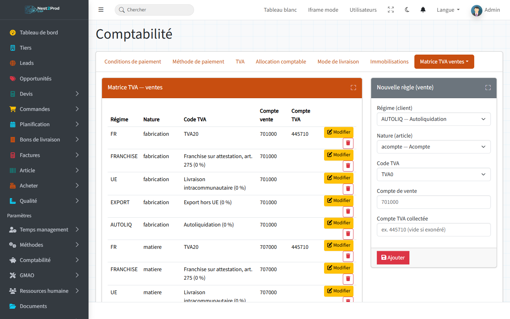

La **Matrice TVA achats** fait de même pour les fournisseurs : compte d'achat, TVA
déductible, et repère pour l'autoliquidation.

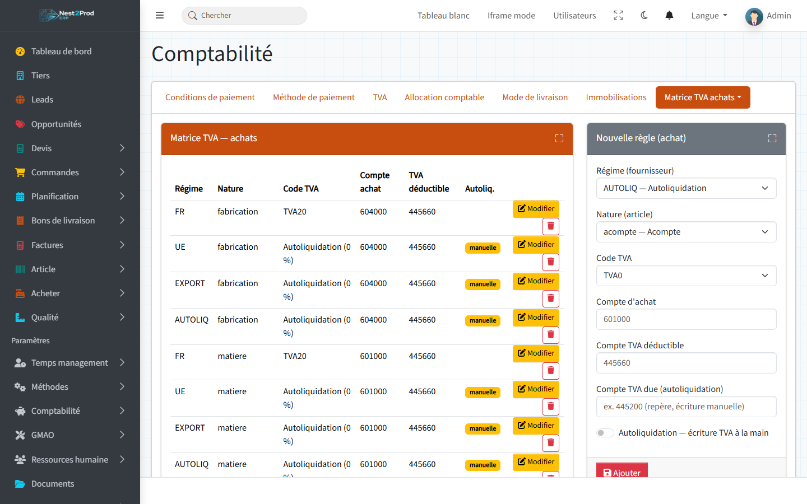

> 💡 Sans régime sur le client ou sans nature sur l'article, ou sans règle pour le couple,
> la ligne retombe sur l'affectation comptable (section 2) : une matrice incomplète ne
> bloque rien.
>
> ⚠️ La matrice ne fournit que les **comptes** : le taux de TVA reste celui du code TVA
> choisi sur la ligne. En vente, elle ne s'applique pour l'instant qu'aux lignes de
> facture qui portent un article.

---

## 5. Verrouiller les périodes

Onglet **Plus › Périodes** : après chaque transmission au comptable, verrouillez le mois.

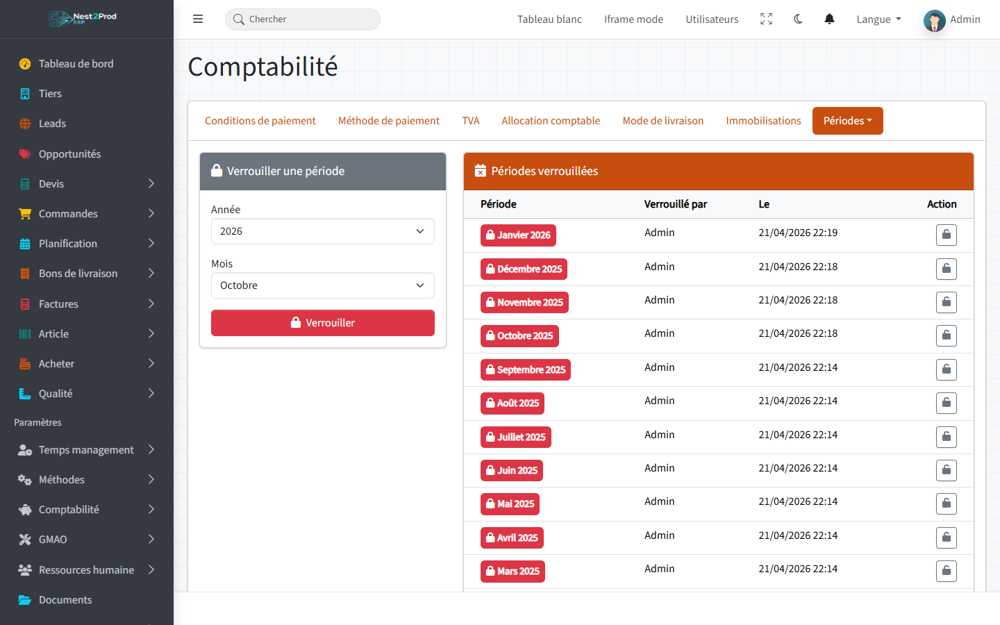

Choisissez l'année et le mois, puis **Verrouiller**. Le cadenas d'une ligne déverrouille la
période.

| Une fois le mois verrouillé… | |
|---|---|
| bloqué | ajouter ou supprimer une ligne de facture, modifier l'en-tête d'une facture, modifier une facture fournisseur |
| **pas** bloqué | modifier la quantité ou le prix d'une ligne de brouillon, enregistrer un règlement daté du mois, créer un avoir |

> 💡 Le verrou protège les factures, pas le journal : ne datez pas un règlement dans un mois
> déjà transmis.

---

## 6. Transmettre au comptable

Menu **Votre entreprise › Imports/Exports**, onglet **Export FEC** (voir aussi le guide
« Facturer et encaisser ») :

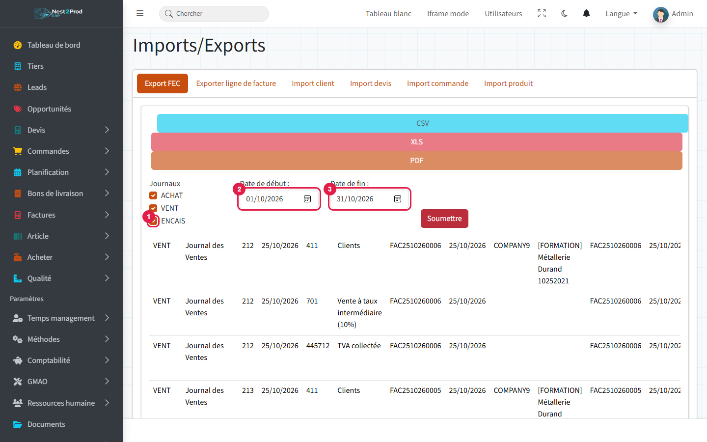

1. **ENCAIS** : cochez-le, il est décoché par défaut.
2. **Date de début** et 3. **Date de fin** : le mois à transmettre, puis « Soumettre » pour
   afficher les écritures.

Cochez ensuite les écritures, puis **CSV**, **XLS** ou **PDF**.

> ⚠️ L'export est **définitif** : les écritures exportées sortent de la liste et ne se
> réexportent pas. Conservez le fichier, et verrouillez la période ensuite.
>
> ⚠️ Les écritures des **brouillons** de facture sont aussi proposées : émettez ou
> supprimez les brouillons avant d'exporter.
>
> 💡 Faites valider le format du fichier par votre expert-comptable lors du premier envoi.

## Questions fréquentes

**Une facture n'apparaît pas dans l'export FEC.**
Il manque une affectation comptable de type Vente pour le code TVA de ses lignes
(section 2). Créez-la : les lignes facturées ensuite auront leur écriture.

**Une facture fournisseur n'apparaît pas.**
Ses lignes ne sont liées à aucune commande client : il faut une affectation de type
« Achat (stock) » pour leur code TVA.

**Les encaissements arrivent au compte 512000.**
La méthode de paiement n'a pas de code compte : renseignez-le.

**Je vois des écritures « Annulation … ».**
Une pièce déjà exportée a été modifiée ou supprimée : l'ERP a passé une écriture
d'annulation au lieu de modifier l'écriture transmise.

**Je ne vois pas les onglets Matrices et Périodes.**
Il vous manque la permission accounting-manage.
