**Goal**: use the quote features you do not need every day but that save a lot of time:
present a quote by work package, check its margin, revise it without losing its history,
reuse it as a model, and understand why a deal was lost.

This guide follows on from "From prospect to invoice", which shows how to create a simple quote.

**Example used**: Métallerie Durand asks for a quote for guardrails in its workshop:
4 steel guardrails, 4 stainless steel handrails and fixing plates.

> 💡 Some buttons of the quote lines screen are only available in French, even when the
> application is in English. Their exact French label is given, followed by its meaning.

## Before you start

- You need access to the **Quotes** menu.
- The customer already exists with **an address and a contact** (see "From prospect to invoice").
- For the margin to mean something, lines need a **cost price**: a routing (operations),
  a bill of materials or costed sub-assemblies.
- **Loss reasons** are managed in Methods › Loss reasons. Five reasons are created by
  default (Price, Lead time, Technical, Competitor, No follow-up).
- Almost everything below can only be done on a quote whose status is **Open**. A sent,
  won or lost quote is frozen.

## Overview

```steps
Create the quote
Lines and tags
Copy lines
Layout
Margin
Review
Printing
Template
Revision and variant
Won or lost
```

---

## 1. Create the quote, or start from a template

**Quotes** menu, "Quotes list" tab, "New Quote" button.

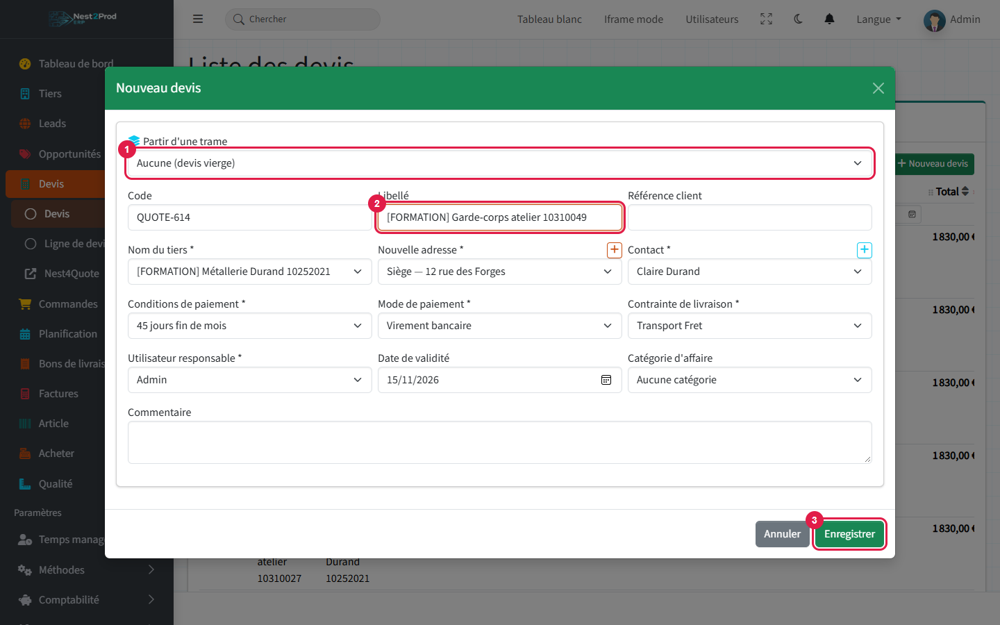

1. **Start from a template**: leave "None (blank quote)" for an empty quote, or pick a
   template to copy all its lines (see step 8). This list only appears when at least
   one template exists.
2. **Label**: a meaningful name to find the quote again ("Workshop guardrails").
3. Choose the customer (**Name of third party**), check the address and contact, then
   click "Save". The quote opens.

---

## 2. Add lines with their equipment tags

"Quote lines" tab, then the vertical « Ajouter » (Add) button on the right of the screen.

The **Equipment tags** field is used when each delivered part must carry a customer
reference (location tag, equipment number, site reference…).

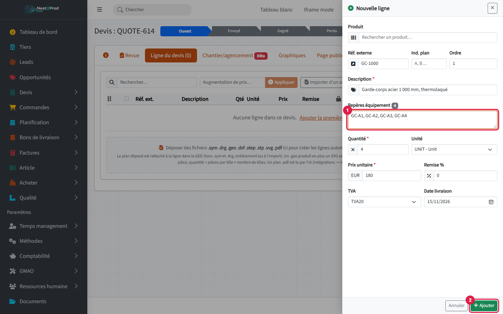

1. **Equipment tags**: enter one tag per part, separated by a comma, a semicolon or a
   new line. The small counter next to the title shows how many tags were read.
2. Click « Ajouter » (Add).

The tags then appear as labels under the line description.

> 💡 Tags follow the line to the order, the order acknowledgement, the delivery note and
> the job traveller. They are only printed when filled in. In the orders list, the search
> also finds an order by its tag.

> ⚠️ More tags than the quantity? A simple warning is shown, nothing is blocked: check
> the quantity or the tags before sending the quote.

> ⚠️ A **duplicated** line does not keep the tags: they identify specific parts and must
> be entered again for the new line.

---

## 3. Copy lines from another quote or a template

Already quoted an identical part? Do not type it again: use the « Importer d'un autre
devis » (Import from another quote) button above the lines.

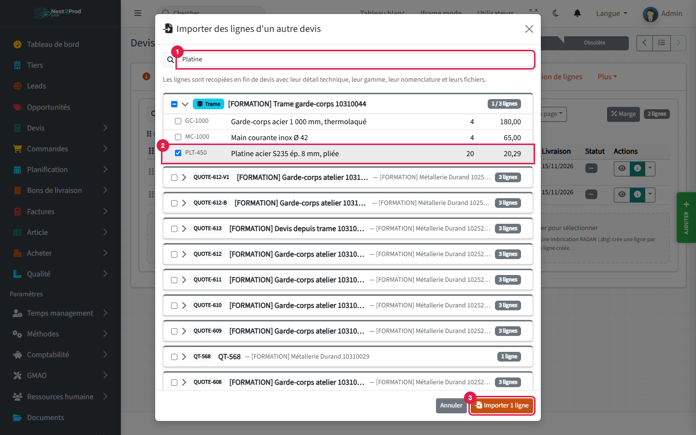

1. Search by code, label, customer or line text. Templates are shown with the « Trame »
   (Template) label.
2. Expand a quote and tick the lines you want (the quote box ticks all its lines).
3. Click « Importer 1 ligne » (Import 1 line — the number follows your selection).

Lines are added **at the end of the quote** with their technical details, routing, bill
of materials and files: their cost price comes with them.

> 💡 To copy a line **within the same quote**, use « Dupliquer » (Duplicate) in the line
> menu (small arrow on the right).

---

## 4. Lay out the quote: sections, subtotals, texts, lump sums

A long quote is easier to read by work package. Four tools, which **never change the total**:

| Tool | What it is for |
|---|---|
| Section | Title of a work package; groups the lines below it, down to the next section |
| Subtotal | Total of the section lines, calculated automatically |
| Text | Free sentence printed on the quote (conditions, exclusions…) |
| Eye (hide) | Line counted in the total but not printed |

### 4.1 Insert a section in the right place

Open the line menu (small arrow on the right):

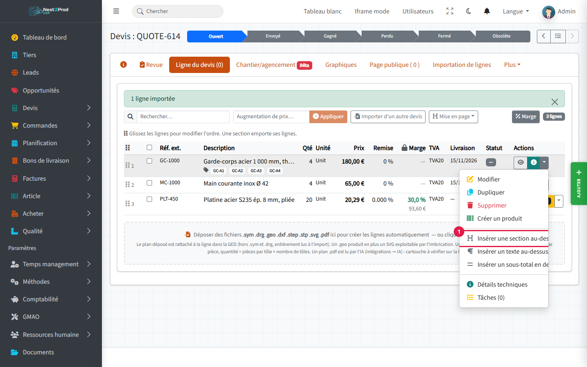

1. « Insérer une section au-dessus » (Insert a section above) places the title just
   before the line. Type the section name, then confirm with the green tick (or Enter).

The same menu offers « Insérer un texte au-dessus » (Insert a text above) and « Insérer
un sous-total en dessous » (Insert a subtotal below). A subtotal without a label is
automatically named "Sous-total" followed by the section name.

### 4.2 Add at the end of the quote

The « Mise en page » (Layout) button adds a section, a subtotal or a text **at the end**:

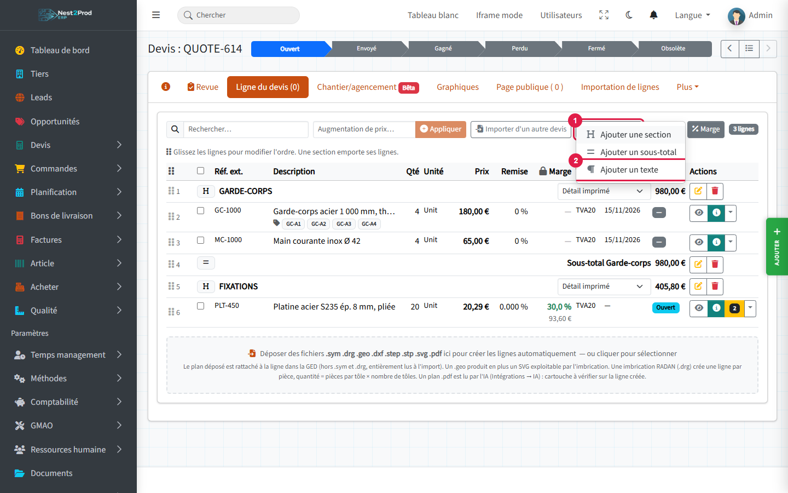

1. Click « Mise en page ».
2. Choose « Ajouter une section » (Add a section), « Ajouter un sous-total » (Add a
   subtotal) or « Ajouter un texte » (Add a text).

> 💡 Drag a line by its handle (the dots on the left) to move it. A section takes its
> lines with it.

### 4.3 Result and lump sums

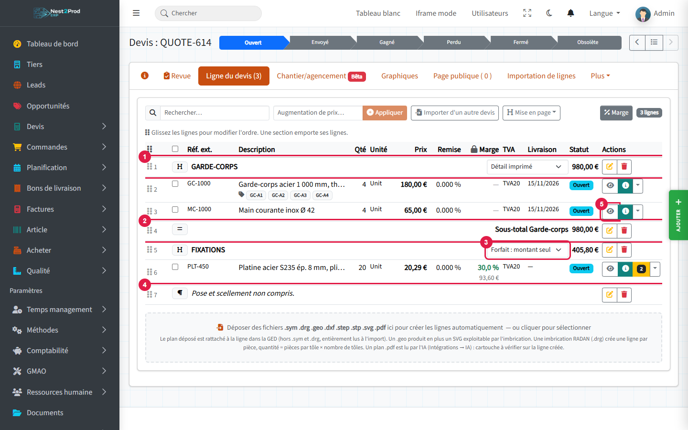

1. **Section**: its total amount is shown on the right.
2. **Subtotal** of the "Garde-corps" section.
3. **Section printing**: « Détail imprimé » (details printed, the default), « Forfait :
   montant seul » (lump sum: a single line with the section amount, no details) or
   « Forfait : 1 × unité » (lump sum: one "1 ×" line with the unit chosen in the list
   that appears).
4. Free **text**, printed in italics under the lines.
5. **Eye**: hides the line on the PDF; it is still counted in the total. A hidden line
   is greyed out, with a crossed-out eye.

> ⚠️ An **empty** section (no line below it) is flagged with an orange badge: move it
> above its lines.

> 💡 For « Forfait : 1 × unité », create a "Lump sum" unit in Methods › Units if it does
> not exist.

> ⚠️ Sections, subtotals and texts have no value: they are never delivered or invoiced.
> When converting to an order, a window asks whether you keep this layout on the order.

---

## 5. Check the margin (internal information)

The margin is **never printed** or shown to the customer. It compares the selling price
with the cost price: routing operations (subcontracting included), bill of materials and
sub-assemblies.

### 5.1 The "Margin" column of the lines

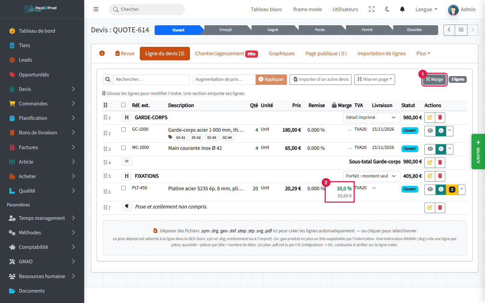

1. The "Margin" button shows or hides the column (your choice is remembered).
2. For each line: the margin as a % **of cost** and its amount. Hover over it to see the
   unit cost, total cost and selling price.

A dash "—" means the line has **no cost** (no routing, no bill of materials). A line below
the alert threshold set by your administrator is shown in red.

### 5.2 The "Margin (internal)" card and the overall margin

Information tab ("i" icon), right-hand column, "Margin (internal)" card (click "+" to
expand it).

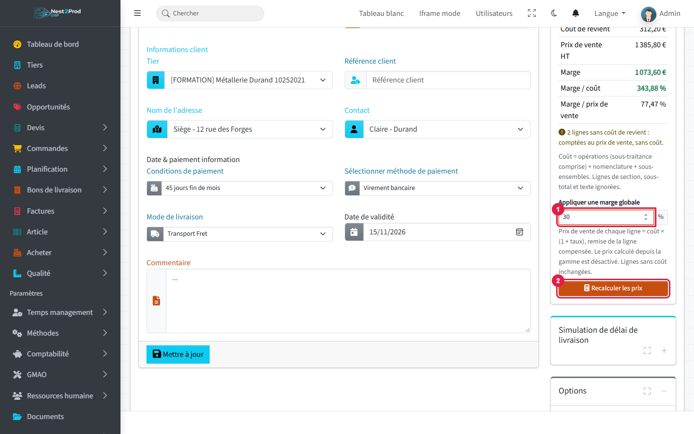

The card gives the cost price, the selling price excl. VAT, the margin in euros, the
margin on cost and the margin on selling price. To set all prices at once from the costs:

1. Enter the **margin rate on cost** (30 = selling price equal to cost + 30%).
2. Click "Recalculate prices", then confirm.

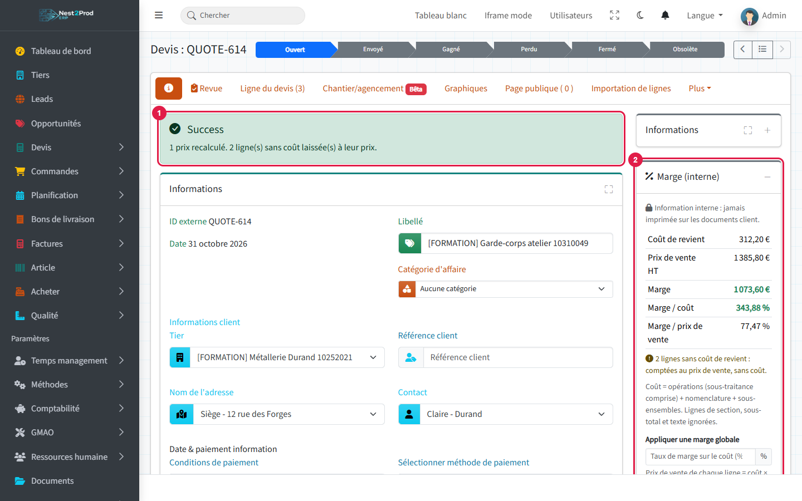

1. The message tells how many prices were recalculated and how many lines without cost
   were left at their price.
2. The card shows the new margin.

> ⚠️ Lines **without cost** are counted at their selling price with a zero cost: they
> inflate the displayed margin. The card says so ("2 lines without cost price"). Cost
> their routing before trusting the percentage.

> ⚠️ The overall margin is only offered on an **Open** quote, and refused as soon as the
> quote has been converted into an order (prices frozen). Each line's discount is offset,
> and the "calculated price" from the routing is turned off on recalculated lines.

---

## 6. Record the quote review

The "Review" tab (next to the "i" icon) keeps track of the quote check before sending,
and of change requests.

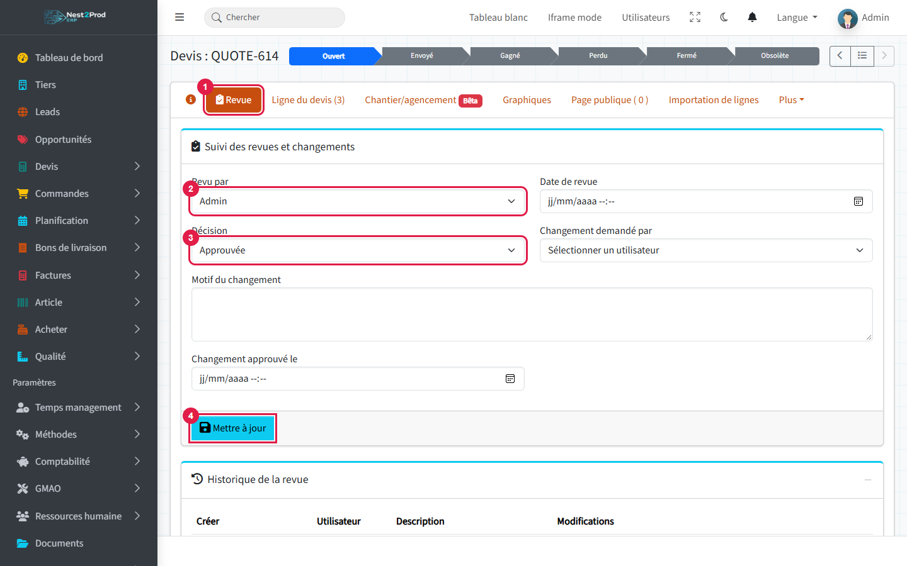

1. Open the "Review" tab.
2. **Reviewed by**: the person who checked the quote; **Review date** if needed.
3. **Decision**: Pending, Approved or Rejected.
4. Click "Update".

If the customer asks for a change, fill in **Change requested by**, **Change reason** and,
once accepted, **Change approved at**. The "Review timeline" card below lists every change.

> 💡 The decision is shown as a badge on the tab (green = approved, red = rejected).
> Nothing is blocked: it is a record, not a mandatory sign-off.

---

## 7. Choose the print layout and language

Information tab, "Options" card, "Quote" row:

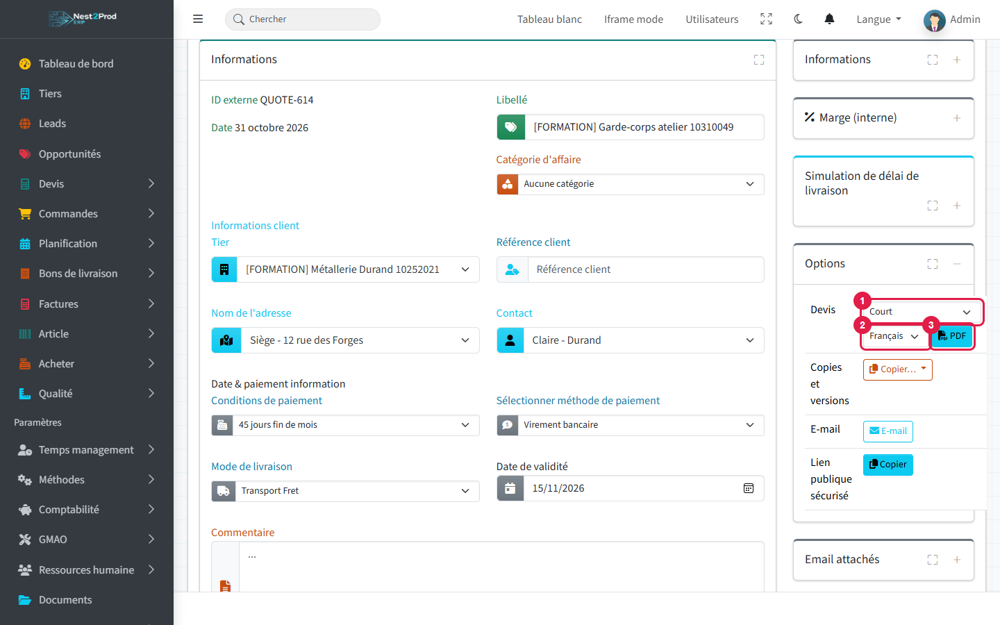

1. **Print layout**:
   - "Short": the usual quote;
   - "Detailed": adds the long description of each line (external comment of the
     technical details), the drawing thumbnail and the ticked project estimates (costs
     printed "not included in the total");
   - "Technical (no prices)": a technical document without any amount, for the
     customer's workshop or design office.
2. **Document language**: French or English. The whole document is translated,
   titles included.
3. Click "PDF".

> ⚠️ The e-mail sent from the "Options" card, the public link and electronic signature
> always use the **usual layout**. To send another layout, download the PDF and attach
> it yourself.

---

## 8. Reuse a quote: duplicate it or save it as a template

All copies go through the "Copy…" button of the "Options" card:

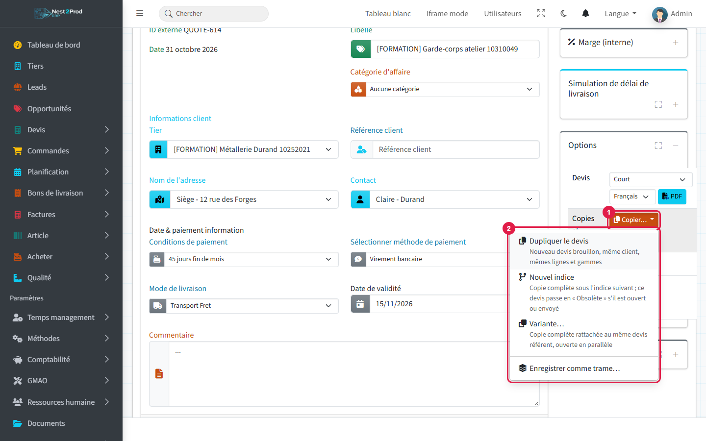

1. Open "Copy…".
2. Four choices:
   - "Duplicate quote": new draft quote, same customer, same lines and routings;
   - "New revision" and "Variant…": see step 9;
   - "Save as template…": a reusable quote model.

### 8.1 Create a template

A **template** is a standard quote (a standard staircase, a common guardrail…) used as a
starting point. It does not appear in any list or indicator.

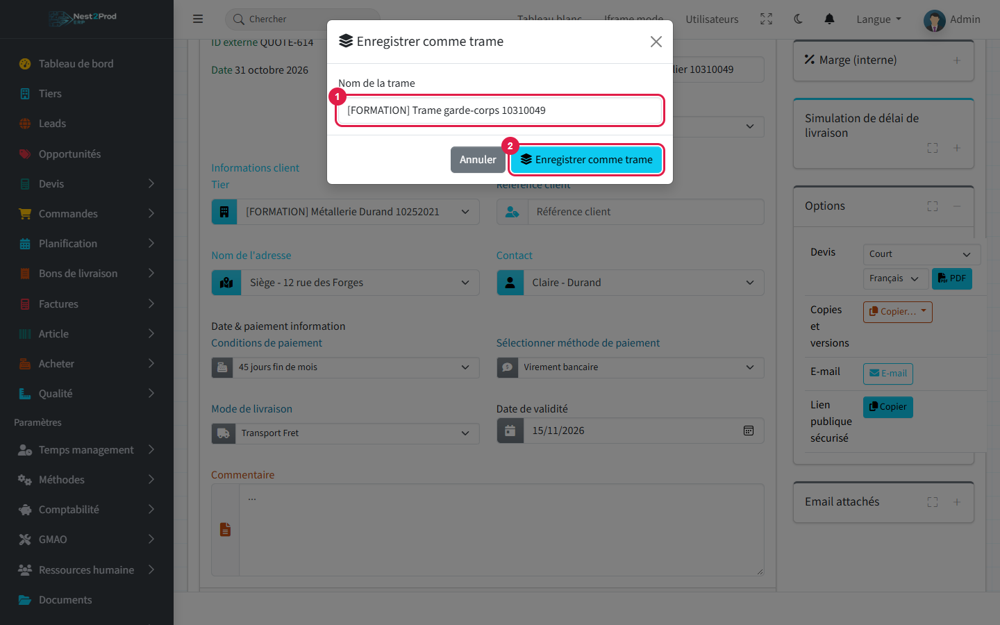

1. **Template name**: suggested from the quote label, editable.
2. Click "Save as template". The template opens.

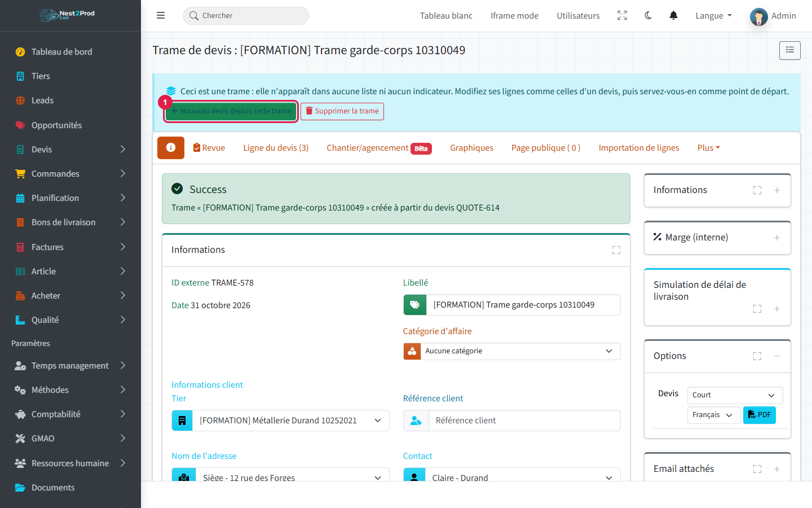

The blue banner reminds you that you are on a template. Its lines are edited like those
of a quote.

1. "New quote from this template" opens the "New Quote" window with the template already
   selected.

### 8.2 Find your templates

Quotes menu, "Quote templates" tab:

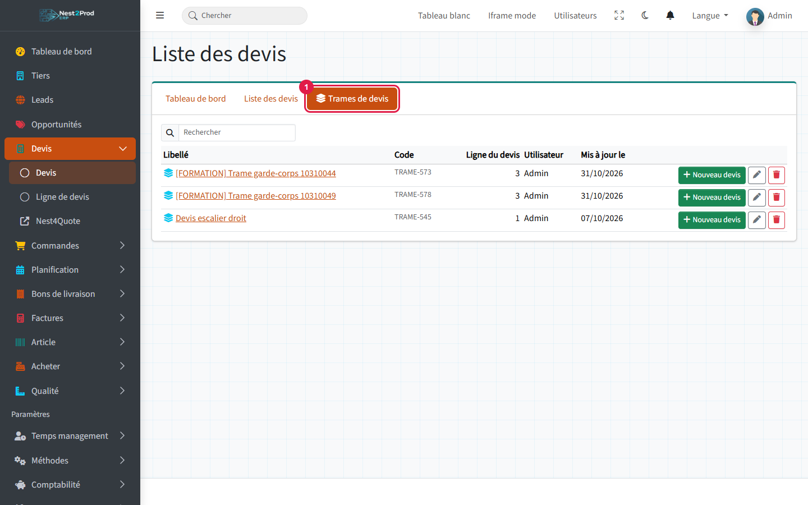

1. The tab lists templates. On each row: "New Quote", edit (pencil) or delete (bin).

### 8.3 Create a quote from a template

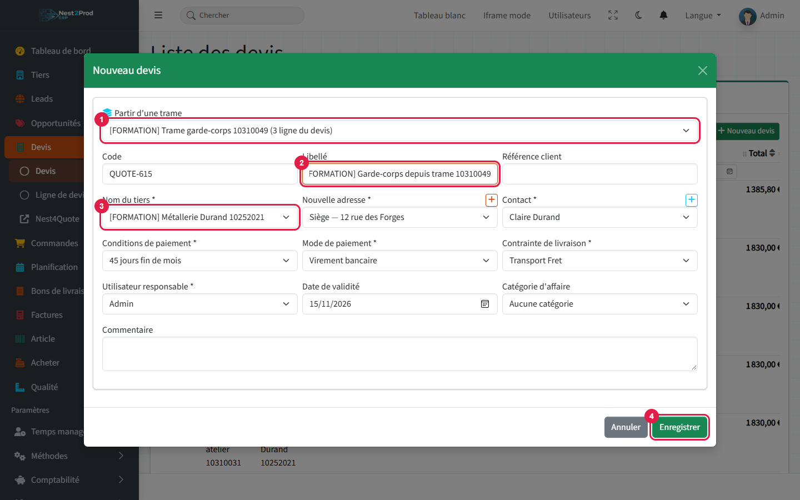

1. The template is selected in **Start from a template**.
2. Check the **Label**.
3. Choose the real customer: the template's customer does not matter.
4. Click "Save".

> ⚠️ When starting from the "New quote from this template" button, the label may stay at
> "-": enter it before saving.

> 💡 Deleting a template does not affect quotes already created from it. A template is
> never converted into an order.

---

## 9. Revise a quote: revision and variant

The customer asks for a change after the quote was sent? Do not edit the sent quote:
create a **revision**. They want to compare two solutions? Create a **variant**. All
remain linked to the original quote (the "reference quote").

| | New revision | Variant |
|---|---|---|
| Code | QT-0001 → QT-0001-B → QT-0001-C | QT-0001-V1, QT-0001-V2… |
| Original quote | becomes "Obsolete" if it was Open or Sent | unchanged, stays open |
| Use | replace the previous version | offer another solution in parallel |

### 9.1 New revision

"Copy…" › "New revision", then confirm. The new revision opens:

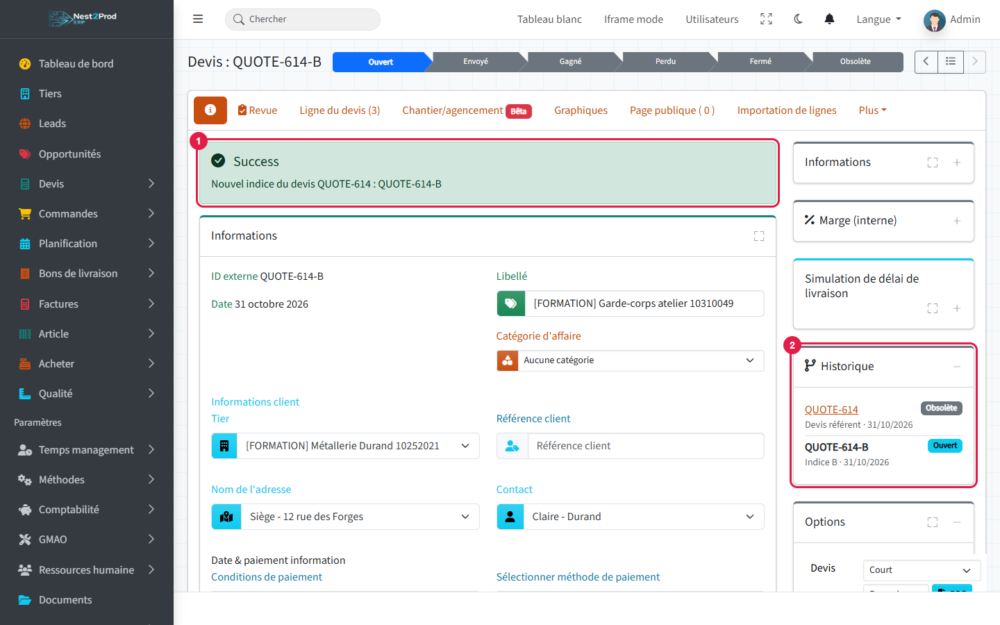

1. The message gives the code of the new revision (here QUOTE-614-B).
2. The "History" card appears: reference quote, revisions and variants, with their status.

> ⚠️ Only the **latest** revision can be revised. On an older revision, the menu shows
> "Superseded by" and a link to the most recent one.

> 💡 A won or lost quote keeps its status when you create a revision.

### 9.2 Variant

"Copy…" › "Variant…":

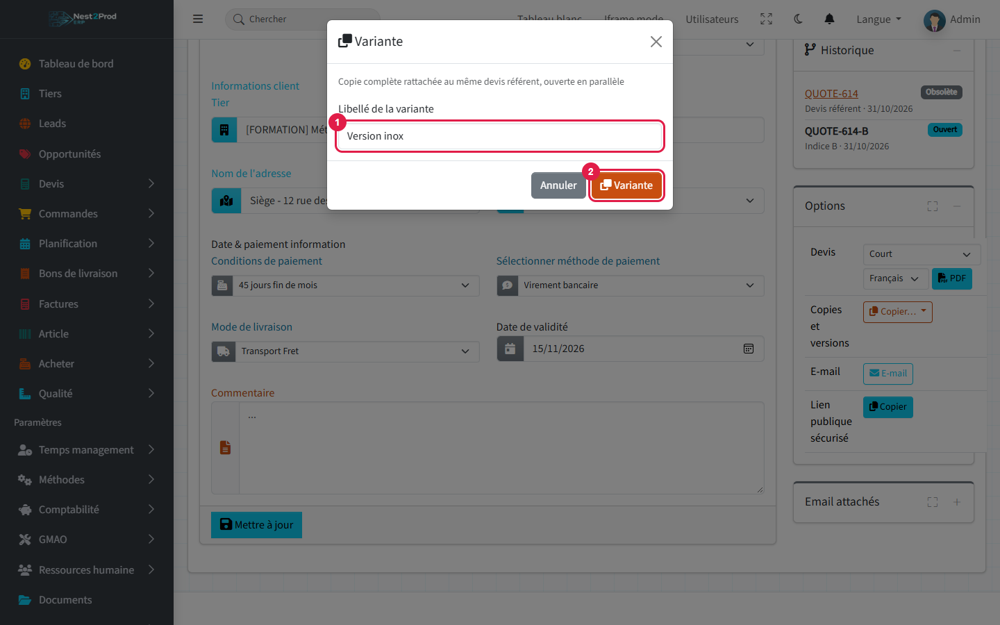

1. **Variant label** (required): what sets it apart ("Stainless version").
2. Click "Variant". The variant opens, with its own code.

The PDF of a revision or variant shows "Revision B" or "Variant: …" under the number.

> 💡 "Duplicate quote" and "Save as template" create an **independent** quote, not linked
> to the family.

---

## 10. Won or lost

### 10.1 Won quote: close the other versions

The customer chooses the stainless variant. On the variant, click the "Win" arrow:

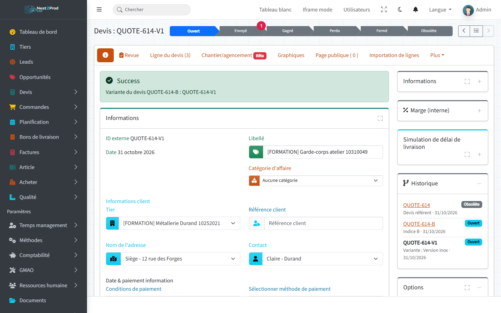

1. "Win" arrow.

The quote then points out the other revisions and variants still open:

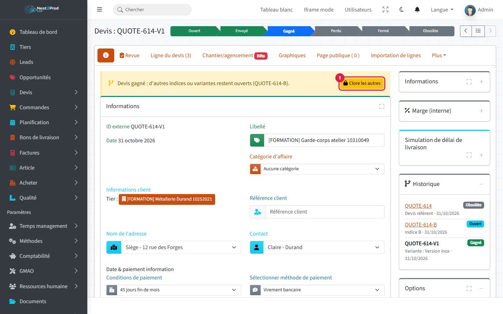

1. Click "Close the others", then confirm. They move to **Closed**.

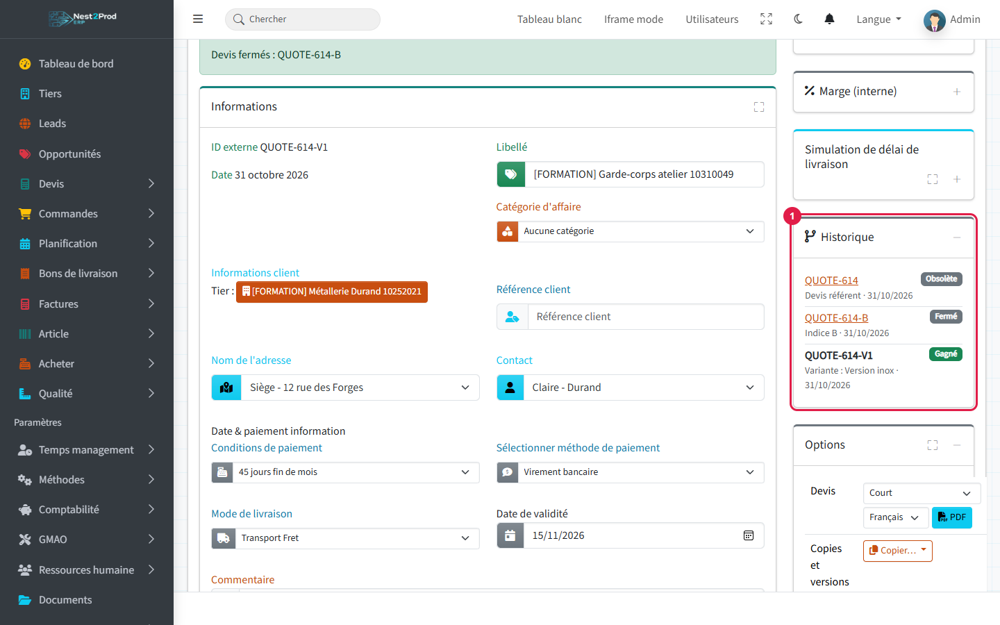

1. The "History" card shows the status of each version: obsolete, closed, won.

> 💡 "Closed" is not "Lost": no loss reason is asked and the closed version does not count
> in lost business.

### 10.2 Lost quote: give the reason

Click the "Lost" arrow. A window asks why:

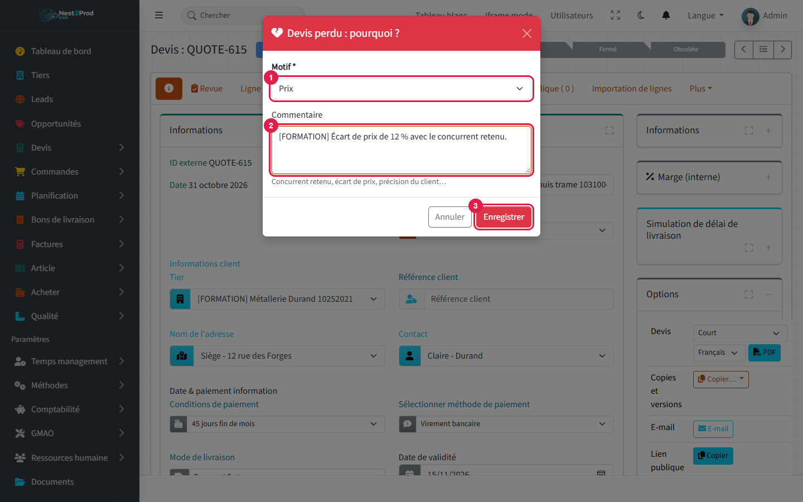

1. **Reason** (required): Price, Lead time, Technical, Competitor, No follow-up…
2. **Comment**: competitor chosen, price gap, customer feedback.
3. Click "Save". "Cancel" leaves the quote in its previous status.

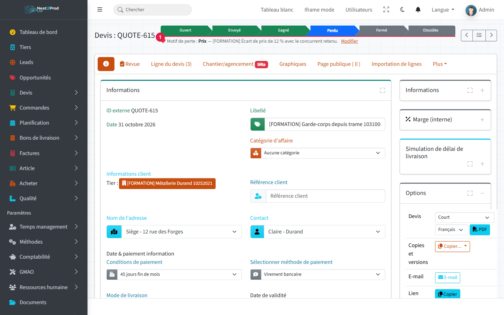

1. The reason and comment are shown under the arrows. "Edit" lets you correct them later.

> 💡 If the quote comes from an opportunity, the opportunity is also set to lost with the
> same reason.

### 10.3 Analyse lost business

Quotes menu, "Dashboard" tab, "Lost business" card:

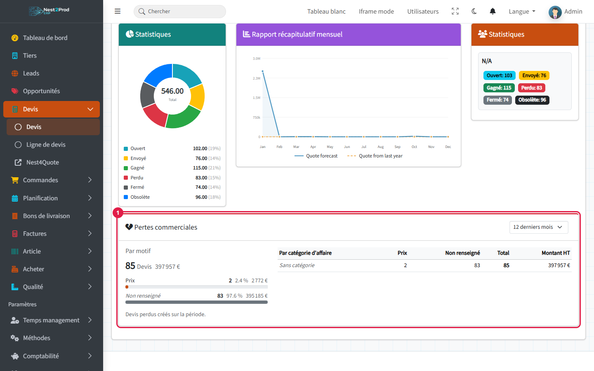

1. **By reason**: number of lost quotes, share and amount excl. tax for each reason;
   **By business category**: the same table broken down by category. The list at the
   top right picks the period: last 12 months, current year or all time.

> 💡 "Not specified" groups quotes lost before loss reasons were set up. You can complete
> them: open the quote and click "Specify" under the arrows.

---

## What next?

- **Convert the quote into an order**: guide "From prospect to invoice", step 5.
  Equipment tags and, if you wish, the layout follow.
- **Have the quote signed online** from its public link (if electronic signature is
  configured).
- **Follow the deal** on the opportunity summary.

## Frequently asked questions

**The « Mise en page », « Importer d'un autre devis » buttons or the line menu have
disappeared.**
The quote is no longer Open: its lines are frozen. Create a new revision to change it.

**The displayed margin is abnormally high.**
Some lines have no cost ("—" in the Margin column): they are counted without cost. Add
their routing or bill of materials.

**"Recalculate prices" does not appear in the Margin card.**
The quote is not Open, or it has already been converted into an order ("Quote converted
into an order: prices frozen").

**I cannot find my template in the quotes list.**
That is intended: templates only appear in the "Quote templates" tab.

**"New revision" is refused.**
A newer revision exists: the message gives its code, that is the one to revise.

**The loss reason window does not open.**
No reason is active in Methods › Loss reasons: the quote then becomes Lost without a reason.

**Does the customer see the margin or hidden lines?**
No. The margin is on no printed document; a hidden line is counted in the total but not
printed.
