**Objectif** : utiliser les fonctions du devis qui ne servent pas tous les jours mais font
gagner beaucoup de temps : présenter un devis par lots, vérifier sa marge, le réviser sans
perdre l'historique, le réutiliser comme modèle et comprendre pourquoi on perd une affaire.

Ce guide complète « Du prospect à la facture », qui montre la création d'un devis simple.

**Exemple utilisé** : la Métallerie Durand demande un devis de garde-corps pour son
atelier : 4 garde-corps acier, 4 mains courantes inox et des platines de fixation.

## Avant de commencer

- Vous devez avoir accès au menu **Devis**.
- Le client existe déjà avec **une adresse et un contact** (voir « Du prospect à la facture »).
- Pour que la marge veuille dire quelque chose, les lignes doivent avoir un **coût de
  revient** : une gamme (opérations), une nomenclature ou des sous-ensembles chiffrés.
- Les **motifs de perte** se gèrent dans le menu Méthodes › Motifs de perte. Cinq motifs
  sont créés d'office (Prix, Délai, Technique, Concurrent, Sans suite).
- Presque tout ce qui suit ne se fait que sur un devis à l'état **Ouvert**. Un devis
  envoyé, gagné ou perdu est figé.

## Vue d'ensemble

```steps
Créer le devis
Lignes et repères
Copier des lignes
Mise en page
Marge
Revue
Impression
Trame
Indice et variante
Gagné ou perdu
```

---

## 1. Créer le devis, ou partir d'une trame

Menu **Devis**, onglet « Liste des devis », bouton « Nouveau devis ».

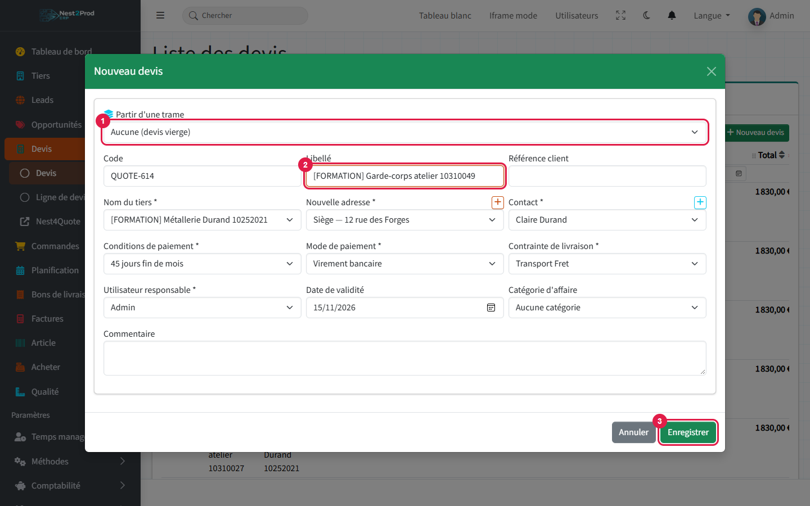

1. **Partir d'une trame** : laissez « Aucune (devis vierge) » pour un devis vide, ou
   choisissez une trame pour recopier toutes ses lignes (voir étape 8). Cette liste
   n'apparaît que s'il existe au moins une trame.
2. **Libellé** : un nom parlant pour retrouver le devis (« Garde-corps atelier »).
3. Choisissez le client (**Nom du tiers**), vérifiez l'adresse et le contact, puis
   cliquez sur « Enregistrer ». La fiche du devis s'ouvre.

---

## 2. Ajouter des lignes avec leurs repères d'équipement

Onglet « Ligne du devis », puis bouton vertical « Ajouter » à droite de l'écran.

Le champ **Repères équipement** sert quand chaque pièce livrée doit porter un repère
du client (repère d'implantation, numéro d'équipement, matricule de chantier…).

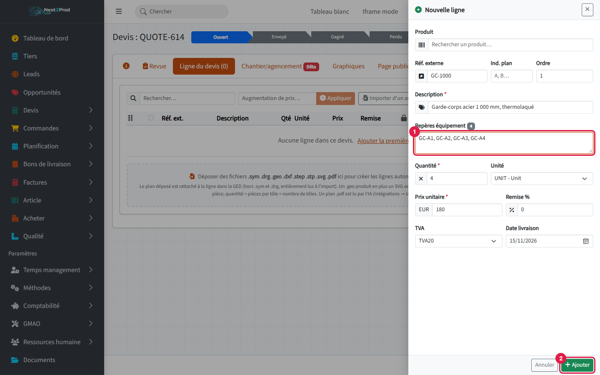

1. **Repères équipement** : saisissez un repère par pièce, séparés par une virgule, un
   point-virgule ou un retour à la ligne. Le petit compteur à côté du titre indique le
   nombre de repères lus.
2. Cliquez sur « Ajouter ».

Les repères s'affichent ensuite en étiquettes sous la description de la ligne.

> 💡 Les repères suivent la ligne jusqu'à la commande, l'accusé de réception, le bon
> de livraison et la fiche suiveuse. Ils ne s'impriment que s'ils sont renseignés.
> Dans la liste des commandes, la recherche trouve aussi une commande par son repère.

> ⚠️ Plus de repères que la quantité ? Un simple avertissement s'affiche, rien n'est
> bloqué : vérifiez la quantité ou les repères avant d'envoyer le devis.

> ⚠️ Une ligne **dupliquée** ne reprend pas les repères : ils désignent des pièces
> précises, à ressaisir pour la nouvelle ligne.

---

## 3. Copier des lignes d'un autre devis ou d'une trame

Vous avez déjà chiffré une pièce identique ? Ne la ressaisissez pas : bouton
« Importer d'un autre devis » au-dessus des lignes.

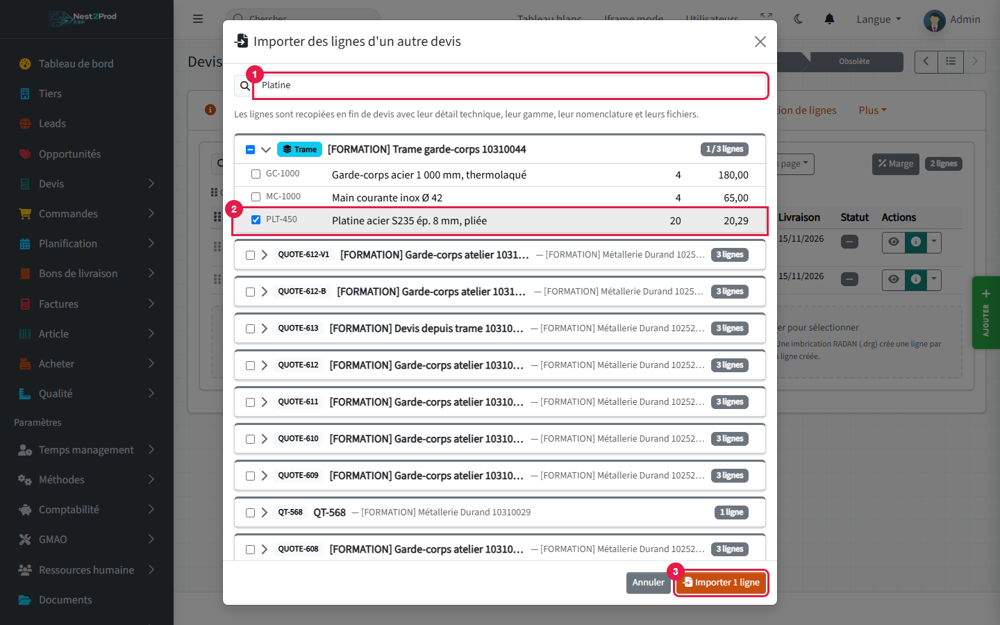

1. Cherchez par code, libellé, client ou texte de ligne. Les trames apparaissent avec
   l'étiquette « Trame ».
2. Dépliez un devis et cochez les lignes voulues (la case du devis coche toutes ses lignes).
3. Cliquez sur « Importer 1 ligne » (le nombre suit votre sélection).

Les lignes sont ajoutées **en fin de devis** avec leur détail technique, leur gamme,
leur nomenclature et leurs fichiers : le coût de revient vient avec elles.

> 💡 Pour recopier une ligne **dans le même devis**, utilisez « Dupliquer » dans le menu
> de la ligne (petite flèche à droite).

---

## 4. Présenter le devis : sections, sous-totaux, textes, forfaits

Un devis long se lit mieux par lots. Quatre outils, qui ne changent **jamais le total** :

| Outil | À quoi il sert |
|---|---|
| Section | Titre d'un lot ; regroupe les lignes placées en dessous, jusqu'à la section suivante |
| Sous-total | Total des lignes de la section, calculé tout seul |
| Texte | Phrase libre imprimée sur le devis (conditions, exclusions…) |
| Œil (masquer) | Ligne comptée dans le total mais non imprimée |

### 4.1 Insérer une section à la bonne place

Ouvrez le menu de la ligne (petite flèche à droite) :

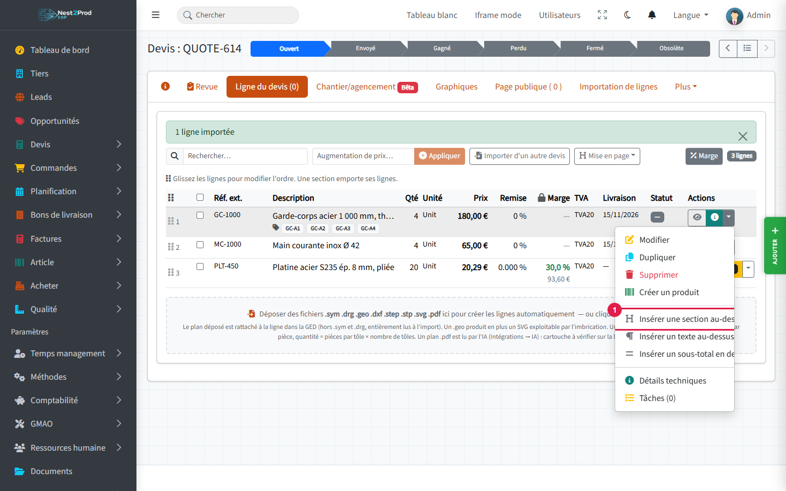

1. « Insérer une section au-dessus » place le titre juste avant la ligne. Tapez le nom
   de la section, puis validez avec la coche verte (ou la touche Entrée).

Le même menu propose « Insérer un texte au-dessus » et « Insérer un sous-total en
dessous ». Un sous-total sans libellé s'appelle automatiquement « Sous-total » suivi du
nom de la section.

### 4.2 Ajouter en fin de devis

Le bouton « Mise en page » ajoute une section, un sous-total ou un texte **à la fin** :

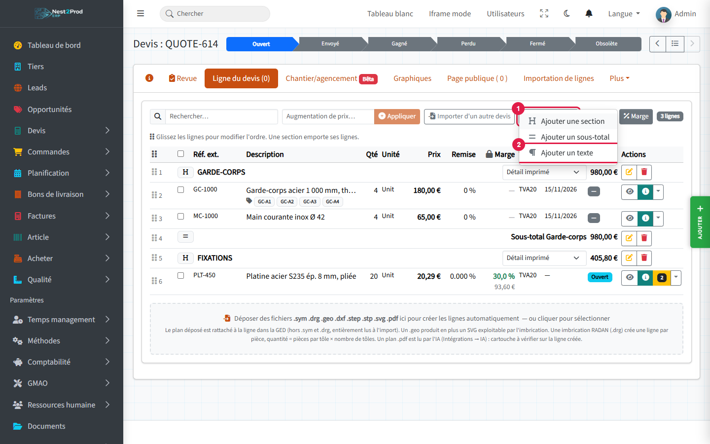

1. Cliquez sur « Mise en page ».
2. Choisissez « Ajouter une section », « Ajouter un sous-total » ou « Ajouter un texte ».

> 💡 Glissez une ligne par la poignée (les points à gauche) pour la déplacer. Une section
> emporte ses lignes avec elle.

### 4.3 Résultat et forfaits

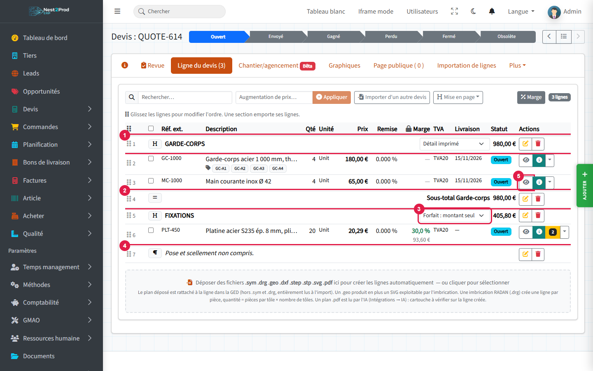

1. **Section** : son montant total s'affiche à droite.
2. **Sous-total** de la section « Garde-corps ».
3. **Impression de la section** : « Détail imprimé » (par défaut), « Forfait : montant
   seul » (une seule ligne au montant de la section, sans détail) ou « Forfait : 1 ×
   unité » (une ligne « 1 × » l'unité choisie dans la liste qui apparaît).
4. **Texte** libre, imprimé en italique sous les lignes.
5. **Œil** : masque la ligne sur le PDF ; elle reste comptée dans le total. Une ligne
   masquée apparaît grisée, avec un œil barré.

> ⚠️ Une section **vide** (aucune ligne en dessous) est signalée par un badge orange :
> placez-la au-dessus de ses lignes.

> 💡 Pour « Forfait : 1 × unité », créez une unité « Forfait » dans Méthodes › Unités si
> elle n'existe pas.

> ⚠️ Sections, sous-totaux et textes ne valent rien : ils ne sont jamais livrés ni
> facturés. À la conversion en commande, une fenêtre demande si vous gardez cette
> présentation sur la commande ou non.

---

## 5. Vérifier la marge (information interne)

La marge **n'est jamais imprimée** ni montrée au client. Elle compare le prix de vente
au coût de revient : opérations de la gamme (sous-traitance comprise), nomenclature et
sous-ensembles.

### 5.1 La colonne « Marge » des lignes

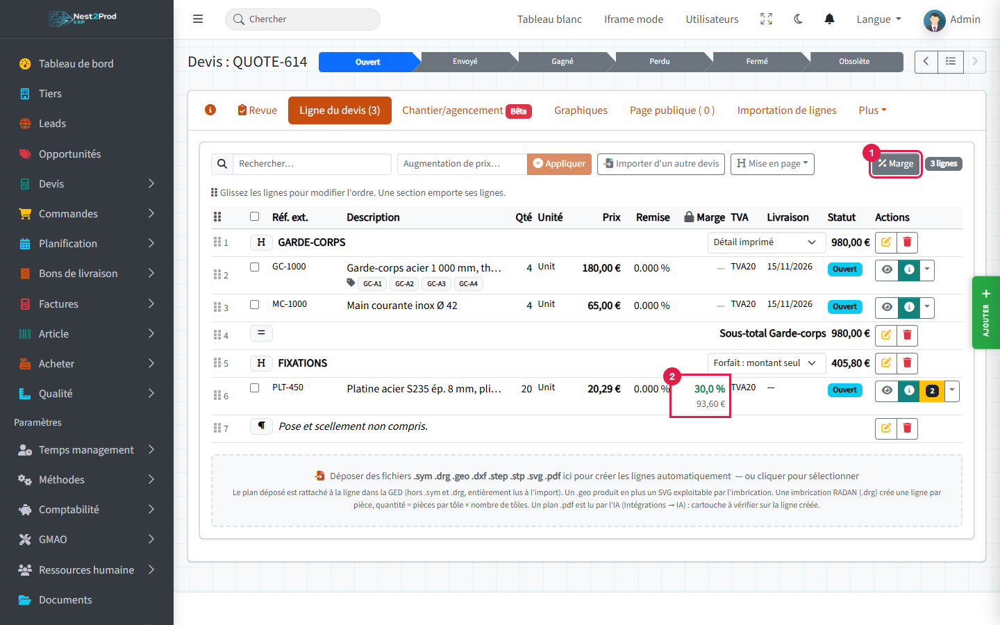

1. Le bouton « Marge » affiche ou masque la colonne (votre choix est mémorisé).
2. Pour chaque ligne : la marge en % **du coût** et son montant. Passez la souris dessus
   pour voir le coût unitaire, le coût total et le prix de vente.

Un tiret « — » signifie que la ligne n'a **aucun coût** (ni gamme, ni nomenclature). Une
ligne sous le seuil d'alerte réglé par votre administrateur s'affiche en rouge.

### 5.2 La carte « Marge (interne) » et la marge globale

Onglet Informations (icône « i »), colonne de droite, carte « Marge (interne) » (cliquez
sur « + » pour la déplier).

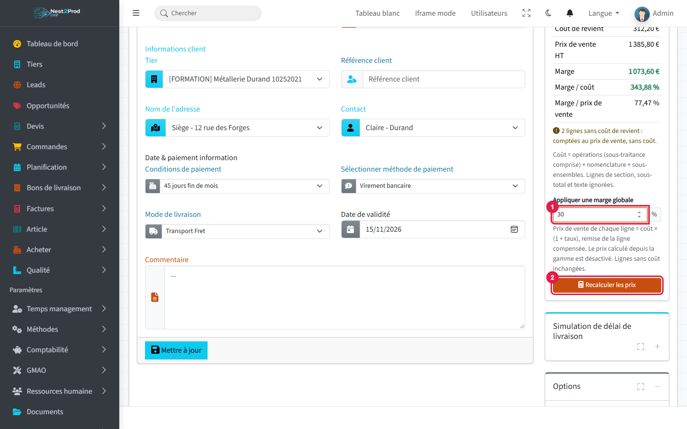

La carte donne le coût de revient, le prix de vente HT, la marge en euros, la marge sur
le coût et la marge sur le prix de vente. Pour fixer d'un coup tous les prix à partir
des coûts :

1. Saisissez le **taux de marge sur le coût** (30 = prix de vente égal au coût + 30 %).
2. Cliquez sur « Recalculer les prix », puis confirmez.

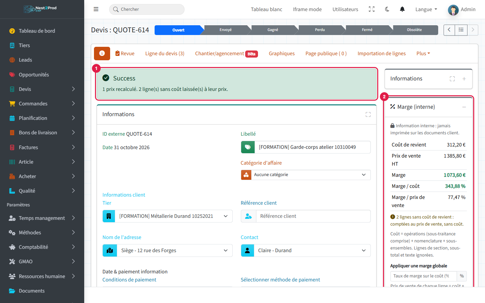

1. Le message indique combien de prix ont été recalculés et combien de lignes sans coût
   ont été laissées à leur prix.
2. La carte affiche la nouvelle marge.

> ⚠️ Les lignes **sans coût** sont comptées au prix de vente, avec un coût nul : elles
> gonflent la marge affichée. La carte le signale (« 2 lignes sans coût de revient »).
> Chiffrez leur gamme avant de vous fier au pourcentage.

> ⚠️ La marge globale n'est proposée que sur un devis **Ouvert**, et refusée dès que le
> devis a été converti en commande (prix figés). La remise de chaque ligne est compensée,
> et le « prix calculé » depuis la gamme est désactivé sur les lignes recalculées.

---

## 6. Tracer la revue du devis

L'onglet « Revue » (à côté de l'icône « i ») garde la trace de la relecture du devis
avant envoi, et des demandes de changement.

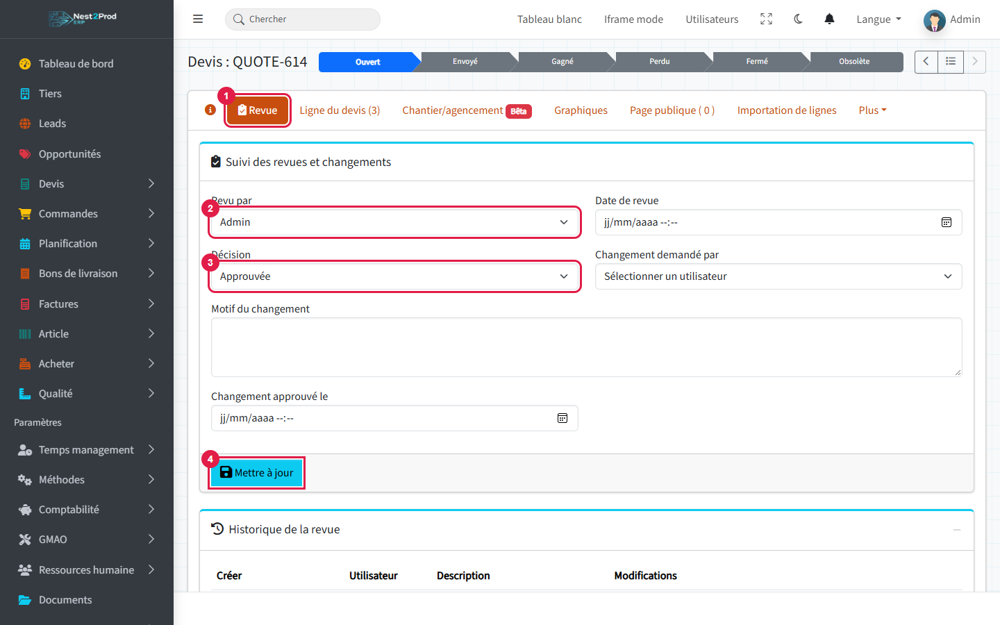

1. Ouvrez l'onglet « Revue ».
2. **Revu par** : la personne qui a relu le devis ; **Date de revue** si besoin.
3. **Décision** : En attente, Approuvée ou Refusée.
4. Cliquez sur « Mettre à jour ».

Si le client demande une modification, renseignez **Changement demandé par**, **Motif
du changement** et, une fois accepté, **Changement approuvé le**. La carte « Historique
de la revue », en dessous, liste toutes les modifications.

> 💡 La décision s'affiche en badge sur l'onglet (vert = approuvée, rouge = refusée). Rien
> n'est bloqué : c'est une trace, pas un visa obligatoire.

---

## 7. Choisir le modèle d'impression et la langue

Onglet Informations, carte « Options », ligne « Devis » :

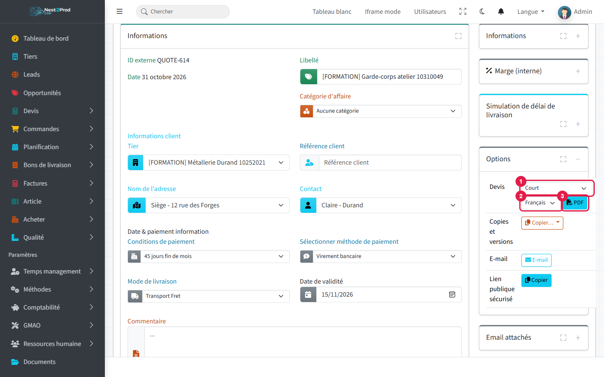

1. **Modèle d'impression** :
   - « Court » : le devis habituel ;
   - « Détaillé » : ajoute la description longue de chaque ligne (commentaire externe
     du détail technique), la vignette du plan et les estimations de projet cochées
     (coûts imprimés « non compris dans le total ») ;
   - « Technique (sans prix) » : un document technique sans aucun montant, à joindre
     pour l'atelier ou le bureau d'études du client.
2. **Langue du document** : français ou anglais. Tout le document est traduit, titres
   compris.
3. Cliquez sur « PDF ».

> ⚠️ L'e-mail envoyé depuis la carte « Options », le lien public et la signature
> électronique utilisent toujours le **modèle habituel**.
> Pour envoyer un autre modèle, téléchargez le PDF et joignez-le vous-même.

---

## 8. Réutiliser un devis : dupliquer ou enregistrer comme trame

Toutes les copies passent par le bouton « Copier… » de la carte « Options » :

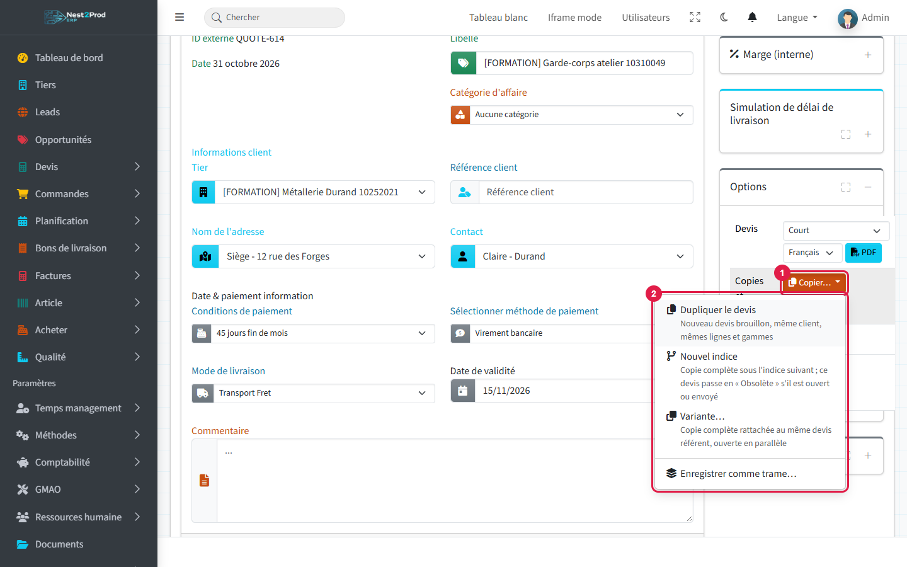

1. Ouvrez « Copier… ».
2. Quatre choix :
   - « Dupliquer le devis » : nouveau devis brouillon, même client, mêmes lignes et gammes ;
   - « Nouvel indice » et « Variante… » : voir l'étape 9 ;
   - « Enregistrer comme trame… » : un modèle de devis réutilisable.

### 8.1 Créer une trame

Une **trame** est un devis type (un escalier standard, un garde-corps courant…) qui sert
de point de départ. Elle n'apparaît dans aucune liste ni aucun indicateur.

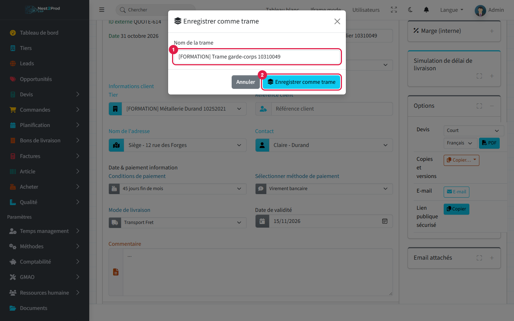

1. **Nom de la trame** : proposé à partir du libellé du devis, modifiable.
2. Cliquez sur « Enregistrer comme trame ». La trame s'ouvre.

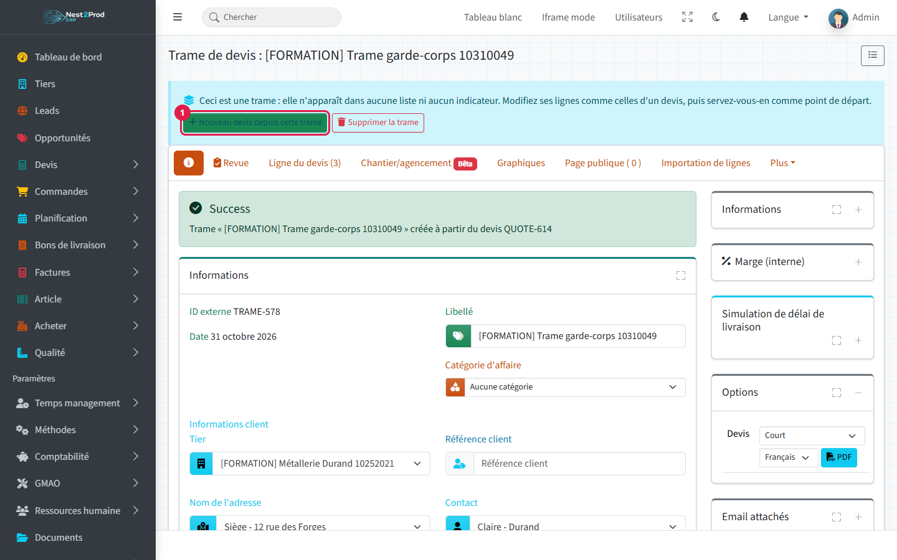

Le bandeau bleu rappelle que vous êtes sur une trame. Ses lignes se modifient comme
celles d'un devis.

1. « Nouveau devis depuis cette trame » ouvre la fenêtre « Nouveau devis » avec la trame
   déjà choisie.

### 8.2 Retrouver ses trames

Menu Devis, onglet « Trames de devis » :

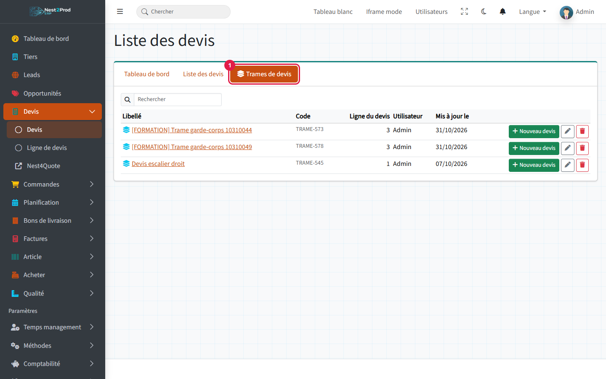

1. L'onglet liste les trames. Sur chaque ligne : « Nouveau devis », modifier (crayon) ou
   supprimer (corbeille).

### 8.3 Créer un devis depuis une trame

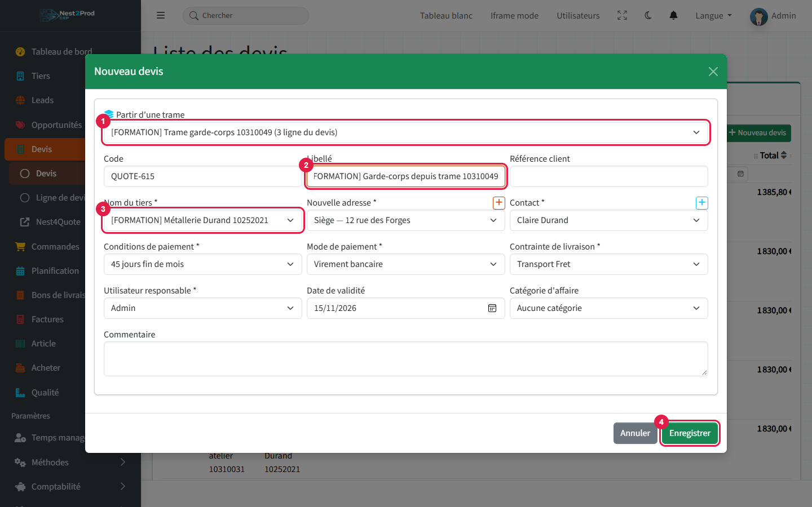

1. La trame est choisie dans **Partir d'une trame**.
2. Vérifiez le **Libellé**.
3. Choisissez le vrai client : celui de la trame n'a aucune importance.
4. Cliquez sur « Enregistrer ».

> ⚠️ En partant du bouton « Nouveau devis depuis cette trame », le libellé peut rester
> sur « - » : saisissez-le avant d'enregistrer.

> 💡 Supprimer une trame ne touche pas aux devis déjà créés à partir d'elle. Une trame ne
> se convertit jamais en commande.

---

## 9. Réviser un devis : indice et variante

Le client demande une modification après envoi ? Ne modifiez pas le devis envoyé :
créez un **indice**. Il veut comparer deux solutions ? Créez une **variante**. Tous
restent rattachés au devis d'origine (le « devis référent »).

| | Nouvel indice | Variante |
|---|---|---|
| Code | QT-0001 → QT-0001-B → QT-0001-C | QT-0001-V1, QT-0001-V2… |
| Devis d'origine | passe en « Obsolète » s'il était Ouvert ou Envoyé | inchangé, reste ouvert |
| Usage | remplacer la version précédente | proposer une autre solution en parallèle |

### 9.1 Nouvel indice

« Copier… » › « Nouvel indice », puis confirmez. Le nouvel indice s'ouvre :

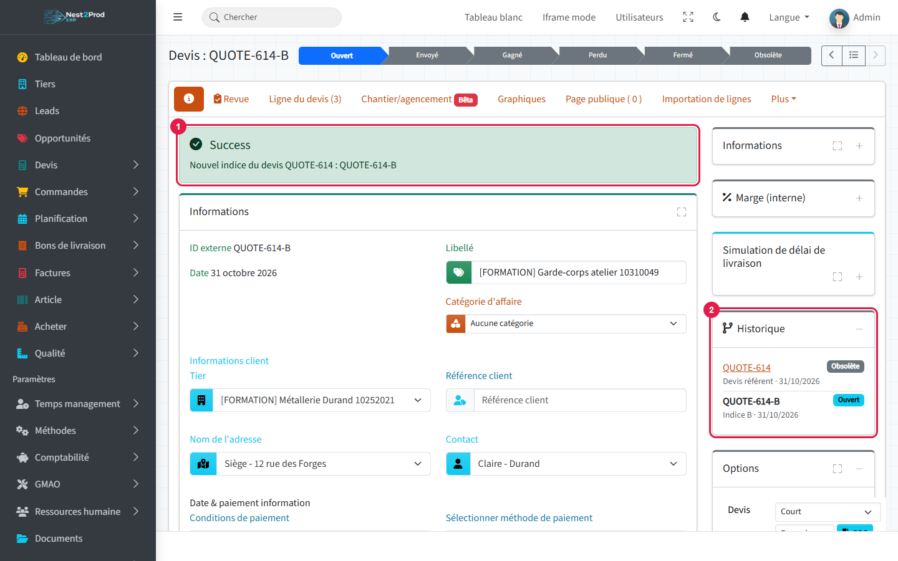

1. Le message donne le code du nouvel indice (ici QUOTE-614-B).
2. La carte « Historique » apparaît : devis référent, indices et variantes, avec leur état.

> ⚠️ Seul le **dernier** indice se révise. Sur un ancien indice, le menu affiche
> « Remplacé par » et le lien vers le plus récent.

> 💡 Un devis gagné ou perdu garde son état quand vous créez un indice.

### 9.2 Variante

« Copier… » › « Variante… » :

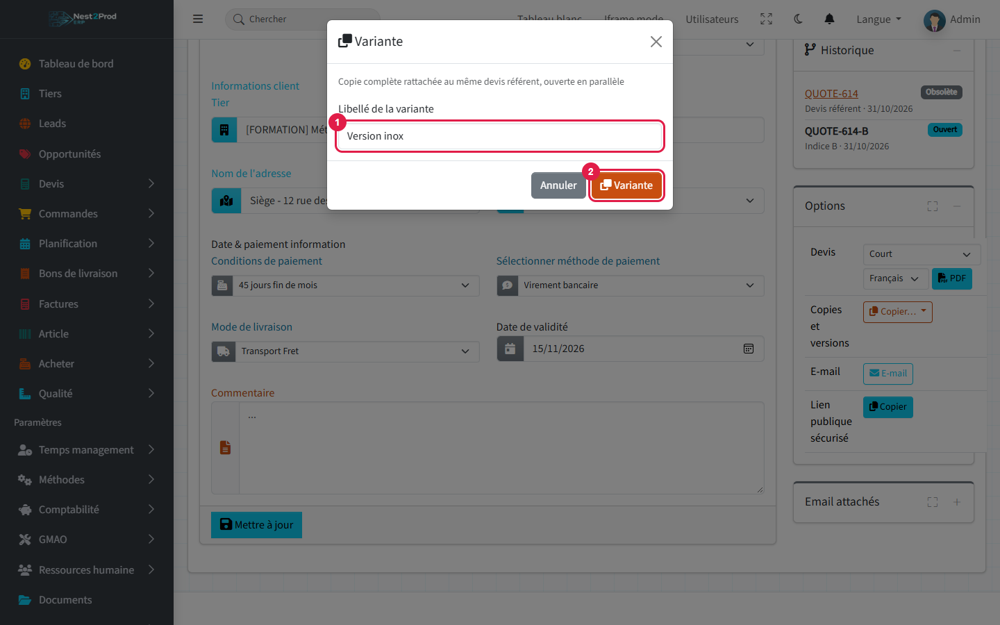

1. **Libellé de la variante** (obligatoire) : ce qui la distingue (« Version inox »).
2. Cliquez sur « Variante ». La variante s'ouvre, avec son propre code.

Le PDF d'un indice ou d'une variante porte la mention « Indice B » ou « Variante : … »
sous le numéro.

> 💡 « Dupliquer le devis » et « Enregistrer comme trame » créent un devis **indépendant**,
> sans lien avec la famille.

---

## 10. Gagné ou perdu

### 10.1 Devis gagné : clore les autres versions

Le client retient la variante inox. Sur la variante, cliquez sur la flèche « Gagné » :

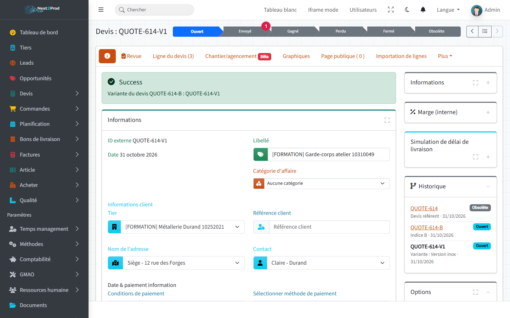

1. Flèche « Gagné ».

La fiche signale alors les autres indices et variantes encore ouverts :

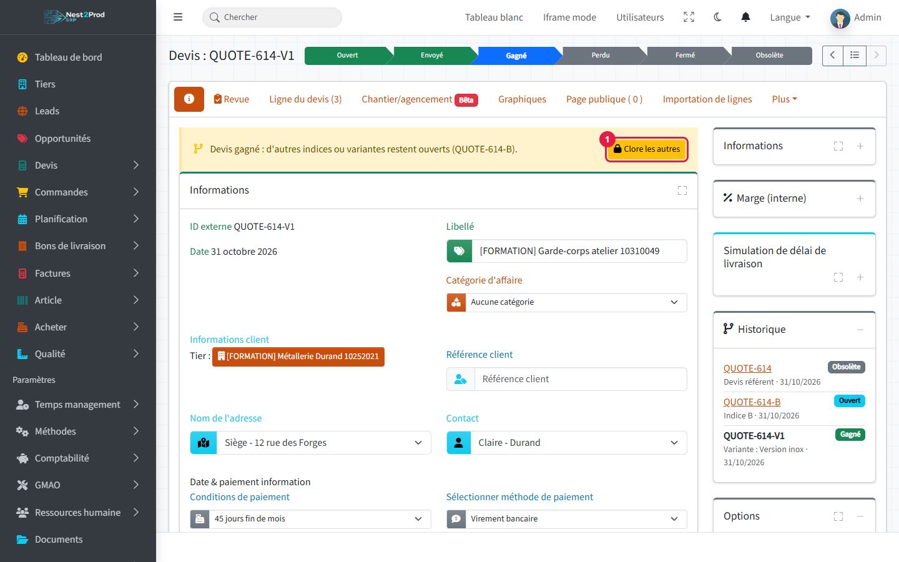

1. Cliquez sur « Clore les autres », puis confirmez. Ils passent à l'état **Fermé**.

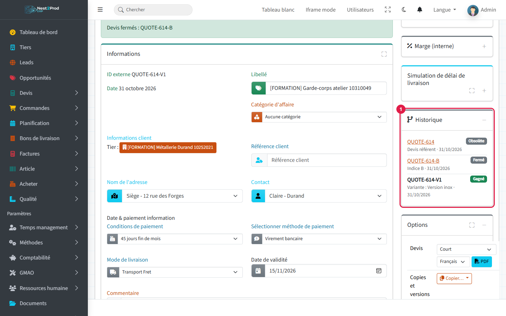

1. La carte « Historique » montre l'état de chaque version : obsolète, fermé, gagné.

> 💡 « Fermé » n'est pas « Perdu » : aucun motif de perte n'est demandé et la version
> close ne compte pas dans les pertes commerciales.

### 10.2 Devis perdu : indiquer le motif

Cliquez sur la flèche « Perdu ». Une fenêtre demande pourquoi :

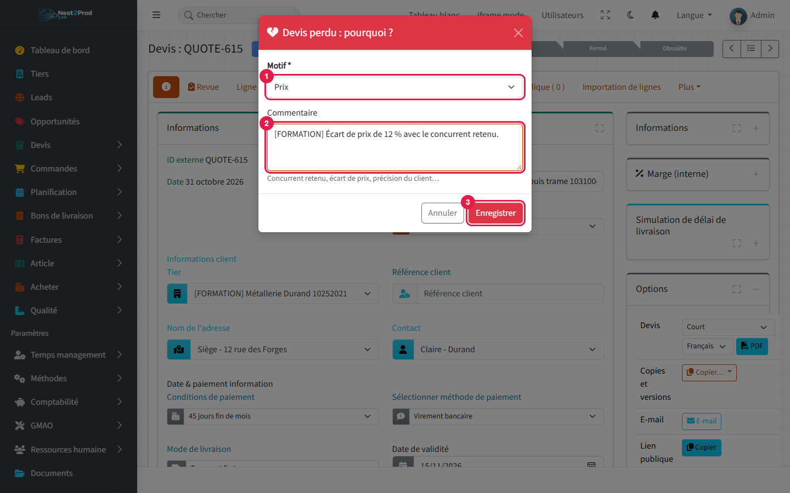

1. **Motif** (obligatoire) : Prix, Délai, Technique, Concurrent, Sans suite…
2. **Commentaire** : concurrent retenu, écart de prix, précision du client.
3. Cliquez sur « Enregistrer ». « Annuler » laisse le devis à son état précédent.

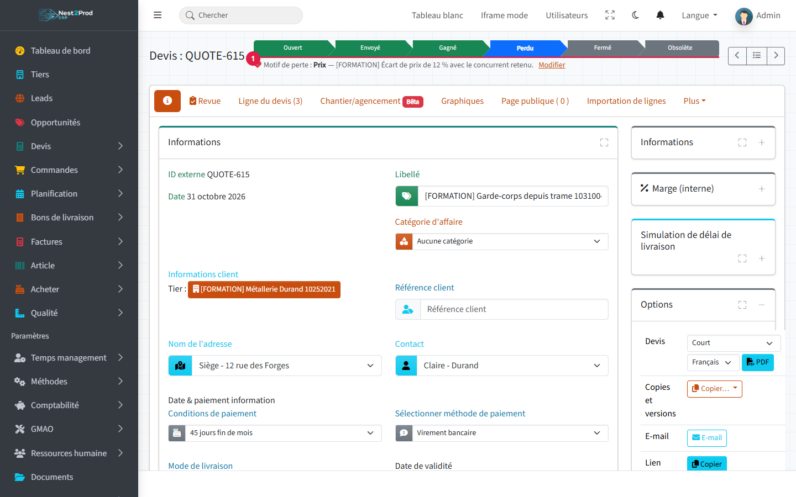

1. Le motif et le commentaire s'affichent sous les flèches. « Modifier » permet de les
   corriger plus tard.

> 💡 Si le devis vient d'une opportunité, celle-ci passe aussi en perdue avec le même motif.

### 10.3 Analyser les pertes

Menu Devis, onglet « Tableau de bord », carte « Pertes commerciales » :

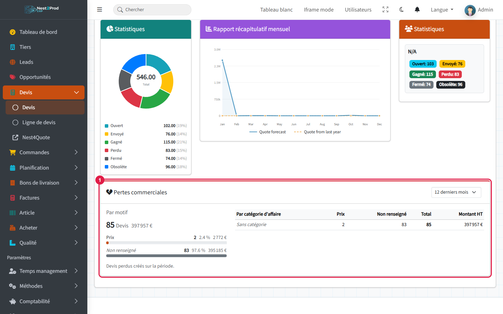

1. **Par motif** : nombre de devis perdus, part et montant HT de chaque motif ;
   **Par catégorie d'affaire** : le même tableau croisé par catégorie. La liste en haut
   à droite choisit la période : 12 derniers mois, année en cours ou depuis le début.

> 💡 « Non renseigné » regroupe les devis perdus avant la mise en place des motifs. Vous
> pouvez les compléter : ouvrez le devis et cliquez sur « Renseigner » sous les flèches.

---

## Et ensuite ?

- **Convertir le devis en commande** : guide « Du prospect à la facture », étape 5.
  Les repères d'équipement et, si vous le souhaitez, la présentation suivent.
- **Faire signer le devis en ligne** depuis son lien public (si la signature électronique
  est configurée).
- **Suivre l'affaire** sur la synthèse de l'opportunité.

## Questions fréquentes

**Les boutons « Mise en page », « Importer d'un autre devis » ou le menu des lignes
ont disparu.**
Le devis n'est plus à l'état Ouvert : ses lignes sont figées. Créez un nouvel indice
pour le modifier.

**La marge affichée est anormalement élevée.**
Certaines lignes n'ont pas de coût (« — » dans la colonne Marge) : elles sont comptées
sans coût. Ajoutez leur gamme ou leur nomenclature.

**« Recalculer les prix » n'apparaît pas dans la carte Marge.**
Le devis n'est pas Ouvert, ou il a déjà été converti en commande (« Devis converti en
commande : prix figés »).

**Je ne trouve pas ma trame dans la liste des devis.**
C'est voulu : les trames n'apparaissent que dans l'onglet « Trames de devis ».

**« Nouvel indice » est refusé.**
Un indice plus récent existe : le message donne son code, c'est lui qu'il faut réviser.

**La fenêtre de motif de perte ne s'ouvre pas.**
Aucun motif n'est actif dans Méthodes › Motifs de perte : le devis passe alors en
Perdu sans motif.

**Le client voit-il la marge ou les lignes masquées ?**
Non. La marge n'est sur aucun document imprimé ; une ligne masquée est comptée dans le
total mais n'est pas imprimée.
