**Goal**: deliver an order with its packing list, invoice it, follow the payment until it
is fully paid, chase it if needed, and pass the entries on to your accountant.

> 💡 Screenshots show the French interface; button names are given as they appear in the English interface.

**Starting point**: an **order** whose parts are ready to ship (see the "From prospect to
invoice" guide for creating the quote and the order).

## Before you start

- You need the **Invoices** permission. Sending reminders also needs its own
  permission (Admin role by default), and the accounting export needs access to the **Your company** menu.
- Validating an **end-of-manufacturing file** needs its own permission (Admin role by
  default). Without it, the "File" menu does not appear on the order.
- For the electronic invoice (Factur-X) and for sending by e-mail: the **SIREN**, the
  **VAT number** and the **address** of your company (Your company › Factory settings) and
  of the customer must be filled in.
- The **payment terms**, the **Payment Methods** and the **Accounting allocations**
  (Accounting menu) decide the invoice due date and which accounts the entries go to.

## Overview

```steps
File validated (if required)
Delivery note and packages
Draft invoice
Issue
Payments
Reminders
Accounting export
```

---

## 1. The end-of-manufacturing file (if required)

Some parts may only leave with a complete file (inspection records, certificates, reports)
checked by an authorised person. If your company has set this up, an order line can
**require this file**: until it is validated, the line goes neither on a delivery note nor
on an invoice.

The requirement comes:

- either from the **business category** of the order (menu Methods › Business categories,
  "End-of-manufacturing file required" switch): it applies to lines created afterwards;
- or from a **line by line** choice, on the order.

To require the file on a line: "Lines" tab of the order, tick the line, then menu
**"Dossier" (File)** › **"Exiger le dossier" (Require the file)**.


1. Tick the line concerned.
2. Open the **"Dossier" (File)** menu (the number in brackets shows how many ticked lines
   each action applies to).
3. Click **"Exiger le dossier" (Require the file)**.

The line then shows the red **"Dossier à valider" (File to validate)** badge.

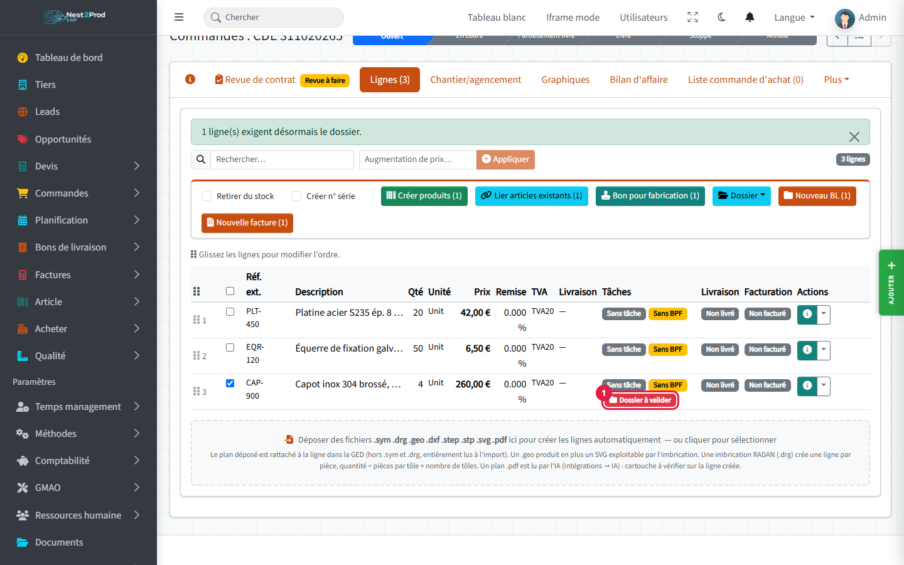

As long as this badge is shown, creating the delivery note is refused, with a message
naming the order and the line:

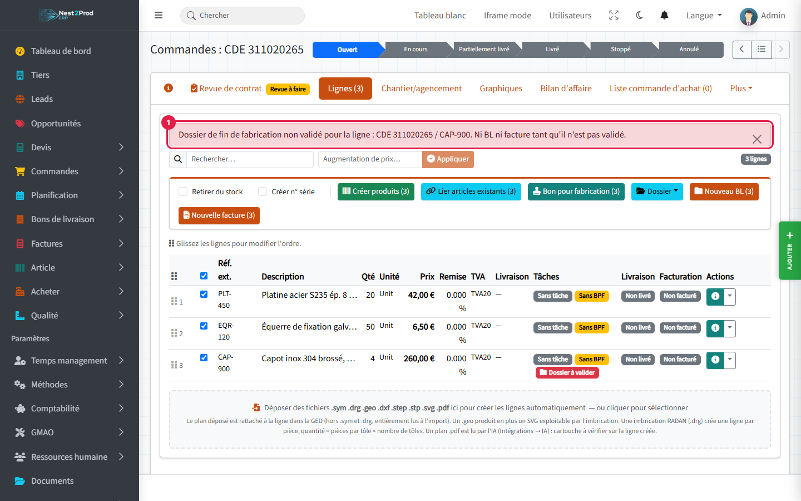

The same badge warns you in the **Delivery notes › Deliverys notes request** and
**Invoices › Invoices request** screens, before you try to create the document.

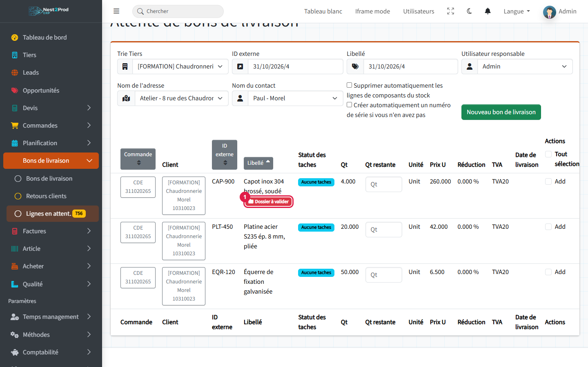

Once the file has been checked: tick the line, menu **"Dossier" (File)** › **"Valider le
dossier" (Validate the file)**.

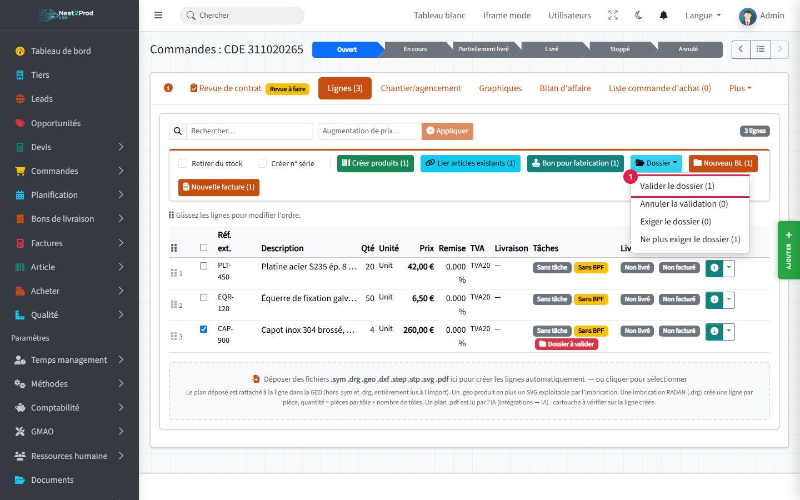

The badge turns green, **"Dossier validé" (File validated)** (the date and the author of
the validation appear when you hover over the badge). The line can be delivered and invoiced.

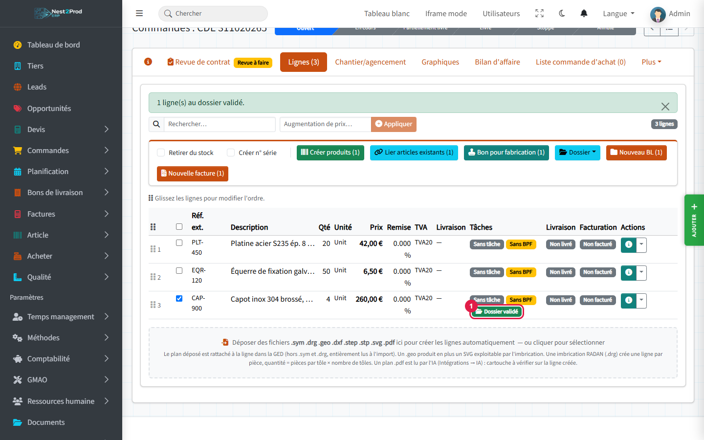

> ⚠️ The block applies to **every** path: delivery note from the order or from the
> delivery notes request, direct "New invoice" from the order, invoices request,
> "Generate pending invoices", converting a proforma into an invoice. The proforma itself
> is not blocked (it is paid before manufacturing).
>
> ⚠️ A validation **can no longer be cancelled** once the line is delivered or invoiced,
> even partly. And a line delivered before the file was required stays blocked at
> invoicing until the file is validated.
>
> 💡 "No longer require the file" lifts the requirement on the ticked lines (after
> confirmation): they can then be delivered and invoiced without it.

Another possible block when creating the delivery note: a line covered by an **external
concession** awaiting the customer's decision does not ship until the concession is decided
(see the "Quality — non-conformities and inspection" guide).

---

## 2. Deliver: delivery note and packing list

"Lines" tab of the order: tick the lines to deliver, then **"Nouveau BL" (New delivery
note)** and confirm. The delivery note page opens.

To print a **packing list** (content of each package, weights, dimensions), first enter
the packages. **Packaging** tab of the delivery note, **New packaging** card: package
reference, type (pallet, crate…), gross and net weight, dimensions, then at the bottom the
**Content** section: the quantity of each delivery note line packed in this package.

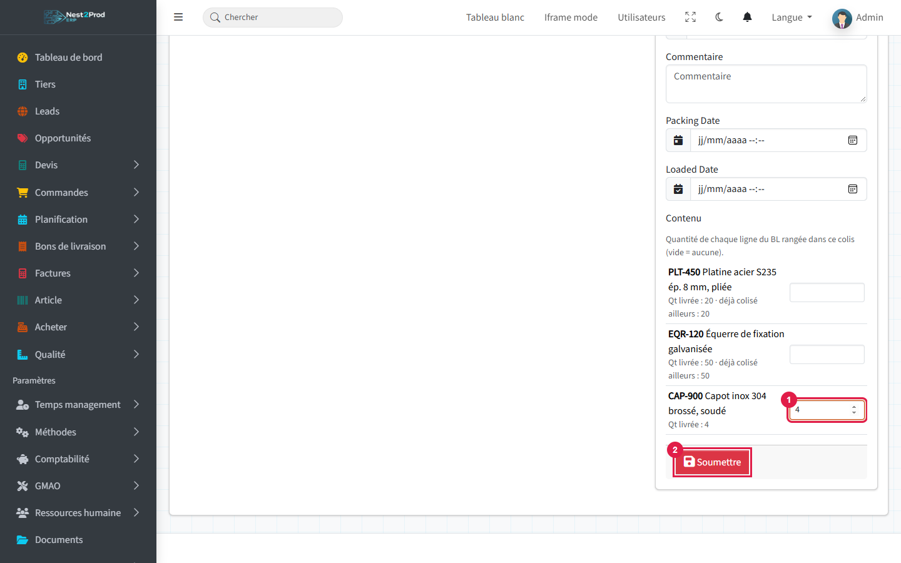

1. Quantity of the line in this package (empty = none). Under each line, the "already
   packed elsewhere" reminder shows what is already in another package.
2. Click "Submit". Repeat for each package.

The packages are added to the list of the tab; the button on each row lets you change them,
content included.

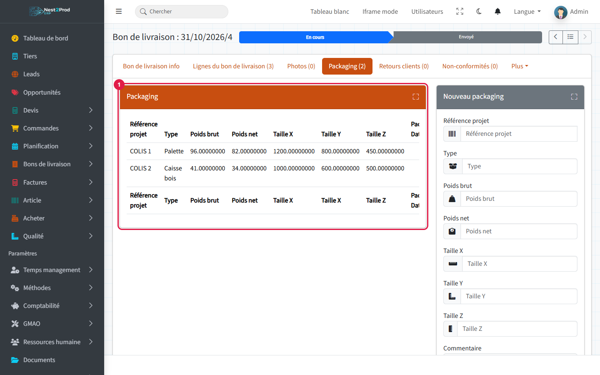

"Delivery info" tab, **Options** card: choose the **Packing list** print layout (and the
language), then **PDF**.

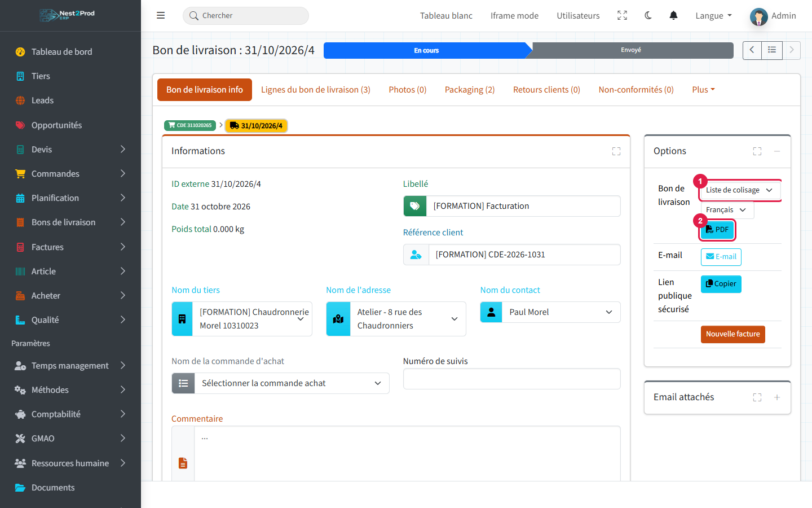

1. "Packing list" layout (the "Delivery note" layout prints the usual delivery note).
2. **PDF** button.

The list shows, package by package, the dimensions, the weights and the packed lines, with
the number of packages and the total weights at the top. It contains **no price**.

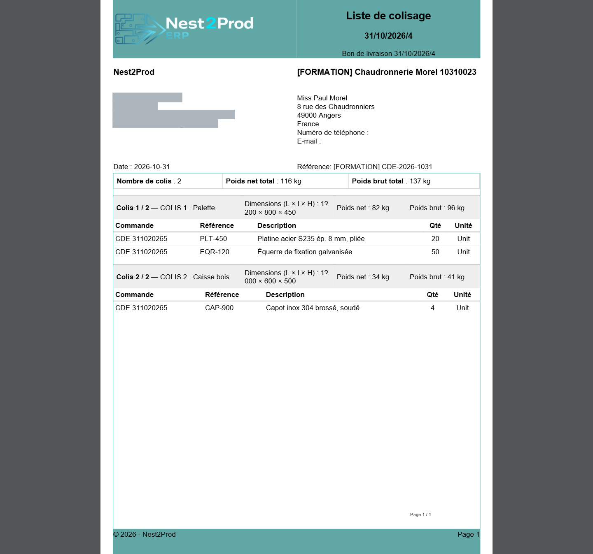

> ⚠️ A line cannot be packed beyond its delivered quantity, all packages together: the
> package is then refused with a message.
>
> 💡 Whatever is in no package appears in a "Not packed" block of the list. The total
> weights are those **entered on the packages**, not the weight of the items.

---

## 3. Create the invoice

Menu **Invoices › Invoices request**: the delivered lines not yet invoiced.

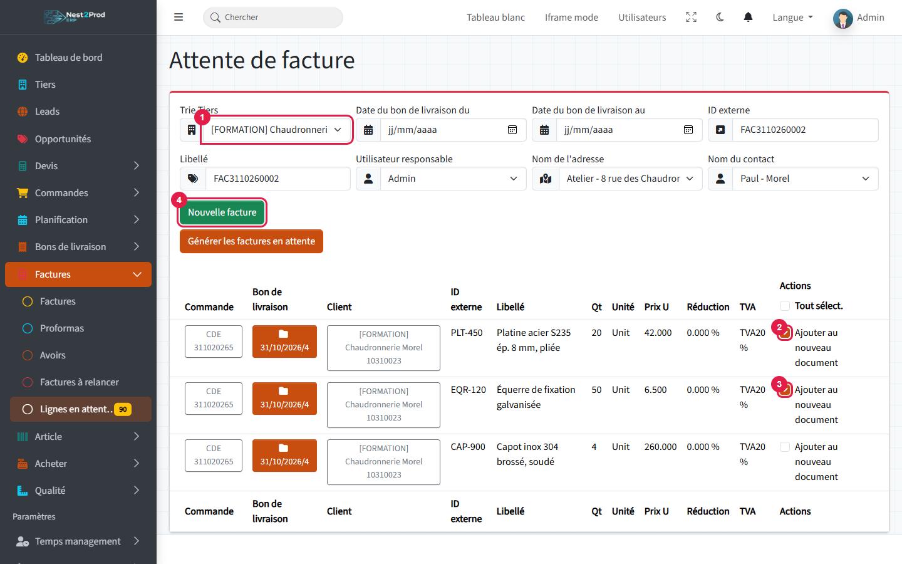

1. Choose the **customer**: their delivery note lines to invoice are shown.
2. Tick "Add to new document" on the first line to invoice…
3. …then on each of the others.
4. Click **New invoice**: the draft invoice opens.

> 💡 "Generate pending invoices" creates in one go the invoices of all the pending lines
> of the customer. The "New invoice" button on the delivery note page invoices the whole
> delivery note.

---

## 4. Check the draft

A draft invoice (status **In Progress**) can still be fully changed: quantities, prices
and discounts are corrected directly in the "Invoice lines" tab.

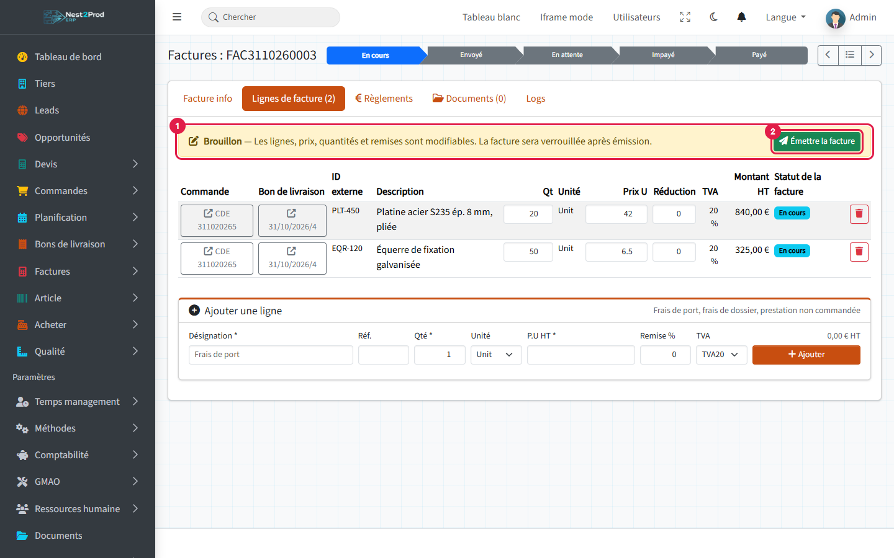

1. The banner reminds you that the invoice is a **draft** ("Brouillon").
2. The **"Émettre la facture" (Issue the invoice)** button locks it (step 5).

To invoice something that was not ordered (shipping costs, handling fees), fill in
"Ajouter une ligne" (Add a line): **"Désignation" (Description)**, **"Qté" (Qty)**, **"P.U HT" (Unit price excl. VAT)**, then "Ajouter" (Add).

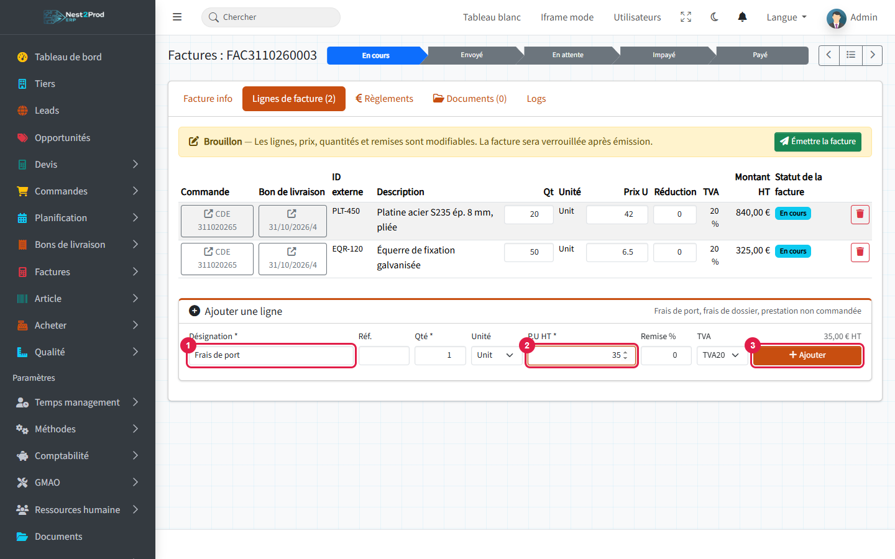

"Invoice info" tab: check the customer, the address, the contact and the **due
date**, then "Update".

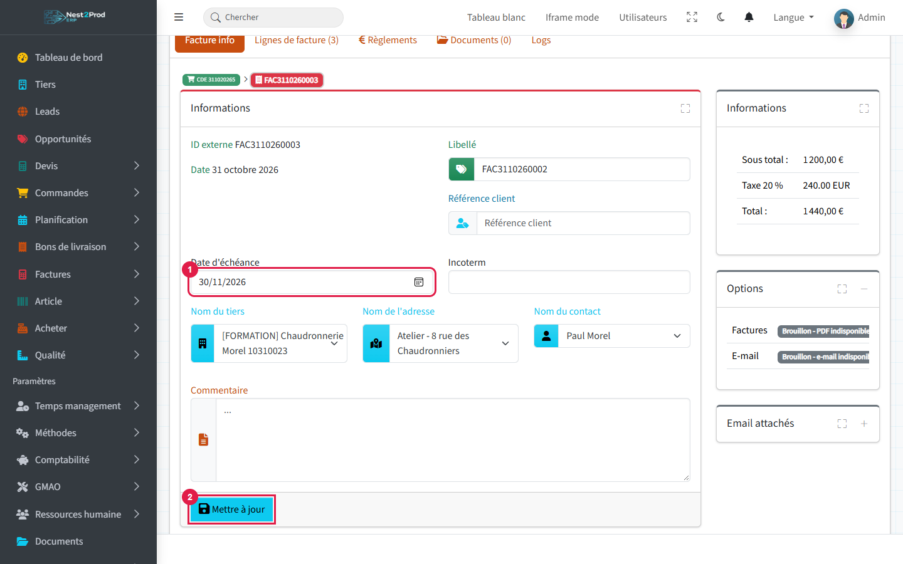

The due date is computed when the invoice is created, from the **payment terms of the
order**: first the months, then the days, then the end of month if the terms say so.
Example: "30 days end of month" for an invoice dated 31 October gives 30 November. An order
without payment terms uses the default terms; without any terms at all, the due date is
30 days.

> ⚠️ The invoice **number** is given to the invoice as soon as it is created, even as a draft.
> Make all your corrections **before** issuing it.
>
> 💡 An invoice grouping several orders uses the payment terms of the first one.

---

## 5. Issue the invoice

"Invoice lines" tab: click **"Émettre la facture" (Issue the invoice)** and confirm. The invoice
moves to the **Send** status: its lines are locked, and the **PDF** and
**E-mail** buttons appear in the Options card.

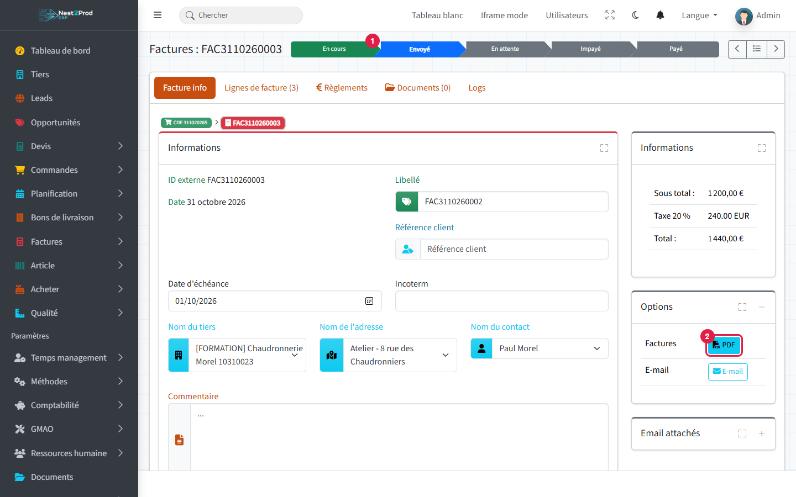

The **Factur-X** version (the PDF that holds the structured data of the electronic
invoice) is downloaded from the invoice list, with the yellow button.

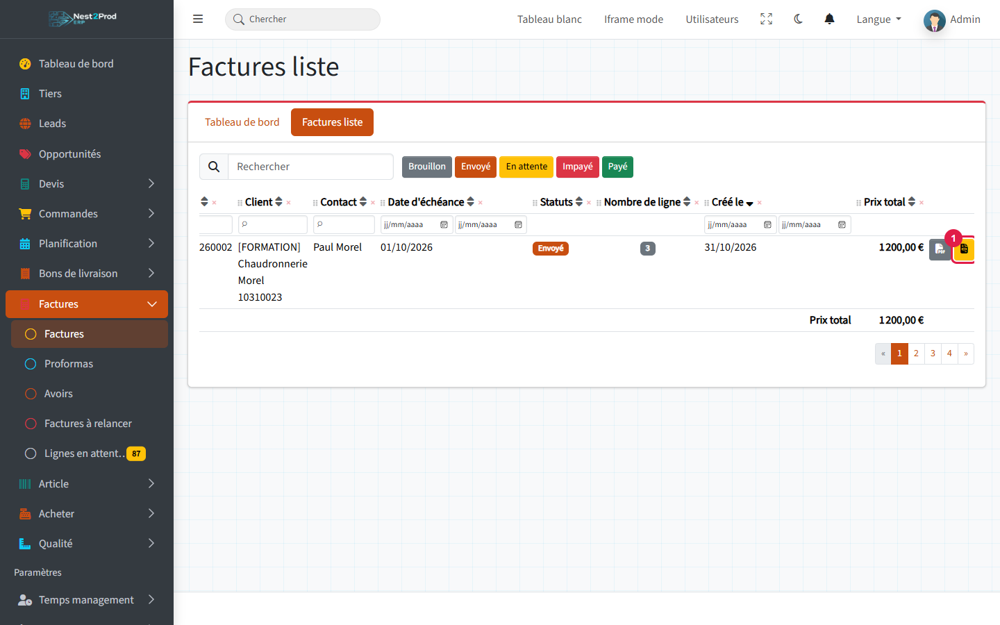

> ⚠️ The steps in the banner at the top of the invoice (In Progress, Send, Paid…) **change the
> status immediately, without confirmation**. Do not use them to issue or settle
> an invoice: use "Émettre la facture" (Issue the invoice) and the "Règlements" (Payments) tab.
>
> 💡 If the Factur-X shows an error, some identification information is missing
> (SIREN, VAT number, address) on your company or on the customer: the message lists
> what is missing.

**Send the invoice**: the **E-mail** button in the Options card prepares a message to the
invoice contact, with the PDF attached.

---

## 6. Record payments

"Règlements" (Payments) tab: enter each payment received.

1. **"Montant" (Amount)**: the amount still due is suggested; a partial payment is accepted.
2. **"Méthode" (Method)**: bank transfer, cheque… (it decides the bank/cash account).
3. **"Référence" (Reference)**: transfer or cheque number.
4. Click "Enregistrer" (Save).

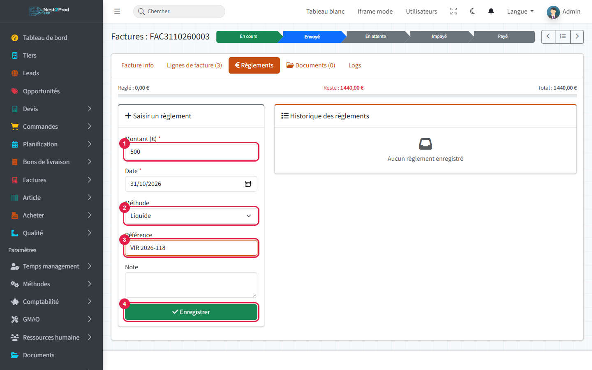

The banner shows what has been paid and the **amount still due**. A first partial payment moves
the invoice to **Pending**.

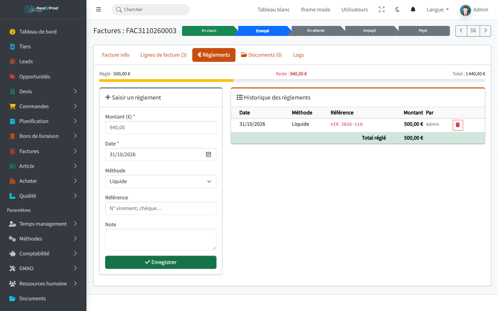

When the amount due drops to zero, the invoice moves to **Paid** and the tab shows **"Soldée" (Settled)**.

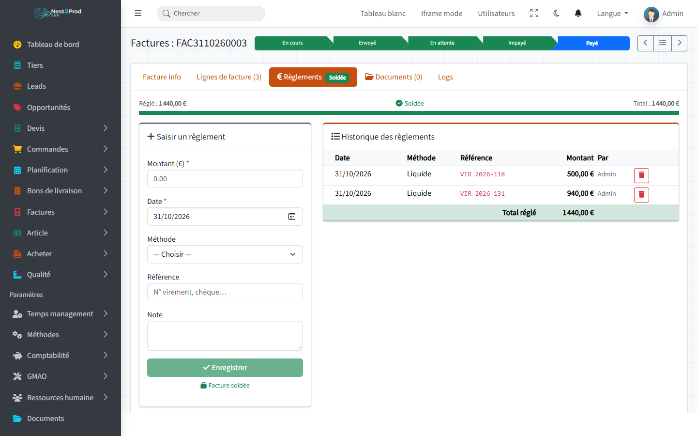

> ⚠️ Only record a payment on an **issued** invoice: the software accepts it on
> a draft, but the invoice would change status without having been issued.
>
> 💡 Each payment creates its cash receipt entry (ENCAIS journal).

---

## 7. Chase unpaid invoices

Menu **Invoices › Invoices to chase**: the invoices that are **issued, overdue and not fully paid**,
grouped by customer. **Nothing is sent automatically**: each reminder starts from your
decision.

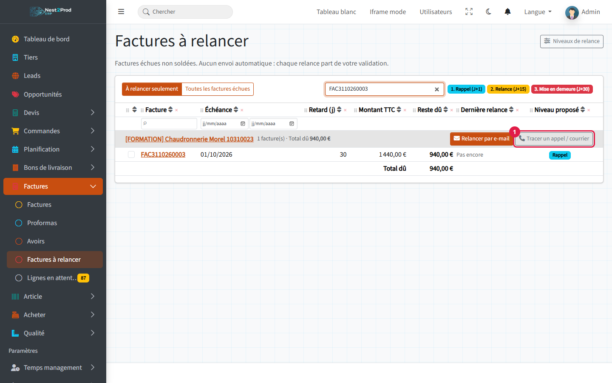

The **suggested level** follows how late the invoice is, without ever skipping a step:

| Level | Time after the due date |
|---|---|
| "Rappel" (Reminder) | D+1 |
| "Relance" (Follow-up) | D+15 |
| "Mise en demeure" (Formal notice) | D+30 |

Two ways to chase a customer:

- **Send a reminder e-mail**: one message per customer, with the PDF of each late invoice;
- **Log a call / letter**: to keep a record of a call or a letter, without
  e-mail. Choose the **Channel**, write down what was said (promise to pay…), then
  "Save the reminder".

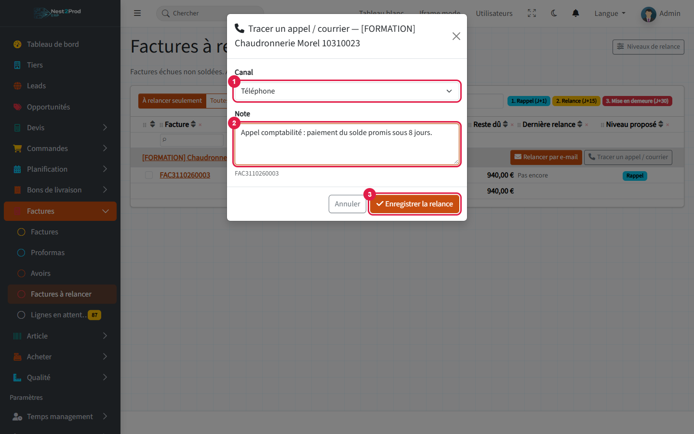

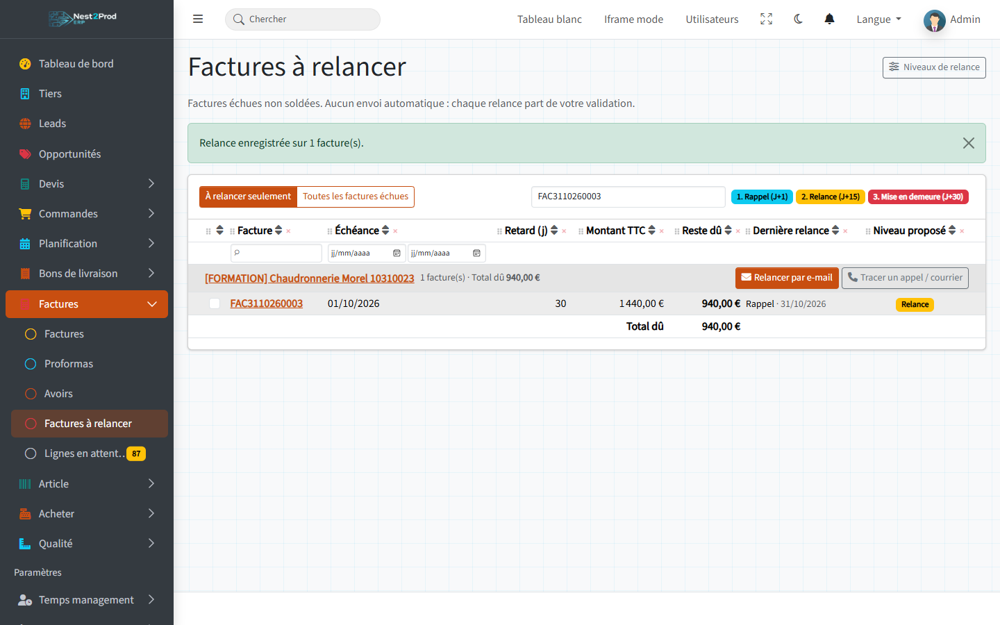

Each reminder raises the invoice level and is shown in the **Reminders** card
of the invoice.

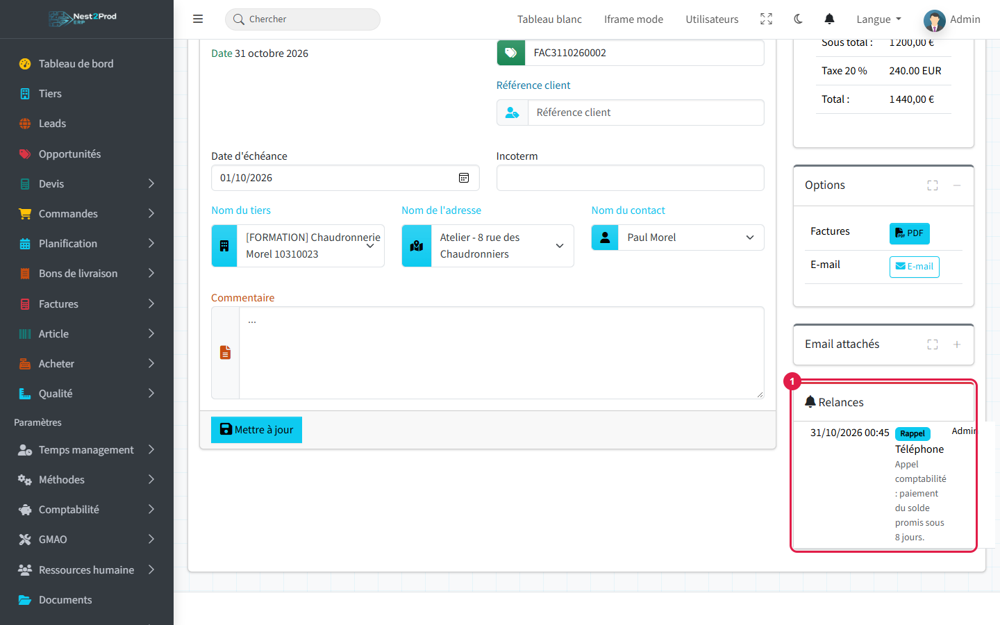

> 💡 The texts of the reminder e-mails are set in "Reminder levels" (button at the
> top right). A logged reminder cannot be deleted.

---

## 8. Make a credit note

A credit note cancels all or part of an **issued** invoice (return, goodwill gesture, mistake).
"Invoice lines" tab: tick the lines concerned, then **New credit note**.

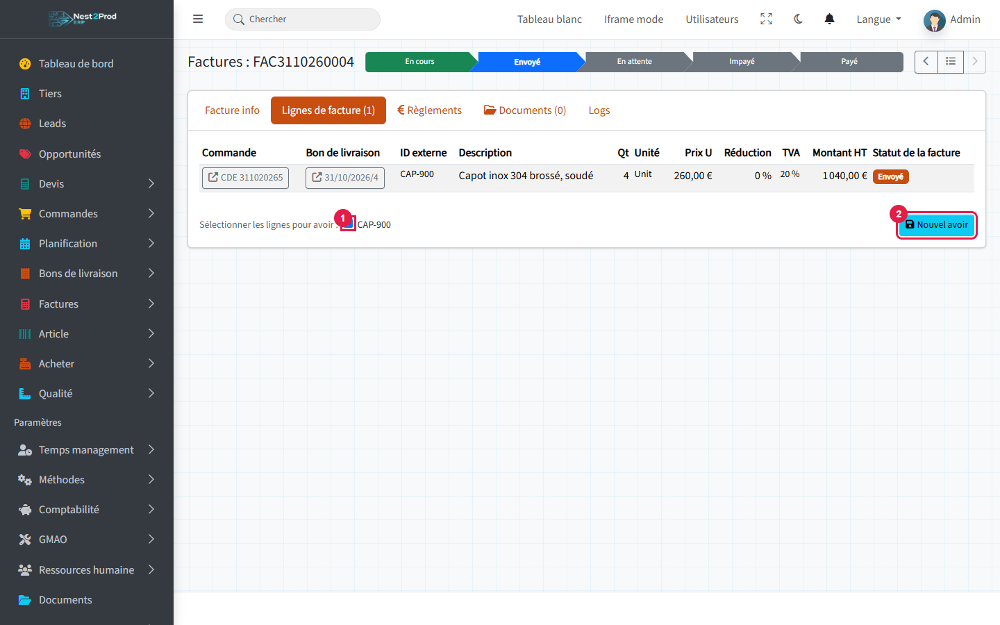

The credit note opens with the **Pending** status. Set it to **Approved** once validated, or to
**Rejected** if it must not count. Its PDF is in the Options card.

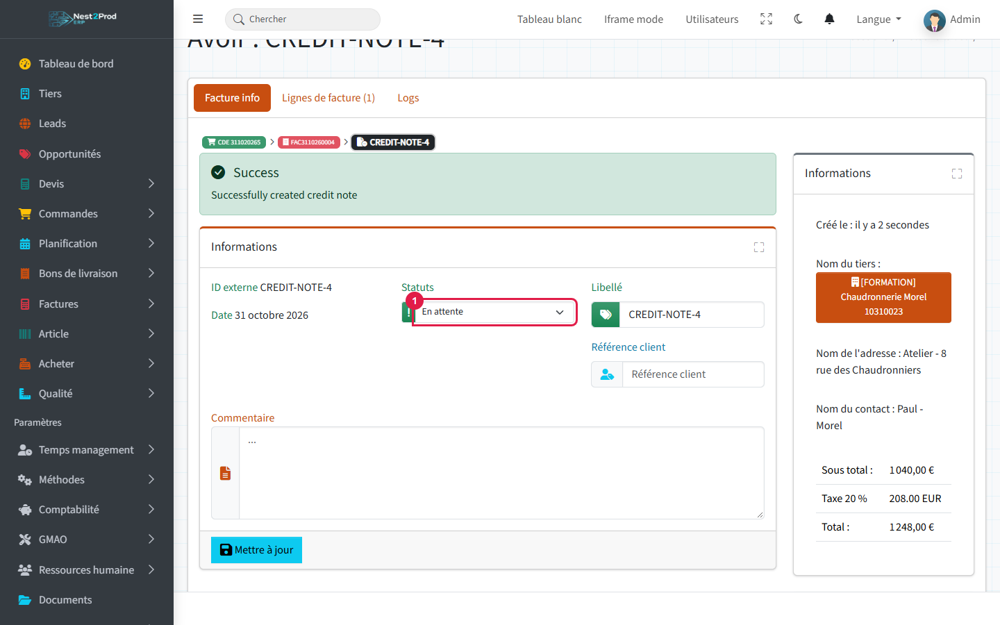

> ⚠️ A ticked line is taken **for its whole quantity**. A credit note cannot be deleted:
> check your selection before clicking.
>
> ⚠️ The order lines concerned become "to be invoiced" again: keep this in mind if you
> invoice them again later.
>
> 💡 A "Pending" or "Approved" credit note is deducted from the amount due on the invoice in
> the reminders and the customer outstanding; a "Rejected" credit note is not.

---

## 9. Follow the customer outstanding

Company page, **Dashboard** tab, **Customer outstanding** card: what the customer owes you
(invoices not fully paid) and what they have ordered but not yet been invoiced for.

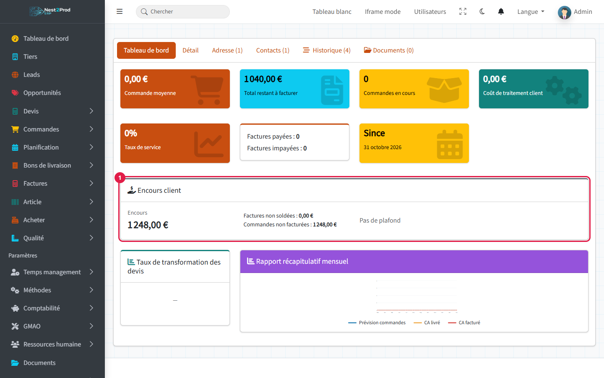

> 💡 In the "Detail" tab of the company page, a **credit limit** can trigger a warning or
> block new orders and delivery notes above a set amount. Invoicing itself is
> never blocked by the credit limit.

---

## 10. Pass on to your accountant

Menu **Your company › Imports/Exports**, **Export FEC** tab (FEC: French accounting entries file):

1. Tick the **journals**: sales (VENT), purchases (ACHAT) and cash receipts (ENCAIS,
   unticked by default).
2. Choose the **period**, then "Submit": the entries to export are shown.
3. Tick the entries, then **CSV**, **XLS** or **PDF**.

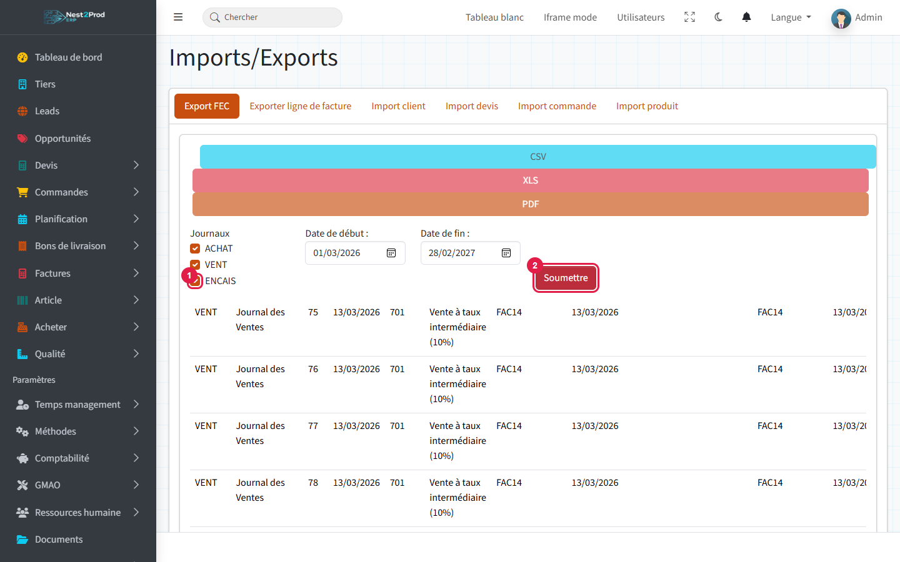

> ⚠️ The export is **final**: exported entries leave the list and cannot be
> exported again. Make only one export per period and keep the file.
>
> 💡 The "Invoice lines export" tab produces the list of invoiced lines, for
> a spreadsheet or another software.

---

## Electronic invoicing

Menu **Your company › "Intégrations" (Integrations)**, **"Facturation électronique (PDP)" (Electronic invoicing (PDP))** card:
the e-invoicing platform (PDP) used to send the invoices, and its status.

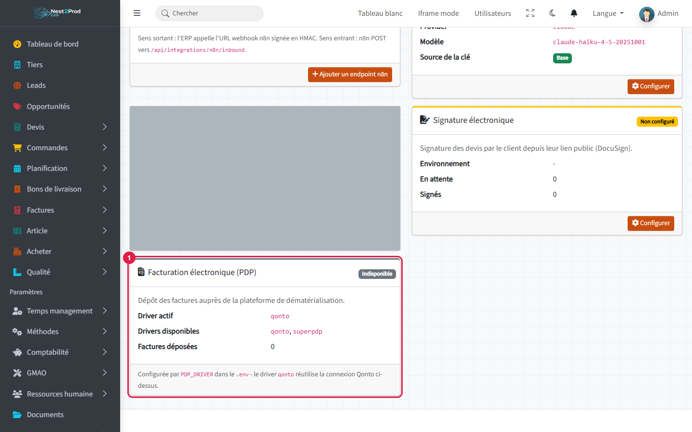

When a platform is set up, each invoice shows a **"Facturation
électronique" (Electronic invoicing)** card with its status (filed, received, accepted, paid…) and a filing button.

> ⚠️ An invoice number filed on the platform is **used up**, even if the invoice
> is rejected: a rejected invoice is corrected with a new invoice, not with a
> new filing.

## What next?

- Set up **payment terms**, accounts and journals: "Accounting — setup and link with the
  accountant" guide.
- Handle a **customer return** or a non-conformity after delivery: "Quality —
  non-conformities and inspection" guide.

## Frequently asked questions

**The delivery note or the invoice is refused: "End-of-manufacturing file not validated".**
The line named in the message requires a file that is not validated yet. Have it validated
by an authorised person (step 1), or lift the requirement if it does not apply.

**I do not see the "File" menu on the order.**
You need the permission to validate the end-of-manufacturing file (Admin role by default).

**I see neither "PDF" nor "E-mail".**
The invoice is still a draft: issue it (step 5).

**My invoice does not appear in the reminders.**
It is not overdue, not issued, or already fully paid.

**The due date is not the one I expected.**
It follows the payment terms of the order (information tab of the order). Correct it if
needed in the "Invoice info" tab while the invoice is still a draft.

**"The code has already been taken" when creating the invoice.**
The number suggested in "External ID" is already used: enter the next number and try again.

**The Factur-X or the e-mail is refused.**
The SIREN, the VAT number or the address of your company or of the customer is missing.

**I want to invoice without a delivery note.**
From the order, tick the lines and click "New invoice": a delivery note is created
automatically. Do not do this if a delivery note already exists for these lines.

**What is a proforma?**
A document asking for payment before delivery (menu Invoices › Proformas). It is
not an invoice: once converted, it becomes a draft invoice with its own number.
