**Goal**: turn a draft invoice into an issued invoice, follow its payment until it is
fully paid, chase it if needed, and pass the entries on to your accountant.

> 💡 Screenshots show the French interface; button names are given as they appear in the English interface.

**Starting point**: a **draft** invoice, created from a delivery note (see the
"From prospect to invoice" guide).

## Before you start

- You need the **Invoices** permission. Sending reminders also needs its own
  permission (Admin role by default), and the accounting export needs access to the **Your company** menu.
- For the electronic invoice (Factur-X) and for sending by e-mail: the **SIREN**, the
  **VAT number** and the **address** of your company (Your company › Factory settings) and
  of the customer must be filled in.
- The **Payment Methods** and the **Accounting allocations** (Accounting menu)
  decide which accounts the entries go to.

## Overview

```steps
Draft
Issue
Send
Payments
Reminders
Accounting export
```

---

## 1. Check the draft

A draft invoice (status **In Progress**) can still be fully changed: quantities, prices
and discounts are corrected directly in the "Invoice lines" tab.

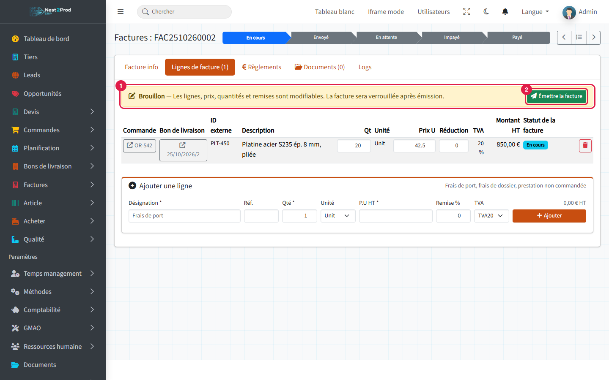

1. The banner reminds you that the invoice is a **draft** ("Brouillon").
2. The **"Émettre la facture" (Issue the invoice)** button locks it (step 2).

To invoice something that was not ordered (shipping costs, handling fees), fill in
"Ajouter une ligne" (Add a line): **"Désignation" (Description)**, **"Qté" (Qty)**, **"P.U HT" (Unit price excl. VAT)**, then "Ajouter" (Add).

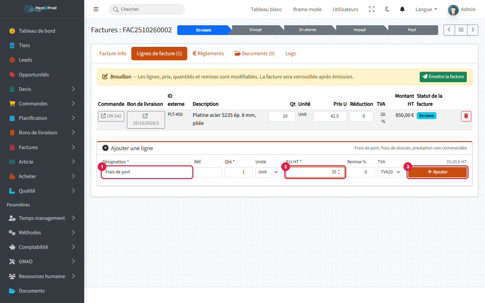

"Invoice info" tab: check the customer, the address, the contact and the **due
date** (30 days by default), then "Update".

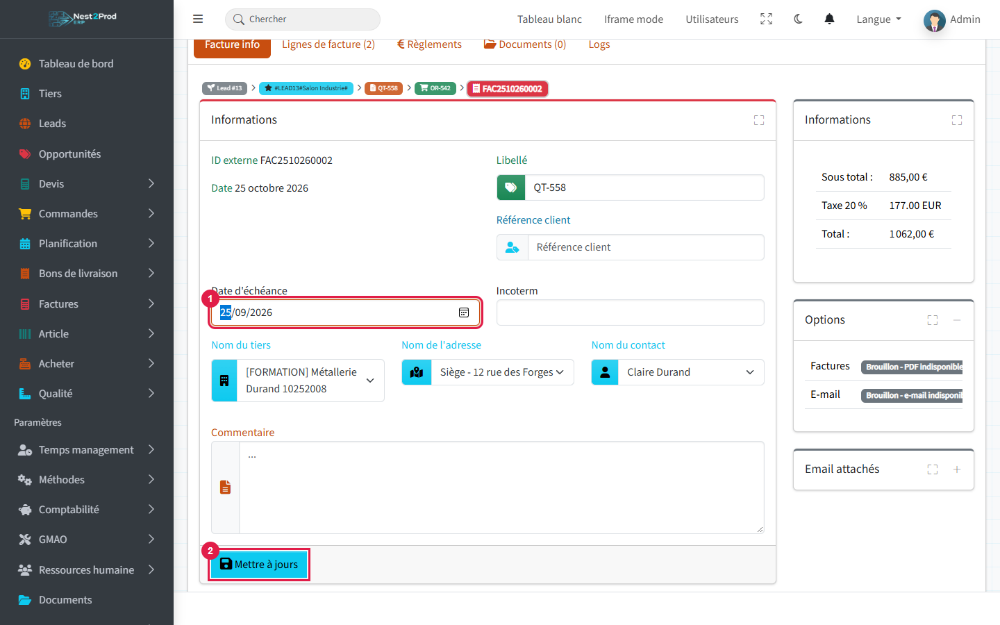

> ⚠️ The invoice **number** is given to the invoice as soon as it is created, even as a draft.
> Make all your corrections **before** issuing it.

---

## 2. Issue the invoice

"Invoice lines" tab: click **"Émettre la facture" (Issue the invoice)** and confirm. The invoice
moves to the **Send** status: its lines are locked, and the **PDF** and
**E-mail** buttons appear in the Options card.

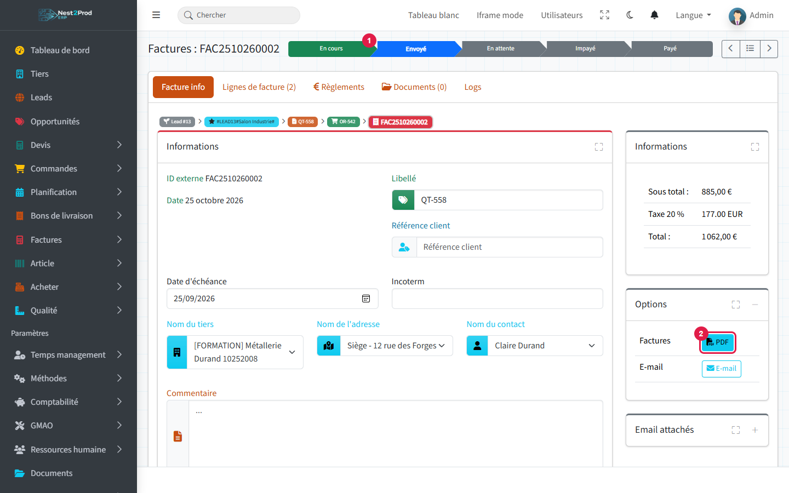

The **Factur-X** version (the PDF that holds the structured data of the electronic
invoice) is downloaded from the invoice list, with the yellow button.

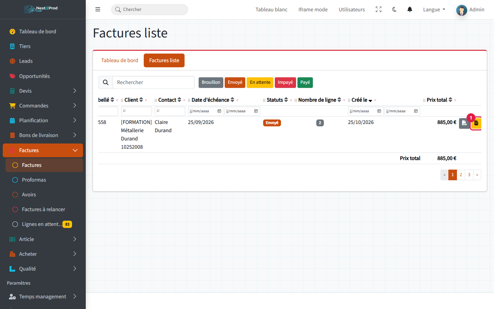

> ⚠️ The steps in the banner at the top of the invoice (In Progress, Send, Paid…) **change the
> status immediately, without confirmation**. Do not use them to issue or settle
> an invoice: use "Émettre la facture" (Issue the invoice) and the "Règlements" (Payments) tab.
>
> 💡 If the Factur-X shows an error, some identification information is missing
> (SIREN, VAT number, address) on your company or on the customer: the message lists
> what is missing.

**Send the invoice**: the **E-mail** button in the Options card prepares a message to the
invoice contact, with the PDF attached.

---

## 3. Record payments

"Règlements" (Payments) tab: enter each payment received.

1. **"Montant" (Amount)**: the amount still due is suggested; a partial payment is accepted.
2. **"Méthode" (Method)**: bank transfer, cheque… (it decides the bank/cash account).
3. **"Référence" (Reference)**: transfer or cheque number.
4. Click "Enregistrer" (Save).

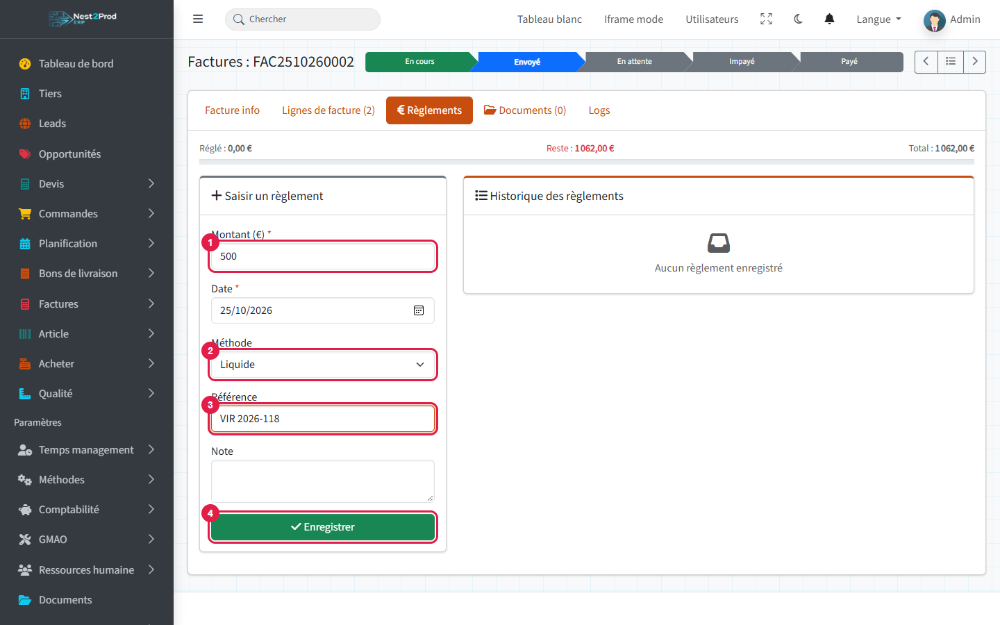

The banner shows what has been paid and the **amount still due**. A first partial payment moves
the invoice to **Pending**.

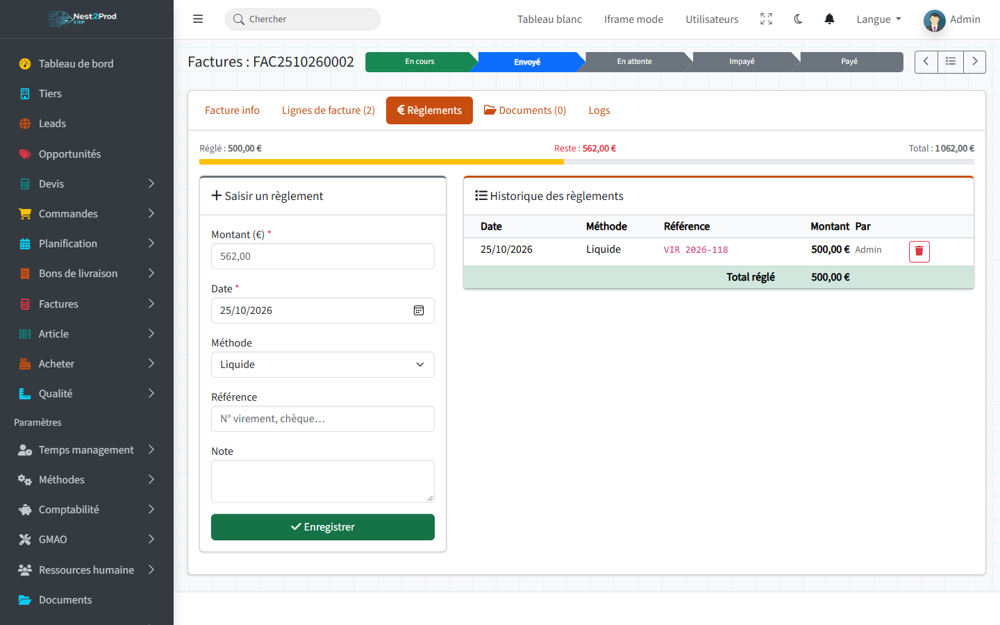

When the amount due drops to zero, the invoice moves to **Paid** and the tab shows **"Soldée" (Settled)**.

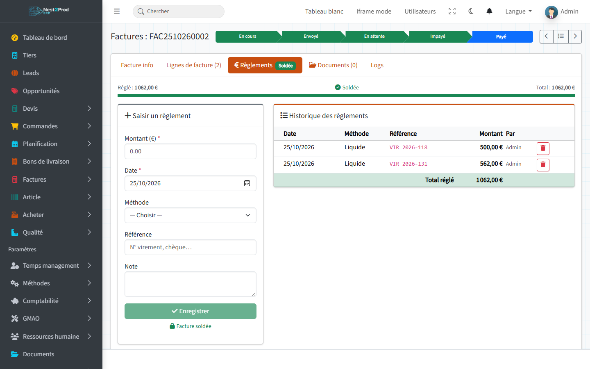

> ⚠️ Only record a payment on an **issued** invoice: the software accepts it on
> a draft, but the invoice would change status without having been issued.
>
> 💡 Each payment creates its cash receipt entry (ENCAIS journal).

---

## 4. Chase unpaid invoices

Menu **Invoices › Invoices to chase**: the invoices that are **issued, overdue and not fully paid**,
grouped by customer. **Nothing is sent automatically**: each reminder starts from your
decision.

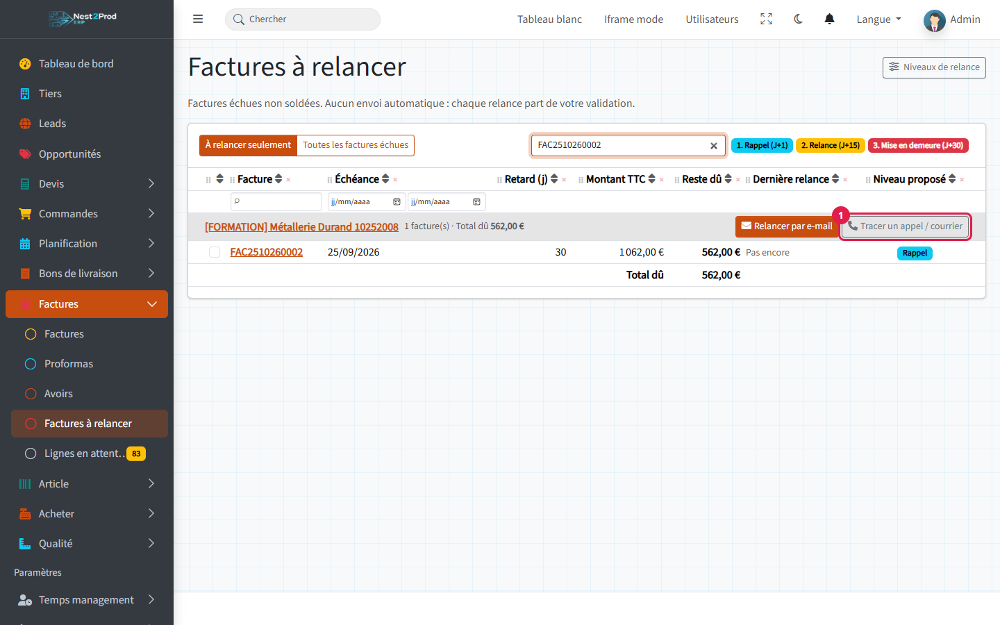

The **suggested level** follows how late the invoice is, without ever skipping a step:

| Level | Time after the due date |
|---|---|
| "Rappel" (Reminder) | D+1 |
| "Relance" (Follow-up) | D+15 |
| "Mise en demeure" (Formal notice) | D+30 |

Two ways to chase a customer:

- **Send a reminder e-mail**: one message per customer, with the PDF of each late invoice;
- **Log a call / letter**: to keep a record of a call or a letter, without
  e-mail. Choose the **Channel**, write down what was said (promise to pay…), then
  "Save the reminder".

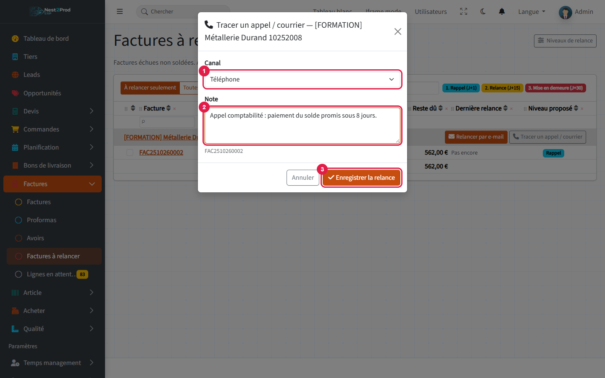

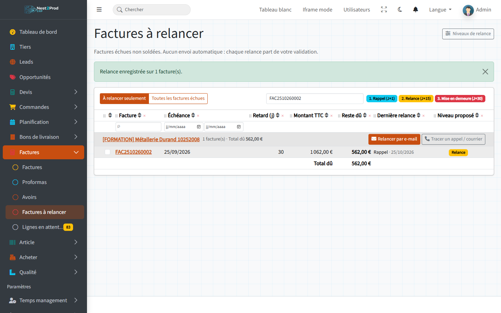

Each reminder raises the invoice level and is shown in the **Reminders** card
of the invoice.

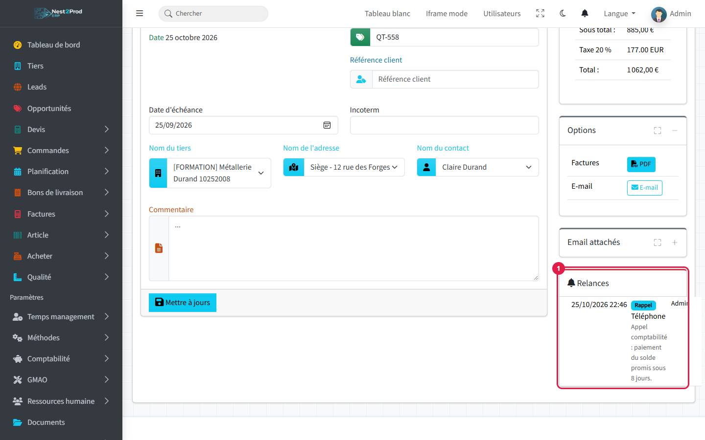

> 💡 The texts of the reminder e-mails are set in "Reminder levels" (button at the
> top right). A logged reminder cannot be deleted.

---

## 5. Make a credit note

A credit note cancels all or part of an **issued** invoice (return, goodwill gesture, mistake).
"Invoice lines" tab: tick the lines concerned, then **New credit note**.

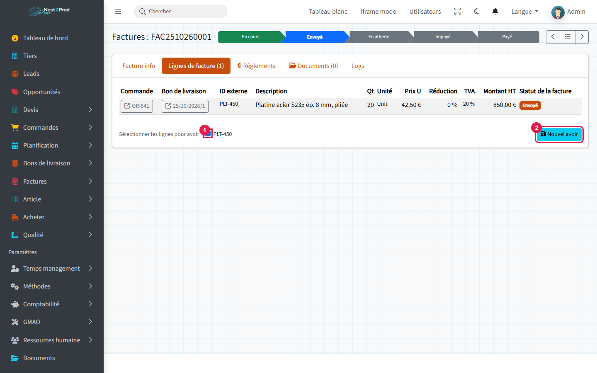

The credit note opens with the **Pending** status. Set it to **Approved** once validated, or to
**Rejected** if it must not count. Its PDF is in the Options card.

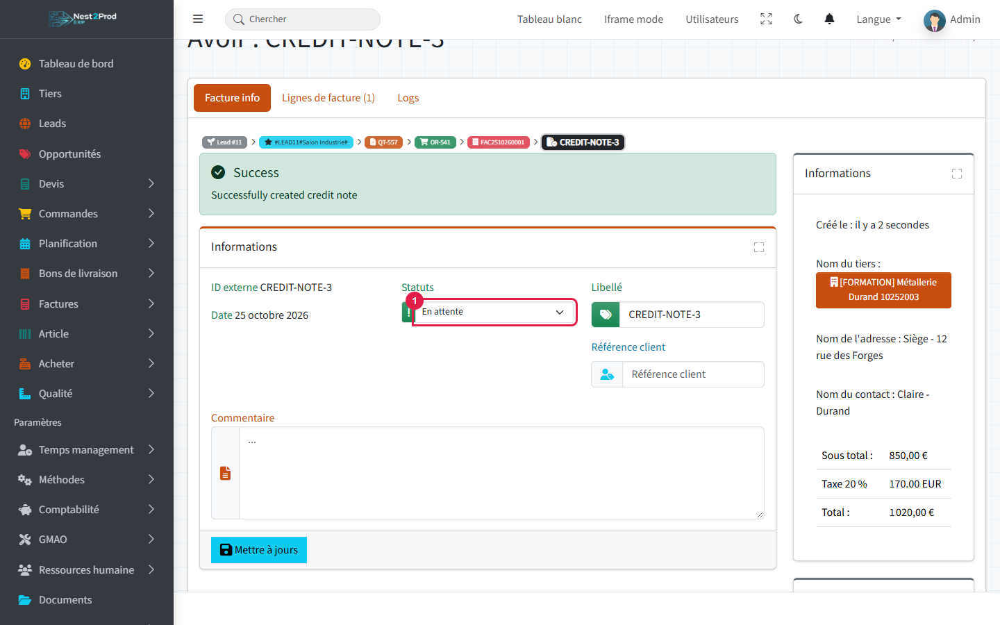

> ⚠️ A ticked line is taken **for its whole quantity**. A credit note cannot be deleted:
> check your selection before clicking.
>
> ⚠️ The order lines concerned become "to be invoiced" again: keep this in mind if you
> invoice them again later.
>
> 💡 A "Pending" or "Approved" credit note is deducted from the amount due on the invoice in
> the reminders and the customer outstanding; a "Rejected" credit note is not.

---

## 6. Follow the customer outstanding

Company page, **Dashboard** tab, **Customer outstanding** card: what the customer owes you
(invoices not fully paid) and what they have ordered but not yet been invoiced for.

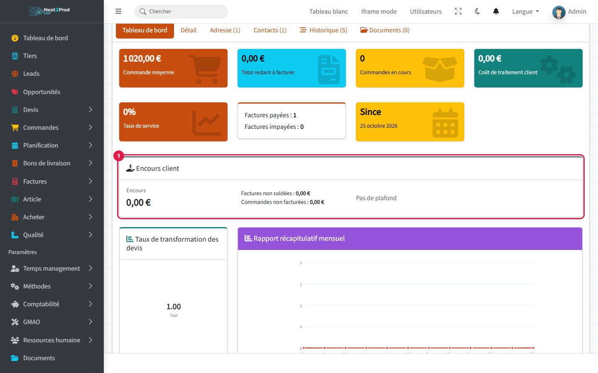

> 💡 In the "Detail" tab of the company page, a **credit limit** can trigger a warning or
> block new orders and delivery notes above a set amount. Invoicing itself is
> never blocked.

---

## 7. Pass on to your accountant

Menu **Your company › Imports/Exports**, **Export FEC** tab (FEC: French accounting entries file):

1. Tick the **journals**: sales (VENT), purchases (ACHAT) and cash receipts (ENCAIS,
   unticked by default).
2. Choose the **period**, then "Submit": the entries to export are shown.
3. Tick the entries, then **CSV**, **XLS** or **PDF**.

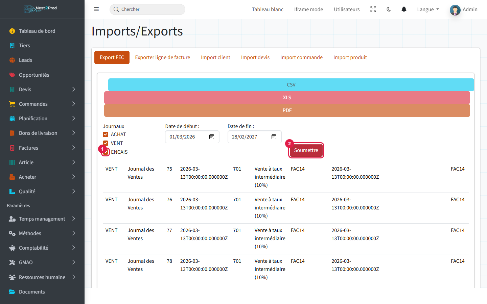

> ⚠️ The export is **final**: exported entries leave the list and cannot be
> exported again. Make only one export per period and keep the file.
>
> 💡 The "Invoice lines export" tab produces the list of invoiced lines, for
> a spreadsheet or another software.

---

## Electronic invoicing

Menu **Your company › "Intégrations" (Integrations)**, **"Facturation électronique (PDP)" (Electronic invoicing (PDP))** card:
the e-invoicing platform (PDP) used to send the invoices, and its status.

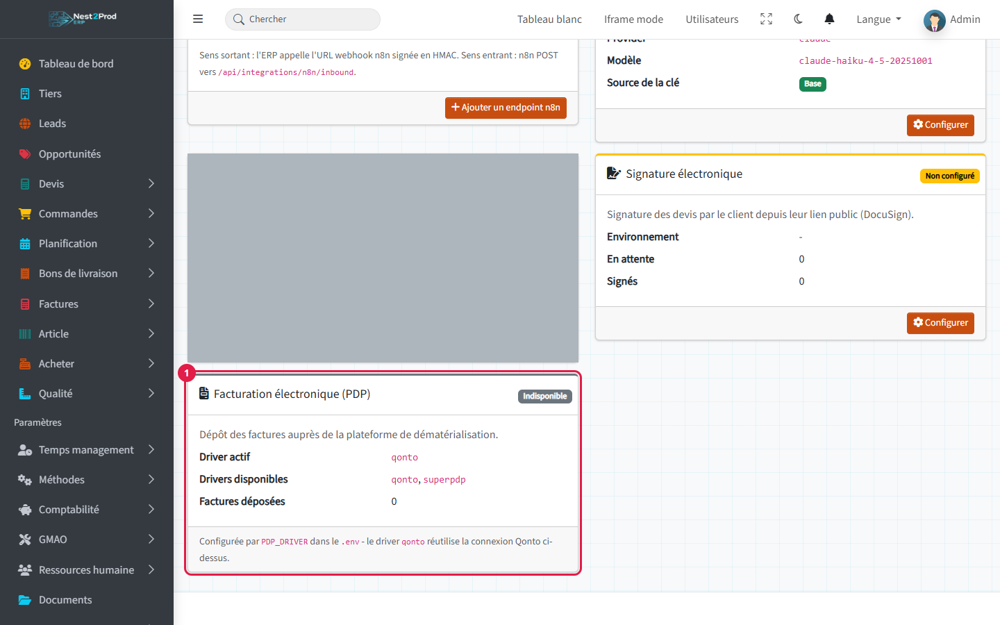

When a platform is set up, each invoice shows a **"Facturation
électronique" (Electronic invoicing)** card with its status (filed, received, accepted, paid…) and a filing button.

> ⚠️ An invoice number filed on the platform is **used up**, even if the invoice
> is rejected: a rejected invoice is corrected with a new invoice, not with a
> new filing.

## Frequently asked questions

**I see neither "PDF" nor "E-mail".**
The invoice is still a draft: issue it (step 2).

**My invoice does not appear in the reminders.**
It is not overdue, not issued, or already fully paid.

**The Factur-X or the e-mail is refused.**
The SIREN, the VAT number or the address of your company or of the customer is missing.

**I want to invoice without a delivery note.**
From the order, tick the lines and click "New invoice": a delivery note is created
automatically. Do not do this if a delivery note already exists for these lines.

**What is a proforma?**
A document asking for payment before delivery (menu Invoices › Proformas). It is
not an invoice: once converted, it becomes a draft invoice with its own number.
