**Objectif** : livrer une commande avec sa liste de colisage, la facturer, suivre le
paiement jusqu'au solde, relancer si besoin, et transmettre les écritures au comptable.

**Point de départ** : une **commande** dont les pièces sont prêtes à partir (voir le guide
« Du prospect à la facture » pour la création du devis et de la commande).

## Avant de commencer

- Il faut la permission **Factures**. L'envoi des relances demande en plus la permission
  dédiée (rôle Admin par défaut), et l'export comptable l'accès au menu **Votre entreprise**.
- Valider un **dossier de fin de fabrication** demande la permission dédiée (rôle Admin par
  défaut). Sans elle, le menu « Dossier » n'apparaît pas sur la commande.
- Pour la facture électronique (Factur-X) et l'envoi par e-mail : le **SIREN**, le
  **n° de TVA** et l'**adresse** de votre société (Votre entreprise › Réglage société) et
  du client doivent être renseignés.
- Les **conditions de paiement**, les **modes de paiement** et les **affectations
  comptables** (menu Comptabilité) déterminent l'échéance des factures et les comptes des
  écritures.

## Vue d'ensemble

```steps
Dossier validé (si exigé)
BL et colis
Facture brouillon
Émission
Règlements
Relances
Export comptable
```

---

## 1. Le dossier de fin de fabrication (si exigé)

Certaines pièces ne doivent partir qu'avec un dossier complet (relevés de contrôle,
certificats, PV) vérifié par une personne habilitée. Si votre entreprise l'a prévu, une
ligne de commande peut **exiger ce dossier** : tant qu'il n'est pas validé, la ligne ne passe
ni sur un bon de livraison, ni sur une facture.

L'exigence vient :

- soit de la **catégorie d'affaire** de la commande (menu Méthodes › Catégories d'affaire,
  case « Dossier de fin de fabrication exigé ») : elle s'applique aux lignes créées ensuite ;
- soit d'un choix **ligne par ligne**, sur la commande.

Pour exiger le dossier sur une ligne : onglet « Lignes » de la commande, cochez la ligne,
puis menu **Dossier** › **Exiger le dossier**.


1. Cochez la ligne concernée.
2. Ouvrez le menu **Dossier** (le nombre entre parenthèses indique combien de lignes
   cochées chaque action concerne).
3. Cliquez sur **Exiger le dossier**.

La ligne porte alors le badge rouge **Dossier à valider**.

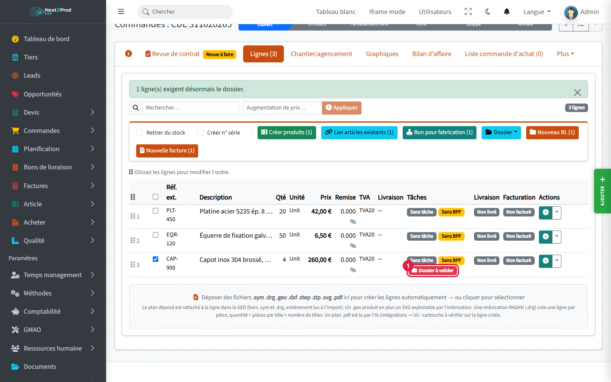

Tant que ce badge est affiché, la création du BL est refusée, avec un message qui cite la
commande et la ligne :

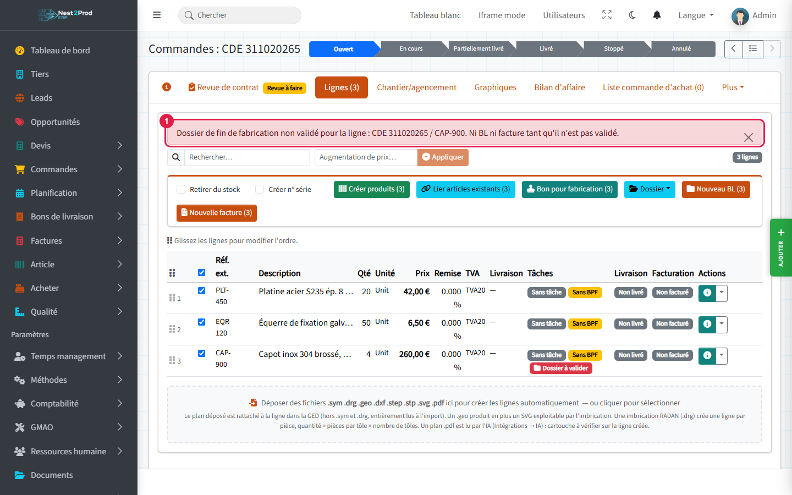

Le même badge prévient dans les écrans **Bons de livraison › Attente de bons de livraison**
et **Factures › Attente de facture**, avant que vous ne tentiez de créer le document.

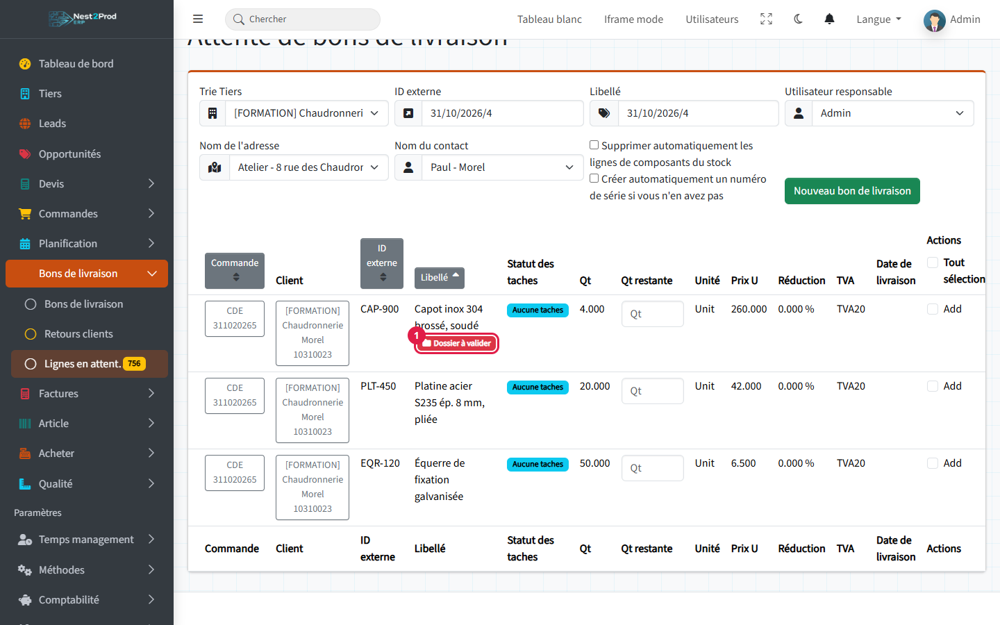

Une fois le dossier vérifié : cochez la ligne, menu **Dossier** › **Valider le dossier**.

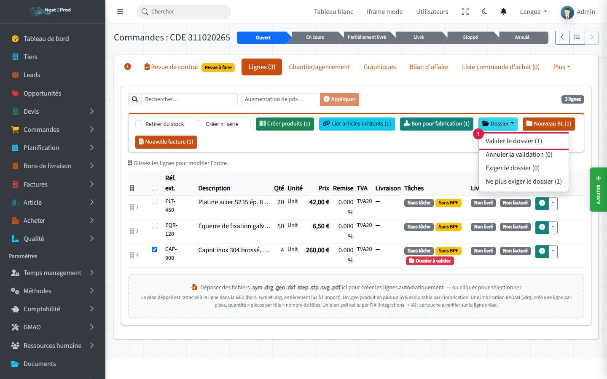

Le badge passe au vert, **Dossier validé** (la date et l'auteur de la validation
s'affichent en survolant le badge). La ligne peut être livrée et facturée.

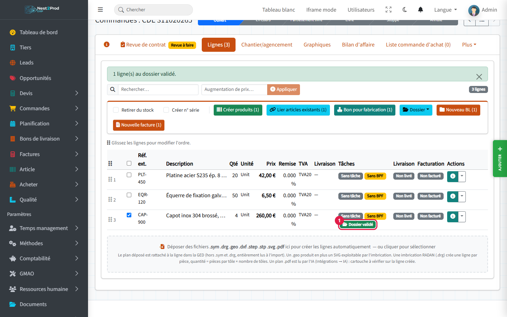

> ⚠️ Le blocage vaut pour **tous** les chemins : BL depuis la commande ou depuis l'attente
> de BL, « Nouvelle facture » directe depuis la commande, attente de facture, « Générer les
> factures en attente », conversion d'une proforma en facture. La proforma elle-même n'est
> pas bloquée (elle se paie avant fabrication).
>
> ⚠️ Une validation **ne s'annule plus** dès que la ligne est livrée ou facturée, même en
> partie. Et une ligne déjà livrée avant qu'on exige le dossier reste bloquée à la
> facturation tant qu'il n'est pas validé.
>
> 💡 « Ne plus exiger le dossier » lève l'exigence sur les lignes cochées (après
> confirmation) : elles peuvent alors être livrées et facturées sans lui.

Autre blocage possible au moment du BL : une ligne visée par une **dérogation externe**
en attente de la décision du client ne part pas tant que la dérogation n'est pas tranchée
(voir le guide « Qualité — non-conformités et contrôle »).

---

## 2. Livrer : bon de livraison et liste de colisage

Onglet « Lignes » de la commande : cochez les lignes à livrer, puis **Nouveau BL** et
confirmez. La fiche du bon de livraison s'ouvre.

Pour imprimer une **liste de colisage** (contenu de chaque colis, poids, dimensions),
saisissez d'abord les colis. Onglet **Packaging** du BL, carte **Nouveau packaging** :
référence du colis, type (palette, caisse…), poids brut et net, dimensions, puis en bas la
rubrique **Contenu** : la quantité de chaque ligne du BL rangée dans ce colis.

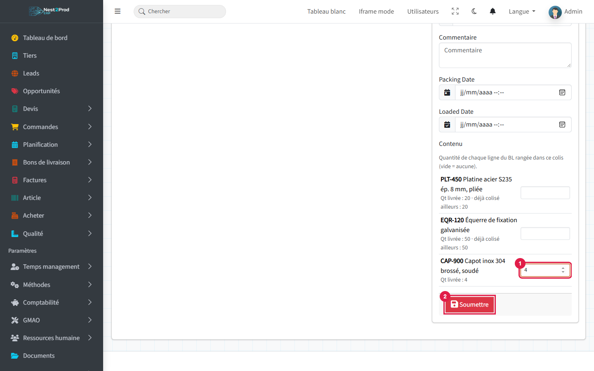

1. Quantité de la ligne dans ce colis (vide = aucune). Sous chaque ligne, le rappel « déjà
   colisé ailleurs » indique ce qui est déjà rangé dans un autre colis.
2. Cliquez sur « Soumettre ». Recommencez pour chaque colis.

Les colis s'ajoutent à la liste de l'onglet ; le bouton de chaque ligne permet de les
modifier, contenu compris.

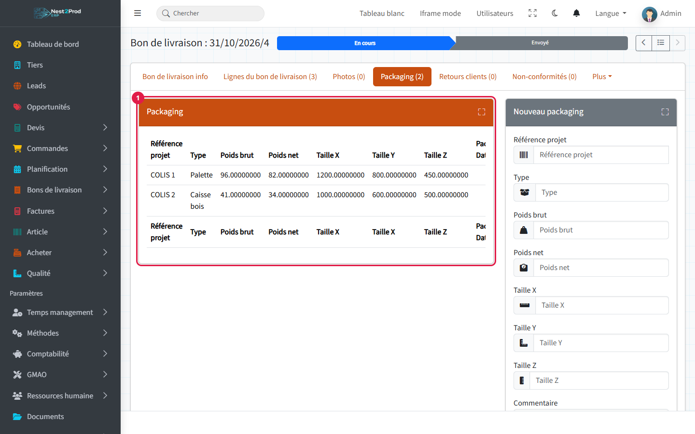

Onglet « Bon de livraison info », carte **Options** : choisissez le modèle d'impression
**Liste de colisage** (et la langue), puis **PDF**.

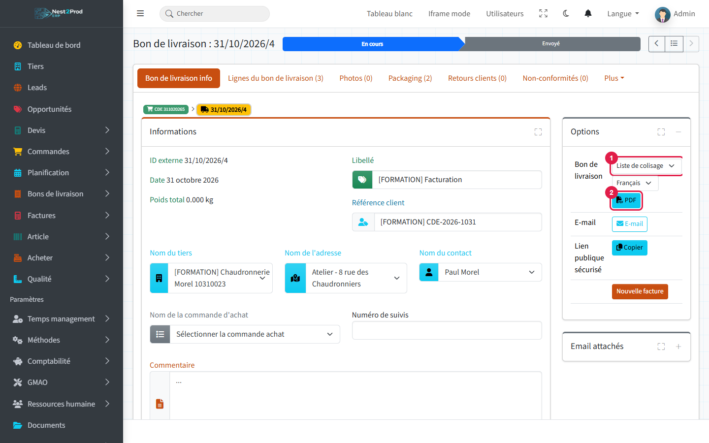

1. Modèle « Liste de colisage » (le modèle « Bon de livraison » imprime le BL habituel).
2. Bouton **PDF**.

La liste reprend, colis par colis, les dimensions, les poids et les lignes rangées, avec le
nombre de colis et les poids totaux en tête. Elle ne contient **aucun prix**.

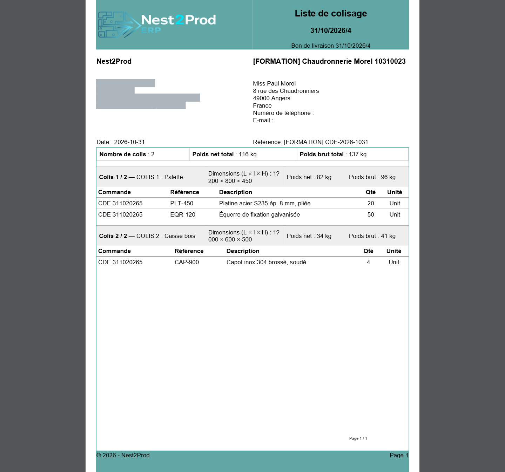

> ⚠️ Une ligne ne peut pas être colisée au-delà de sa quantité livrée, tous colis
> confondus : le colis est alors refusé avec un message.
>
> 💡 Ce qui n'est rangé dans aucun colis apparaît dans un bloc « Hors colis » de la liste.
> Les poids totaux sont ceux **saisis sur les colis**, pas le poids des articles.

---

## 3. Créer la facture

Menu **Factures › Attente de facture** : les lignes livrées qui ne sont pas encore
facturées.

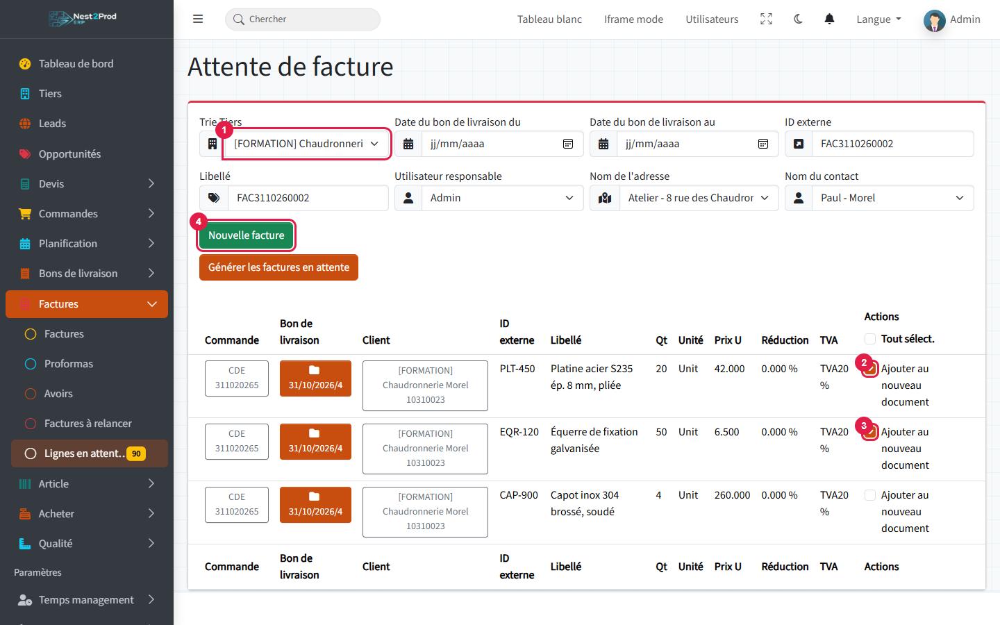

1. Choisissez le **client** : ses lignes de BL à facturer s'affichent.
2. Cochez « Ajouter au nouveau document » sur la première ligne à facturer…
3. …puis sur chacune des autres.
4. Cliquez sur **Nouvelle facture** : la facture brouillon s'ouvre.

> 💡 « Générer les factures en attente » crée en une fois les factures de toutes les
> lignes en attente du client. Le bouton « Nouvelle facture » de la fiche BL facture le BL
> entier.

---

## 4. Vérifier le brouillon

Une facture brouillon (statut **En cours**) reste entièrement modifiable : quantités, prix
et remises se corrigent directement dans l'onglet « Lignes de facture ».

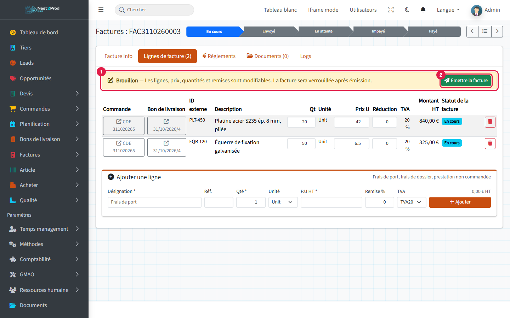

1. Le bandeau rappelle que la facture est un **brouillon**.
2. Le bouton **Émettre la facture** la verrouille (étape 5).

Pour facturer un élément non commandé (frais de port, frais de dossier), remplissez
« Ajouter une ligne » : **Désignation**, **Qté**, **P.U HT**, puis « Ajouter ».

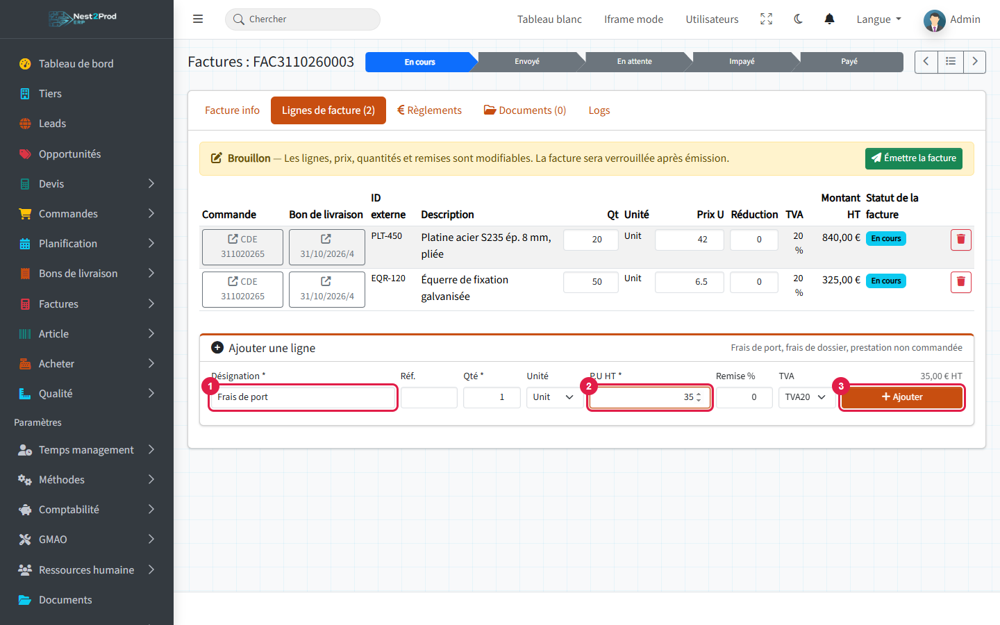

Onglet « Facture info » : vérifiez le client, l'adresse, le contact et la **date
d'échéance**, puis « Mettre à jour ».

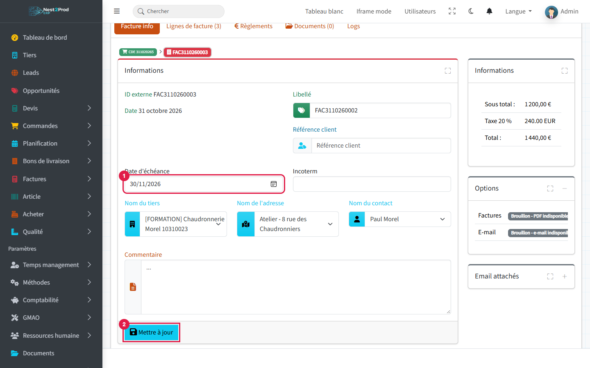

L'échéance est calculée à la création de la facture avec la **condition de paiement de la
commande** : d'abord les mois, puis les jours, puis la fin de mois si la condition le
prévoit. Exemple : « 30 jours fin de mois » pour une facture du 31 octobre donne le
30 novembre. Une commande sans condition prend la condition par défaut ; sans aucune
condition, l'échéance est à 30 jours.

> ⚠️ Le **numéro** de la facture lui est attribué dès sa création, brouillon compris.
> Faites toutes vos corrections **avant** l'émission.
>
> 💡 Une facture qui regroupe plusieurs commandes prend la condition de paiement de la
> première.

---

## 5. Émettre la facture

Onglet « Lignes de facture » : cliquez sur **Émettre la facture** et confirmez. La facture
passe au statut **Envoyé** : ses lignes sont verrouillées, et les boutons **PDF** et
**E-mail** apparaissent dans la carte Options.

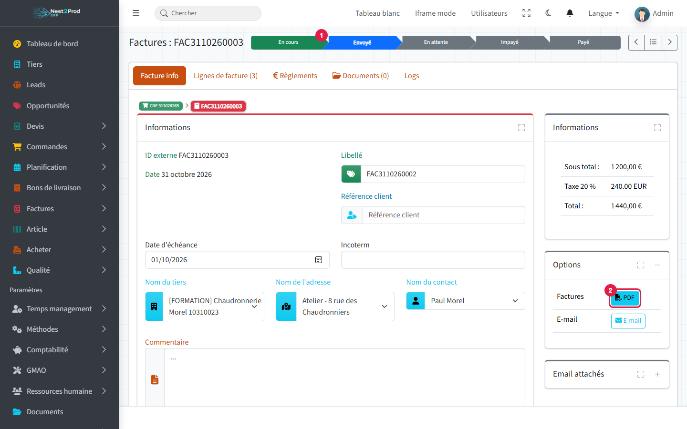

La version **Factur-X** (le PDF qui contient les données structurées de la facture
électronique) se télécharge depuis la liste des factures, avec le bouton jaune.

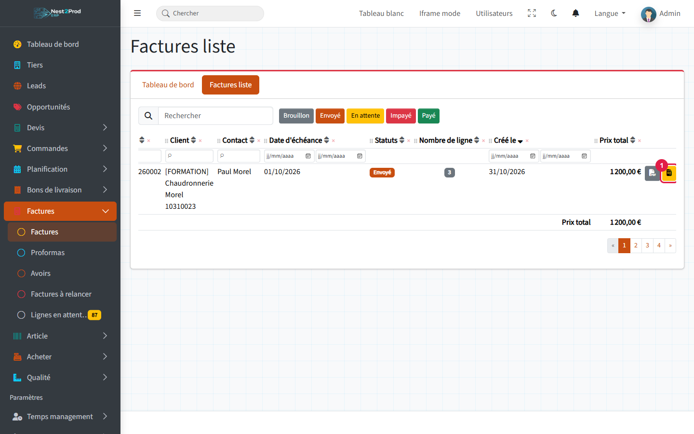

> ⚠️ Les étapes du bandeau en haut de la fiche (En cours, Envoyé, Payé…) **changent le
> statut immédiatement, sans confirmation**. Ne vous en servez pas pour émettre ou solder
> une facture : utilisez « Émettre la facture » et l'onglet « Règlements ».
>
> 💡 Si le Factur-X affiche une erreur, il manque une information d'identification
> (SIREN, n° de TVA, adresse) sur votre société ou sur le client : le message liste
> ce qui manque.

**Envoyer la facture** : le bouton **E-mail** de la carte Options prépare un message au
contact de la facture, avec le PDF joint.

---

## 6. Enregistrer les règlements

Onglet « Règlements » : saisissez chaque paiement reçu.

1. **Montant** : le reste dû est proposé ; un paiement partiel est accepté.
2. **Méthode** : virement, chèque… (elle détermine le compte de trésorerie).
3. **Référence** : n° de virement ou de chèque.
4. Cliquez sur « Enregistrer ».

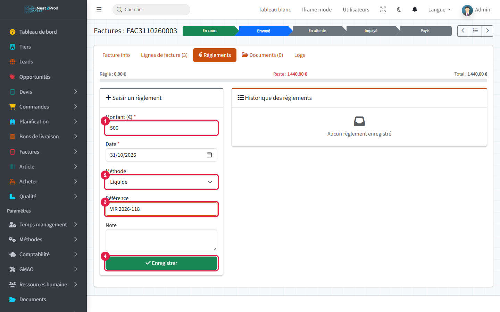

Le bandeau affiche ce qui est réglé et le **reste dû**. Un premier règlement partiel fait
passer la facture à **En attente**.

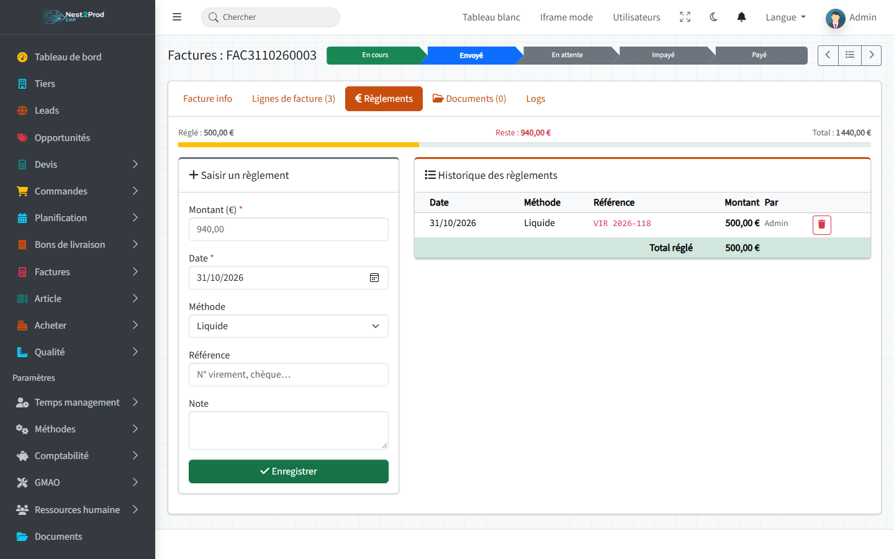

Quand le reste dû tombe à zéro, la facture passe à **Payé** et l'onglet affiche **Soldée**.

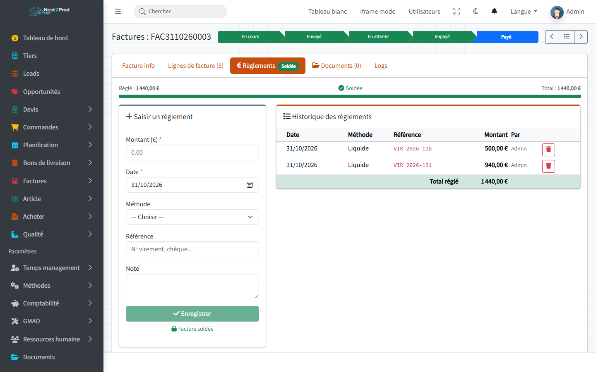

> ⚠️ N'enregistrez un règlement que sur une facture **émise** : le logiciel l'accepte sur
> un brouillon, mais la facture changerait de statut sans avoir été émise.
>
> 💡 Chaque règlement génère son écriture d'encaissement (journal ENCAIS).

---

## 7. Relancer les impayés

Menu **Factures › Factures à relancer** : les factures **émises, échues et non soldées**,
regroupées par client. **Rien n'est envoyé automatiquement** : chaque relance part de votre
décision.

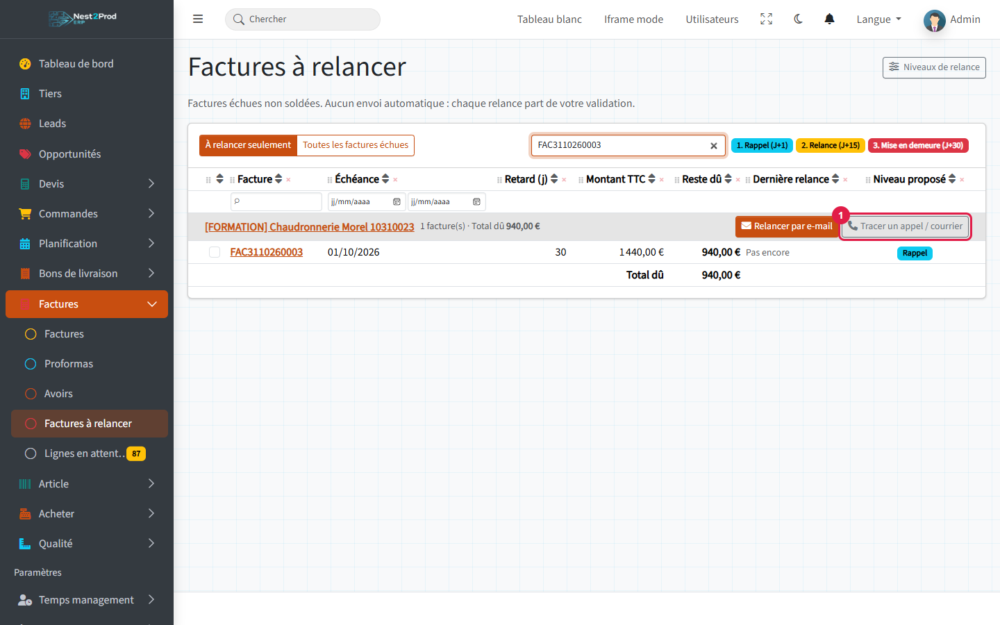

Le **niveau proposé** suit le retard, sans jamais sauter d'étape :

| Niveau | Délai après l'échéance |
|---|---|
| Rappel | J+1 |
| Relance | J+15 |
| Mise en demeure | J+30 |

Deux façons de relancer un client :

- **Relancer par e-mail** : un message par client, avec le PDF de chaque facture en retard ;
- **Tracer un appel / courrier** : pour garder la trace d'un appel ou d'une lettre, sans
  e-mail. Choisissez le **canal**, notez ce qui a été dit (promesse de paiement…), puis
  « Enregistrer la relance ».

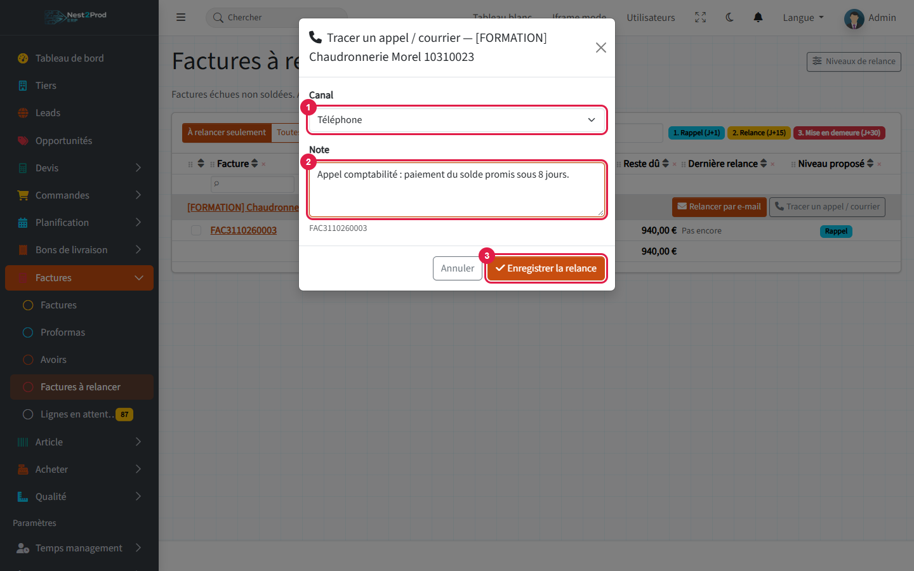

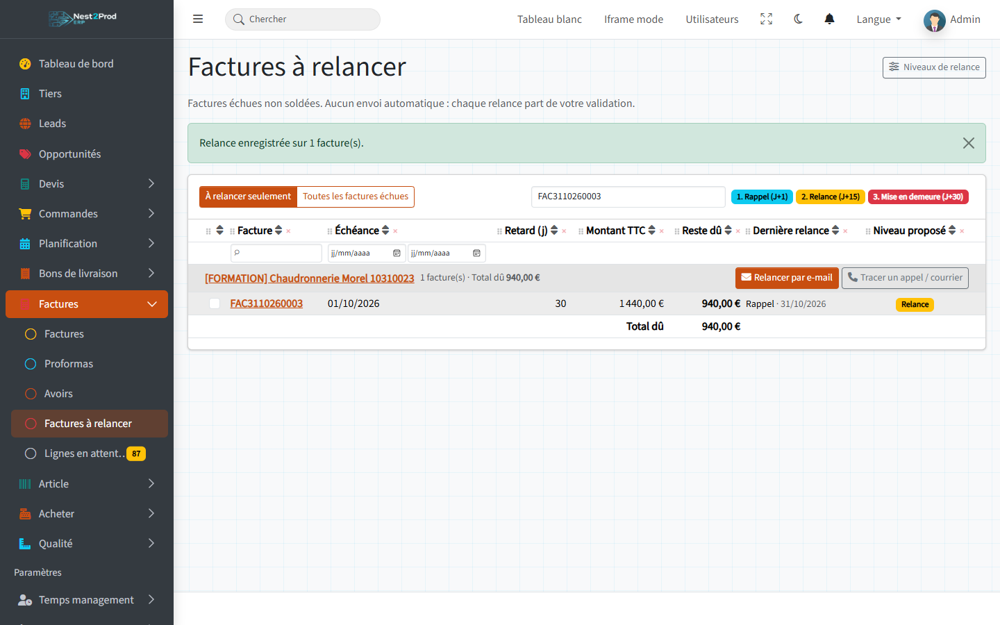

Chaque relance fait monter le niveau de la facture et s'affiche dans la carte **Relances**
de sa fiche.

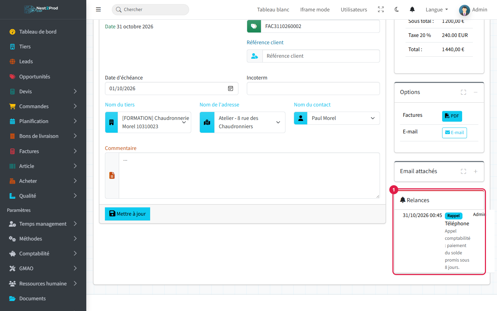

> 💡 Les textes des e-mails de relance se règlent dans « Niveaux de relance » (bouton en
> haut à droite). Une relance tracée ne se supprime pas.

---

## 8. Faire un avoir

Un avoir annule tout ou partie d'une facture **émise** (retour, geste commercial, erreur).
Onglet « Lignes de facture » : cochez les lignes concernées, puis **Nouvel avoir**.

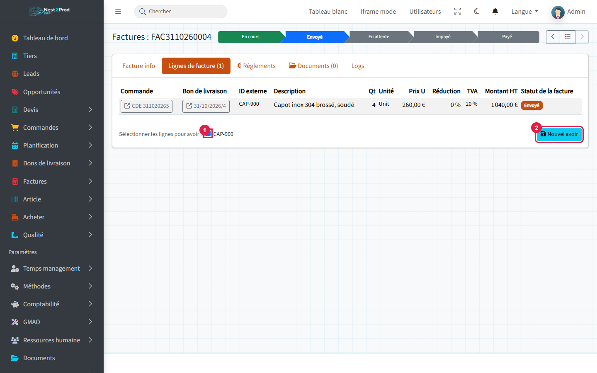

L'avoir s'ouvre au statut **En attente**. Passez-le à **Approuvée** une fois validé, ou à
**Refusée** s'il ne doit pas compter. Son PDF se trouve dans la carte Options.

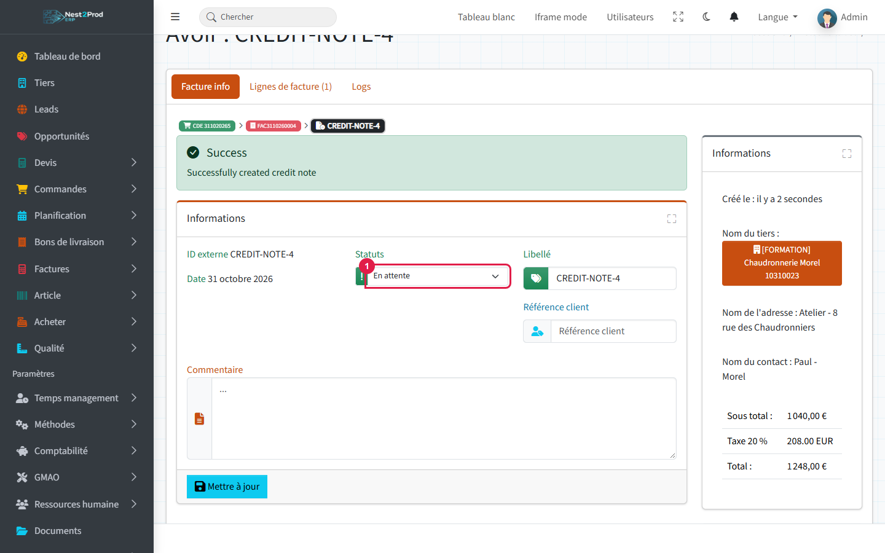

> ⚠️ Une ligne cochée est reprise **pour sa quantité entière**. Un avoir ne se supprime
> pas : vérifiez la sélection avant de cliquer.
>
> ⚠️ Les lignes de commande concernées redeviennent « à facturer » : pensez-y si vous
> refacturez ensuite.
>
> 💡 Un avoir « En attente » ou « Approuvée » est déduit du reste dû de la facture dans
> les relances et l'encours client ; un avoir « Refusée » ne l'est pas.

---

## 9. Suivre l'encours client

Fiche société, onglet **Tableau de bord**, carte **Encours client** : ce que le client vous
doit (factures non soldées) et ce qu'il a commandé sans être encore facturé.

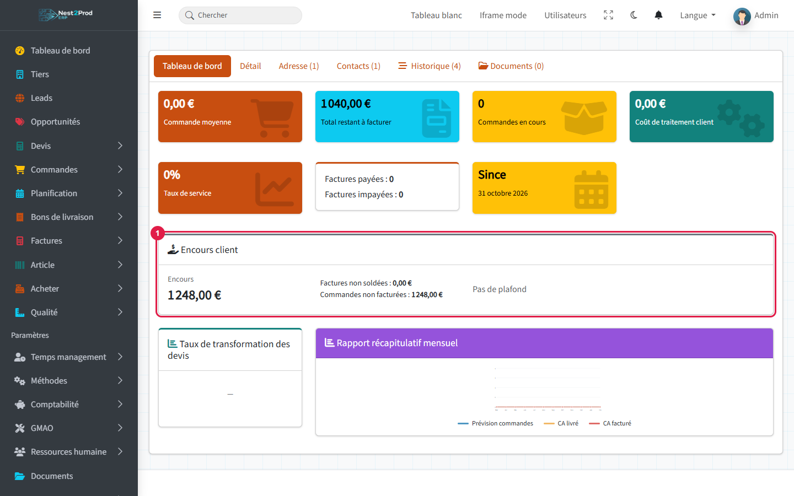

> 💡 Onglet « Détail » de la fiche, un **plafond d'encours** peut déclencher une alerte ou
> bloquer les nouvelles commandes et BL au-delà d'un montant. La facturation, elle, n'est
> jamais bloquée par le plafond.

---

## 10. Transmettre au comptable

Menu **Votre entreprise › Imports/Exports**, onglet **Export FEC** :

1. Cochez les **journaux** : ventes (VENT), achats (ACHAT) et encaissements (ENCAIS,
   décoché par défaut).
2. Choisissez la **période**, puis « Soumettre » : les écritures à exporter s'affichent.
3. Cochez les écritures, puis **CSV**, **XLS** ou **PDF**.

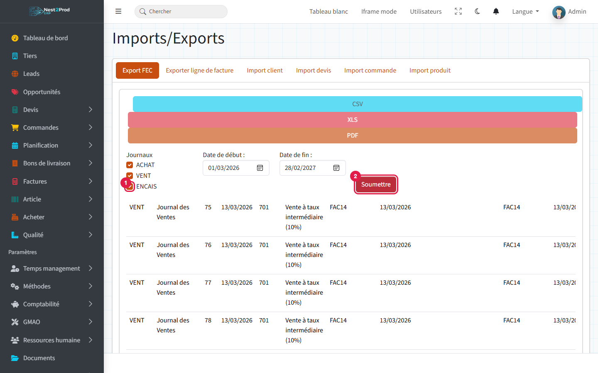

> ⚠️ L'export est **définitif** : les écritures exportées sortent de la liste et ne se
> réexportent pas. Faites un seul export par période et conservez le fichier.
>
> 💡 L'onglet « Exporter ligne de facture » produit la liste des lignes facturées, pour
> un tableur ou un autre logiciel.

---

## La facturation électronique

Menu **Votre entreprise › Intégrations**, carte **Facturation électronique (PDP)** :
la plateforme utilisée pour transmettre les factures et son état.

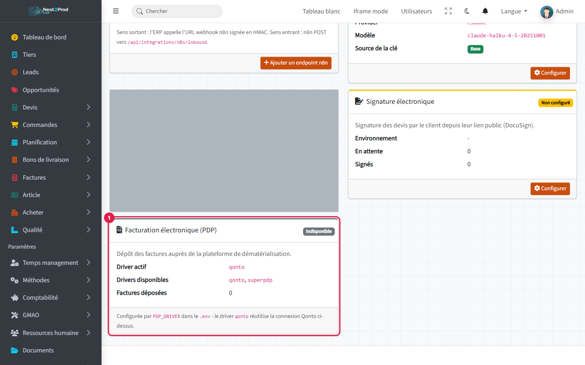

Quand une plateforme est configurée, chaque facture affiche une carte **Facturation
électronique** avec son statut (déposée, reçue, acceptée, payée…) et un bouton de dépôt.

> ⚠️ Un numéro de facture déposé sur la plateforme est **consommé**, même si la facture
> est rejetée : une facture rejetée se corrige par une nouvelle facture, pas par un
> nouveau dépôt.

## Et ensuite ?

- Régler les **conditions de paiement**, les comptes et les journaux : guide
  « Comptabilité — paramétrage et lien avec l'expert-comptable ».
- Traiter un **retour client** ou une non-conformité après livraison : guide « Qualité —
  non-conformités et contrôle ».

## Questions fréquentes

**Le BL ou la facture est refusé : « Dossier de fin de fabrication non validé ».**
La ligne citée exige un dossier qui n'est pas encore validé. Faites-le valider par une
personne habilitée (étape 1), ou levez l'exigence si elle n'a pas lieu d'être.

**Je ne vois pas le menu « Dossier » sur la commande.**
Il faut la permission de valider le dossier de fin de fabrication (rôle Admin par défaut).

**Je ne vois ni « PDF » ni « E-mail ».**
La facture est encore un brouillon : émettez-la (étape 5).

**Ma facture n'apparaît pas dans les relances.**
Elle n'est pas échue, pas émise, ou déjà soldée.

**L'échéance n'est pas celle que j'attendais.**
Elle suit la condition de paiement de la commande (onglet d'information de la commande).
Corrigez-la si besoin dans l'onglet « Facture info » tant que la facture est un brouillon.

**« Le champ code a déjà été pris » en créant la facture.**
Le numéro proposé dans « ID externe » est déjà utilisé : saisissez le numéro suivant et
recommencez.

**Le Factur-X ou l'e-mail est refusé.**
Il manque le SIREN, le n° de TVA ou l'adresse de votre société ou du client.

**Je veux facturer sans bon de livraison.**
Depuis la commande, cochez les lignes et cliquez sur « Nouvelle facture » : un BL est créé
automatiquement. Ne le faites pas si un BL existe déjà pour ces lignes.

**Une proforma, c'est quoi ?**
Un document de demande de paiement avant livraison (menu Factures › Proformas). Elle n'est
pas une facture : convertie, elle devient une facture brouillon avec son propre numéro.
