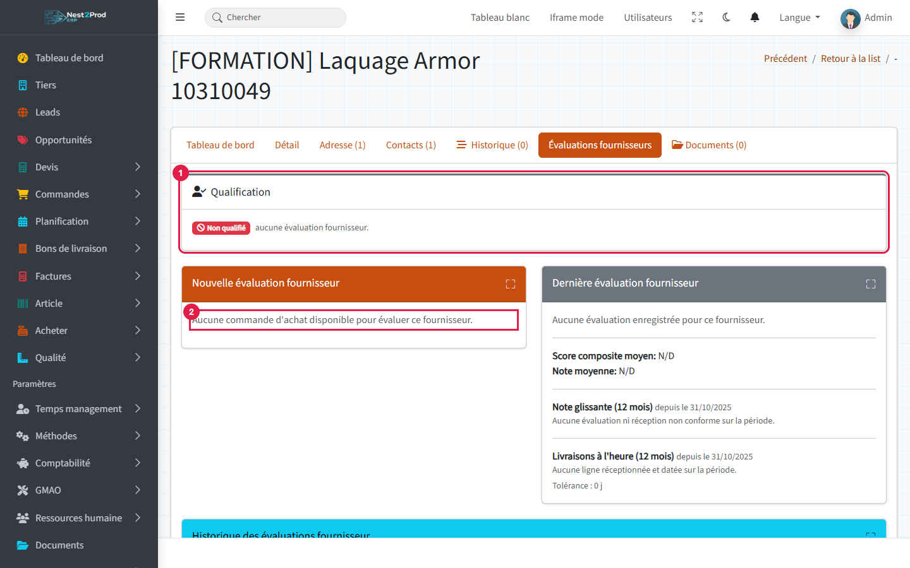
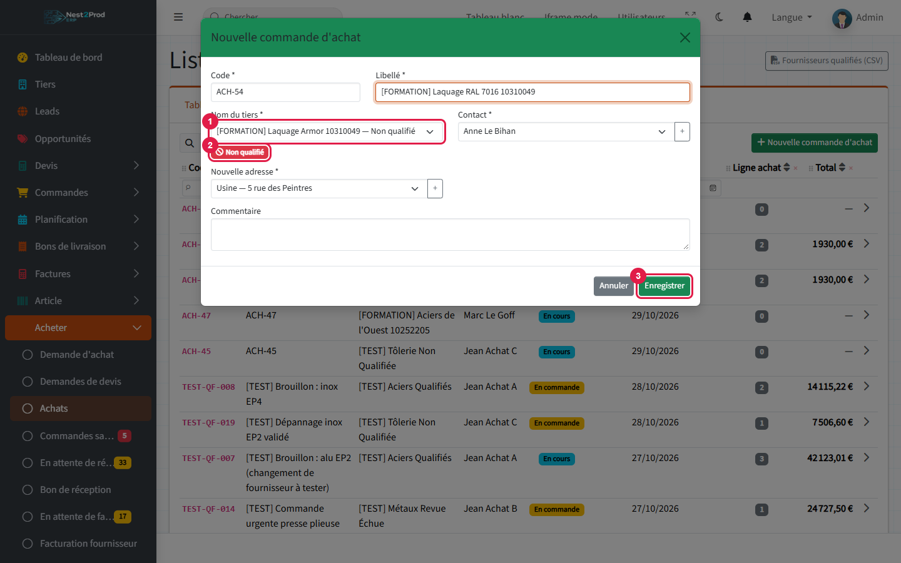
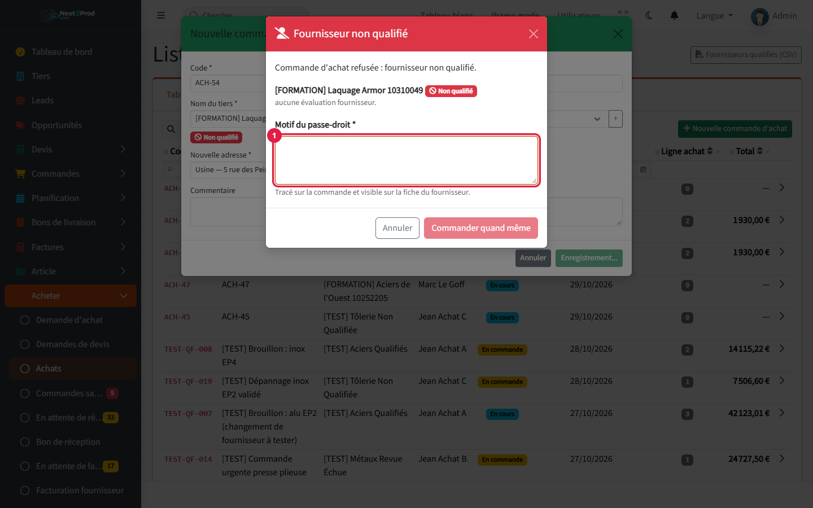
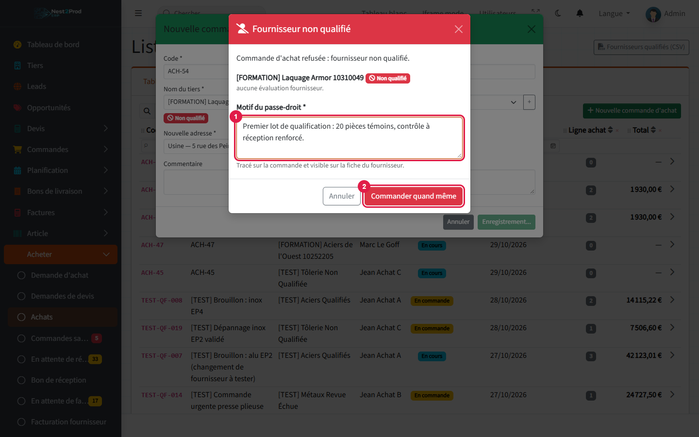
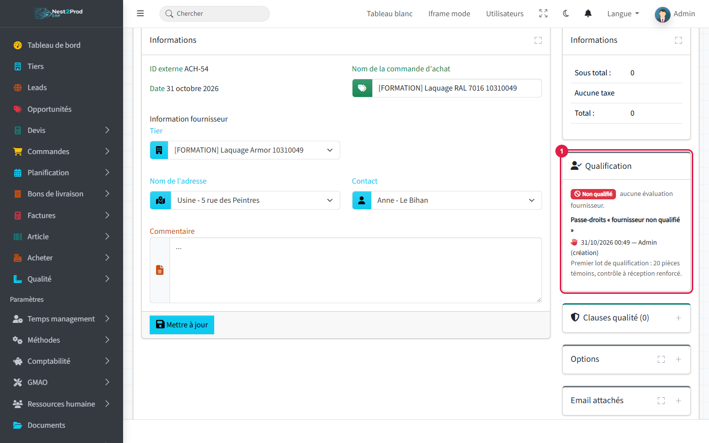
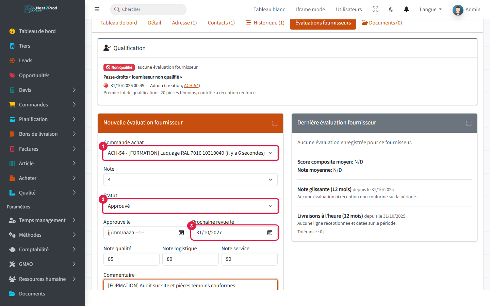
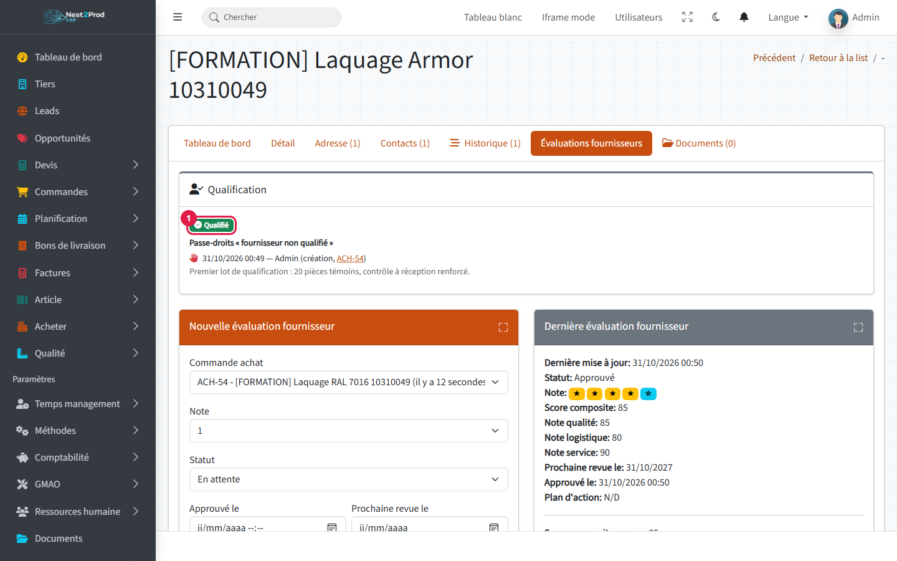
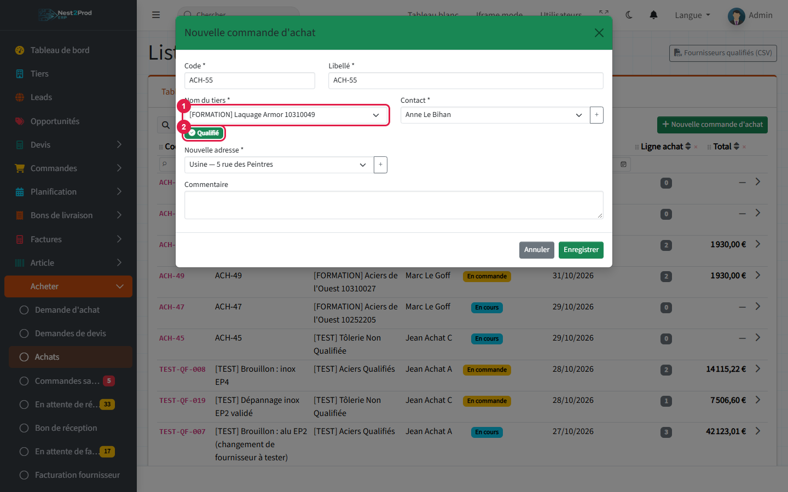
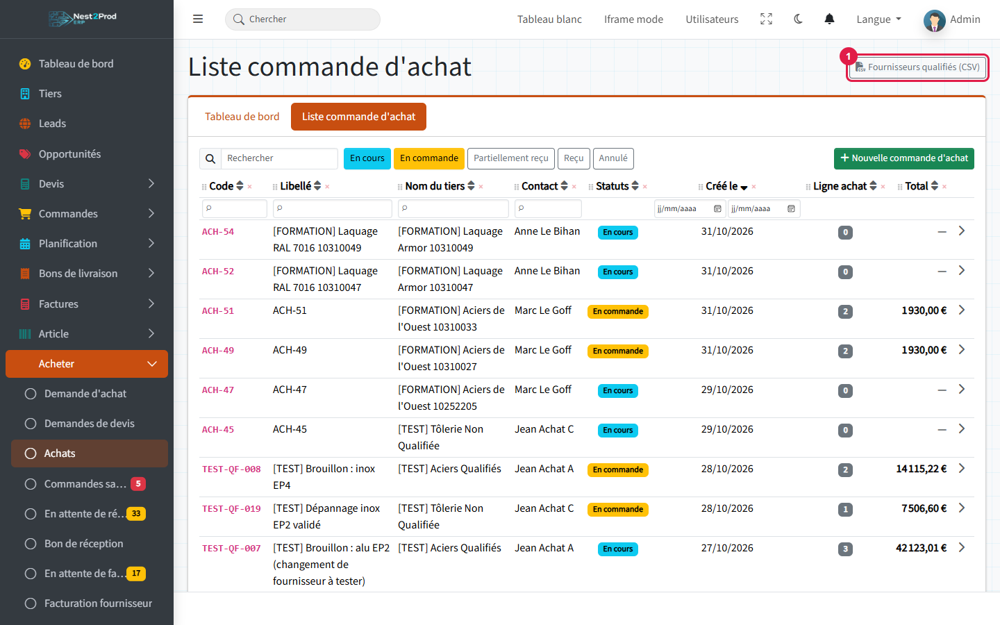

**Goal**: no purchase order goes to a supplier your quality system has not approved, except
by a reasoned and recorded decision.

> 💡 Screenshots show the French interface; button names are given as they appear in the
> English interface.

**Example used**: the sheet metal shop wants a new supplier, Laquage Armor, to powder-coat
parts in RAL 7016. It has never been evaluated: the first order is refused, goes through a
reasoned override, then the supplier is evaluated and qualified.

## Before you start

- Your company has made supplier qualification mandatory: that is why this guide is shown.
  Without this option there is no check and no badge.
- You need the **Purchase** permission ("Purchase" menu).
- Overriding a refusal requires the **"unqualified-supplier-override"** permission (Admin role
  by default, Your company → Roles and permissions).
- The supplier must have **"Status supplier" = Active** ("Detail" tab of its record): otherwise
  the evaluation tab does not appear (see the guide "From request for quotation to supplier
  invoice").

### What is a qualified supplier?

A supplier is **qualified** when its **latest supplier evaluation** ("Supplier evaluations"
tab of its record) has the status **"Approved"** and its **"Next review at"** date has not
passed (or is empty).

| Badge | Meaning |
|---|---|
| **Qualified** (green) | Latest evaluation approved, review up to date: ordering is free |
| **Not qualified** (red) | No evaluation, or latest evaluation "Pending", "Under review" or "Rejected" |
| **Review overdue** (orange) | Evaluation approved, but the next review date has passed |

> ⚠️ Only the **formal evaluation** of the supplier record counts. The stars given when a
> delivery is received (rating window after a goods receipt) do **not** count towards
> qualification.

## Overview

```steps
New supplier: not qualified
First order with an override
Approved evaluation
Supplier qualified
Free ordering until the review
```

---

## 1. A new supplier is not qualified

Open the supplier record, **"Supplier evaluations"** tab:

1. the **"Qualification"** card shows **"Not qualified"** and the reason ("no supplier
   evaluation");
2. the "New supplier evaluation" card says **"No purchase orders available to evaluate this
   supplier yet."**



> ⚠️ **An evaluation is always attached to a purchase order.** A new supplier therefore cannot
> be evaluated before its first order, and that first order is refused because the supplier is
> not qualified. **The first order always goes through an override** (step 2), given by a
> holder of the "unqualified-supplier-override" permission. The evaluation is then made on that
> order (step 4).

> 💡 A **request for quotation** is never checked: you can consult an unqualified supplier
> freely.

## 2. The order is refused: the override

Menu **Purchase → Purchases**, "Purchase list" tab, **"New purchase document"** button.

1. In **"Name of third party"**, the supplier is followed by "— Not qualified".
2. The red **"Not qualified"** badge repeats it under the list.
3. Click **"Save"**.



The **"Supplier not qualified"** window opens: the order is **not** created. It gives the
reason (here "no supplier evaluation").

1. Enter the **"Override reason"** (mandatory, at least 3 characters).



1. The reason explains why you order anyway (first qualification batch, urgent repair,
   supplier imposed by the customer…).
2. Click **"Order anyway"**: the order is created.



> ⚠️ Without the "unqualified-supplier-override" permission, the window only shows "You are not
> allowed to order from a supplier that is not qualified. A request for quotation is still
> possible." and the "Cancel" button. Ask a manager to create the order.

> 💡 The override applies to **this order only**: it also covers its validation (moving to
> "Ordered") as long as the supplier does not change. The next order is checked again.

## 3. The record on the order

On the purchase order, the **"Qualification"** card (1) shows the supplier status and the
override: date, author, step ("creation", "validation" or "supplier change") and reason.



The last ten overrides are also listed on the supplier record, with a link to each order:
everything you need to review them during an audit.

## 4. Evaluate and qualify the supplier

Once the first batch has been received and inspected, go back to the supplier record,
**"Supplier evaluations"** tab, **"New supplier evaluation"** card:

1. **"Purchase order"**: the order the evaluation is attached to;
2. **"Status"**: **"Approved"** — this is the status that qualifies the supplier;
3. **"Next review at"**: the requalification date (for example in one year);
4. click **"Submit"**.

Also fill in the rating, the quality / logistics / service scores and the comment according
to your procedure. "Approved at" is filled in automatically if left empty.



> ⚠️ The default status is **"Pending"**. An evaluation saved without changing it becomes the
> latest evaluation and makes the supplier **not qualified**, even if it was qualified before.
> Only the most recent one counts.

The "Qualification" card switches to **"Qualified"** (1). The override stays in the history.



## 5. Further orders go through without a window

In "New purchase document", the supplier no longer has a suffix in the list (1) and carries
the green **"Qualified"** badge (2): the order is created normally.



> ⚠️ **Remember the review.** The day after the "Next review at" date, the supplier becomes
> **"Review overdue"** and orders are refused again. A new approved evaluation, with a new date,
> requalifies it.

## Screens that are checked

The same override window opens wherever a purchase order is created or validated:

- **New purchase document** (purchase list);
- **Request for quotation → order**: "New order" button on the lines of a request for
  quotation;
- **Purchase request** (needs coming from customer orders), order type;
- **Reorder** (from stock shortages): all suppliers are checked before anything is created,
  and one reason covers all the orders;
- **Validation** of an "In progress" order to "Ordered" (or received) with the status arrows;
  cancelling remains free;
- **Supplier change** on an order already validated: refused, with no override possible. Set
  the order back to "In progress" to change the supplier.

**Not** checked: requests for quotation, and the order created automatically by a manual
receipt (the goods are already there).

## Export the list of qualified suppliers

Menu **Purchase → Purchases**: the **"Qualified suppliers (CSV)"** button (1), top right,
downloads the current list (code, company name, qualification, status of the latest
evaluation, evaluation date, approval date, next review). The file opens in Excel; it is the
list to show during an audit.



## What next?

- Follow the order through to the invoice: guide "From request for quotation to supplier
  invoice".
- Plan requalifications: note each supplier's "Next review at" date and redo the evaluation
  before it.
- Give the "unqualified-supplier-override" permission only to the people entitled to decide an
  override (purchasing manager, quality).

## Frequently asked questions

**I do not see the "Supplier evaluations" tab.**
The company is not an active supplier: "Detail" tab, "Status supplier" = Active, then
"Update".

**My supplier was qualified and is now refused.**
Either its review date has passed ("Review overdue"), or a more recent evaluation was saved
with a status other than "Approved". The reason is shown in the window and on the
"Qualification" card.

**Aren't the stars given at receipt enough?**
No. They feed the supplier's rolling rating, but qualification only reads the formal
evaluations of the "Supplier evaluations" tab.

**Does yesterday's override apply to today's order?**
No, it applies to one order only. Qualify the supplier if you plan to order from it
regularly.

**Can I ask an unqualified supplier for a price?**
Yes, requests for quotation are never blocked. Turning them into an order is what is checked.
