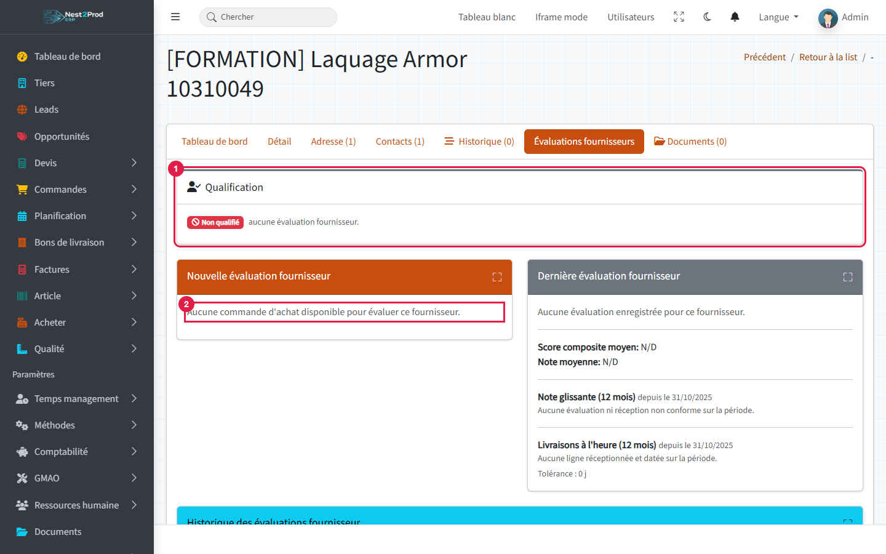
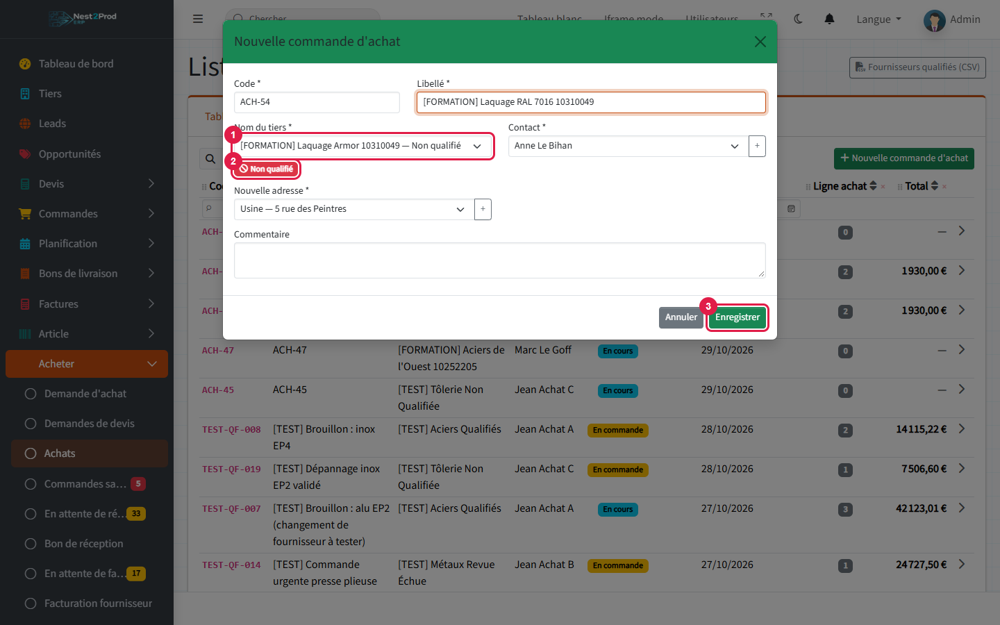
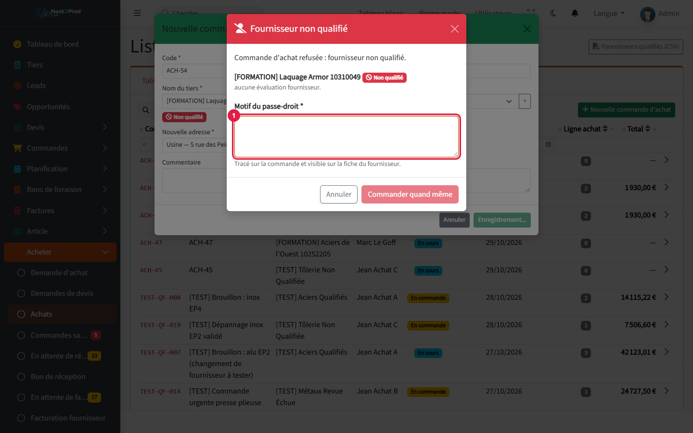
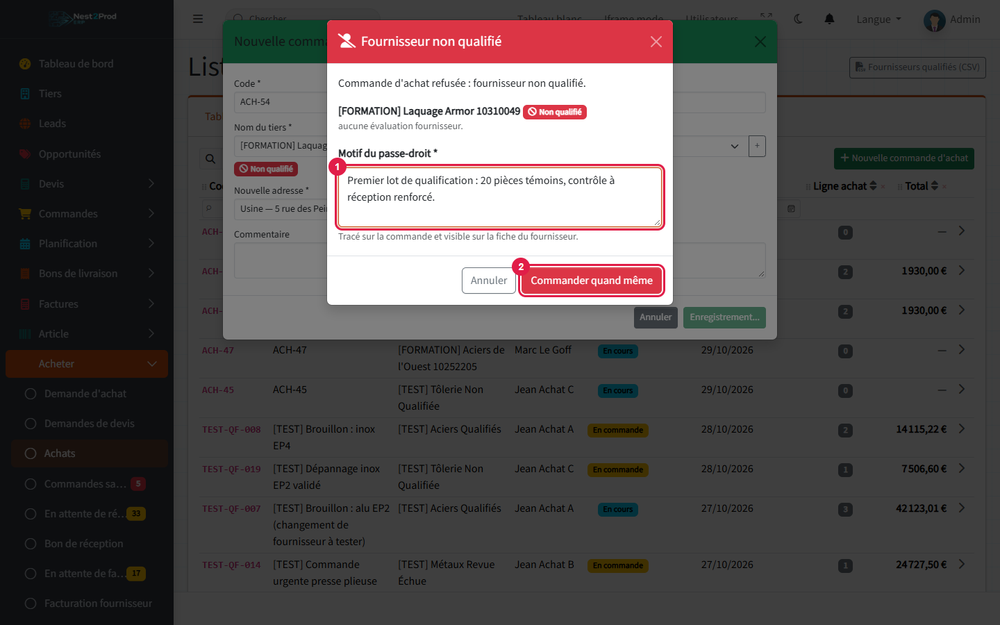
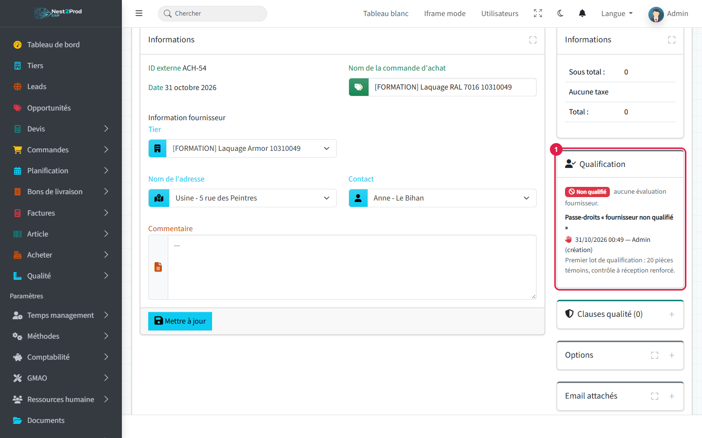
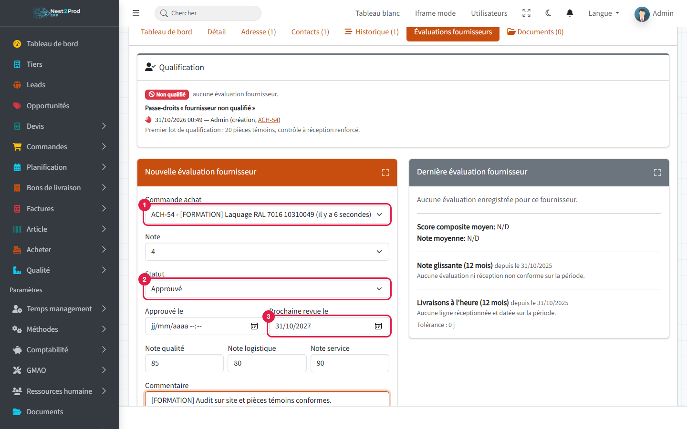
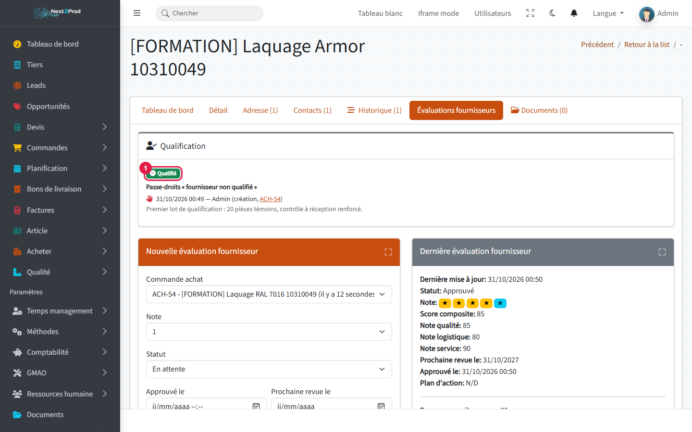
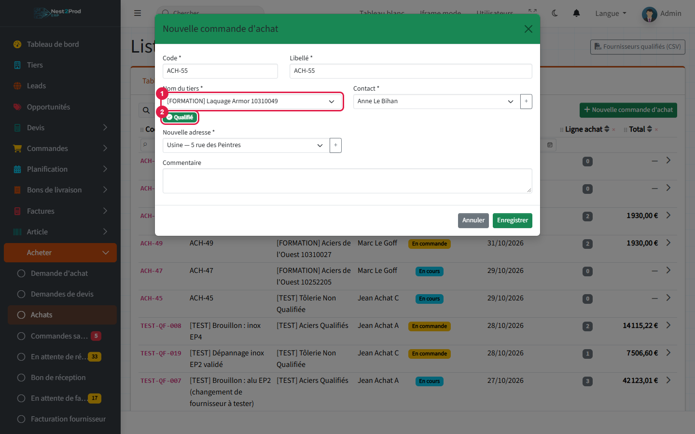
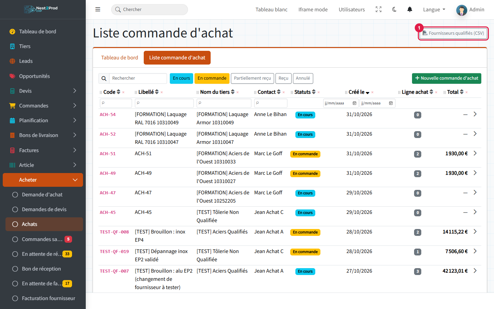

**Objectif** : qu'aucune commande d'achat ne parte chez un fournisseur que votre système
qualité n'a pas approuvé, sauf décision motivée et tracée.

**Exemple utilisé** : la tôlerie veut confier le laquage RAL 7016 à un nouveau fournisseur,
Laquage Armor. Il n'a encore jamais été évalué : la première commande est refusée, passe par
un passe-droit motivé, puis le fournisseur est évalué et qualifié.

## Avant de commencer

- Votre société a rendu obligatoire la qualification des fournisseurs : c'est pour cela que
  ce guide apparaît. Sans cette option, aucun contrôle ni badge.
- Il faut la permission **Achats** (menu « Acheter »).
- Passer outre un refus demande le droit **« unqualified-supplier-override »** (rôle Admin par
  défaut, Votre société → Rôles et permissions).
- Le fournisseur doit avoir **« Etat fournisseur » = Actif** (onglet « Détail » de sa fiche) :
  sinon l'onglet d'évaluation n'apparaît pas (voir le guide « De la demande de prix à la
  facture fournisseur »).

### Qu'est-ce qu'un fournisseur qualifié ?

Un fournisseur est **qualifié** quand sa **dernière évaluation fournisseur** (onglet
« Évaluations fournisseurs » de sa fiche) est au statut **« Approuvé »** et que sa date
**« Prochaine revue le »** n'est pas dépassée (ou vide).

| Badge | Signification |
|---|---|
| **Qualifié** (vert) | Dernière évaluation approuvée, revue à jour : commande libre |
| **Non qualifié** (rouge) | Aucune évaluation, ou dernière évaluation « En attente », « En revue » ou « Rejeté » |
| **Revue échue** (orange) | Évaluation approuvée, mais la date de prochaine revue est passée |

> ⚠️ Seule compte l'**évaluation formelle** de la fiche fournisseur. Les étoiles données à la
> réception d'une livraison (fenêtre de notation après un bon de réception) n'entrent **pas**
> dans la qualification.

## Vue d'ensemble

```steps
Fournisseur neuf : non qualifié
Première commande avec passe-droit
Évaluation approuvée
Fournisseur qualifié
Commandes libres jusqu'à la revue
```

---

## 1. Un fournisseur neuf n'est pas qualifié

Ouvrez la fiche du fournisseur, onglet **« Évaluations fournisseurs »** :

1. la carte **« Qualification »** affiche **« Non qualifié »** et la raison (« aucune évaluation
   fournisseur ») ;
2. la carte « Nouvelle évaluation fournisseur » indique **« Aucune commande d'achat disponible
   pour évaluer ce fournisseur. »**



> ⚠️ **Une évaluation se rattache toujours à une commande d'achat.** Un fournisseur neuf ne peut
> donc pas être évalué avant sa première commande, et cette première commande est refusée
> puisqu'il n'est pas qualifié. **La première commande passe forcément par un passe-droit**
> (étape 2), donné par un porteur du droit « unqualified-supplier-override ». L'évaluation se
> fait ensuite sur cette commande (étape 4).

> 💡 Une **demande de prix** n'est jamais contrôlée : vous pouvez consulter un fournisseur non
> qualifié librement.

## 2. La commande est refusée : le passe-droit

Menu **Acheter → Achats**, onglet « Liste commande d'achat », bouton **« Nouvelle commande
d'achat »**.

1. Dans **« Nom du tiers »**, le fournisseur apparaît suivi de « — Non qualifié ».
2. Le badge rouge **« Non qualifié »** le rappelle sous la liste.
3. Cliquez **« Enregistrer »**.



La fenêtre **« Fournisseur non qualifié »** s'ouvre : la commande n'est **pas** créée. Elle
rappelle la raison (ici « aucune évaluation fournisseur »).

1. Saisissez le **« Motif du passe-droit »** (obligatoire, 3 caractères au moins).



1. Le motif explique pourquoi vous commandez quand même (premier lot de qualification,
   dépannage urgent, fournisseur imposé par le client…).
2. Cliquez **« Commander quand même »** : la commande est créée.



> ⚠️ Sans le droit « unqualified-supplier-override », la fenêtre affiche seulement « Vous n'avez
> pas le droit de commander à un fournisseur non qualifié. Une demande de prix reste possible. »
> et le bouton « Annuler ». Demandez à un responsable de créer la commande.

> 💡 Le passe-droit vaut pour **cette commande seulement** : il couvre aussi sa validation
> (passage « En commande ») tant que le fournisseur ne change pas. La commande suivante sera de
> nouveau contrôlée.

## 3. La trace sur la commande

Sur la fiche de la commande d'achat, la carte **« Qualification »** (1) affiche l'état du
fournisseur et le passe-droit : date, auteur, étape (« création », « validation » ou
« changement de fournisseur ») et motif.



Les dix derniers passe-droits sont aussi listés sur la fiche du fournisseur, avec un lien vers
chaque commande : de quoi les relire lors d'un audit.

## 4. Évaluer et qualifier le fournisseur

Une fois le premier lot reçu et contrôlé, retournez sur la fiche du fournisseur, onglet
**« Évaluations fournisseurs »**, carte **« Nouvelle évaluation fournisseur »** :

1. **« Commande achat »** : la commande à laquelle se rattache l'évaluation ;
2. **« Statut »** : **« Approuvé »** — c'est ce statut qui qualifie le fournisseur ;
3. **« Prochaine revue le »** : la date de requalification (par exemple dans un an) ;
4. cliquez **« Soumettre »**.

Complétez aussi la note, les notes qualité / logistique / service et le commentaire selon
votre procédure. « Approuvé le » se remplit seul s'il reste vide.



> ⚠️ Le statut proposé par défaut est **« En attente »**. Une évaluation enregistrée sans le
> changer devient la dernière évaluation et rend le fournisseur **non qualifié**, même s'il
> était qualifié avant. Seule la plus récente compte.

La carte « Qualification » passe à **« Qualifié »** (1). Le passe-droit reste dans l'historique.



## 5. Les commandes suivantes passent sans fenêtre

Dans « Nouvelle commande d'achat », le fournisseur n'a plus de mention dans la liste (1) et
porte le badge vert **« Qualifié »** (2) : la commande se crée normalement.



> ⚠️ **Pensez à la revue.** Le lendemain de la date « Prochaine revue le », le fournisseur
> passe en **« Revue échue »** et les commandes sont de nouveau refusées. Une nouvelle
> évaluation approuvée, avec une nouvelle date, le requalifie.

## Les écrans contrôlés

La même fenêtre de passe-droit s'ouvre partout où une commande d'achat naît ou est validée :

- **Nouvelle commande d'achat** (liste des achats) ;
- **Demande de prix → commande** : bouton « Nouvelle commande » des lignes d'une demande de
  prix ;
- **Demande d'achat** (besoins issus des commandes clients), type commande ;
- **Réapprovisionnement** (depuis les ruptures de stock) : tous les fournisseurs sont vérifiés
  avant de créer quoi que ce soit, et un seul motif vaut pour toutes les commandes ;
- **Validation** d'une commande « En cours » vers « En commande » (ou reçue) avec les flèches
  de statut ; l'annulation reste libre ;
- **Changement de fournisseur** d'une commande déjà validée : refusé, sans passe-droit
  possible. Repassez la commande « En cours » pour changer de fournisseur.

Ne sont **pas** contrôlées : les demandes de prix, et la commande créée automatiquement par
une réception manuelle (la marchandise est déjà là).

## Exporter la liste des fournisseurs qualifiés

Menu **Acheter → Achats** : le bouton **« Fournisseurs qualifiés (CSV) »** (1), en haut à
droite, télécharge la liste à jour (code, raison sociale, qualification, statut de la dernière
évaluation, date d'évaluation, date d'approbation, prochaine revue). Le fichier s'ouvre dans
Excel ; c'est la liste à présenter lors d'un audit.



## Et ensuite ?

- Suivre la commande jusqu'à la facture : guide « De la demande de prix à la facture
  fournisseur ».
- Planifier les requalifications : notez la date « Prochaine revue le » de chaque fournisseur
  et refaites l'évaluation avant cette date.
- Confier le droit « unqualified-supplier-override » aux seules personnes habilitées à décider
  d'un passe-droit (responsable achats, qualité).

## Questions fréquentes

**Je ne vois pas l'onglet « Évaluations fournisseurs ».**
Le tiers n'est pas un fournisseur actif : onglet « Détail », « Etat fournisseur » = Actif, puis
« Mettre à jour ».

**Mon fournisseur était qualifié et il est refusé.**
Soit sa date de revue est passée (« Revue échue »), soit une évaluation plus récente a été
enregistrée avec un autre statut que « Approuvé ». La raison est donnée dans la fenêtre et sur
la carte « Qualification ».

**Les étoiles données à la réception ne suffisent-elles pas ?**
Non. Elles alimentent la note glissante du fournisseur, mais la qualification ne lit que les
évaluations formelles de l'onglet « Évaluations fournisseurs ».

**Le passe-droit d'hier vaut-il pour la commande d'aujourd'hui ?**
Non, il vaut pour une seule commande. Qualifiez le fournisseur si vous comptez lui commander
régulièrement.

**Puis-je demander un prix à un fournisseur non qualifié ?**
Oui, les demandes de prix ne sont jamais bloquées. C'est leur transformation en commande qui
est contrôlée.
