**Goal**: keep the maintenance of the workshop machines up to date. Every intervention,
preventive or after a breakdown, is recorded on the equipment concerned.

> 💡 Screenshots show the French interface; button names are given as they appear in the English interface.

**Who is it for**: the maintenance manager and the workshop manager.

**Example used**: the workshop press brake. Its hydraulic oil change is planned every
month, and a leak on a cylinder has to be reported.

## Before you start {#avant-de-commencer}

- The **GMAO** menu only appears with the **asset_manager** permission. The equipment list
  also requires **asset-menu**.
- The machine must exist as a **resource** in Methods (see the guide "Methods"): the CMMS
  equipment is linked to it.

## Overview {#vue-densemble}

```steps
Equipment
Maintenance plan
Work order
Intervention
Closing
```

The **GMAO** menu has four entries: **Dashboard**, **Assets** (the equipment),
**Maintenance plans** and **Work orders**. Plans can also be opened from an equipment
record.

---

## 1. The dashboard {#le-tableau-de-bord}

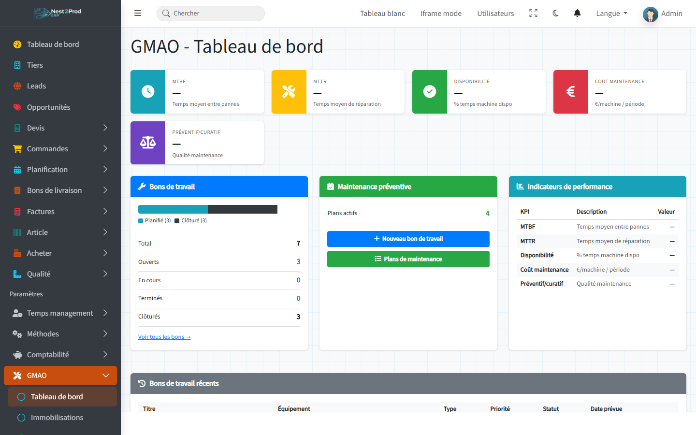

- **Work orders**: the number of work orders, by status;
- **Preventive maintenance**: the number of active plans, with the **New Work Order** and
  **Maintenance Plans** buttons;
- **Recent work orders**: the latest orders created.

> ⚠️ The indicators at the top (MTBF, MTTR, availability, cost, preventive / corrective
> share) stay at "—": they are not computed yet.

---

## 2. Register a piece of equipment {#enregistrer-un-equipement}

Menu **GMAO › Assets**, then **New Asset**.

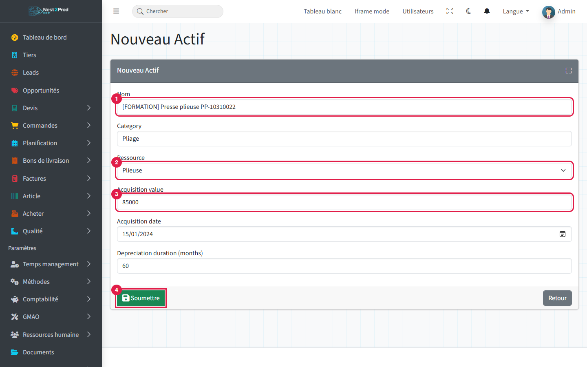

1. **Name**: a name the workshop recognises, with the machine's tag.
2. **Resource**: the Methods machine this equipment matches.
3. **Acquisition value**: the purchase value. Acquisition date and depreciation duration
   in months are optional.
4. **Submit**.

The **equipment record** gathers its work orders and maintenance plans.

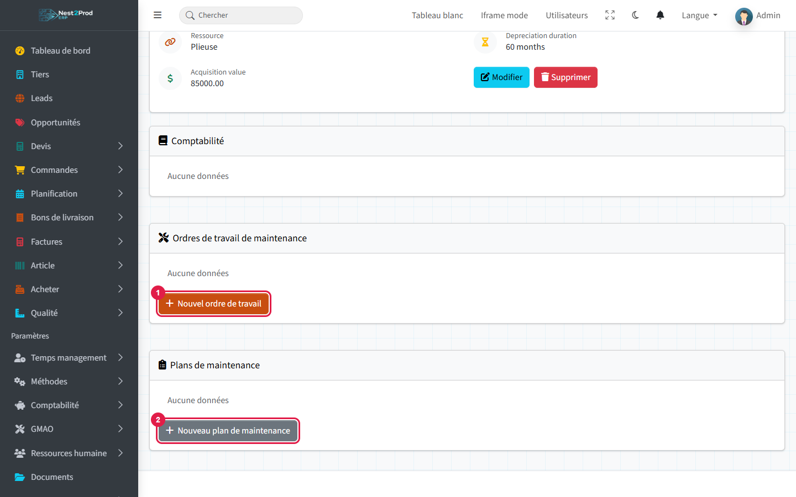

1. **New Work Order**: a one-off intervention (breakdown, adjustment).
2. **New Maintenance Plan**: a recurring maintenance.

> ⚠️ The **Delete** button of the record deletes the equipment **without asking for
> confirmation**. The same goes for plans and work orders.

---

## 3. Plan preventive maintenance {#planifier-la-maintenance-preventive}

From the equipment record, **New Maintenance Plan**: the equipment is already selected.
Existing plans are also listed in the **GMAO › Maintenance plans** menu.

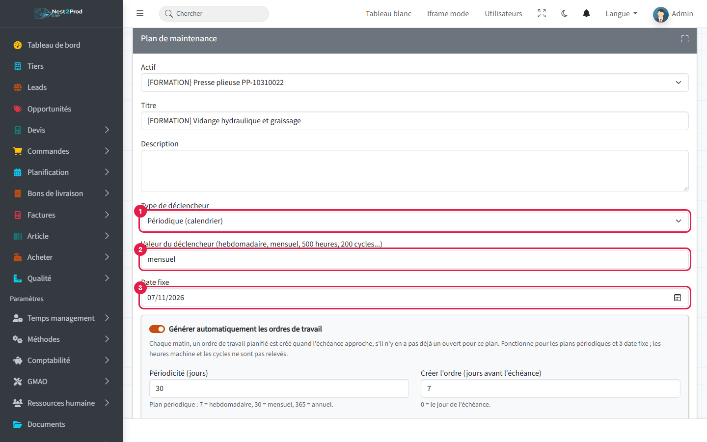

1. **Trigger type**: **Time-based**, machine hours, cycles, or **Fixed date** (a single
   intervention on a given date).
2. **Trigger value**: the frequency, in plain words ("monthly", "500 hours"…), for
   information only: it does not set the calendar.
3. **Fixed date**: the date of the intervention. For a time-based plan, it is the **first**
   due date.

Just below, the automatic generation box:

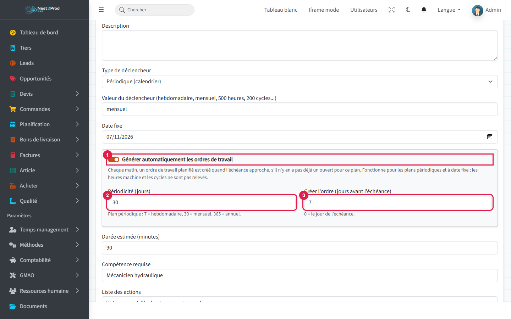

1. **Generate work orders automatically**: ticked by default.
2. **Interval (days)**: the gap between two interventions of a time-based plan (7 =
   weekly, 30 = monthly, 365 = yearly).
3. **Create the order (days before due date)**: how early the work order is created, to
   leave time to order the parts (7 by default, 0 = on the due date).
4. **Submit**.

Also fill in the **estimated duration**, the **required skill**, the **list of actions** and
the **required parts**: they are copied into each work order.

> ⚠️ With generation ticked, the **interval** is required for a time-based plan, and the
> **fixed date** for a fixed-date plan: without them, the form refuses to save.

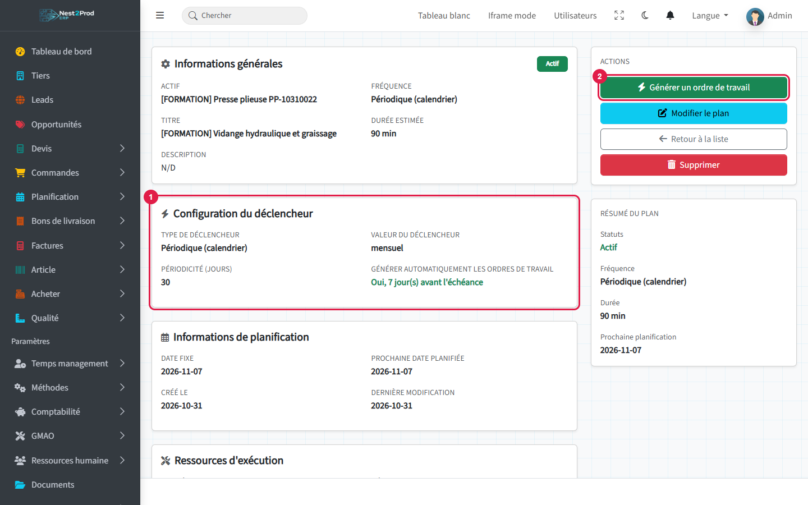

1. **Trigger Configuration**: the interval and automatic generation ("Yes, 7 day(s) before
   the due date"). The **Schedule Information** card below gives the **next scheduled
   date**.
2. **Generate Work Order** creates the intervention right away, without waiting (for
   example to bring an oil change forward).

### What happens every morning

Every day at **6 am**, the ERP goes through the plans with automatic generation ticked and
creates a **Planned** work order for each plan whose due date is approaching (minus the days
ahead). Nobody has anything to do: the order appears in the work order list, on the due
date.

- **One open order per plan**: as long as the previous order is not completed or closed,
  the plan does not create another one. An overdue order therefore does not pile up others
  behind it.
- **The calendar does not drift**: the next due date follows the **planned** date of the
  previous order, not the day it was closed. An oil change planned on 7 November and done
  on the 10th comes back on 7 December (interval 30).
- **Fixed-date plan**: a single order, on its date.

> ⚠️ Machine hours and cycles are not recorded anywhere: those plans generate nothing on
> their own, click **Generate Work Order**. Each click creates a new order, even if another
> one is already open.
>
> 💡 Automatic creation requires the ERP's scheduled tasks to run on your server. If no
> order ever appears on its own, tell your administrator.

---

## 4. The work order {#lordre-de-travail}

The generated order is **Planned**, of type **Preventive**, on the plan's due date; its
record shows the **maintenance plan** it comes from.

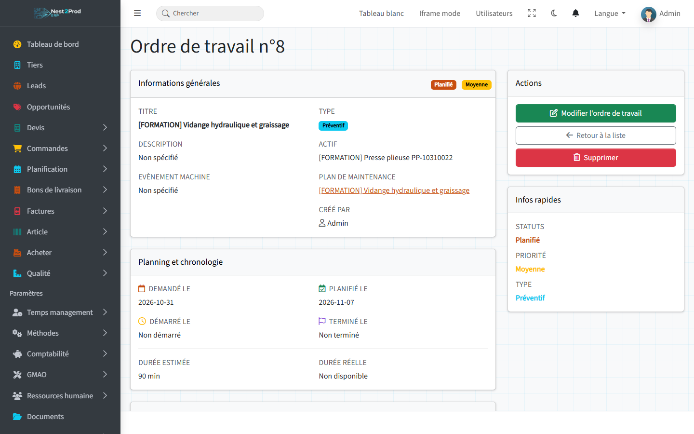

Back on the plan record:

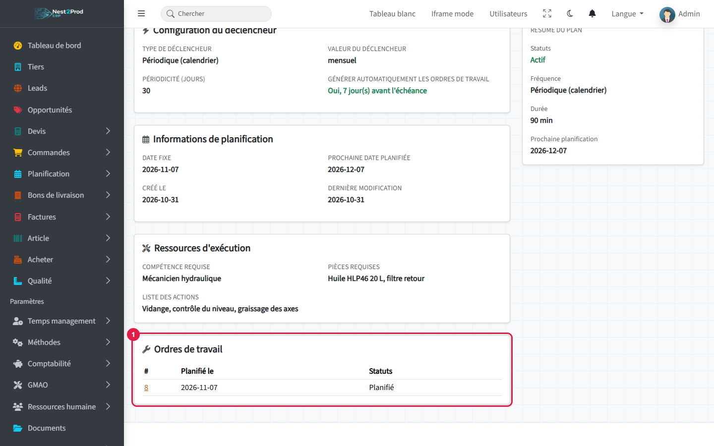

1. **Work Orders**: the orders already created by the plan, with their planned date and
   status. Here, the 7 November oil change is created: the next scheduled date moves to
   7 December.

Statuses follow this order:

| Status | Meaning |
|---|---|
| Draft | draft, not planned yet |
| Planned | planned on a date |
| In progress | intervention under way |
| Completed | intervention finished |
| Closed | order closed, nothing left to do |

---

## 5. Carry out the intervention {#realiser-lintervention}

**Edit Work Order**, then record the intervention:

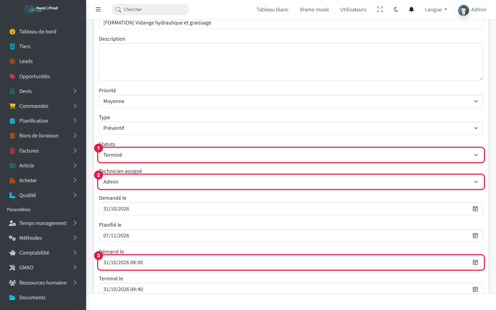

1. **Status**: "In progress" during the intervention, "Completed" once finished.
2. **Assigned technician**.
3. **Started at** and **Finished at**.

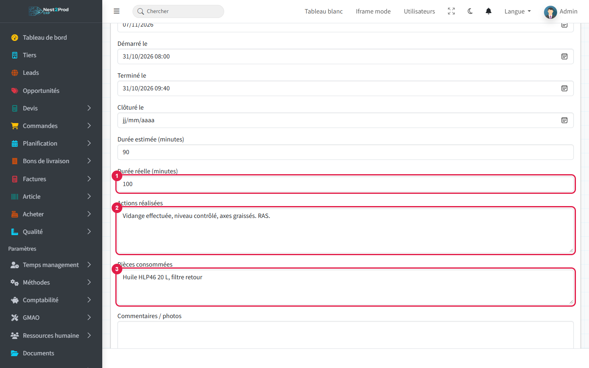

1. **Actual duration** in minutes, to compare with the estimated duration.
2. **Actions performed**: what was done and what was found.
3. **Parts consumed**.

Save.

> 💡 The **Machine stopped** field matters: a work order with the machine stopped removes the
> intervention period from the resource's **capacity** in the load planning.

---

## 6. Close {#cloturer}

Once the intervention is checked, reopen the order: status **Closed**, then
**Completed at**.

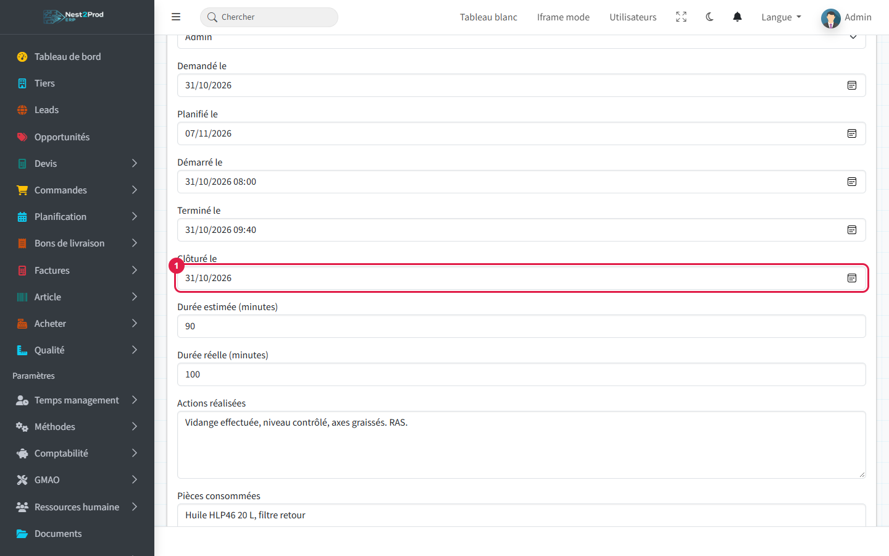

1. **Completed at**: the closing date.

Then **Save**, at the bottom of the form.

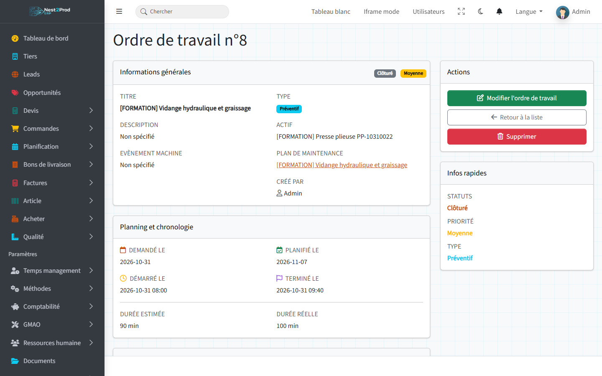

The record shows the full timeline: requested, planned, started, finished, and the
estimated duration next to the actual one.

---

## 7. Report a breakdown {#declarer-une-panne}

From the equipment record, **New Work Order**.

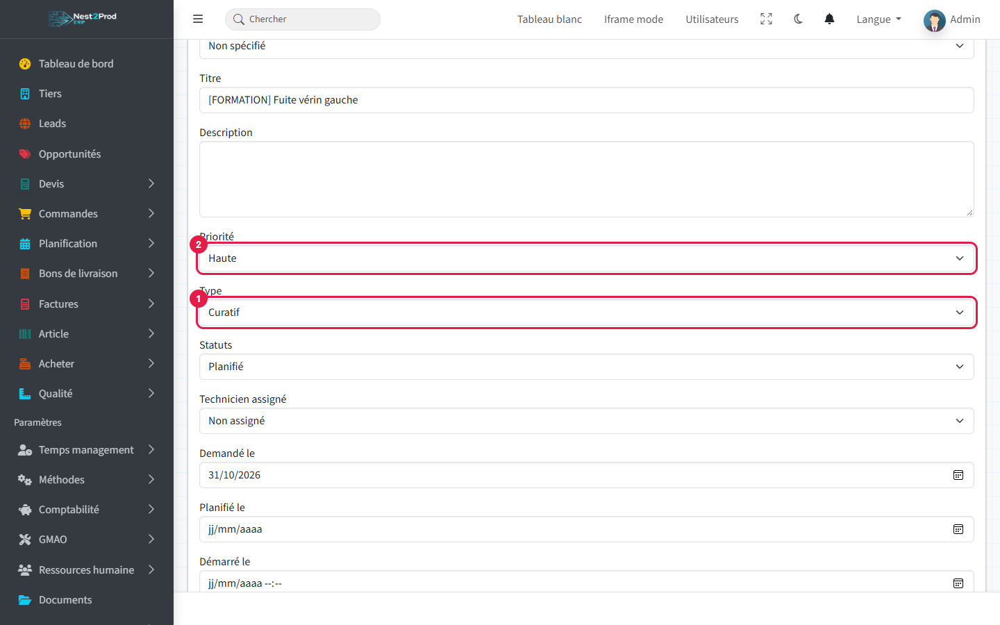

1. **Type**: **Corrective** for a repair (Preventive for planned upkeep).
2. **Priority**: Low, Medium, High or Critical.

At the bottom of the form, describe the breakdown:

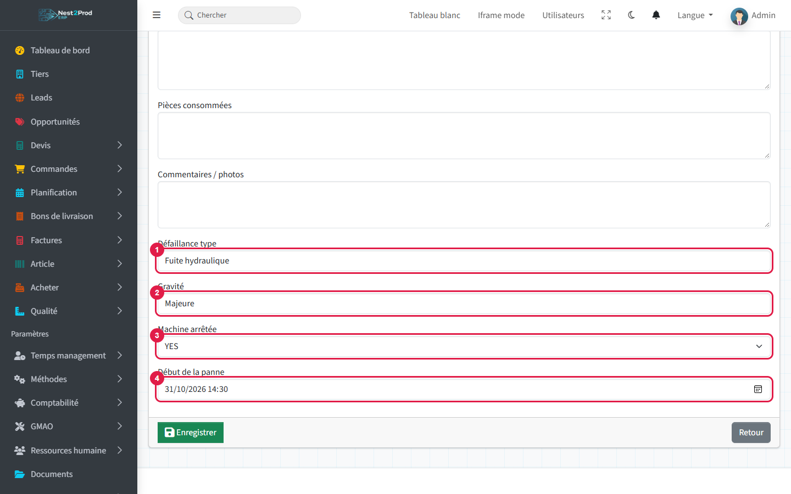

1. **Failure type**: the nature of the breakdown.
2. **Severity**.
3. **Machine stopped**: YES if the machine can no longer produce.
4. **Failure started at**: date and time of the stop.

Then follow the intervention as in sections 5 and 6.

> ⚠️ If a field is wrongly filled in, the page reloads **without an error message** and the
> order is not created. Check that it appears in the list.

---

## 8. Follow the interventions {#suivre-les-interventions}

Menu **GMAO › Work orders**: all work orders, with their equipment, type, priority,
status and technician.

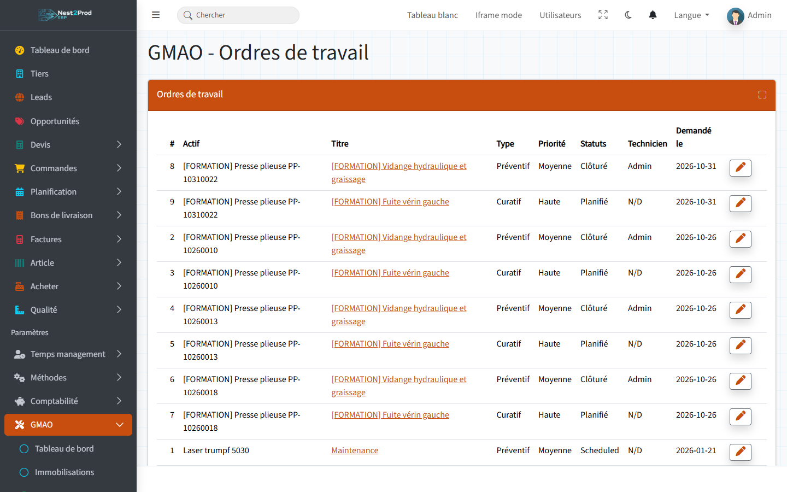

The **equipment record** keeps the history of its interventions:

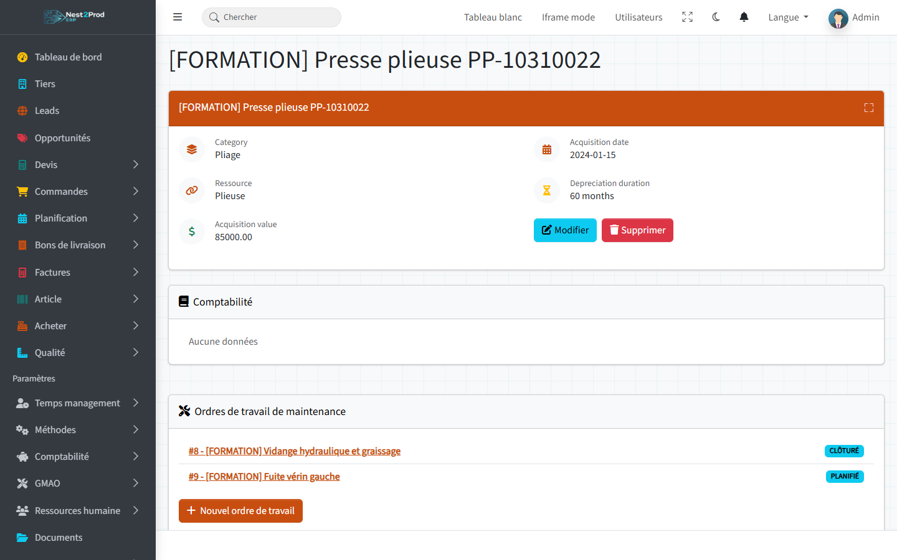

## What next? {#et-ensuite}

- Record the **actual duration** and the **failure start** on each order: they will feed the
  MTBF and MTTR indicators of the dashboard.
- Assign a **working schedule** to the machine (guide "Time, shifts and leave"): a
  machine stop is then removed from its real capacity in the load planning.

## Frequently asked questions {#questions-frequentes}

**My maintenance plan created no work order when it was due.**
Orders are created every morning at 6 am, the chosen number of days before the due date.
Check on the plan record that automatic generation is ticked and, for a time-based plan,
that the interval is filled in. A plan that already has an open order waits for it to be
completed or closed. Plans on machine hours or cycles generate nothing on their own. Plans
created before this feature have generation unticked: edit them (**Edit Plan**) to turn it
on.

**A fixed-date plan does not come back.**
That is expected: a fixed-date plan creates a single order. For a recurring intervention,
choose "Time-based" and an interval.

**MTBF and MTTR stay at "—".**
They are not computed yet. The actual duration and the failure start entered on each work
order will be used to compute them.

**My machine is not in the equipment's resource list.**
Create it first in Methods › Resources.
