**Goal**: keep the maintenance of the workshop machines up to date. Every intervention,
preventive or after a breakdown, is recorded on the equipment concerned.

> 💡 Screenshots show the French interface; button names are given as they appear in the English interface.

**Who is it for**: the maintenance manager and the workshop manager.

**Example used**: the workshop press brake. Its hydraulic oil change is planned every
month, and a leak on a cylinder has to be reported.

## Before you start

- The **GMAO** menu only appears with the **asset_manager** permission. The equipment list
  also requires **asset-menu**.
- The machine must exist as a **resource** in Methods (see the guide "Methods"): the CMMS
  equipment is linked to it.

## Overview

```steps
Equipment
Maintenance plan
Work order
Intervention
Closing
```

The **GMAO** menu has three entries: **Dashboard**, **Assets** (the equipment) and
**Work orders**. Maintenance plans are opened from the dashboard or from an equipment
record.

---

## 1. The dashboard

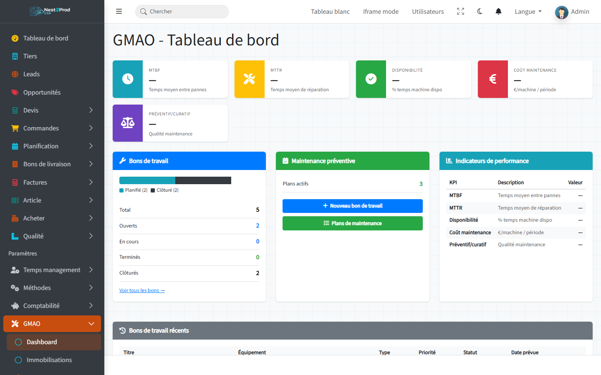

- **Work orders**: the number of work orders, by status;
- **Preventive maintenance**: the number of active plans, with the **New Work Order** and
  **Maintenance Plans** buttons;
- **Recent work orders**: the latest orders created.

> ⚠️ The indicators at the top (MTBF, MTTR, availability, cost, preventive / corrective
> share) stay at "—": they are not computed yet.

---

## 2. Register a piece of equipment

Menu **GMAO › Assets**, then **New Asset**.

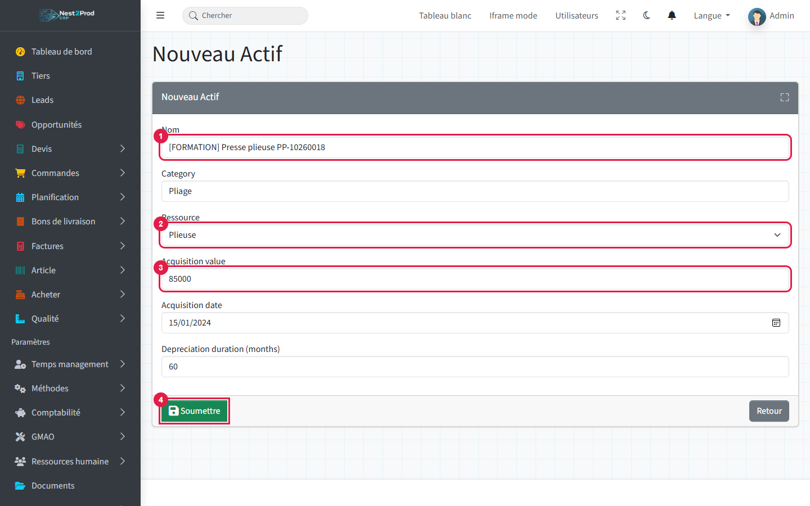

1. **Name**: a name the workshop recognises, with the machine's tag.
2. **Resource**: the Methods machine this equipment matches.
3. **Acquisition value**: the purchase value. Acquisition date and depreciation duration
   in months are optional.
4. **Submit**.

The **equipment record** gathers its work orders and maintenance plans.

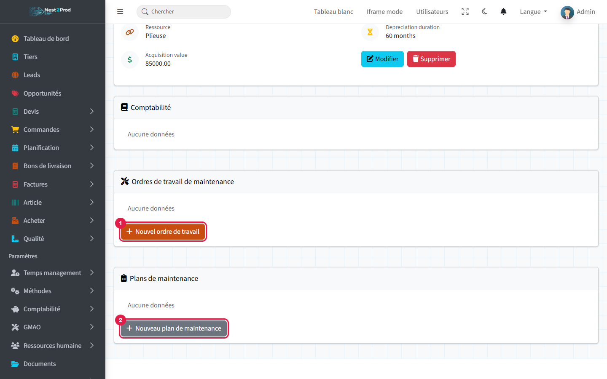

1. **New Work Order**: a one-off intervention (breakdown, adjustment).
2. **New Maintenance Plan**: a recurring maintenance.

> ⚠️ The **Delete** button of the record deletes the equipment **without asking for
> confirmation**. The same goes for plans and work orders.

---

## 3. Plan preventive maintenance

From the equipment record, **New Maintenance Plan**: the equipment is already selected.

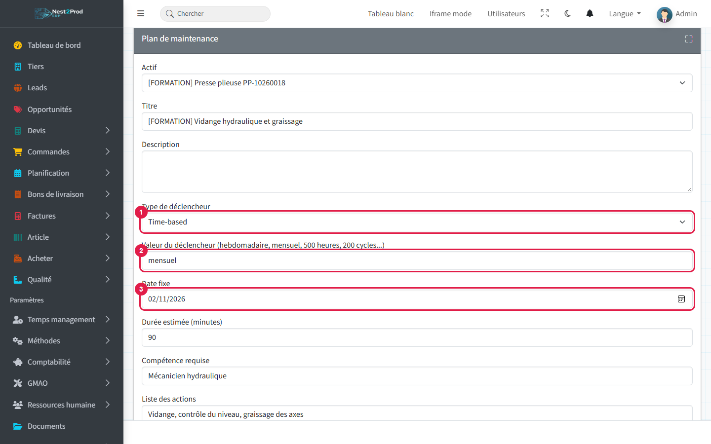

1. **Trigger type**: time-based, machine hours, cycles or fixed date.
2. **Trigger value**: the frequency, in plain words ("monthly", "500 hours"…).
3. **Fixed date**: the date of the next intervention.

Fill in the **estimated duration**, the **required skill**, the **list of actions** and
the **required parts**: they are copied into each work order.

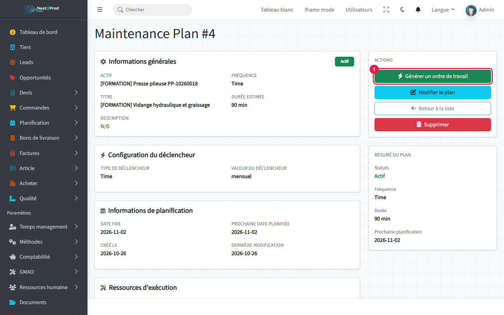

1. **Generate Work Order** creates the intervention from the plan.

> ⚠️ Work orders are **not** generated automatically when due: you have to click the button.
> Each click creates a new work order, so click only once.

---

## 4. The work order

The generated order is **Planned**, of type **Preventive**, on the plan's due date.

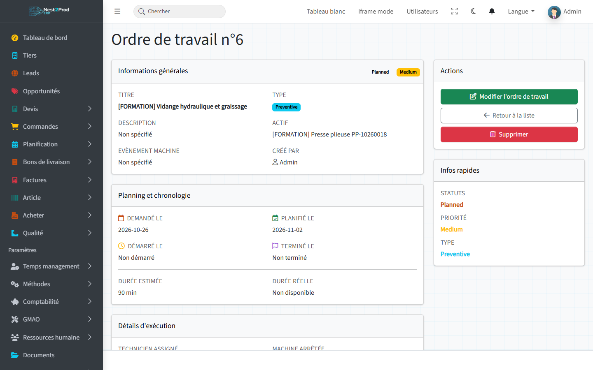

Statuses follow this order:

| Status | Meaning |
|---|---|
| Draft | draft, not planned yet |
| Planned | planned on a date |
| In progress | intervention under way |
| Completed | intervention finished |
| Closed | order closed, nothing left to do |

---

## 5. Carry out the intervention

**Edit Work Order**, then record the intervention:

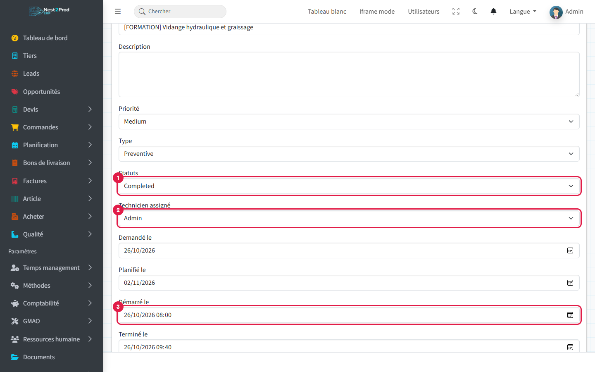

1. **Status**: "In progress" during the intervention, "Completed" once finished.
2. **Assigned technician**.
3. **Started at** and **Finished at**.

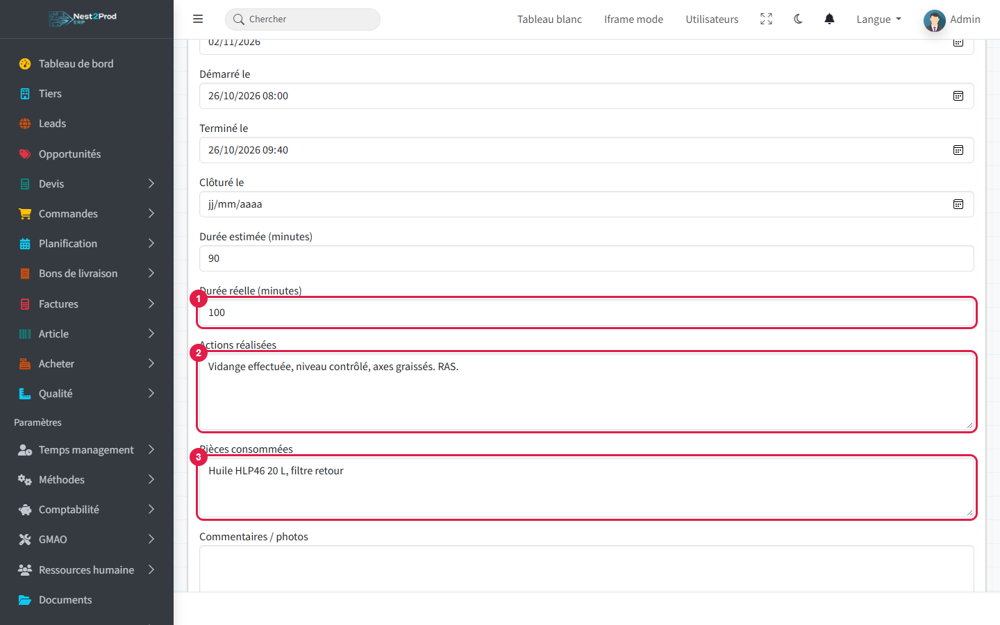

1. **Actual duration** in minutes, to compare with the estimated duration.
2. **Actions performed**: what was done and what was found.
3. **Parts consumed**.

Save.

> 💡 The **Machine stopped** field matters: a work order with the machine stopped removes the
> intervention period from the resource's **capacity** in the load planning.

---

## 6. Close

Once the intervention is checked, reopen the order: status **Closed**, then
**Completed at**.

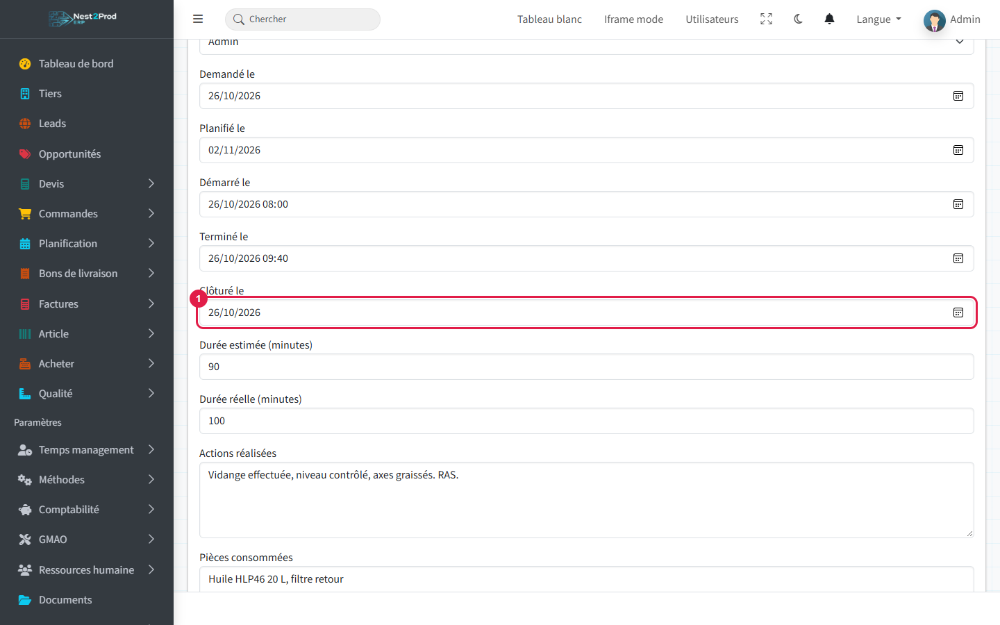

1. **Completed at**: the closing date.
2. **Save**.


The record shows the full timeline: requested, planned, started, finished, and the
estimated duration next to the actual one.

---

## 7. Report a breakdown

From the equipment record, **New Work Order**.

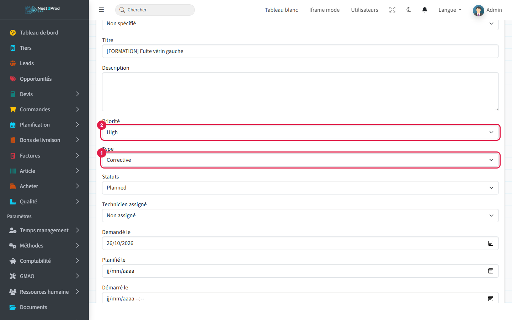

1. **Type**: **Corrective** for a repair (Preventive for planned upkeep).
2. **Priority**: Low, Medium, High or Critical.

At the bottom of the form, describe the breakdown:

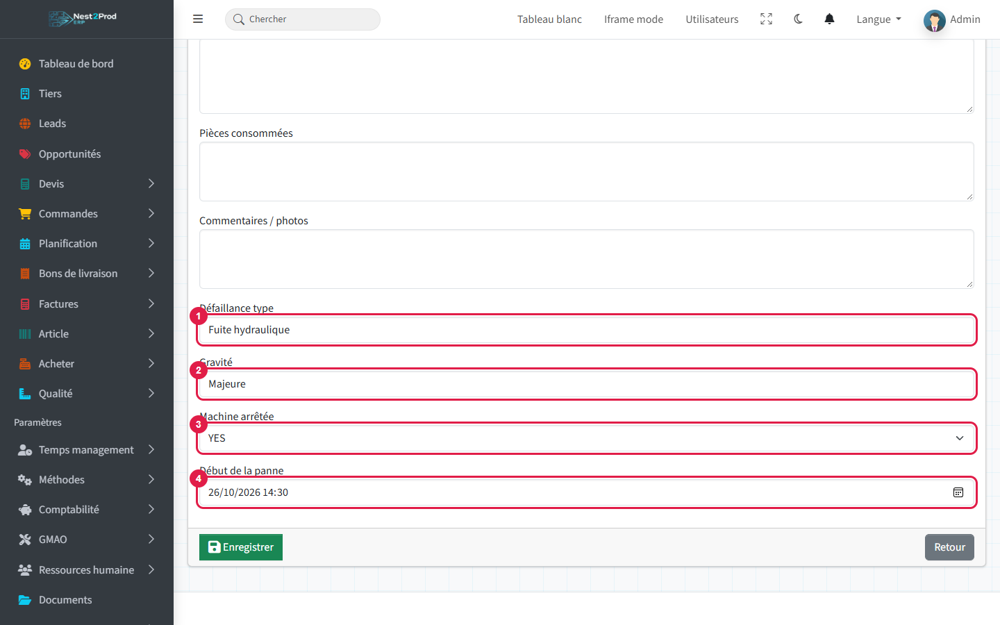

1. **Failure type**: the nature of the breakdown.
2. **Severity**.
3. **Machine stopped**: YES if the machine can no longer produce.
4. **Failure started at**: date and time of the stop.

Then follow the intervention as in sections 5 and 6.

> ⚠️ If a field is wrongly filled in, the page reloads **without an error message** and the
> order is not created. Check that it appears in the list.

---

## 8. Follow the interventions

Menu **GMAO › Work orders**: all work orders, with their equipment, type, priority,
status and technician.

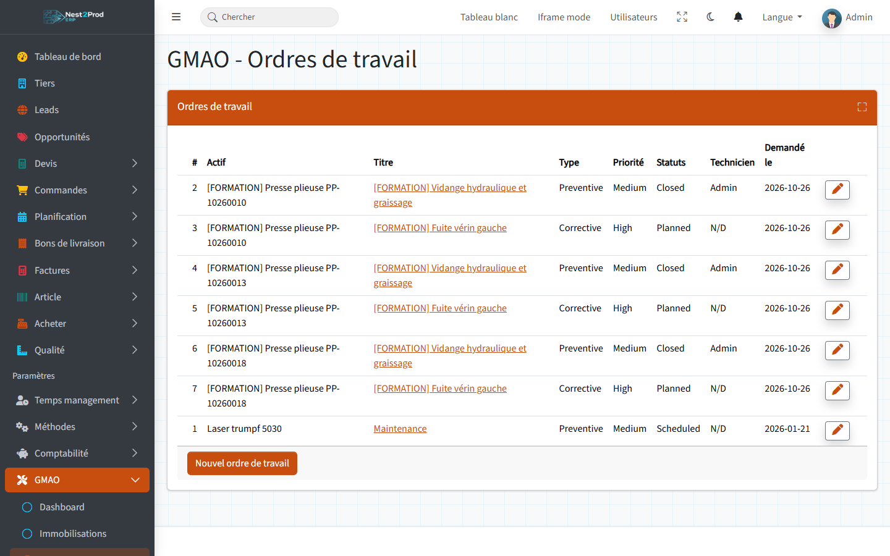

The **equipment record** keeps the history of its interventions:

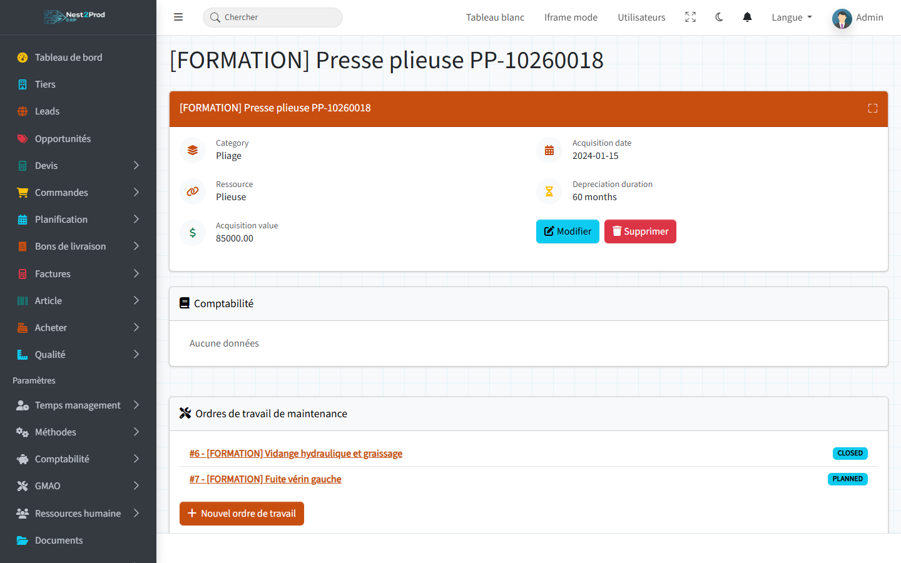

## Frequently asked questions

**My maintenance plan created no work order when it was due.**
That is expected: work orders are generated with the "Generate Work Order" button of the
plan record.

**MTBF and MTTR stay at "—".**
They are not computed yet. The actual duration and the failure start entered on each work
order will be used to compute them.

**My machine is not in the equipment's resource list.**
Create it first in Methods › Resources.
