**Objectif** : tenir à jour la maintenance des machines de l'atelier. Chaque intervention,
qu'elle soit préventive ou consécutive à une panne, est tracée sur l'équipement concerné.

**Pour qui** : le responsable maintenance et le chef d'atelier.

**Exemple utilisé** : la presse plieuse de l'atelier. Sa vidange hydraulique est planifiée
tous les mois, et une fuite sur un vérin doit être déclarée.

## Avant de commencer

- Le menu **GMAO** n'apparaît qu'avec la permission **asset_manager**. La liste des
  équipements demande en plus **asset-menu**.
- La machine doit exister comme **ressource** dans les Méthodes (voir le guide
  « Les Méthodes ») : l'équipement GMAO s'y rattache.

## Vue d'ensemble

```steps
Équipement
Plan de maintenance
Ordre de travail
Intervention
Clôture
```

Le menu **GMAO** a quatre entrées : **Tableau de bord**, **Immobilisations** (les
équipements), **Plans de maintenance** et **Ordres de travail**. Les plans s'ouvrent aussi
depuis la fiche d'un équipement.

---

## 1. Le tableau de bord

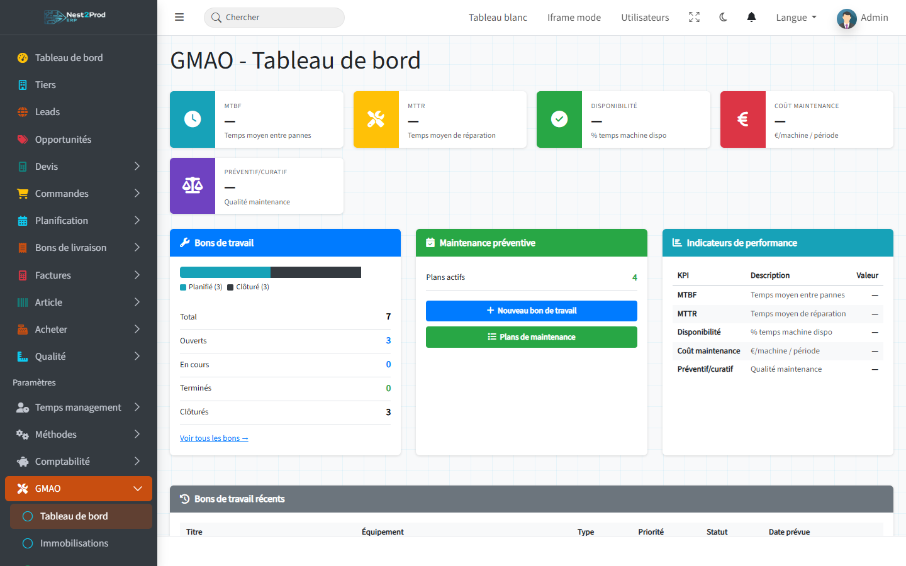

- **Bons de travail** : le nombre d'ordres de travail, par statut ;
- **Maintenance préventive** : le nombre de plans actifs, et les boutons **Nouveau bon de
  travail** et **Plans de maintenance** ;
- **Bons de travail récents** : les derniers ordres créés.

> ⚠️ Les indicateurs du haut (MTBF, MTTR, disponibilité, coût, part préventif / curatif)
> restent affichés « — » : ils ne sont pas encore calculés.

---

## 2. Enregistrer un équipement

Menu **GMAO › Immobilisations**, puis **Nouveau Actif**.

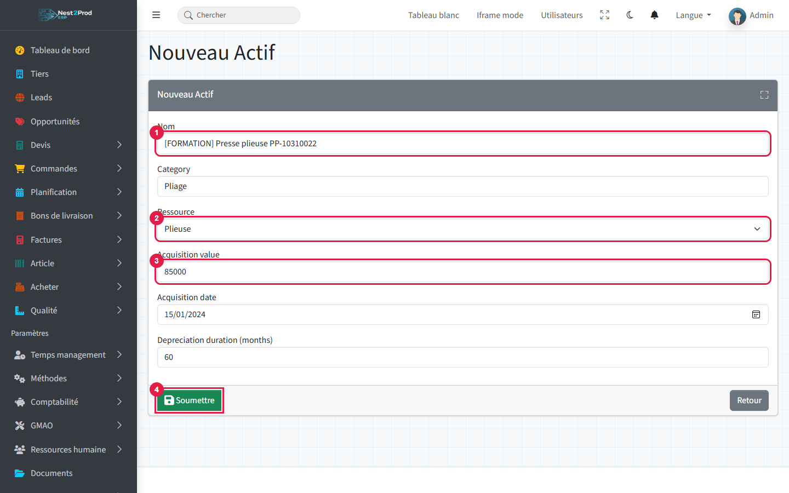

1. **Nom** : un nom que l'atelier reconnaît, avec le repère de la machine.
2. **Ressource** : la machine des Méthodes à laquelle l'équipement correspond.
3. **Acquisition value** : la valeur d'achat. La date d'acquisition et la durée
   d'amortissement en mois sont facultatives.
4. **Soumettre**.

La **fiche équipement** regroupe ses ordres de travail et ses plans de maintenance.

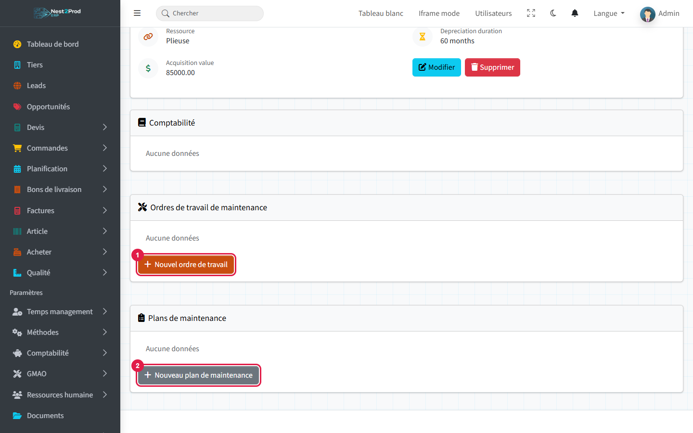

1. **Nouvel ordre de travail** : une intervention ponctuelle (panne, réglage).
2. **Nouveau plan de maintenance** : une maintenance qui revient.

> ⚠️ Le bouton **Supprimer** de la fiche efface l'équipement **sans demander de
> confirmation**. Il en va de même pour les plans et les ordres de travail.

---

## 3. Planifier la maintenance préventive

Depuis la fiche de l'équipement, **Nouveau plan de maintenance** : l'équipement est déjà
choisi. Les plans existants se retrouvent aussi dans le menu **GMAO › Plans de
maintenance**.

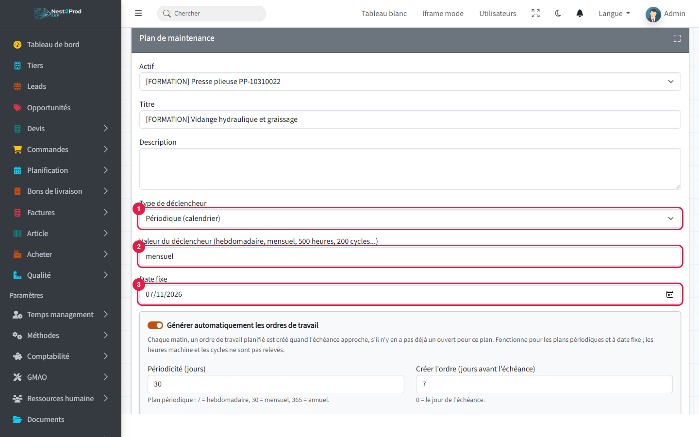

1. **Type de déclencheur** : **Périodique (calendrier)**, heures machine, cycles, ou **date
   fixe** (une seule intervention, à une date donnée).
2. **Valeur du déclencheur** : la fréquence, en clair (« mensuel », « 500 heures »…), pour
   information seulement : ce n'est pas elle qui fixe le calendrier.
3. **Date fixe** : la date de l'intervention. Pour un plan périodique, c'est la **première**
   échéance.

Juste en dessous, l'encadré de génération automatique :

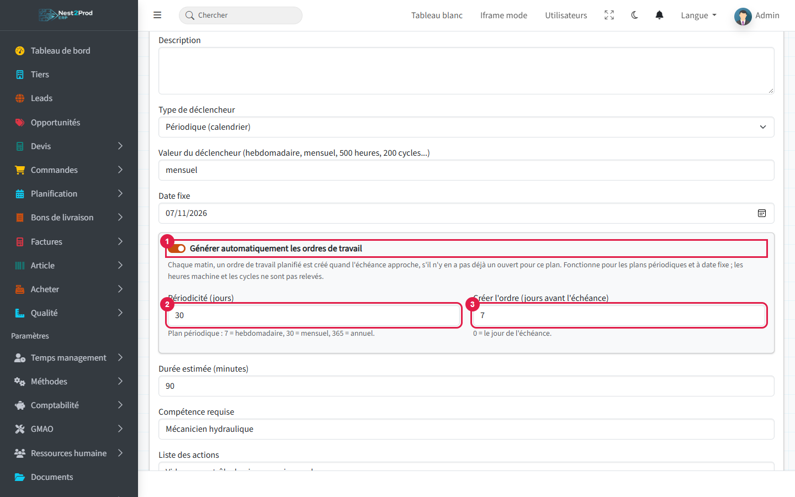

1. **Générer automatiquement les ordres de travail** : cochée par défaut.
2. **Périodicité (jours)** : l'écart entre deux interventions d'un plan périodique (7 =
   hebdomadaire, 30 = mensuel, 365 = annuel).
3. **Créer l'ordre (jours avant l'échéance)** : l'avance avec laquelle l'ordre de travail
   est créé, pour avoir le temps de commander les pièces (7 par défaut, 0 = le jour même).
4. **Soumettre**.

Complétez aussi la **durée estimée**, la **compétence requise**, la **liste des actions** et
les **pièces nécessaires** : ces informations sont recopiées dans chaque ordre de travail.

> ⚠️ Génération cochée, la **périodicité** est obligatoire pour un plan périodique, et la
> **date fixe** pour un plan à date fixe : sans elles, le formulaire refuse
> l'enregistrement.

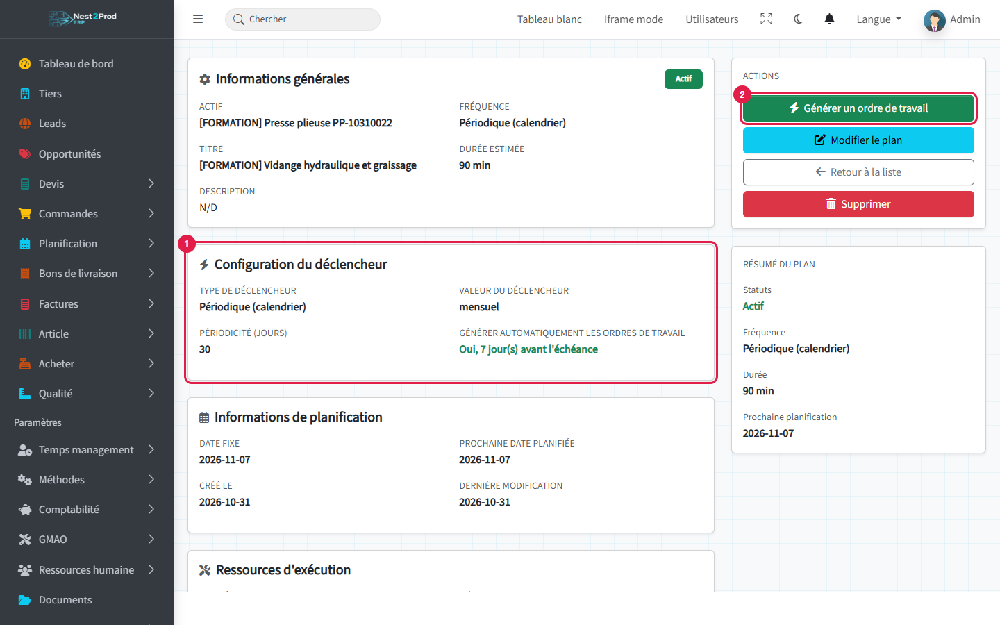

1. **Configuration du déclencheur** : la périodicité et la génération automatique (« Oui,
   7 jour(s) avant l'échéance »). La carte **Informations de planification**, en dessous,
   donne la **prochaine date planifiée**.
2. **Générer un ordre de travail** crée l'intervention tout de suite, sans attendre (par
   exemple pour avancer une vidange).

### Ce qui se passe chaque matin

Tous les jours à **6 h**, l'ERP passe en revue les plans dont la génération automatique est
cochée et crée un ordre de travail **Planifié** pour chaque plan dont l'échéance approche
(moins les jours d'avance). Personne n'a rien à faire : l'ordre apparaît dans la liste des
ordres de travail, à la date de l'échéance.

- **Un seul ordre ouvert par plan** : tant que l'ordre précédent n'est pas terminé ou
  clôturé, le plan n'en crée pas d'autre. Un ordre en retard n'en empile donc pas d'autres
  derrière lui.
- **Le calendrier ne dérive pas** : l'échéance suivante part de la date **planifiée** de
  l'ordre précédent, pas du jour où il a été clôturé. Une vidange prévue le 7 novembre et
  faite le 10 revient le 7 décembre (périodicité 30).
- **Plan à date fixe** : un seul ordre, à sa date.

> ⚠️ Les heures machine et les cycles ne sont relevés nulle part : ces plans ne génèrent
> rien tout seuls, il faut cliquer sur **Générer un ordre de travail**. Chaque clic crée un
> nouvel ordre, même si un autre est déjà ouvert.
>
> 💡 La création automatique demande que les tâches planifiées de l'ERP tournent sur votre
> serveur. Si aucun ordre n'apparaît jamais tout seul, signalez-le à votre administrateur.

---

## 4. L'ordre de travail

L'ordre généré est **Planifié**, de type **Préventif**, à la date d'échéance du plan ; sa
fiche rappelle le **plan de maintenance** d'où il vient.

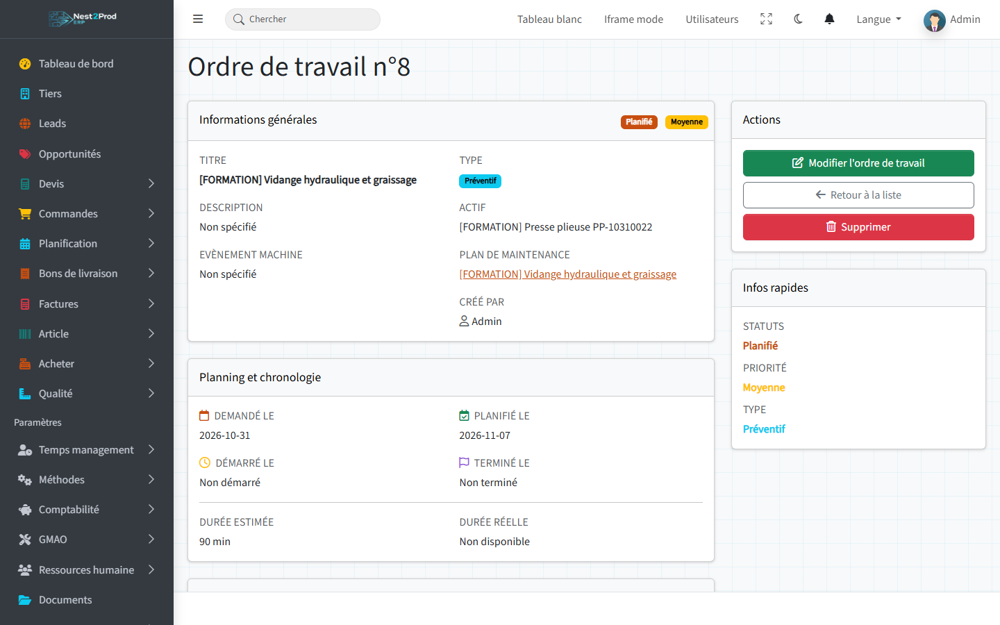

De retour sur la fiche du plan :

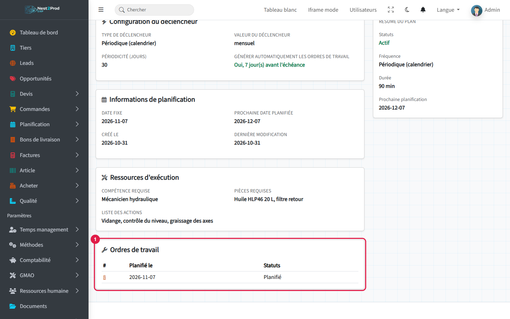

1. **Ordres de travail** : les ordres déjà créés par le plan, avec leur date planifiée et
   leur statut. Ici, la vidange du 7 novembre est créée : la prochaine date planifiée passe
   au 7 décembre.

Les statuts se suivent dans cet ordre :

| Statut | Signification |
|---|---|
| Brouillon | pas encore planifié |
| Planifié | planifié à une date |
| En cours | intervention en cours |
| Terminé | intervention terminée |
| Clôturé | ordre clôturé, rien à reprendre |

---

## 5. Réaliser l'intervention

**Modifier l'ordre de travail**, puis renseignez l'intervention :

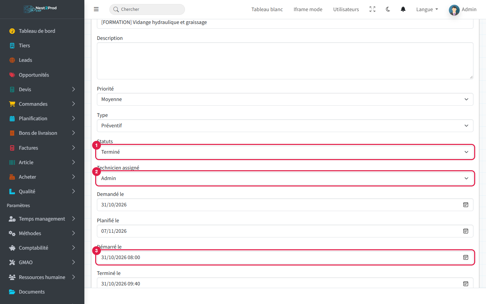

1. **Statuts** : « En cours » pendant l'intervention, « Terminé » une fois terminée.
2. **Technicien assigné**.
3. **Démarré le** et **Terminé le**.

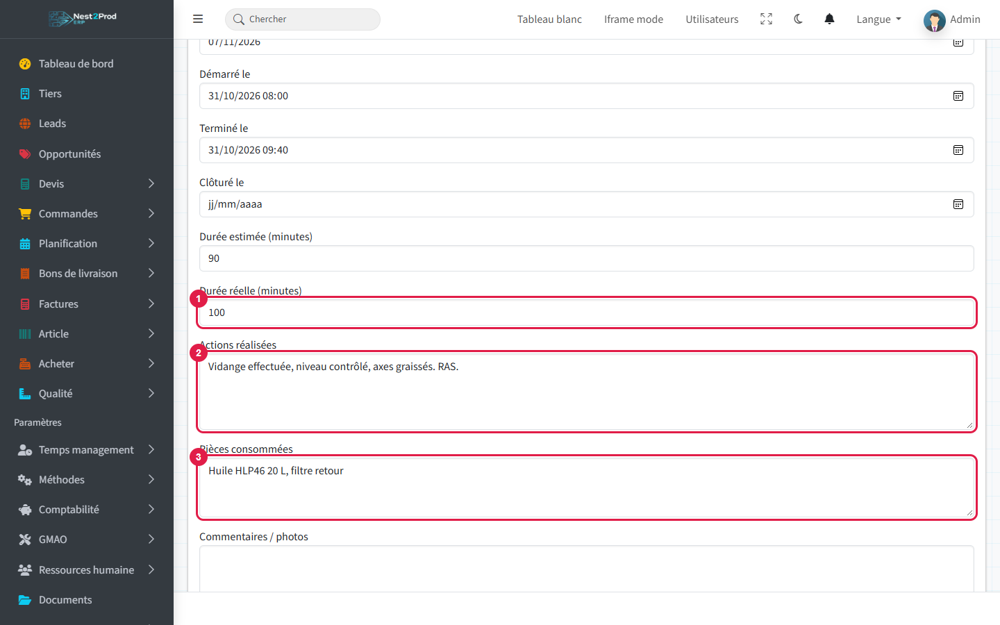

1. **Durée réelle** en minutes, à comparer à la durée estimée.
2. **Actions réalisées** : ce qui a été fait, et ce qui a été constaté.
3. **Pièces consommées**.

Enregistrez.

> 💡 Le champ **Machine arrêtée** compte : un ordre de travail avec la machine arrêtée
> retire la période d'intervention de la **capacité** de la ressource dans le planning de
> charge.

---

## 6. Clôturer

Une fois l'intervention vérifiée, rouvrez l'ordre : statut **Clôturé**, puis **Clôturé le**.

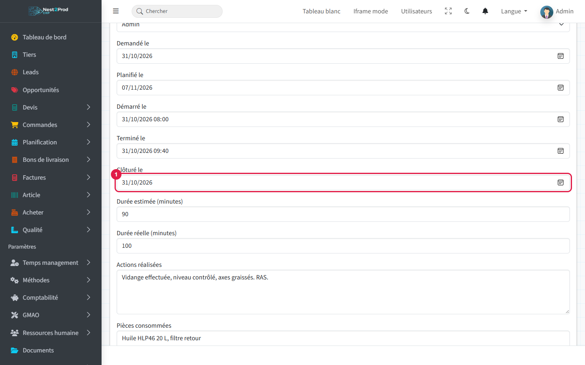

1. **Clôturé le** : la date de clôture.

Puis **Enregistrer**, en bas du formulaire.

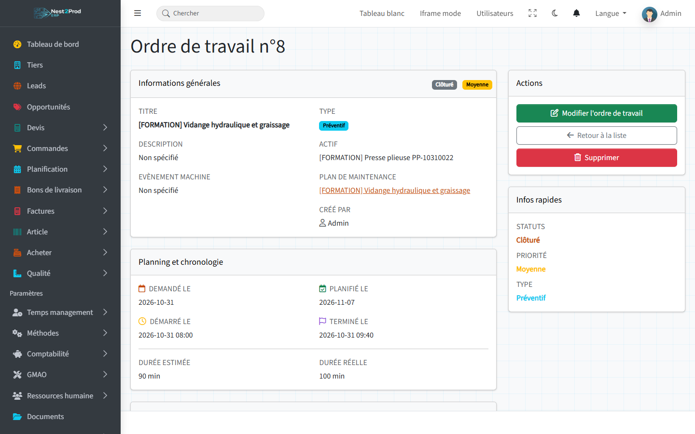

La fiche montre la chronologie complète : demandé, planifié, démarré, terminé, et la durée
estimée en regard de la durée réelle.

---

## 7. Déclarer une panne

Depuis la fiche de l'équipement, **Nouvel ordre de travail**.

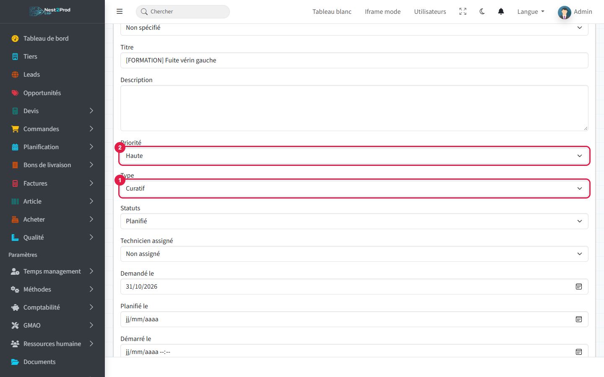

1. **Type** : **Curatif** pour une réparation (Préventif pour l'entretien planifié).
2. **Priorité** : Basse, Moyenne, Haute ou Critique.

En bas du formulaire, décrivez la panne :

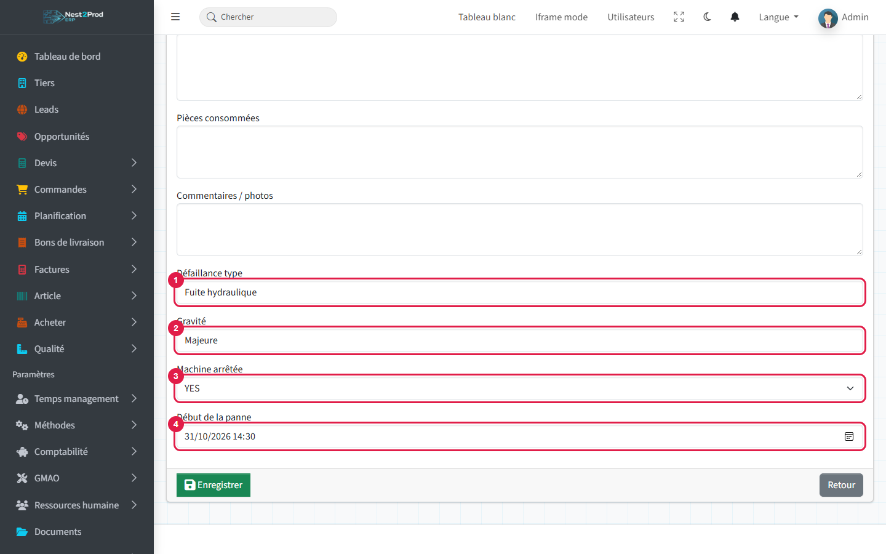

1. **Défaillance type** : la nature de la panne.
2. **Gravité**.
3. **Machine arrêtée** : YES si la machine ne peut plus produire.
4. **Début de la panne** : la date et l'heure de l'arrêt.

Puis suivez l'intervention comme aux sections 5 et 6.

> ⚠️ Si un champ est mal rempli, la page se recharge **sans message d'erreur** et l'ordre
> n'est pas créé. Vérifiez qu'il apparaît bien dans la liste.

---

## 8. Suivre les interventions

Menu **GMAO › Ordres de travail** : tous les ordres de travail, avec leur équipement, leur type,
leur priorité, leur statut et leur technicien.

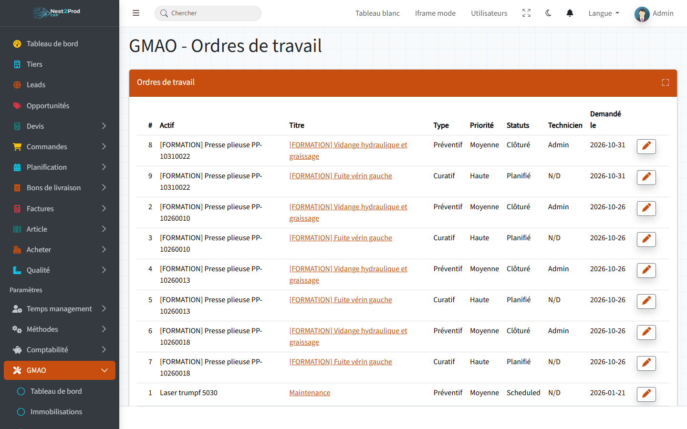

La **fiche équipement** garde l'historique de ses interventions :

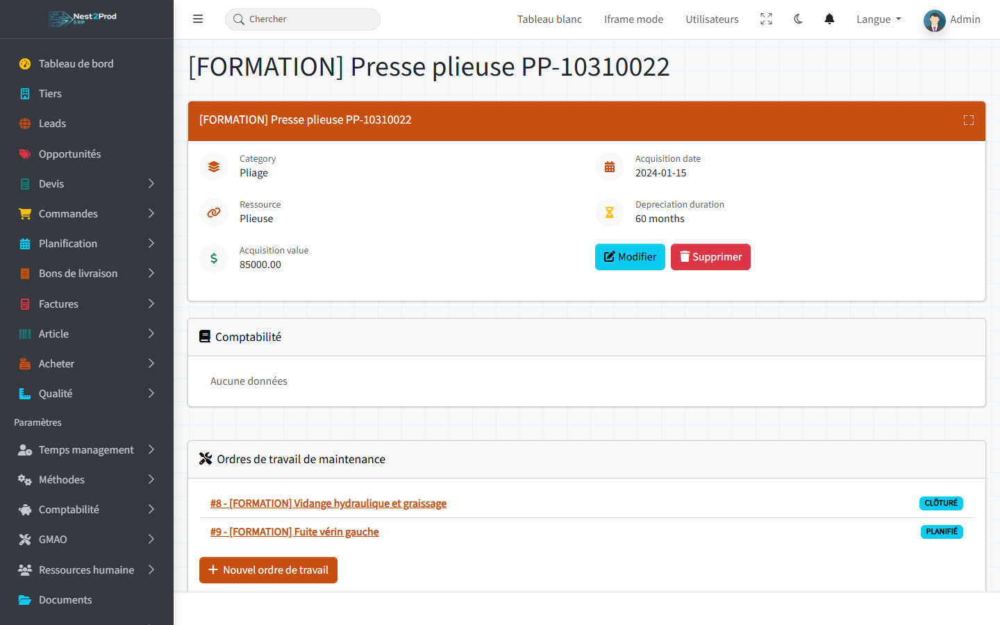

## Et ensuite ?

- Renseigner la **durée réelle** et le **début de la panne** sur chaque ordre : ils
  serviront aux indicateurs MTBF et MTTR du tableau de bord.
- Affecter un **régime horaire** à la machine (guide « Temps, horaires et congés ») : un
  arrêt machine se retire alors de sa vraie capacité dans le planning de charge.

## Questions fréquentes

**Mon plan de maintenance n'a créé aucun ordre de travail à l'échéance.**
Les ordres sont créés chaque matin à 6 h, le nombre de jours d'avance choisi avant
l'échéance. Vérifiez sur la fiche du plan que la génération automatique est cochée et, pour
un plan périodique, que la périodicité est renseignée. Un plan qui a déjà un ordre ouvert
attend que celui-ci soit terminé ou clôturé. Les plans aux heures machine ou aux cycles ne
génèrent rien tout seuls. Les plans créés avant cette fonction ont la génération décochée :
modifiez-les (**Modifier le plan**) pour l'activer.

**Un plan à date fixe ne revient plus.**
C'est normal : un plan à date fixe ne crée qu'un ordre. Pour une intervention qui revient,
choisissez « Périodique (calendrier) » et une périodicité.

**Les indicateurs MTBF et MTTR restent à « — ».**
Ils ne sont pas encore calculés. La durée réelle et le début de la panne saisis sur chaque
ordre de travail serviront à les calculer.

**Ma machine n'apparaît pas dans la liste des ressources de l'équipement.**
Créez-la d'abord dans Méthodes › Ressources.
