**Objectif** : comprendre le rôle de chaque catégorie du menu **Méthodes** et la paramétrer
dans le bon ordre.

Les Méthodes décrivent **comment travaille votre atelier** : ce que vous savez faire
(services), avec quoi (ressources, outils), comment vous comptez (unités) et comment vous
classez vos articles (familles). Vous ne les remplissez qu'une fois, mais **tout le reste en
dépend** : le chiffrage des devis, les gammes de fabrication, le planning de charge,
l'écran opérateur et les achats de sous-traitance.

## Avant de commencer

- Il faut la permission **Méthodes**, généralement réservée au responsable méthodes ou à
  l'administrateur.
- Préparez la liste de vos postes de travail (laser, plieuse, soudure…), leur **taux
  horaire** et leur **capacité** en heures par semaine.
- Les **utilisateurs** doivent déjà exister : chaque section a un responsable.

## Dans quel ordre paramétrer

Chaque catégorie s'appuie sur la précédente : suivez cet ordre.

```steps
Unités
Services
Familles
Sections
Ressources
Emplacements
Outils
Délais inter-opérations
Nomenclatures standard
```

| Catégorie | À quoi elle sert | Où elle est réutilisée | Il faut d'abord |
|---|---|---|---|
| Unités | Compter : pièce, kg, mètre… | Lignes de devis, de commande et d'achat, articles | — |
| Services | Ce que l'atelier sait faire, et à quel prix | Gammes, chiffrage, planning, écran opérateur, achats | — |
| Familles | Classer les articles | Fiche article, nesting, inventaire | un service |
| Sections | Regrouper les postes (atelier, îlot) | Ressources, planning, RH, sécurité | un utilisateur |
| Ressources | Les machines et les postes manuels | Planning de charge, affectation des tâches, écran opérateur | une section et un service |
| Emplacements | Les zones de l'atelier | Vue d'ensemble méthodes | une ressource |
| Outils | L'outillage réservable | Opérations de gamme, stock d'outillage | — |
| Délais inter-opérations | Le temps d'attente entre deux opérations | Calcul des dates du planning | des services productifs |
| Nomenclatures standard | Les gammes types réutilisables | Carte « Modèles standards » des gammes | des services |

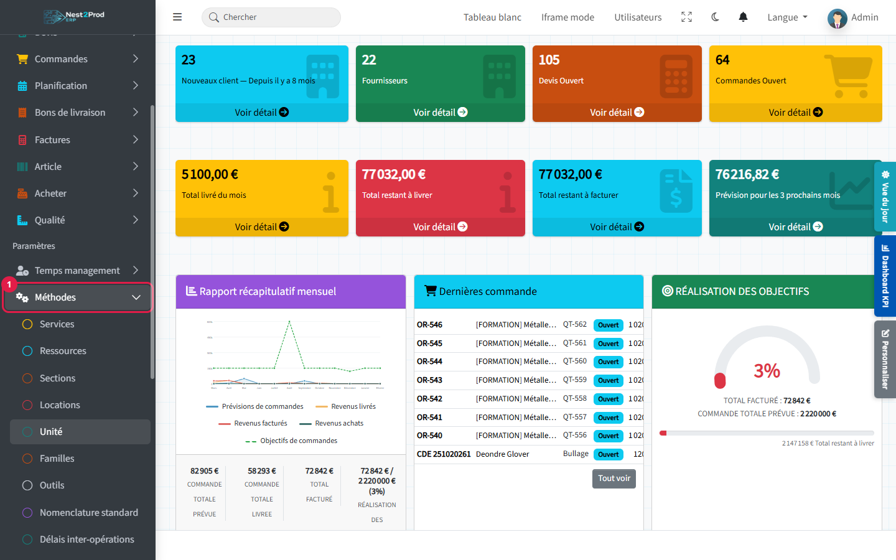

> 💡 Tous les écrans se présentent de la même façon : la liste à gauche, avec un bouton
> « Modifier » par ligne, et la carte de création à droite, validée par « Soumettre ».
>
> ⚠️ L'**ID externe** (le code) ne se modifie plus après la création, et une catégorie ne se
> supprime pas (sauf les délais inter-opérations). Choisissez des codes courts et stables :
> LASER, PLI, SOUD…

---

## 1. Unités : comment on compte

L'unité indique comment se compte une quantité : pièce, kilogramme, mètre, mètre carré…

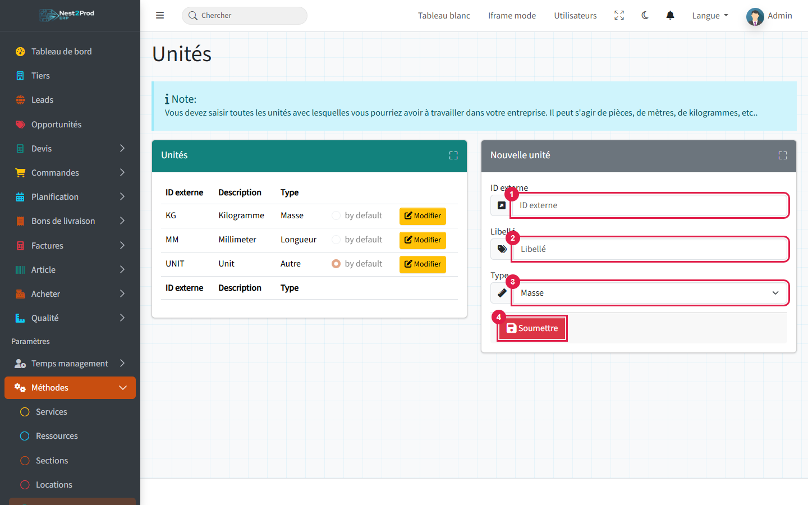

1. **ID externe** : code court (U, KG, M).
2. **Libellé** : nom affiché.
3. **Type** : masse, longueur, aire, volume ou autre. C'est une simple information de classement.

> ⚠️ **Une unité doit être « Par défaut ».** C'est elle qui est proposée sur chaque nouvelle
> ligne de devis, de commande ou d'achat : sans elle, la création de ligne est refusée.
> Le réglage « Par défaut » se trouve dans la fenêtre « Modifier » d'une unité. En choisir
> une retire automatiquement ce réglage à l'ancienne.

---

## 2. Services : ce que l'atelier sait faire

C'est la catégorie la plus importante. Un service est un **savoir-faire** (découpe laser,
pliage, soudure, peinture sous-traitée…) ou une **nature d'achat** (tôle, visserie…).

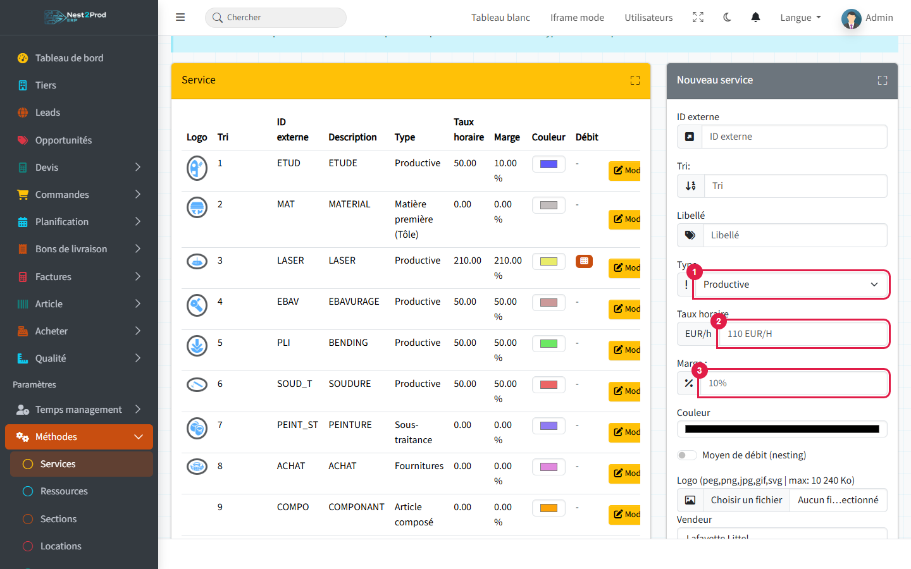

1. **Type** : il décide où le service apparaît (voir le tableau ci-dessous).
2. **Taux horaire** : coût d'une heure de ce poste. C'est lui qui chiffre les opérations.
3. **Marge** : en %, ajoutée au coût pour donner le prix de vente.

| Type | Sert à | Apparaît dans |
|---|---|---|
| Productive | Une opération faite en interne | Gamme opératoire, planning, écran opérateur |
| Sous-traitance | Une opération confiée à un fournisseur | Gamme opératoire ; l'écran opérateur propose une commande d'achat au lieu de Play |
| Matière première, Tôle, Profilé, Bloc | La matière | Nomenclature matières des gammes |
| Fournitures | Visserie, consommables | Nomenclature matières |
| Article composé | Un sous-ensemble fabriqué | Nomenclature, sous-ensembles, création d'article depuis une ligne |

**Comment le service chiffre une opération.** Dans une gamme, choisir un service remplit
le libellé, puis calcule :

- coût = (temps de réglage ÷ quantité + temps unitaire) × taux horaire ;
- prix = coût × (1 + marge).

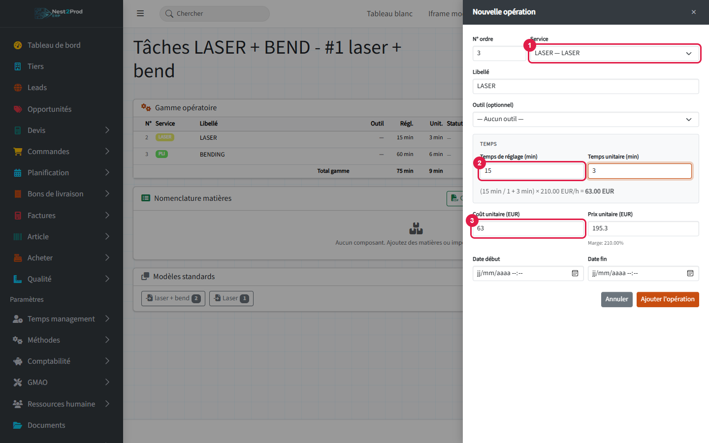

> ⚠️ Un service **sans taux horaire** donne un coût de 0 : l'opération est alors refusée,
> sauf si vous saisissez vous-même le coût et le prix. Renseignez un taux sur chaque service
> productif.
>
> 💡 Créez au moins un service de type **Article composé**, avec une famille rattachée :
> c'est ce qui permet le bouton « Créer l'article » depuis une ligne de devis ou de commande.
>
> 💡 L'interrupteur **Moyen de débit (nesting)** désigne les machines de découpe utilisées
> par l'imbrication tôle.

---

## 3. Familles : classer les articles

Une famille regroupe des articles semblables (tôle, tube, visserie…). Elle est obligatoire
sur chaque article.

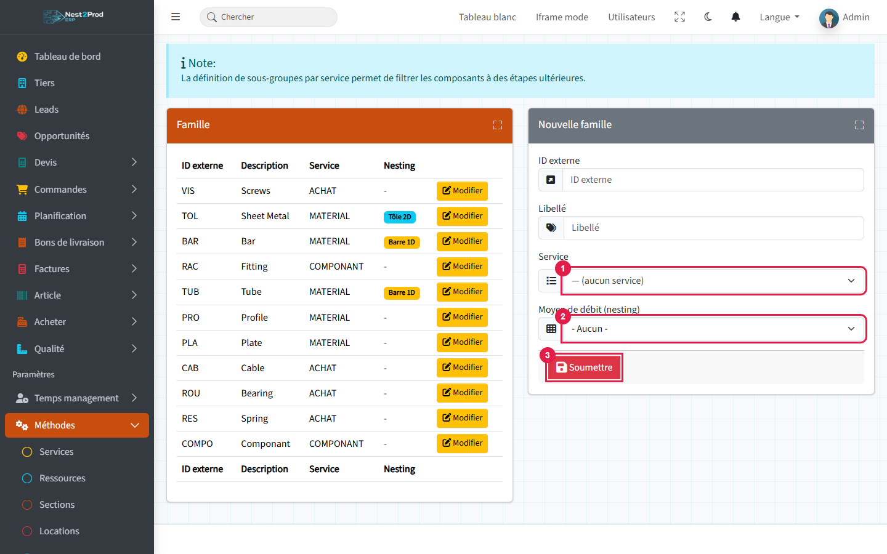

1. **Service** : la famille est rangée sous un service (une famille « Tôle » sous le service
   matière, par exemple). C'est ce qui filtre les composants proposés plus loin.
2. **Moyen de débit (nesting)** : **Tôle (2D)** pour les formats de tôle, **Barre (1D)**
   pour les barres et les tubes. L'imbrication et le calcul des besoins en matière s'en servent.

---

## 4. Sections : regrouper les postes

Une section est un regroupement de postes : un atelier, un îlot, un service (« Atelier
découpe », « Atelier soudure »…).

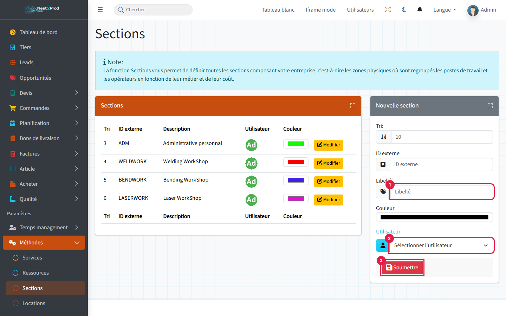

Renseignez le **libellé** et l'**utilisateur responsable**. Les sections organisent les
ressources dans le planning de charge et dans la vue d'ensemble. On les retrouve aussi
dans les modules Ressources humaines et Sécurité.

---

## 5. Ressources : les machines et les postes

Une ressource est **ce qui réalise le travail** : une machine (laser, plieuse) ou un poste
manuel (équipe de montage). C'est elle qui porte la **capacité** du planning.

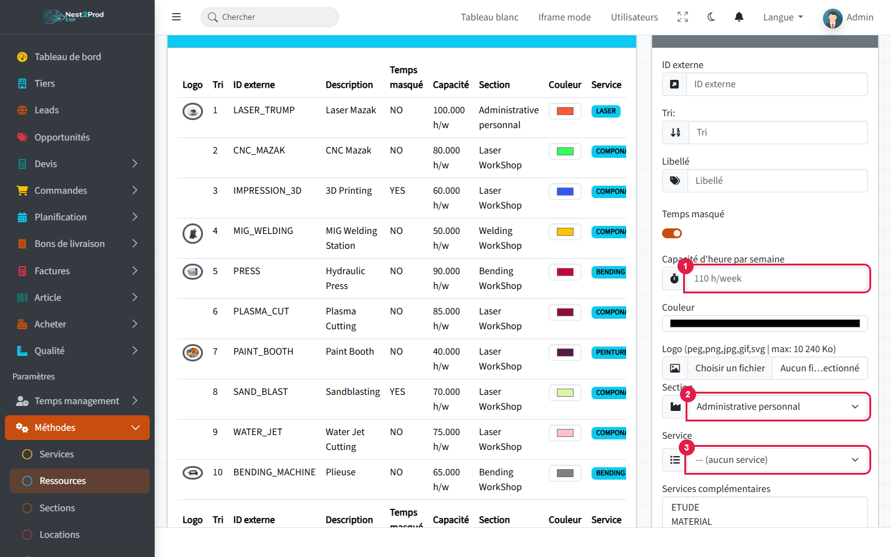

1. **Capacité d'heure par semaine** : les heures disponibles. Le planning de charge compare
   la charge à cette capacité.
2. **Section** : où se trouve la ressource.
3. **Service** : ce qu'elle fait en priorité. Les **services complémentaires** listent les
   autres opérations qu'elle sait faire, par ordre de préférence.

Autres réglages utiles :

- **Main-d'œuvre** : à cocher pour un poste composé de personnes et non d'une machine.
  **Opérateurs par heure** précise le besoin en personnel (0,5 = un opérateur pour deux machines).
- **Régime horaire** : les horaires de travail de la ressource (menu Temps). Sans régime,
  la capacité est répartie sur 5 jours.
- **Personnes habilitées** : les opérateurs autorisés sur ce poste.

> ⚠️ **Un service sans ressource n'est jamais planifié.** Ses tâches restent dans « Tâches
> non affectées » et sa capacité vaut zéro dans le planning. Vérifiez dans la vue d'ensemble
> que chaque service productif a au moins une ressource.

---

## 6. Emplacements : les zones de l'atelier

Un emplacement (entrée « Locations » du menu) est une zone de l'atelier rattachée à une
ressource. Il sert à repérer les postes dans la **vue d'ensemble méthodes**.

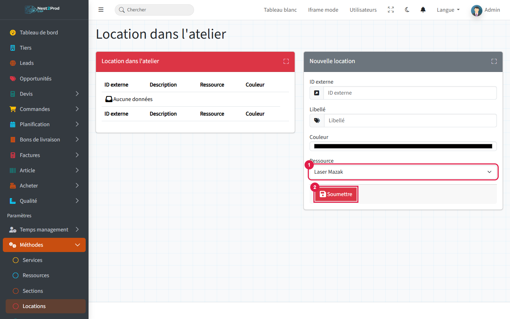

> 💡 Ce ne sont **pas** les emplacements de stock : ceux-là se gèrent dans le menu Stock.

---

## 7. Outils : l'outillage réservable

Les outils (poinçons, matrices, porte-outils…) peuvent être attachés à une opération de
gamme. Le logiciel refuse alors de réserver le même outil deux fois sur le même créneau.

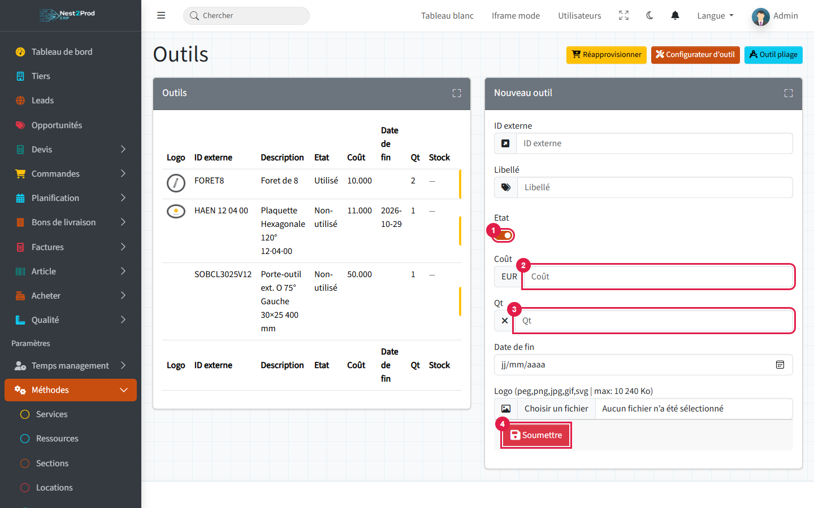

1. **Etat** : laissez l'interrupteur activé pour que l'outil soit proposé dans les gammes.
2. **Coût**.
3. **Qt** : le nombre d'exemplaires.

> 💡 Dans la fenêtre « Modifier », le bloc **Article de stock** crée ou relie un article
> pour suivre le stock de l'outil et le réapprovisionner (bouton « Réapprovisionner »).

---

## 8. Délais inter-opérations : le temps entre deux opérations

Certaines opérations ne s'enchaînent pas immédiatement : séchage après peinture,
refroidissement après soudure… Un délai se déclare **par paire d'opérations**, en heures
d'atelier.

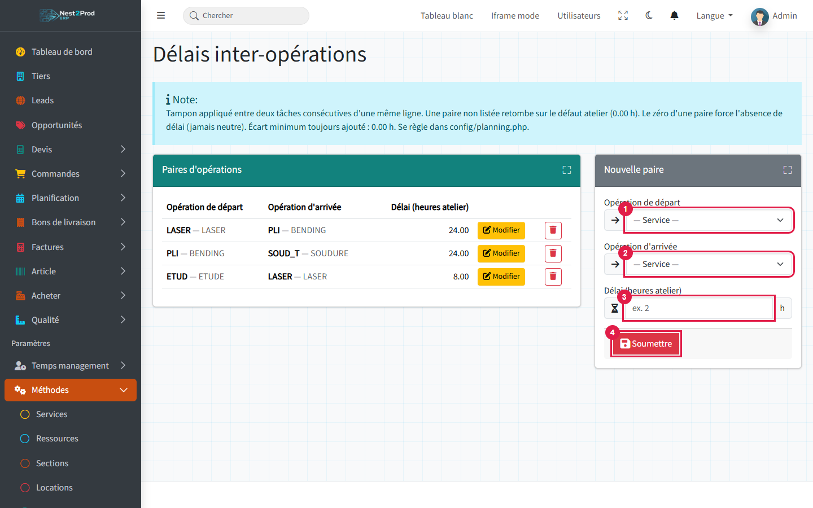

1. **Opération de départ**.
2. **Opération d'arrivée**.
3. **Délai** en heures d'atelier, puis « Soumettre ».

Le planning ajoute ce délai entre deux tâches consécutives d'une même ligne. Une paire non
listée n'a pas de délai.

---

## 9. Nomenclatures standard : les gammes types

Une nomenclature standard est un **modèle de gamme** (opérations et matières) que l'on
réutilise : « Laser + pliage », « Mécano-soudé peint »…

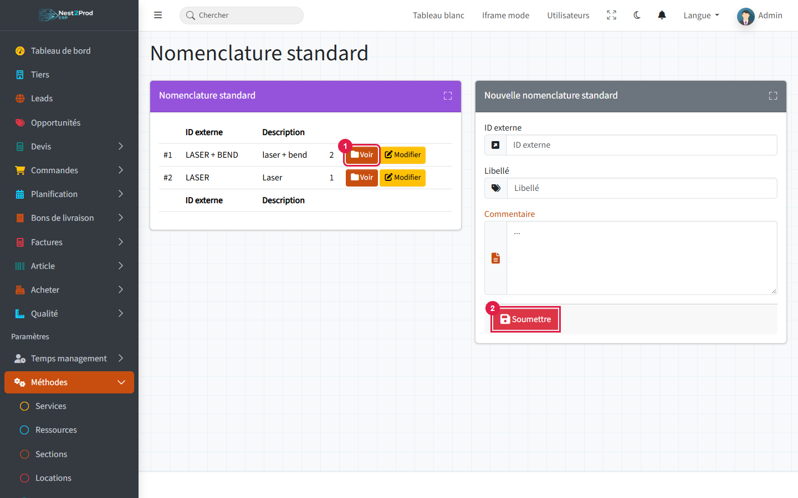

Créez le modèle (ID externe, libellé), puis cliquez sur « Voir » pour saisir ses opérations
et ses matières. L'écran est le même que celui de la gamme d'une ligne de devis.

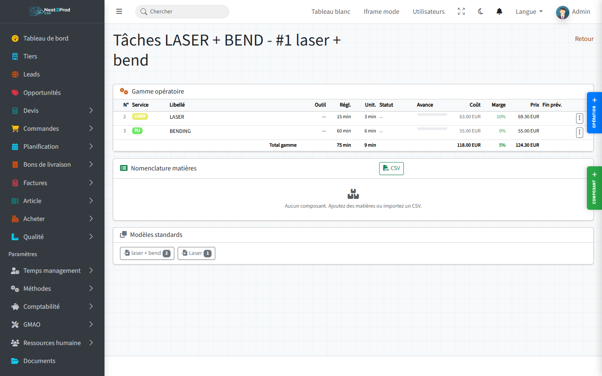

Sur la gamme d'une ligne de devis ou de commande, la carte **Modèles standards** propose
un bouton par modèle : un clic ajoute toutes ses opérations à la gamme.

> ⚠️ Les coûts du modèle sont calculés pour une pièce et recopiés tels quels : vérifiez
> les temps de réglage sur la gamme de la ligne quand la quantité est importante.

---

## Contrôler le paramétrage : la vue d'ensemble

Menu **Planification › Vue d'ensemble méthodes** : une carte par service, avec son nombre
de ressources et ses tâches en cours.

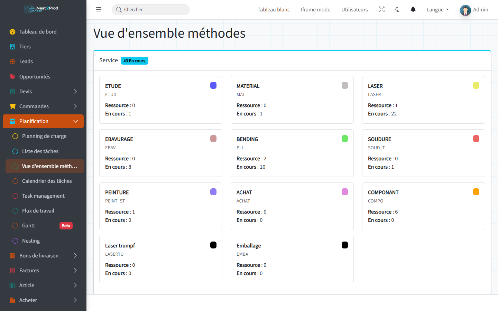

> 💡 Un service productif qui affiche **Ressource : 0** ne sera jamais planifié :
> rattachez-lui une ressource (étape 5).

## Questions fréquentes

**« Aucune TVA ou unité par défaut configurée » à la création d'une ligne de devis.**
Aucune unité n'est « Par défaut » : réglez-en une (étape 1).

**Mon opération est refusée dans la gamme.**
Son coût vaut 0 : le service n'a pas de taux horaire. Renseignez-le (étape 2), ou saisissez
le coût et le prix à la main.

**Le service n'apparaît pas dans la liste de la gamme opératoire.**
Seuls les types **Productive** et **Sous-traitance** y figurent. Les autres types
apparaissent dans la nomenclature matières.

**Mes tâches restent dans « Tâches non affectées » au planning.**
Aucune ressource n'est rattachée à leur service (étape 5).

**« Créer l'article » échoue depuis une ligne de devis.**
Il manque un service de type **Article composé** avec au moins une famille (étapes 2 et 3).

**Je me suis trompé de code.**
Le code ne se modifie pas : créez une nouvelle entrée avec le bon code et corrigez le
libellé de l'ancienne pour qu'elle ne soit plus choisie par erreur.
