**Goal**: prepare a new instance before the first quotes, in the right order, so that
your documents are correct from day one.

> 💡 Screenshots show the French interface; button names are given as they appear in the English interface.

**For whom**: the company administrator (permission **Your company**).

## In what order {#dans-quel-ordre}

```steps
Setup wizard
Factory settings
Accounting
Methods and business categories
Task workflow
Revenue target
Roles and users
Email
Imports
Operating options
```

## 1. The setup wizard {#lassistant-de-configuration}

When you first log in, an 8-step wizard asks for the information the application cannot
work without: the **company** (name, address, SIREN (French company number), VAT number,
logo), a **VAT** rate, a **payment condition**, a **payment method**, a **delivery
method**, a **unit**, your **role** (with its permissions) and the **estimated budget** of
the current year. Each value you enter becomes the **default** value.

The wizard is shown in the language of the page address: `/en/…` in English, `/fr/…` in
French.

> ⚠️ At the "Role & Rights" step, every permission is ticked by default: this is intended
> for the first account, which administers the instance. Menus have a readable label,
> specific rights (sign-offs, overrides) their technical name: their description can be
> read later in **Roles & permissions** (step 7). Also check that a **revenue target**
> exists for the current year (step 6): without a target, the dashboard sends you back to
> the entry screen.
>
> 💡 Everything the wizard asks for can be changed later in the screens below.

---

## 2. Factory settings {#reglage-societe}

Menu **Your company › Factory settings**, "Factory settings" tab. This information
appears on all your documents (quotes, orders, invoices).

**Identity**: name, address, postal code, city, country, phone, email.

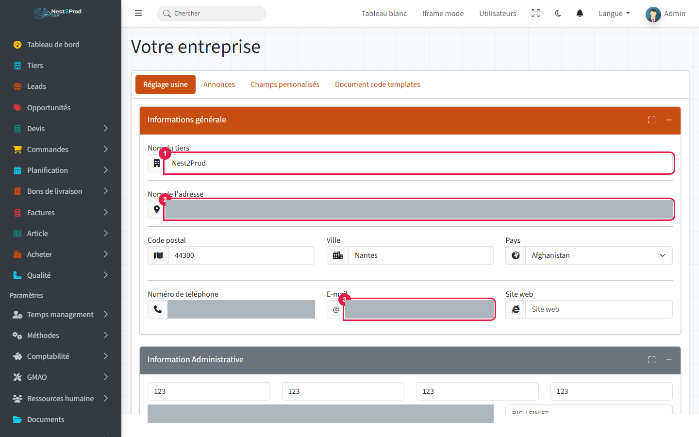

**Administrative information**: **SIREN** (9 digits), **EU VAT number**,
IBAN and BIC. The SIREN and the VAT number are required for electronic invoicing.

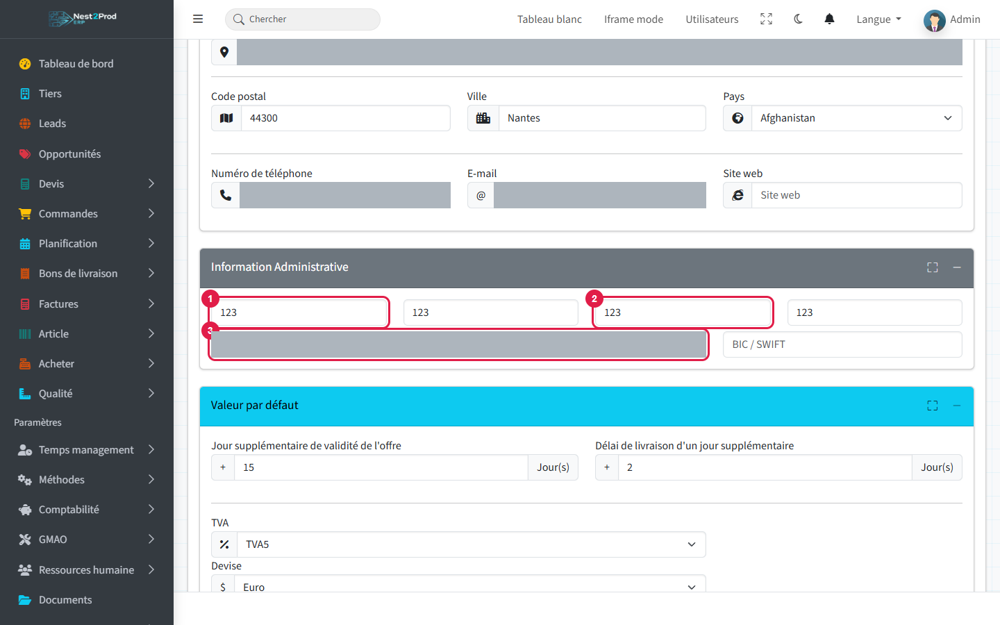

**Default values**: quote validity period, delivery lead time, the company's **VAT**,
**currency** and **first month of the financial year**.

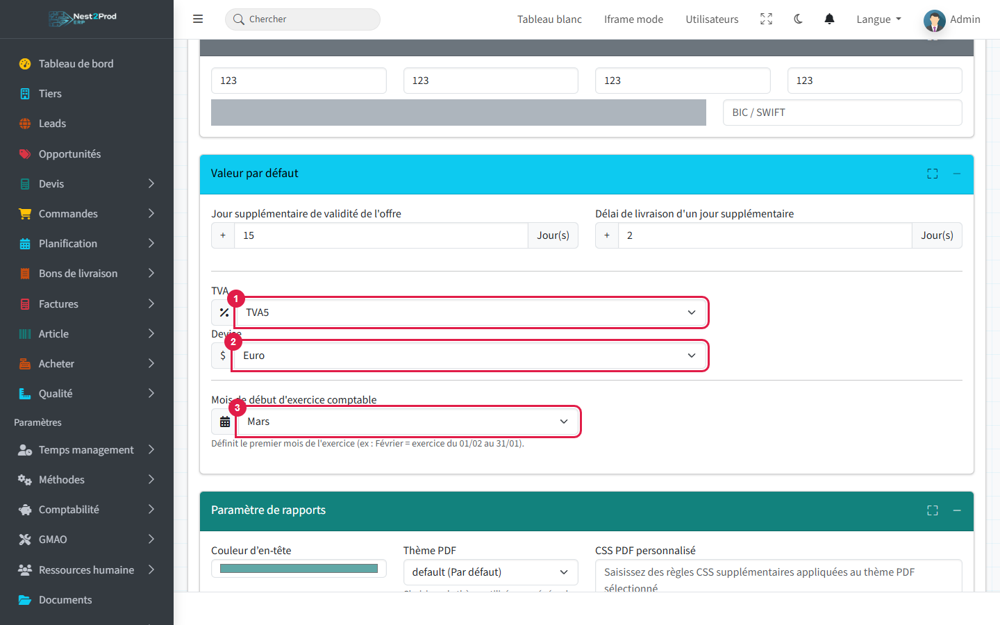

The form continues with the PDF theme, your **terms and conditions** (a link or a PDF file
added after quotes and orders), the logo and the optional modules. Finish with "Submit".

> ⚠️ After the wizard, check the **country** and the **currency**: if they have never been
> saved, the list shows its first value, not yours.

### Document numbering

"Document code templates" tab: the number format for each document type
(quote, order, delivery note, invoice, purchases…). Example: `FAC{yy}{mm}{id(4)}` gives FAC26100001.

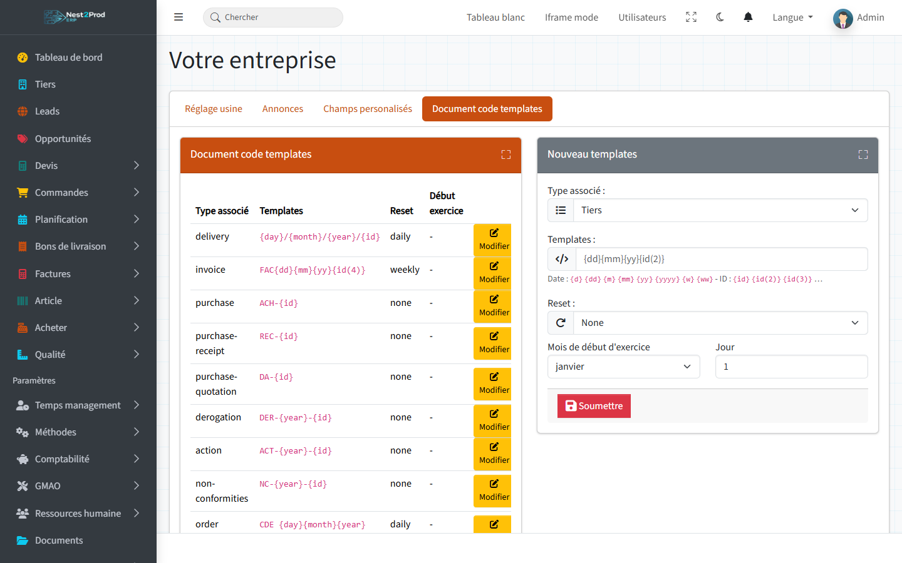

- Date tokens: `{d}` `{dd}` `{m}` `{mm}` `{yy}` `{yyyy}` `{w}` `{ww}`;
  number: `{id}`, or `{id(4)}` for 4 digits.
- **Reset**: start again from 1 every day, week, month or year, or never.

> ⚠️ Set up the numbering **before** the first invoice: once an invoice has a number,
> it never changes.

---

## 3. Accounting {#comptabilite}

Menu **Accounting**: VAT, payment conditions, payment methods, delivery methods
and accounting allocations. All these screens work the same way: the list on the left,
creation on the right.

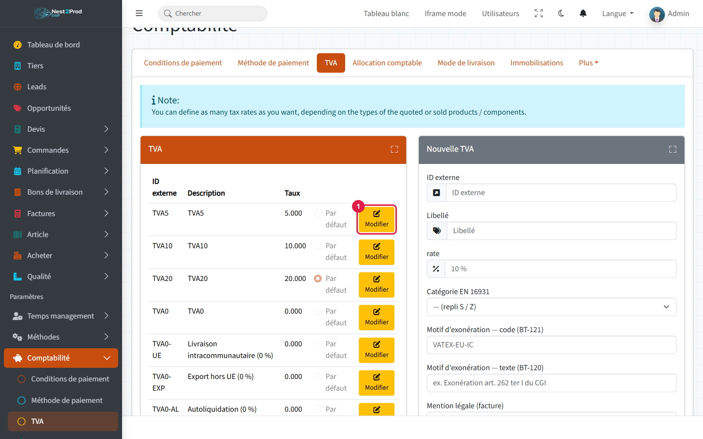

> ⚠️ Each list must have a **default** value: without a default VAT and unit, creating
> a quote, order or purchase line is refused. The "By default" setting is made in the
> **"Edit"** window, not at creation.

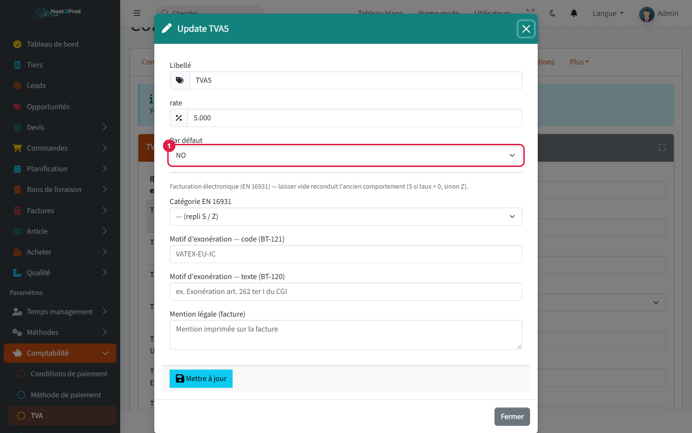

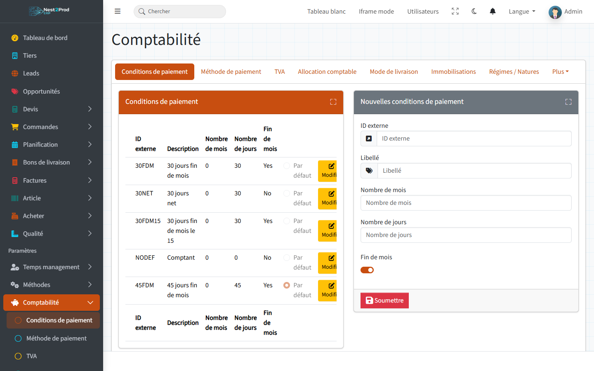

The **payment method** also holds the cash account used for payment receipt entries
(account field).

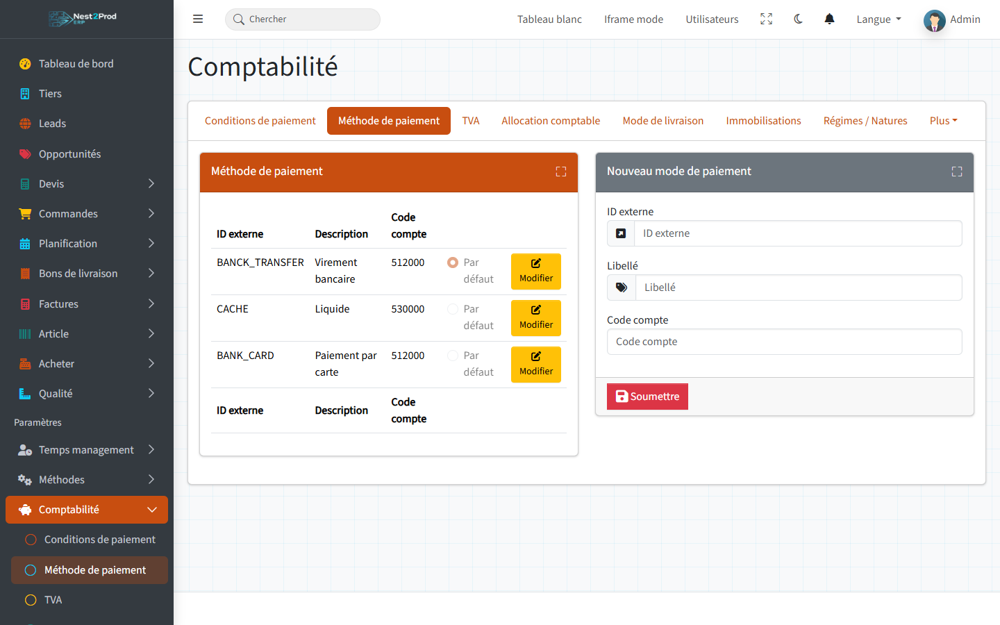

> 💡 The "Edit" window of a VAT rate also holds the **legal mention** printed on
> invoices (exemption, reverse charge…). The **accounting allocations** link each
> VAT rate to its sales and purchase accounts: without them, no entry is generated.

---

## 4. Methods and business categories {#methodes-et-categories-daffaire}

Units, services and hourly rates, families, sections, resources… Follow the guide
"Methods, the workshop dictionary".

### Business categories

Menu **Methods › Business categories**. A category classifies your business (flow
metering, pyrometry, mechanics…). It is chosen on the opportunity, then carries over by
itself to the quote created from it and to the order converted from the quote. It can
also impose rules.

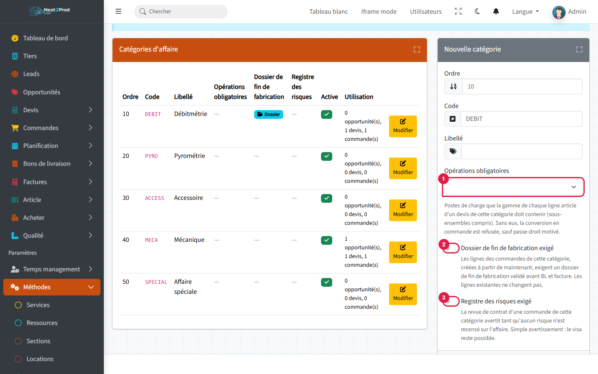

In "New category", fill in the **Code** (it cannot be changed afterwards), the **Label**
and the display **Order**, then set the three requirements:

1. **Required operations**: the work centres that the routing of every line of a quote in
   this category must contain. Without them, converting the quote into an order is
   refused, unless overridden with a reason (`required-operations-override` right).
2. **End-of-manufacturing file required**: the lines of orders in this category will need
   a validated file before the delivery note and the invoice.
3. **Risk register required**: the order's contract review warns as long as no risk has
   been recorded on the affair. Warning only, the sign-off remains possible.

Finish with "Submit". To change a category: "Edit" button on its line (same settings,
plus the **Active** box), then "Update".

> ⚠️ The end-of-manufacturing file only applies to order lines created **after** the
> setting: existing lines do not change.
>
> 💡 A category already in use cannot be deleted: untick **Active**. It is no longer
> offered but stays on the documents that carry it.

### Loss reasons

Menu **Methods › Loss reasons**: the reasons offered when a quote is set to **Lost** or an
opportunity to **Closed lost** (price, lead time, technical, competitor, no follow-up).
They feed the lost business indicator of the Quotes screen.

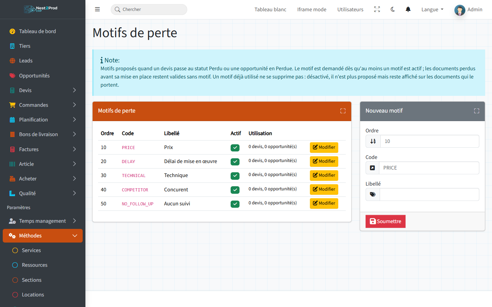

> ⚠️ As soon as at least one reason is **active**, a reason is required to set a quote or
> an opportunity to lost. To never ask for one, deactivate them all.

---

## 5. Task workflow {#flux-des-taches}

Menu **Your company › Task Workflow**: the statuses that manufacturing operations go
through. Without any status, quotes, orders, purchases and production send you
to this screen.

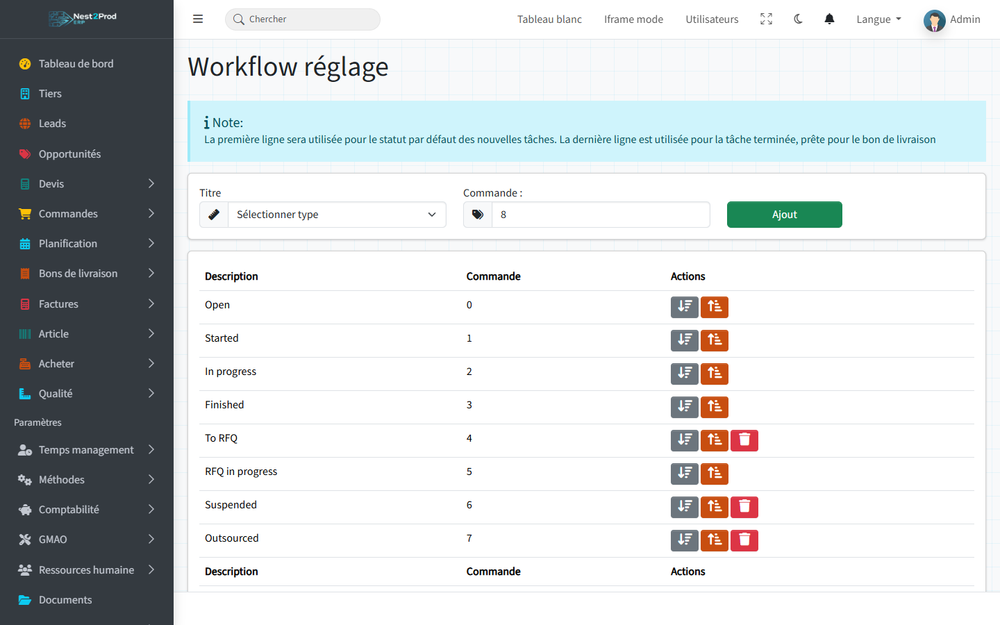

Create the statuses in this order, choosing their title from the list:
**Open**, **Started**, **In progress**, **Finished**, **Suspended**, **To RFQ**,
**RFQ in progress**, **Outsourced**, **Supplied**.

> ⚠️ The titles are not translated and cannot be renamed: the software recognises a
> started operation by "In progress" and a finished one by "Finished". The first line is the
> status of new operations.

---

## 6. Revenue target {#objectif-de-chiffre}

Menu **Your company › Estimated budget**: the revenue target,
month by month, shown on the dashboard.

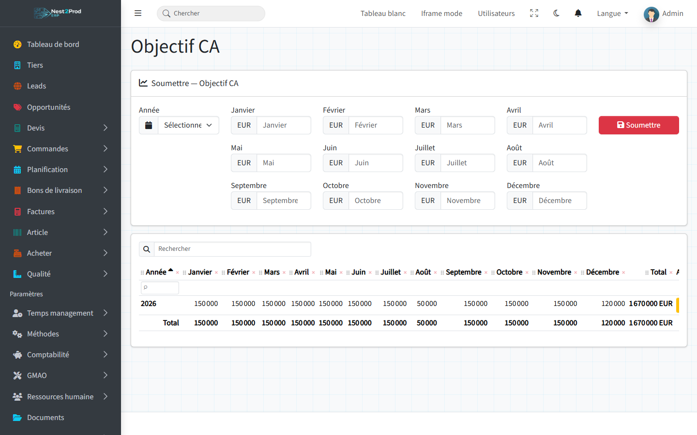

> ⚠️ A target is mandatory for the **current year**: remember to enter the one for
> the following year before 1 January.

---

## 7. Roles and users {#roles-et-utilisateurs}

### Roles and permissions

Menu **Your company › Roles & permissions**. A **role** groups **permissions**:
one permission per menu (quotes, orders, purchases, accounting…) plus **specific
rights** that allow a sign-off or an override.

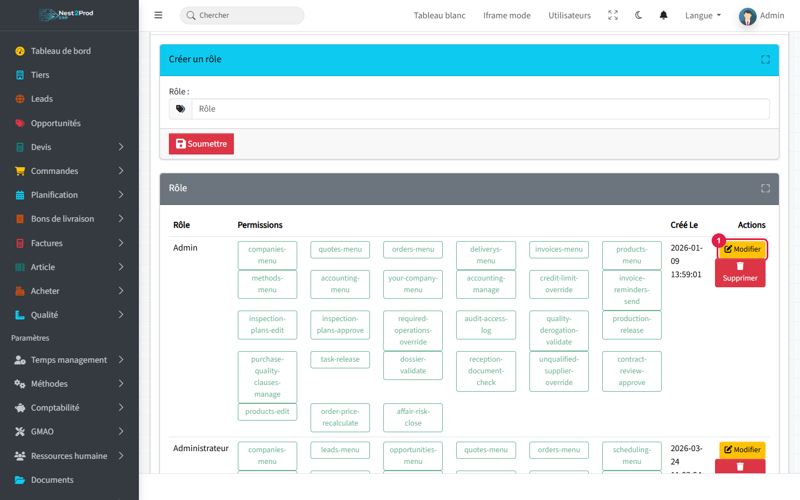

1. Click "Edit" on the role's line.
2. Tick its permissions, then "Update".

Each permission is shown with its **description**: what it opens, in one sentence. In the
list of roles, the description also appears when hovering over a permission, and the
"Permissions" tab lists them all.

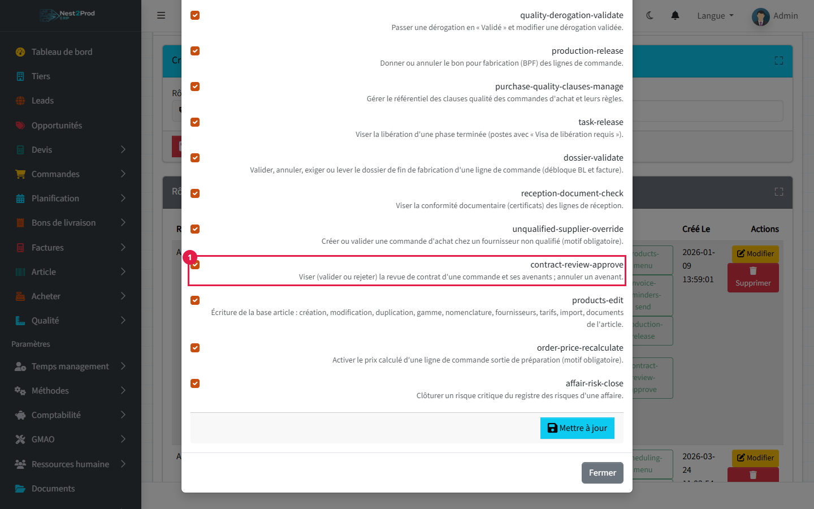

- Keep the **Admin** role for the administrator: new permissions added by
  updates are given to it automatically.
- Create one role per job (sales, workshop, accountant…), then tick its permissions
  in "Edit".

> ⚠️ The "Delete" buttons act without confirmation.

#### Specific rights to assign

Recent updates added sign-off and override rights. They are only given to the **Admin**
role: add them to the roles of the people in charge.

| Permission | What it allows | Give it for example to |
|---|---|---|
| `contract-review-approve` | Sign off (approve or reject) an order's contract review and its amendments | Management, sales manager |
| `order-price-recalculate` | Switch an order line back to calculated price after preparation (reason required) | Sales manager |
| `required-operations-override` | Convert a quote into an order although a required operation is missing (reason required) | Methods manager |
| `affair-risk-close` | Close a critical risk in an affair's risk register | Project manager, management |
| `production-release` | Grant or cancel the production release of order lines | Production manager |
| `task-release` | Sign off a finished phase (work centres with "Release sign-off required") | Inspector, workshop manager |
| `dossier-validate` | Validate a line's end-of-manufacturing file (unblocks delivery note and invoice) | Quality |
| `quality-derogation-validate` | Set a derogation to "Validated" | Quality manager |
| `reception-document-check` | Sign off the certificates of receipt lines | Quality, stores |
| `unqualified-supplier-override` | Order from an unqualified supplier (reason required) | Purchasing manager |
| `purchase-quality-clauses-manage` | Manage the quality clauses of purchase orders | Quality manager |
| `audit-access-log` | View and export the access log | Administrator |

> ⚠️ Special case: `products-edit` (change the product base) was given automatically to
> **every role** that had the Products menu. Remove it from roles that should only view
> products: they keep read access (`products-menu`).
>
> 💡 The other specific rights (`credit-limit-override`, `invoice-reminders-send`,
> `inspection-plans-edit`, `inspection-plans-approve`, `accounting-manage`) read the same
> way: their description is shown under their name.

### Users

Menu **Human resources › Users list**.

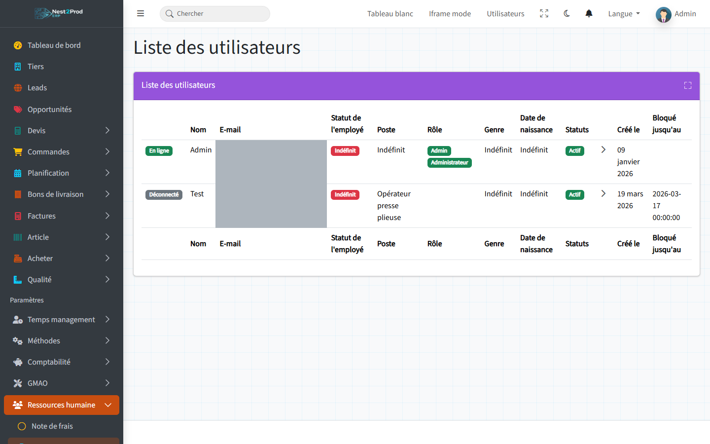

A new user registers themselves (registration page, if your installer has
enabled it) or is imported from the company directory (LDAP). They must then **confirm their
email address**: so the email configuration (step 8) must be done first.

To give them their rights: open their record, **HR information** tab, choose their
**Role**, then "Update".

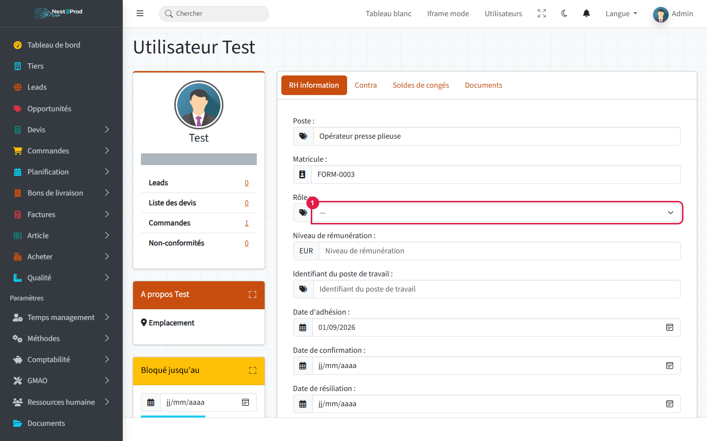

> ⚠️ A user without a role shows "—": left as is, they remain without a role and see no
> menu. You cannot change your own role (the field does not appear on your own record).

---

## 8. Email {#e-mail}

Menu **Your company › Email settings**: the sending server (SMTP) that sends
quotes, invoices, reminders and notifications.

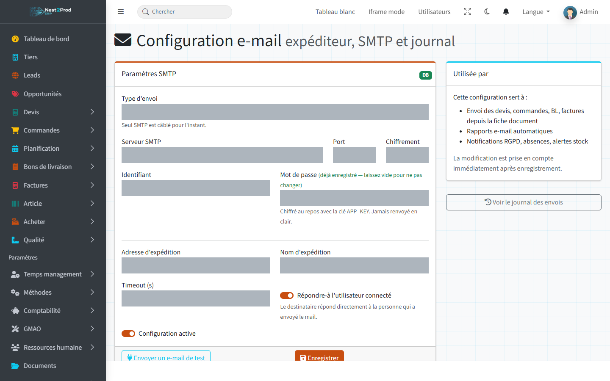

Fill in the server, port, encryption, username and password,
the sender address and name, then "Save" and **"Send a test email"**.

> 💡 Email texts are set in **Template mail** (one template per document
> type). The **Email log** keeps a record of every email sent.

---

## 9. Bringing in your data {#reprendre-vos-donnees}

Menu **Your company › Imports/Exports**, **"Import data"** tab: import customers, products,
quotes and orders from an **Excel (.xlsx, .xls) or CSV file**, for instance the export of your
former software. The lines of a quote or an order are imported from the "Lines Import" tab of
its page, and the routing of a line from the "CSV / Excel" button of the routing screen.

```steps
Type and file
Mapping and preview
Import
```

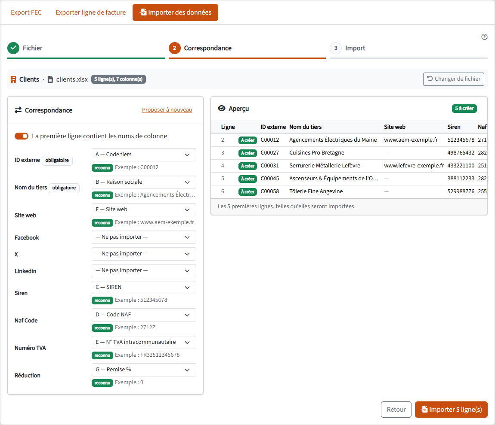

1. Choose what you import, then drop the file (or click to choose it). The **"Download an
   Excel template"** link gives an empty workbook with the right columns.
2. For each ERP field, the wizard suggests the **file column** from its name ("Company name",
   "Description", "Thickness (mm)"…): check it, change it in the list or choose "Do not
   import". The **preview** shows the first lines as they will be imported, each marked
   **New**, **Update** (existing product) or **Rejected** with the reason (empty required
   field, customer not found, code already existing, unreadable number or date…). Nothing is
   saved yet.
3. Click **"Import"**: the result tells how many lines were created and rejected. The chosen
   mapping is remembered for the next file with the same columns.

> ⚠️ Only the **first sheet** of an Excel workbook is read. Import **customers before quotes
> and orders**: these are linked by the customer code, and the customer needs a default
> address and contact. A customer, quote or order whose code already exists is rejected (no
> duplicate if you import the same file twice).
>
> 💡 A CSV file may be separated by semicolons, commas or tabs, and saved in UTF-8 or as
> Excel's "CSV (semicolon delimited)": accents are kept. Dates such as 25/06/2026 and
> decimal commas are accepted.

---

---

## 10. Operating options {#options-dexploitation}

A few settings are not in the application: they are set in the server's **configuration
file**. Ask your installer for them, quoting the setting's name. Guides that depend on an
option only appear in the **Guides** menu when it is enabled.

### Time zone (`APP_TIMEZONE`)

Without this setting, the application counts hours in universal time: in France, clock-in
times and the "now" line of the schedule are then **1 hour behind in winter, 2 hours in
summer**. Ask for `APP_TIMEZONE=Europe/Paris` (or your own time zone) at installation.

> ⚠️ Changing the time zone of an instance already in use shifts the reading of hours
> already recorded: set it before the first clock-ins.

### Production release required (`PRODUCTION_REQUIRE_RELEASE`)

Disabled by default. When enabled, a production operation cannot start until its order
line has received its **production release**.

<!-- feature: production-release -->
The option is **enabled** on your instance: give the `production-release` right to the
people who release production, otherwise the workshop cannot start any operation. The
release is given on the order record, line by line or on the ticked lines.
<!-- /feature -->
<!-- feature: !production-release -->
The option is **disabled** on your instance: no operation is blocked and nothing about the
production release is shown.
<!-- /feature -->

### Qualified supplier required (`PURCHASES_REQUIRE_QUALIFIED_SUPPLIER`)

Disabled by default. When enabled, a purchase order can only be created or validated with
a supplier whose latest evaluation is **approved** and up to date.

<!-- feature: qualified-supplier -->
The option is **enabled** on your instance: evaluate your usual suppliers (company record,
evaluation tab) before ordering. For an urgent order with an unqualified supplier, the
`unqualified-supplier-override` right allows going ahead with a reason.
<!-- /feature -->
<!-- feature: !qualified-supplier -->
The option is **disabled** on your instance: no order is blocked and no qualification
status is shown.
<!-- /feature -->

### Access log (`AUDIT_LOG_READS`)

Disabled by default. When enabled, the application records **who opened** sensitive
records: opportunities, quotes, orders, order lines, document files and batches. The same
record opened several times by the same person is only recorded once every 10 minutes.

<!-- feature: access-log -->
The option is **enabled** on your instance. The log is read in **Your company › Access
log** (`audit-access-log` right): filters by user, record type, number and dates, and CSV
export.

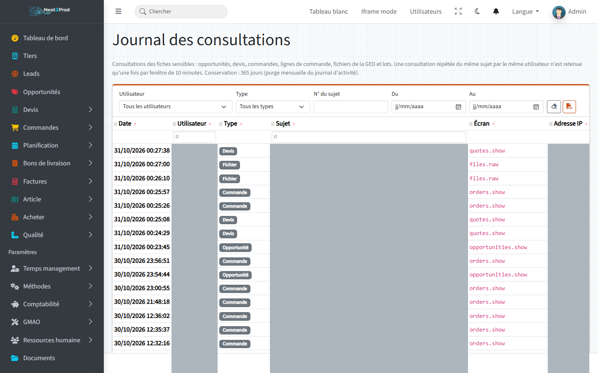

> 💡 The log is kept for 365 days, then purged with the change history.
<!-- /feature -->
<!-- feature: !access-log -->
The option is **disabled** on your instance: the **Access log** screen exists but records
nothing, and says so in a banner.
<!-- /feature -->

---

## What next? {#et-ensuite}

Each user can choose the look of the application: user menu (top
right) › **Profile**, **Appearance** tab (skin and main colour). Light
or dark mode is set with the button in the top bar.

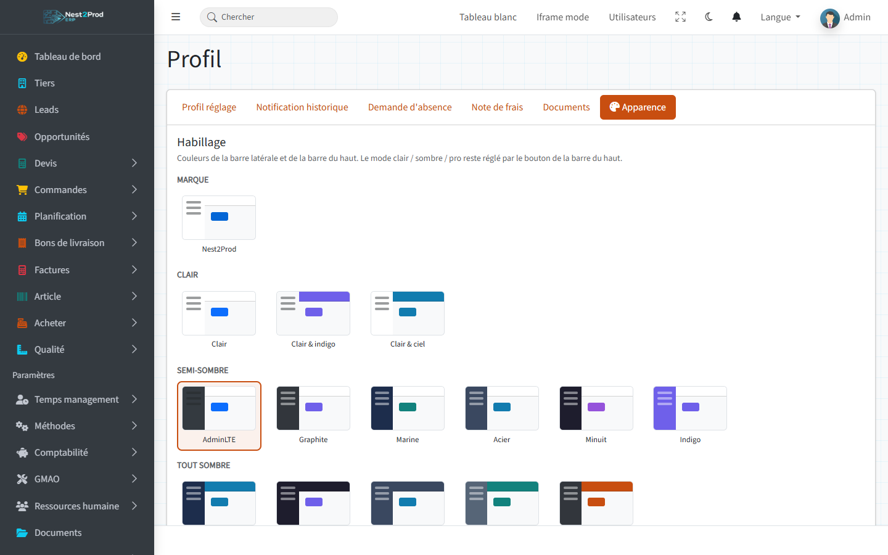

Your instance is ready: follow the guide **"From prospect to invoice"** for the first
quote.

## Frequently asked questions {#questions-frequentes}

**The application keeps sending me back to the setup wizard.**
A company, a VAT rate, a payment condition or method, a delivery method
or a unit is missing.

**"Aucune TVA ou unité par défaut configurée" (No default VAT or unit configured) when creating a line.**
No VAT rate or no unit is set "By default" ("Edit" window).

**I cannot set a quote to "Lost".**
A loss reason is required as soon as at least one reason is active (step 4): choose one in
the window that opens.

**Converting a quote into an order is refused: "Required operations missing".**
The quote's business category requires work centres that are missing from the routing
(step 4). Complete the routing, or have someone with `required-operations-override`
convert it.

**The dashboard sends me to the revenue target.**
There is no target for the current year (step 6).

**A user cannot see a menu.**
Their role does not have the permission for that menu (step 7), or they have no role.

**A sign-off or an override is refused.**
The user's role does not have the matching specific right: read the descriptions in
**Roles & permissions** (step 7).

**Clock-in times are one or two hours off.**
The time zone is not set (step 10, `APP_TIMEZONE`).
