**Objectif** : préparer une instance neuve avant les premiers devis, dans le bon ordre, pour
que les documents sortent justes dès le premier jour.

**Pour qui** : l'administrateur de la société (permission **Votre entreprise**).

## Dans quel ordre

```steps
Assistant de configuration
Réglage société
Comptabilité
Méthodes et catégories d'affaire
Flux des tâches
Objectif de chiffre
Rôles et utilisateurs
E-mail
Imports
Options d'exploitation
```

## 1. L'assistant de configuration

À la première connexion, un assistant en 8 étapes demande les informations sans
lesquelles l'application ne peut pas fonctionner : la **société** (nom, adresse, SIREN,
n° de TVA, logo), une **TVA**, une **condition de paiement**, un **moyen de paiement**, un
**mode de livraison**, une **unité**, votre **rôle** (avec ses permissions) et le **budget
prévisionnel** de l'année en cours. Chaque valeur saisie devient la valeur **par défaut**.

L'assistant s'affiche dans la langue de l'adresse de la page : `/fr/…` en français,
`/en/…` en anglais.

> ⚠️ À l'étape « Rôle & Droits », toutes les permissions sont cochées par défaut : c'est
> voulu pour le premier compte, qui administre l'instance. Les menus y portent un libellé
> lisible, les droits particuliers (visas, passe-droits) leur nom technique : leur
> description se lit ensuite dans **Rôles & permissions** (étape 7). Vérifiez aussi
> qu'un **objectif de chiffre** existe pour l'année en cours (étape 6) : sans objectif, le tableau de bord vous renvoie vers l'écran de saisie.
>
> 💡 Tout ce que demande l'assistant se modifie ensuite dans les écrans ci-dessous.

---

## 2. Réglage société

Menu **Votre entreprise › Réglage société**, onglet « Réglage usine ». Ces informations
figurent sur tous vos documents (devis, commandes, factures).

**Identité** : nom, adresse, code postal, ville, pays, téléphone, e-mail.

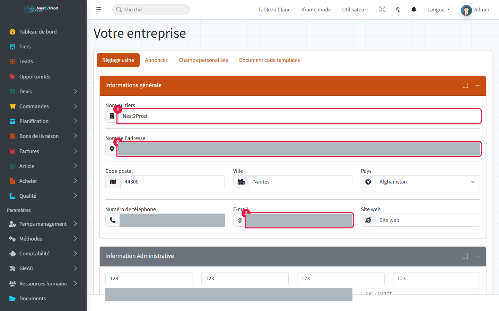

**Information administrative** : **SIREN** (9 chiffres), **n° de TVA intracommunautaire**,
IBAN et BIC. Le SIREN et le n° de TVA sont indispensables à la facture électronique.

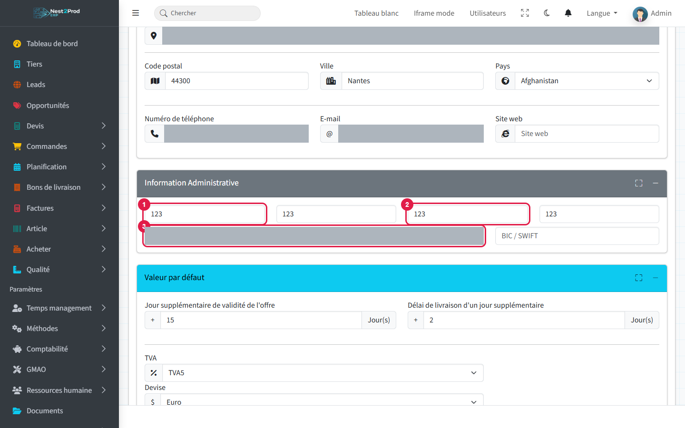

**Valeurs par défaut** : durée de validité des devis, délai de livraison, **TVA** de la
société, **devise** et **mois de début d'exercice** comptable.

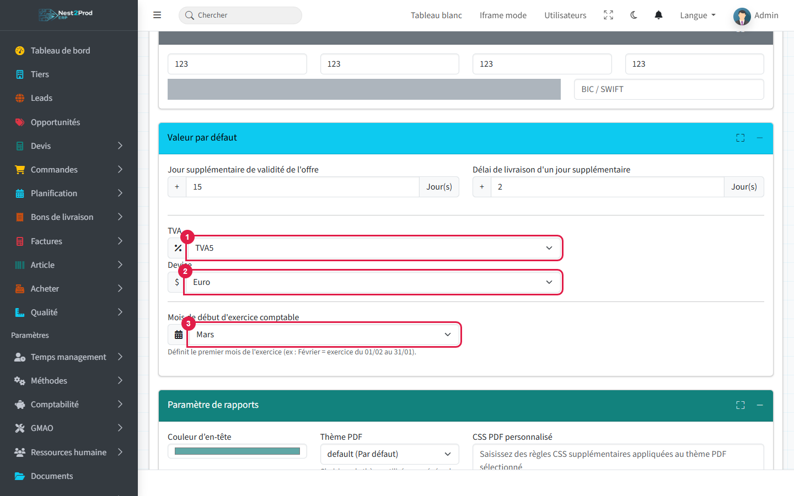

Le formulaire continue avec le thème des PDF, vos **CGV** (lien ou fichier PDF ajouté à la
suite des devis et commandes), le logo et les modules optionnels. Terminez par « Soumettre ».

> ⚠️ Après l'assistant, vérifiez le **pays** et la **devise** : s'ils n'ont jamais été
> enregistrés, la liste affiche sa première valeur, pas la vôtre.

### Numérotation des documents

Onglet « Document code templates » : le format du numéro de chaque type de document
(devis, commande, BL, facture, achats…). Exemple : `FAC{yy}{mm}{id(4)}` donne FAC26100001.

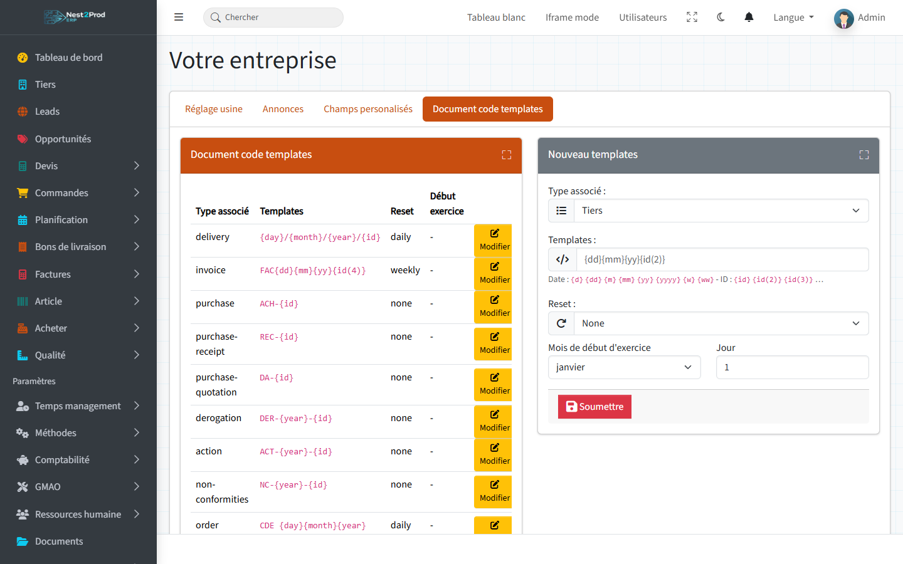

- Jetons de date : `{d}` `{dd}` `{m}` `{mm}` `{yy}` `{yyyy}` `{w}` `{ww}` ;
  numéro : `{id}`, ou `{id(4)}` pour 4 chiffres.
- **Reset** : repartir de 1 chaque jour, semaine, mois ou année, ou jamais.

> ⚠️ Réglez la numérotation **avant** la première facture : une facture numérotée ne
> change plus de numéro.

---

## 3. Comptabilité

Menu **Comptabilité** : TVA, conditions de paiement, modes de paiement, modes de livraison
et affectations comptables. Tous les écrans fonctionnent pareil : la liste à gauche, la
création à droite.

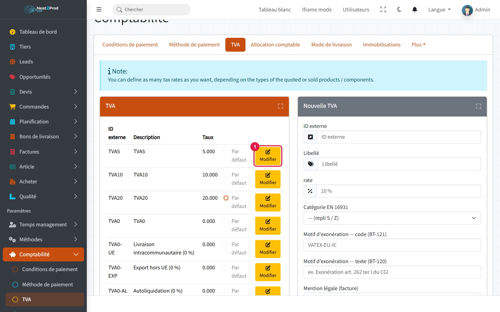

> ⚠️ Chaque liste doit avoir une valeur **par défaut** : sans TVA ni unité par défaut, la
> création d'une ligne de devis, de commande ou d'achat est refusée. Le réglage « Par
> défaut » se fait dans la fenêtre **« Modifier »**, pas à la création.

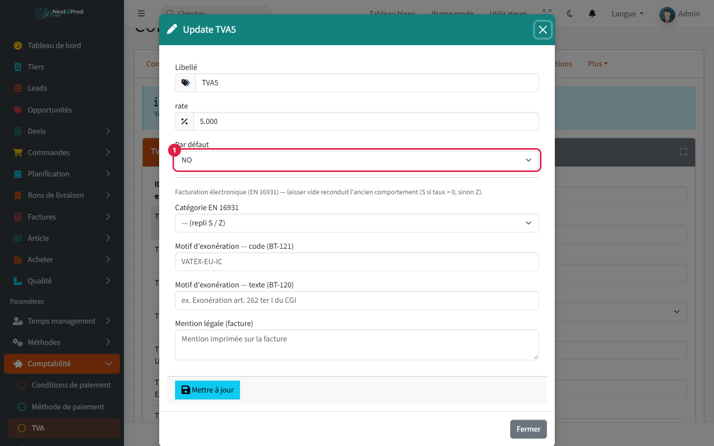

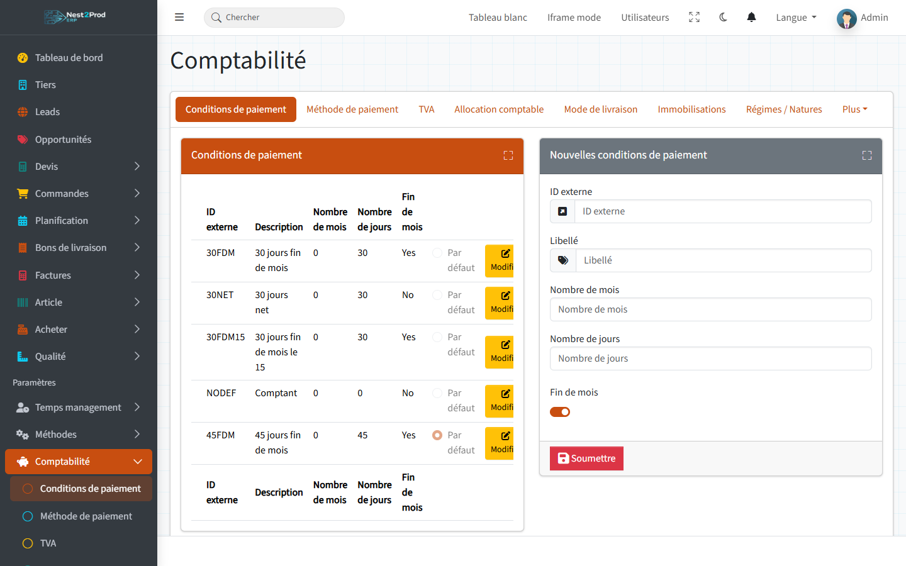

Le **mode de paiement** porte aussi le compte de trésorerie utilisé pour les écritures
d'encaissement (champ compte).

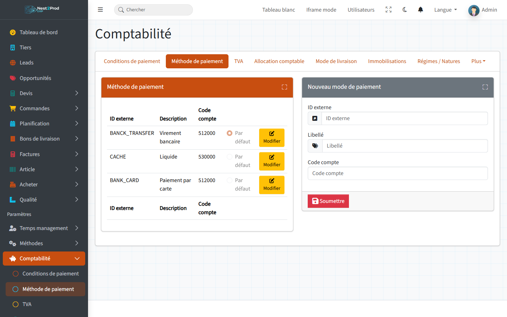

> 💡 La fenêtre « Modifier » d'une TVA porte aussi la **mention légale** imprimée sur les
> factures (exonération, autoliquidation…). Les **affectations comptables** relient chaque
> taux de TVA à ses comptes de vente et d'achat : sans elles, aucune écriture n'est générée.

---

## 4. Méthodes et catégories d'affaire

Unités, services et taux horaires, familles, sections, ressources… Suivez le guide
« Les Méthodes, le dictionnaire de l'atelier ».

### Catégories d'affaire

Menu **Méthodes › Catégories d'affaire**. Une catégorie classe vos affaires (débitmétrie,
pyrométrie, mécanique…). Elle se choisit sur l'opportunité, puis passe d'elle-même au devis
créé depuis elle et à la commande issue du devis. Elle peut aussi imposer des règles.

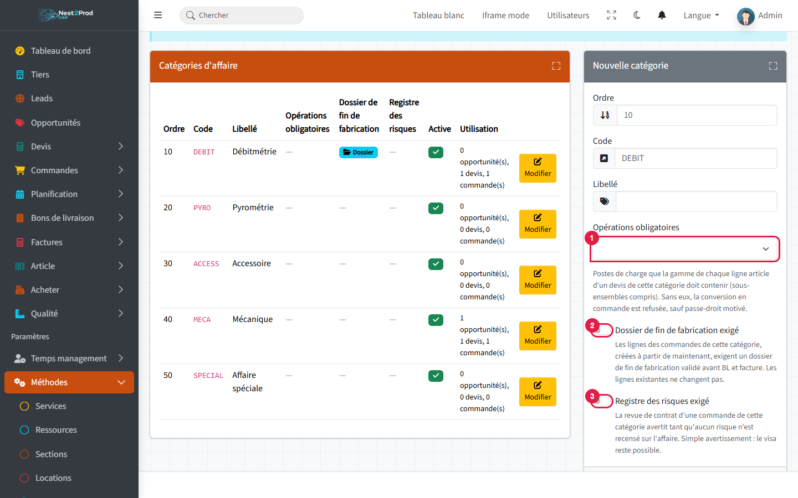

Dans « Nouvelle catégorie », remplissez le **Code** (il ne se modifie plus ensuite), le
**Libellé** et l'**Ordre** d'affichage, puis réglez les trois exigences :

1. **Opérations obligatoires** : les postes de charge que la gamme de chaque ligne d'un
   devis de cette catégorie doit contenir. Sans eux, la conversion du devis en commande
   est refusée, sauf passe-droit motivé (droit `required-operations-override`).
2. **Dossier de fin de fabrication exigé** : les lignes des commandes de cette catégorie
   devront avoir un dossier validé avant le bon de livraison et la facture.
3. **Registre des risques exigé** : la revue de contrat de la commande avertit tant
   qu'aucun risque n'est recensé sur l'affaire. Simple avertissement, le visa reste possible.

Terminez par « Soumettre ». Pour changer une catégorie : bouton « Modifier » de sa ligne
(mêmes réglages, plus la case **Active**), puis « Mettre à jour ».

> ⚠️ Le dossier de fin de fabrication ne s'applique qu'aux lignes de commande créées
> **après** le réglage : les lignes existantes ne changent pas.
>
> 💡 Une catégorie déjà utilisée ne se supprime pas : décochez **Active**. Elle n'est plus
> proposée mais reste affichée sur les documents qui la portent.

### Motifs de perte

Menu **Méthodes › Motifs de perte** : les raisons proposées quand un devis passe au statut
**Perdu** ou une opportunité en **Perdue** (prix, délai, technique, concurrent, aucun
suivi). Ils alimentent l'indicateur des pertes commerciales de l'écran Devis.

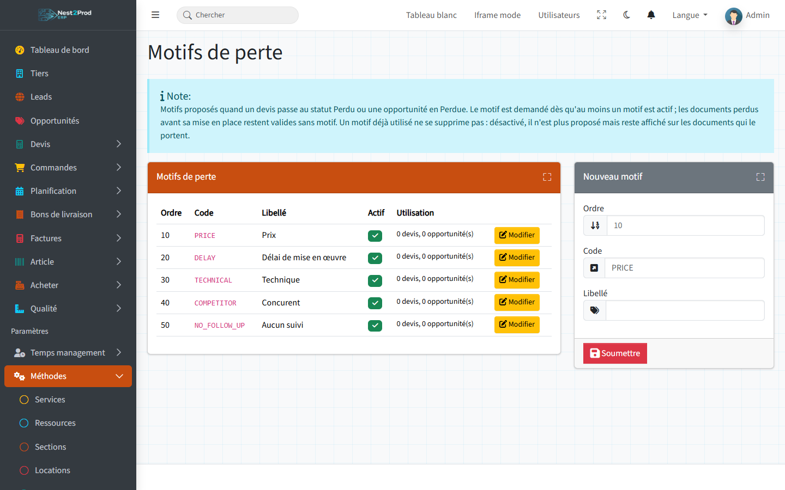

> ⚠️ Dès qu'au moins un motif est **actif**, il devient obligatoire pour passer un devis
> ou une opportunité en perdu. Pour ne pas en demander, désactivez-les tous.

---

## 5. Flux des tâches

Menu **Votre entreprise › Flux des Tâches** : les statuts que prennent les opérations de
fabrication. Sans aucun statut, les devis, commandes, achats et la production renvoient
vers cet écran.

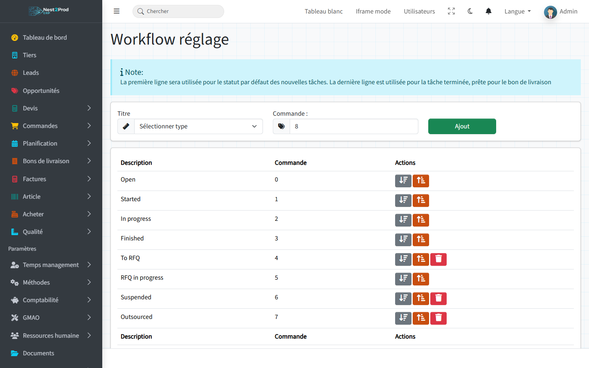

Créez les statuts dans cet ordre, en choisissant leur titre dans la liste :
**Open**, **Started**, **In progress**, **Finished**, **Suspended**, **To RFQ**,
**RFQ in progress**, **Outsourced**, **Supplied**.

> ⚠️ Les titres ne se traduisent pas et ne se renomment pas : le logiciel reconnaît une
> opération démarrée à « In progress » et terminée à « Finished ». La première ligne est le
> statut des nouvelles opérations.

---

## 6. Objectif de chiffre

Menu **Votre entreprise › Objectif de chiffre** : l'objectif de chiffre d'affaires,
mois par mois, affiché sur le tableau de bord.

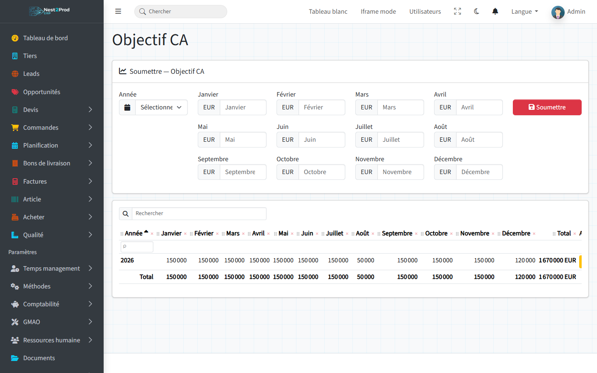

> ⚠️ Un objectif est obligatoire pour l'**année en cours** : pensez à saisir celui de
> l'année suivante avant le 1er janvier.

---

## 7. Rôles et utilisateurs

### Rôles et permissions

Menu **Votre entreprise › Rôles & permissions**. Un **rôle** regroupe des **permissions** :
une permission par menu (devis, commandes, achats, comptabilité…) plus des **droits
particuliers** qui autorisent un visa ou un passe-droit.

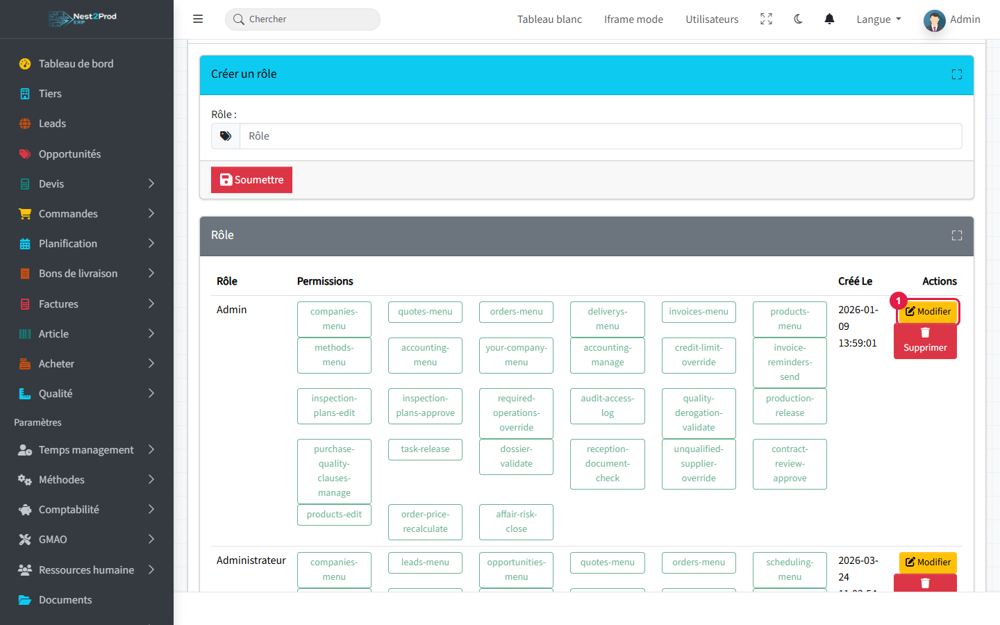

1. Cliquez « Modifier » sur la ligne du rôle.
2. Cochez ses permissions, puis « Mettre à jour ».

Chaque permission est affichée avec sa **description** : ce qu'elle ouvre, en une phrase.
Dans la liste des rôles, la description apparaît aussi au survol d'une permission, et
l'onglet « Permissions » les liste toutes.

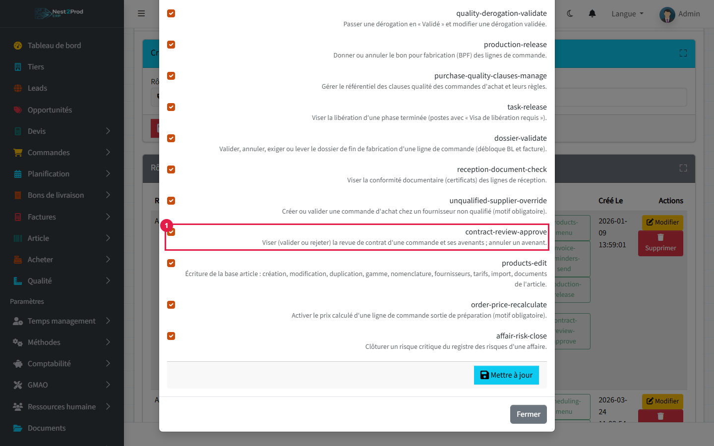

- Gardez le rôle **Admin** pour l'administrateur : les nouvelles permissions ajoutées par
  les mises à jour lui sont données automatiquement.
- Créez un rôle par métier (commercial, atelier, comptable…), puis cochez ses permissions
  dans « Modifier ».

> ⚠️ Les boutons « Supprimer » agissent sans confirmation.

#### Les droits particuliers à attribuer

Les mises à jour récentes ont ajouté des droits de visa et de passe-droit. Ils ne sont
donnés qu'au rôle **Admin** : ajoutez-les aux rôles des personnes qui en ont la charge.

| Permission | Ce qu'elle autorise | À donner par exemple à |
|---|---|---|
| `contract-review-approve` | Viser (valider ou rejeter) la revue de contrat d'une commande et ses avenants | Direction, responsable commercial |
| `order-price-recalculate` | Remettre une ligne de commande en prix calculé après sa préparation (motif obligatoire) | Responsable commercial |
| `required-operations-override` | Convertir un devis en commande malgré une opération obligatoire manquante (motif obligatoire) | Responsable méthodes |
| `affair-risk-close` | Clôturer un risque critique du registre des risques d'une affaire | Chef de projet, direction |
| `production-release` | Donner ou annuler le bon pour fabrication (BPF) des lignes de commande | Responsable de production |
| `task-release` | Viser la libération d'une phase terminée (postes avec « Visa de libération requis ») | Contrôleur, chef d'atelier |
| `dossier-validate` | Valider le dossier de fin de fabrication d'une ligne (débloque BL et facture) | Qualité |
| `quality-derogation-validate` | Passer une dérogation en « Validé » | Responsable qualité |
| `reception-document-check` | Viser les certificats des lignes de réception | Qualité, magasin |
| `unqualified-supplier-override` | Commander chez un fournisseur non qualifié (motif obligatoire) | Responsable achats |
| `purchase-quality-clauses-manage` | Gérer les clauses qualité des commandes d'achat | Responsable qualité |
| `audit-access-log` | Consulter et exporter le journal des consultations | Administrateur |

> ⚠️ Cas particulier : `products-edit` (modifier la base article) a été donnée
> automatiquement à **tous les rôles** qui avaient le menu Articles. Retirez-la des rôles
> qui ne doivent que consulter les articles : ils gardent la lecture (`products-menu`).
>
> 💡 Les autres droits particuliers (`credit-limit-override`, `invoice-reminders-send`,
> `inspection-plans-edit`, `inspection-plans-approve`, `accounting-manage`) se lisent de la
> même façon : leur description est affichée sous leur nom.

### Utilisateurs

Menu **Ressources humaines › Utilisateurs liste**.

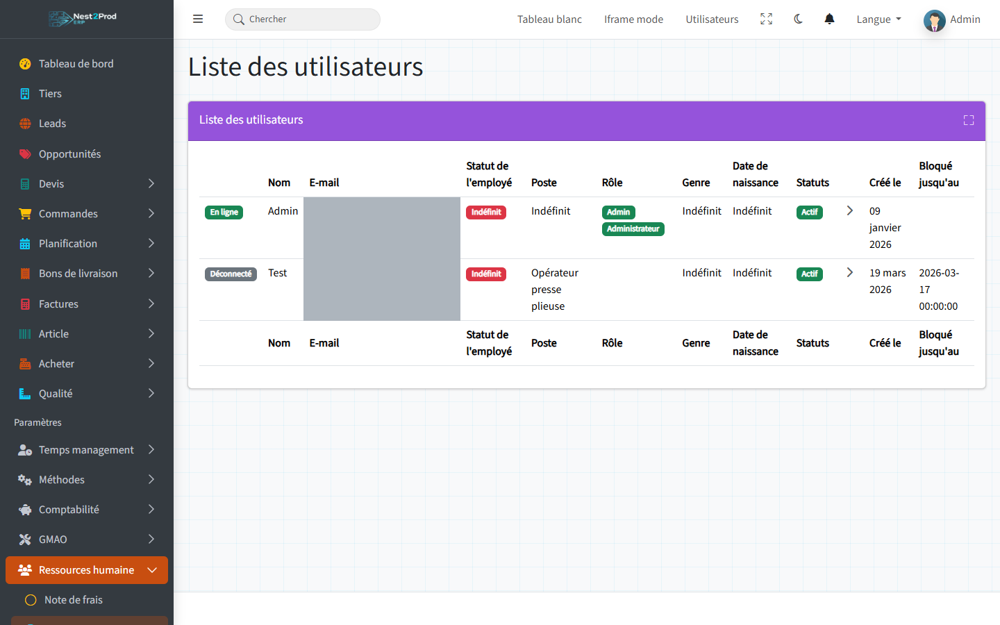

Un nouvel utilisateur s'inscrit lui-même (page d'inscription, si votre installateur l'a
activée) ou est importé de l'annuaire de l'entreprise (LDAP). Il doit ensuite **valider son
adresse e-mail** : la configuration e-mail (étape 8) doit donc être faite avant.

Pour lui donner ses droits : ouvrez sa fiche, onglet **RH information**, choisissez son
**Rôle**, puis « Mettre à jour ».

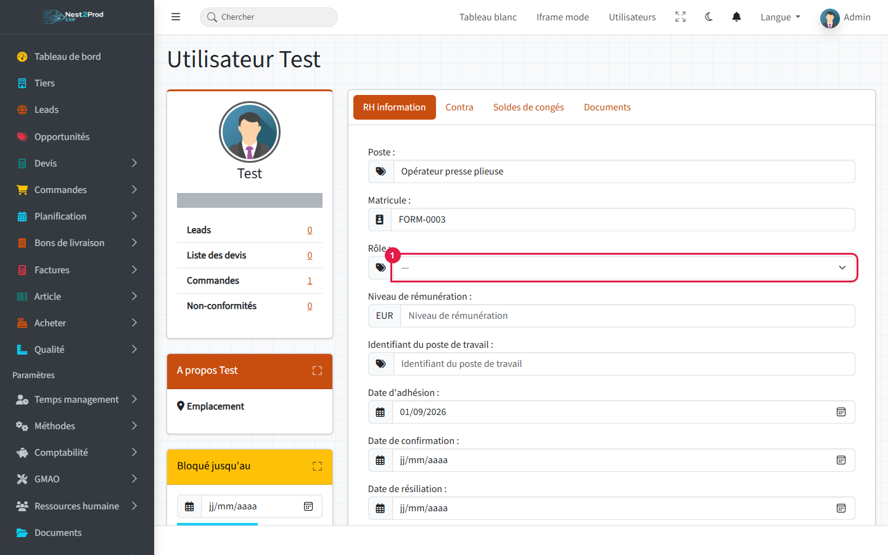

> ⚠️ Un utilisateur sans rôle affiche « — » : laissé ainsi, il reste sans rôle et ne voit
> aucun menu. On ne peut pas modifier son propre rôle (le champ n'apparaît pas sur sa
> propre fiche).

---

## 8. E-mail

Menu **Votre entreprise › Configuration e-mail** : le serveur d'envoi (SMTP) qui expédie
les devis, factures, relances et notifications.

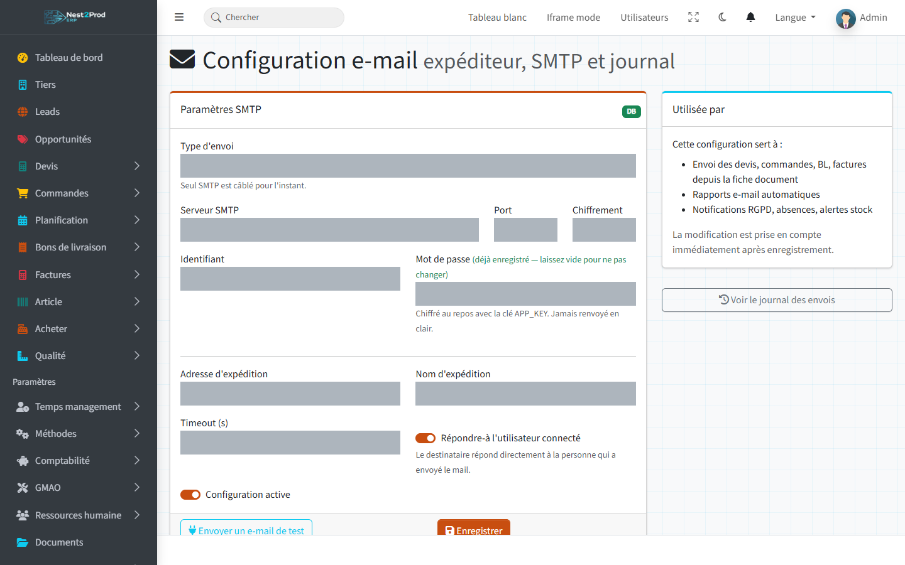

Renseignez le serveur, le port, le chiffrement, l'identifiant et le mot de passe,
l'adresse et le nom d'expédition, puis « Enregistrer » et **« Envoyer un e-mail de test »**.

> 💡 Les textes des e-mails se règlent dans **Template de mail** (un modèle par type de
> document). Le **Journal des e-mails** garde la trace de chaque envoi.

---

## 9. Reprendre vos données

Menu **Votre entreprise › Imports/Exports** : import des clients, des articles, des devis
et des commandes depuis un fichier CSV.

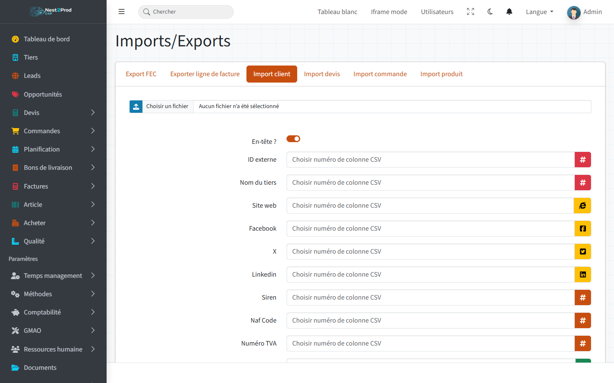

1. Choisissez le fichier CSV, et indiquez s'il a une **ligne d'en-tête**.
2. Pour chaque champ, saisissez le **numéro de la colonne** qui le contient.
3. Importez.

> ⚠️ Le fichier doit être un **CSV séparé par des points-virgules** (pas un fichier Excel),
> et les colonnes sont **numérotées à partir de 0**. Importez les clients avant les devis
> et commandes, et faites un essai sur quelques lignes.

---

---

## 10. Options d'exploitation

Quelques réglages ne sont pas dans l'application : ils se posent dans le **fichier de
configuration** du serveur. Demandez-les à votre installateur en citant le nom du réglage.
Les guides qui dépendent d'une option n'apparaissent dans le menu **Guides** que si elle
est active.

### Fuseau horaire (`APP_TIMEZONE`)

Sans réglage, l'application compte les heures en temps universel : en France, les heures
de pointage et le trait « maintenant » du planning ont alors **1 h de retard en hiver,
2 h en été**. Demandez `APP_TIMEZONE=Europe/Paris` dès l'installation.

> ⚠️ Changer le fuseau d'une instance déjà utilisée décale la lecture des heures déjà
> enregistrées : réglez-le avant les premiers pointages.

### Bon pour fabrication obligatoire (`PRODUCTION_REQUIRE_RELEASE`)

Option désactivée par défaut. Active, une opération de production ne peut pas démarrer
tant que sa ligne de commande n'a pas reçu son **bon pour fabrication** (BPF).

<!-- feature: production-release -->
L'option est **active** sur votre instance : donnez le droit `production-release` aux
personnes qui libèrent la fabrication, sinon l'atelier ne pourra démarrer aucune opération.
Le BPF se donne sur la fiche commande, ligne par ligne ou sur les lignes cochées.
<!-- /feature -->
<!-- feature: !production-release -->
L'option est **désactivée** sur votre instance : aucune opération n'est bloquée et rien
n'est affiché sur le BPF.
<!-- /feature -->

### Fournisseur qualifié obligatoire (`PURCHASES_REQUIRE_QUALIFIED_SUPPLIER`)

Option désactivée par défaut. Active, une commande d'achat ne peut être créée ou validée
que chez un fournisseur dont la dernière évaluation est **approuvée** et à jour.

<!-- feature: qualified-supplier -->
L'option est **active** sur votre instance : évaluez vos fournisseurs habituels (fiche
société, onglet évaluation) avant de commander. Pour une commande urgente chez un
fournisseur non qualifié, le droit `unqualified-supplier-override` permet de passer outre
avec un motif.
<!-- /feature -->
<!-- feature: !qualified-supplier -->
L'option est **désactivée** sur votre instance : aucune commande n'est bloquée et aucun
état de qualification n'est affiché.
<!-- /feature -->

### Journal des consultations (`AUDIT_LOG_READS`)

Option désactivée par défaut. Active, l'application note **qui a ouvert** les fiches
sensibles : opportunités, devis, commandes, lignes de commande, fichiers des documents et
lots. Une même fiche ouverte plusieurs fois par la même personne n'est notée qu'une fois
toutes les 10 minutes.

<!-- feature: access-log -->
L'option est **active** sur votre instance. Le journal se lit dans **Votre entreprise ›
Journal des consultations** (droit `audit-access-log`) : filtres par utilisateur, type de
fiche, numéro et dates, et export CSV.

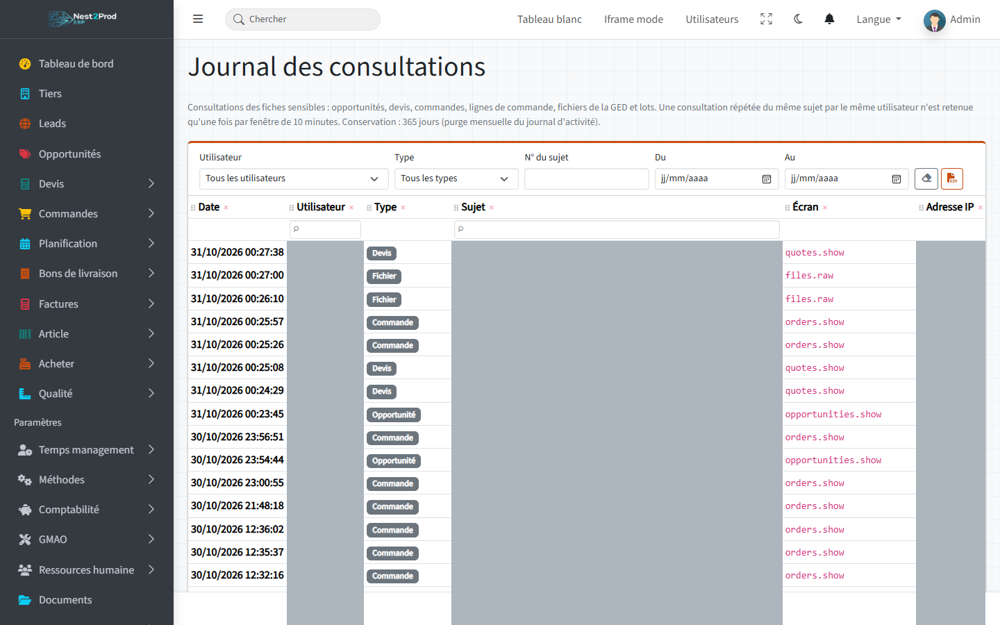

> 💡 Le journal est conservé 365 jours, puis purgé avec l'historique des modifications.
<!-- /feature -->
<!-- feature: !access-log -->
L'option est **désactivée** sur votre instance : l'écran **Journal des consultations**
existe mais n'enregistre rien, et l'indique par un bandeau.
<!-- /feature -->

---

## Et ensuite ?

Chaque utilisateur peut choisir l'apparence de l'application : menu utilisateur (en haut à
droite) › **Profil**, onglet **Apparence** (habillage et couleur principale). Le mode clair
ou sombre se règle par le bouton de la barre du haut.

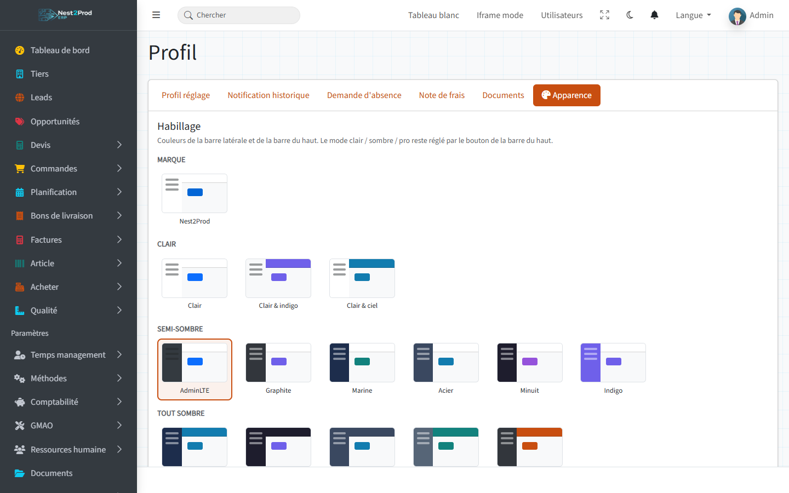

Votre instance est prête : suivez le guide **« Du prospect à la facture »** pour le premier
devis.

## Questions fréquentes

**L'application me renvoie toujours vers l'assistant de configuration.**
Il manque une société, une TVA, une condition ou un mode de paiement, un mode de livraison
ou une unité.

**« Aucune TVA ou unité par défaut configurée » en créant une ligne.**
Aucune TVA ou aucune unité n'est réglée « Par défaut » (fenêtre « Modifier »).

**Je n'arrive pas à passer un devis en « Perdu ».**
Un motif de perte est demandé dès qu'au moins un motif est actif (étape 4) : choisissez-en
un dans la fenêtre qui s'ouvre.

**La conversion d'un devis en commande est refusée : « Opérations obligatoires manquantes ».**
La catégorie d'affaire du devis exige des postes de charge absents de la gamme (étape 4).
Complétez la gamme, ou faites convertir par une personne qui a `required-operations-override`.

**Le tableau de bord me renvoie vers l'objectif de chiffre.**
Il n'y a pas d'objectif pour l'année en cours (étape 6).

**Un utilisateur ne voit pas un menu.**
Son rôle n'a pas la permission de ce menu (étape 7), ou il n'a aucun rôle.

**Un visa ou un passe-droit est refusé.**
Le rôle de l'utilisateur n'a pas le droit particulier correspondant : lisez les
descriptions dans **Rôles & permissions** (étape 7).

**Les heures de pointage sont décalées d'une ou deux heures.**
Le fuseau horaire n'est pas réglé (étape 10, `APP_TIMEZONE`).
