**Objectif** : préparer une instance neuve avant les premiers devis, dans le bon ordre, pour
que les documents sortent justes dès le premier jour.

**Pour qui** : l'administrateur de la société (permission **Votre entreprise**).

## Dans quel ordre

```steps
Assistant de configuration
Réglage société
Comptabilité
Méthodes
Flux des tâches
Objectif de chiffre
Rôles et utilisateurs
E-mail
Imports
```

## 1. L'assistant de configuration

À la première connexion, un assistant demande les informations sans lesquelles
l'application ne peut pas fonctionner : la **société** (nom, adresse, SIREN, n° de TVA,
logo), une **TVA**, une **condition de paiement**, un **mode de paiement**, un **mode de
livraison** et une **unité**. Chaque valeur saisie devient la valeur **par défaut**.

> ⚠️ À la fin de l'assistant, vérifiez que votre compte a bien un **rôle** (étape 6) et
> qu'un **objectif de chiffre** existe pour l'année en cours (étape 5). Sans objectif, le
> tableau de bord vous renvoie vers l'écran de saisie.
>
> 💡 Tout ce que demande l'assistant se modifie ensuite dans les écrans ci-dessous.

---

## 2. Réglage société

Menu **Votre entreprise › Réglage société**, onglet « Réglage usine ». Ces informations
figurent sur tous vos documents (devis, commandes, factures).

**Identité** : nom, adresse, code postal, ville, pays, téléphone, e-mail.

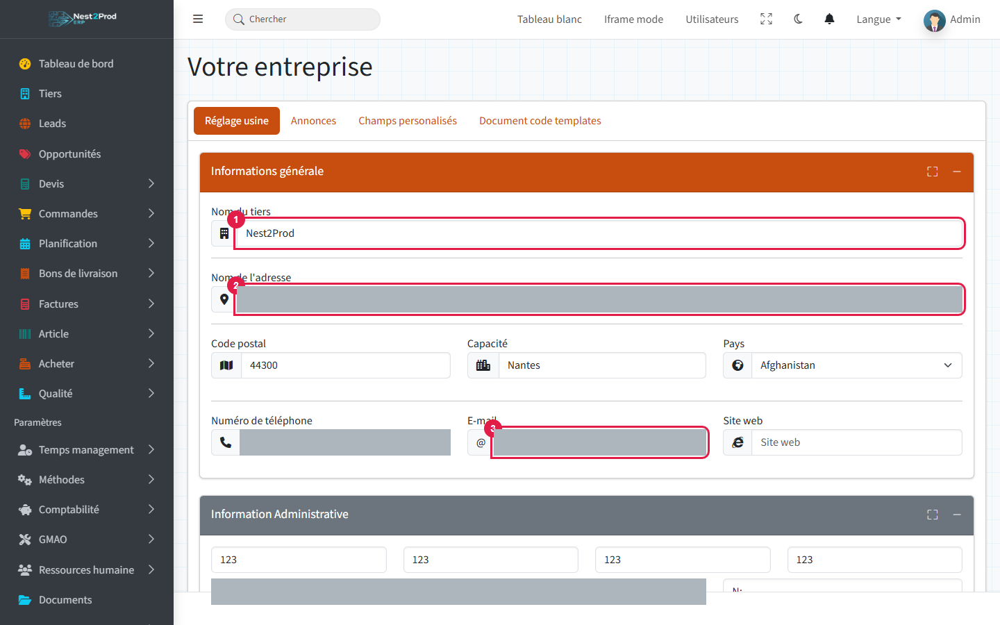

**Information administrative** : **SIREN** (9 chiffres), **n° de TVA intracommunautaire**,
IBAN et BIC. Le SIREN et le n° de TVA sont indispensables à la facture électronique.

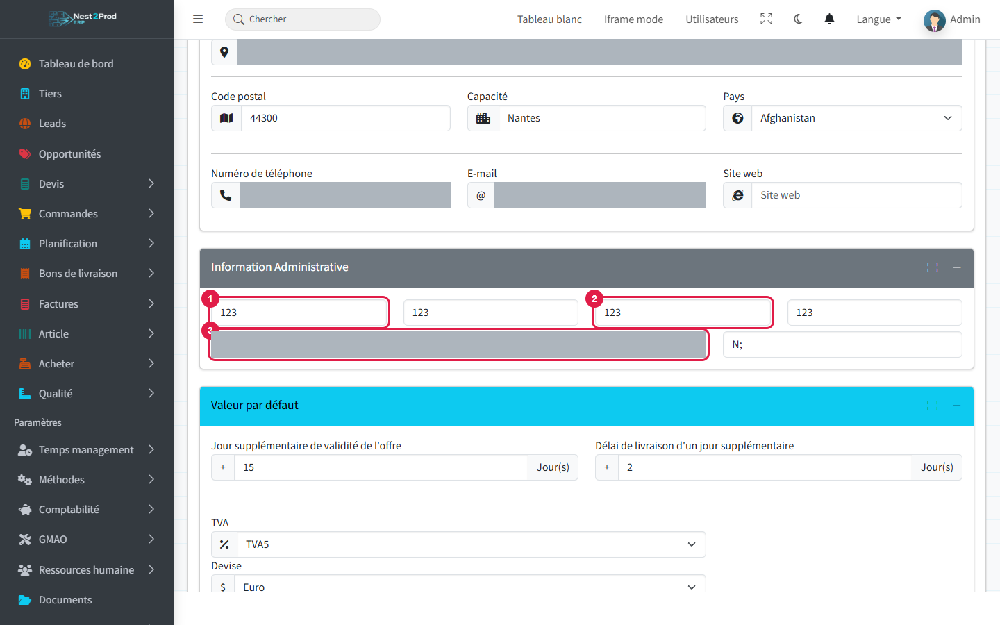

**Valeurs par défaut** : durée de validité des devis, délai de livraison, **TVA** de la
société, **devise** et **mois de début d'exercice** comptable.

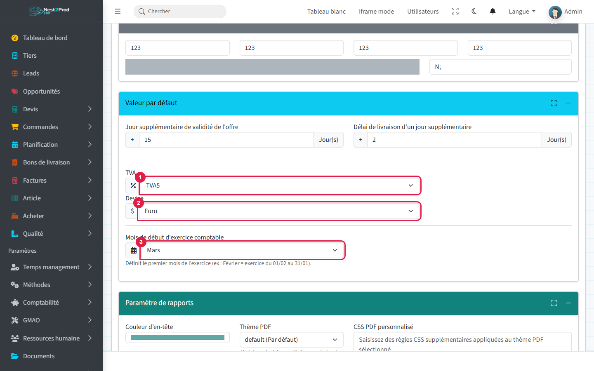

Le formulaire continue avec le thème des PDF, vos **CGV** (lien ou fichier PDF ajouté à la
suite des devis et commandes), le logo et les modules optionnels. Terminez par « Soumettre ».

> ⚠️ Après l'assistant, vérifiez le **pays** et la **devise** : s'ils n'ont jamais été
> enregistrés, la liste affiche sa première valeur, pas la vôtre.

### Numérotation des documents

Onglet « Document code templates » : le format du numéro de chaque type de document
(devis, commande, BL, facture, achats…). Exemple : `FAC{yy}{mm}{id(4)}` donne FAC26100001.

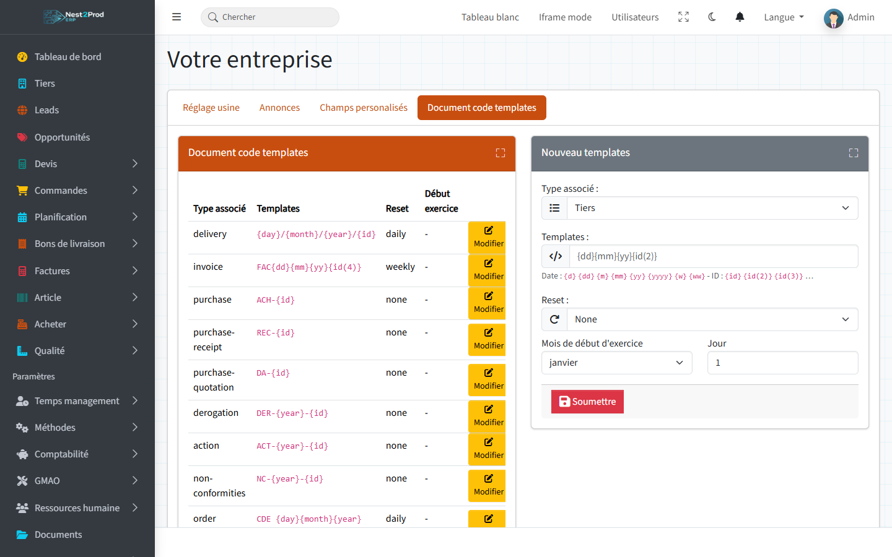

- Jetons de date : `{d}` `{dd}` `{m}` `{mm}` `{yy}` `{yyyy}` `{w}` `{ww}` ;
  numéro : `{id}`, ou `{id(4)}` pour 4 chiffres.
- **Reset** : repartir de 1 chaque jour, semaine, mois ou année, ou jamais.

> ⚠️ Réglez la numérotation **avant** la première facture : une facture numérotée ne
> change plus de numéro.

---

## 3. Comptabilité

Menu **Comptabilité** : TVA, conditions de paiement, modes de paiement, modes de livraison
et affectations comptables. Tous les écrans fonctionnent pareil : la liste à gauche, la
création à droite.

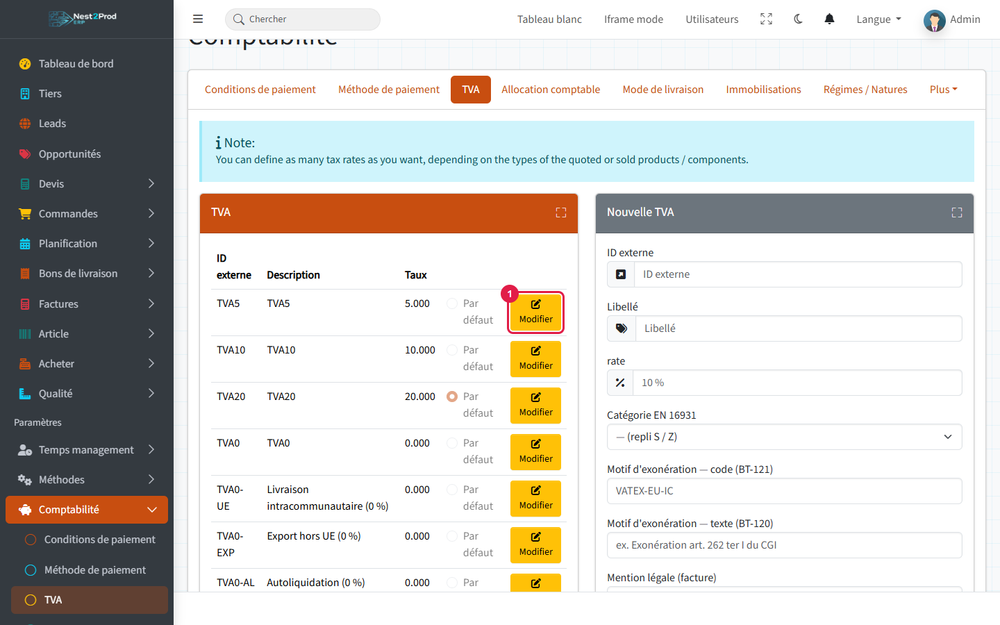

> ⚠️ Chaque liste doit avoir une valeur **par défaut** : sans TVA ni unité par défaut, la
> création d'une ligne de devis, de commande ou d'achat est refusée. Le réglage « Par
> défaut » se fait dans la fenêtre **« Modifier »**, pas à la création.

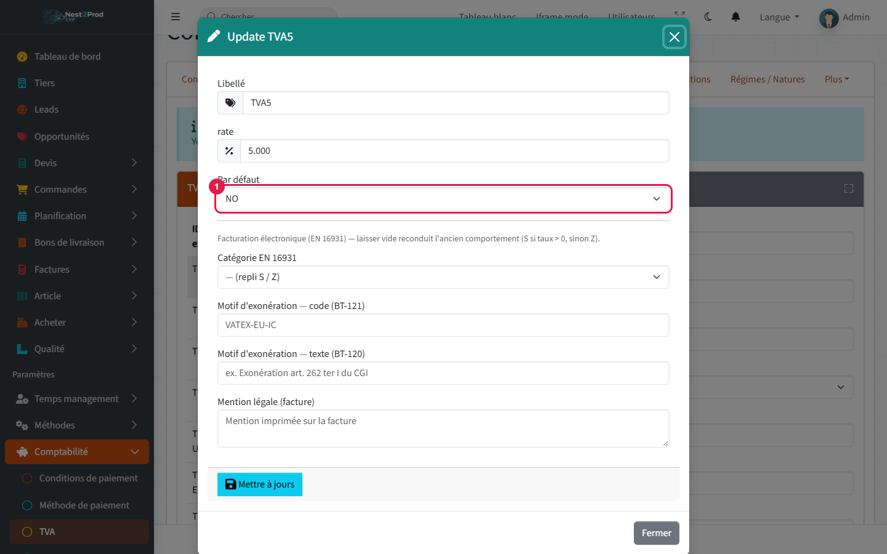

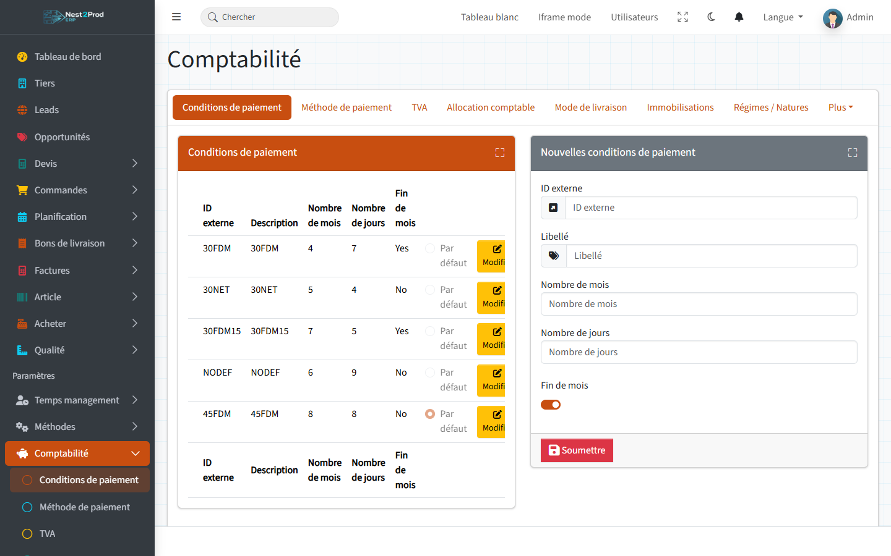

Le **mode de paiement** porte aussi le compte de trésorerie utilisé pour les écritures
d'encaissement (champ compte).

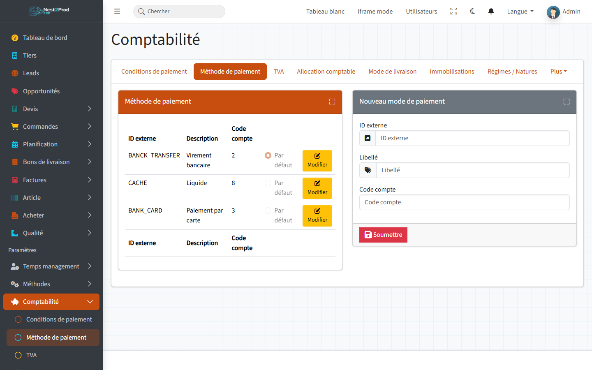

> 💡 La fenêtre « Modifier » d'une TVA porte aussi la **mention légale** imprimée sur les
> factures (exonération, autoliquidation…). Les **affectations comptables** relient chaque
> taux de TVA à ses comptes de vente et d'achat : sans elles, aucune écriture n'est générée.

---

## 4. Méthodes

Unités, services et taux horaires, familles, sections, ressources… Suivez le guide
« Les Méthodes, le dictionnaire de l'atelier ».

---

## 5. Flux des tâches

Menu **Votre entreprise › Flux des Tâches** : les statuts que prennent les opérations de
fabrication. Sans aucun statut, les devis, commandes, achats et la production renvoient
vers cet écran.

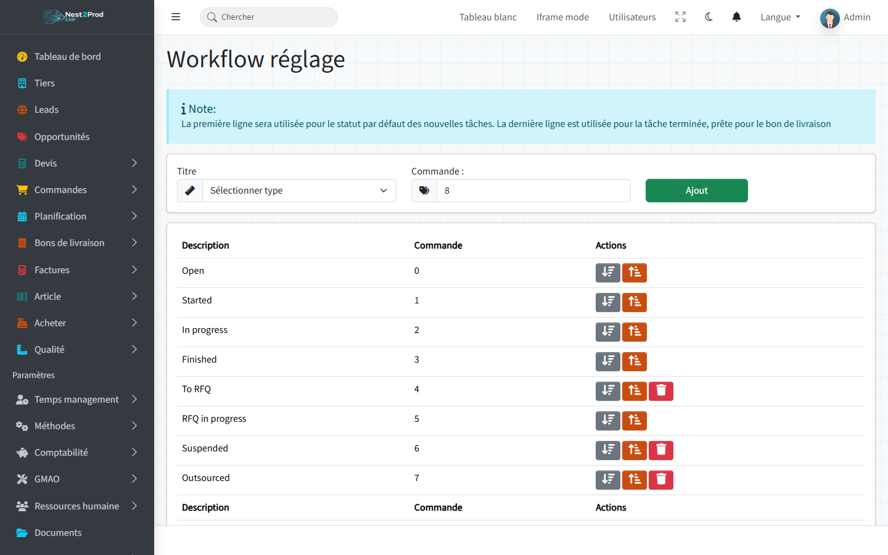

Créez les statuts dans cet ordre, en choisissant leur titre dans la liste :
**Open**, **Started**, **In progress**, **Finished**, **Suspended**, **To RFQ**,
**RFQ in progress**, **Outsourced**, **Supplied**.

> ⚠️ Les titres ne se traduisent pas et ne se renomment pas : le logiciel reconnaît une
> opération démarrée à « In progress » et terminée à « Finished ». La première ligne est le
> statut des nouvelles opérations.

---

## 6. Objectif de chiffre

Menu **Votre entreprise › Objectif de chiffre** : l'objectif de chiffre d'affaires,
mois par mois, affiché sur le tableau de bord.

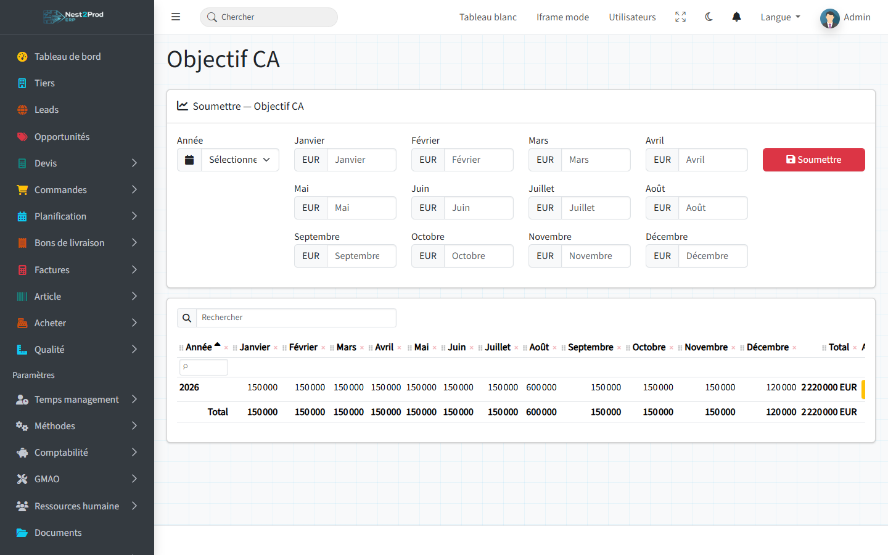

> ⚠️ Un objectif est obligatoire pour l'**année en cours** : pensez à saisir celui de
> l'année suivante avant le 1er janvier.

---

## 7. Rôles et utilisateurs

### Rôles et permissions

Menu **Votre entreprise › Rôles & permissions**. Un **rôle** regroupe des **permissions** :
une permission par menu (devis, commandes, achats, comptabilité…) plus quelques droits
particuliers (relances, plafond d'encours, validation des plans qualité…).

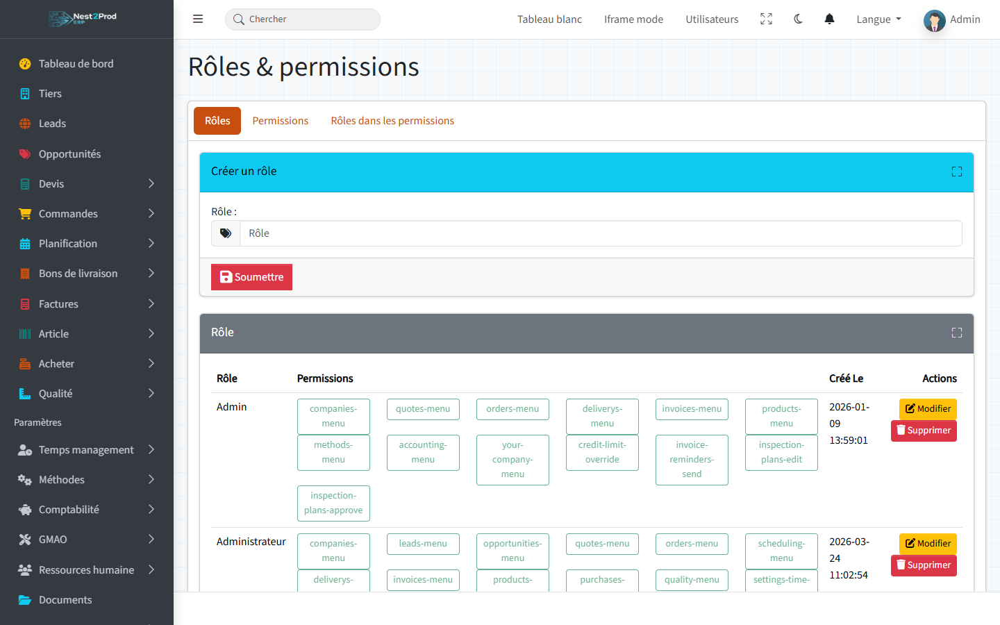

- Gardez le rôle **Admin** pour l'administrateur : les nouvelles permissions ajoutées par
  les mises à jour lui sont données automatiquement.
- Créez un rôle par métier (commercial, atelier, comptable…), puis cochez ses permissions
  dans « Modifier ».

> ⚠️ Les boutons « Supprimer » agissent sans confirmation.

### Utilisateurs

Menu **Ressources humaines › Utilisateurs liste**.


Un nouvel utilisateur s'inscrit lui-même (page d'inscription, si votre installateur l'a
activée) ou est importé de l'annuaire de l'entreprise (LDAP). Il doit ensuite **valider son
adresse e-mail** : la configuration e-mail (étape 8) doit donc être faite avant.

Pour lui donner ses droits : ouvrez sa fiche, onglet **RH information**, choisissez son
**Rôle**, puis « Mettre à jour ».

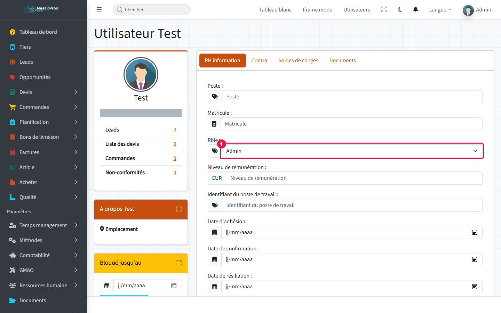

> ⚠️ Pour un utilisateur sans rôle, la liste affiche le premier rôle : il lui sera donné à
> l'enregistrement. Vérifiez-le avant d'enregistrer. On ne peut pas modifier son propre rôle.

---

## 8. E-mail

Menu **Votre entreprise › Configuration e-mail** : le serveur d'envoi (SMTP) qui expédie
les devis, factures, relances et notifications.

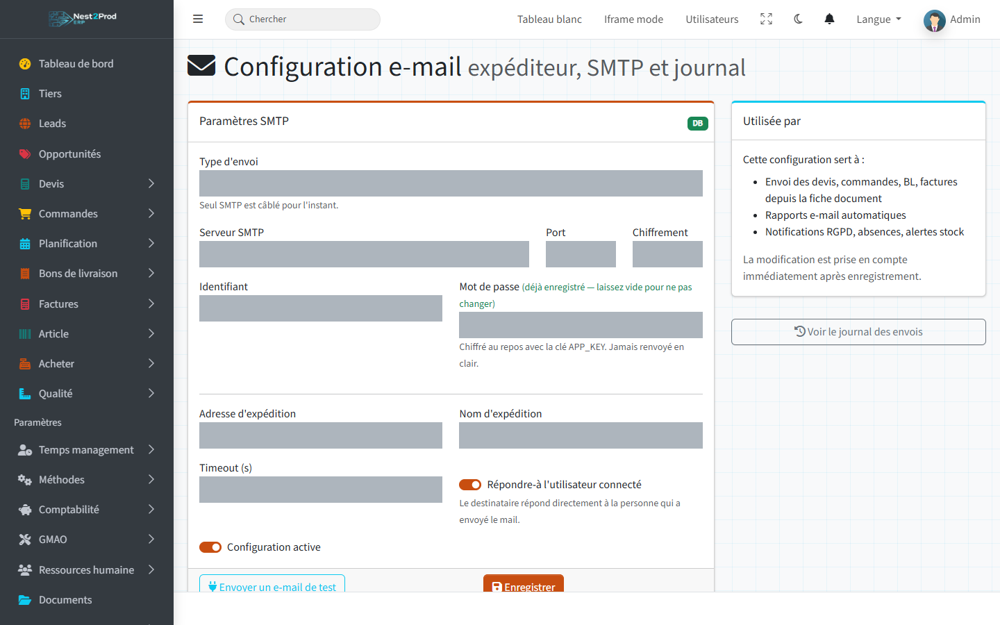

Renseignez le serveur, le port, le chiffrement, l'identifiant et le mot de passe,
l'adresse et le nom d'expédition, puis « Enregistrer » et **« Envoyer un e-mail de test »**.

> 💡 Les textes des e-mails se règlent dans **Template de mail** (un modèle par type de
> document). Le **Journal des e-mails** garde la trace de chaque envoi.

---

## 9. Reprendre vos données

Menu **Votre entreprise › Imports/Exports** : import des clients, des articles, des devis
et des commandes depuis un fichier CSV.

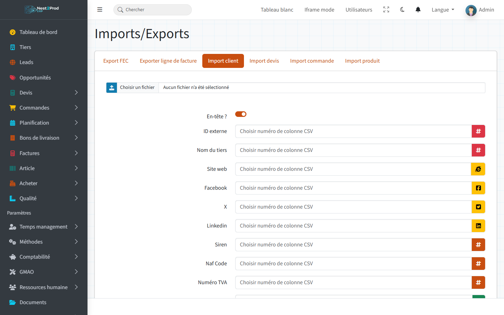

1. Choisissez le fichier CSV, et indiquez s'il a une **ligne d'en-tête**.
2. Pour chaque champ, saisissez le **numéro de la colonne** qui le contient.
3. Importez.

> ⚠️ Le fichier doit être un **CSV séparé par des points-virgules** (pas un fichier Excel),
> et les colonnes sont **numérotées à partir de 0**. Importez les clients avant les devis
> et commandes, et faites un essai sur quelques lignes.

---

## Et ensuite ?

Chaque utilisateur peut choisir l'apparence de l'application : menu utilisateur (en haut à
droite) › **Profil**, onglet **Apparence** (habillage et couleur principale). Le mode clair
ou sombre se règle par le bouton de la barre du haut.

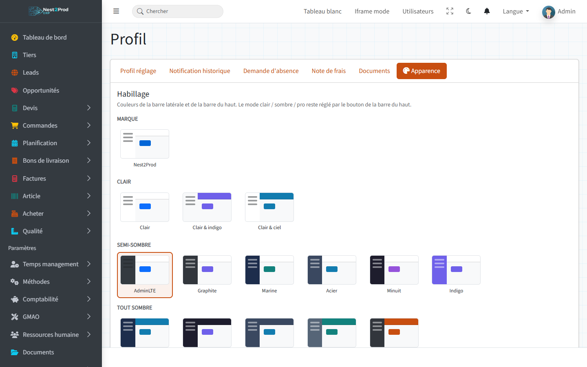

Votre instance est prête : suivez le guide **« Du prospect à la facture »** pour le premier
devis.

## Questions fréquentes

**L'application me renvoie toujours vers l'assistant de configuration.**
Il manque une société, une TVA, une condition ou un mode de paiement, un mode de livraison
ou une unité.

**« Aucune TVA ou unité par défaut configurée » en créant une ligne.**
Aucune TVA ou aucune unité n'est réglée « Par défaut » (fenêtre « Modifier »).

**Le tableau de bord me renvoie vers l'objectif de chiffre.**
Il n'y a pas d'objectif pour l'année en cours (étape 6).

**Un utilisateur ne voit pas un menu.**
Son rôle n'a pas la permission de ce menu (étape 7).
