**Goal**: handle a defect from start to finish (report, analysis, corrective action,
derogation accepted by the customer, closing) and keep track of the workshop's inspection
equipment.

> 💡 Screenshots show the French interface; button names are given as they appear in the English interface.

**Who is it for**: the quality manager. Operators also report non-conformities from the
workshop.

**Example used**: a batch of 12 brackets comes out of the press brake at 92° instead of
90°. The back gauge moved during a tool change. The customer accepts 7 parts at 91.5°, the
other 5 are reworked.

## Before you start

- The **Quality** menu appears with the **quality-menu** permission. Internal audits
  require **audit-menu**, customer returns **returns-menu**.
- Setting a derogation to "Validate" requires **quality-derogation-validate** (Admin role
  by default).
- The receipt document review requires **reception-document-check**.
- To balloon and approve control plans: **inspection-plans-edit** and
  **inspection-plans-approve**.
- **Services** (bending, laser…) come from Methods (see the guide "Methods").
- Electronic signature of derogations is only offered once the **Integrations → Electronic
  signature** screen is configured.

## Overview

```steps
Settings
Measuring devices
Non-conformity
Corrective action
Derogation
Customer approval
Closing
```

The **Quality** menu gathers: **Dashboard** (with measuring devices and settings),
**Actions**, **Derogations**, **Non conformities**, **Receipt document review**,
**Inspection** (control plans), **Process mapping**, **FMEA**, **Internal audits** and
**Customer returns**.

---

## 1. The dashboard

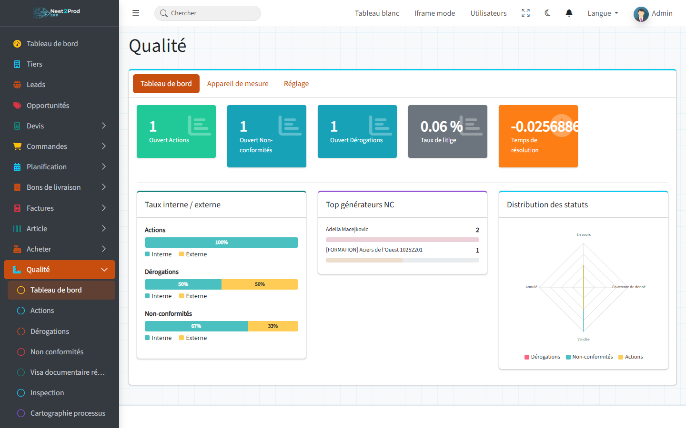

- **Open Actions / Non-conformities / Derogations**: records with the "In progress" status.
- **Dispute rate**: the share of order lines that have a non-conformity.
- **Resolution time**: the average time between creating and closing a non-conformity.
- Below: internal / external split, customers generating the most non-conformities, and
  the status distribution.

> 💡 Resolution time only counts non-conformities closed with the **Resolved** button
> (section 7): that button records the closing date.

---

## 2. Set up the defect reference lists

**Settings** tab: three lists, filled in once, reused by every non-conformity.

- **Failure type**: what is found (out-of-tolerance dimension, scratch, rust…);
- **Cause type**: why (setting, material, program, handling…);
- **Correction type**: what is done (rework, scrap, 100 % sorting…).

Expand a card with **+**, then:

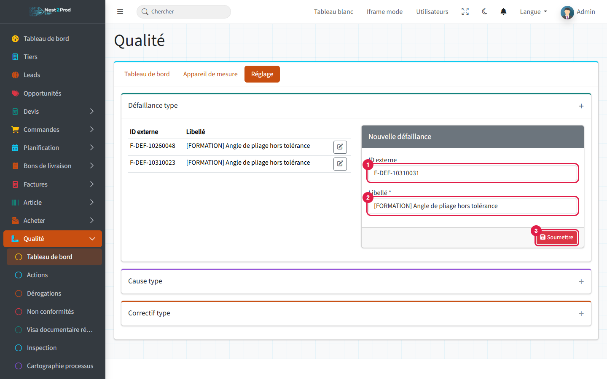

1. **External ID**: a short, unique code.
2. **Label**.
3. **Submit**.

> 💡 Keep these lists short and stable: they classify non-conformities and reveal those
> that recur.

---

## 3. Track measuring devices

**Measuring device** tab: calipers, protractors, micrometers, gauges…

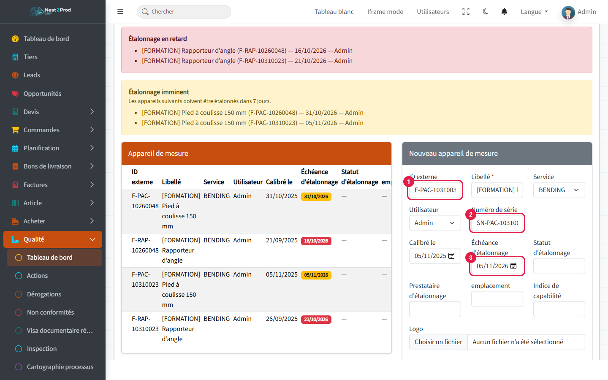

1. **External ID**: the device's tag, unique.
2. **Serial number**, also unique.
3. **Calibration due date**: the date of the next calibration.

Also choose the responsible **Service** and **User** (both required), then click **Submit**
at the bottom of the form.

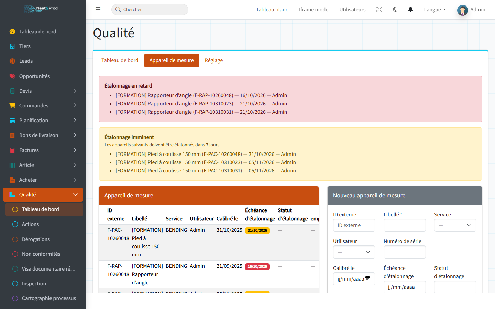

- **Red** banner: calibration overdue;
- **Yellow** banner: calibration due within 7 days.

Every morning at 7:30, the person responsible for each device concerned also gets a notification
(scheduled task: the scheduler must run on the server).

> 💡 A device past its calibration date can still be used to enter a measurement, but it is
> flagged "Calibration overdue" in the device list of the inspection screen.

---

## 4. Report a non-conformity

Menu **Non conformities**, **New non-conformity** card at the bottom of the page (click its
title to expand it).

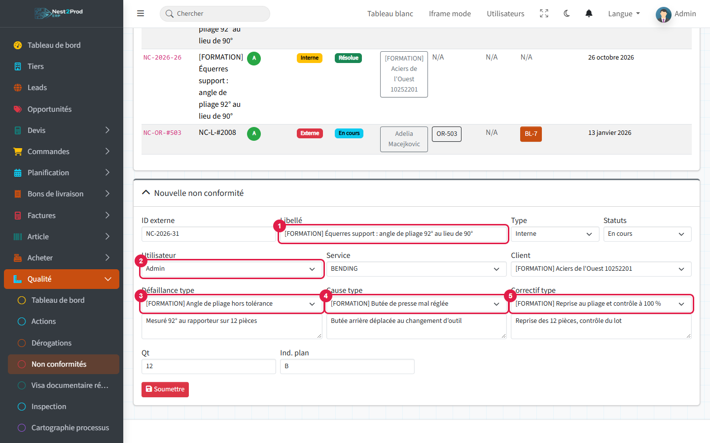

1. **Label**: the defect, in one sentence. The number (external ID) is suggested.
2. **User**: the person in charge (required).
3. **Failure type**, with the detailed finding below.
4. **Cause type**, with the analysis.
5. **Correction type**, with what was done.

Fill in the **Type** (Internal if the defect comes from you, External if it comes from a
customer or supplier), the **Service**, the **Customer**, the quantity **Qty** and the
**drawing revision**, then **Submit**.

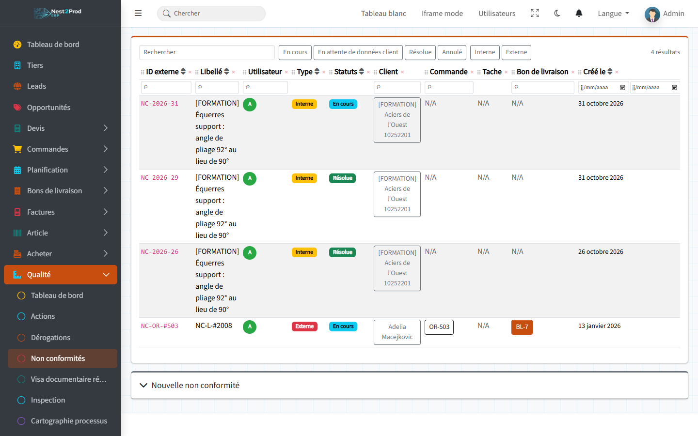

The list filters by status, type and search. Clicking a row shows the details and the change
history (section 7); the PDF button prints the record.

**Other ways to create a non-conformity:**

- from the **operation tracking screen** in the workshop, "New non-conformity" button: it
  is linked to the order and the operation;
- from the **public link of a delivery note**, by the customer;
- from an **out-of-tolerance measurement** entered during an inspection (section 9);
- from the **document review** of a goods receipt, when the certificate is not compliant
  (section 8).

> ⚠️ In the workshop, the button creates the non-conformity **immediately**, without
> confirmation: a double click creates two.

---

## 5. Start a corrective action

Menu **Actions**: an action fixes the cause so the defect does not come back.

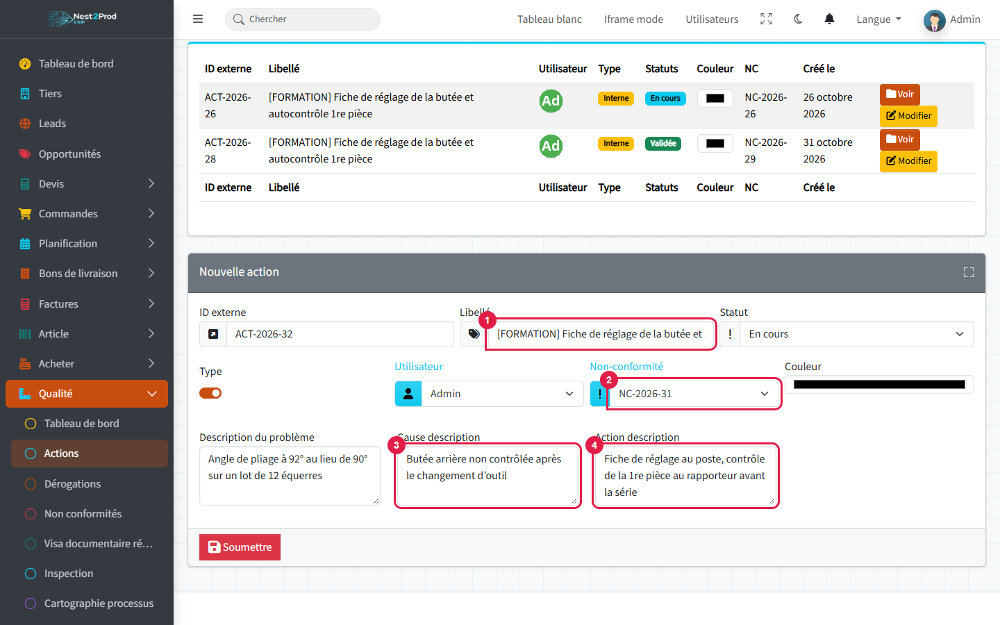

1. **Label**: replace the number copied by default with the action's title.
2. **Non-conformity**: the record the action answers.
3. **Cause description**.
4. **Action description**.

The **Type** switch turned on means **Internal**. Choose the **User** in charge, then
**Submit**.

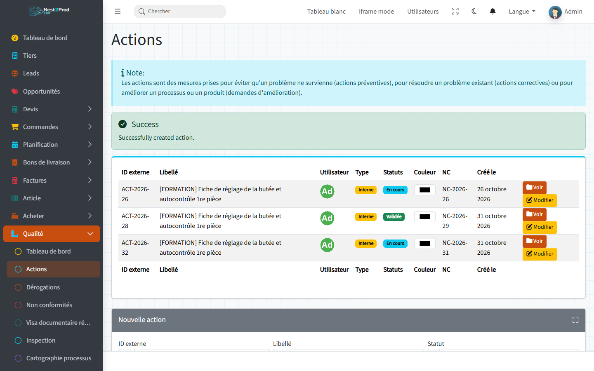

When the action is done and checked, open it with **Edit** and set its status to
**Validate**.

The **View** button shows the record and, below it, the **Change history**: who changed
what and when, with the old value struck through and the new one.

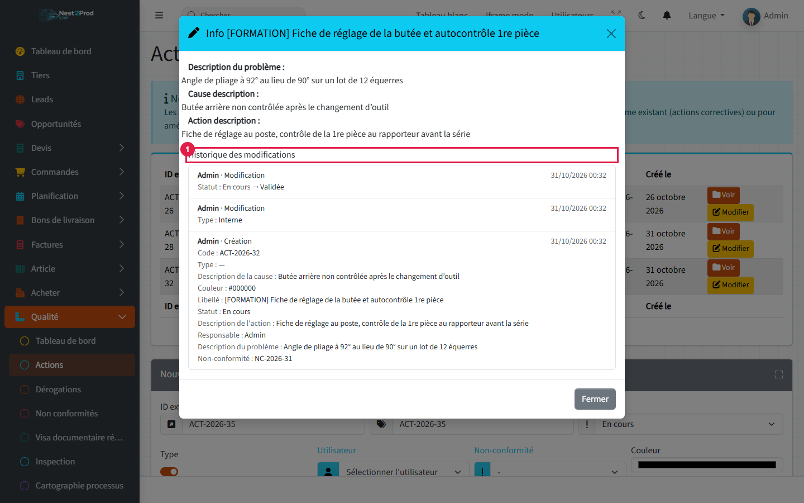

1. **Change history**: here the creation, then the change from "In progress" to
   "Validate".

> ⚠️ When editing, the three descriptions (problem, cause, action) are required, although
> they were not at creation. Fill them in from the start.
>
> 💡 Actions are sorted from oldest to newest: the latest one is at the end of the list.

---

## 6. Get a derogation from the customer

A **derogation** records the acceptance of out-of-tolerance parts. An **external**
derogation commits the customer: it can only be validated once their written approval is
proven. An **internal** derogation (a decision taken in-house) only requires the decision.

### 6.1 Create the request

Menu **Derogations**, **New derogation** card at the bottom of the page.

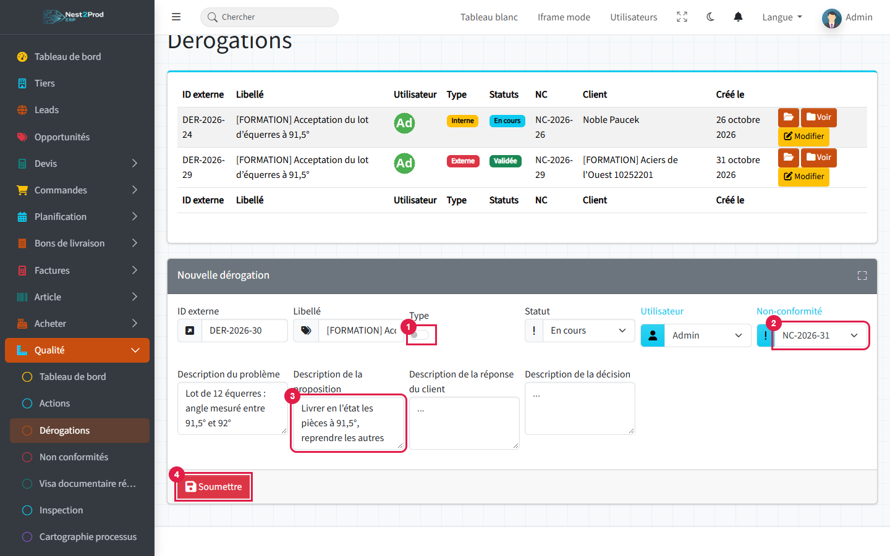

1. **Type**: switch **turned off** for an **external** (customer) derogation.
2. **Non-conformity**: the record behind the request. Its customer is carried over.
3. **Proposal description**: what you suggest to the customer.
4. **Submit**: the derogation record opens.

Only the problem and proposal descriptions are required: the reply and the decision are
completed on the record once the customer has answered.

> ⚠️ The **Type** switch is on by default, which creates an **internal** derogation. For a
> request to the customer, turn it off, otherwise the customer's approval will never be
> required.

In the list, the folder button (**Open**) reopens a derogation record.

### 6.2 Enter the customer and their reply

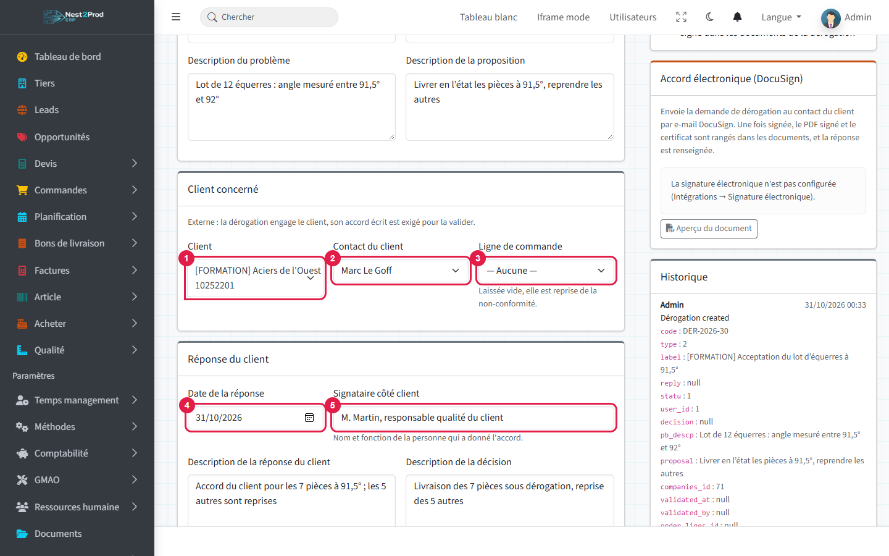

1. **Customer**: carried over from the non-conformity, can be changed.
2. **Customer contact**: the person the request is addressed to. Required for electronic
   signature (they need an e-mail address).
3. **Order line**: the parts concerned. Left empty, it is taken from the non-conformity.
4. **Reply date** of the customer.
5. **Customer signatory**: name and position of the person who gave the approval.

Fill in the **Customer reply description** and **Decision description** below, then click
**Update** (at the bottom of the "Customer reply" card).

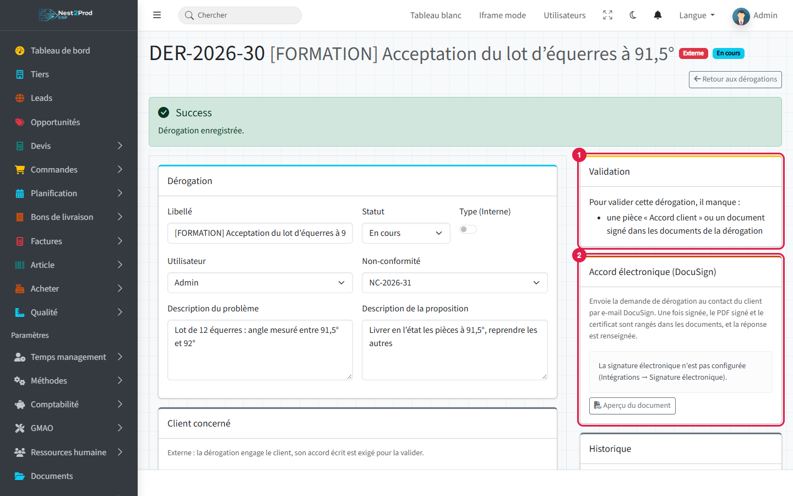

1. **Validation**: the list of what is still missing to validate. Here, only the written
   proof of approval remains.
2. **Electronic approval (DocuSign)**: sends the request to the customer for signature (see
   6.4). **Document preview** shows the PDF that would be sent.

> ⚠️ **Delivery blocked**: as long as an **external** derogation is "In Progress" or
> "Waiting Customer Data", the order line concerned (chosen on the record or taken from the
> non-conformity) cannot go on a delivery note. The message "Delivery refused: derogation …
> is waiting for the customer decision" is shown. Validate or cancel the derogation before
> delivering.

### 6.3 Attach the written approval and validate

The **Documents** card, at the bottom of the record, holds the proof of approval: letter,
e-mail saved as PDF, signed form…

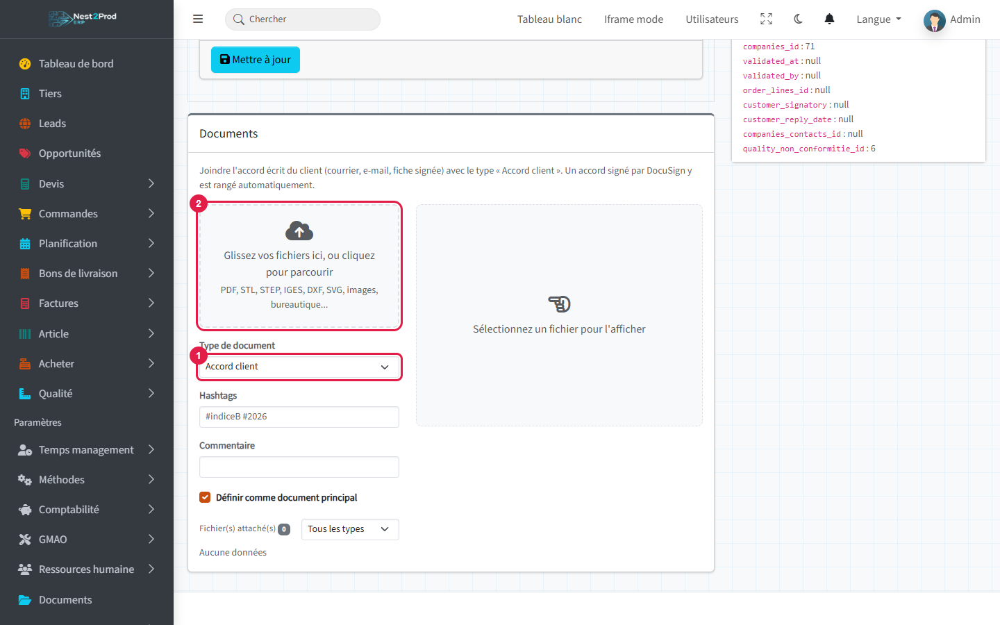

1. **Document type**: choose **Customer approval** before dropping the file.
2. Drag the file into the area, or click to choose it.

Once everything is in place, the **Validation** card says so.

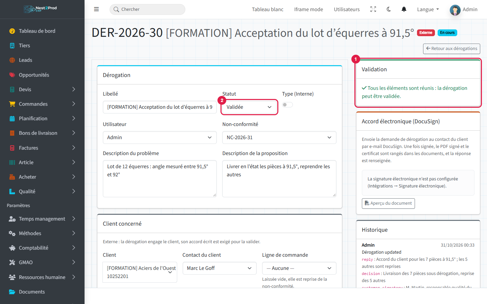

1. **Validation**: "Everything is in place".
2. **Status**: choose **Validate**, then click **Update**.

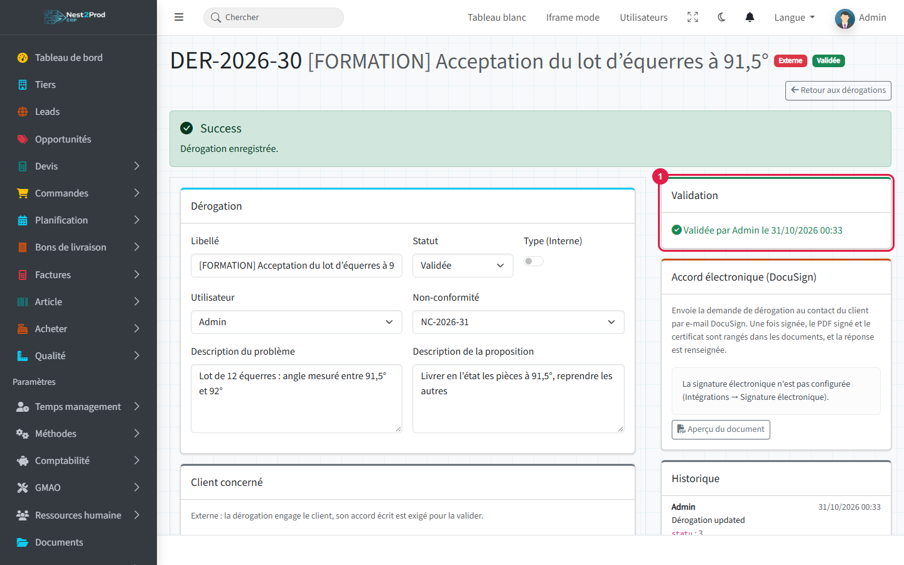

1. The record shows who validated it and when.

> ⚠️ A file dropped with another type (Photo, Other…) does not count as proof: change its
> type to **Customer approval** in the file list.
>
> ⚠️ A validated derogation is **locked**: only holders of the
> **quality-derogation-validate** permission can still change it or add a document.
>
> 💡 The **Validate** option is greyed out for users without the permission. If something is
> missing, validation is refused and the message lists what to complete.

### 6.4 Have the customer sign electronically

If electronic signature is configured, the **Electronic approval (DocuSign)** card offers
**Send for signature** on an external derogation that is "In Progress" or "Waiting Customer
Data" and whose contact has an e-mail address.

- The customer receives a DocuSign e-mail with the derogation request to sign; the
  derogation moves to "Waiting Customer Data".
- Once signed, the signed PDF and its certificate are filed in **Documents** ("Signed
  document" type), and the reply, its date and the signatory are filled in if they were
  empty.
- **The derogation is never validated automatically**: review it, then set it to
  **Validate** as in 6.3.
- **Refresh status** checks DocuSign immediately (otherwise the status updates by itself,
  through the scheduled task).

> ⚠️ The request really goes to the customer: check the contact and review the **Document
> preview** before clicking.
>
> ⚠️ If you change the derogation after sending it, the pending request is voided: click
> **Send the request again** so the customer signs the current version.

---

## 7. Close the non-conformity

Once handled, open the non-conformity with its pencil.

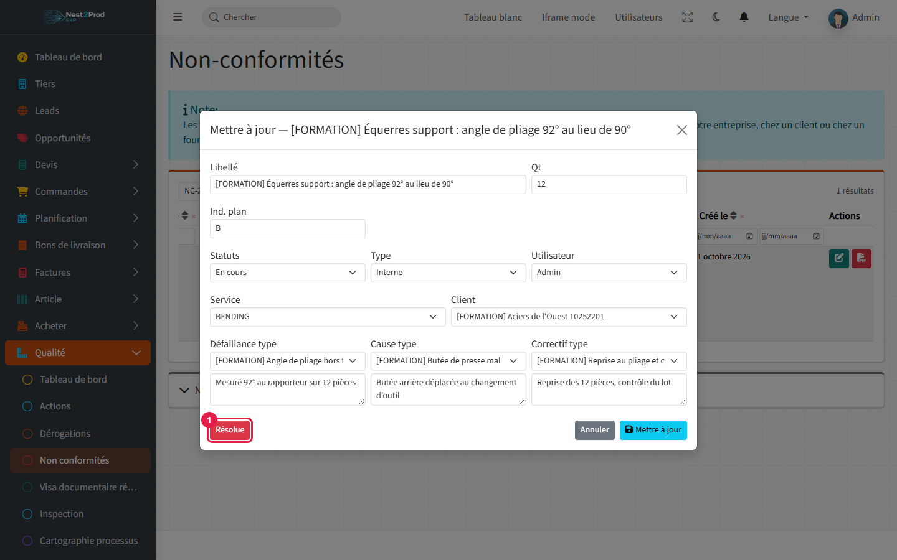

1. **Resolved** sets the record to "Resolved" and records the closing date.

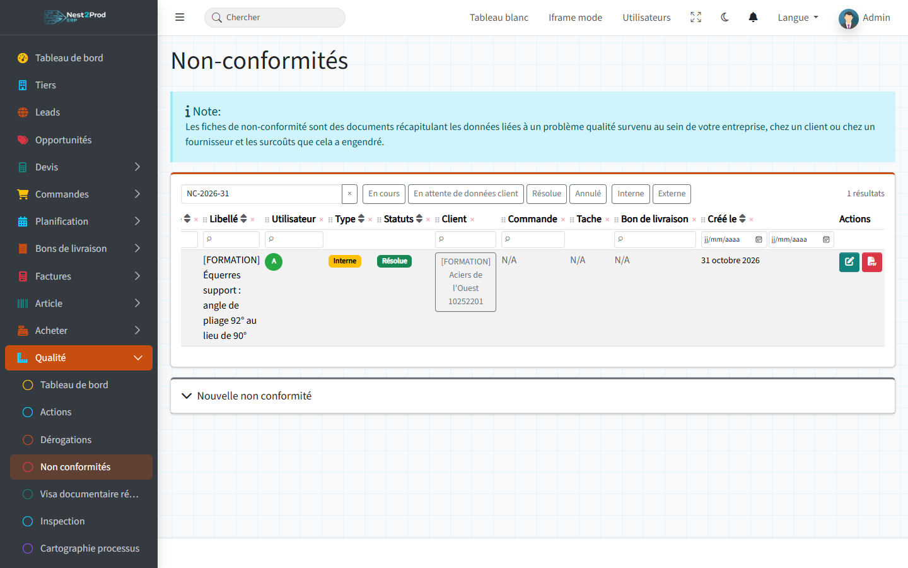

Clicking the row opens the record details, with its history.

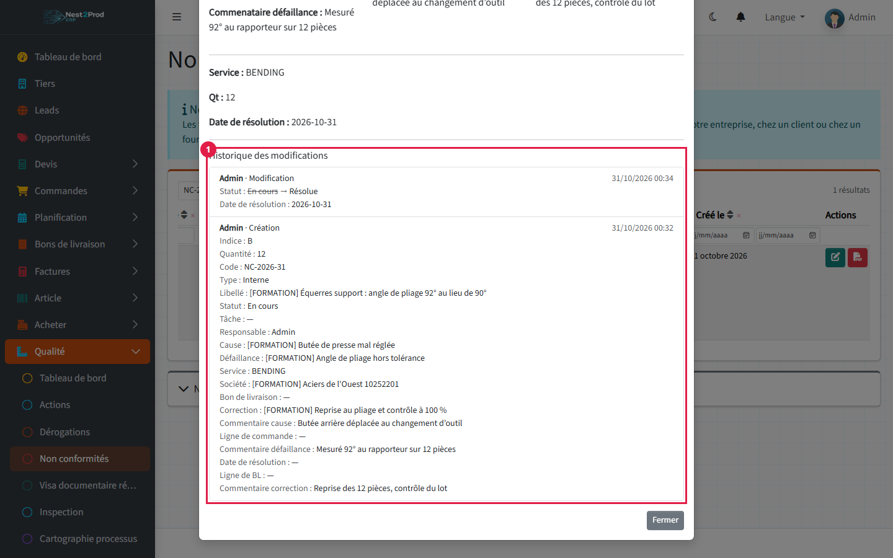

1. **Change history**: every change (status, person in charge, failure, quantity…) with its
   author, date, old and new value. Settings (failures, causes, corrections), measuring
   devices and FMEA are also tracked.

> ⚠️ The **Resolved** button closes the window **without saving** other changed fields. If
> you changed something, click **Update** first, reopen the record, then click
> **Resolved**.
>
> 💡 Choosing "Resolved" in the status list does not record a closing date: the record
> would be ignored by the resolution time. Use the button. **Reopen** sets the record back
> to "In progress".

---

## 8. Receipt document review

Menu **Receipt document review**: goods receipt lines whose purchase order requires a
material certificate (EN 10204: 2.1, 2.2, 3.1, 3.2), or for which a certificate was
received. Quality checks the **paperwork** here, separately from the physical inspection of
the parts.

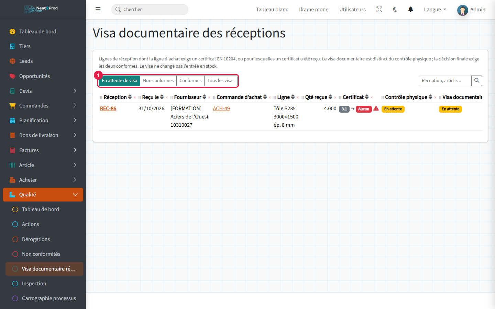

1. The filters: **Awaiting review**, **Non-compliant**, **Compliant**, **All reviews**.

The **Certificate** column compares the required and the received certificate (a red
triangle flags a gap). **Review** opens the review: compliant or non-compliant, with a
comment, and a supplier non-conformity if needed.

> 💡 Entering the received certificate and the review itself are detailed in the
> **Purchasing** guide. The review does not change stock, and the final decision requires
> both the physical inspection and the document review to be compliant.

---

## 9. Control plans and first article

Menu **Inspection**: the **Quality plans** screen gathers the items' control plans.

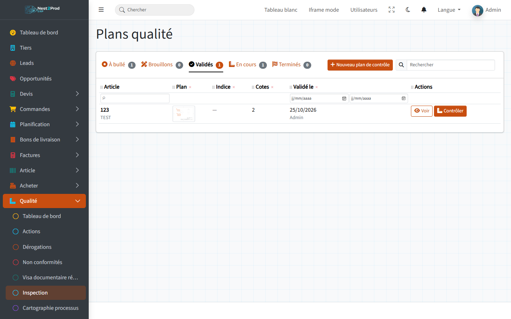

- **To balloon**: items ordered by a customer that requires a control plan (box on the
  customer record) or set to "Control plan: Always", and that do not have one yet;
- **Drafts** and **Approved**: plans being ballooned, then approved;
- **In progress** and **Closed**: inspections carried out on these plans.

A control plan applies to an item **at a given revision**. The **ballooning tool** shows the
item's drawing (a PDF in its documents): draw a rectangle around each dimension to check,
with its nominal, tolerances and sampling. When the drawing contains text, the selected
dimension is read and pre-filled: always check it.

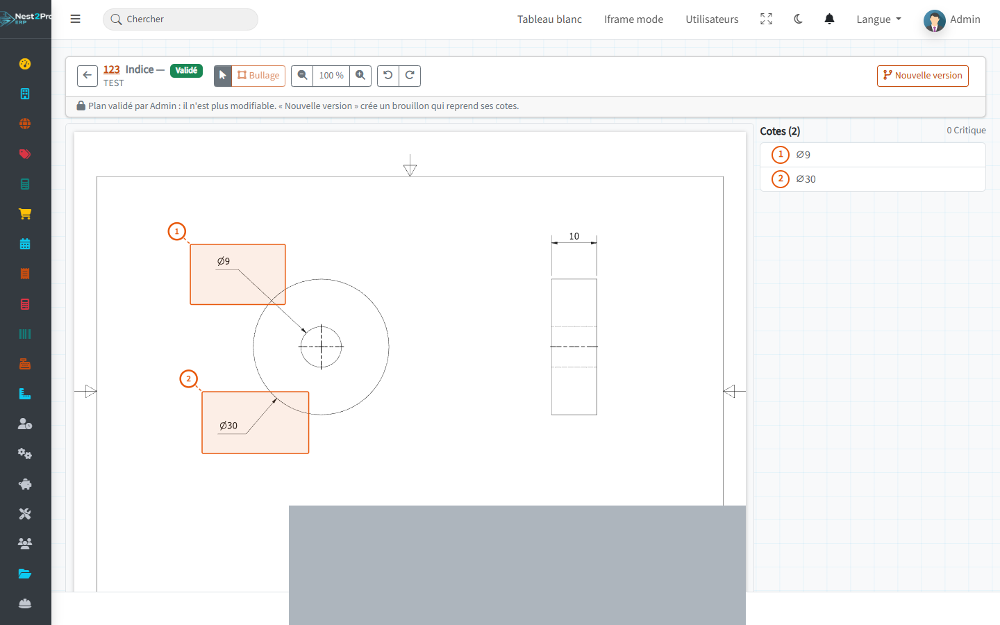

An **approved** plan can no longer be changed: "New version" creates a draft that copies
its dimensions. Approving it makes the former plan obsolete **for the same revision** only.

During production, the **Inspection** tab of the operation tracking screen shows the
ballooned drawing and a measurement grid, if the item has an approved plan at the ordered
revision. The first inspection of an item at a revision is a **first article**: part 1 must
be measured (a simple warning, production is never blocked). An out-of-tolerance
measurement offers to **report a non-conformity**, pre-filled. The **Inspect** button of an
approved plan starts an inspection outside production (goods receipt, audit).

The **first article report** gathers the part identification, material and dimension
results. It is signed "verified" then "approved" (which locks it), and its PDF is filed in
the order's documents (or the item's, if there is no order).

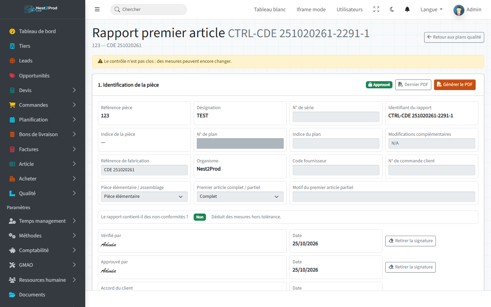

> 💡 Ballooning will get its own guide.

---

## 10. Internal audits and customer returns

**Internal audits**: ISO 9001 planner with annual plans, calendar, processes and checklists
(clauses 4 to 10, pre-filled). An audit is started from the calendar; its findings (major or
minor non-conformity, observation, strength) feed the dashboard.

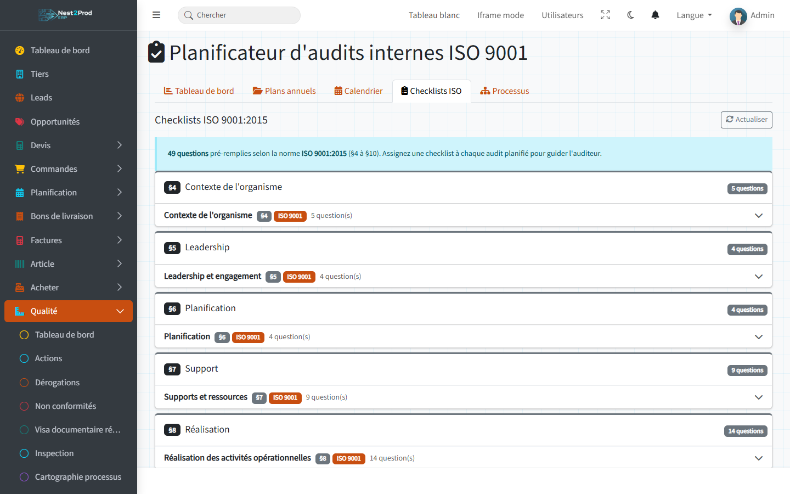

**Customer returns** (also in the Delivery notes menu): a return is linked to a delivery
and, if needed, to a non-conformity. Enter the diagnosis, then generate the rework tasks.

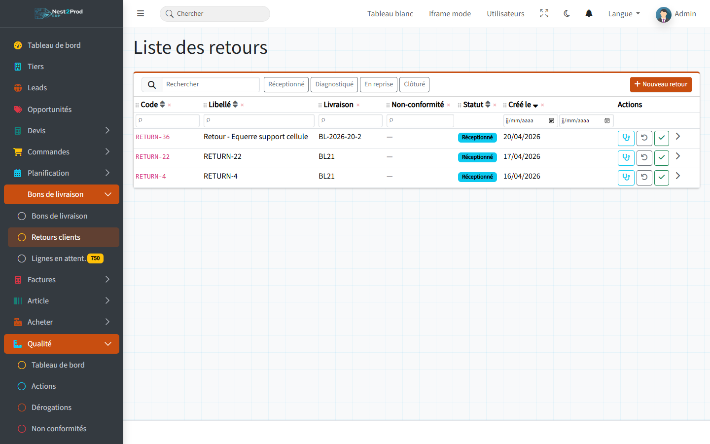

## What next?

- **Deliver** the accepted parts: once the derogation is validated, the line's delivery note
  is no longer blocked (sales guide).
- **Measure during production** with the approved control plan, from the operation's
  Inspection tab.
- **Review the certificates** of material receipts (Purchasing guide).
- **Schedule an internal audit** to check that the corrective action holds over time.

## Frequently asked questions

**The Failure, Cause and Correction lists only offer "N/A".**
The reference lists are empty: fill in the Settings tab of the dashboard (section 2).

**My action does not save when edited.**
The three descriptions (problem, cause, action) are required when editing.

**Resolution time stays at 0 days.**
No non-conformity has been closed with the "Resolved" button.

**I cannot create the delivery note: "derogation … is waiting for the customer decision".**
An open external derogation targets the line. Complete and validate it (section 6.3), or
cancel it if the customer refused.

**The "Validate" option is greyed out on the derogation.**
You do not have the **quality-derogation-validate** permission: ask a manager who has it
to validate.

**The Validation card still asks for a "Customer approval" document although I uploaded the
letter.**
The file was uploaded with another type. In the file list of the Documents card, change its
type to "Customer approval".

**The "Send for signature" button does not appear.**
Electronic signature is not configured, the derogation is internal, it is no longer "In
Progress" or "Waiting Customer Data", or the contact has no e-mail address: the reason is
shown in the card.

**How do I see which actions answer a non-conformity?**
The "NC" column of the actions and derogations lists shows the linked record; the
non-conformity itself does not list them.
