**Objectif** : traiter un défaut de bout en bout (déclaration, analyse, action corrective,
dérogation éventuelle, clôture) et suivre les moyens de contrôle de l'atelier.

**Pour qui** : le responsable qualité. Les opérateurs déclarent aussi des non-conformités
depuis l'atelier.

**Exemple utilisé** : un lot de 12 équerres sort de la presse plieuse à 92° au lieu de 90°.
La butée a bougé au changement d'outil.

## Avant de commencer

- Le menu **Qualité** apparaît avec la permission **quality-menu**. Les audits internes
  demandent **audit-menu**, les retours clients **returns-menu**.
- Pour buller et valider des plans de contrôle : **inspection-plans-edit** et
  **inspection-plans-approve**.
- Les **services** (pliage, laser…) viennent des Méthodes (voir le guide « Les Méthodes »).

## Vue d'ensemble

```steps
Réglage
Appareils de mesure
Non-conformité
Action corrective
Dérogation
Clôture
```

Le menu **Qualité** regroupe : **Tableau de bord** (avec les appareils de mesure et le
réglage), **Actions**, **Dérogations**, **Non conformités**, **Inspection** (les plans de
contrôle), **Cartographie processus**, **AMDEC**, **Audits internes** et **Retours clients**.

---

## 1. Le tableau de bord

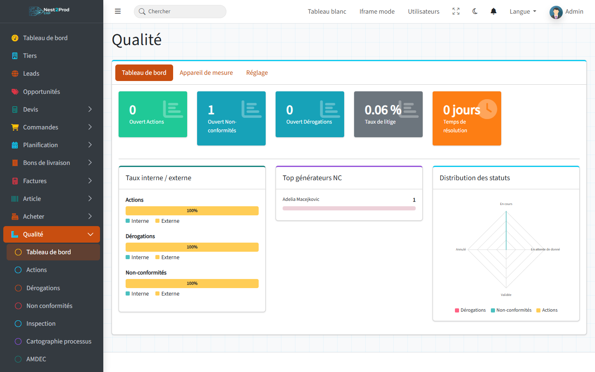

- **Ouvert Actions / Non-conformités / Dérogations** : les fiches au statut « En cours ».
- **Taux de litige** : la part des lignes de commande qui ont une non-conformité.
- **Temps de résolution** : le délai moyen entre la création et la clôture d'une
  non-conformité.
- En dessous : la répartition interne / externe, les clients qui génèrent le plus de
  non-conformités et la distribution des statuts.

> 💡 Le temps de résolution ne compte que les non-conformités clôturées avec le bouton
> **Résolue** (section 7) : c'est lui qui enregistre la date de clôture.

---

## 2. Préparer le référentiel des défauts

Onglet **Réglage** : trois listes, à remplir une fois, que chaque non-conformité reprend.

- **Défaillance type** : ce qui est constaté (cote hors tolérance, rayure, oxydation…) ;
- **Cause type** : pourquoi (réglage, matière, programme, manutention…) ;
- **Correctif type** : ce qui est fait (reprise, rebut, tri à 100 %…).

Dépliez une carte avec le **+**, puis :

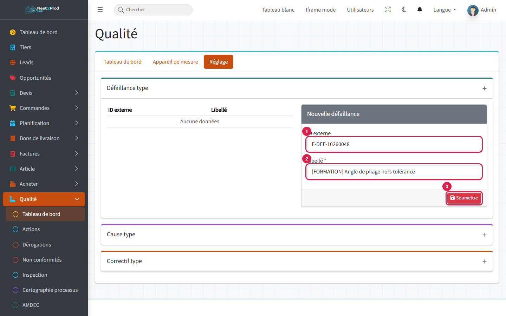

1. **ID externe** : un code court, unique.
2. **Libellé**.
3. **Soumettre**.

> 💡 Gardez des listes courtes et stables : elles servent à classer les non-conformités et à
> repérer celles qui reviennent.

---

## 3. Suivre les appareils de mesure

Onglet **Appareil de mesure** : pieds à coulisse, rapporteurs, micromètres, calibres…

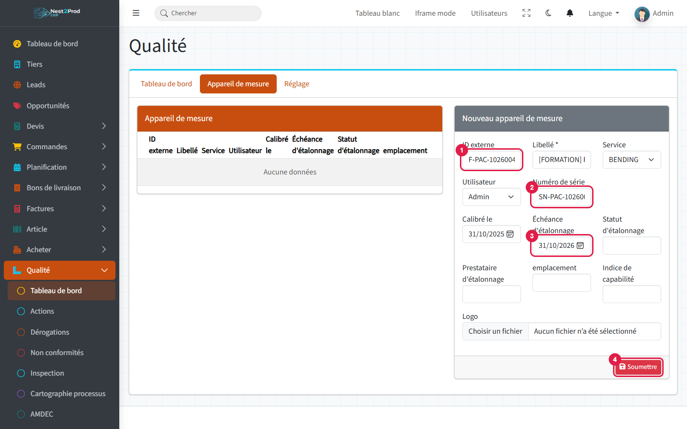

1. **ID externe** : le repère de l'appareil, unique.
2. **Numéro de série**, unique lui aussi.
3. **Échéance d'étalonnage** : la date du prochain étalonnage.
4. **Soumettre**, après avoir choisi le **Service** et l'**Utilisateur** responsable (tous
   deux obligatoires).

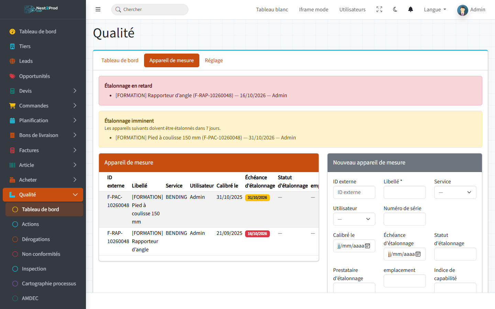

- Bandeau **rouge** : étalonnage en retard ;
- Bandeau **jaune** : étalonnage dans les 7 jours.

Chaque matin à 7 h 30, le responsable de chaque appareil concerné reçoit aussi une notification
(tâche planifiée : le planificateur doit tourner sur le serveur).

> 💡 Un appareil dont l'étalonnage est dépassé reste utilisable pour saisir une mesure,
> mais il est signalé « Étalonnage dépassé » dans la liste des appareils de l'écran de
> contrôle.

---

## 4. Déclarer une non-conformité

Menu **Non conformités**, carte **Nouvelle non conformité** en bas de la page (cliquez sur
son titre pour la déplier).

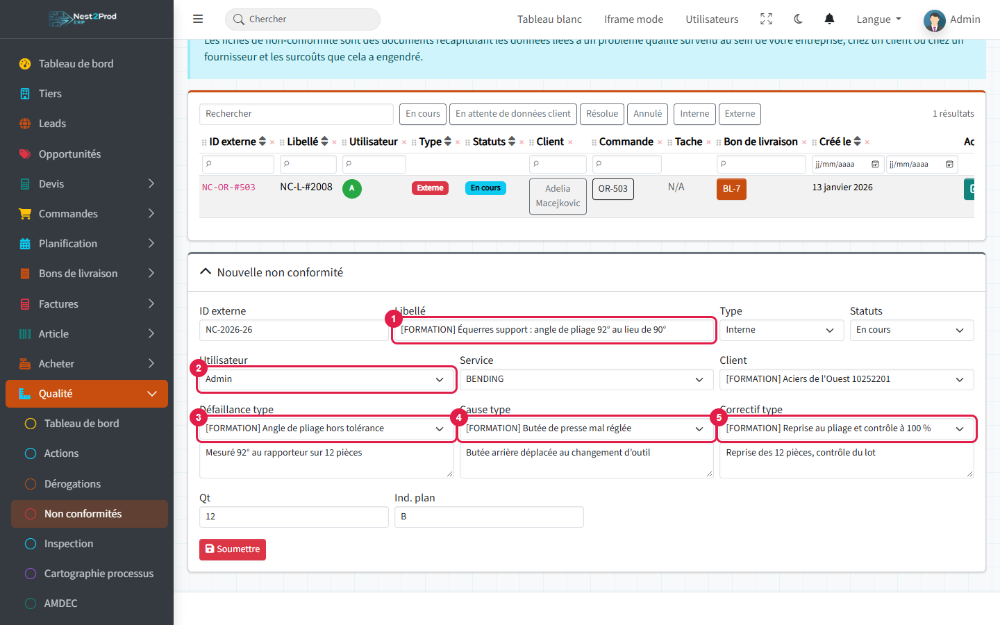

1. **Libellé** : le défaut, en une phrase. Le numéro (ID externe) est proposé.
2. **Utilisateur** : le responsable du traitement (obligatoire).
3. **Défaillance type**, avec le constat détaillé dessous.
4. **Cause type**, avec l'analyse.
5. **Correctif type**, avec ce qui a été fait.

Complétez le **Type** (Interne si le défaut vient de chez vous, Externe s'il vient d'un
client ou d'un fournisseur), le **Service**, le **Client**, la quantité **Qt** et l'**indice
du plan**, puis **Soumettre**.

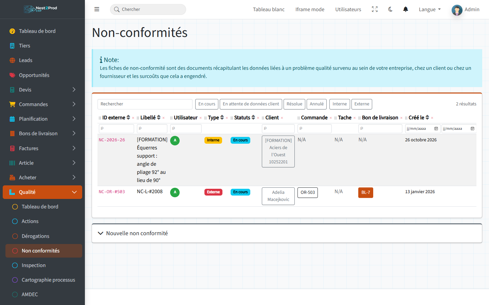

La liste se filtre par statut, par type et par recherche. Un clic sur une ligne affiche le
détail, le bouton PDF imprime la fiche.

**Autres façons de créer une non-conformité :**

- depuis l'**écran de suivi d'une opération** à l'atelier, bouton « Nouvelle non
  conformité » : elle est liée à la commande et à l'opération ;
- depuis le **lien public d'un bon de livraison**, par le client ;
- depuis une **mesure hors tolérance** saisie dans un contrôle (section 8).

> ⚠️ À l'atelier, le bouton crée la non-conformité **immédiatement**, sans confirmation : un
> double clic en crée deux.

---

## 5. Lancer une action corrective

Menu **Actions** : une action corrige la cause pour que le défaut ne revienne pas.

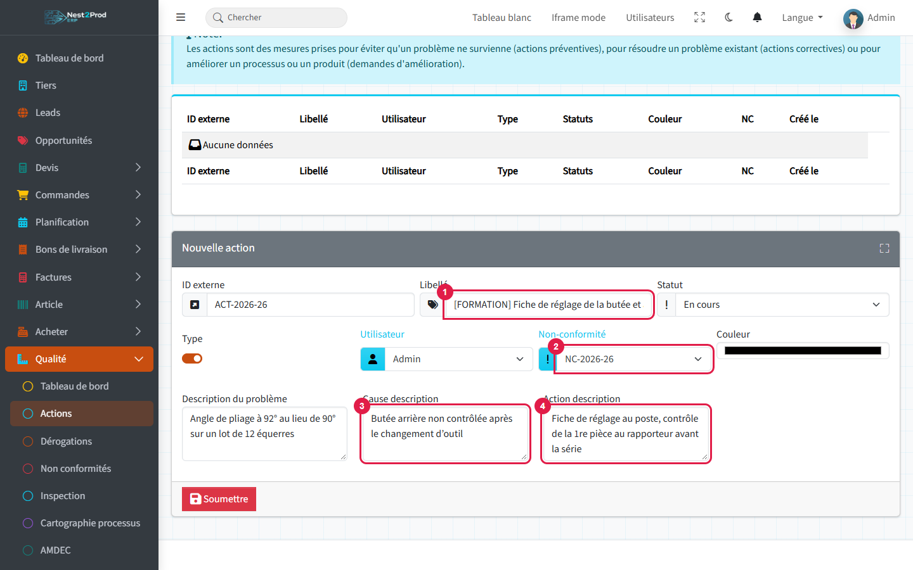

1. **Libellé** : remplacez le numéro recopié par défaut par l'intitulé de l'action.
2. **Non-conformité** : la fiche à laquelle l'action répond.
3. **Cause description**.
4. **Action description**.

L'interrupteur **Type** coché signifie **Interne**. Choisissez l'**Utilisateur** chargé de
l'action, puis **Soumettre**.

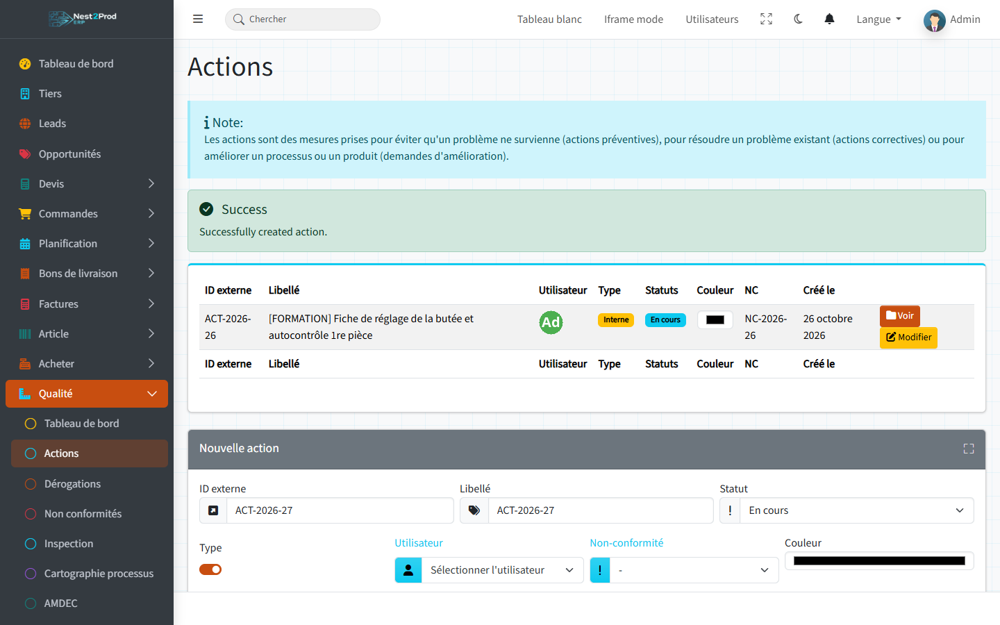

Quand l'action est faite et vérifiée, ouvrez-la avec **Modifier** et passez son statut à
**Validée**.

> ⚠️ En modification, les trois descriptions (problème, cause, action) sont obligatoires,
> alors qu'elles ne l'étaient pas à la création. Remplissez-les dès le départ.
>
> 💡 Les actions sont triées de la plus ancienne à la plus récente : la dernière créée est
> en fin de liste.

---

## 6. Demander une dérogation

Menu **Dérogations** : quand le client peut accepter des pièces hors tolérance, la
dérogation trace la demande et sa réponse.

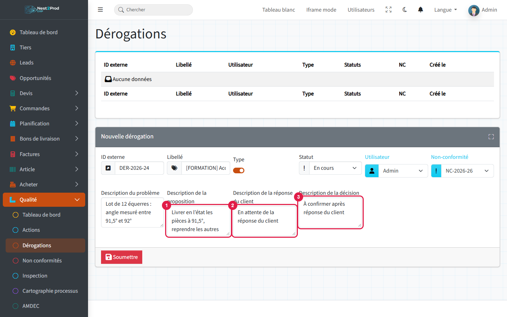

1. **Description de la proposition** : ce que vous proposez au client.
2. **Description de la réponse du client**.
3. **Description de la décision**.

Les quatre zones de texte sont **obligatoires** : notez « en attente » tant que le client n'a
pas répondu, puis complétez la dérogation avec **Modifier**. Reliez-la à la non-conformité
comme une action.

---

## 7. Clôturer la non-conformité

Une fois le traitement terminé, ouvrez la non-conformité avec son crayon.

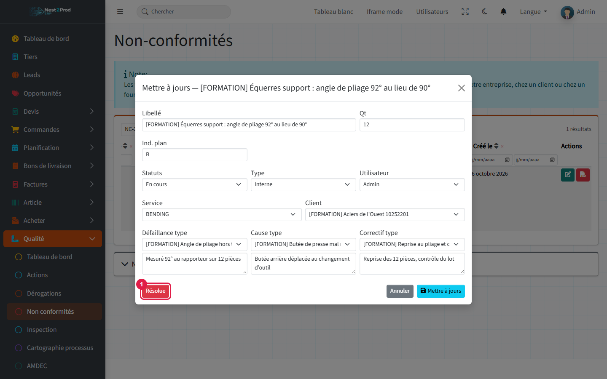

1. **Résolue** passe la fiche au statut « Résolue » et enregistre la date de clôture.

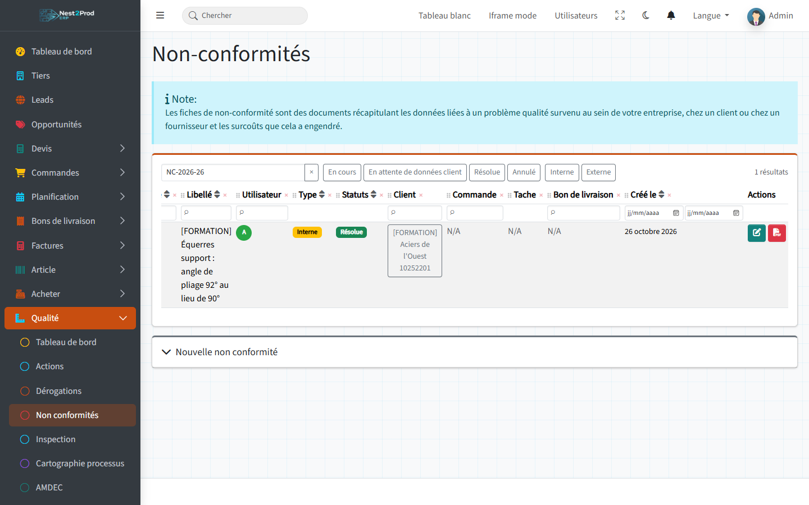

> ⚠️ Le bouton **Résolue** ferme la fenêtre **sans enregistrer** les autres champs modifiés.
> Si vous avez changé quelque chose, cliquez d'abord sur **Mettre à jours**, rouvrez la
> fiche, puis cliquez sur **Résolue**.
>
> 💡 Choisir « Résolue » dans la liste des statuts n'enregistre pas de date de clôture : la
> fiche serait ignorée par le temps de résolution. Utilisez le bouton. **Réouvrir** remet la
> fiche « En cours ».

---

## 8. Plans de contrôle et premier article

Menu **Inspection** : l'écran **Plans qualité** regroupe les plans de contrôle des articles.

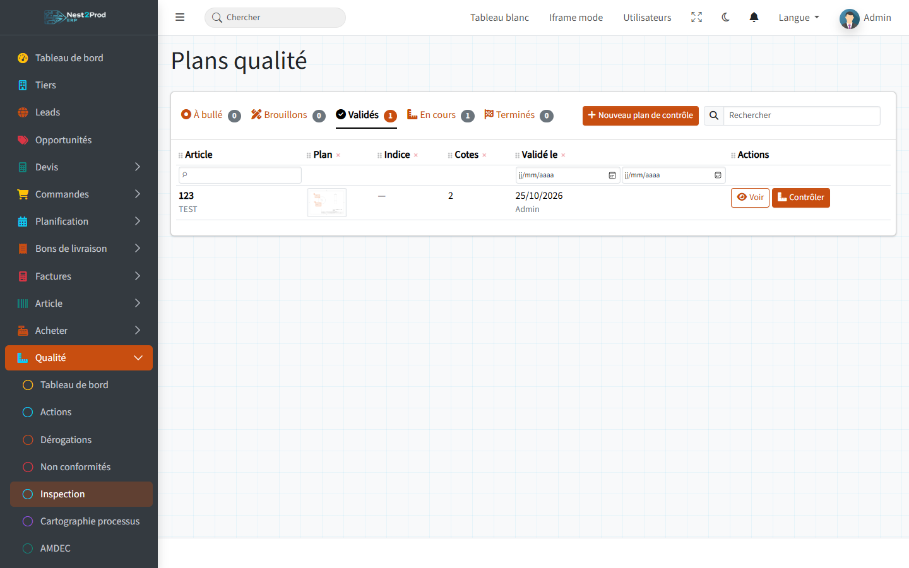

- **À bullé** : les articles commandés par un client qui exige un plan de contrôle (case de
  la fiche client) ou réglés sur « Plan de contrôle : Toujours », et qui n'en ont pas
  encore ;
- **Brouillons** et **Validés** : les plans en cours de bullage, puis validés ;
- **En cours** et **Terminés** : les contrôles réalisés sur ces plans.

Le **bulleur** affiche le plan de l'article (le PDF de sa GED) : on y trace un rectangle par
cote à contrôler, avec son nominal, ses tolérances et son échantillonnage.

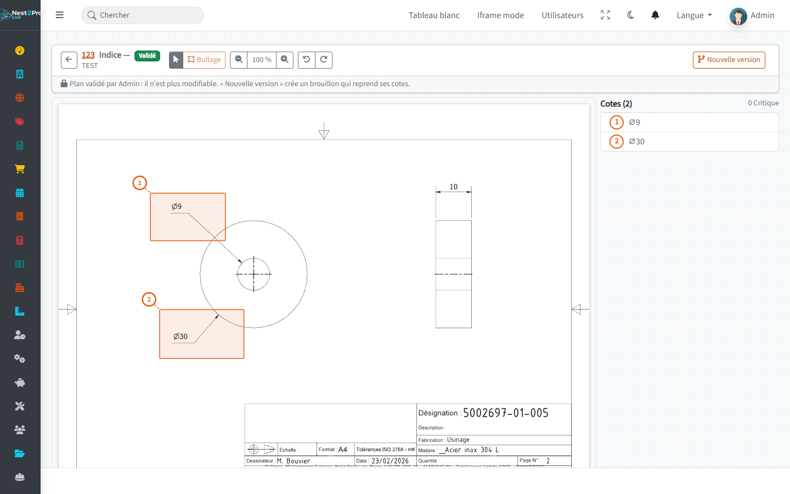

Un plan **validé** n'est plus modifiable : « Nouvelle version » crée un brouillon qui reprend
ses cotes.

En fabrication, l'onglet **Contrôle** de l'écran de suivi de l'opération affiche le plan
bullé et une grille de mesures. Une mesure hors tolérance propose de **déclarer une
non-conformité** pré-remplie. Le bouton **Contrôler** d'un plan validé lance un contrôle
hors fabrication (réception, audit).

Le **rapport premier article** reprend l'identification de la pièce, la matière et les
résultats des cotes. Il se signe « vérifié » puis « approuvé », et son PDF est rangé dans la
GED de la commande.

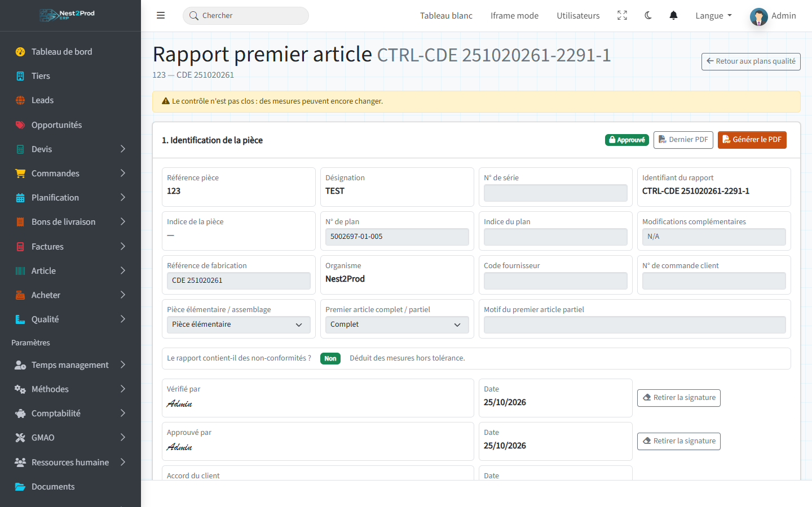

> 💡 Le détail du bullage fera l'objet d'un guide à part.

---

## 9. Audits internes et retours clients

**Audits internes** : planificateur ISO 9001 avec plans annuels, calendrier, processus et
checklists (§4 à §10 de la norme, pré-remplies). Un audit se lance depuis le calendrier ;
ses constats (non-conformité majeure ou mineure, observation, point positif) alimentent le
tableau de bord.

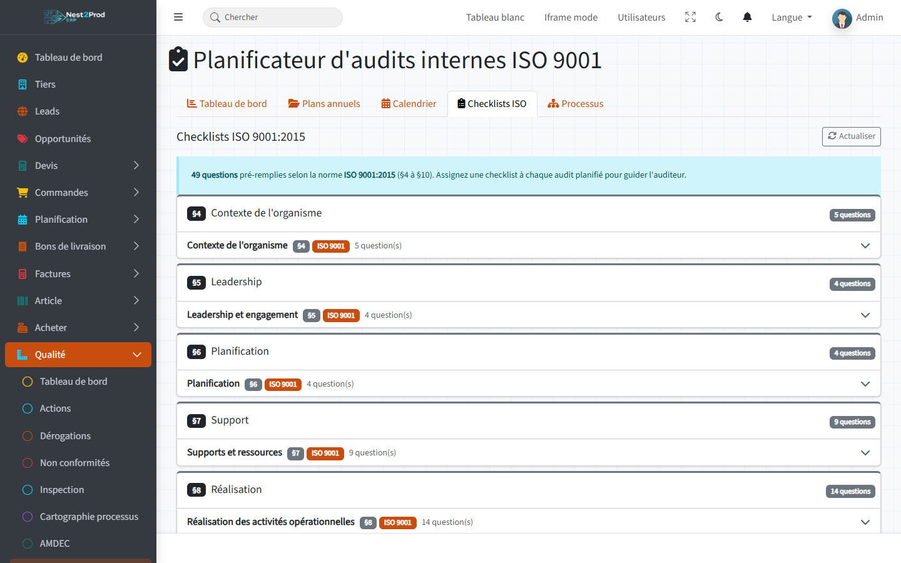

**Retours clients** (aussi dans le menu Bons de livraison) : un retour se rattache à une
livraison et, au besoin, à une non-conformité. On y saisit le diagnostic, puis on génère les
tâches de reprise.

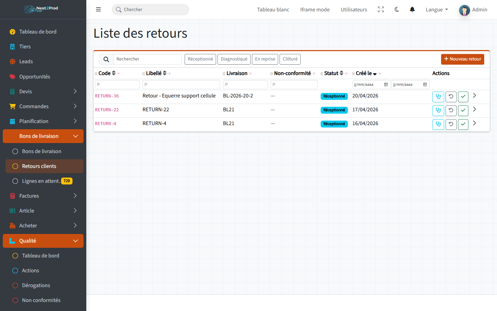

## Questions fréquentes

**Les listes Défaillance, Cause et Correctif ne proposent que « N/A ».**
Le référentiel est vide : remplissez l'onglet Réglage du tableau de bord (section 2).

**Mon action ne s'enregistre pas en modification.**
Les trois descriptions (problème, cause, action) sont obligatoires en modification.

**Le temps de résolution reste à 0 jour.**
Aucune non-conformité n'a été clôturée avec le bouton « Résolue ».

**Comment savoir quelles actions répondent à une non-conformité ?**
La colonne « NC » de la liste des actions et des dérogations indique la fiche liée ; la
non-conformité elle-même ne les liste pas.
