**Objectif** : traiter un défaut de bout en bout (déclaration, analyse, action corrective,
dérogation acceptée par le client, clôture) et suivre les moyens de contrôle de l'atelier.

**Pour qui** : le responsable qualité. Les opérateurs déclarent aussi des non-conformités
depuis l'atelier.

**Exemple utilisé** : un lot de 12 équerres sort de la presse plieuse à 92° au lieu de 90°.
La butée a bougé au changement d'outil. Le client accepte 7 pièces à 91,5°, les 5 autres
sont reprises.

## Avant de commencer

- Le menu **Qualité** apparaît avec la permission **quality-menu**. Les audits internes
  demandent **audit-menu**, les retours clients **returns-menu**.
- Passer une dérogation en « Validée » demande **quality-derogation-validate** (rôle Admin
  par défaut).
- Le visa documentaire des réceptions demande **reception-document-check**.
- Pour buller et valider des plans de contrôle : **inspection-plans-edit** et
  **inspection-plans-approve**.
- Les **services** (pliage, laser…) viennent des Méthodes (voir le guide « Les Méthodes »).
- La signature électronique des dérogations n'est proposée que si l'écran **Intégrations →
  Signature électronique** est configuré.

## Vue d'ensemble

```steps
Réglage
Appareils de mesure
Non-conformité
Action corrective
Dérogation
Accord du client
Clôture
```

Le menu **Qualité** regroupe : **Tableau de bord** (avec les appareils de mesure et le
réglage), **Actions**, **Dérogations**, **Non conformités**, **Visa documentaire réception**,
**Inspection** (les plans de contrôle), **Cartographie processus**, **AMDEC**, **Audits
internes** et **Retours clients**.

---

## 1. Le tableau de bord

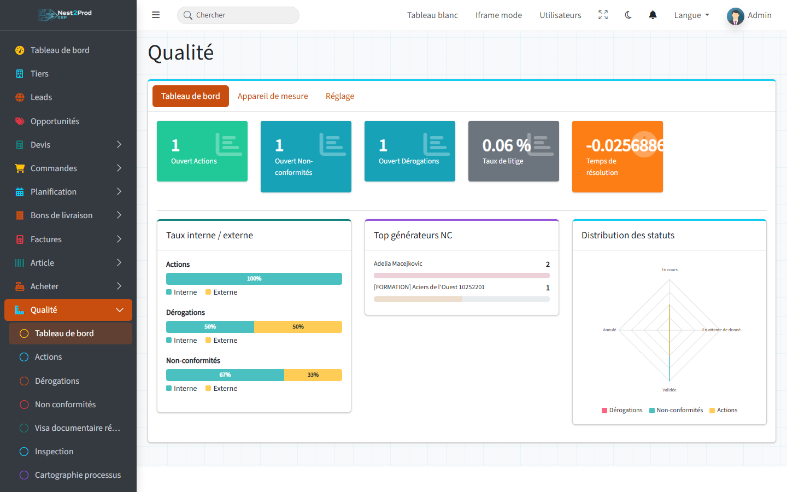

- **Ouvert Actions / Non-conformités / Dérogations** : les fiches au statut « En cours ».
- **Taux de litige** : la part des lignes de commande qui ont une non-conformité.
- **Temps de résolution** : le délai moyen entre la création et la clôture d'une
  non-conformité.
- En dessous : la répartition interne / externe, les clients qui génèrent le plus de
  non-conformités et la distribution des statuts.

> 💡 Le temps de résolution ne compte que les non-conformités clôturées avec le bouton
> **Résolue** (section 7) : c'est lui qui enregistre la date de clôture.

---

## 2. Préparer le référentiel des défauts

Onglet **Réglage** : trois listes, à remplir une fois, que chaque non-conformité reprend.

- **Défaillance type** : ce qui est constaté (cote hors tolérance, rayure, oxydation…) ;
- **Cause type** : pourquoi (réglage, matière, programme, manutention…) ;
- **Correctif type** : ce qui est fait (reprise, rebut, tri à 100 %…).

Dépliez une carte avec le **+**, puis :

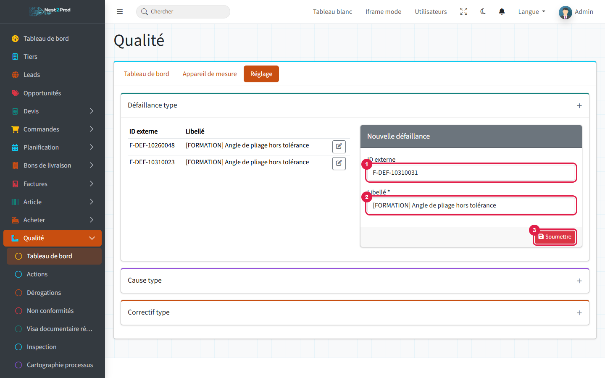

1. **ID externe** : un code court, unique.
2. **Libellé**.
3. **Soumettre**.

> 💡 Gardez des listes courtes et stables : elles servent à classer les non-conformités et à
> repérer celles qui reviennent.

---

## 3. Suivre les appareils de mesure

Onglet **Appareil de mesure** : pieds à coulisse, rapporteurs, micromètres, calibres…

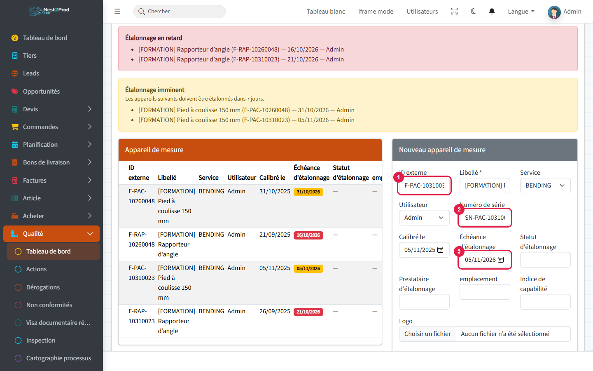

1. **ID externe** : le repère de l'appareil, unique.
2. **Numéro de série**, unique lui aussi.
3. **Échéance d'étalonnage** : la date du prochain étalonnage.

Choisissez aussi le **Service** et l'**Utilisateur** responsable (tous deux obligatoires),
puis cliquez sur **Soumettre**, en bas du formulaire.

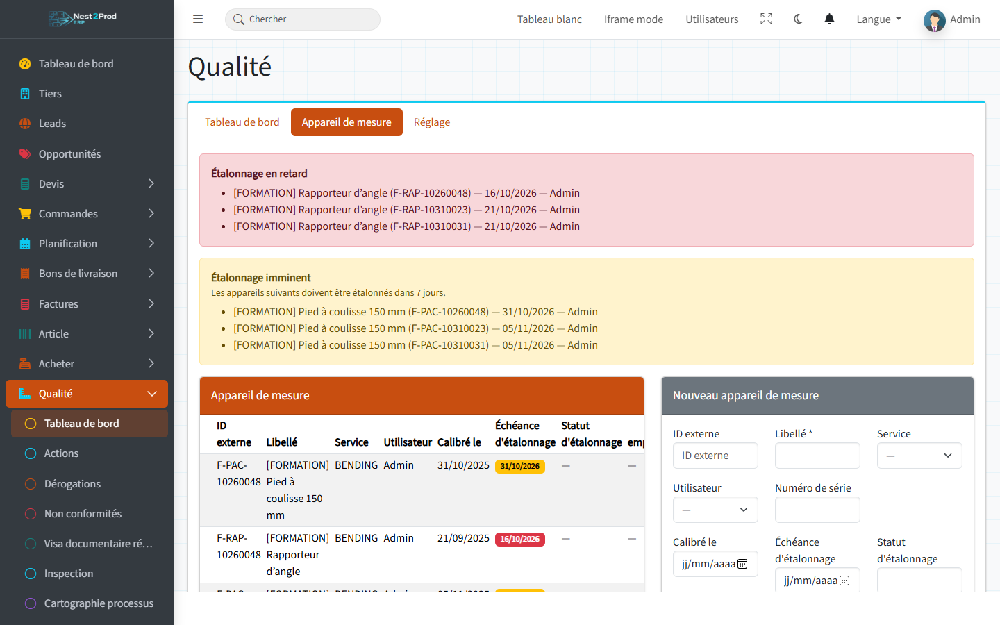

- Bandeau **rouge** : étalonnage en retard ;
- Bandeau **jaune** : étalonnage dans les 7 jours.

Chaque matin à 7 h 30, le responsable de chaque appareil concerné reçoit aussi une notification
(tâche planifiée : le planificateur doit tourner sur le serveur).

> 💡 Un appareil dont l'étalonnage est dépassé reste utilisable pour saisir une mesure,
> mais il est signalé « Étalonnage dépassé » dans la liste des appareils de l'écran de
> contrôle.

---

## 4. Déclarer une non-conformité

Menu **Non conformités**, carte **Nouvelle non conformité** en bas de la page (cliquez sur
son titre pour la déplier).

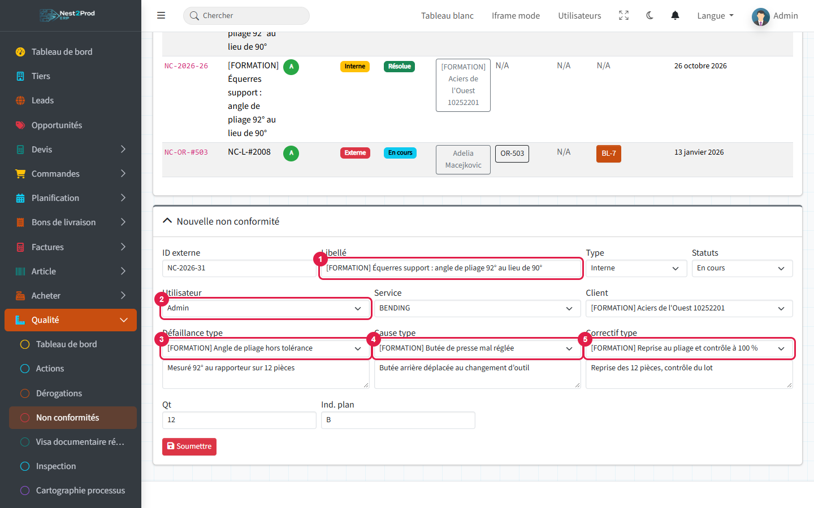

1. **Libellé** : le défaut, en une phrase. Le numéro (ID externe) est proposé.
2. **Utilisateur** : le responsable du traitement (obligatoire).
3. **Défaillance type**, avec le constat détaillé dessous.
4. **Cause type**, avec l'analyse.
5. **Correctif type**, avec ce qui a été fait.

Complétez le **Type** (Interne si le défaut vient de chez vous, Externe s'il vient d'un
client ou d'un fournisseur), le **Service**, le **Client**, la quantité **Qt** et l'**indice
du plan**, puis **Soumettre**.

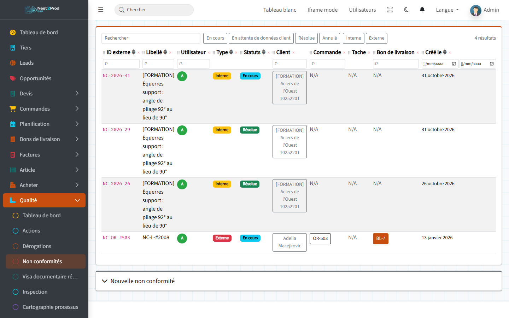

La liste se filtre par statut, par type et par recherche. Un clic sur une ligne affiche le
détail et l'historique des modifications (section 7), le bouton PDF imprime la fiche.

**Autres façons de créer une non-conformité :**

- depuis l'**écran de suivi d'une opération** à l'atelier, bouton « Nouvelle non
  conformité » : elle est liée à la commande et à l'opération ;
- depuis le **lien public d'un bon de livraison**, par le client ;
- depuis une **mesure hors tolérance** saisie dans un contrôle (section 9) ;
- depuis le **visa documentaire** d'une réception, quand le certificat n'est pas conforme
  (section 8).

> ⚠️ À l'atelier, le bouton crée la non-conformité **immédiatement**, sans confirmation : un
> double clic en crée deux.

---

## 5. Lancer une action corrective

Menu **Actions** : une action corrige la cause pour que le défaut ne revienne pas.

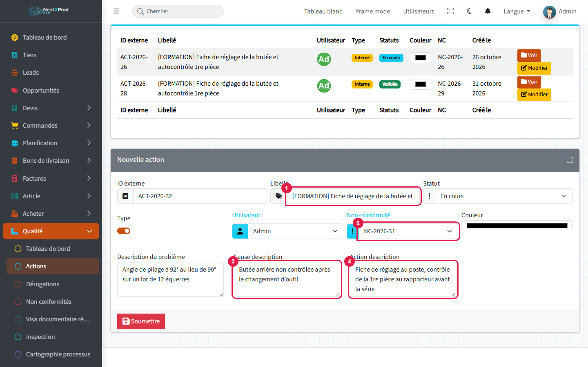

1. **Libellé** : remplacez le numéro recopié par défaut par l'intitulé de l'action.
2. **Non-conformité** : la fiche à laquelle l'action répond.
3. **Cause description**.
4. **Action description**.

L'interrupteur **Type** coché signifie **Interne**. Choisissez l'**Utilisateur** chargé de
l'action, puis **Soumettre**.

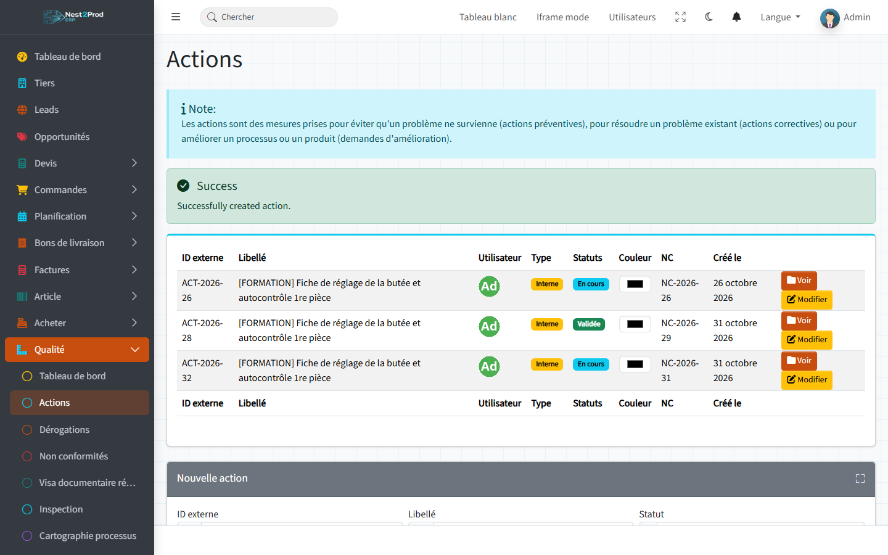

Quand l'action est faite et vérifiée, ouvrez-la avec **Modifier** et passez son statut à
**Validée**.

Le bouton **Voir** affiche la fiche et, en dessous, l'**Historique des modifications** :
qui a changé quoi, et quand, avec l'ancienne valeur barrée et la nouvelle.

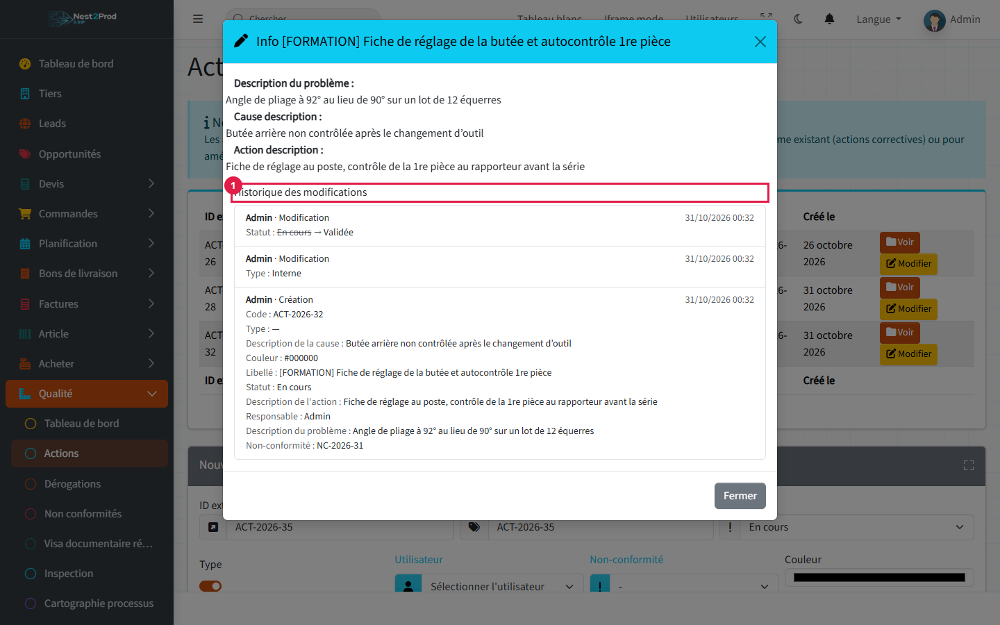

1. **Historique des modifications** : ici la création, puis le passage de « En cours » à
   « Validée ».

> ⚠️ En modification, les trois descriptions (problème, cause, action) sont obligatoires,
> alors qu'elles ne l'étaient pas à la création. Remplissez-les dès le départ.
>
> 💡 Les actions sont triées de la plus ancienne à la plus récente : la dernière créée est
> en fin de liste.

---

## 6. Obtenir une dérogation du client

Une **dérogation** trace l'acceptation de pièces hors tolérance. Une dérogation **externe**
engage le client : elle ne peut être validée que si son accord écrit est prouvé. Une
dérogation **interne** (décision prise chez vous) n'exige que la décision.

### 6.1 Créer la demande

Menu **Dérogations**, carte **Nouvelle dérogation** en bas de la page.

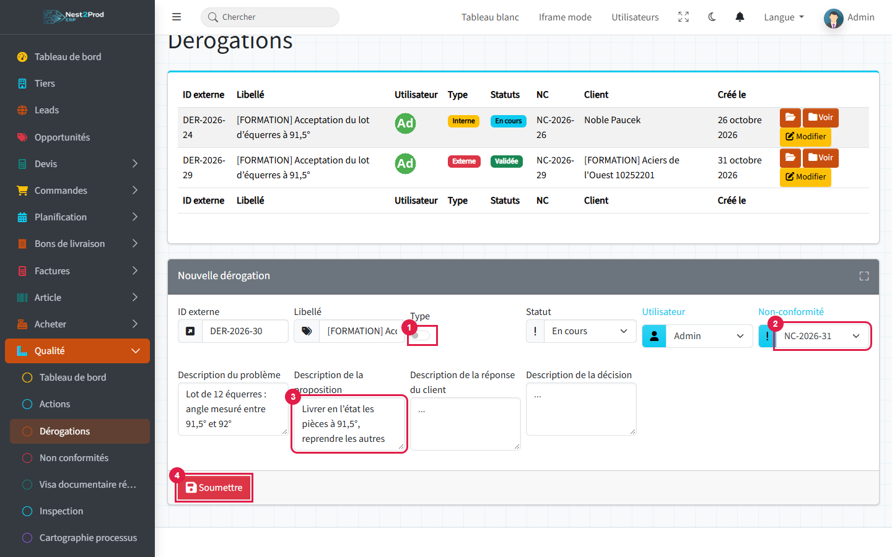

1. **Type** : interrupteur **décoché** pour une dérogation **externe** (client).
2. **Non-conformité** : la fiche à l'origine de la demande. Son client y est repris.
3. **Description de la proposition** : ce que vous proposez au client.
4. **Soumettre** : la fiche de la dérogation s'ouvre.

Seules la description du problème et celle de la proposition sont obligatoires : la réponse
et la décision se complètent sur la fiche, quand le client a répondu.

> ⚠️ L'interrupteur **Type** est coché par défaut, ce qui crée une dérogation **interne**.
> Pour une demande au client, décochez-le, sinon l'accord du client ne sera jamais exigé.

Dans la liste, le bouton dossier (**Ouvrir la fiche**) rouvre la fiche d'une dérogation.

### 6.2 Renseigner le client et sa réponse

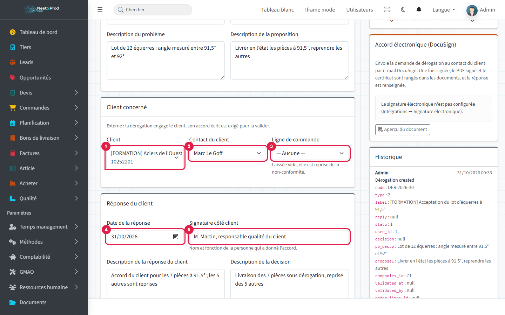

1. **Client** : repris de la non-conformité, modifiable.
2. **Contact du client** : la personne à qui la demande est adressée. Indispensable pour la
   signature électronique (il lui faut une adresse e-mail).
3. **Ligne de commande** : les pièces concernées. Laissée vide, elle est reprise de la
   non-conformité.
4. **Date de la réponse** du client.
5. **Signataire côté client** : nom et fonction de la personne qui a donné l'accord.

Complétez en dessous la **Description de la réponse du client** et la **Description de la
décision**, puis cliquez sur **Mettre à jour** (en bas de la carte « Réponse du client »).

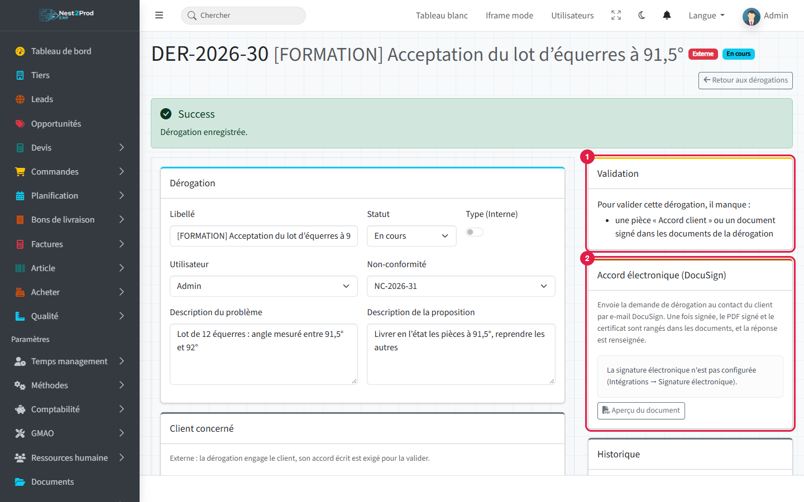

1. **Validation** : la liste de ce qui manque encore pour valider. Ici, il ne reste que la
   preuve écrite de l'accord.
2. **Accord électronique (DocuSign)** : envoi de la demande au client pour signature (voir
   6.4). **Aperçu du document** montre le PDF qui lui serait envoyé.

> ⚠️ **Livraison bloquée** : tant qu'une dérogation **externe** est « En cours » ou « En
> attente de données client », la ligne de commande concernée (choisie sur la fiche ou
> reprise de la non-conformité) ne peut pas passer sur un bon de livraison. Le message
> « Livraison impossible : la dérogation … attend la décision du client » s'affiche. Validez
> ou annulez la dérogation avant de livrer.

### 6.3 Joindre l'accord écrit et valider

La carte **Documents**, en bas de la fiche, reçoit la preuve de l'accord : courrier, e-mail
enregistré en PDF, fiche signée…

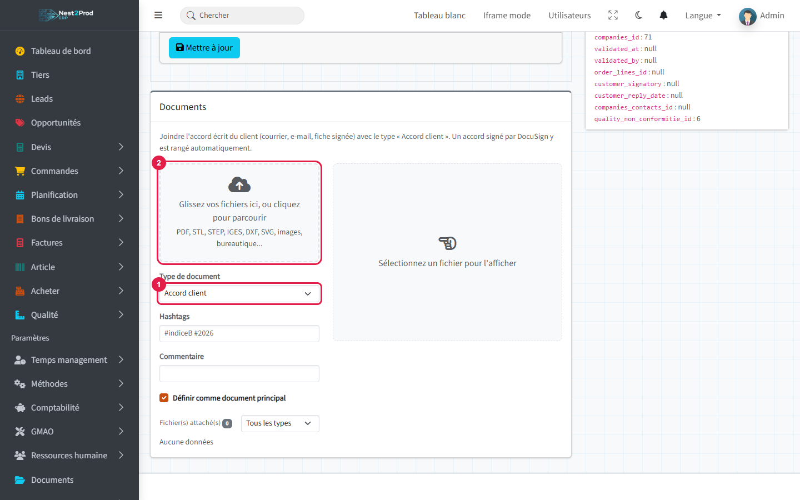

1. **Type de document** : choisissez **Accord client** avant de déposer le fichier.
2. Glissez le fichier dans la zone, ou cliquez pour le choisir.

Quand tout est réuni, la carte **Validation** l'indique.

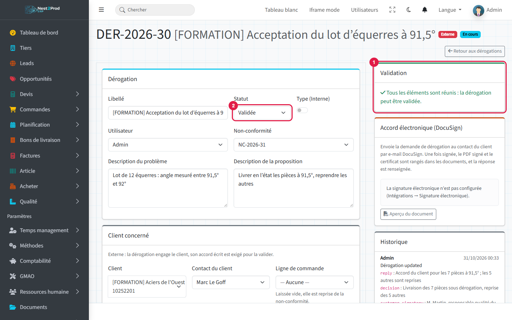

1. **Validation** : « Tous les éléments sont réunis ».
2. **Statut** : choisissez **Validée**, puis cliquez sur **Mettre à jour**.

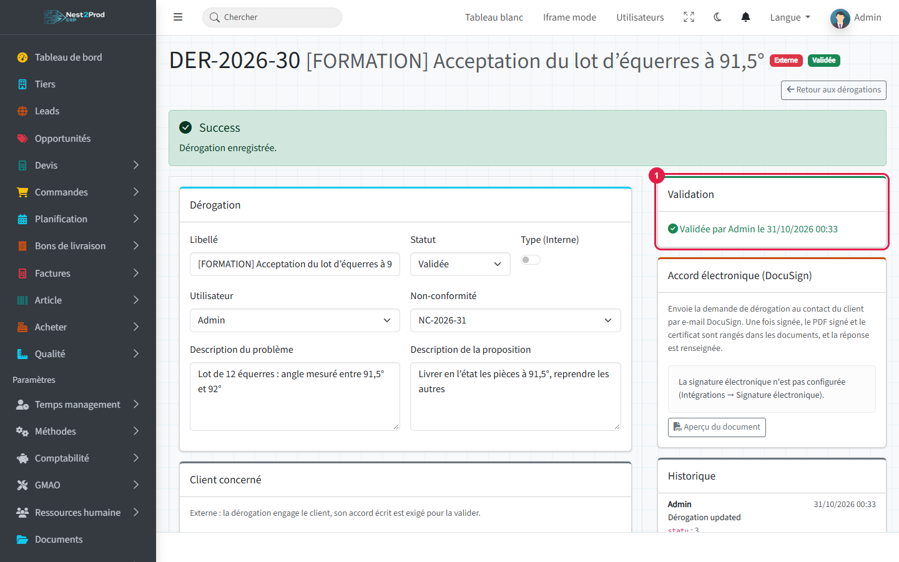

1. La fiche indique qui a validé et quand.

> ⚠️ Un fichier déposé avec un autre type (Photo, Autre…) ne compte pas comme preuve :
> changez son type en **Accord client** dans la liste des fichiers.
>
> ⚠️ Une dérogation validée est **figée** : seuls les porteurs de la permission
> **quality-derogation-validate** peuvent encore la modifier ou y déposer un document.
>
> 💡 L'option **Validée** est grisée pour qui n'a pas la permission. Si un élément manque, la
> validation est refusée et le message liste ce qu'il faut compléter.

### 6.4 Faire signer le client par voie électronique

Si la signature électronique est configurée, la carte **Accord électronique (DocuSign)**
propose **Envoyer pour signature** sur une dérogation externe « En cours » ou « En attente
de données client » dont le contact a une adresse e-mail.

- Le client reçoit un e-mail DocuSign avec la demande de dérogation à signer ; la
  dérogation passe « En attente de données client ».
- Une fois signée, le PDF signé et son certificat sont rangés dans les **Documents** (type
  « Document signé »), et la réponse, sa date et le signataire sont remplis s'ils étaient
  vides.
- **La dérogation n'est jamais validée d'office** : relisez-la, puis passez-la en
  **Validée** comme en 6.3.
- **Relire l'état** interroge DocuSign tout de suite (sinon l'état se met à jour tout seul,
  par la tâche planifiée).

> ⚠️ L'envoi part réellement chez le client : vérifiez le contact et relisez l'**Aperçu du
> document** avant de cliquer.
>
> ⚠️ Si vous modifiez la dérogation après l'envoi, la demande en attente est annulée :
> cliquez sur **Renvoyer la demande** pour que le client signe la version à jour.

---

## 7. Clôturer la non-conformité

Une fois le traitement terminé, ouvrez la non-conformité avec son crayon.

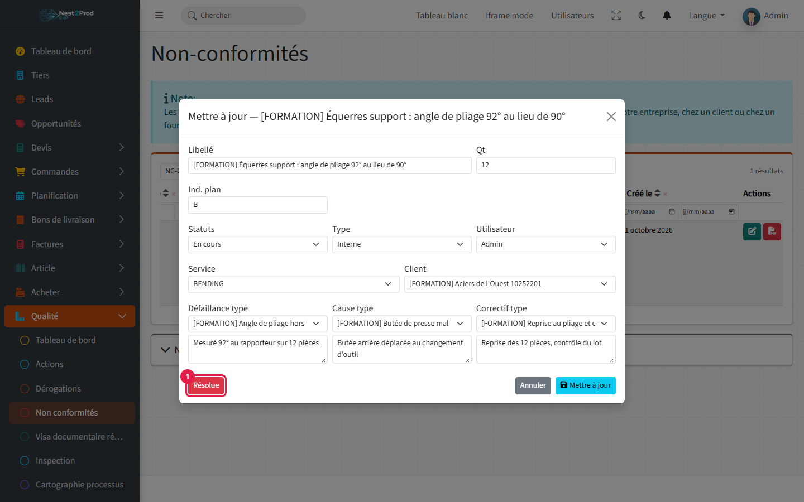

1. **Résolue** passe la fiche au statut « Résolue » et enregistre la date de clôture.

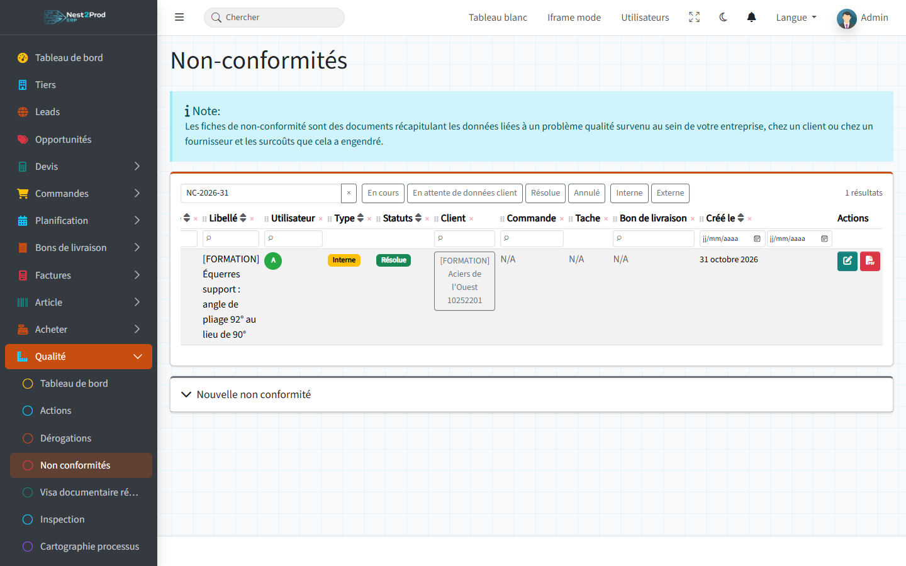

Un clic sur la ligne ouvre le détail de la fiche, avec son historique.

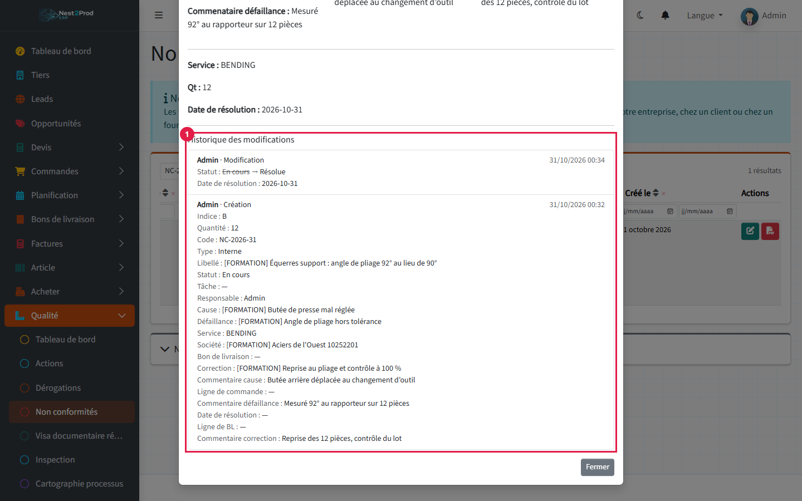

1. **Historique des modifications** : chaque changement (statut, responsable, défaillance,
   quantité…) avec son auteur, sa date, l'ancienne et la nouvelle valeur. Les réglages
   (défaillances, causes, correctifs), les appareils de mesure et l'AMDEC sont tracés de la
   même façon.

> ⚠️ Le bouton **Résolue** ferme la fenêtre **sans enregistrer** les autres champs modifiés.
> Si vous avez changé quelque chose, cliquez d'abord sur **Mettre à jour**, rouvrez la
> fiche, puis cliquez sur **Résolue**.
>
> 💡 Choisir « Résolue » dans la liste des statuts n'enregistre pas de date de clôture : la
> fiche serait ignorée par le temps de résolution. Utilisez le bouton. **Réouvrir** remet la
> fiche « En cours ».

---

## 8. Visa documentaire des réceptions

Menu **Visa documentaire réception** : les lignes de réception dont la commande d'achat
exige un certificat matière (EN 10204 : 2.1, 2.2, 3.1, 3.2), ou pour lesquelles un
certificat a été reçu. La qualité y vérifie les **papiers**, indépendamment du contrôle
physique des pièces.

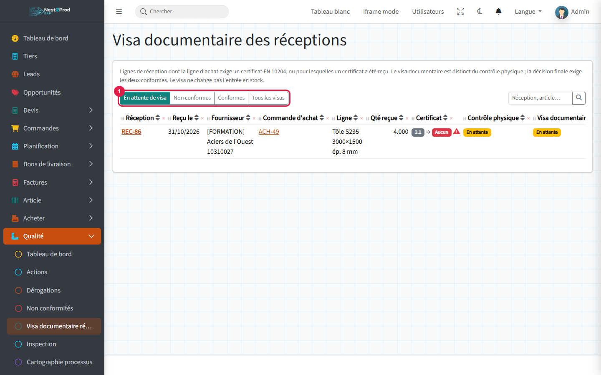

1. Les filtres : **En attente de visa**, **Non conformes**, **Conformes**, **Tous les
   visas**.

La colonne **Certificat** compare le certificat exigé et le certificat reçu (un triangle
rouge signale un écart). **Viser** ouvre le visa : conforme ou non conforme, avec un
commentaire, et la création d'une non-conformité fournisseur si besoin.

> 💡 La saisie du certificat reçu et le visa sont détaillés dans le guide **Achats**. Le
> visa ne change rien au stock, et la décision finale exige que le contrôle physique et le
> visa soient tous deux conformes.

---

## 9. Plans de contrôle et premier article

Menu **Inspection** : l'écran **Plans qualité** regroupe les plans de contrôle des articles.

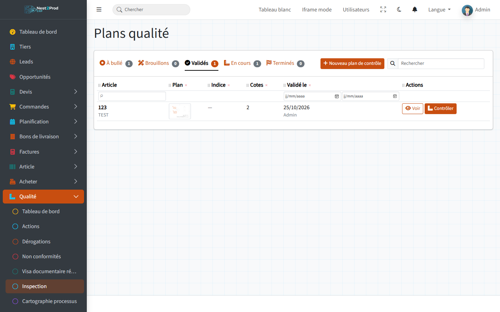

- **À bullé** : les articles commandés par un client qui exige un plan de contrôle (case de
  la fiche client) ou réglés sur « Plan de contrôle : Toujours », et qui n'en ont pas
  encore ;
- **Brouillons** et **Validés** : les plans en cours de bullage, puis validés ;
- **En cours** et **Terminés** : les contrôles réalisés sur ces plans.

Un plan de contrôle concerne un article **à un indice donné**. Le **bulleur** affiche le
plan de l'article (un PDF de ses documents) : on y trace un rectangle par cote à contrôler,
avec son nominal, ses tolérances et son échantillonnage. Quand le plan contient du texte, la
cote tracée est lue et pré-remplie : relisez-la toujours.

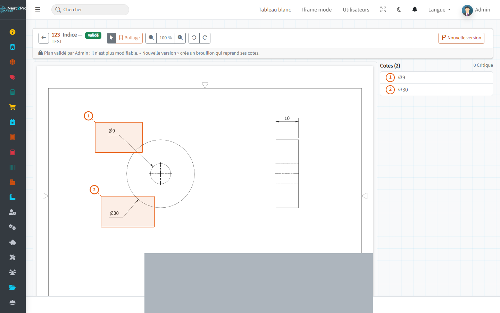

Un plan **validé** n'est plus modifiable : « Nouvelle version » crée un brouillon qui reprend
ses cotes. Sa validation rend obsolète l'ancien plan **du même indice** seulement.

En fabrication, l'onglet **Contrôle** de l'écran de suivi de l'opération affiche le plan
bullé et une grille de mesures, si l'article a un plan validé à l'indice commandé. Le premier
contrôle d'un article à un indice est un **premier article** : la pièce 1 doit être mesurée
(simple avertissement, la production n'est jamais bloquée). Une mesure hors tolérance propose
de **déclarer une non-conformité** pré-remplie. Le bouton **Contrôler** d'un plan validé
lance un contrôle hors fabrication (réception, audit).

Le **rapport premier article** reprend l'identification de la pièce, la matière et les
résultats des cotes. Il se signe « vérifié » puis « approuvé » (ce qui le fige), et son PDF
est rangé dans les documents de la commande (à défaut, de l'article).

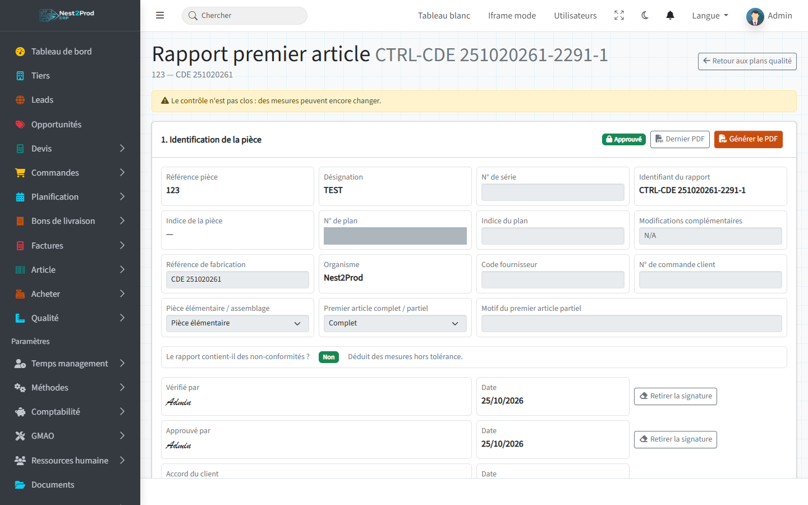

> 💡 Le détail du bullage fera l'objet d'un guide à part.

---

## 10. Audits internes et retours clients

**Audits internes** : planificateur ISO 9001 avec plans annuels, calendrier, processus et
checklists (§4 à §10 de la norme, pré-remplies). Un audit se lance depuis le calendrier ;
ses constats (non-conformité majeure ou mineure, observation, point positif) alimentent le
tableau de bord.

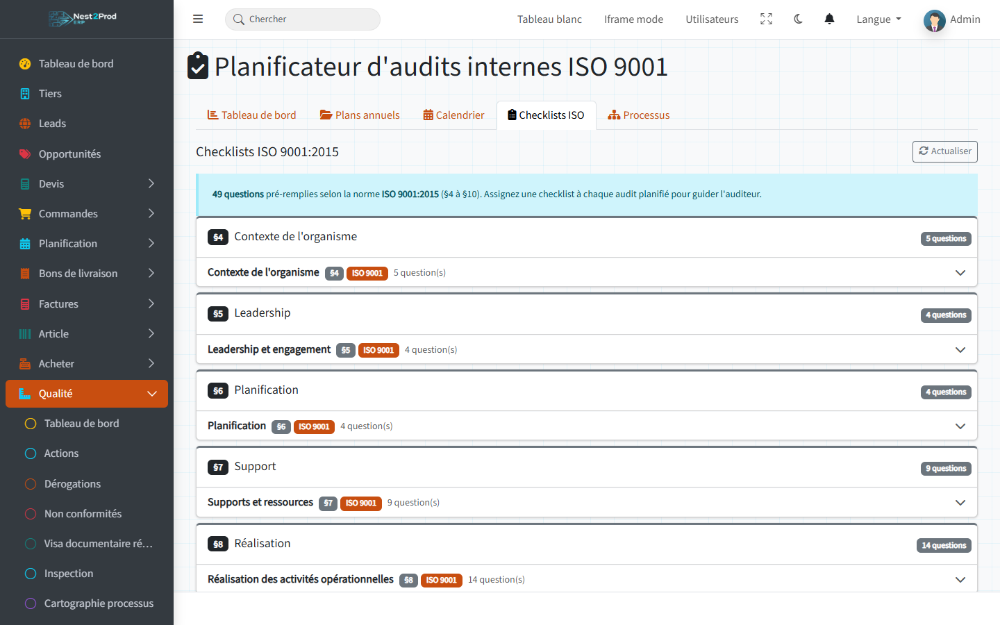

**Retours clients** (aussi dans le menu Bons de livraison) : un retour se rattache à une
livraison et, au besoin, à une non-conformité. On y saisit le diagnostic, puis on génère les
tâches de reprise.

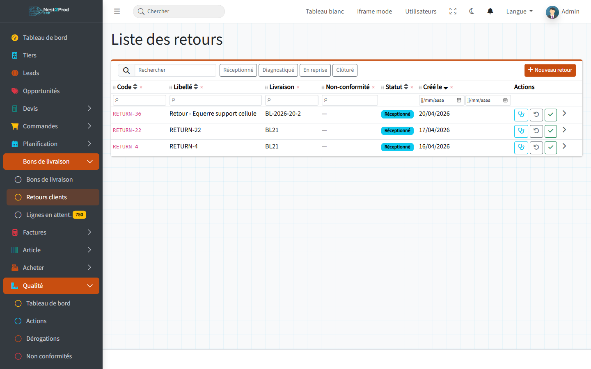

## Et ensuite ?

- **Livrer** les pièces acceptées : une fois la dérogation validée, le bon de livraison de
  la ligne n'est plus bloqué (guide de la vente).
- **Mesurer en fabrication** avec le plan de contrôle validé, depuis l'onglet Contrôle de
  l'opération.
- **Viser les certificats** des réceptions matière (guide Achats).
- **Planifier un audit interne** pour vérifier que l'action corrective tient dans le temps.

## Questions fréquentes

**Les listes Défaillance, Cause et Correctif ne proposent que « N/A ».**
Le référentiel est vide : remplissez l'onglet Réglage du tableau de bord (section 2).

**Mon action ne s'enregistre pas en modification.**
Les trois descriptions (problème, cause, action) sont obligatoires en modification.

**Le temps de résolution reste à 0 jour.**
Aucune non-conformité n'a été clôturée avec le bouton « Résolue ».

**Je ne peux pas créer le bon de livraison : « la dérogation … attend la décision du
client ».**
Une dérogation externe ouverte vise la ligne. Complétez-la et validez-la (section 6.3), ou
annulez-la si le client a refusé.

**L'option « Validée » est grisée sur la dérogation.**
Il vous manque la permission **quality-derogation-validate** : demandez la validation à un
responsable qui la détient.

**La carte Validation réclame encore une pièce « Accord client » alors que j'ai déposé le
courrier.**
Le fichier a été déposé avec un autre type. Dans la liste des fichiers de la carte
Documents, changez son type en « Accord client ».

**Le bouton « Envoyer pour signature » n'apparaît pas.**
La signature électronique n'est pas configurée, la dérogation est interne, elle n'est plus
« En cours » ni « En attente de données client », ou le contact n'a pas d'adresse e-mail :
le motif est affiché dans la carte.

**Comment savoir quelles actions répondent à une non-conformité ?**
La colonne « NC » de la liste des actions et des dérogations indique la fiche liée ; la
non-conformité elle-même ne les liste pas.
