**Objectif** : regrouper sur une seule fiche tout ce que l'entreprise sait d'un salarié, et
faire circuler les notes de frais sans papier.

**Pour qui** : la personne chargée des RH, et chaque salarié pour ses notes de frais.

**Exemple utilisé** : un opérateur presse plieuse embauché en CDI au 1er septembre. Il
rentre d'un salon professionnel à Lyon avec un ticket de restaurant à se faire rembourser.

## Avant de commencer

- Le menu **Ressources humaines** apparaît avec la permission **human-resources-menu**,
  nécessaire aussi pour modifier une fiche salarié, ses contrats, et valider les notes de
  frais.
- Chaque salarié saisit ses notes de frais depuis son **profil**, sans permission
  particulière.
- Les congés, le rapport de présence et l'export paie font l'objet du guide « Temps,
  horaires et congés » ; la matrice des habilitations, du guide « Risques et santé au
  travail ».

## Vue d'ensemble

```steps
Fiche salarié
Contrat
Dossier
Note de frais
Justificatif
Validation
```

Le menu **Ressources humaines** regroupe : **Note de frais** (validation, catégories de
dépense, natures de congé), **Utilisateurs liste**, **Rapport de présence**, **Soldes de
congés** et **Export paie**.

---

## 1. La liste des salariés

Menu **Ressources humaines › Utilisateurs liste** : un salarié par ligne, avec son statut de
connexion, son poste, ses rôles et, s'il est bloqué, la date de fin du blocage. La flèche en
bout de ligne ouvre sa fiche.

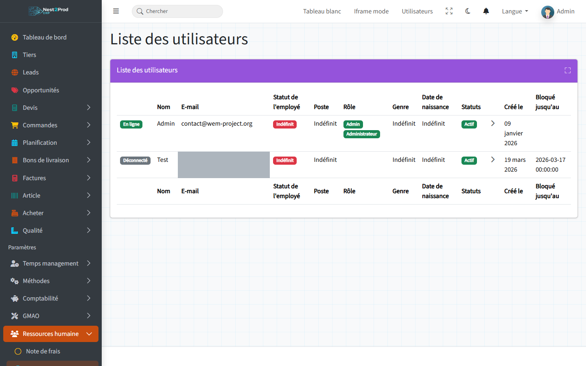

> 💡 Un salarié est un compte utilisateur de l'ERP : il s'inscrit lui-même, puis
> l'administrateur lui donne un rôle (voir le guide « Mettre en route son instance ») ; sa
> fiche RH se complète ensuite ici.

---

## 2. La fiche salarié

Onglet **RH information** :

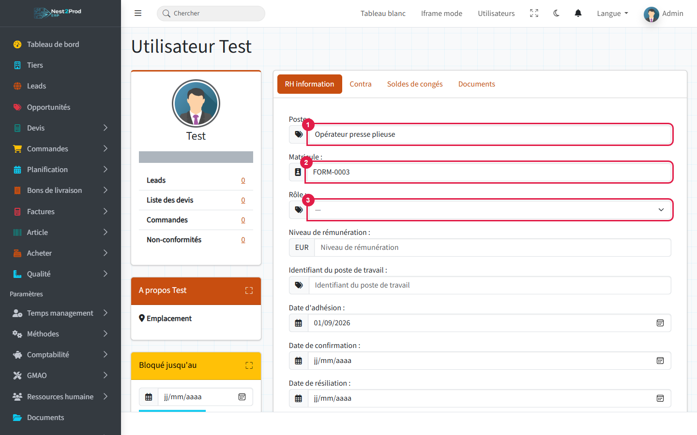

1. **Poste** : l'intitulé du poste occupé.
2. **Matricule** : le matricule du salarié dans votre logiciel de paie. Il est repris par
   l'export paie ; sans lui, l'export utilise l'identifiant interne et le signale.
3. **Rôle** : le rôle qui ouvre les menus de l'ERP. « — » le laisse inchangé.

Plus bas : niveau de rémunération, poste de travail, dates d'adhésion, de confirmation et
de résiliation, statut de l'employé, section et **responsable** du salarié. **Mettre à
jours** enregistre.

> 💡 Le rôle ne se modifie qu'avec la permission d'administration de l'entreprise, et jamais
> sur son propre compte.
>
> ⚠️ La carte **Bloqué jusqu'au** (colonne de gauche) empêche le salarié de se connecter
> jusqu'à la date choisie : réservez-la à un départ ou à un compte compromis.

---

## 3. Les contrats

Onglet **Contra** (contrats), carte **Nouveau contrat** :

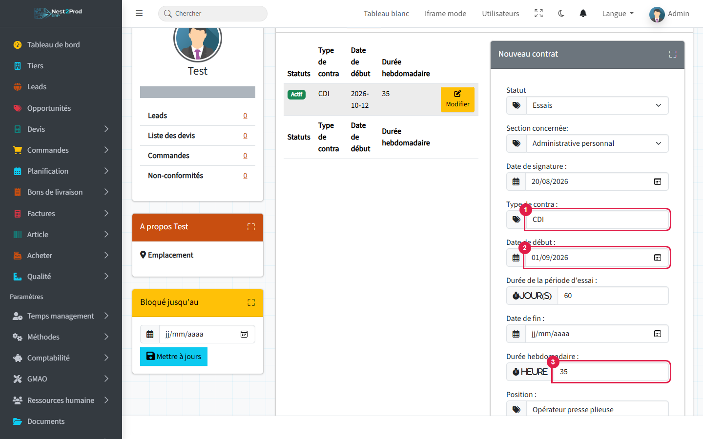

1. **Type de contrat** : CDI, CDD, intérim, apprentissage…
2. **Date de début** (et **Date de fin** pour un contrat à durée déterminée).
3. **Durée hebdomadaire** en heures.

Complétez le **statut** (Essais pendant la période d'essai, puis Actif), la **section**, la
**date de signature**, la **durée de la période d'essai** en jours, la **position** et, si
besoin, le coefficient et les salaires. **Soumettre**.

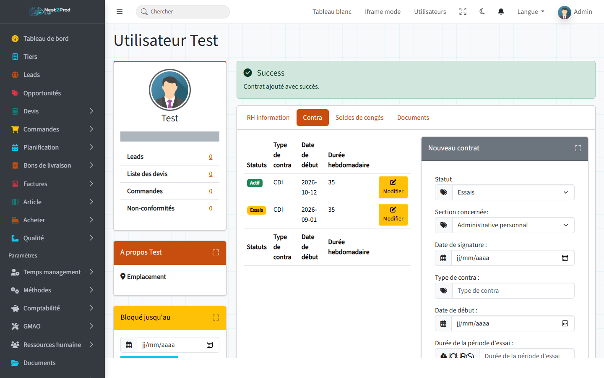

Le contrat **Actif** compte : sa durée hebdomadaire sert à convertir en jours les absences
saisies en heures.

---

## 4. Le dossier du salarié

Onglet **Documents** : contrat signé, bulletins, arrêts de travail, diplômes, pièces
d'identité.

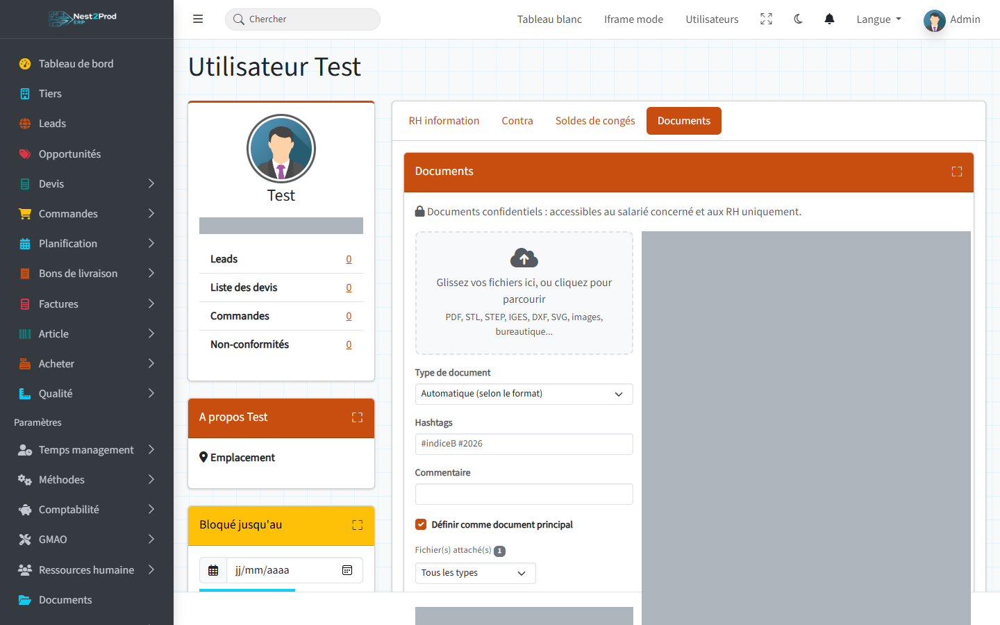

Déposez un fichier dans la zone prévue, puis choisissez son **type de document** (contrat,
bulletin de paie, arrêt de travail, diplôme, pièce d'identité…).

> ⚠️ Ce dossier est **confidentiel** : seuls le salarié concerné et les RH peuvent le
> consulter, y déposer un fichier ou en supprimer. Le reste de l'entreprise n'y a pas accès,
> contrairement aux documents des articles ou des commandes.

---

## 5. La note de frais (salarié)

Le salarié ouvre son **profil** (menu de son nom en haut à droite), onglet **Note de frais**,
et crée une note par déplacement ou par mois :

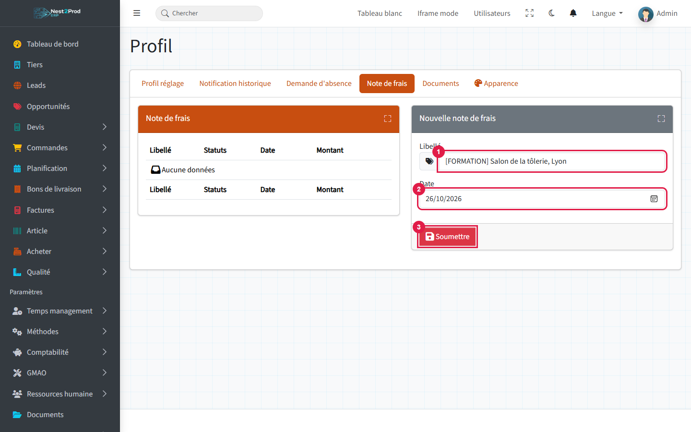

1. **Libellé** : le déplacement ou la période.
2. **Date**.
3. **Soumettre**.

Le bouton **Voir** de la note ouvre sa page : la liste des dépenses à gauche, les
**justificatifs** à droite.

---

## 6. Le justificatif et la dépense

Déposez d'abord la photo du ticket (ou la facture en PDF) dans la carte **Justificatifs** :

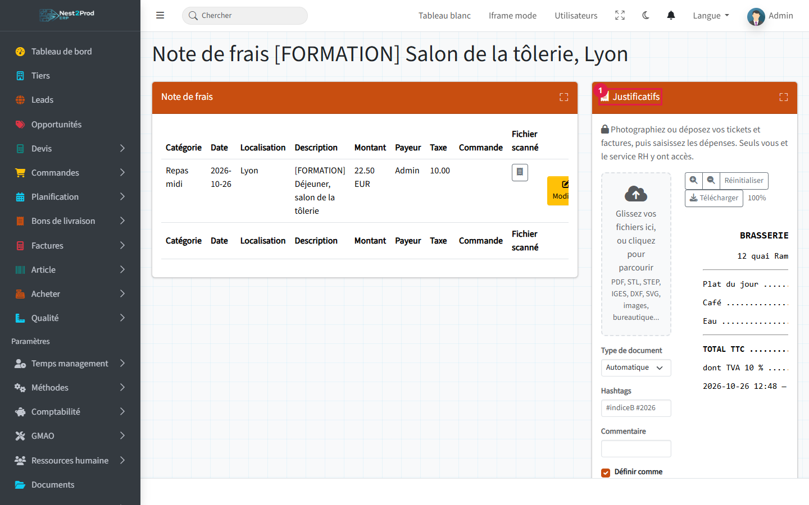

1. **Justificatifs** : glissez le fichier ou cliquez pour le choisir. Sur téléphone, le
   navigateur propose de prendre la photo.

Puis, dans la carte de saisie :

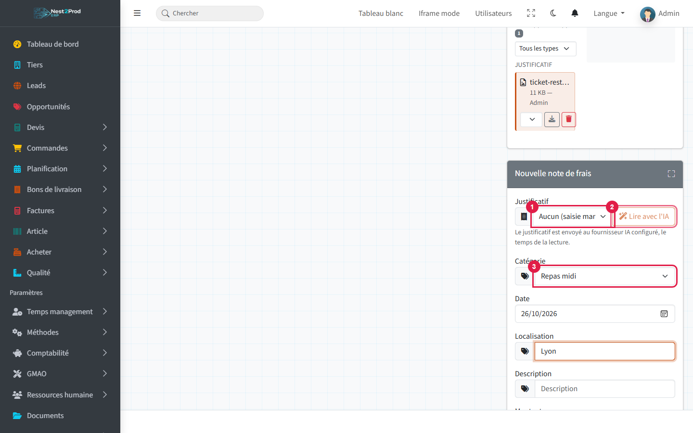

1. **Justificatif** : le ticket déposé. La liste ne propose que les justificatifs pas encore
   saisis.
2. **Lire avec l'IA** : lit le ticket et pré-remplit la date, le lieu, la description, le
   montant et la TVA. Rien n'est enregistré : relisez avant d'envoyer.
3. **Catégorie** : carburant, hôtel, repas…

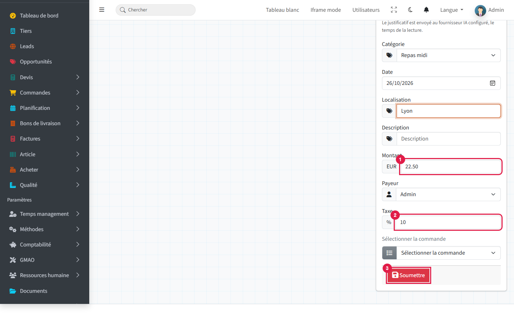

1. **Montant** : le montant TTC payé.
2. **Taxe** : le **taux** de TVA (10 pour 10 %), pas son montant.
3. **Soumettre** ajoute la dépense à la note.

La dépense peut aussi être rattachée à une **commande** client (frais refacturables) ; le
**payeur** est celui qui a avancé la somme.


> ⚠️ **Lire avec l'IA** envoie l'image du justificatif au fournisseur d'IA configuré par
> votre administrateur. Sans fournisseur configuré, saisissez la dépense à la main.

---

## 7. Soumettre la note

Une fois toutes les dépenses saisies, le salarié revient dans son profil, onglet **Note de
frais**, et ouvre la note avec **Modifier** :

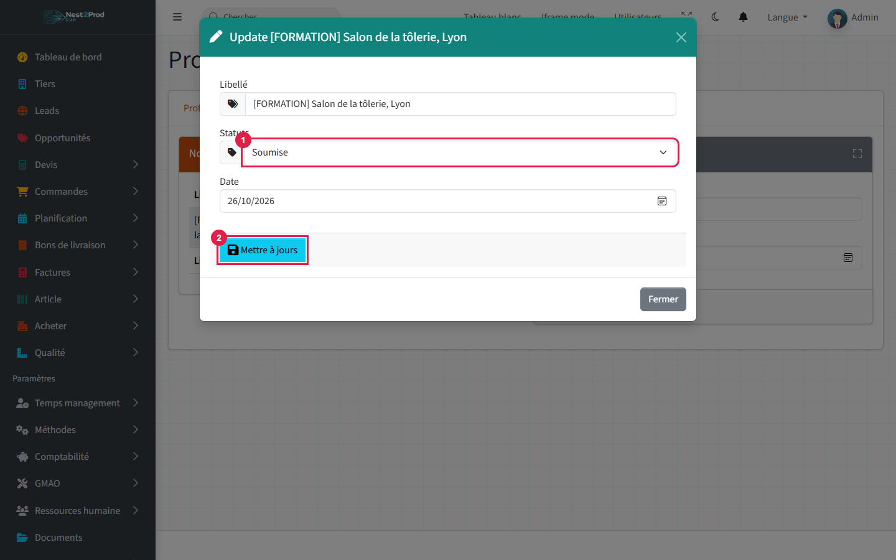

1. **Statuts** : « Soumise ».
2. **Mettre à jours**.

Une note soumise ne se modifie plus : ses dépenses et ses justificatifs sont figés jusqu'à
la décision des RH.

---

## 8. La validation (RH)

Menu **Ressources humaines › Note de frais**, onglet **Validation des note de frais** : les
notes soumises, avec leur montant. **Voir** ouvre la note et ses justificatifs.

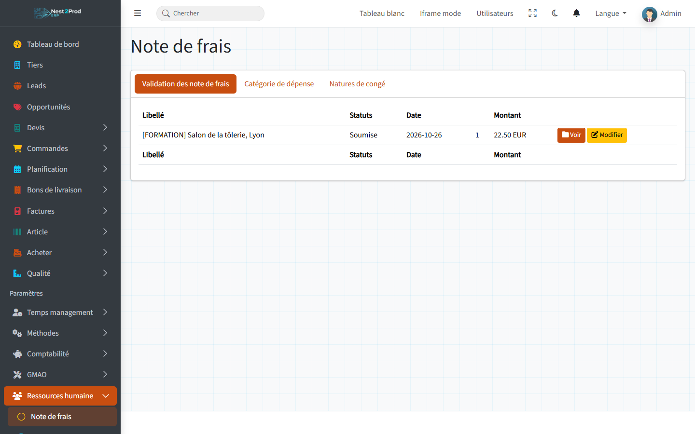

**Modifier** sur la note :

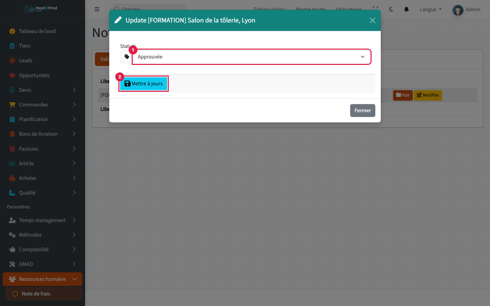

1. **Statuts** : **Approuvée**, ou **Retour** pour la renvoyer au salarié (justificatif
   manquant, montant à corriger).
2. **Mettre à jours**.

Une note retournée redevient modifiable par le salarié, qui la corrige puis la soumet à
nouveau.

| Statut | Qui | Modifiable par le salarié |
|---|---|---|
| Fait / Soumettre | le salarié prépare sa note | oui |
| Soumise | en attente des RH | non |
| Retour | renvoyée au salarié | oui |
| Approuvée | validée par les RH | non |

> 💡 Le remboursement lui-même se fait hors de l'ERP (virement ou paie) : l'approbation
> indique seulement que la note est bonne à payer.

---

## 9. Les catégories de dépense

Onglet **Catégorie de dépense** : la liste proposée au salarié (carburant, hôtel, repas
midi, repas soir…). **Nouvelle catégorie de dépense** en ajoute une.

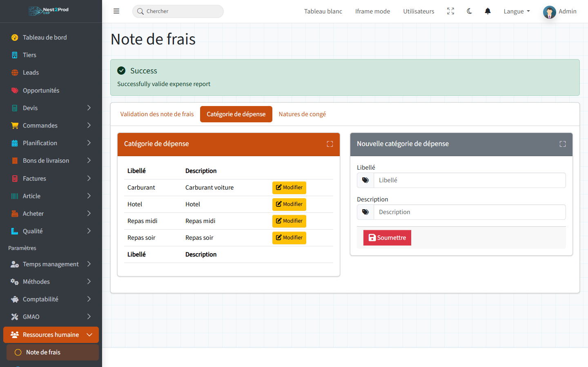

## Questions fréquentes

**Le salarié ne voit pas son ticket dans la liste « Justificatif ».**
Il est déjà rattaché à une autre dépense, ou il a été déposé dans une autre note.

**La note n'apparaît pas dans l'onglet de validation.**
Elle n'est pas au statut « Soumise » : le salarié doit la soumettre depuis son profil.

**Un collègue peut-il voir mes justificatifs ?**
Non : comme le dossier salarié, les justificatifs ne sont visibles que par le salarié de la
note et par les RH.

**Je ne peux pas modifier le rôle d'un salarié.**
Il faut la permission d'administration de l'entreprise, et on ne modifie jamais son propre
rôle.
