**Goal**: keep the workshop's health and safety registers, and know at any time who is
authorised on which machine.

> 💡 Screenshots show the French interface; button names are given as they appear in the English interface.

**Who is it for**: the HSE manager and the workshop manager.

**Example used**: an operator pinches a finger on the press brake during a tool change.
The incident is reported, the risk assessed, the machine inspection tracked, and the
"Press brake operation" authorisation set up.

## Before you start

- The **OSH** menu appears with the **osh-menu** permission, which is also needed to create
  authorisation types.
- **Sections** (workshops) and **resources** (machines) come from Methods (see the guide
  "Methods").

> ⚠️ The module does not replace the mandatory **risk assessment document** and does not
> handle PPE or accident declarations: it keeps the registers and flags authorisations.

## Overview

```steps
Authorisation types
Incident
Risk
Conformity
Trainings
Matrix and gaps
```

The **OSH** menu has five entries: **Incidents**, **Risks**, **Trainings**, **Versatility
matrix** and **Conformities**. Each screen shows a list on the left and a creation form on
the right. To edit a row, click its pencil.

> ⚠️ Except on the versatility matrix, no message confirms the save, and an incomplete form
> comes back without any error. Check that the row appears in the list.

---

## 1. Set up authorisation types

Menu **Versatility matrix**, **Authorisation types** tab. An authorisation type is a
recognised skill (press brake, forklift licence, first aid, welding…), renewable or not.

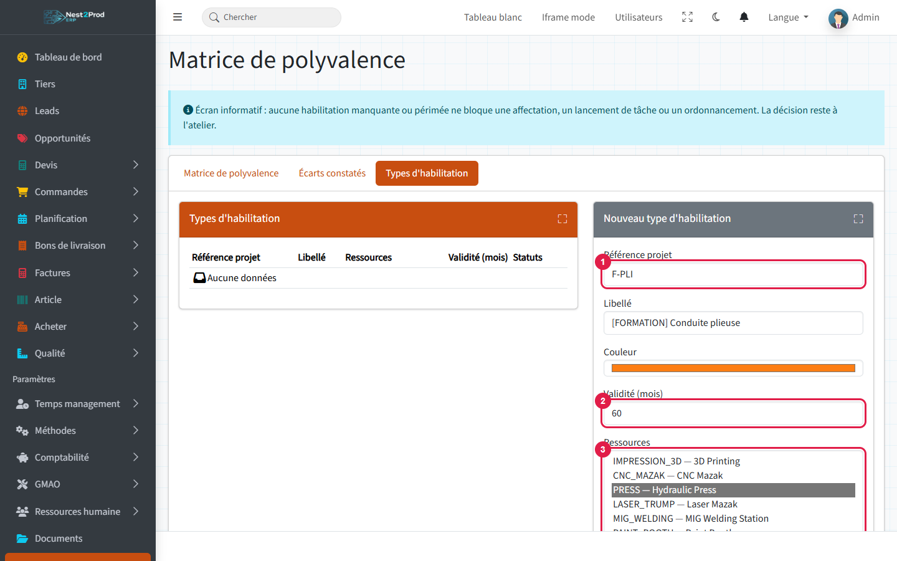

1. **Code**: the short code of the authorisation (the French screen labels it "Référence
   projet"). It must be unique.
2. **Validity (months)**: the time before renewal, 0 for a lifetime authorisation.
3. **Resources**: the machines on which the authorisation is expected (Ctrl + click to
   pick several). Leave empty for a general authorisation (first aid, forklift).
4. **Submit**.

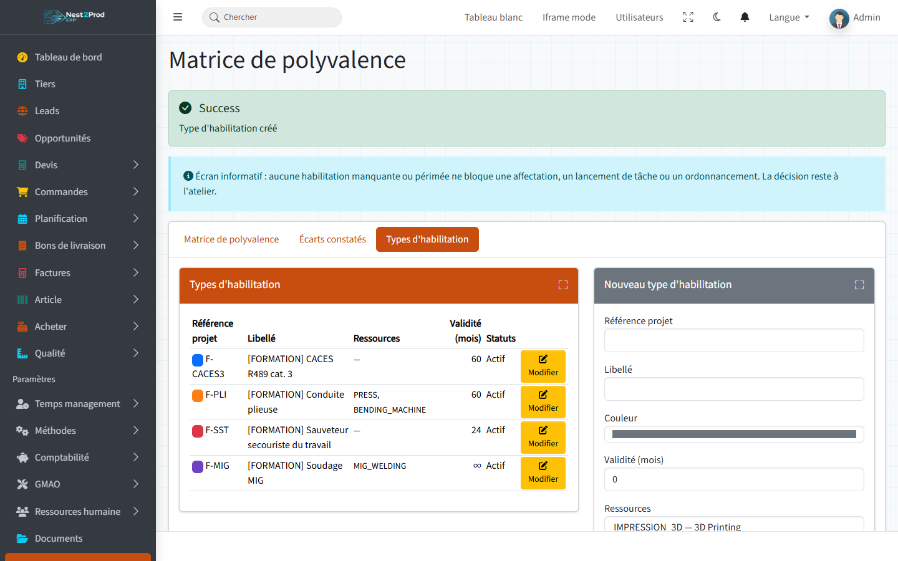

> 💡 The link to machines is only used to spot **gaps** (section 7): it never prevents
> assigning an operator.

---

## 2. Report an incident

Menu **Incidents**.

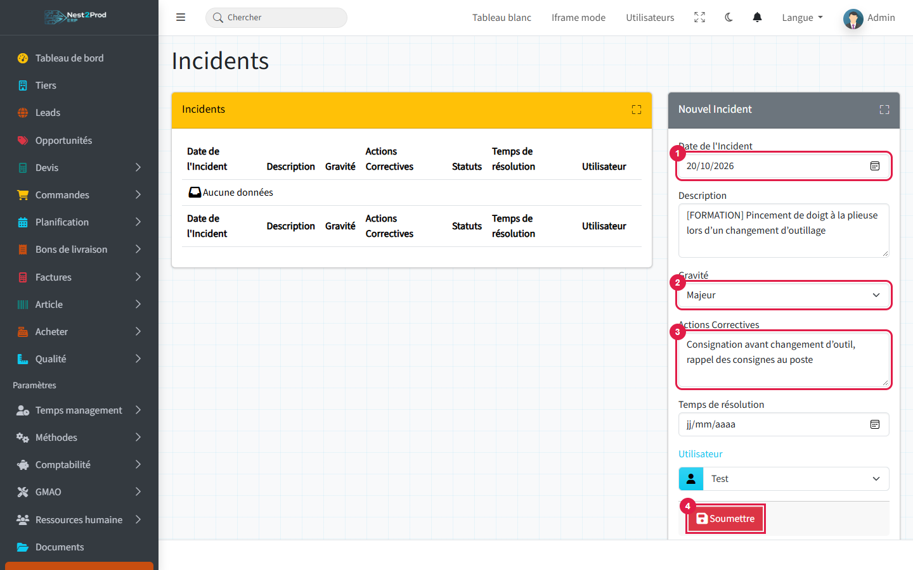

1. **Incident date**.
2. **Severity**: Minor, Major or Critical.
3. **Corrective actions**: what was done straight away.
4. **Submit**, after choosing the **User** concerned.

The incident is created **In progress**. Once the actions are done, click its pencil:

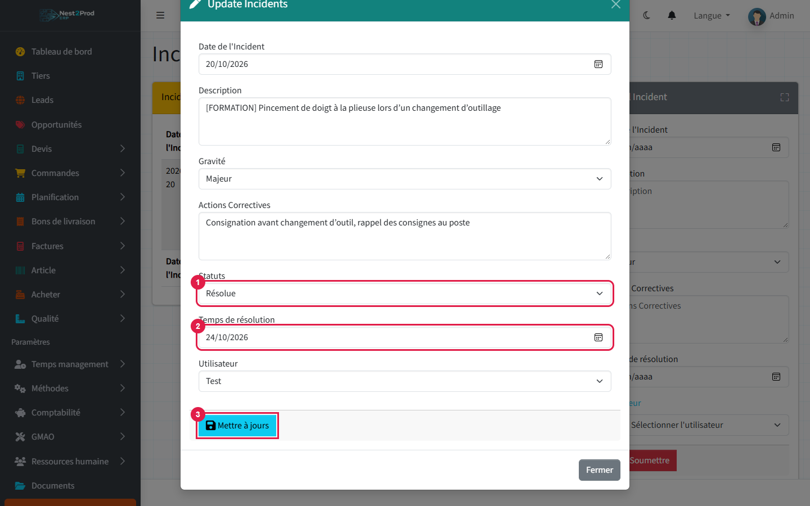

1. **Status**: Resolved.
2. **Resolution time**: despite its label, this is the resolution **date**.
3. **Update**.

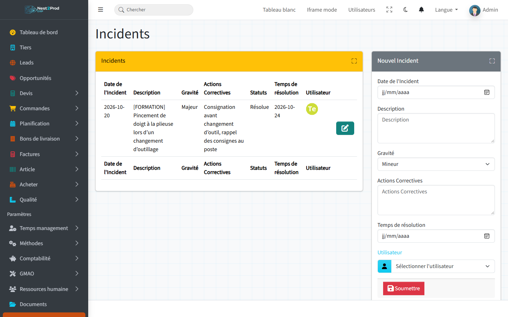

> 💡 Entering the resolution date does not change the status: set it to "Resolved"
> yourself.

---

## 3. Assess the risk

Menu **Risks**: the risk assessment by workshop.

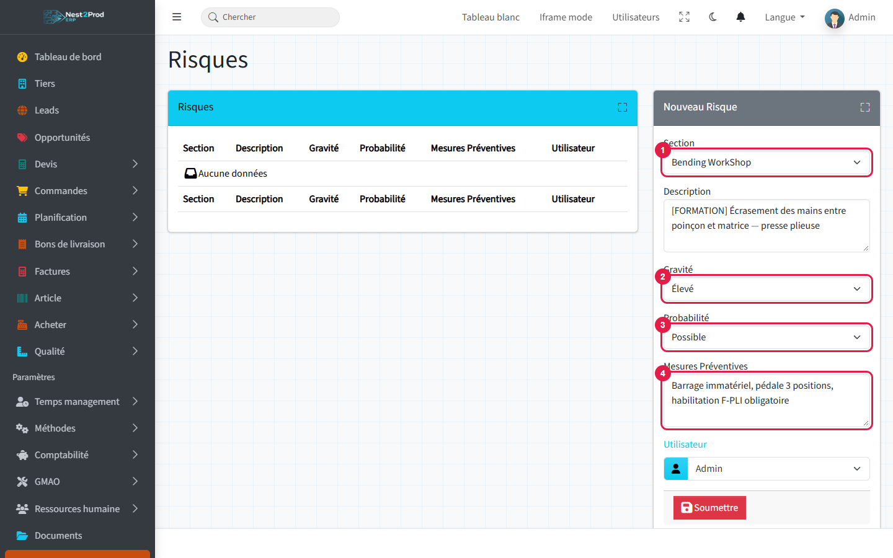

1. **Section**: the workshop concerned.
2. **Severity**: Low, Moderate or High.
3. **Probability**: Rare, Possible or Probable.
4. **Preventive measures**: what reduces the risk (guards, instructions, required
   authorisation).

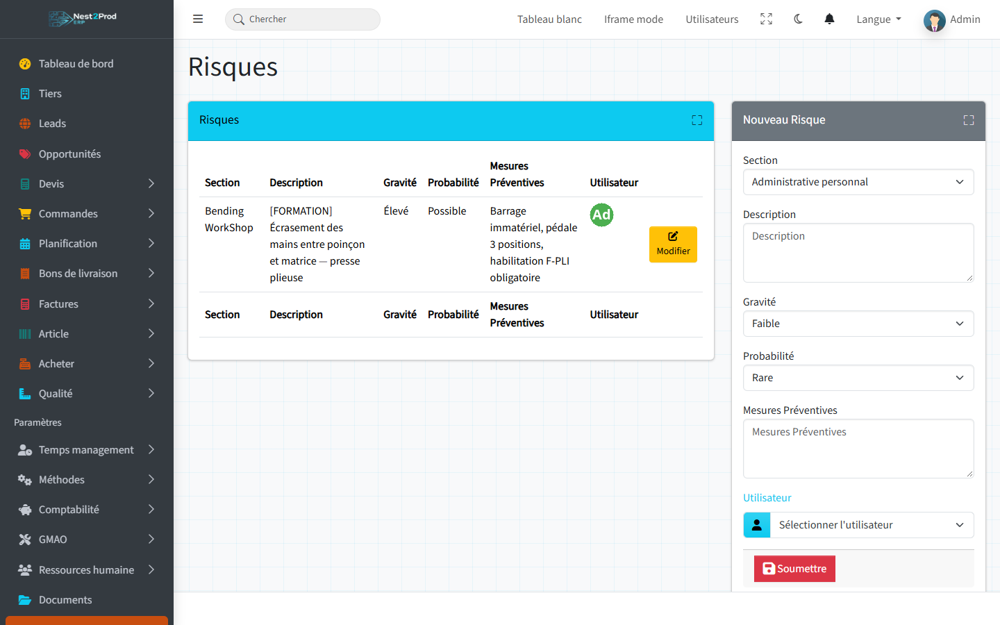

The screen does not compute a score. To rank risks, multiply severity by probability
(1 to 9):

| | Rare (1) | Possible (2) | Probable (3) |
|---|---|---|---|
| **High (3)** | 3 | **6** | **9** |
| **Moderate (2)** | 2 | 4 | **6** |
| **Low (1)** | 1 | 2 | 3 |

In the example, hand crushing at the press brake scores 3 × 2 = **6**: a priority.

> 💡 Incidents and risks are not linked: quote the incident in the preventive measures to
> keep track of it.

---

## 4. Track regulatory inspections

Menu **Conformities**: periodic inspections, electrical checks, mandatory registers.

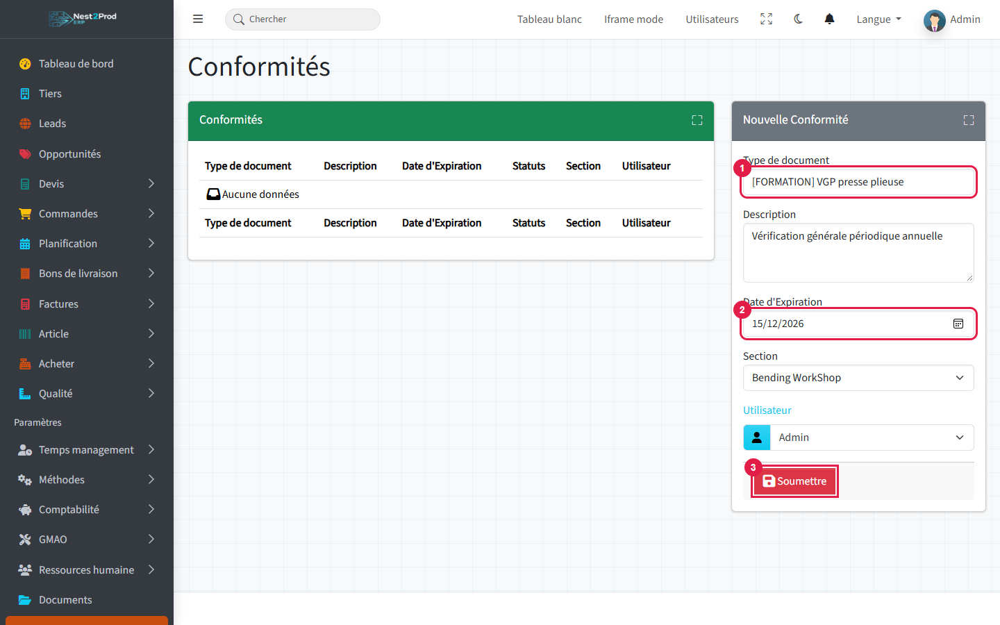

1. **Document type**: the inspection or document.
2. **Expiration date**: when the next inspection is due.
3. **Submit**, after choosing the **Section** and the responsible **User**.

Once the report is received, set the conformity to **Approved**:

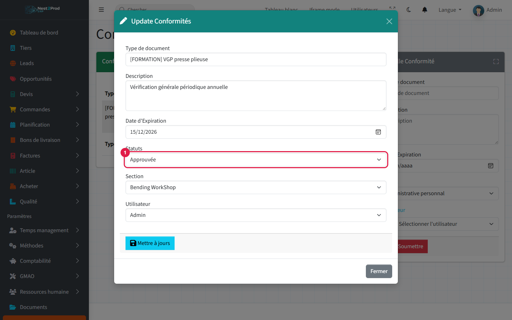

1. **Status**: In progress, Approved or Expired.

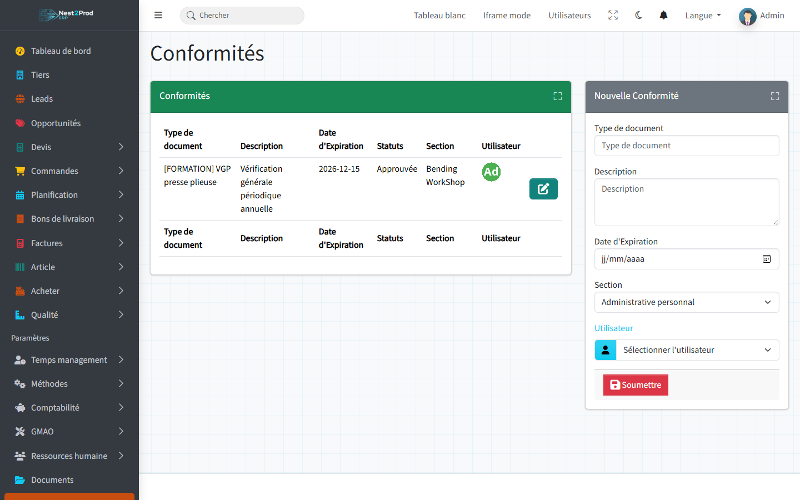

> ⚠️ The **Expired** status is not set automatically on the due date, and no alert is sent:
> read the "Expiration date" column every month.

---

## 5. Record trainings

Menu **Trainings**: one row per session attended by an employee.

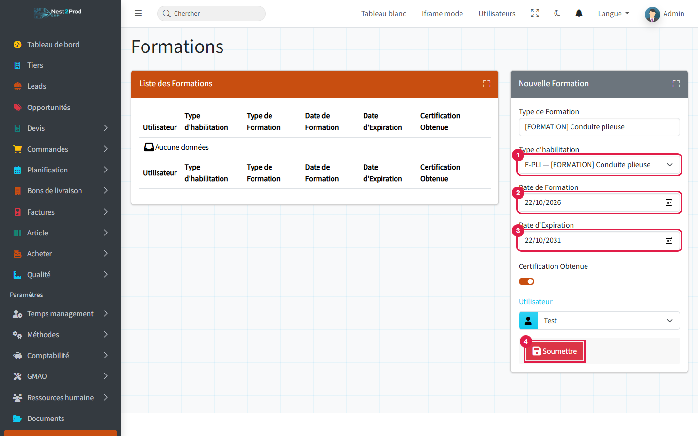

1. **Authorisation type**: without it, the training does not appear in the matrix.
2. **Training date**.
3. **Expiration date**: to compute from the type's validity (it is not suggested). Leave
   empty for a lifetime authorisation.
4. **Submit**, after choosing the **User**.

The **Type of training** is the free label of the session ("First aid initial",
"Forklift refresher"…).

If the employee did not pass, open the training with its pencil:

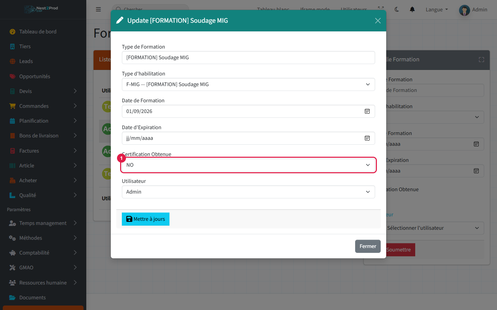

1. **Certification obtained**: NO.

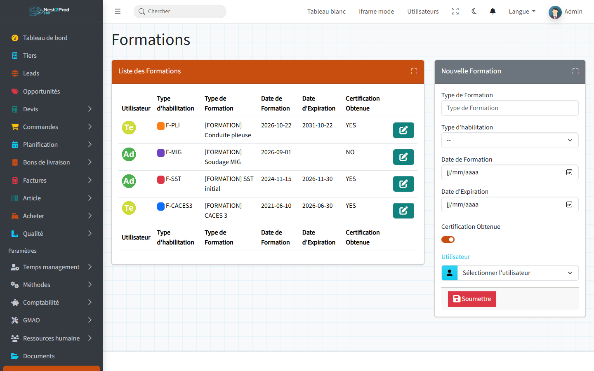

> ⚠️ The **Certification obtained** switch of the creation form is ignored: every training
> is created "obtained". Correct it afterwards if needed.

---

## 6. Read the versatility matrix

Menu **Versatility matrix**: one employee per row, one authorisation per column, with the
related machines under each column.

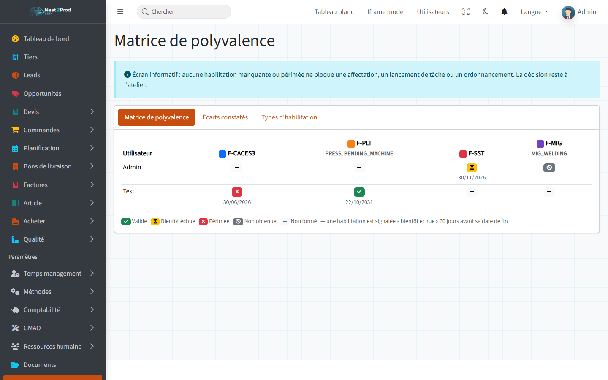

| Badge | State |
|---|---|
| ✔ green | **Valid** |
| ⏳ yellow | **Expiring soon**: the end date is less than 60 days away |
| ✖ red | **Expired**: the end date has passed |
| ⊘ grey | **Not obtained**: the last session was not passed |
| — | **Not trained**: no session |

- The **latest session** counts: a passed refresher replaces an expired session.
- An authorisation without an end date is valid for life.

---

## 7. Spot gaps

**Gaps found** tab: operations assigned to an operator who has no valid authorisation for
the operation's machine.

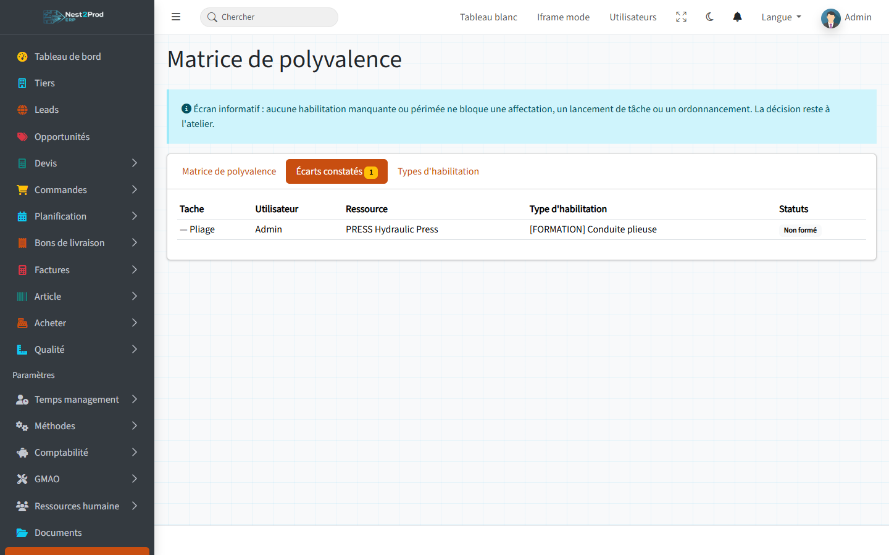

In the example, the bending operation on the press is assigned to an employee **not
trained** on the press brake.

> 💡 The screen is **informative**: it blocks neither the assignment, nor starting an
> operation, nor the planning. The workshop manager decides.

---

## 8. Monthly routine

1. **Matrix**: chase "expiring soon" trainings and schedule refreshers for expired ones.
2. **Gaps found**: reassign operations or plan trainings.
3. **Conformities**: spot the month's due dates and set overdue ones to "Expired".
4. **Incidents**: close those whose actions are done, and carry the resulting preventive
   measures over to **Risks**.

## Frequently asked questions

**A training does not appear in the matrix.**
It has no authorisation type, or the type is inactive. Open the training and choose its
type.

**An employee was retrained, but the matrix still shows "Expired".**
The new session needs a more recent training date and the same authorisation type.

**Why is the "Gaps found" tab empty?**
No operation assigned to an operator is on a machine linked to an authorisation type, or
all operators are authorised.

**My entries are missing after clicking "Submit".**
A required field was missing (date, user, description): the screen comes back without a
message. Enter it again, checking each field.
