**Objectif** : décrire quand l'atelier travaille (horaires, jours fériés), et gérer les
congés du dépôt de la demande jusqu'à l'export paie.

**Pour qui** : le chef d'atelier (horaires et calendrier), les RH (congés, présence, paie)
et chaque salarié (sa demande d'absence).

**Exemple utilisé** : l'atelier passe en 2×8 du lundi au vendredi. Un salarié pose la
semaine du 11 novembre : 5 jours ouvrés, moins le férié, soit 4 jours décomptés.

## Avant de commencer

- Le menu **Temps management** (Temps et absences, Horaires de travail) apparaît avec la
  permission **settings-time-menu**.
- Les congés, soldes, présence et export paie sont dans **Ressources humaines** et
  demandent **human-resources-menu**. Seuls les porteurs de cette permission saisissent
  pour un autre salarié et valident les demandes.
- Chaque salarié dépose ses demandes depuis son **profil**.

## Vue d'ensemble

```steps
Natures de congé
Horaires de travail
Jours fériés
Droits
Demande et validation
Soldes et paie
```

---

## 1. Les natures de congé

Menu **Ressources humaines › Note de frais**, onglet **Natures de congé** : congés payés,
RTT, récupération, maladie, événement familial, formation, sans solde…

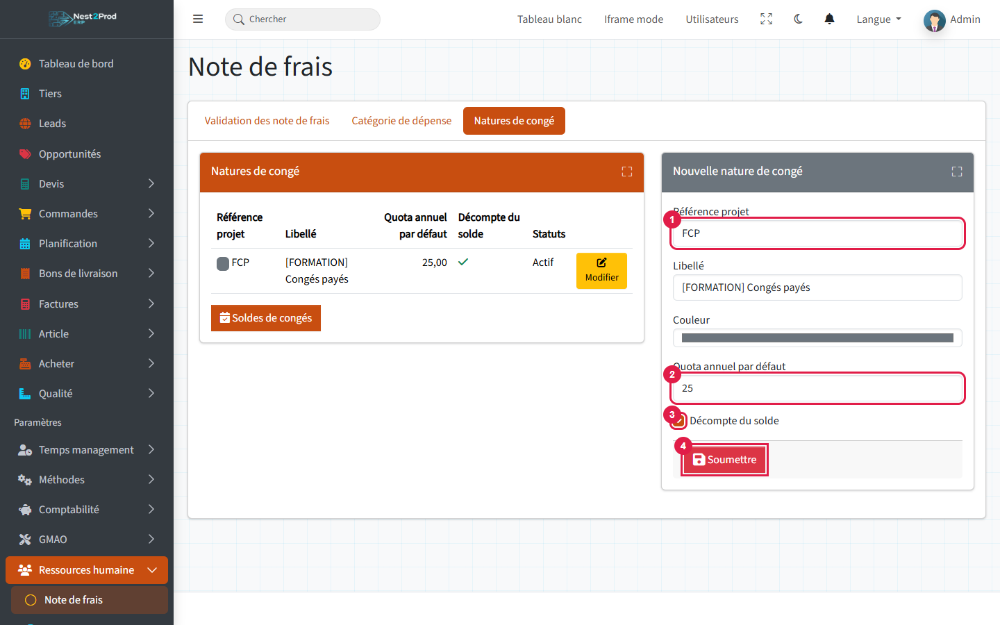

1. **Référence projet** : le code de la nature (le libellé du champ devrait être « Code »).
   C'est aussi le **code rubrique** de l'export paie (CP, RTT…).
2. **Quota annuel par défaut** : le droit proposé chaque année (25 jours pour les CP).
3. **Décompte du solde** : coché, la nature consomme un droit (CP, RTT) ; décoché, elle est
   seulement tracée (arrêt maladie).
4. **Soumettre**.

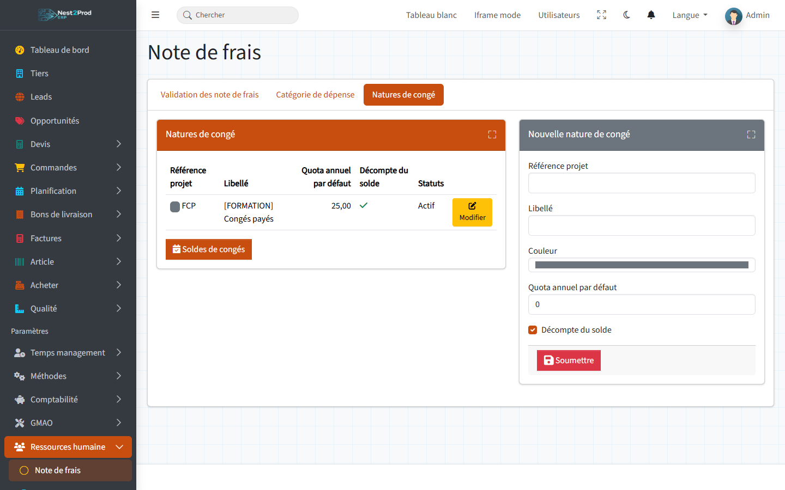

> 💡 Une absence **sans nature** n'apparaît ni dans les soldes ni dans l'export paie :
> créez les natures avant les premières demandes.

---

## 2. Les horaires de travail

Menu **Temps management › Horaires de travail** : un **régime horaire** décrit les plages
travaillées de chaque jour (journée, 2×8, 3×8, poste de nuit).

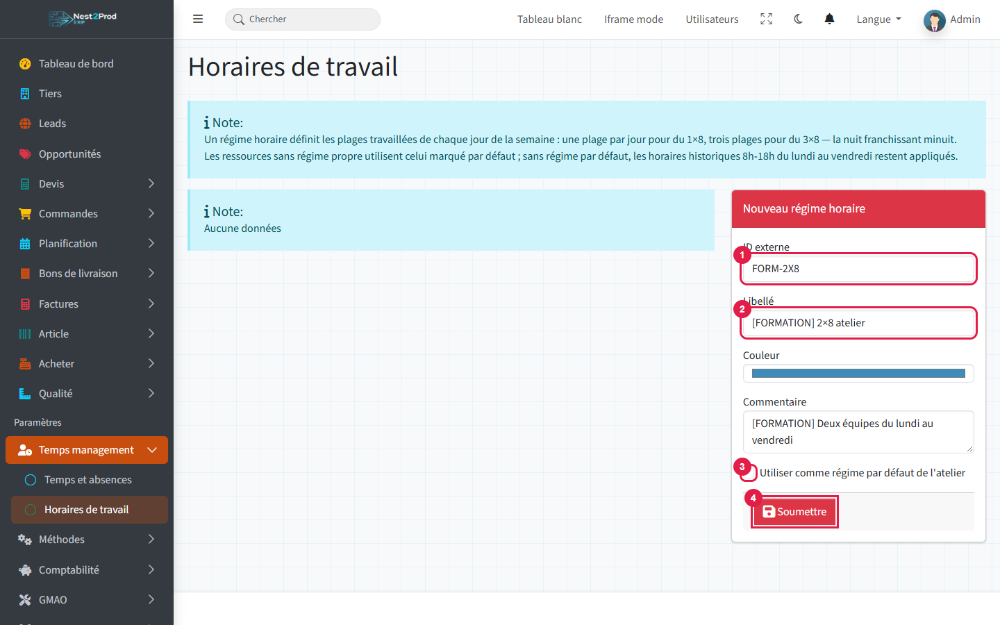

1. **ID externe** : un code court (2X8, 3X8…).
2. **Libellé**.
3. **Utiliser comme régime par défaut de l'atelier** : laissez décoché pour l'instant.
4. **Soumettre**.

Ajoutez ensuite les plages sous la carte du régime :

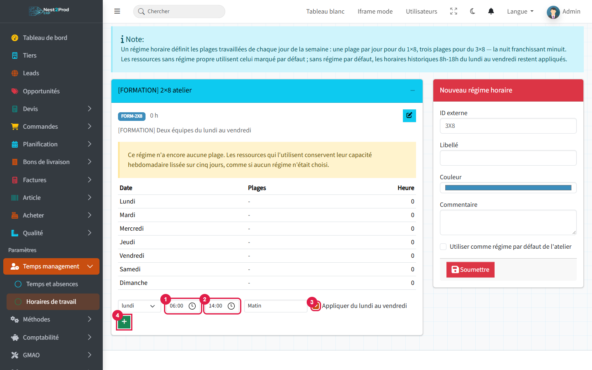

1. **Début** et 2. **Fin** de la plage. Une fin plus tôt que le début passe minuit
   (poste de nuit).
3. **Appliquer du lundi au vendredi** : cochée, la plage est créée sur les cinq jours, quel
   que soit le jour choisi. Décochez-la pour une plage du samedi.
4. **+** ajoute la plage.

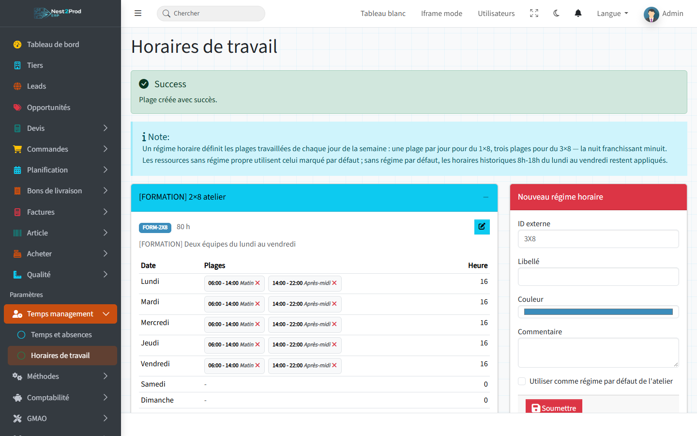

Le total d'heures par jour et par semaine s'affiche ; la croix d'une plage la supprime.

Pour qu'une machine suive ce régime, choisissez-le sur sa fiche (**Méthodes ›
Ressources**, champ « Régime horaire »). Sa capacité dans le **planning de charge** devient
alors celle du régime : 16 h par jour en 2×8, 0 le dimanche.

> ⚠️ Cochez « régime par défaut » **après** avoir ajouté les plages, jamais sur un régime
> vide. Le régime par défaut s'applique à toutes les ressources qui n'ont pas le leur, et
> sert au calcul des dates des opérations : le changer modifie tout le planning.

---

## 3. Les jours fériés

Menu **Temps management › Temps et absences**, onglet **jour férié**.

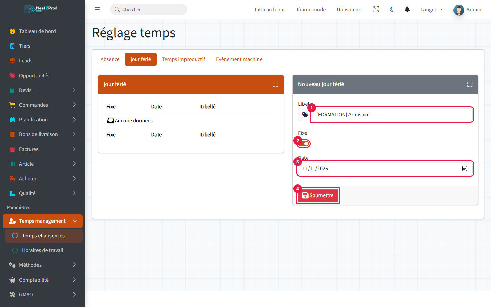

1. **Libellé**.
2. **Fixe** : coché, le jour revient chaque année à la même date (1er mai, 11 novembre) ;
   décoché, il ne vaut que pour cette date (lundi de Pâques, pont).
3. **Date**.
4. **Soumettre**.

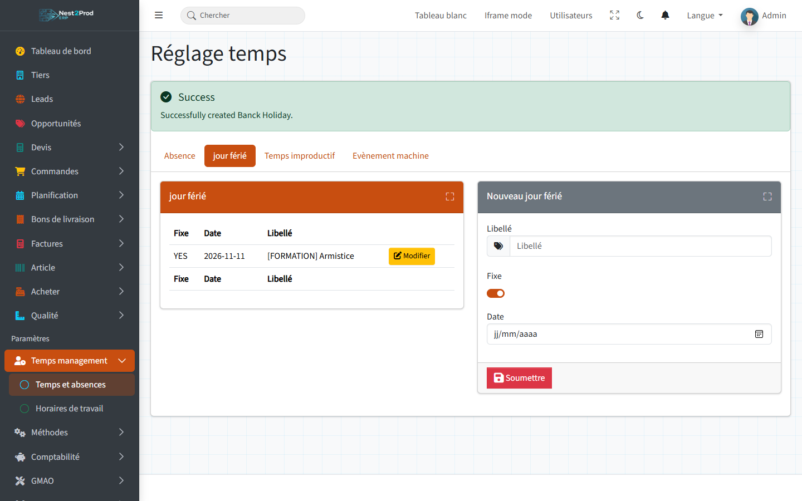

Un jour férié est grisé dans le planning de charge (capacité nulle), sauté par le calcul
des dates des opérations, et retiré du décompte des congés en jours ouvrables et ouvrés.

> ⚠️ Saisissez le calendrier de l'année **avant** les demandes d'absence : un férié ajouté
> après coup ne recalcule pas les demandes déjà enregistrées. Votre administrateur peut
> alors lancer `php artisan hr:recompute-absence-days`.
>
> 💡 Pour un férié mobile (lundi de Pâques, Ascension), préférez une date par année : le
> planning de charge traite pour l'instant tous les fériés comme revenant chaque année.

---

## 4. Les droits à congés

Fiche du salarié (**Ressources humaines › Utilisateurs liste**), onglet **Soldes de
congés**, bouton **Modifier** sur la nature :

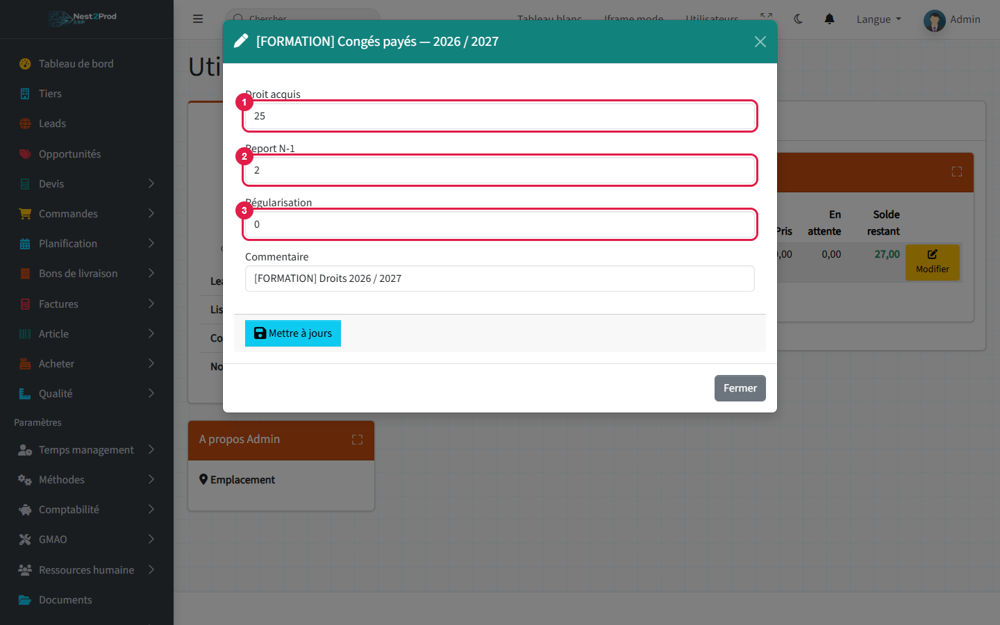

1. **Droit acquis** : le droit de la période (25 jours de CP).
2. **Report N-1** : le reliquat de la période précédente.
3. **Régularisation** : une correction, positive ou négative.

La période de référence va du **1er juin au 31 mai**. Le bouton **Générer les droits
manquants** de l'écran des soldes crée d'un coup le droit par défaut de chaque salarié pour
chaque nature décomptée.

---

## 5. La demande d'absence (salarié)

Le salarié ouvre son **profil** (menu de son nom en haut à droite), onglet **Demande
d'absence**. Il y voit ses soldes, ses demandes et le formulaire :

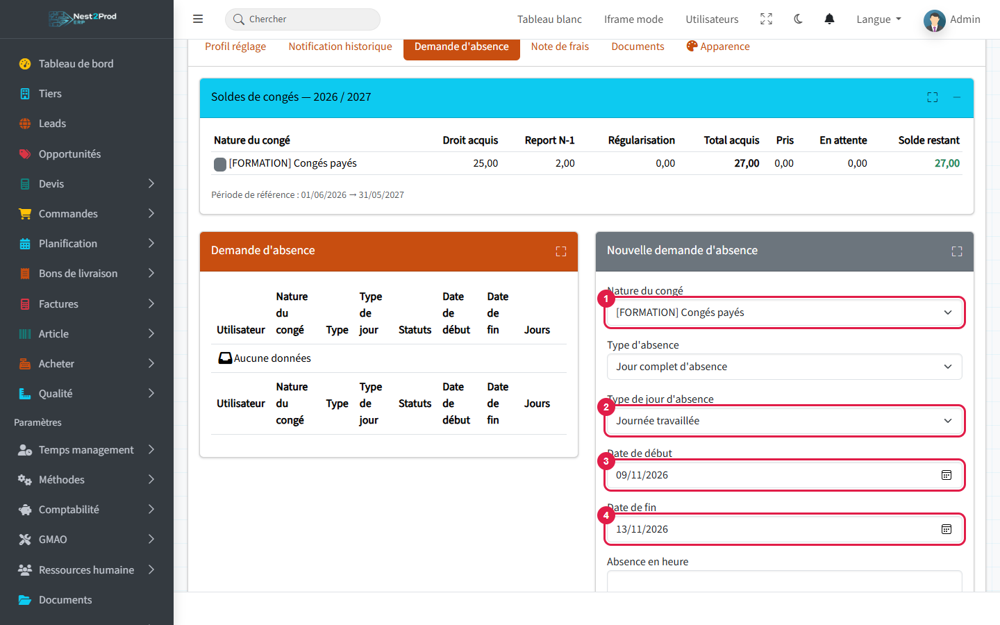

1. **Nature du congé**.
2. **Type de jour d'absence**, qui fixe ce qui est décompté :
   - **Journée travaillée** (jours ouvrés) : du lundi au vendredi, hors fériés ;
   - **Journée de travail** (jours ouvrables) : du lundi au samedi, hors fériés ;
   - **Calendar** (calendaire) : tous les jours, week-ends et fériés compris.
3. **Date de début** et 4. **Date de fin**.

Le **Type d'absence** distingue la journée complète, la demi-journée du matin et l'absence
en heures (avec le nombre d'heures).

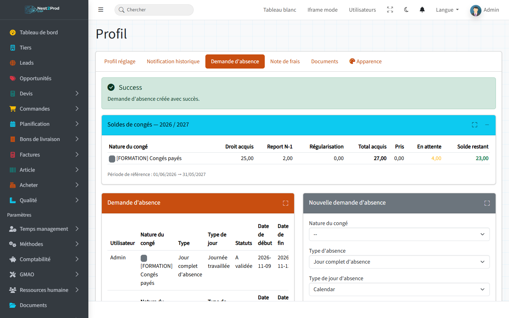

La demande part **à valider** : le solde la compte déjà « En attente » (4 jours ici), pour
que le salarié ne pose pas deux fois le même reliquat. Il peut la modifier tant qu'elle
n'est pas traitée.

> ⚠️ Le type « Absence après-midi » compte une journée entière : pour une demi-journée,
> utilisez « Absence matin » ou une absence en heures.
>
> 💡 La demande arrive dans la cloche de notifications des RH et du responsable du salarié
> (renseigné sur sa fiche) ; le salarié est prévenu de la même façon quand elle est validée
> ou refusée.

---

## 6. La validation (RH)

Menu **Temps management › Temps et absences**, onglet **Absence** : toutes les demandes,
avec le nombre de jours décomptés. **Modifier** sur une demande :

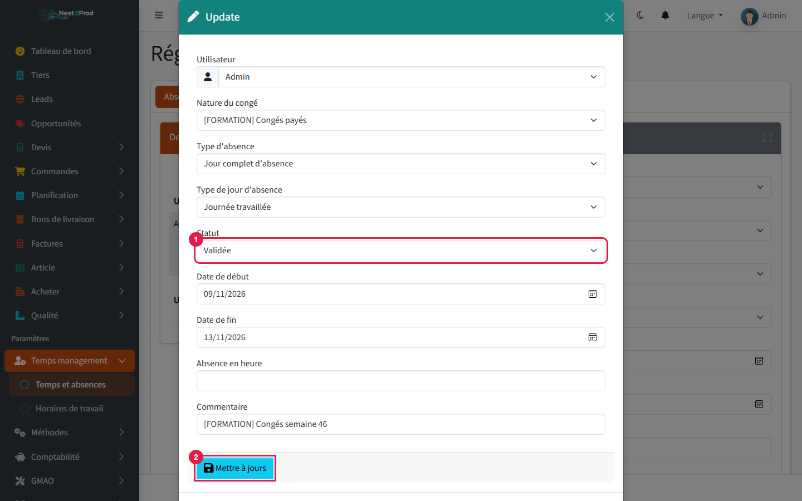

1. **Statut** : « Validée » ou « Non-validée » (refus).
2. **Mettre à jour**.

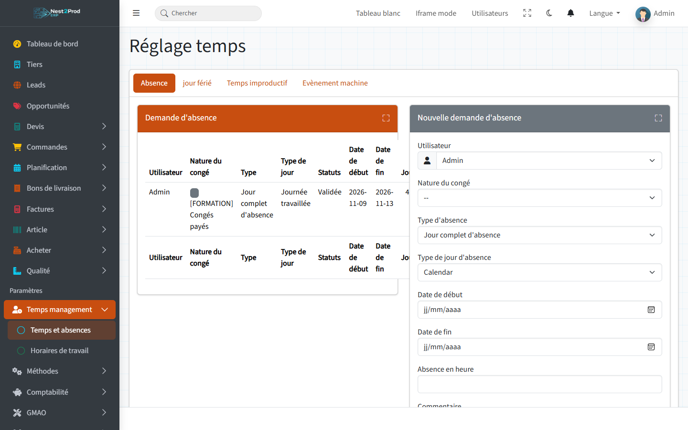

Les RH peuvent aussi saisir une absence pour un salarié depuis le formulaire de droite
(choisissez l'**Utilisateur** : le premier de la liste est sélectionné par défaut).

---

## 7. Les soldes

Menu **Ressources humaines › Soldes de congés** : le tableau de l'atelier, un salarié par
ligne et, par nature, le total acquis, le pris et le solde restant.

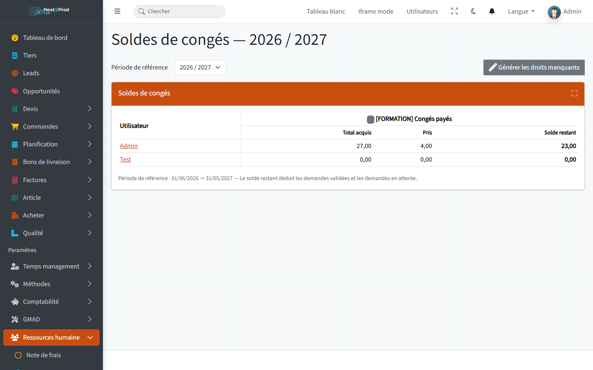

> 💡 Le **solde restant** déduit aussi les demandes en attente, qui n'ont pas de colonne
> ici : « Total acquis − Pris » peut donc être plus grand que le solde. Le détail (dont la
> colonne « En attente ») est sur la fiche du salarié.

---

## 8. Présence et export paie

**Rapport de présence** (Ressources humaines) : le temps passé par salarié sur une période,
d'après les déclarations de production (onglet Activités) ou la badgeuse (onglet Pointage).
Les **anomalies** comptent les badgeages non refermés, les entrées en double et les sorties
orphelines.

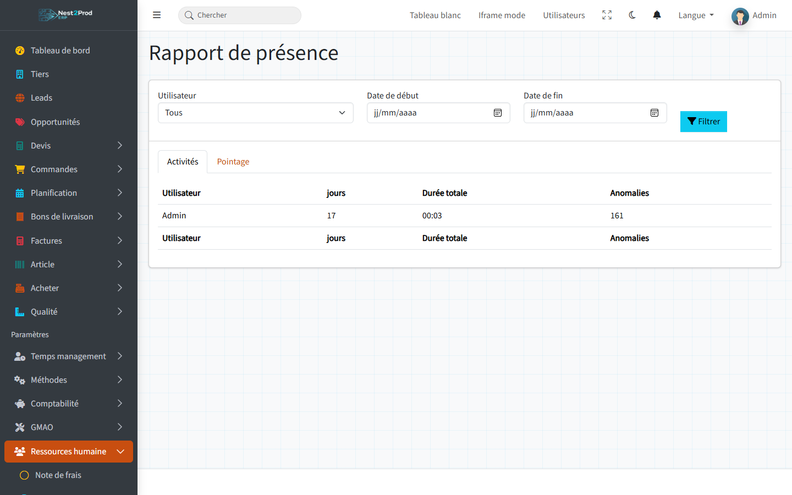

> 💡 La badgeuse est la page **/pointage** de votre instance, à ouvrir sur un poste à
> l'entrée de l'atelier : le salarié choisit son nom, puis Entrée ou Sortie.

**Export paie** (Ressources humaines) : les variables du mois pour votre logiciel de paie.

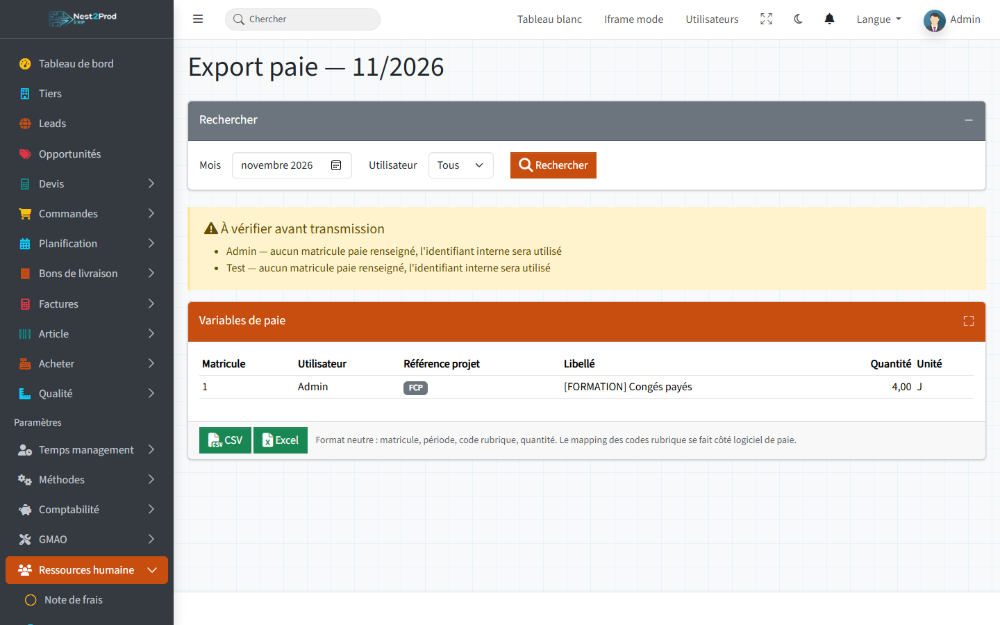

- Une ligne par salarié et par rubrique : une par nature de congé (absences **validées**,
  en jours), les heures badgées (HTRAV) et les heures sur les opérations (HPROD).
- L'encadré **À vérifier avant transmission** liste les badgeages non refermés et les
  salariés sans **matricule paie** (à renseigner sur la fiche salarié).
- **CSV** ou **Excel** télécharge le fichier, sans rien modifier.

> 💡 Le fichier est au format neutre (matricule, période, code rubrique, quantité, unité) :
> faites correspondre les codes des natures de congé aux rubriques de votre logiciel de
> paie.

---

## 9. Les autres réglages

- **Evènement machine** (Temps et absences) : les types d'arrêt (maintenance, panne,
  réglage) repris par la GMAO. Un ordre de travail avec « Machine arrêtée » retire sa
  période de la capacité de la machine (voir le guide « Maintenance (GMAO) »).

  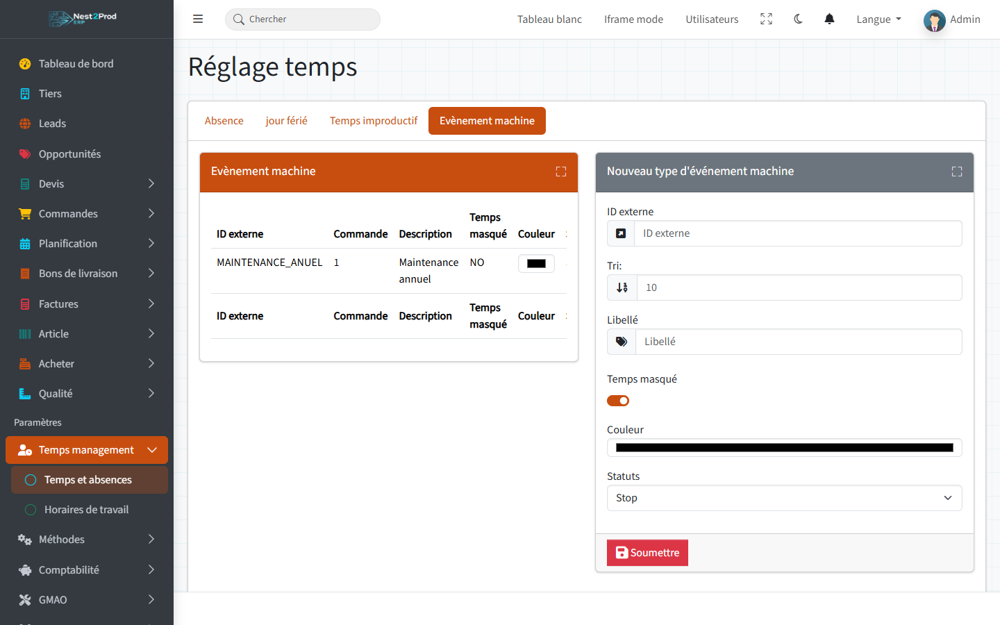

- **Temps improductif** (Temps et absences) : un référentiel descriptif des temps non
  productifs.
- **Unité des temps** (Votre entreprise) : afficher les temps des gammes en heures ou en
  minutes. Le stockage, les exports et les capacités restent en heures.

  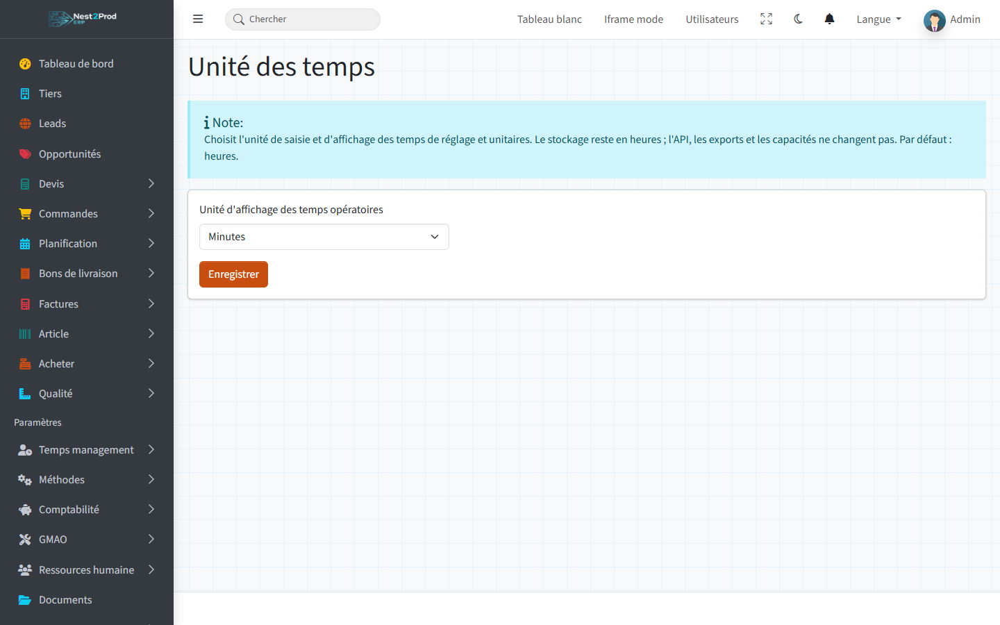

## Questions fréquentes

**Une demande compte 5 jours au lieu de 4.**
Elle est en « Calendar » (calendaire) ou le jour férié n'existait pas encore au moment de
la demande.

**La nature du congé ne propose que « -- ».**
Aucune nature n'est créée ou active : section 1.

**L'absence validée n'apparaît pas dans l'export paie.**
Elle n'a pas de nature de congé, ou elle tombe hors du mois choisi.

**Le planning de charge n'a pas changé après la création du régime.**
Le régime n'est affecté à aucune ressource et n'est pas le régime par défaut.
