**Objectif** : suivre une affaire de bout en bout dans Nest2Prod ERP, du premier contact
avec un prospect jusqu'à la facture, en passant par le devis, la commande, la fabrication
et la livraison.

**Exemple utilisé** : la Métallerie Durand, rencontrée sur un salon, commande 20 platines
en acier S235 de 8 mm, découpées au laser puis pliées, à 42,50 € HT pièce.

## Avant de commencer

- Vous devez avoir accès aux menus Tiers, Leads, Opportunités, Devis, Commandes,
  Bons de livraison et Factures.
- Le paramétrage de base doit être fait par votre administrateur : conditions et modes de
  paiement, modes de livraison, taux de TVA, unités, et les **services** de fabrication
  (laser, pliage…) avec leur taux horaire.
- Facultatif : les **catégories d'affaire** et les **motifs de perte** (menu Méthodes).

## Vue d'ensemble

```steps
Prospect
Lead
Opportunité
Devis (ligne + gamme)
Commande
<!-- feature: production-release -->
Bon pour fabrication
<!-- /feature -->
Production déclarée
Bon de livraison
Facture
```

Chaque document est créé **à partir du précédent** : vous ne ressaisissez jamais le client,
l'adresse ni les lignes. Le fil d'Ariane en haut de chaque document (Lead › Opportunité ›
Devis › Commande…) permet de remonter l'historique de l'affaire.

---

## 1. Se connecter

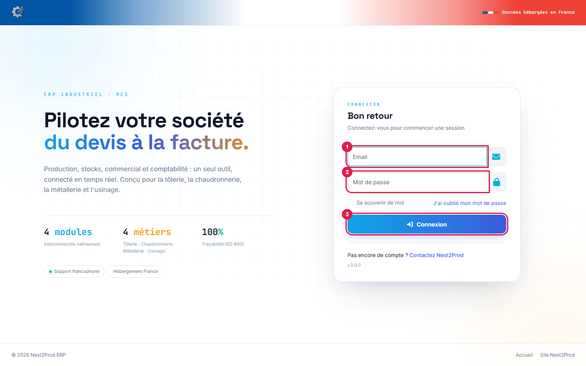

1. Saisissez votre **e-mail**.
2. Saisissez votre **mot de passe**.
3. Cliquez sur « Connexion ».

Vous arrivez sur le tableau de bord.

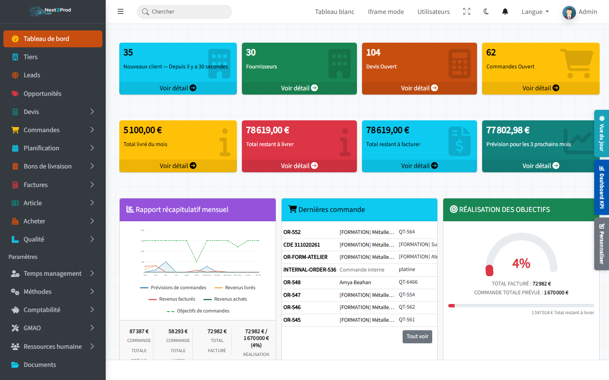

---

## 2. Créer le prospect

Un prospect est une société qui n'est pas encore cliente. Il faut le créer avec **une
adresse et un contact** : le lead et le devis en ont besoin.

### 2.1 Ajouter la société

Menu **Tiers**, onglet « Liste des Tiers », puis cliquez sur « Ajouter un tiers ».

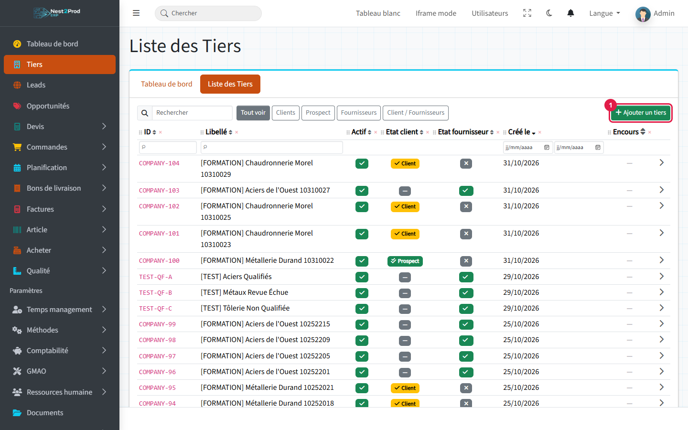

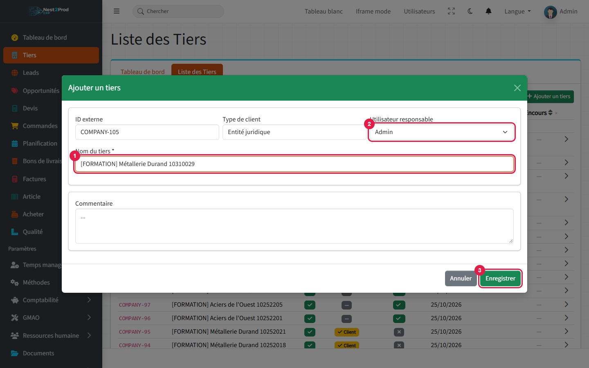

1. **Nom du tiers** : la raison sociale.
2. **Utilisateur responsable** : le commercial qui suit cette société.
3. Cliquez sur « Enregistrer ». La fiche de la société s'ouvre.

### 2.2 Passer la société en « Prospect »

> ⚠️ **Étape indispensable.** Une société nouvellement créée est « Inactive » : elle
> n'apparaîtra **pas** dans la liste des sociétés au moment de créer le lead.

Sur la fiche, onglet « Détail », réglez **Etat client** sur « Prospect »…

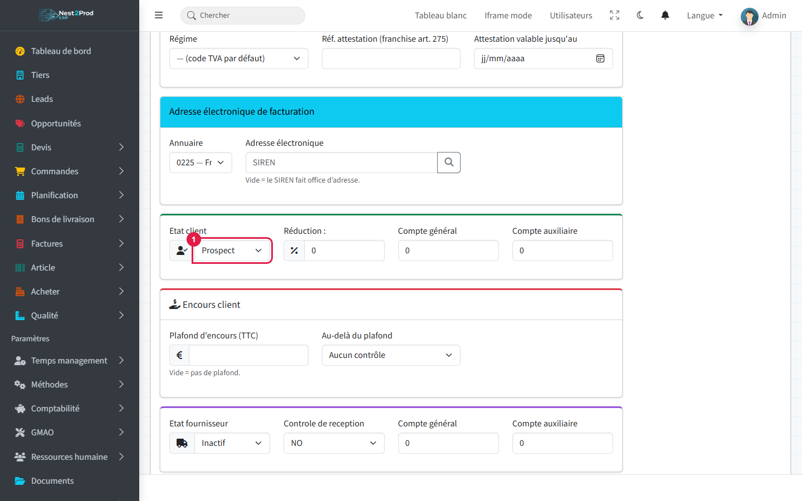

… puis cliquez sur « Mettre à jour » en bas de la fiche. Un message vert confirme
l'enregistrement.

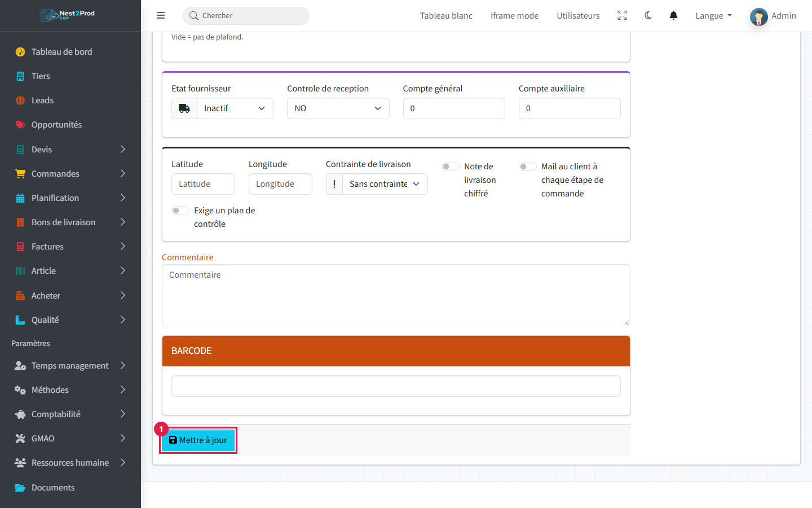

### 2.3 Ajouter l'adresse

Onglet « Adresses » : renseignez **Tri** (1 pour la première adresse), **Libellé**
(ex. « Siège »), l'adresse, le code postal, la ville et le pays, puis « Enregistrer ».

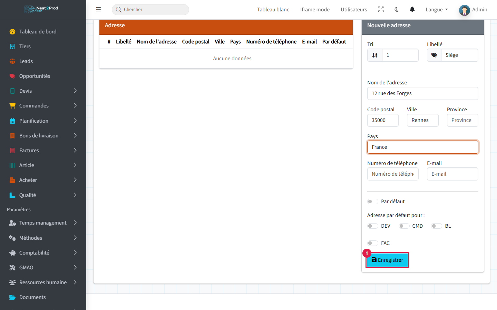

> 💡 Les interrupteurs « Adresse par défaut pour DEV / CMD / BL / FAC » choisissent
> l'adresse proposée automatiquement sur chaque type de document.

### 2.4 Ajouter le contact

Onglet « Contact » : **Tri**, **Civilité**, **Prénom**, **Nom**, puis « Enregistrer ».
Le contact doit apparaître dans le tableau de gauche.

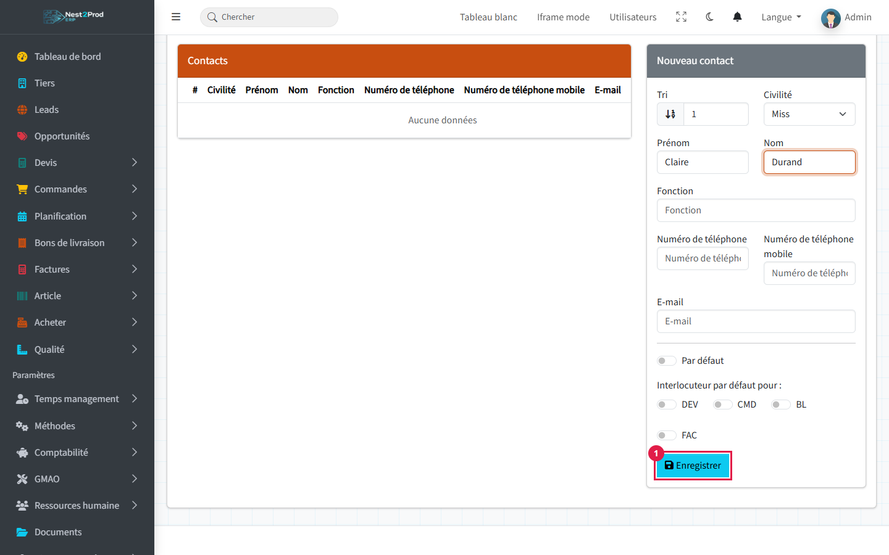

> ⚠️ Renseignez toujours la **civilité**. Sans elle, le contact n'est pas enregistré et
> aucun message ne vous prévient : vérifiez qu'il apparaît bien dans le tableau.

---

## 3. Enregistrer le lead

Le lead trace l'origine du contact (salon, site web, recommandation…) et son niveau
d'intérêt.

Menu **Leads**, onglet « Liste des Lead », puis « Nouveau Lead ».

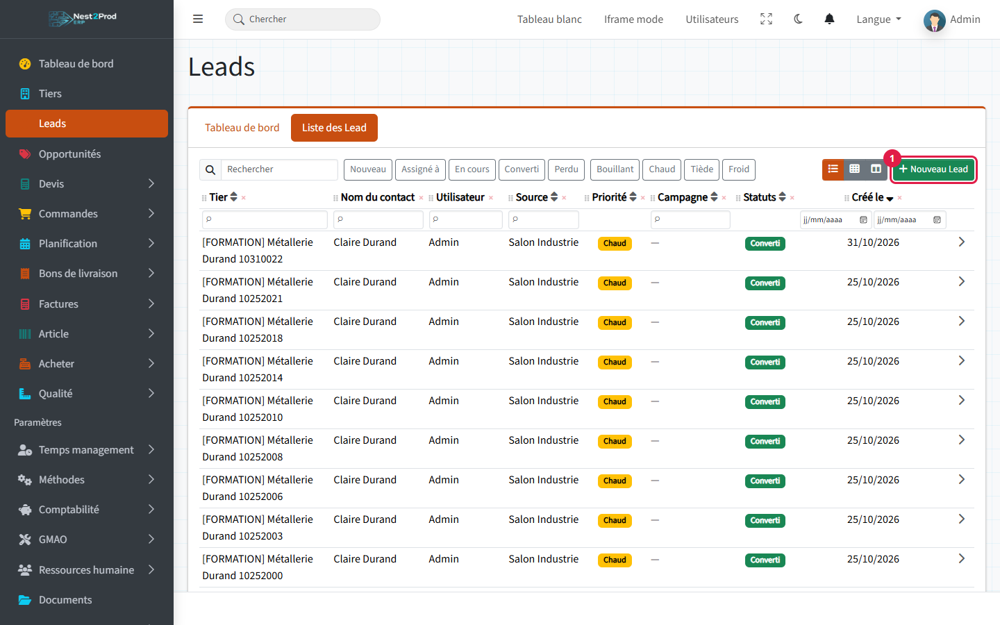

Choisissez le **Tier** : l'adresse et le contact se chargent alors dans les deux listes
suivantes. Complétez l'**Utilisateur**, la **Priorité** (Bouillant, Chaud, Tiède, Froid)
et la **Source**, puis cliquez sur « Soumettre ».

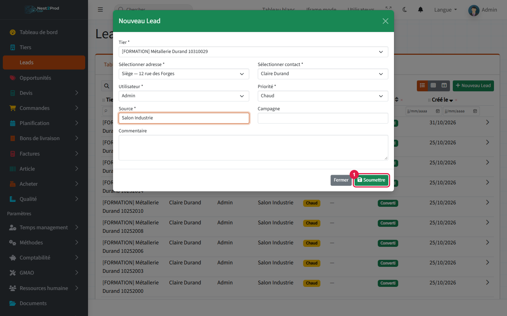

---

## 4. Transformer le lead en opportunité

Quand le prospect exprime un besoin concret, transformez le lead en opportunité : sur la
fiche du lead, carte « Options », cliquez sur « Nouvelle Oportunité ». Le lead passe
à l'état « Converti ».

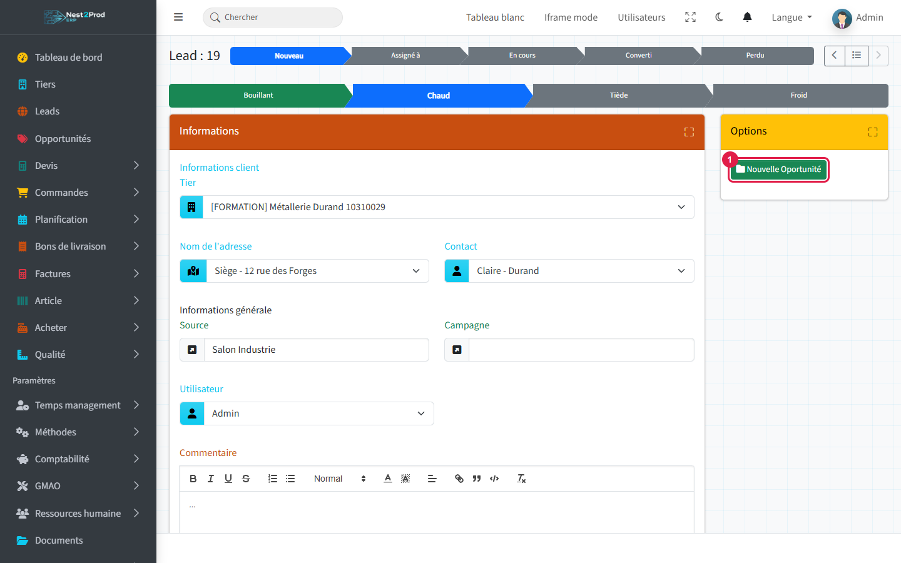

L'opportunité s'ouvre sur l'onglet **Synthèse**, qui suivra toute l'affaire : étape en
cours, points bloquants, prochaine action, montants (devisé, commandé, facturé…) et
risques critiques.

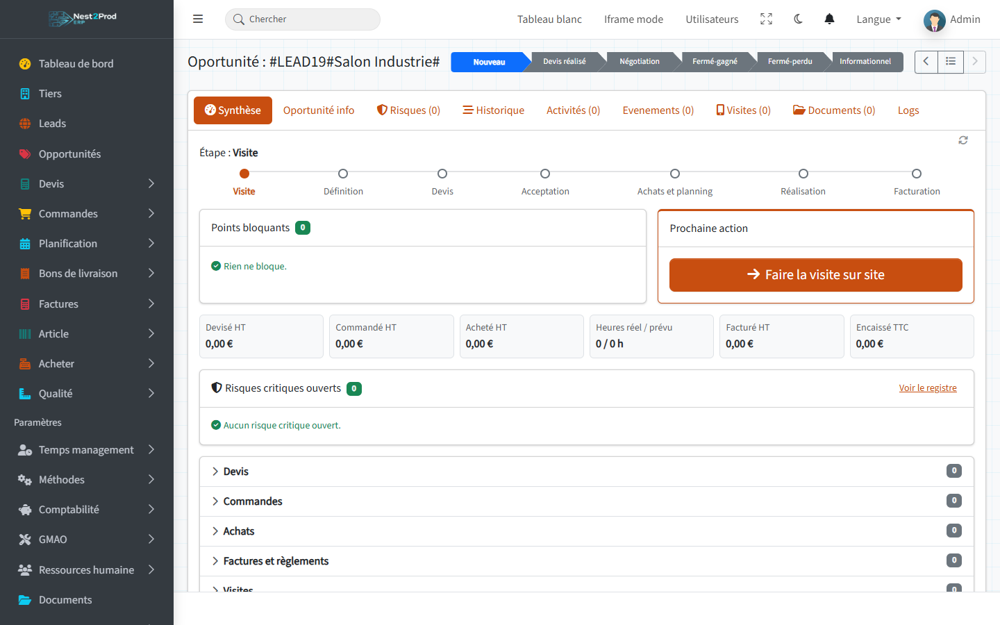

### 4.1 Recenser les risques de l'affaire

Un point technique délicat, un délai serré, une matière difficile à trouver : notez-le dès
maintenant dans le **registre des risques**. Il suit l'affaire jusqu'à la livraison.

Onglet « Risques », puis cliquez sur « Nouveau risque ».

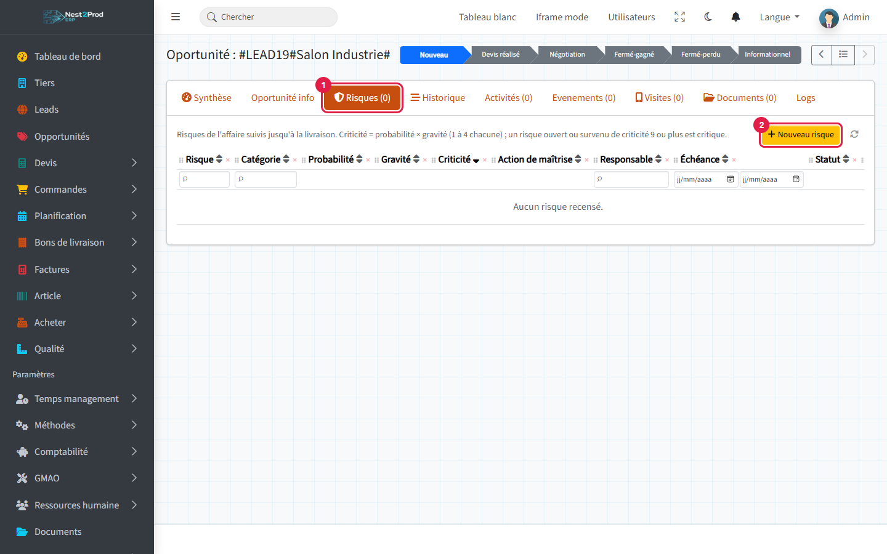

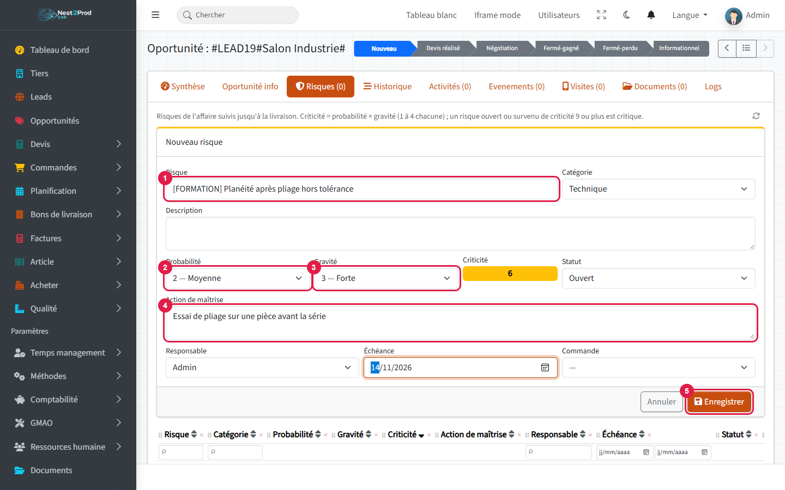

1. **Risque** : ce qui peut mal tourner, en une phrase. Choisissez aussi sa **Catégorie**
   (technique, délai, qualité…).
2. **Probabilité**, de 1 (faible) à 4 (très forte).
3. **Gravité**, de 1 à 4. La **Criticité** (probabilité × gravité) se calcule seule.
4. **Action de maîtrise** : ce que vous ferez pour l'éviter. Désignez aussi un
   **Responsable** et une **Échéance**.
5. Cliquez sur « Enregistrer ».

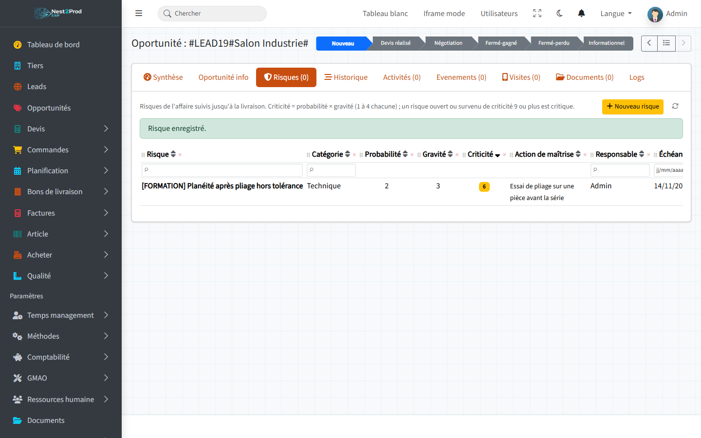

Un risque **critique** (criticité 9 ou plus, encore ouvert) ou dont l'échéance est passée
remonte dans les points bloquants de la Synthèse et dans la carte « Risques critiques
ouverts ». Pour le mettre à jour, cliquez sur sa ligne et changez son **Statut** :
« Maîtrisé », « Clos » ou « Survenu ».

> 💡 Un risque ne se supprime jamais : clôturez-le. La clôture d'un risque critique est
> réservée aux personnes qui en ont le droit.

---

## 5. Établir le devis

### 5.1 Créer le devis

Onglet « Oportunité info ». Si votre administrateur a défini des **catégories d'affaire**,
choisissez-en une dans « Catégorie d'affaire », puis cliquez sur « Mettre à jour » en bas
du formulaire. Elle passera d'elle-même au devis, puis à la commande.

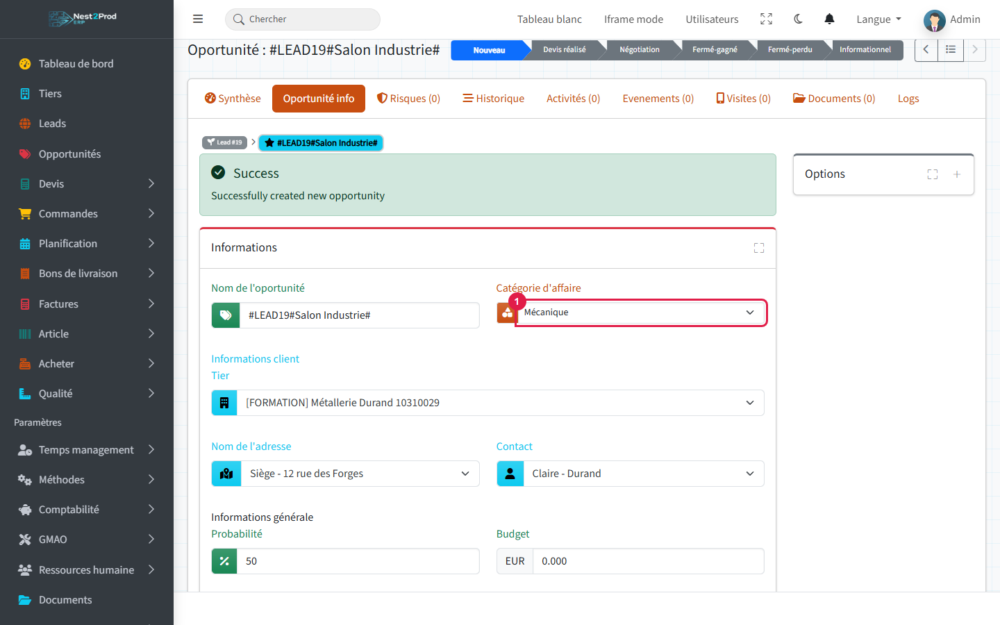

Dans la carte « Options » (à droite, dépliez-la avec **+**), cliquez sur « Nouveau devis ».

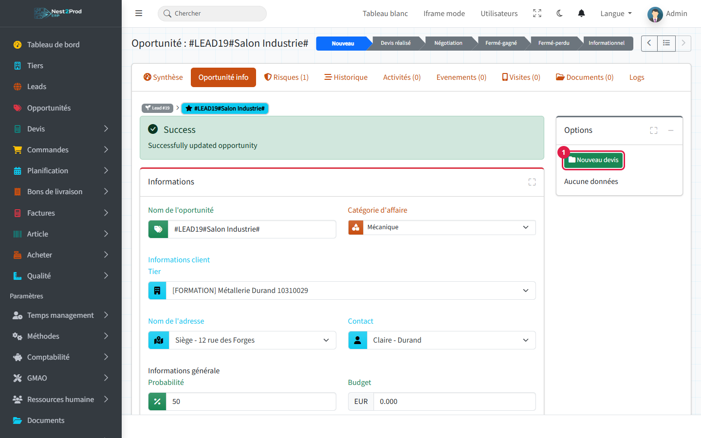

Le devis est créé à l'état **Ouvert**, avec le client, l'adresse, le contact, la catégorie
d'affaire et vos conditions de paiement et de livraison par défaut.

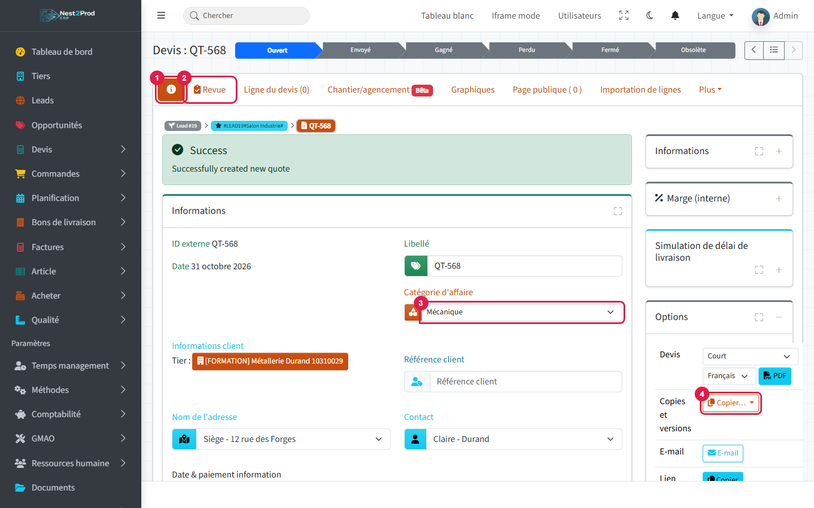

1. Les informations du devis sont sous l'onglet **« i »**, le premier.
2. L'onglet « Revue » trace la relecture du devis (qui, quand, décision).
3. La **Catégorie d'affaire** est reprise de l'opportunité.
4. La carte « Options » regroupe le PDF, l'« E-mail », le lien public et, sous
   « Copier… », les copies du devis (« Dupliquer le devis », « Nouvel indice »,
   « Variante… », « Enregistrer comme trame… »).

> 💡 À droite, les cartes « Informations » (totaux), « Marge (interne) » et « Simulation
> de délai de livraison » sont repliées : ouvrez-les avec **+**. Indices, variantes,
> trames et marge sont détaillés dans le guide « Devis avancé ».

> ⚠️ Une catégorie d'affaire peut exiger certaines opérations dans la gamme (étape 5.3) :
> un bandeau « Opérations obligatoires manquantes » les signale alors sur l'onglet des
> lignes, et la transformation en commande est refusée tant qu'elles manquent, sauf
> dérogation motivée d'une personne autorisée.

### 5.2 Ajouter une ligne

Onglet « Ligne du devis », puis cliquez sur la languette verte **Ajouter**, sur le bord droit.

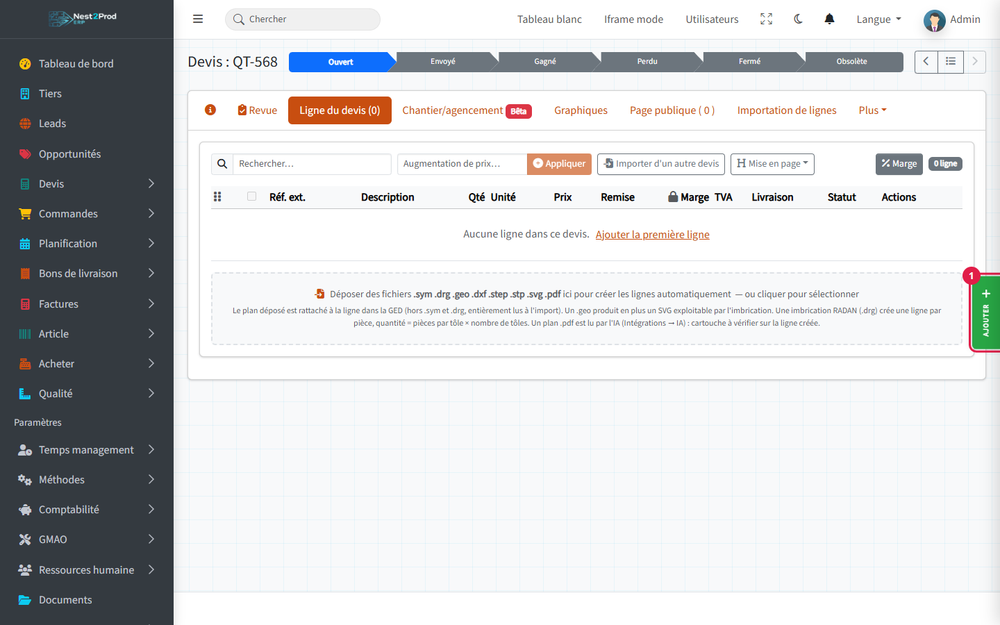

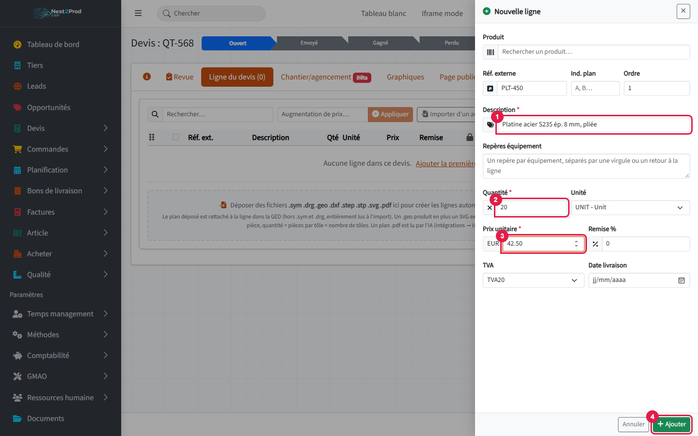

1. **Description** : la désignation imprimée sur le devis.
2. **Quantité**.
3. **Prix unitaire** HT.
4. Cliquez sur « Ajouter ».

> 💡 Le panneau reste ouvert pour saisir la ligne suivante. Fermez-le avec « Annuler »
> quand vous avez terminé. Le champ « Produit » permet de partir d'un article existant.

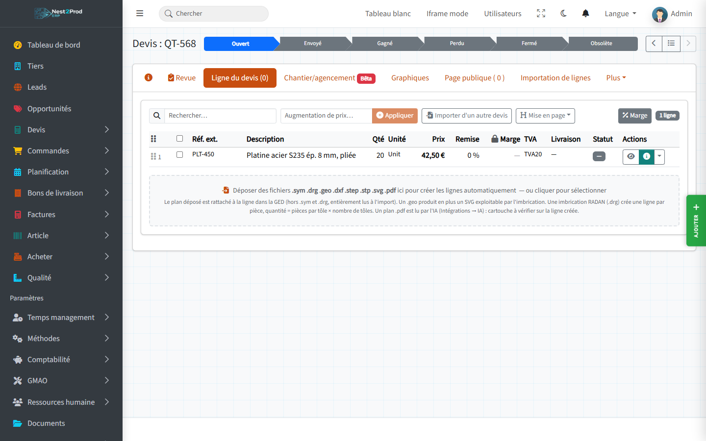

### 5.3 Décrire la gamme de fabrication

La gamme liste les opérations (découpe, pliage…). Elle sert au chiffrage ici, puis
deviendra le travail à faire en atelier une fois la commande passée.

Ouvrez le menu de la ligne (petite flèche à droite), puis « Tâches ».

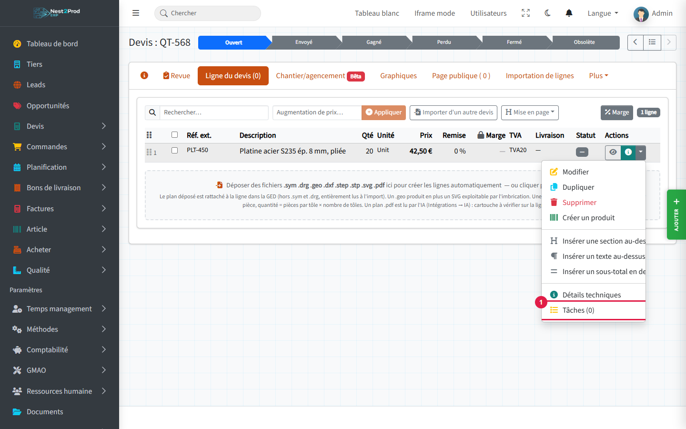

Cliquez sur « Gérer les tâches ».

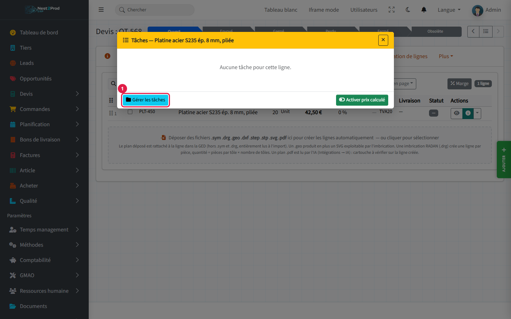

Cliquez sur la languette bleue **Opération**, sur le bord droit, puis renseignez :

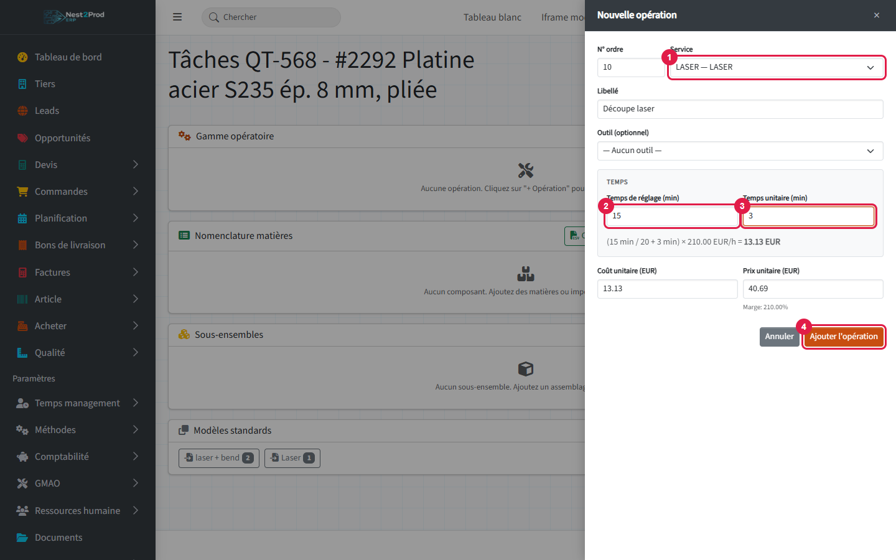

1. **Service** : le poste de travail (laser, pliage…).
2. **Temps de réglage**, en minutes, pour toute la série.
3. **Temps unitaire**, en minutes par pièce.
4. Cliquez sur « Ajouter l'opération ».

Le coût et le prix se calculent à partir du taux horaire du service. Répétez l'opération
pour chaque étape, puis cliquez sur « Retour ».

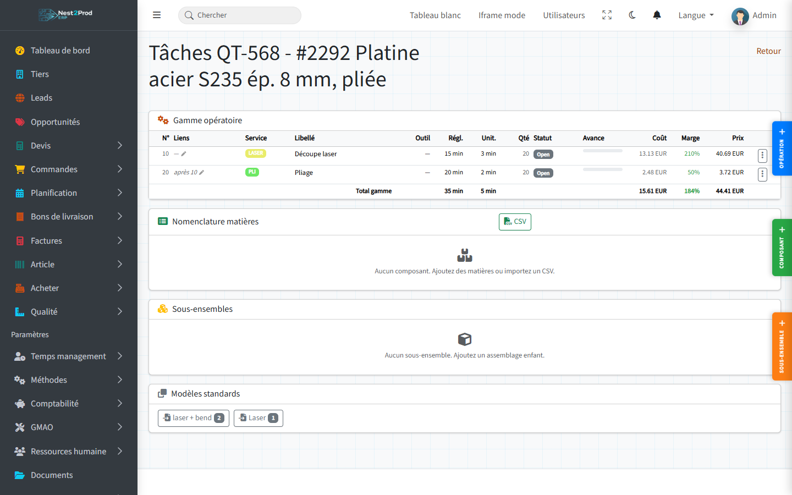

> ⚠️ Si le service n'a pas de taux horaire, saisissez vous-même le **coût unitaire** et le
> **prix unitaire** : l'opération est refusée tant qu'ils valent 0.
>
> 💡 Les **modèles standards** (en bas de l'écran) ajoutent une gamme type en un clic.

> 💡 Le devis s'envoie au client depuis l'onglet **« i »**, carte « Options » (« E-mail »,
> PDF ou « Lien publique sécurisé »). Il peut aussi le signer en ligne, si la signature
> électronique est activée.

---

## 6. Transformer le devis en commande

Quand le client accepte, onglet « Ligne du devis » : cochez les lignes commandées, puis
cliquez sur « Créer une commande » et confirmez.

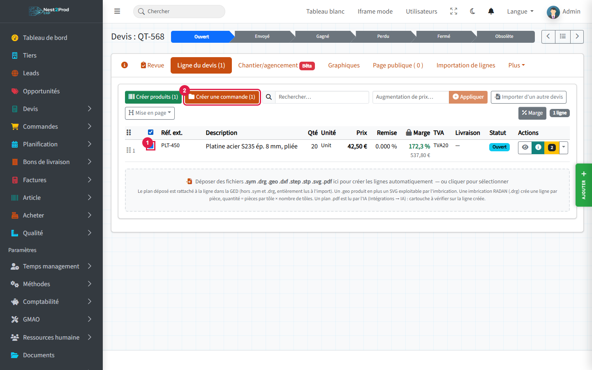

La commande est créée avec ses lignes **et leurs gammes**. Le devis passe à l'état
« Gagné ».

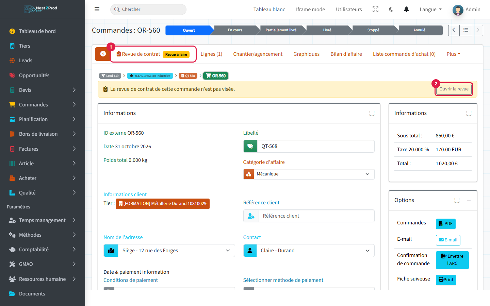

1. L'onglet « Revue de contrat » sert à vérifier que la commande correspond à l'offre
   (points à cocher, écarts, visa).
2. Tant que la revue n'est pas visée, un bandeau jaune le rappelle ; « Ouvrir la revue »
   y mène. Elle ne bloque pas la suite du parcours : voir le guide « Revue de contrat de
   la commande ».

> ⚠️ Seul un devis **Ouvert** ou **Envoyé** peut être transformé en commande.
> On peut ne cocher qu'une partie des lignes si le client ne commande pas tout.

> 💡 **Le client refuse ?** Passez le devis à « Perdu » avec les flèches d'état en haut de
> la fiche. La fenêtre « Devis perdu : pourquoi ? » demande un **motif** (prix, délai,
> concurrent…) et un commentaire facultatif : sans motif, le devis ne passe pas à Perdu.
> De même pour une opportunité passée à « Fermé-perdu ». Ces motifs alimentent la carte
> « Pertes commerciales » du tableau de bord des devis.

---

## 7. Déclarer la production

Chaque opération de la gamme se déclare sur son **écran de suivi** : démarrage, pièces
bonnes et rebutées, fin.

<!-- feature: production-release -->
### 7.1 Donner le bon pour fabrication

Dans votre entreprise, une ligne de commande ne se fabrique qu'après son **bon pour
fabrication** (BPF), le feu vert du bureau d'études. Sans lui, le bouton « Play » de
l'écran de suivi reste grisé et un bandeau à cadenas en donne la raison.

Onglet « Lignes » de la commande :

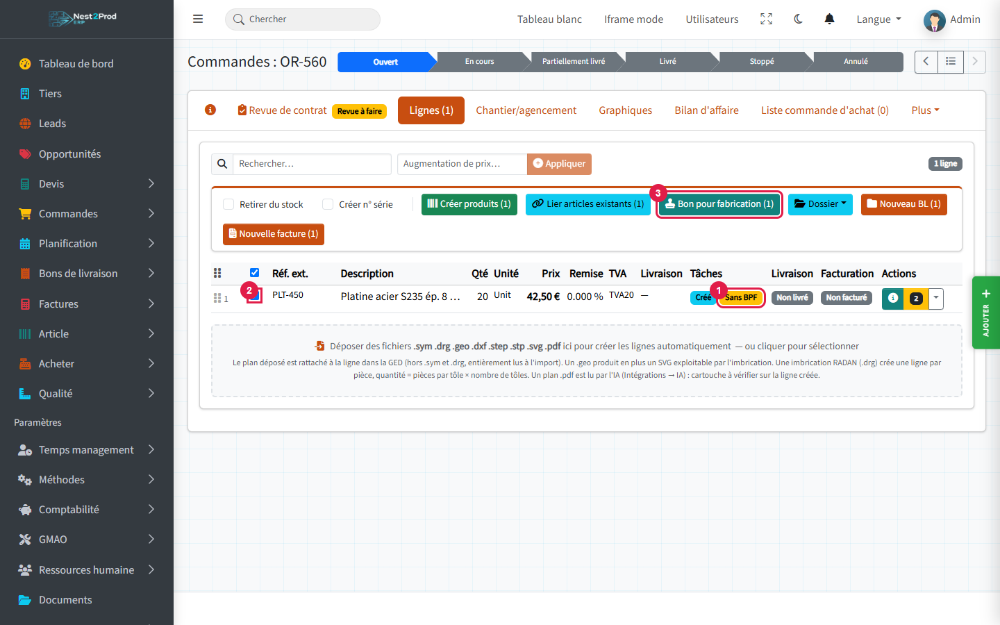

1. Le badge « Sans BPF » signale une ligne pas encore libérée.
2. Cochez la ligne.
3. Cliquez sur « Bon pour fabrication (1) ».

La ligne porte alors le badge vert **BPF** : l'atelier peut démarrer.

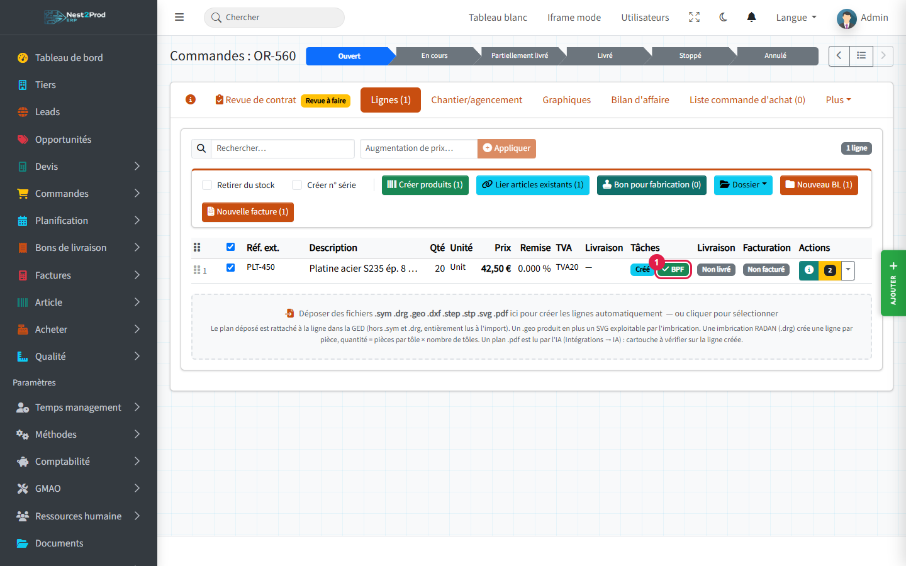

> ⚠️ Ce bouton n'apparaît qu'aux personnes autorisées à donner le BPF. Si vous ne le voyez
> pas, adressez-vous au bureau d'études. Annulation, refus et cas particuliers : voir le
> guide « Bon pour fabrication ».

### 7.2 Déclarer chaque opération

<!-- /feature -->
Onglet « Lignes » de la commande : cliquez sur le bouton jaune des tâches de la ligne,
puis sur « Gérer les tâches ».

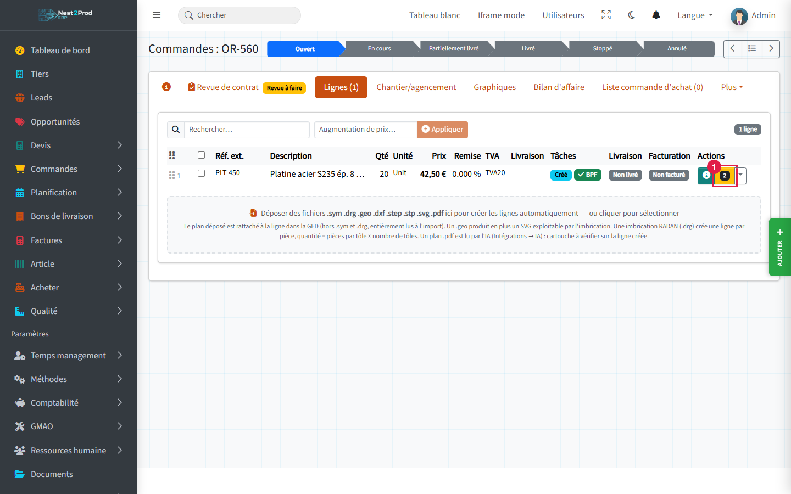

Cliquez sur le libellé d'une opération pour ouvrir son écran de suivi.

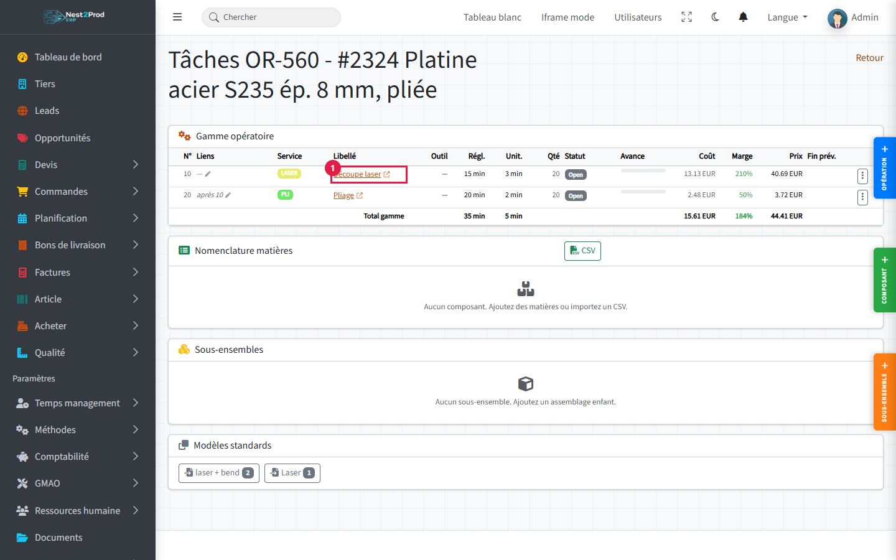

Sur l'écran de suivi :

1. Cliquez sur « Play » au démarrage du travail.

   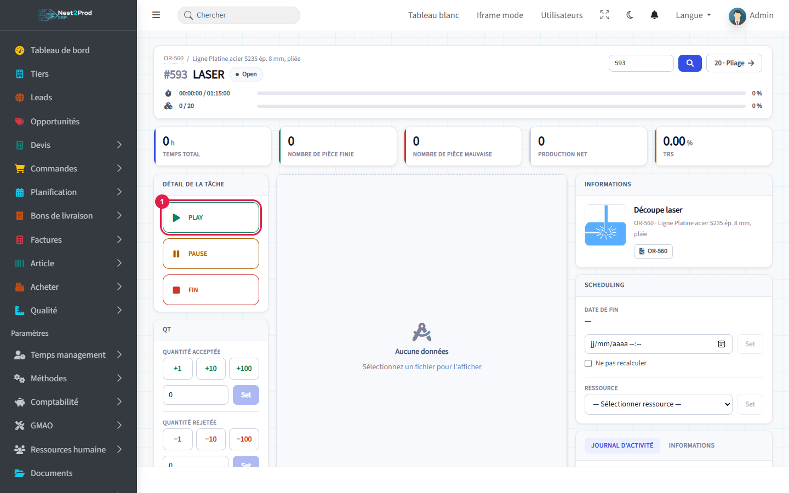

2. Sous « Quantité acceptée », saisissez le nombre de pièces bonnes puis cliquez sur
   « Set ». Les boutons +1 / +10 / +100 servent aux déclarations au fil de l'eau.
   Les rebuts se déclarent de la même façon, sous « Quantité rejetée ».

   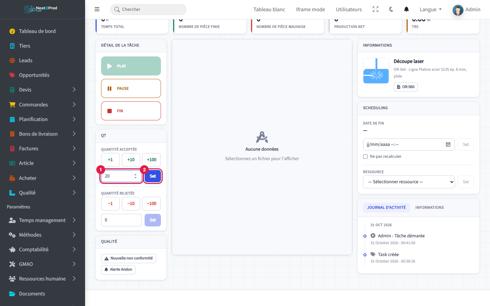

3. Cliquez sur « Fin » quand l'opération est terminée.

   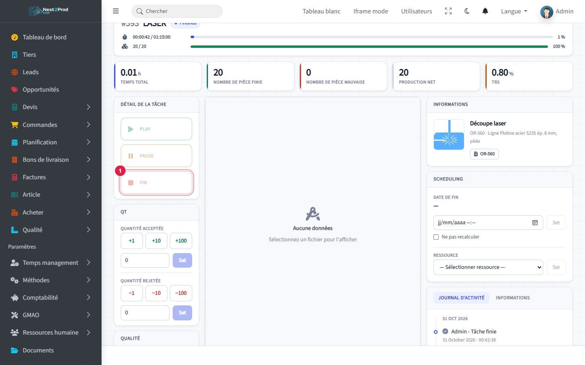

Recommencez pour chaque opération (le bouton en haut à droite, ex. « 20 · Pliage »,
passe à la suivante). Sur la commande, la colonne « Tâches » de la ligne passe à
« Terminé ».

> 💡 « Pause » interrompt le chronomètre, par exemple pendant une coupure ou un changement d'outil.

---

## 8. Livrer : le bon de livraison

Onglet « Lignes » de la commande : cochez les lignes à livrer, cliquez sur
« Nouveau BL » et confirmez.

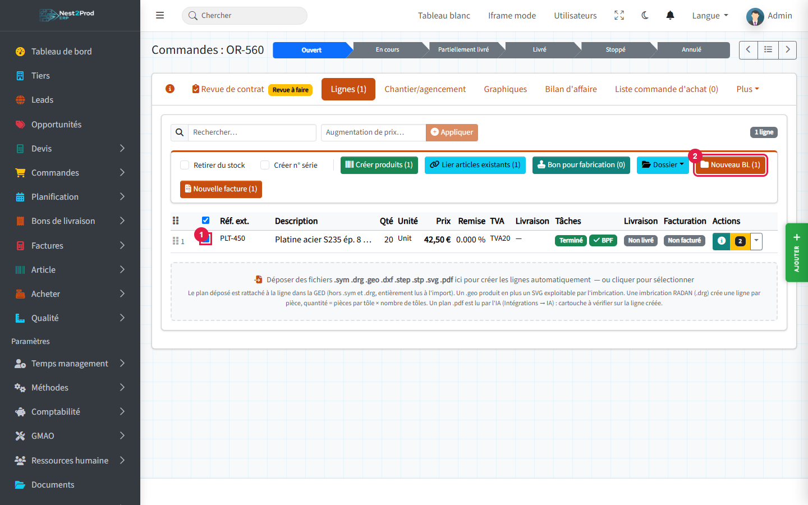

Le bon de livraison reprend tout ce qui reste à livrer sur les lignes cochées. Son PDF
est disponible dans la carte « Options ».

> ⚠️ Le logiciel **ne vérifie pas** que la production est déclarée avant de livrer :
> c'est à vous de vous en assurer.

---

## 9. Facturer

Sur le bon de livraison, carte « Options », cliquez sur « Nouvelle facture ».

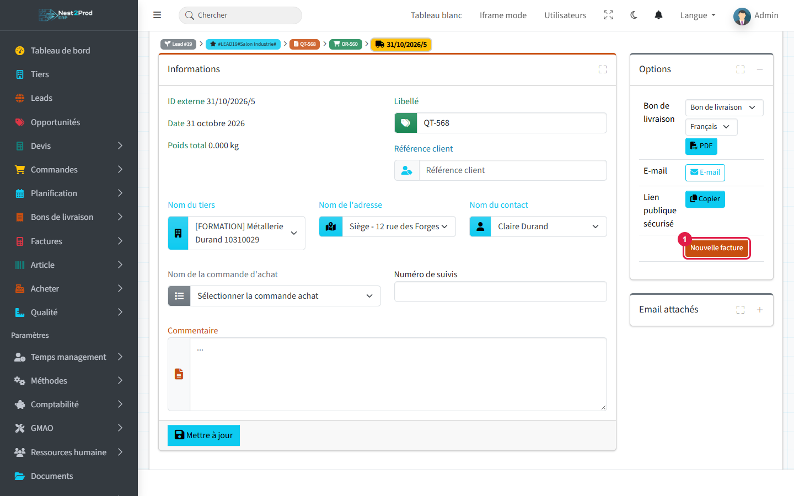

La facture est créée à l'état **En cours** (brouillon), avec les lignes livrées.

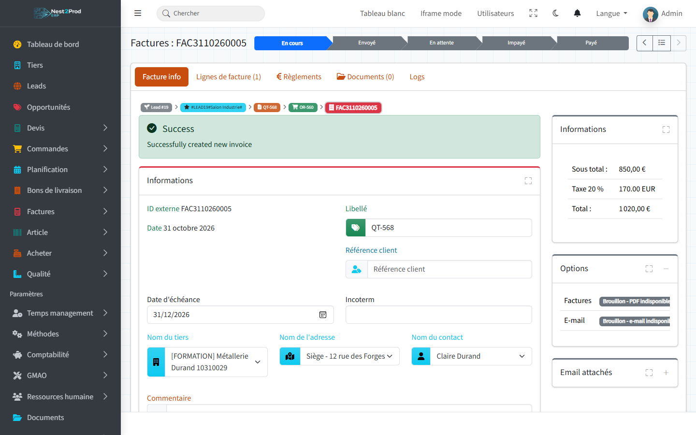

> ⚠️ **Facturez depuis le bon de livraison**, pas depuis la commande. Le bouton
> « Nouvelle facture » de la commande crée son propre bon de livraison : la facture n'est
> alors pas rattachée au BL déjà fait, qui reste « à facturer ».
>
> 💡 Son numéro lui est attribué dès sa création. Tant qu'elle est en brouillon, ses lignes
> restent modifiables mais elle n'a ni PDF ni envoi par e-mail : émettez-la pour la verrouiller
> et pouvoir l'envoyer (voir le guide « Facturer et encaisser »).

---

## Et ensuite ?

- **Émettre et envoyer la facture**, puis **enregistrer le règlement** (onglet « Règlements »).
- **Suivre l'affaire** sur la synthèse de l'opportunité : montants devisés, commandés,
  facturés et encaissés, points bloquants et risques.
- **Viser la revue de contrat** de la commande : guide « Revue de contrat, avenants et prix de la commande ».
- **Réviser ou décliner un devis** (indice, variante, trame, marge) : guide « Devis avancé ».
- **Relancer** les factures échues : menu Factures › Relances.

## Questions fréquentes

**Ma société n'apparaît pas dans « Nouveau Lead ».**
Elle est probablement encore « Inactive » : passez son « Etat client » en Prospect
(étape 2.2).

**La liste des contacts est vide dans « Nouveau Lead ».**
Le contact n'a pas été enregistré : vérifiez sur la fiche de la société, onglet Contact,
et n'oubliez pas la civilité.

**Je ne peux plus modifier les lignes ou la gamme du devis.**
Ce n'est possible qu'à l'état **Ouvert**. Un devis gagné, perdu ou fermé est figé.

**Je ne trouve pas le champ « Catégorie d'affaire ».**
Il n'apparaît que si votre administrateur a créé des catégories (menu Méthodes ›
Catégories d'affaire).

**Je ne peux pas passer le devis à « Perdu ».**
Un motif de perte est demandé : choisissez-le dans la fenêtre qui s'ouvre. Les motifs se
gèrent dans le menu Méthodes › Motifs de perte.

<!-- feature: production-release -->
**« Play » est grisé sur l'écran de suivi.**
La ligne de commande n'a pas encore son bon pour fabrication : voyez l'étape 7.1.

<!-- /feature -->
**Le bouton « Nouvelle Oportunité » a disparu du lead.**
Une opportunité existe déjà pour ce lead : la carte « Options » propose de la consulter.
